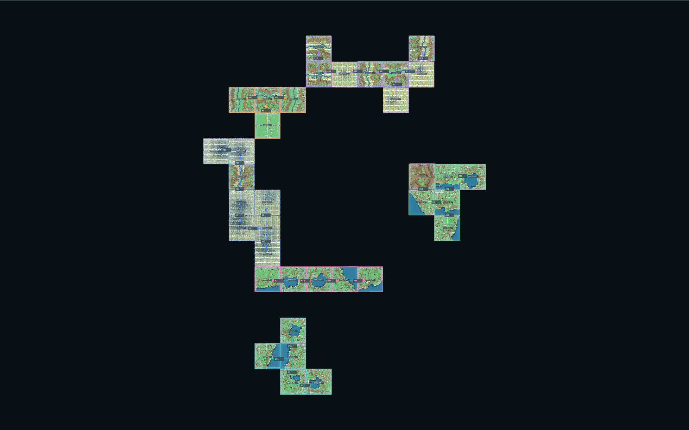

# Procedural Mini World — A City of Cities

A controllable procedural world driven by real urban spatial relations. Terrain is generated city-neutral first; a **City DNA** (Venice, Manhattan, Fez, Amsterdam, Lisbon, Chicago) is matched to it and drives roads, blocks, parcels, and grey-box buildings. Since 2026-10-28 the six cities start from their own core chunks and **grow** into a shared world. It is a research prototype, not a game and not a visual copy of any city.

> **Research question:** How can distinct urban identities emerge, expand, and collectively form a world through procedural growth?
> *(Original question, 2026-10-17: how can city characteristics be encoded as controllable rules, and how is identity kept, weakened, or re-formed when rules change, mix, or are stitched together?)*

## Current Work

| | |
| --- | --- |
| **Stage** | G03a Urban Territory & Spatial Relationships: implemented, verified on seeds 6201 / 6202 / 6203, **pending review** (status authority: [compass §1 and §5](./docs/procedural-mini-world/FINAL-EXPERIMENT-LOG.md)) |
| **Question now** | Can the multi-city growth be read as organised space (territories, non-urban land, boundaries, city relationships) without changing growth? |
| **Branch** | `experiment/procedural-growing-world` (local; not pushed yet). `main` and the public site are at `1f63e6f` (M06). |
| **Code** | [experiments/city-of-cities/](./experiments/city-of-cities/) · verifiers in [scripts/](./scripts/) (`verify-city-of-cities`, `verify-city-growth`, `verify-city-territory`) |
| **Uncommitted** | WEB-01 website and film; G03b (urban encounter), G02b (morphological growth) and G03a code, notes and screenshots; `presentation/` (class film tooling) |
| **Waiting for review** | G03b, G02b, G03a, G02 (+ G01-FIX), G01-MO, the Research Compass. **No task has been accepted yet**; passing verifiers check data, not spatial quality. |



**What this shows:** six cities grown from their own cores for 30 steps (one chunk per step, 36 chunks); each territory stays connected and every arrow points from parent to child chunk.
**Conditions:** world seed 6201, default G02 parameters, real browser runtime, G02-V verification run (commit `91efb1e`, local).
**Why it matters:** the map size and city boundaries are outcomes of growth rules, not a preset 3 × 3 layout.
**Limit:** it does not show that the territories read as different cities; chunk counts per city are nearly the same on every seed (see [Project Feedback](./docs/procedural-mini-world/PROJECT-FEEDBACK.md)).

## Exercises

Main exercises in research order. The full list of ~40 recorded tasks is in the [Experiment Index](./docs/procedural-mini-world/EXPERIMENT-INDEX.md).

| Exercise | Research question / result | Open exercise | Study record | Commit |
| --- | --- | --- | --- | --- |
| Terrain-first single chunk (T1–T6) | Can a city-neutral terrain be read and given a fitting City DNA that drives roads → blocks → parcels → buildings? Full chain for 6 DNAs, verified. | [Live](https://gameeeee-zc626.web.app/experiments/seed-terrain/) | [System Architecture](./docs/procedural-mini-world/03-generative-system/system-architecture.md) | [`7b21c3e`](https://github.com/Peterrr294/Peter_Chen_Gamingggg/commit/7b21c3e) M01 release snapshot: Procedural Mini World midterm (Firebase Hosting gameeeee-zc626) |
| 3 × 3 World Grid and seams (06.2–06.3c) | Can nine chunks share one world and join at their edges? 4 / 12 edges joined at first; later every edge classified, unjoinable ones reported. | [Live](https://gameeeee-zc626.web.app/experiments/world-grid/) | [World Grid & Seam](./docs/procedural-mini-world/03-generative-system/world-grid-and-seam.md) | [`7b21c3e`](https://github.com/Peterrr294/Peter_Chen_Gamingggg/commit/7b21c3e) (06.2, 06.3a); [`1f63e6f`](https://github.com/Peterrr294/Peter_Chen_Gamingggg/commit/1f63e6f) M06 checkpoint: World Grid seams, terrain coordination, World State checkpoint |
| City Influence & Fusion (07.1, 07.1a) | Can one city's rules invade a neighbour and show a mixed boundary? Works for one source and one target; unaffected areas stay identical with spatial ids. | Local only: `npm run dev` → `/experiments/world-grid/` (City Influence folder) | [City Influence](./docs/procedural-mini-world/03-generative-system/city-influence.md) | `79687a0` G00 checkpoint: City Influence & Fusion (07.1, 07.1a) before Procedural Growth (local, not pushed) |
| Growth prototype (G01, 2026-10-27) | Can six cores grow a map chunk by chunk? Yes, 48 chunks; became the model for the new mainline. Superseded. | Local only: `/experiments/growing-world/` | [Procedural Growth](./docs/procedural-mini-world/03-generative-system/procedural-growth.md) | `c3e2e5f` G01 growth prototype and G00-R A City of Cities research compass (local, not pushed) |
| G01 Multi-Origin Initialization | Can six independent city cores be placed reproducibly by terrain suitability? Yes on 3 seeds; placement v2 fixes seed 6202. | Local only: `/experiments/city-of-cities/` | [G01 note](./docs/procedural-mini-world/A-City-of-Cities/G01-Multi-Origin-Initialization.md) | `69b3a1f` G01 Multi-Origin Initialization: six city origins in one world frame (local, not pushed) |
| G02 Procedural Urban Growth | Can the six cities grow one chunk per step, explainably and reproducibly? Yes, 30 steps on 3 seeds, Node = browser. | Local only: `/experiments/city-of-cities/` | [G02 note](./docs/procedural-mini-world/A-City-of-Cities/G02-Procedural-Urban-Growth.md) | `91efb1e` G02 Procedural Urban Growth and G01 placement v2 (checkpoint before presentation) (local, not pushed) |
| G02b Morphological Growth | Does a grown chunk continue its city? Road-first growth: Manhattan's grid continues through 3 chunks (17 roads joined at 0 m), Fez 2 joins, Chicago refused by terrain. | Local only: `/experiments/city-of-cities/` (Morphological growth folder) | [G02b note](./docs/procedural-mini-world/A-City-of-Cities/G02b-Morphological-Growth.md) | Working tree — uncommitted |
| G03b Urban Encounter | When Chicago's grid and Fez's lanes meet (test fixture), what happens at the edge? Fez adapts and connects (2 joins, 2.3 km core-to-core route); Chicago's grid cannot adapt (plan pending); a river valley keeps them apart. | Local only: `/experiments/city-of-cities/?fixture=compatible` | [G03b note](./docs/procedural-mini-world/A-City-of-Cities/G03b-Urban-Encounter.md) | Working tree — uncommitted |
| G03a Urban Territory | Can growth be read as territories, boundaries and city relationships? Analysis layer verified; cities touch rarely (0–4 shared edges). | Local only: `/experiments/city-of-cities/` (Territory folder) | [G03a note](./docs/procedural-mini-world/A-City-of-Cities/G03a-Urban-Territory.md) | Working tree — uncommitted |
| Interactive Procedural Film (WEB-01) | Can a visitor watch one real city generate from terrain to buildings? Yes for six verified configurations, with a timeline that never alters the model. | Local only: `npm run dev` → `/` | [Log entry WEB-01](./docs/procedural-mini-world/FINAL-EXPERIMENT-LOG.md) | Working tree — uncommitted |

Local only = not deployed. Start with `npm install` then `npm run dev` and open `http://localhost:5173` plus the path. Earlier Game Lab studies (Starlight Run, Cellular Noise, Voxel Terrain, Shader Basics, Flavor Clash) are listed in the [documentation catalog](./docs/README.md).

## Learning Journey

1. [Knowledge base home](./docs/procedural-mini-world/README.md): question, status words, and the research path diagrams that explain why each exercise led to the next.
2. [System Architecture](./docs/procedural-mini-world/03-generative-system/system-architecture.md): the single-chunk chain everything else reuses.
3. [World Grid & Seam](./docs/procedural-mini-world/03-generative-system/world-grid-and-seam.md): the static world and why its preset layout became a limit.
4. [A City of Cities — Research Compass](./docs/procedural-mini-world/A-City-of-Cities-Research-Compass.md): the current framing, hypotheses H1–H3, and the G00–G05 roadmap.
5. [G01](./docs/procedural-mini-world/A-City-of-Cities/G01-Multi-Origin-Initialization.md) → [G02](./docs/procedural-mini-world/A-City-of-Cities/G02-Procedural-Urban-Growth.md) → [G03a](./docs/procedural-mini-world/A-City-of-Cities/G03a-Urban-Territory.md): origins, growth, territory.
6. [Project Feedback](./docs/procedural-mini-world/PROJECT-FEEDBACK.md): AI review of every part, with the smallest next check for each.

## Knowledge Base and Records

| Entry | For |
| --- | --- |
| [Knowledge base home](./docs/procedural-mini-world/README.md) | Study areas, research path, review status |
| [Experiment Index](./docs/procedural-mini-world/EXPERIMENT-INDEX.md) | Every task with files, evidence, lifecycle, and the commit map |
| [Compass and experiment log](./docs/procedural-mini-world/FINAL-EXPERIMENT-LOG.md) | Stage status (§1, §5) and the full record of each task (§7) |
| [Project Feedback](./docs/procedural-mini-world/PROJECT-FEEDBACK.md) | AI feedback per research area (not a teacher's or formal review) |
| [Next session hand-off](./docs/procedural-mini-world/NEXT_SESSION.md) | Day hand-off: Git state, open problems, start commands |
| [Midterm Review](./docs/procedural-mini-world/midterm-review/00-midterm-review.md) | The 2026-10-19 midterm summary (historical) |
| [Documentation catalog](./docs/README.md) | Earlier Game Lab projects, learning notes, Firebase and website |
| [AGENTS.md](./AGENTS.md) | Rules for coding agents and evidence conventions |

The repository root is also an Obsidian vault (`.obsidian/`). All links are relative and work on GitHub, in Obsidian, and in VS Code. The site's Files & Notes page reads every `docs/**/*.md`.

## Run Locally

Node.js 20+ (or the portable copy that `dev.cmd` / `build.cmd` expect in `.tools/`). Verifiers drive an installed Google Chrome through `playwright-core`.

```powershell
npm install
npm run dev                              # http://localhost:5173/
node scripts/verify-city-territory.mjs   # each task has scripts/verify-<name>.mjs
node scripts/verify-markdown-links.mjs   # documentation link check
```

Stack: JavaScript (ES modules), Three.js 0.180, Vite 7, lil-gui, Firebase Hosting; no game engine. Public site: <https://gameeeee-zc626.web.app/#miniWorld> (deployed from `main` by `.github/workflows/firebase-hosting-merge.yml`). The archived Terrain Seam page needs git-ignored local models; see [Local model files](./docs/projects/flavor-clash/terrain-seam-building-scatter.md).
