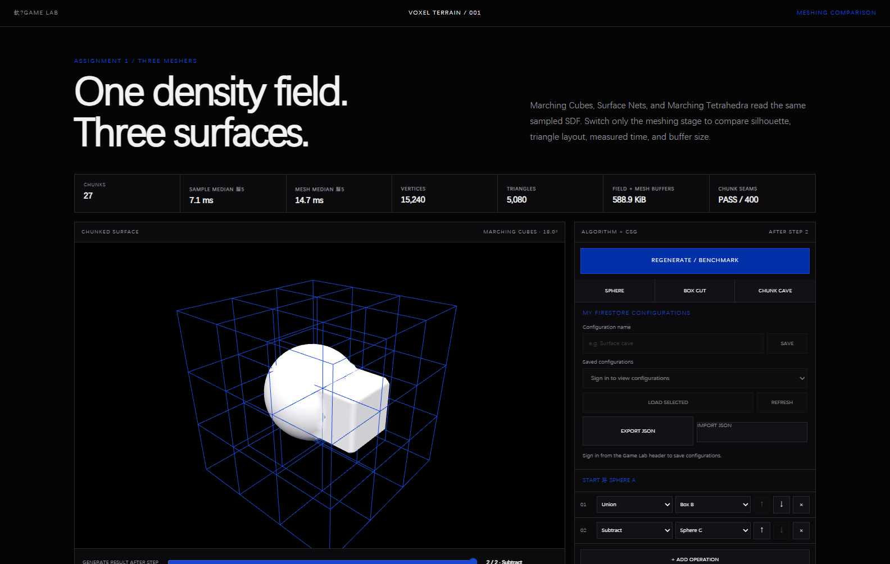
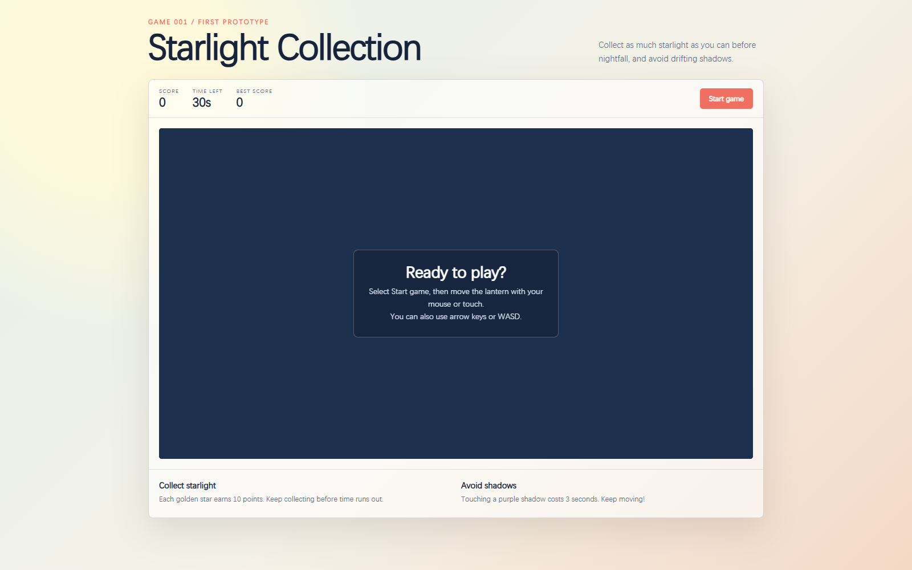

# Peter's Game Lab — A Study Notebook for Playable and Procedural Worlds

Peter's Game Lab is a browser-based study notebook about game programming, procedural generation, 3D rendering, and the infrastructure needed to publish experiments. It begins with a playable collection game, moves through reproducible Cellular noise and volumetric terrain, and records how those experiments became a shared Vite and Firebase website.

Results remain beside the questions, decisions, limitations, and next steps that produced them. **Implemented** means the code exists; **Verified** means a test, screenshot, or reachable page supports the claim; **Concept** and **Needs verification** prevent planned work from appearing finished.

Start with the [documentation cover](./docs/README.md), [exploration map](./docs/EXPLORATION-MAP.md), or [Assignment 1 checklist](./docs/ASSIGNMENT-1-CHECKLIST.md).

## Current Research Goals

- Connect deterministic scalar fields to readable 2D maps and 3D terrain.
- Compare SDF primitives, ordered CSG, chunk ownership, and three surface-extraction methods against one input field.
- Develop small playable systems before extending them into larger world-generation ideas.
- Preserve terrain configurations with local JSON and account-linked Firestore records.
- Record each transition as question → hypothesis → experiment → observation → decision → next question.

## Online Website and Demonstrations

These Firebase Hosting pages returned HTTP 200 during the 2026-09-29 audit.

| Entry | What to inspect | Verification |
| --- | --- | --- |
| [Peter's Game Lab](https://gameeeee-zc626.web.app/) | Shared navigation, projects, learning notes, and Files & Notes | Verified online |
| [Starlight Run](https://gameeeee-zc626.web.app/legacy-game.html) | The 30-second collection-game entry and playable loop | Verified online |
| [Cellular Noise](https://gameeeee-zc626.web.app/experiments/cellular-noise/) | Shared 2D/3D field, layered terrain, controls, and simulation | Verified online |
| [Voxel Terrain](https://gameeeee-zc626.web.app/experiments/voxel-terrain/) | SDF/CSG presets, chunks, three meshers, and configuration UI | Verified online |
| [GitHub repository](https://github.com/Peterrr294/Peter_Chen_Gamingggg) | Source, history, and notebook | Verified with `git ls-remote` |

## Study Areas

| Study Area | What I explored | Evidence | Status |
| --- | --- | --- | --- |
| Playable game loop | Movement, collection, hazards, timer, score, and local high score | [Starlight record](./docs/projects/starlight-run/overview.md) | Implemented |
| React Three Fiber | Canvas, meshes, materials, lights, grid, camera, and OrbitControls | [Learning path](./docs/learning/react-three-fiber/learning-path.md) | Verified Level 0 |
| Shader fundamentals | Vertex and fragment responsibilities, uniforms, UV patterns, and coordinate spaces on one reusable plane | [Round-one shader notebook](./docs/learning/shaders/first-shader-experiments.md) | Implemented; personal observations pending |
| PCG terrain scattering | Seeded XZ candidates, downward mesh raycasts, bounded rejection, debug points, and instanced placeholder trees | [Random Scattering notebook](./docs/learning/pcg-terrain/random-scattering.md) | Implemented; personal observations pending |
| Noise and procedural patterns | Seeded Cellular F1, binary shaping, continuous terrain, and shared 2D/3D arrays | [Experiment notebook](./experiments/cellular-noise/README.md) | Implemented; visual evidence added |
| Signed Distance Functions | Negative-inside sphere and box fields sampled in world space | [Voxel notebook — SDF](./experiments/voxel-terrain/README.md#signed-distance-fields) | Implemented |
| Ordered CSG operations | Union, intersection, subtraction, smooth union, and order-dependent sequences | [Voxel notebook — CSG](./experiments/voxel-terrain/README.md#ordered-csg) | Implemented |
| Chunk-based terrain | Finite descriptors, shared samples, halo data, ownership, and seam audit | [Voxel notebook — chunks](./experiments/voxel-terrain/README.md#chunk-based-terrain) | Implemented |
| Marching Cubes | Table-driven zero-crossing interpolation | [Mesher comparison](./experiments/voxel-terrain/README.md#three-meshing-methods) | Implemented |
| Surface Nets | One point per active cell with owned boundary quads | [Mesher comparison](./experiments/voxel-terrain/README.md#three-meshing-methods) | Implemented |
| Marching Tetrahedra | Consistent six-tetrahedron split and shared-field normals | [Mesher comparison](./experiments/voxel-terrain/README.md#three-meshing-methods) | Implemented |
| Wave Function Collapse | Seeded local road modules with socket compatibility, boundary constraints, bounded retries, and connected-component filtering | [Flavor Clash map study](./docs/projects/flavor-clash/README.md) | Implemented and browser-verified |
| Flavor Clash | Four independently configurable regions connected to a central plaza in one finite map | [Map Prototype 0.1](./docs/projects/flavor-clash/README.md) | Implemented locally; screenshots pending |
| Firebase Authentication | Google sign-in/sign-out and UID ownership | [Firebase notebook](./docs/infrastructure/firebase/account-linked-terrain-saves.md) | Implemented locally; public evidence pending |
| Firestore persistence | Per-user save, list, load, and Security Rules | [Firebase notebook](./docs/infrastructure/firebase/account-linked-terrain-saves.md) | Implemented locally; screenshot pending |
| Firebase Hosting | Vite output on the public Game Lab domain | [Website architecture](./docs/infrastructure/game-lab-website/architecture-and-navigation.md) | Verified online |

## Featured Experiments

### Layered Cellular terrain


**What this shows:** The Canvas and Three.js surface display the same continuous field while the inspector exposes reproducible parameters.

**Why it matters:** It proves the move from binary Cellular regions to a reusable height field without letting the two views diverge.

**Parameters or conditions:** Resolution 64, world extent 32, noise scale 10, three layers, detail weight 0.35, grid height 2.

### SDF, CSG, and chunk ownership



**What this shows:** Chunk Cave combines Sphere A with Box B, subtracts Sphere C, and renders the result inside a 3D chunk grid.

**Why it matters:** It connects ordered CSG to finite chunk ownership and surface extraction.

**Parameters or conditions:** Marching Cubes; 3 chunks per axis, 12 cells per chunk, 0.5 spacing, visible boundaries.

### First playable loop



**What this shows:** The project exposes its pre-run interface and rules for a timed collection round.

**Why it matters:** It is the first project joining input, scoring, collision, hazards, time, and replay into one bounded loop.

**Parameters or conditions:** Current local code before starting a 30-second round; keyboard and pointer controls are presented.

## Learning Journey

1. [Starlight Run](./docs/projects/starlight-run/overview.md) establishes a complete game loop.
2. [React Three Fiber](./docs/learning/react-three-fiber/learning-path.md) isolates basic 3D concepts.
3. [Shader Basics](./docs/learning/shaders/first-shader-experiments.md) exposes the GPU pipeline, uniforms, and coordinate spaces on one plane.
4. [Cellular Noise](./experiments/cellular-noise/README.md) develops deterministic sampled data.
5. [Voxel Terrain](./experiments/voxel-terrain/README.md) turns sampled 3D fields into surfaces.
6. [Flavor Clash Map Prototype 0.1](./docs/projects/flavor-clash/README.md) separates local WFC roads, plaza splines, and seeded regional scattering.
7. [Firebase Account Saves](./docs/infrastructure/firebase/account-linked-terrain-saves.md) connects terrain state to persistence.
8. [Current Project State](./docs/_meta/current-project-state.md) identifies verified work and the next review.
9. [Exploration Map](./docs/EXPLORATION-MAP.md) revisits the work as a timeline, dependency map, and decision record.

## Exploration Map

[From Playable Experiments to Procedural Worlds](./docs/EXPLORATION-MAP.md) separates chronology from concept dependency and covers terrain data flow, mesher decisions, persistence routes, and the implemented WFC/Flavor Clash prototype boundary.

## Assignment 1 Status

The [Assignment 1 evidence checklist](./docs/ASSIGNMENT-1-CHECKLIST.md) audits structure, navigation, screenshots, notebook quality, status language, links, Mermaid, and the production build. It lists evidence that still requires a human-authenticated Firebase session or new Flavor Clash screenshots.

## Repository Structure

```text
.
├── README.md                         # Evaluator entry and study-area directory
├── docs/
│   ├── README.md                    # Complete document catalog
│   ├── ASSIGNMENT-1-CHECKLIST.md    # Requirement and evidence audit
│   ├── EXPLORATION-MAP.md           # Timeline, dependencies, decisions, and flows
│   ├── _meta/                       # Project map and current state
│   ├── assets/screenshots/          # Long-lived visual evidence
│   ├── infrastructure/              # Website and Firebase
│   ├── learning/                    # R3F and prompting studies
│   ├── logs/                        # Date-preserved development records
│   ├── projects/                    # Project indexes and records
│   └── standards/                   # Visual and documentation rules
├── experiments/
│   ├── cellular-noise/              # Code-adjacent notebook and source
│   ├── flavor-clash-prototype/      # Finite four-region WFC map study
│   ├── shader-basics/               # Minimal custom-shader experiments
│   └── voxel-terrain/               # Code-adjacent notebook and source
├── src/                              # React Three Fiber and Firebase setup
└── archive/portfolio/                # Preserved presentation site
```

Generated outputs, dependencies, editor configuration, `sources/`, and personal notes remain outside the documentation reorganization.

## Run and Build

```powershell
.\dev.cmd
.\build.cmd
```

The local URL is normally `http://localhost:5173/`. Production output is generated in `dist/` and should be served over HTTP.
