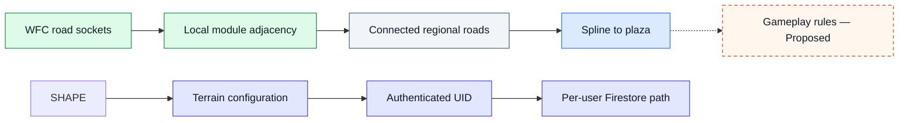
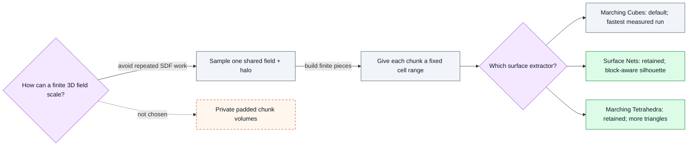
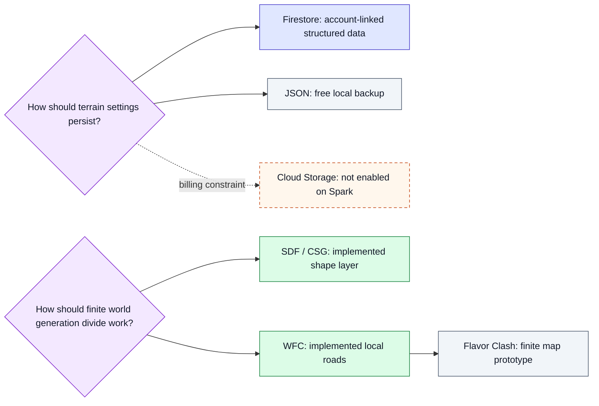
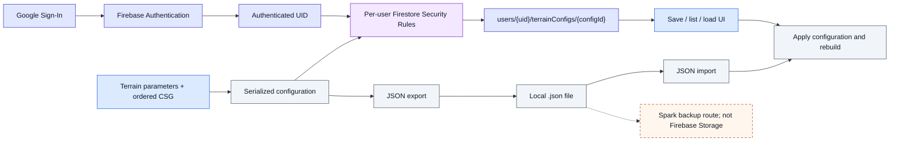
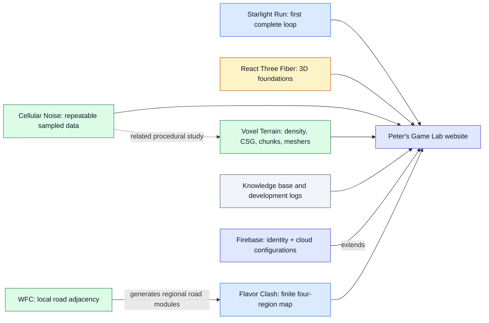

# From Playable Experiments to Procedural Worlds

This is a personal map of an ongoing game-programming exploration. Every implemented node is grounded in a repository document, code path, dated log, or Git commit; nodes without implementation evidence are explicitly marked `Concept`, `Proposed`, or `Needs verification`.

The maps show two different kinds of relationship. The timeline records when work appeared in dated evidence, while the dependency maps show which ideas or data structures support other ideas. A later date does not automatically mean that one project caused another, and a conceptual dependency does not claim that a feature has already been built.

## 1. Exploration Timeline

```mermaid
flowchart LR
  F["2026-09-02: Learning foundation"]:::outcome
  S["Starlight: first playable loop"]:::project
  R["React Three Fiber: Level 0 scene"]:::concept
  C1["2026-09-09: reproducible Cellular map"]:::experiment
  C2["2026-09-16: continuous terrain and simulation"]:::experiment
  W["2026-09-16: unified Game Lab website"]:::infrastructure
  V1["2026-09-28: SDF, CSG, and finite chunks"]:::experiment
  V2["Three-mesher comparison"]:::outcome
  FB["Hosting, login, and account saves"]:::infrastructure
  PCG["2026-10-07: seeded terrain scattering"]:::experiment
  WF["2026-10-07: four-region WFC map"]:::project
  NOW["Current: Flavor Clash visual evidence next"]:::decision

  F -->|"build a complete interaction loop"| S
  F -->|"learn a basic 3D scene"| R
  F -.->|"independent assignment"| C1
  C1 -->|"replace binary-only heights"| C2
  C2 -->|"make experiments browsable together"| W
  C2 -.->|"move from height fields to volumetric surfaces"| V1
  V1 -->|"compare extraction choices"| V2
  W -->|"deploy the shared site"| FB
  V2 -->|"persist terrain configurations"| FB
  C2 -.->|"reuse deterministic fields"| PCG
  PCG -->|"combine placement with local layout"| WF
  WF -->|"capture and compare four regions"| NOW

  classDef project fill:#dbeafe,stroke:#2563eb,color:#111827;
  classDef experiment fill:#dcfce7,stroke:#15803d,color:#111827;
  classDef concept fill:#fef3c7,stroke:#b45309,color:#111827;
  classDef decision fill:#f3e8ff,stroke:#7e22ce,color:#111827;
  classDef infrastructure fill:#e0e7ff,stroke:#4338ca,color:#111827;
  classDef outcome fill:#f1f5f9,stroke:#475569,color:#111827;
  classDef proposed fill:#fff7ed,stroke:#c2410c,color:#111827,stroke-dasharray:5 4;
```

### How to read this map

Solid arrows follow a documented implementation or handoff. Dotted arrows indicate parallel study, a conceptual progression rather than direct code reuse, or a future branch. Dates come from the learning notes, development logs, and Git history; the 2026-09-02 game and React work share a milestone rather than a proven strict ordering.

### Key insight

The exploration repeatedly moves from a small visible result to a more general representation: a playable loop led alongside a basic 3D scene, a binary map became a continuous terrain field, and the terrain study expanded into volumetric density and surface extraction. Website and Firebase work form an infrastructure branch that gathers and preserves those experiments rather than replacing them.

| Node | Detailed record |
| --- | --- |
| Learning foundation and React scene | [React Three Fiber — From First Scene to Playable Prototype](./learning/react-three-fiber/learning-path.md) |
| First playable loop | [Starlight Run — Building the First Playable Loop](./projects/starlight-run/first-playable-loop.md) |
| Reproducible Cellular map | [2026-09-09 — Five-Stage Cellular Noise Prototype](./logs/2026-09-09.md) |
| Continuous terrain and unified website | [2026-09-16 — Terrain Simulation and Unified Website](./logs/2026-09-16.md) |
| SDF, chunking, and three meshers | [2026-09-28 — Voxel SDF, Chunking, and Three-Mesher Comparison](./logs/2026-09-28.md) |
| Hosting and account saves | [Account-Linked Terrain Saves with Firebase](./infrastructure/firebase/account-linked-terrain-saves.md) |
| Seeded terrain scattering | [2026-10-07 — Seeded Terrain Scattering with Surface Queries and Instances](./logs/2026-10-07.md) |
| WFC / Flavor Clash prototype | [Four Regions, One Plaza — Flavor Clash Map Prototype 0.1](./projects/flavor-clash/README.md) |
| Current direction | [Current Project State — Active Work and Resume Guide](./_meta/current-project-state.md) |

## 2. Concept Dependency Map

### Terrain Construction Dependencies

```mermaid
flowchart LR
  FIELD["Scalar / density field"]:::concept --> SDF["Sphere and box SDFs"]:::concept --> CSG["Ordered CSG"]:::concept
  CSG --> GRID["Sampled voxel grid"]:::experiment --> CHUNK["Finite chunk ownership"]:::experiment
  CHUNK --> EXTRACT["Surface extraction"]:::decision --> BUFFER["Positions and normals"]:::outcome --> THREE["Three.js mesh"]:::project
  THREE -.-> EDIT["Editable terrain — Proposed"]:::proposed

  classDef project fill:#dbeafe,stroke:#2563eb,color:#111827;
  classDef experiment fill:#dcfce7,stroke:#15803d,color:#111827;
  classDef concept fill:#fef3c7,stroke:#b45309,color:#111827;
  classDef decision fill:#f3e8ff,stroke:#7e22ce,color:#111827;
  classDef outcome fill:#f1f5f9,stroke:#475569,color:#111827;
  classDef proposed fill:#fff7ed,stroke:#c2410c,color:#111827,stroke-dasharray:5 4;
```

### How to read this map

Read left to right from mathematical representation to sampled data, chunk ownership, mesh buffers, and rendered geometry. The dotted final arrow marks an intended research direction, not an implemented editing system.

### Key insight

Each stage changes representation without collapsing the stages together. That separation is what allows three meshers to consume one field and makes future editing questions independent from the current surface extraction implementation.

### World, Game, and Cloud Responsibilities

### How to read this map

The upper branch is the implemented finite-map layout pipeline; the lower branch is the separate Firebase persistence pipeline used by Voxel Terrain. The dotted arrow marks gameplay as future work rather than a feature of Map Prototype 0.1.

### Key insight

WFC answers where compatible local road modules go, while the spline guarantees a higher-level connection to the plaza. SDF/CSG still answers a different volumetric-shape question, and Authentication/Firestore answers who owns a saved parameter set. Flavor Clash is now implemented as a bounded map study, not as finished gameplay.

| Concept area | Detailed record |
| --- | --- |
| Scalar field, SDF, CSG, chunks, and meshers | [Voxel Terrain — From Density Fields to Three Meshers](../experiments/voxel-terrain/README.md) |
| Reproducible sampled fields | [Cellular Noise — Reproducible Patterns and Chunked Generation](../experiments/cellular-noise/README.md) |
| First complete game rule loop | [Starlight Run — First Playable Collection Game](./projects/starlight-run/overview.md) |
| Configuration persistence | [Account-Linked Terrain Saves with Firebase](./infrastructure/firebase/account-linked-terrain-saves.md) |
| Implemented Flavor Clash map scope | [Four Regions, One Plaza — Flavor Clash Map Prototype 0.1](./projects/flavor-clash/README.md) |

## 3. Experiment Decision Map

### Geometry and Meshing Decisions

### How to read this map

The first decision separates shared sampling from chunk-owned mesh output. The second holds the field and chunk layout constant while branching into three meshers; measured labels apply only to the recorded default configuration and machine.

### Key insight

One shared field plus fixed chunk ownership makes the comparison interpretable. Marching Cubes became the default from the recorded run, while Surface Nets and Marching Tetrahedra remain useful contrasts rather than failed experiments.

### Persistence and Responsibility Decisions

### How to read this map

The save decision has two implemented branches and one unavailable branch. The world-generation decision now has two implemented but separate studies: SDF/CSG for volumetric shape and WFC for local road layout in the finite Flavor Clash map.

### Key insight

Firestore and local JSON solve different persistence needs, while Cloud Storage remains unavailable under the documented Spark constraint. Flavor Clash also exports local JSON, but this prototype deliberately does not change or claim Firebase persistence.

| Decision | Evidence |
| --- | --- |
| Shared sampling, chunk ownership, and measured mesher results | [2026-09-28 development log](./logs/2026-09-28.md) |
| Firestore, JSON backup, and Storage constraint | [Account-Linked Terrain Saves with Firebase](./infrastructure/firebase/account-linked-terrain-saves.md) |
| WFC excluded from the implemented voxel stage | [Voxel Terrain technical README](../experiments/voxel-terrain/README.md) |
| WFC implemented as a separate finite-map study | [Flavor Clash Map Prototype 0.1](./projects/flavor-clash/README.md) |

## 4. Terrain Data Flow

```mermaid
flowchart LR
  PARAM["Shape parameters"]:::project
  POINT["World-space point"]:::concept
  SDF["Sphere / box SDF"]:::concept
  CSG["Ordered CSG evaluation"]:::concept
  FIELD["Shared Float32Array + halo"]:::experiment
  DESC["Chunk descriptor / cell range"]:::experiment
  SELECT["Selected mesher"]:::decision
  BUFFERS["Positions and normals"]:::outcome
  MESH["BufferGeometry + Three.js mesh"]:::project
  PIXELS["WebGL canvas pixels"]:::outcome

  PARAM --> POINT
  POINT -->|"sample input"| SDF
  SDF -->|"signed distance"| CSG
  CSG -->|"one float per grid sample"| FIELD
  FIELD --> SELECT
  DESC --> SELECT
  SELECT -->|"typed position / normal buffers"| BUFFERS
  BUFFERS --> MESH
  MESH -->|"renderer + camera + lights"| PIXELS

  classDef project fill:#dbeafe,stroke:#2563eb,color:#111827;
  classDef experiment fill:#dcfce7,stroke:#15803d,color:#111827;
  classDef concept fill:#fef3c7,stroke:#b45309,color:#111827;
  classDef decision fill:#f3e8ff,stroke:#7e22ce,color:#111827;
  classDef outcome fill:#f1f5f9,stroke:#475569,color:#111827;
```

### How to read this map

The upper path transforms user-controlled shape values into sampled scalar data. The meshing stage receives both the shared field and a chunk descriptor, then emits positions and normals for one independently owned geometry. The final renderer turns those buffers into pixels; it does not alter the density field.

### Key insight

The shared `Float32Array` is the comparison boundary. Because every mesher reads the same signed distances, changes in triangle count, silhouette, time, or buffer size can be attributed to surface extraction rather than different SDF samples.

| Data-flow stage | Detailed record |
| --- | --- |
| Shape and ordered CSG evaluation | [2026-09-28 implementation files and final data flow](./logs/2026-09-28.md#final-data-flow) |
| Shared field and algorithm behavior | [Voxel Terrain — From Density Fields to Three Meshers](../experiments/voxel-terrain/README.md) |

## 5. User Configuration Flow

### How to read this map

The cloud route combines an authenticated UID with serialized terrain settings and passes the request through rules that restrict reads and writes to that UID. The lower route never enters Firebase: it downloads a local JSON file and later feeds validated imported data into the same apply-and-rebuild path.

### Key insight

Authentication identifies ownership; Firestore stores structured configuration; JSON provides a free portable backup. Cloud Storage is intentionally absent under the documented Spark-only constraint, so the local file route must not be described as a Storage upload.

| Configuration path | Detailed record |
| --- | --- |
| Authentication, Firestore schema, rules, UI, and JSON backup | [Account-Linked Terrain Saves with Firebase](./infrastructure/firebase/account-linked-terrain-saves.md) |
| Current configuration implementation | [Voxel Terrain project documents](./projects/voxel-terrain/README.md) |

## 6. Project Relationship Map

### How to read this map

Solid arrows show implemented content gathered by the website. The dotted Cellular-to-Voxel arrow is a conceptual relationship between reproducible fields and volumetric density. Flavor Clash reuses deterministic height sampling but remains a separate finite-map page with its own WFC, spline, and scatter responsibilities.

### Key insight

The Game Lab is the presentation layer that makes otherwise independent learning paths visible together. Starlight demonstrates a game loop, Cellular Noise reproducible procedural data, Voxel Terrain volumetric surface construction, Flavor Clash finite regional layout, and Firebase identity and persistence around selected experiments.

| Project | Detailed record |
| --- | --- |
| Game Lab website | [Peter's Game Lab — Website Architecture and Navigation](./infrastructure/game-lab-website/architecture-and-navigation.md) |
| Starlight Run | [Starlight Run — First Playable Collection Game](./projects/starlight-run/overview.md) |
| React Three Fiber | [React Three Fiber — From First Scene to Playable Prototype](./learning/react-three-fiber/learning-path.md) |
| Cellular Noise | [Cellular Noise project documents](./projects/cellular-noise/README.md) |
| Voxel Terrain | [Voxel Terrain project documents](./projects/voxel-terrain/README.md) |
| Firebase | [Account-Linked Terrain Saves with Firebase](./infrastructure/firebase/account-linked-terrain-saves.md) |
| WFC / Flavor Clash prototype | [Four Regions, One Plaza — Flavor Clash Map Prototype 0.1](./projects/flavor-clash/README.md) |

## Evidence and Status Boundaries

The dated sequence uses the 2026-09-02 learning records, the 2026-09-09, 2026-09-16, and 2026-09-28 development logs, and Git commits that place Hosting and Firebase persistence after the pre-Firebase backup on 2026-09-28. Git does not establish a finer ordering between Starlight Run and the React Three Fiber Level 0 work because they entered the same recorded milestone.

Implemented and automated verification do not imply completed visual review. The Voxel Terrain log records 17 passing tests and a successful production build, while manual inspection of presets, wireframes, seams, and GPU-specific rendering remains pending. The Firebase guide records local Authentication, Firestore, Security Rules, and JSON checks, but its deployment checklist still marks deployment of the newer Authentication/configuration features as pending; the map therefore describes verified code and documented local behavior without claiming that every account feature is publicly verified.
