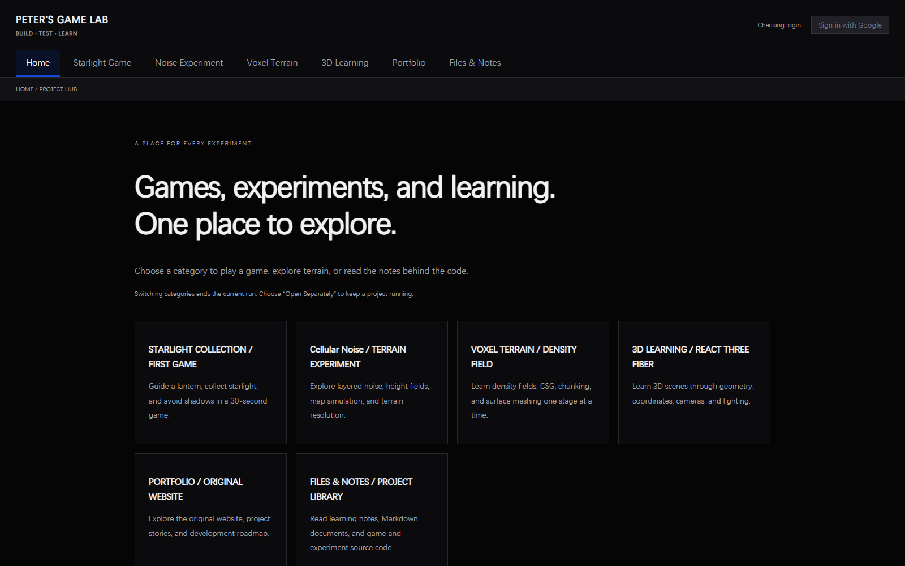

# Peter's Game Lab — Projects, Experiments, and Learning Archive

Peter's Game Lab is a growing collection of playable browser projects, procedural-generation experiments, and the notes behind their development. The repository brings a small Canvas game, React Three Fiber studies, Cellular noise terrain, voxel surface extraction, and a shared project website into one place.

The work focuses on learning game programming through visible, testable stages: building a first playable loop, turning mathematical fields into terrain, comparing 3D meshing techniques, and connecting a Vite site to Firebase Authentication, Firestore, and Hosting. The documents preserve both current systems and earlier decisions so readers can see how each result developed.

New readers should follow the route below. It moves from the public-facing project overview to the first game, then through the two terrain experiments and Firebase integration before ending at the current resume point.
To see why each stage led to another—and which future ideas remain unverified—open [From Playable Experiments to Procedural Worlds](./EXPLORATION-MAP.md).
For the evaluator-facing evidence audit and the remaining screenshot requirements, open [Assignment 1 — Repository Documentation and Evidence Checklist](./ASSIGNMENT-1-CHECKLIST.md).

> **Current project:** Procedural Mini World. Start with the [experiment index](./procedural-mini-world/EXPERIMENT-INDEX.md) and the [compass and experiment log](./procedural-mini-world/FINAL-EXPERIMENT-LOG.md). The rest of this catalog covers the earlier Game Lab studies.

## Repository at a Glance

**What this shows:** One deployed homepage connects the playable game, two procedural-generation experiments, React Three Fiber study, portfolio archive, and document library.

**Why it matters:** A new reader can see that the repository is organized as one study environment rather than a collection of unrelated files.

**Parameters or conditions:** Captured from the Firebase Hosting homepage after an HTTP 200 response on 2026-09-29; desktop viewport 1600 × 1000.

## Start Here

### Recommended Reading Route

**Project Overview → First Playable Game → Cellular Noise → Voxel Terrain → Firebase Account Saves → Current Project State**

Each linked row below is one step in the route and explains why it follows the previous document.

| Document | What it covers | Status |
| --- | --- | --- |
| [Peter's Game Lab — Knowledge Base and Project Hub](../README.md) | Introduces the website, playable sections, repository landmarks, local workflow, and production build. Begin here to understand the public project as a whole. | Active |
| [Starlight Run — First Playable Collection Game](./projects/starlight-run/overview.md) | Presents the 30-second collection game's rules, input methods, implemented systems, and planned extensions. It is the shortest route from the site overview to a complete playable loop. | Active |
| [Cellular Noise — Reproducible Patterns and Chunked Generation](../experiments/cellular-noise/README.md) | Explains deterministic Cellular F1 sampling, binary and continuous shaping, shared 2D/3D maps, chunk consistency, controls, and verified implementation stages. It introduces the terrain data used before surface meshing. | Active |
| [Voxel Terrain — From Density Fields to Three Meshers](../experiments/voxel-terrain/README.md) | Follows the experiment from signed-distance fields and ordered CSG through finite chunks to Marching Cubes, Surface Nets, and Marching Tetrahedra. It records the common sampling method and algorithm tradeoffs. | Active |
| [Account-Linked Terrain Saves with Firebase](./infrastructure/firebase/account-linked-terrain-saves.md) | Shows how Google Authentication, per-user Firestore documents, Security Rules, local JSON backup, and Firebase Hosting support saved voxel configurations. Read it after the terrain experiments to see how project state becomes account data. | Complete |
| [Current Project State — Active Work and Resume Guide](./_meta/current-project-state.md) | Summarizes the installed stack, active voxel milestone, verified systems, pending browser review, and exact next-session entry points. End here for the repository's present status. | Active |

For a structural view of code and documentation ownership, use [Project Map — Documents, Code, and Current Ownership](./_meta/project-map.md), which distinguishes durable project records from code-adjacent READMEs and dated logs.

### Choose an Entry Point

| Reader goal | Best entry |
| --- | --- |
| Experience the projects immediately | Open the verified pages under [Live Links](#live-links). |
| Understand procedural terrain | Start with [Procedural Generation Experiments](#procedural-generation-experiments). |
| Learn how the code was built | Follow [3D Learning](#3d-learning), then [Tutorials and Learning Materials](#tutorials-and-learning-materials). |
| Review decisions over time | Browse [Development Logs](#development-logs). |
| Understand the website and deployment | Go to [Website and Firebase Infrastructure](#website-and-firebase-infrastructure). |

## Playable Projects

The playable-project records explain what a visitor can do, how the core loop works, and which early plans remain historical rather than current.

### Starlight Run

Starlight Run is a short Canvas game in which the player guides a lantern, collects golden starlight, avoids shadows, and tries to improve a locally saved high score before the timer ends.

| Document | What it covers | Status |
| --- | --- | --- |
| [Project Index — Games and Technical Experiments](./projects/README.md) | Maps the repository's playable work and technical experiments to their focused documentation and separates project records from dated logs. | Reference |
| [Starlight Run — Project Documents](./projects/starlight-run/README.md) | Connects the current playable overview, first-loop record, and archived prompting workbook for this game. | Reference |
| [Starlight Run — Building the First Playable Loop](./projects/starlight-run/first-playable-loop.md) | Preserves the initial scope, completion checklist, and lesson record for movement, collection, collision feedback, and end-of-round results. | Historical |

### Flavor Clash

Map Prototype 0.1 builds a finite four-region showcase around one central plaza. It separates seeded terrain, WFC local roads, spline connections, and Poisson-disk object scattering so each system and region can be inspected independently.

| Document | What it covers | Status |
| --- | --- | --- |
| [Four Regions, One Plaza — Flavor Clash Map Prototype 0.1](./projects/flavor-clash/README.md) | Explains the Iceland, Tokyo, Venice, and Hawaii studies; deterministic region seeds; local WFC roads; plaza splines; instanced scattering; controls; limitations; and screenshot plan. | Implemented / Testing |
| [Open-Source Sources Used by the Procedural Map Prototype](./OPEN_SOURCE_SOURCES.md) | Records the selected WFC, Poisson sampling, and Three.js sources, licenses, reuse boundaries, and the evaluated but unused Three-WFC alternative. | Reference |

## Procedural Generation Experiments

These experiments study how deterministic scalar fields become readable maps and 3D surfaces, then how a visible terrain can receive repeatable procedural content. Cellular Noise develops the sampled terrain field; Voxel Terrain compares three surface extraction methods; PCG Terrain Lab begins with seeded object scattering.

### Cellular Noise

The Cellular Noise experiment tests reproducible random access, chunk-order independence, fixed-world sampling, layered height fields, and synchronized 2D and 3D representations.

| Document | What it covers | Status |
| --- | --- | --- |
| [Cellular Noise — Project Documents](./projects/cellular-noise/README.md) | Connects the implementation README to the two development milestones that introduced the binary prototype and later continuous terrain simulation. | Reference |

### Voxel Terrain

The Voxel Terrain experiment develops from negative-inside SDFs and ordered CSG to finite chunk ownership, shared sampling, seam checks, three meshers, benchmarks, and account-linked configuration saving.

| Document | What it covers | Status |
| --- | --- | --- |
| [Voxel Terrain — Project Documents](./projects/voxel-terrain/README.md) | Connects the code-adjacent algorithm summary with the measured 2026-09-28 implementation and verification record. | Reference |

### PCG Terrain Lab

The Class 06 lab keeps environmental PCG separate from the Voxel Terrain implementation. Round 01 generates seeded XZ candidates, raycasts onto a reused Cellular height field, rejects missing surfaces, and writes accepted transforms into instanced low-poly trees.

| Document | What it covers | Status |
| --- | --- | --- |
| [Seeds on the Surface: My First Terrain Scatter](./learning/pcg-terrain/random-scattering.md) | Explains deterministic candidate generation, top-down surface queries, bounded attempts, InstancedMesh placement, Sparse/Medium/Dense comparison, debug evidence, limitations, and the next noise-distribution question. | Active / Testing |

## 3D Learning

The 3D learning area isolates React Three Fiber scene concepts and the first custom-shader pipeline before applying them to larger games and terrain experiments. It records what is implemented, what must be observed personally, and what remains paused.

| Document | What it covers | Status |
| --- | --- | --- |
| [Learning Index — Guided Practice and Progressive Study](./learning/README.md) | Separates progressive React Three Fiber study from the prompt-led game workbook and explains how learning notes relate to project records. | Reference |
| [React Three Fiber — From First Scene to Playable Prototype](./learning/react-three-fiber/learning-path.md) | Teaches Canvas setup, meshes, materials, lighting, grids, and OrbitControls, then lays out levels for transforms, props, interaction, animation, assets, and a future 3D game loop. | Active |
| [Learning to See the GPU: My First Shader Experiments](./learning/shaders/first-shader-experiments.md) | Uses one plane and five bounded modes to explain vertex and fragment work, uniforms, UV repetition, color mixing, and UV/local/world/screen coordinates without lighting or textures. | Active / Testing |
| [Terrain-Bound Building Scatter — Venice and Japan](./projects/flavor-clash/terrain-seam-building-scatter.md) | Traces terrain ownership, surface masks, world-space placement, original-world isolation, and independent controls with one browser capture per adjustment step. | Implemented / Verified |

## Website and Firebase Infrastructure

These references explain how independent projects share one Vite website and how signed-in users can save terrain configurations without mixing account data.

| Document | What it covers | Status |
| --- | --- | --- |
| [Infrastructure Index — Website, Firebase, and Delivery](./infrastructure/README.md) | Routes readers to the shared website architecture and the Firebase account-save implementation while keeping project algorithms elsewhere. | Reference |
| [Peter's Game Lab — Website Architecture and Navigation](./infrastructure/game-lab-website/architecture-and-navigation.md) | Describes hash navigation, iframe lifecycle, Vite entry points, the raw-text Files & Notes library, responsive review needs, and the path toward a portfolio site. | Reference |

## Tutorials and Learning Materials

The tutorial material shows a beginner how to ask for bounded code changes, verify behavior, debug problems, and reflect on what was learned.

| Document | What it covers | Status |
| --- | --- | --- |
| [A Beginner's Prompting Workbook for Game Development](./learning/prompting-and-debugging/beginner-workbook.md) | Teaches prompt structure through small Starlight Run exercises involving scoring, lives, star types, difficulty, sound, debugging, and project reflection. Its coding targets refer to an earlier standalone version. | Historical |

## Design and Documentation Standards

These standards keep the website visually coherent and the knowledge base searchable as new projects and logs are added.

| Document | What it covers | Status |
| --- | --- | --- |
| [Standards Index — Visual and Documentation Rules](./standards/README.md) | Provides the entry point for interface design rules and knowledge-base maintenance conventions. | Reference |
| [Peter's Game Lab — Visual Language and Interface Rules](./standards/visual-language/interface-system.md) | Defines the black and Klein Blue palette, typography, spacing, interaction feedback, accessibility requirements, content hierarchy, audience, and definition of done. | Reference |
| [Knowledge Base Documentation Rules](./standards/documentation/knowledge-base-rules.md) | Governs filenames, unique titles, relative links, code-adjacent READMEs, dated logs, historical preservation, and review checks. | Reference |

## Development Logs

The logs preserve what was understood, implemented, tested, and left open on specific dates. They remain historical records even when later documents describe a newer state.

| Document | What it covers | Status |
| --- | --- | --- |
| [Development Log Index — Decisions and Verified Milestones](./logs/README.md) | Orders the six recorded milestones and explains why later summaries should not erase stage-specific limitations. | Reference |
| [2026-09-09 — Five-Stage Cellular Noise Prototype](./logs/2026-09-09.md) | Records the original binary-map assignment, shared-array data flow, five verified stages, identified resolution limitations, and the planned continuous-height-field step. | Historical |
| [2026-09-16 — Terrain Simulation and Unified Website](./logs/2026-09-16.md) | Covers layered continuous terrain, fixed-world resolution, scrolling simulation controls, six automated tests, and integration of all projects into the shared website. | Historical |
| [2026-09-28 — Voxel SDF, Chunking, and Three-Mesher Comparison](./logs/2026-09-28.md) | Records the completed SDF/CSG/chunk pipeline, shared-density optimization, measured mesher comparison, 17 passing tests, and the pending manual visual review. | Historical |
| [2026-09-29 — Shader Basics Round 01 and Study Notebook Handoff](./logs/2026-09-29.md) | Records the repository audit, five minimal shader modes, website-tab integration, browser verification, preserved observation fields, and the exact next-session evidence checklist. | Active handoff |
| [2026-10-03 — Timestamped Playwright Evidence for Shader Experiments](./logs/2026-10-03.md) | Adds a reproducible Chrome-based capture command, eight Shader component states per run, timestamped Obsidian archives, and append-only Markdown evidence routing. | Active workflow |
| [2026-10-07 — Seeded Terrain Scattering with Surface Queries and Instances](./logs/2026-10-07.md) | Records the Class 06 audit, height-field reuse, downward ray queries, deterministic scatter tests, InstancedMesh placement, three measured presets, and the personal-evidence boundary. | Active handoff |
| [2026-10-07 — Flavor Clash: From Regional Terrain to a Road Mesh](./logs/2026-10-07-flavor-clash.md) | Summarizes the progression from the finite regional prototype through Iceland surface data and projected paths to deterministic ribbon geometry. | Active handoff |

## Live Links

These public entries were verified on 2026-09-29. Only deployed or remotely confirmed locations are included.

| Link | Purpose |
| --- | --- |
| [Peter's Game Lab on Firebase Hosting](https://gameeeee-zc626.web.app/) | Opens the shared homepage and navigation hub. |
| [Starlight Run](https://gameeeee-zc626.web.app/legacy-game.html) | Opens the standalone 30-second collection game. |
| [Cellular Noise](https://gameeeee-zc626.web.app/experiments/cellular-noise/) | Opens the layered terrain and simulation experiment. |
| [Voxel Terrain](https://gameeeee-zc626.web.app/experiments/voxel-terrain/) | Opens the SDF, CSG, chunking, and mesher comparison page. |
| [GitHub Repository](https://github.com/Peterrr294/Peter_Chen_Gamingggg) | Opens the source repository and version history. |

Flavor Clash is not listed under Live Links because Prototype 0.1 has been verified locally but has not been deployed to Firebase Hosting in this task.
