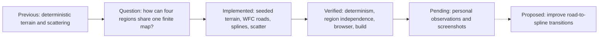

# Current Project State — Active Work and Resume Guide

> **Superseded (marked 2026-10-20, DOC-01):** this page records the Game Lab state as of 2026-10-07, before Procedural Mini World. Current status: [project compass §1](../procedural-mini-world/FINAL-EXPERIMENT-LOG.md) and the [knowledge base home](../procedural-mini-world/README.md). The content below is kept unchanged as history.

> Last saved: 2026-10-07
> Main-path milestone: React Three Fiber Level 0 complete / Level 1 paused
> Active exercise: Flavor Clash Map Prototype 0.1 technically verified; personal observations and screenshots next
## Progress and Next Direction



### How to read this map

The solid sequence moves from earlier deterministic terrain and scattering into one bounded four-region map, its implementation, technical verification, and the observations that only the learner can complete. The dotted final arrow is proposed future work, not part of Prototype 0.1.

### Key insight

The Flavor Clash map is technically ready, but the study is not complete until the four identities, Systems view, same-seed result, and independent region regeneration are reviewed personally and recorded with real screenshots.

## Resume Here

Active handoff: [2026-10-07 — Four Seeded Regions and Local WFC Roads](../logs/2026-10-07-flavor-clash.md) records the finite-map decisions, implementation, measured default output, verification, evidence boundary, and next steps. Then use [Four Regions, One Plaza](../projects/flavor-clash/README.md) for the system explanation and personal observation fields. The PCG Terrain and Shader handoffs remain earlier unfinished personal-evidence tasks.

Website foundation milestone: [Peter's Game Lab — Website Architecture and Navigation](../infrastructure/game-lab-website/architecture-and-navigation.md) records the shared site's content map, architecture, file responsibilities, run/build workflow, pending browser review, and roadmap toward a personal website. Read it before future website optimization or structural changes.

The root URL is now a unified Game Lab with Home, Starlight Game, Noise Experiment, Voxel Terrain, 3D Learning, Shader Basics, PCG Terrain Lab, Flavor Clash, Portfolio, and Files/Notes tabs. Flavor Clash is available at `#flavor` and `/experiments/flavor-clash-prototype/`. Notes and source files can be read/downloaded in `#files`. Vite builds all project pages.

Teaching preference: treat the learner as a coding beginner. Explain one graphics or mathematics principle, make one bounded change with detailed Chinese comments, provide a browser check, and ask one understanding question before the next major concept.

The Cellular Noise, Voxel Terrain, Shader Basics, and PCG Terrain assignments remain intact but are not the active resume point. The active experiment is [Flavor Clash Map Prototype 0.1](../projects/flavor-clash/README.md).

Keep detailed Chinese code comments and Chinese teaching discussion; write project notes in English.

The React Three Fiber main path remains available in [React Three Fiber — From First Scene to Playable Prototype](../learning/react-three-fiber/learning-path.md). When it resumes, begin with Level 1 scene coordinates and transforms.

## Current Application

- Full-browser React Three Fiber Canvas
- Dark-gray background
- Box, sphere, and cylinder using `meshStandardMaterial`
- Ambient and directional lights
- XZ infinite fading grid from Drei
- OrbitControls with rotate, zoom, and pan
- Production build verified successfully
- Independent Shader Basics page with one plane, one ShaderMaterial, and five switchable modes
- Uniform controls, UV repetition, and UV/local/world/screen coordinate comparison
- Independent PCG Terrain Lab with seeded candidates and downward mesh ray queries
- Two InstancedMesh tree groups with random position, scale, and optional Y-axis rotation
- Sparse, Medium, and Dense presets with candidate/accepted/rejected debug points
- Independent Flavor Clash page with four finite seeded regions and one central plaza
- Local WFC road modules, spline plaza routes, Poisson scattering, and InstancedMesh placeholders
- Showcase/Systems views, per-region regeneration, JSON import/export, and automated determinism checks
- Independent cellular-noise assignment with side-by-side 2D and 3D views
- Deterministic Cellular F1 sampling with 16 × 16 chunks
- Binary Threshold, Invert Threshold, and Band shaping operations
- lil-gui controls for noise scale, grid height, and resolution
- Shared continuous heightMap rendered as grayscale and terrain elevation
- Multi-layer Cellular noise and fixed-domain resolution calibration
- Simulation start/pause, reset, arrow navigation, Space and W shortcuts

## Documentation Language

Public website UI and primary content are English. All page roots use `lang="en"`. Shared `typography.css` selects Helvetica/DengXian for English and FangSong for Chinese annotations, with system fallbacks. Chinese teaching comments remain in source files. Apply this policy to future website changes.

All Obsidian project notes are written in English for classmates and instructors. Development conversations may continue in Chinese or a Chinese-English mix.

## Important Files

- `src/App.jsx` — Canvas, camera, lights, grid, and controls
- `src/components/SceneObjects.jsx` — the three sample meshes
- `src/main.jsx` — React entry point
- `src/style.css` — full-screen layout
- `docs/standards/visual-language/interface-system.md` — black/Klein-blue UI and content rules
- `docs/learning/react-three-fiber/learning-path.md` — incremental learning plan
- `experiments/cellular-noise/` — independent Cellular Noise terrain exercise
- `experiments/voxel-terrain/` — active finite SDF, ordered CSG, chunking, and three-mesher comparison
- `experiments/pcg-terrain/` — active Class 06 height-field scattering experiment
- `experiments/flavor-clash-prototype/` — active finite four-region WFC map experiment
- `docs/projects/flavor-clash/README.md` — Flavor Clash system record and screenshot plan
- `docs/logs/2026-10-07-flavor-clash.md` — current prototype handoff
- `docs/learning/pcg-terrain/random-scattering.md` — Random Scattering study and personal observation fields
- `docs/logs/2026-10-07.md` — current PCG Terrain Lab session record and resume handoff
- `docs/logs/2026-09-29.md` — current Shader Round 01 session record and resume handoff
- `docs/logs/2026-09-28.md` — previous Voxel Terrain session record
- `docs/logs/2026-09-09.md` — complete session record and next-session handoff
- `package.json` / `package-lock.json` — installed dependency definitions
- `archive/portfolio/` — preserved previous portfolio version

## Installed Stack

- Node.js 24.19.0 — portable copy in `.tools/`
- npm 11.17.0
- React 19.2.8
- React DOM 19.2.8
- Three.js 0.180.0
- React Three Fiber 9.7.0
- Drei 10.7.8
- Vite 7.3.6
- Vite React Plugin 5.0.4
- lil-gui 0.21.0
- wavefunctioncollapse 2.1.0
- poisson-disk-sampling 2.3.1

## Start Next Time

From the project root:

```powershell
.\dev.cmd
```

Open the URL printed by Vite, normally `http://localhost:5173/`. For the active experiment, open `http://localhost:5173/#flavor` or `http://localhost:5173/experiments/flavor-clash-prototype/`. If that port is occupied, replace `5173` with the port selected by Vite.

Build check:

```powershell
.\build.cmd
```

## Next Action

1. Read the [Flavor Clash session handoff](../logs/2026-10-07-flavor-clash.md), then the [prototype study record](../projects/flavor-clash/README.md).
2. Inspect the default map in Showcase and Systems mode.
3. Regenerate the same seed, then change only one region seed offset and compare the other three.
4. Complete every `Observation to complete after testing` block in the learner's own words.
5. Capture the eight planned real screenshots and record their visible parameters.
6. Stop after Prototype 0.1; do not add infinite terrain or full gameplay yet.

## Local Environment Notes

- System `node`, `npm`, and `git` are not currently available through the terminal PATH.
- `dev.cmd` and `build.cmd` already use the local portable Node.js, so the app remains usable.
- Git is installed at `D:\Github\Git\cmd\git.exe` and can be called using that full path.
- `.tools/`, `node_modules/`, `dist/`, and logs are intentionally excluded by `.gitignore`.

## Related Knowledge Base Notes

- [Project Map](./project-map.md)
- [Visual Language and Interface Rules](../standards/visual-language/interface-system.md)
- [React Three Fiber Learning Path](../learning/react-three-fiber/learning-path.md)
- [Shader Basics Round 01](../learning/shaders/first-shader-experiments.md)
- [PCG Terrain Lab — Random Scattering](../learning/pcg-terrain/random-scattering.md)
- [Starlight Run Overview](../projects/starlight-run/overview.md)
- [Beginner's Prompting Workbook](../learning/prompting-and-debugging/beginner-workbook.md)
- [Starlight Run First Playable Loop](../projects/starlight-run/first-playable-loop.md)
- [2026-09-09 Cellular Noise Session](../logs/2026-09-09.md)
- [2026-09-16 Terrain Simulation and Unified Website](../logs/2026-09-16.md)
- [2026-09-28 Voxel Meshing Comparison](../logs/2026-09-28.md)
- [2026-09-29 Shader Basics Round 01](../logs/2026-09-29.md)
- [2026-10-07 Seeded Terrain Scattering](../logs/2026-10-07.md)
- [Voxel Terrain Technical README](../../experiments/voxel-terrain/README.md)
- [Cellular Noise Technical README](../../experiments/cellular-noise/README.md)
