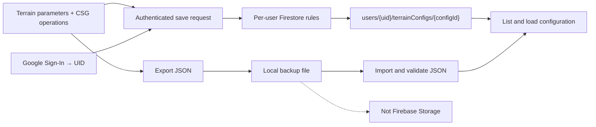

# Account-Linked Terrain Saves with Firebase

This tutorial documents how Peter's Game Lab connects a Vite website to Firebase Authentication, Cloud Firestore, and Firebase Hosting. The finished feature lets a user sign in with Google, save a voxel-terrain configuration to their account, and load it later.

The project uses the Firebase Spark plan. Cloud Storage is discussed separately because Firebase requires the Blaze plan for Storage access as of February 3, 2026.
## Configuration Paths



### How to read this map

The upper path is authenticated and rule-checked before reaching a per-user Firestore collection. The lower path stays on the user''s device and rejoins only at configuration loading.

### Key insight

Firestore provides account-linked structured storage; JSON remains a local Spark-compatible backup and is not a disguised Cloud Storage implementation.

## Outcome

- Google sign-in and sign-out with persistent authentication state.
- Terrain parameters and ordered CSG operations saved to Firestore.
- A list containing only the signed-in user's configurations.
- Per-user access enforced by Firestore Security Rules.
- Local JSON export and import as a free file backup.
- Vite builds deployed to Firebase Hosting through GitHub Actions.

Firestore stores each configuration at:

```text
users/{uid}/terrainConfigs/{configId}
```

## Evidence Status

### Hosting result


**What this shows:** The shared Game Lab interface is reachable from the Firebase Hosting domain and exposes the sign-in control in the site header.

**Why it matters:** It verifies Hosting delivery and the presence of the authentication entry point, but it does not by itself prove a successful Google session or Firestore write.

**Parameters or conditions:** `https://gameeeee-zc626.web.app/` returned HTTP 200 and was captured at 1600 × 1000 on 2026-09-29.

### Missing authenticated evidence

The repository contains the Authentication, Firestore, rules, and configuration UI implementation, and the historical checklist records successful local tests. Assignment 1 still lacks privacy-safe screenshots of those authenticated states:

- **Google sign-in:** capture the signed-in header while hiding email, UID, access tokens, and other personal data.
- **Firestore save/list/load:** save a disposable configuration such as `Assignment 1 evidence`, refresh the list, load it, and capture the visible success status with personal identifiers hidden.
- **Public deployment:** repeat both checks on the Hosting domain after the new authentication/configuration build is deployed.

Until those captures exist, Authentication and Firestore persistence are **Implemented locally / Needs verification publicly**, not visually verified Assignment 1 outcomes.

## 1. Register the web app

1. Open the [Firebase Console](https://console.firebase.google.com/).
2. Create or open a project. This project uses `gameeeee-zc626`.
3. Open **Project settings → General → Your apps**.
4. Select the Web icon (`</>`) and register the app.
5. Copy the generated `firebaseConfig` object.

The web configuration identifies the project and is not a service-account private key. Authentication and Security Rules protect the data. Never commit service-account JSON, private keys, or GitHub secrets.

## 2. Install and initialize Firebase

Install the modular Web SDK:

```sh
npm install firebase
```

Create `src/firebase.js`:

```js
import { initializeApp } from 'firebase/app';
import { getAuth, GoogleAuthProvider } from 'firebase/auth';
import { getFirestore } from 'firebase/firestore';

const firebaseConfig = {
  apiKey: 'YOUR_API_KEY',
  authDomain: 'YOUR_PROJECT.firebaseapp.com',
  projectId: 'YOUR_PROJECT_ID',
  storageBucket: 'YOUR_PROJECT.firebasestorage.app',
  messagingSenderId: 'YOUR_SENDER_ID',
  appId: 'YOUR_APP_ID',
};

const app = initializeApp(firebaseConfig);
const auth = getAuth(app);
const db = getFirestore(app);
const googleProvider = new GoogleAuthProvider();

export { app, auth, db, googleProvider };
```

Analytics is omitted because it is not needed for this assignment.

## 3. Enable Google Authentication

1. Open **Authentication → Sign-in method**.
2. Add Google as a provider.
3. Enable it, choose the support email, and save.
4. Under **Authentication → Settings → Authorized domains**, add `localhost` for development if it is absent.

Projects created after April 28, 2025 do not automatically authorize `localhost`. The browser hostname must match: `localhost` and `127.0.0.1` are different domains.

Use Firebase's stable `uid`, rather than a name or email address, as the database identifier:

```js
import { onAuthStateChanged, signInWithPopup, signOut } from 'firebase/auth';
import { auth, googleProvider } from './src/firebase.js';

onAuthStateChanged(auth, user => {
  console.log(user ? `Signed in: ${user.uid}` : 'Signed out');
});

await signInWithPopup(auth, googleProvider);
await signOut(auth);
```

## 4. Create Cloud Firestore

1. Open **Firestore Database**.
2. Click **Create database**.
3. Select **Production mode**.
4. Keep the default database ID unless multiple databases are required.
5. Choose the location carefully; it normally cannot be changed later.

Production mode initially denies all client access. The next step grants only the access required by this application.

## 5. Protect each user's data

Publish these rules from **Firestore → Rules**:

```text
rules_version = '2';

service cloud.firestore {
  match /databases/{database}/documents {
    match /users/{userId}/terrainConfigs/{configId} {
      allow read, write: if request.auth != null
                         && request.auth.uid == userId;
    }
  }
}
```

An unauthenticated visitor cannot access configurations. A signed-in user can access only the documents stored below their own UID. The same rules are versioned in `firestore.rules`, referenced by `firebase.json`.

## 6. Save a terrain configuration

Store the meshing algorithm, parameters, and ordered CSG operations:

```js
import { addDoc, collection, serverTimestamp } from 'firebase/firestore';
import { auth, db } from '../../src/firebase.js';

const user = auth.currentUser;
if (!user) throw new Error('Sign in before saving');

await addDoc(collection(db, 'users', user.uid, 'terrainConfigs'), {
  name: 'My First Terrain',
  schemaVersion: 1,
  parameters: { ...parameters },
  operations: operations.map(({ type, shapeId }) => ({ type, shapeId })),
  createdAt: serverTimestamp(),
  updatedAt: serverTimestamp(),
});
```

The schema version makes it possible to recognize or migrate older formats later.

## 7. List and load configurations

Read the same user-specific collection:

```js
import { collection, getDocs } from 'firebase/firestore';

const snapshot = await getDocs(
  collection(db, 'users', user.uid, 'terrainConfigs'),
);

const configurations = snapshot.docs.map(document => ({
  id: document.id,
  ...document.data(),
}));
```

Before applying data, validate parameter types and confirm that every CSG operation uses supported operation and shape identifiers. The application then updates the GUI, rebuilds the operation list, and regenerates the terrain.

## 8. Local JSON backup

The free file backup uses browser APIs:

```js
const payload = JSON.stringify(configuration, null, 2);
const url = URL.createObjectURL(
  new Blob([payload], { type: 'application/json' }),
);
```

Export downloads the Blob. Import reads a selected file with `file.text()`, parses it, validates it, and applies it through the same configuration-loading path. This is a local backup and is not Cloud Storage.

## 9. Storage limitation on the Spark plan

Cloud Storage would normally use `getStorage`, `ref`, and `uploadBytes`, with a per-user path such as:

```text
users/{uid}/terrain-configs/{configurationId}.json
```

Firebase requires the pay-as-you-go Blaze plan for access to the default Cloud Storage bucket as of February 3, 2026. This project must remain on Spark, so production Storage is intentionally not enabled. Firestore stores account-linked structured data, while JSON export provides local file backup.

If working Storage is mandatory, the instructor must allow a Blaze billing account, provide a suitable project, or accept a Storage Emulator demonstration. See [Firebase's official Storage billing notice](https://firebase.google.com/docs/storage/faqs-storage-changes-announced-sept-2024).

## 10. Configure Hosting

Vite generates `dist`:

```sh
npm run build
```

Firebase Hosting publishes that directory. The repository has one GitHub Actions workflow for pull-request previews and another for the live `main` branch. Both run `npm ci` before `npm run build`, because a clean GitHub runner has no local `node_modules`.

The public project URLs are:

- [Peter's Game Lab](https://gameeeee-zc626.web.app/)
- [Voxel Terrain](https://gameeeee-zc626.web.app/experiments/voxel-terrain/)

## 11. Verification checklist

- [x] Firebase Web SDK installed and production build succeeds.
- [x] Google sign-in, persistence, and sign-out tested locally.
- [x] Firestore production database created.
- [x] Per-user Security Rules published.
- [x] Signed-in user saved and loaded a terrain configuration.
- [x] Firestore document appeared below that user's UID.
- [x] Local JSON export and import restored a configuration.
- [x] Firebase Hosting serves the existing public website.
- [ ] Deploy the new Authentication and configuration features.
- [ ] Verify the new features on the public Hosting domain.
- [ ] Add the public website URL to the course Google Spreadsheet.

Cloud Storage remains unavailable under the required Spark-only constraint and is not marked complete.

## 12. Relevant project files

- `src/firebase.js`: Firebase initialization, Authentication, and Firestore.
- `site.js`: sign-in, sign-out, and authentication-state UI.
- `experiments/voxel-terrain/demo.js`: Firestore save/load and JSON backup.
- `firestore.rules`: per-user database permissions.
- `firebase.json`: Firestore rules and Hosting configuration.
- `.github/workflows/firebase-hosting-pull-request.yml`: PR previews.
- `.github/workflows/firebase-hosting-merge.yml`: live deployment.

## References

- [Add Firebase to a JavaScript project](https://firebase.google.com/docs/web/setup)
- [Authenticate with Google](https://firebase.google.com/docs/auth/web/google-signin)
- [Get started with Firestore](https://firebase.google.com/docs/firestore/quickstart)
- [Add data to Firestore](https://firebase.google.com/docs/firestore/manage-data/add-data)
- [Deploy Hosting with GitHub](https://firebase.google.com/docs/hosting/github-integration)
