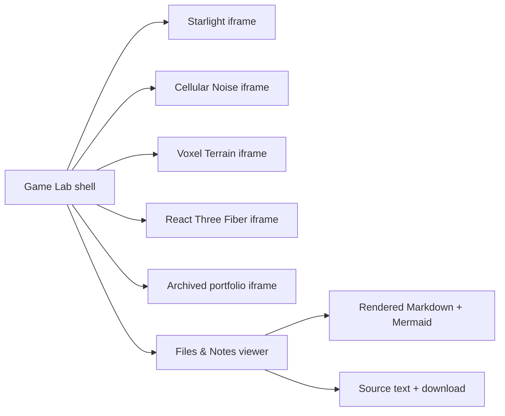

# Peter's Game Lab — Website Architecture and Navigation

> Foundation milestone: 2026-09-16
> Status: unified website implemented; deployed homepage evidence captured, full interactive review pending
> Purpose: preserve the architecture and decisions that future website improvements and a personal portfolio will build on.
## Content Integration



### How to read this map

Each project iframe is an independent runtime selected by the shared shell. Files & Notes is a separate branch with two representations of the same authored file.

### Key insight

The shell avoids rewriting unrelated projects into one framework while giving their rendered notes, source text, and downloads a common reading surface.

## Why This Milestone Matters

The project previously contained separate playable games, graphics experiments, a React learning scene, an archived portfolio, and Markdown records. The root website opened only the React scene, so it did not present the full body of work.

The new foundation gives these projects one shared entry and visible categories. Each experiment can keep its own implementation while becoming part of a larger personal website. This establishes a place for both finished work and the process of learning how to make it.

## Deployed Result


**What this shows:** The public homepage presents one consistent header, navigation, authentication control, introduction, and routes into the projects and notes.

**Why it matters:** It verifies that the separate experiments are discoverable through one deployed entry rather than only through local file paths.

**Parameters or conditions:** Captured from `https://gameeeee-zc626.web.app/` after the route returned HTTP 200 on 2026-09-29; desktop viewport 1600 × 1000.

## Before and After

| Area | Before | Foundation now |
| --- | --- | --- |
| Root URL | React Three Fiber scene | Shared Game Lab homepage |
| First game | Separate `legacy-game.html` | Starlight Game category |
| Cellular Noise | Separate experiment URL | Noise Experiment category |
| React scene | Root entry | 3D Learning category and `scene.html` |
| Original portfolio | Archived page with a broken script path | Portfolio category with its script path corrected |
| Notes and source | Read primarily in the editor | File library with text viewing and downloads |
| Production output | Selected entries only | Homepage and all four project-page entries |

## Content Map

| Category | Navigation hash | Content location | Responsibility |
| --- | --- | --- | --- |
| Home | `#home` | `site.js` → `showHome()` | Introduce the lab and link to categories |
| Starlight Game | `#game` | `legacy-game.html` | First playable collection game |
| Noise Experiment | `#noise` | `experiments/cellular-noise/index.html` | Noise stack, height field, and map simulation |
| 3D Learning | `#scene` | `scene.html` → `src/main.jsx` | Original React Three Fiber scene |
| Portfolio | `#portfolio` | `archive/portfolio/index.html` | Original presentation website |
| Files and Notes | `#files` | `site.js` → `showFiles()` | Read and download project records and source |

Hash links can be bookmarked, and browser Back/Forward selects previous categories. An empty hash shows Home; unknown category hashes fall back to Home. The navigation uses standard links with `aria-current` to mark the selected category.

## How the Website Fits Together

```text
index.html — shared header, category navigation, content container
    |
    +-- site.css — common website appearance and responsive layout
    |
    +-- site.js
         |
         +-- sections — category names, descriptions, and page URLs
         +-- navigate() — select a category from the URL hash
         +-- showHome() — generate overview cards
         +-- project iframe — load the selected standalone project
         +-- showFiles() — load notes/source as text

vite.config.js — builds the shared homepage and standalone project entries
dist/          — generated website output
```

`index.html` supplies structure. `site.css` supplies appearance. `site.js` supplies navigation and behavior. This separation makes it possible to improve one aspect without placing every project inside one large file.

## Architecture Decisions and Their Consequences

### Keep Projects Independent

The shared shell uses an iframe for each project page. An iframe is a page embedded inside another page; it has its own document, styles, and JavaScript context. This accommodates the original native Canvas game, vanilla Three.js noise experiment, and React scene without requiring a framework rewrite.

Only one project iframe is active. `content.replaceChildren()` removes the previous frame when switching categories, unloading its document and ending its running animation or simulation. Returning loads a fresh page. Browser-persisted data, such as the game's local high score, is separate from an in-progress run and can survive unloading.

Open Separately opens a standalone project in another browser tab when the visitor wants to preserve its current run while browsing other work. Retaining in-progress state across category switches is a future design choice, not an implemented feature.

### Keep the Original React Scene

`scene.html` now supplies the React entry that used to live in the root page. It still loads `src/main.jsx`, which renders `src/App.jsx`. The scene components remain independent of the new website navigation.

### Bundle the File Library as Text

`import.meta.glob` registers files from explicit authored-content directories. Its raw-text option returns file contents as strings; the viewer uses `textContent`, so reading HTML or JavaScript does not execute it. Files load when selected. Downloads use Blob URLs, which are released when replaced or when leaving the library.

The included patterns cover the root knowledge-base entry, categorized Markdown under `docs/`, and authored HTML, JavaScript, CSS, JSON, and command files under the root, `src/`, `experiments/`, and `archive/`. Dependencies, generated output, local editor configuration, and `package-lock.json` are excluded. This is an authored-content library rather than a live view of every filesystem item; other formats need deliberate support later.

Markdown now opens in a safe rendered view with a Source toggle. The local renderer escapes raw HTML, formats the repository's headings, lists, tables, links, and code blocks, and resolves internal Markdown links through the file selector. Mermaid blocks load through a browser ESM module under strict security; a load or parse failure leaves the source code visible with an explicit error instead of blanking the document. The Source view and Blob download preserve the original file. Search and code highlighting remain future improvements. Adding a matching note still requires a new production build for that note to appear on a deployed site.

### Build Every Project Page

`vite.config.js` registers `index.html`, `scene.html`, `legacy-game.html`, the archived portfolio entry, and the noise experiment entry. The resulting `dist/` directory contains the shared homepage, standalone pages, and processed assets. Relative project links preserve their directory relationships.

The archived portfolio's invalid `/src/main.js` reference was changed to `./main.js`, pointing to its actual neighboring script.

## Important Files to Read First

1. [index.html](../../../index.html): website containers and navigation links.
2. [site.js](../../../site.js): category registry, navigation, project loading, and file library.
3. [site.css](../../../site.css): shared visual system and small-screen layout.
4. [vite.config.js](../../../vite.config.js): production page entries.
5. [Visual Language and Interface Rules](../../standards/visual-language/interface-system.md): visual direction and audience.
6. [Current Project State](../../_meta/current-project-state.md): current resume point.
7. [2026-09-16 — Terrain Simulation and Unified Website](../../logs/2026-09-16.md): session history and verification limits.

## Run, Build, and Review

From the project root:

```powershell
.\dev.cmd
```

Open the URL Vite prints, normally `http://localhost:5173/`. The server must remain running; the recorded HTTP checks do not guarantee it remains available after the terminal/session closes.

Build the website:

```powershell
.\build.cmd
```

Serve `dist/` over HTTP for production review. Generated files in `dist/` should be recreated through the build rather than edited by hand.

Recorded integration evidence: production build passed; homepage, standalone project pages, portfolio script, and hub script returned HTTP 200. Actual browser appearance, keyboard focus, and interactive navigation have not yet been visually confirmed. The six earlier noise/interaction tests verify the terrain work, not the new hub's browser layout.

Browser review checklist:

- [ ] All six categories show the intended content.
- [ ] Direct category hashes and Back/Forward navigation work.
- [ ] Switching categories ends the previous run; Open Separately preserves a separate session.
- [ ] Game controls and experimental simulation controls work inside the frames.
- [ ] Notes/source selection and file downloads work.
- [ ] Mobile navigation, frame scrolling, and file readability remain usable.
- [ ] Keyboard focus is visible and visitors can reach navigation and embedded controls.
- [ ] Console and network checks show no missing scripts or assets.
- [ ] The same review succeeds against the production build.

## Path Toward a Personal Website

The technical foundation is implemented. The following are planned directions, not completed features:

| Step | Outcome | Starting point |
| --- | --- | --- |
| 1. Review usability | Comfortable navigation, mobile layout, and project controls | Browser checklist above |
| 2. Define personal identity | Name, introduction, interests, and contact information | Home and existing portfolio copy |
| 3. Curate project stories | Each work explains its goal, contribution, result, and learning | `sections`, project notes, screenshots |
| 4. Improve the reading experience | Formatted notes, search, and accessible code reading | `showFiles()` |
| 5. Expand project structure | Add new games/experiments consistently | Category registry and Vite page entries |
| 6. Prepare the public site | Choose which work and source material to publish; verify hosting and paths | Content library patterns and production review |
| 7. Iterate with evidence | Record visitor difficulties and test one improvement at a time | Session notes and this baseline |

For a new standalone category, create its page, register it in `sections`, add its header link in `index.html`, and add its entry in `vite.config.js`. Home cards are generated from `sections`. For new content directories, update the library patterns if their files should be browsable. Build and review both the category and its standalone page.

## Teaching and Change Agreement

### Public Language and Typography

The website uses English as its primary language across navigation, project descriptions, game instructions and results, experimental explanations, accessibility labels, and portfolio content. Page roots declare `lang="en"`. Chinese remains available for supplemental annotations and teaching code comments.

The shared `typography.css` is linked by the hub and all four standalone project pages. Local-font character ranges select Helvetica/DengXian for Latin text and FangSong/STFangsong for Chinese text, including mixed-language source comments. Arial is a Latin fallback when the preferred fonts are unavailable. Actual font availability depends on the visitor's device; no font binaries are bundled. Existing component styles keep their sizes and layout while the shared policy overrides their font families.

Future pages should link this stylesheet, use English primary copy, and include English alternative text and control labels. This policy also applies to the reading experience in Files & Notes.

The learner is a coding beginner. Before important code changes, explain the underlying idea, explore the relevant existing code together, and confirm the learner's familiarity. Then make one small change with detailed Chinese comments, test it together, and record the result. Conversation may be in Chinese; project records remain in English for classmates and instructors.

This milestone is the baseline for later improvements. Record what changed, why, what was checked, and what remains unconfirmed. Keep historical session notes intact, and update this foundation document when the architecture changes.
