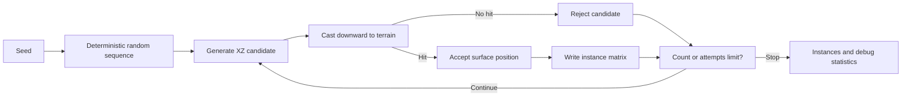

# Seeds on the Surface: My First Terrain Scatter

> Class 06 · PCG Terrain Lab Round 01 · Status: Implemented and technically verified; personal observations and screenshots pending

This study isolates one procedural-content-generation question: how can repeatable random candidates become efficient object instances that sit on a terrain surface? It deliberately stops before noise-weighted distribution, biome masks, spacing rules, splines, fields, or particles.

Open the experiment from the website’s **PCG Terrain Lab** entry or directly at `/experiments/pcg-terrain/`.

## 1. Research Question

1. How can I generate random candidate positions across terrain?
2. How can each XZ candidate find the corresponding surface Y?
3. Why is one fixed Y value incorrect on uneven ground?
4. How does a seed make the result reproducible?
5. Why is `THREE.InstancedMesh` appropriate for repeated assets?
6. How do requested count and maximum attempts affect completion and generation time?

> Observation to complete after testing:
>
> Before changing any controls, describe what you expect Sparse, Medium, and Dense to reveal.

## 2. Random Scattering

Scattering begins with attempts, not guaranteed placements. Each attempt proposes an XZ location inside a candidate region. The experiment casts a ray downward at that location. A hit becomes an accepted placement; a miss becomes a rejected candidate. Generation stops when either the requested asset count is reached or the maximum-attempt budget is exhausted.

### How to read this map

The arrows follow one candidate from seeded random input to a surface decision. The loop is bounded by both requested count and maximum attempts, so generation cannot run forever.

### Key insight

Random scattering is a selection process. Candidate generation and surface acceptance are separate responsibilities, which makes rejected attempts visible rather than silently disappearing.

## 3. Seed and Repeatable Randomness

The seed text is converted to a 32-bit value and passed through a small deterministic pseudo-random generator. For the same seed and the same parameters, random numbers are consumed in the same order, producing the same XZ positions, scales, and optional yaw rotations.

Changing the seed changes the sequence. Changing count, attempt budget, scale limits, yaw, candidate bounds, terrain, or the order in which random values are consumed also changes the final result.

> Observation to complete after testing:
>
> Regenerate twice without changing anything, then change only the seed. Record what stays identical and what changes.

## 4. Surface Query Method

This page reuses `sampleHeight()` from the Cellular Noise experiment to build a static `PlaneGeometry` height field. The scatter step does not simply call the height function again. Instead, it sends a `THREE.Raycaster` from above each XZ candidate toward world negative Y and uses the first triangle intersection from the rendered terrain mesh.

This method was chosen because it makes the placement query match the visible mesh and clearly demonstrates why a fixed Y value fails. A fixed Y would either bury trees in hills or leave them floating over valleys.

The current terrain is a height field, so it contains no caves or overhangs. On a more complex mesh, a vertical ray would return the highest visible intersection by default; lower cave surfaces would require a different selection rule.

> Observation to complete after testing:
>
> Orbit to a low angle and inspect several tree bases on hills and valleys. Record any visible floating or penetration.

## 5. InstancedMesh

No reusable tree model existed in the repository, so the page creates a low-poly placeholder tree from a cylinder trunk and cone crown. Every trunk shares one geometry and material through one `InstancedMesh`; every crown shares another. A per-tree matrix stores only position, uniform scale, and optional Y-axis rotation.

This produces two instanced draw groups instead of one independent `Mesh` object for every trunk and crown. Regeneration removes and disposes the old instanced objects, creates correctly sized instance buffers, marks the matrices for upload, and recomputes bounding boxes and spheres.

Trees remain aligned to world Y in this round. Surface-normal alignment is intentionally excluded.

## 6. Sparse, Medium, and Dense

| Preset | Requested | Maximum attempts | Scale range | Intended comparison |
| --- | ---: | ---: | --- | --- |
| Sparse | 24 | 60 | 0.80–1.20 | Inspect individual surface contacts and debug points. |
| Medium | 140 | 320 | 0.65–1.35 | Observe the default uniform random distribution. |
| Dense | 900 | 1900 | 0.50–1.50 | Inspect clustering, overlap, empty gaps, and interaction cost. |

The presets affect only this page. They do not change Cellular Noise, Voxel Terrain, Firebase data, or any other experiment.

> Observation to complete after testing:
>
> Compare the three presets from the same camera angle. Describe where clustering and empty gaps become easiest to see.

## 7. Performance Statistics

The following technical baseline was captured by the local Playwright verification on 2026-10-07 using headless Chrome. Generation time is measured around candidate generation, ray queries, and scatter planning; it is not a cross-device benchmark and should be repeated during personal testing.

| Preset | Seed | Requested | Attempts | Accepted | Rejected | Acceptance rate | Generation time |
| --- | --- | ---: | ---: | ---: | ---: | ---: | ---: |
| Sparse | CLASS-06 | 24 | 37 | 24 | 13 | 64.9% | 7.70 ms |
| Medium | CLASS-06 | 140 | 238 | 140 | 98 | 58.8% | 44.20 ms |
| Dense | CLASS-06 | 900 | 1,427 | 900 | 527 | 63.1% | 284.50 ms |

> Observation to complete after testing:
>
> Fill the table from the visible Debug panel. Note whether Dense remains responsive while orbiting after generation.

## 8. Debug Views

- **Candidate** shows every attempted XZ position.
- **Accepted** shows positions where the downward ray hit the terrain.
- **Rejected** shows attempts with no terrain intersection, normally outside the finite height-field mesh.

Turning a debug category off hides its `THREE.Points` object. Regeneration disposes old point geometries so debug data does not accumulate.

> Observation to complete after testing:
>
> Enable one debug category at a time and explain how the three sets relate.

## 9. Problems with Uniform Random Distribution

The current generator treats every candidate in the rectangular region equally. It does not understand visual composition or environmental rules. As a result it can produce clusters, overlaps, large empty gaps, trees on steep-looking areas, and placements with no biome or water awareness.

These are known limitations, not failed hidden features. They create the questions for later controlled experiments.

## 10. Current Limits

- One static, non-chunked height-field terrain.
- Downward ray queries return only the first/top intersection.
- One placeholder tree species made from simple geometry.
- No minimum spacing or collision rejection.
- No slope, height, biome, shoreline, or visibility masks.
- No normal alignment; every tree remains world-Y-up.
- No Perlin distribution, Poisson Disk, spline, vector field, particle system, or fluid simulation.
- Parameter completion or **Regenerate** triggers generation; the animation loop never creates a new scatter result.

## 11. Next Research Question

**How does a noise-weighted acceptance rule change uniform random scattering without hiding the candidate and rejection process?**

This is a proposed next round only. Noise Distribution is not implemented here.

## 12. Screenshot Plan

Do not use mockups or temporary clipboard paths. Save real captures under `docs/assets/screenshots/pcg-terrain/` after personally testing the page.

| Planned evidence | What it must prove |
| --- | --- |
| Website homepage entry | The shared project hub contains a working PCG Terrain Lab card or navigation entry. |
| PCG Terrain Lab page | The independent title, three tabs, terrain view, controls, Debug panel, learning guide, and navigation are visible. |
| Sparse | Individual instances visibly contact the terrain and statistics show the Sparse preset. |
| Medium | The default distribution and its visible parameter values are recorded. |
| Dense | High instance count, clustering or overlap, and the Debug performance readout are visible. |
| Candidate / Accepted / Rejected | The three debug colors are visible together or as clearly labeled separate captures. |
| Same-seed comparison | Two captures or one labeled comparison shows identical results for unchanged seed and parameters. |

For every image add **What this shows**, **Why it matters**, and **Parameters or conditions** before marking visual evidence complete.

## Relevant Files

- `experiments/pcg-terrain/index.html` — independent page and learning UI.
- `experiments/pcg-terrain/demo.js` — height field, ray queries, instances, debug objects, controls, and rendering.
- `experiments/pcg-terrain/scatter.js` — deterministic random sequence and bounded scatter algorithm.
- `experiments/pcg-terrain/scatter.test.js` — seed, bounds, attempts, scale, and yaw verification.
- `experiments/cellular-noise/noise.js` — reused world-coordinate height sampler.
