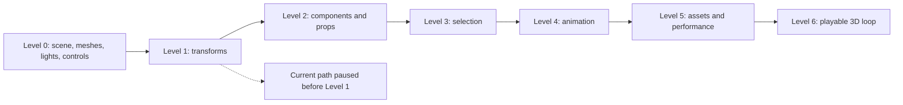
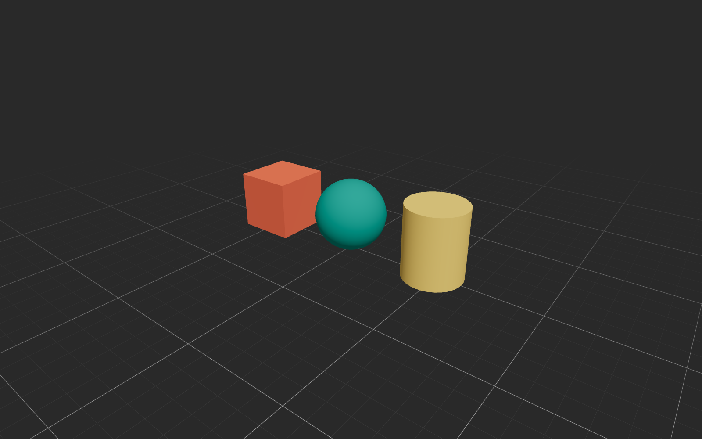

# React Three Fiber — From First Scene to Playable Prototype

> Begin with a simple scene and add only one concept at a time. Preview and document each result before moving to the next level.
## Learning Sequence

### How to read this map

Solid arrows are the intended one-concept-at-a-time curriculum. The dotted status branch marks where recorded implementation stops.

### Key insight

Only Level 0 is complete; transforms and every later level remain a learning plan rather than implemented scene behavior.

## Project Entry Points

- [Visual Language and Interface Rules](../../standards/visual-language/interface-system.md): visual, interaction, content, and audience guidelines
- [Knowledge Base and Project Hub](../../../README.md): run instructions and project structure
- [Starlight Run Overview](../../projects/starlight-run/overview.md): original game concept and development log
- [Beginner's Prompting Workbook](../prompting-and-debugging/beginner-workbook.md): early web-game learning course
- `src/App.jsx`: 3D scene, lighting, grid, and controls
- `src/components/SceneObjects.jsx`: geometry in the scene

## 2026-09-02: First React 3D Scene

### Goal

Create a basic 3D scene that a beginner can understand using React, Three.js, React Three Fiber, and Drei.

### Completed

- [x] Converted the project from native Three.js to React
- [x] Created a full-browser `Canvas`
- [x] Added a box, sphere, and cylinder
- [x] Gave the three objects different colors
- [x] Used `meshStandardMaterial`
- [x] Added ambient and directional lights
- [x] Added `OrbitControls` for rotation, zoom, and pan
- [x] Added an infinite fading grid on the XZ plane
- [x] Set a neutral dark-gray background
- [x] Completed a production build check

### Concepts Learned

1. `Canvas` creates the Three.js renderer, scene, and camera.
2. A `mesh` combines a shape (`geometry`) with a surface (`material`).
3. `meshStandardMaterial` responds to scene lighting.
4. `ambientLight` provides base illumination across the scene.
5. `directionalLight` simulates light coming from a fixed direction.
6. Drei provides useful components such as `OrbitControls` and `Grid`.
7. React components separate scene responsibilities and make the project easier to read and extend.

### Level 0 Result

**What this shows:** Three reusable primitive meshes receive distinct materials and sit in one lit scene with a grid, perspective camera, and OrbitControls.

**Why it matters:** The image verifies the completed Level 0 foundation before transforms, interaction, animation, or asset loading are introduced.

**Parameters or conditions:** Current `scene.html` and `src/App.jsx`; local Vite server; default camera and lighting; no Level 1 transform exercise applied.

### Verification

- Build status: successful
- Local preview: `http://localhost:5174/`
- Controls: left-drag to rotate, wheel to zoom, and right-drag to pan
- npm security check: 0 known vulnerabilities

### Preserved Content

The previous personal development website is preserved in `archive/portfolio/`.

## Level-by-Level Development Rules

Each level follows the same cycle:

1. Identify one main concept for the level.
2. Make the smallest practical code change.
3. Start the local preview and test it directly.
4. Check the browser console and production build.
5. Record the result, problems, and next step in this log.
6. Confirm completion before moving to the next level.

## Learning Roadmap

### Level 0: Basic Scene — Complete

- [x] Canvas, camera, and background
- [x] Basic geometry and materials
- [x] Lighting
- [x] Grid and OrbitControls

Completion criterion: all three objects are clearly visible, and the view supports rotation, zoom, and pan.

### Level 1: Scene Coordinates — Next

- [ ] Adjust object `position`, `rotation`, and `scale`
- [ ] Observe the difference between the X, Y, and Z directions
- [ ] Keep the scene static and do not add animation

Completion criterion: explain why each object is in its current location and independently change its position and size.

### Level 2: Components and Props

- [ ] Create a reusable geometry component
- [ ] Pass position, color, and shape through props
- [ ] Keep the result visually close to Level 1

Completion criterion: understand how React props control Three.js objects.

### Level 3: Basic Interaction

- [ ] Select an object by clicking it
- [ ] Change the selected object's color or outline state
- [ ] Avoid adding complex UI

Completion criterion: all three objects respond independently to clicks and clearly communicate selection state.

### Level 4: Simple Animation

- [ ] Rotate one object with `useFrame`
- [ ] Use the time delta to keep speed consistent across devices
- [ ] Provide a way to stop the animation

Completion criterion: explain the render loop and why rotation should not be modified directly inside the component function.

### Level 5: Assets and Performance

- [ ] Load a simple GLTF model
- [ ] Add a loading state
- [ ] Inspect model, texture, and build size

Completion criterion: the model loads reliably, and a loading failure does not leave only a blank page.

### Level 6: Apply It to a Game Prototype

- [ ] Move one basic game mechanic into the 3D scene
- [ ] Separate visuals, state, and input logic
- [ ] Record the first playable test

Completion criterion: create a minimal 3D game loop that can be played repeatedly.

## Questions Before Level 1

Open the current preview and answer these questions first:

1. Which coordinate controls an object's height above the ground?
2. Why do the box, sphere, and cylinder have different center heights?
3. Which three directions are represented by the camera position `[7, 6, 9]`?
4. What do you expect to see if the sphere position changes to `[0, 3, 0]`?
5. Why does the grid use the XZ plane instead of the XY plane?

## Template for the Next Entry

### YYYY-MM-DD: Level N — Title

- Goal for this level:
- Changes made:
- Preview result:
- Problems encountered:
- What I learned:
- Build successful:
- Next step:
