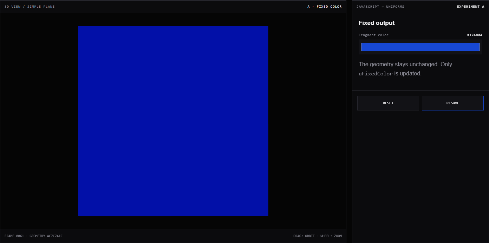
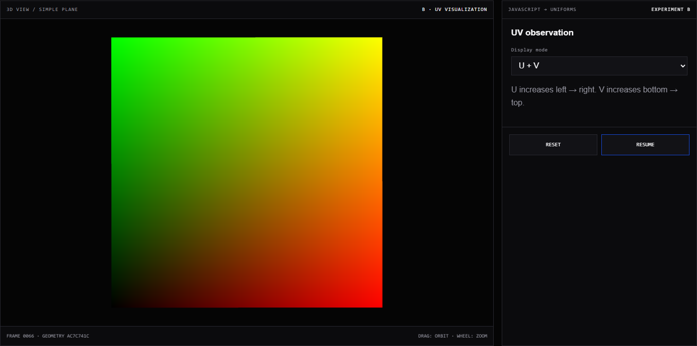
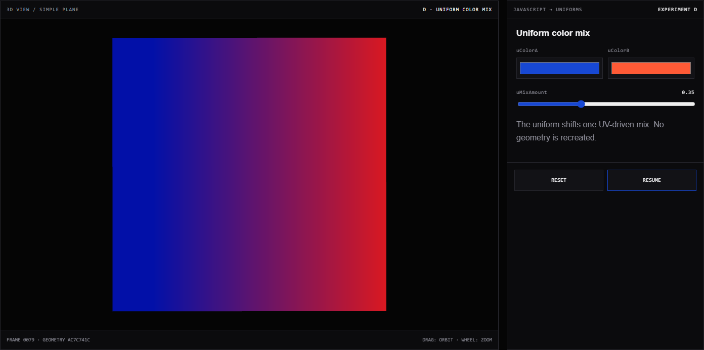
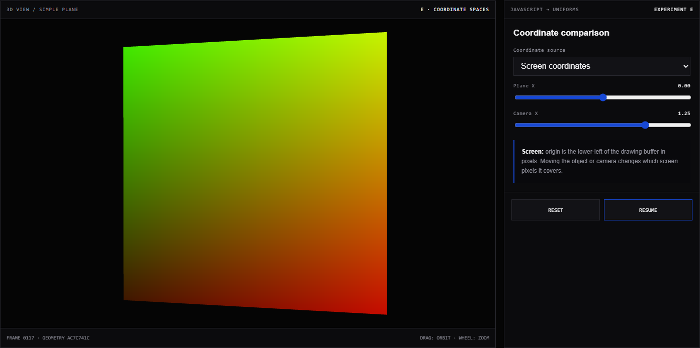
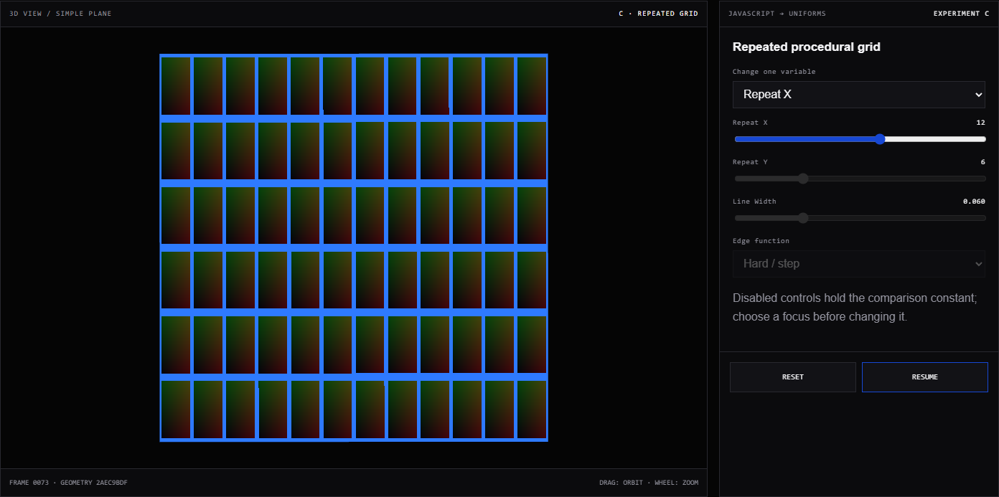
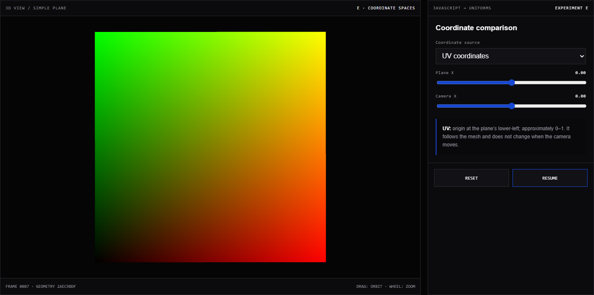
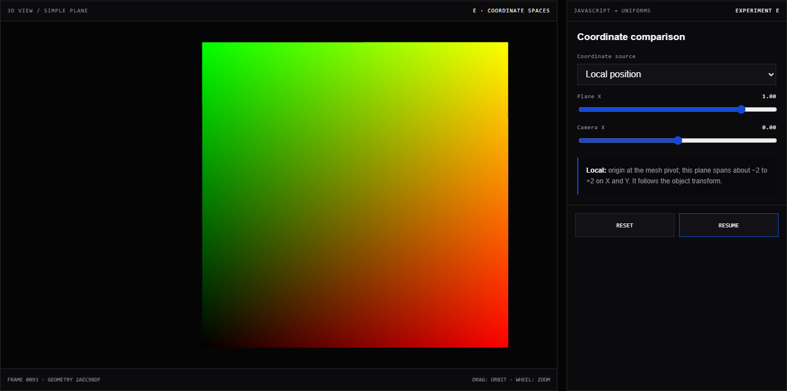
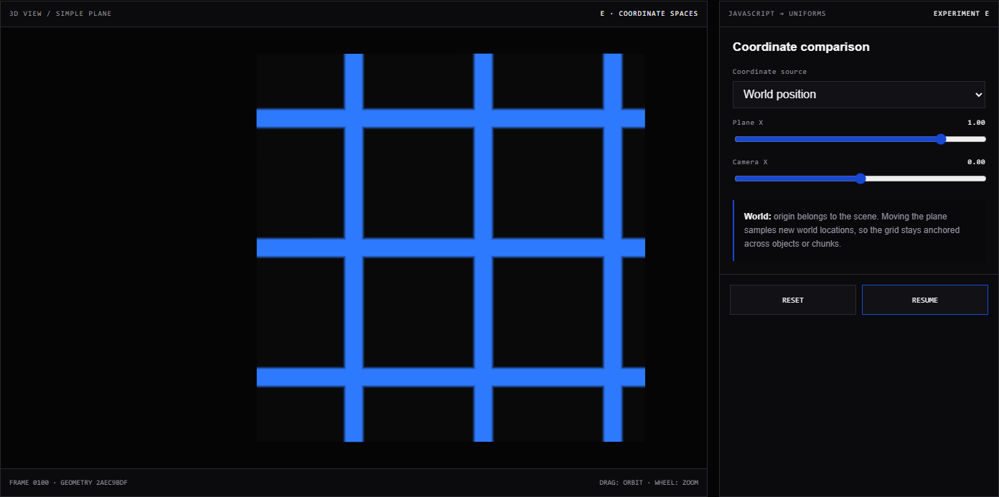

# Learning to See the GPU: My First Shader Experiments

> Round 01 · Minimal plane experiments · Status: Implemented, personal observations and screenshots still to be completed

This study isolates the smallest useful shader pipeline in the existing Three.js project. It uses one `PlaneGeometry`, one `ShaderMaterial`, native HTML controls, and five display modes. Lighting, textures, noise, terrain shading, and post-processing are deliberately excluded so each change has one visible cause.

Open the experiment at `experiments/shader-basics/index.html` through Vite, or choose **Shader Basics** from the Game Lab navigation.

## Repository Check Before Starting

| Question | Verified answer |
| --- | --- |
| Three.js version | `^0.180.0` in `package.json` (the r180 release line) |
| Page organization | Vite multi-page project with a shared hash-navigation homepage and independent pages under `experiments/` |
| Existing custom shader | No `ShaderMaterial`, `RawShaderMaterial`, authored vertex shader, or authored fragment shader was found before this experiment |
| Language | JavaScript ES modules; no TypeScript configuration or `.ts` source |
| Development | `npm run dev` or `./dev.cmd` |
| Production build | `npm run build` or `./build.cmd` |
| Existing unrelated changes | Documentation reorganization, screenshot evidence, Obsidian settings, and personal files were already modified; this experiment does not overwrite them |

## 1. Research Questions

1. Where does a shader sit in the rendering pipeline?
2. What do the vertex and fragment stages control?
3. How does a fragment know where it is?
4. How does JavaScript control GPU shader input through uniforms?
5. How do UV, local, world, and screen coordinates change a procedural pattern?

## 2. My Understanding Before Testing

Use this space before opening the experiment. It is intentionally not completed on the learner's behalf.

> Observation to complete after testing:
>
> What I currently think a vertex shader does:
>
> What I currently think a fragment shader does:
>
> What I expect a uniform to change:
>
> Which coordinate system I expect to work across terrain chunks, and why:

## 3. Minimal Rendering Pipeline


### How to read this map

JavaScript creates the material and updates uniform values. The vertex shader runs for geometry vertices and writes both `gl_Position` and any varyings needed later. Rasterization fills the triangle and interpolates those varyings. The fragment shader runs for the generated fragments and outputs a color.

### Key insight

JavaScript does not calculate every pixel. It supplies geometry, program code, and shared inputs; the GPU repeatedly executes that program over vertices and fragments.

## 4. Vertex Shader Responsibility

The minimum job is to write `gl_Position`, the vertex position in clip space:

```glsl
void main() {
  gl_Position = projectionMatrix
    * modelViewMatrix
    * vec4(position, 1.0);
}
```

- `position` is a per-vertex geometry attribute.
- `modelViewMatrix` applies the object's transform and the inverse camera transform.
- `projectionMatrix` applies perspective projection.
- The four-component result is required by the next pipeline stage.

The full experiment also passes `uv`, local `position`, and `modelMatrix * position` to the fragment stage so Experiment E can compare coordinate spaces.

## 5. Fragment Shader Responsibility

The fixed-color fragment shader receives one shared color and outputs it:

```glsl
uniform vec3 uFixedColor;

void main() {
  gl_FragColor = vec4(uFixedColor, 1.0);
}
```

The fragment stage does not automatically know the model's UV or world position. Those values must be passed as varyings from the vertex stage. Screen-space position is the exception here: GLSL provides `gl_FragCoord` for the current fragment.

## 6. Attribute, Uniform, and Varying

| Data type | Where it begins | How often it can differ | Example in this experiment |
| --- | --- | --- | --- |
| Attribute | Geometry buffer | Per vertex | `position`, `uv` |
| Uniform | JavaScript / renderer | Shared for one draw call | `uColorA`, `uRepeat`, `uResolution` |
| Varying | Written by vertex shader | Interpolated per fragment | `vUv`, `vLocalPosition`, `vWorldPosition` |

Changing a uniform updates material input. It does not recreate `PlaneGeometry`. The experiment displays the geometry UUID beside the frame counter so this can be checked while moving controls.

## 7. Five Experiments

### Experiment A — Fixed Color

1. Select **A · Fixed Color**.
2. Change the Fragment Color input.
3. Confirm the whole plane changes color.
4. Pause and resume the slow CPU-side plane rotation.
5. Watch the geometry UUID while changing the color.

This verifies that geometry reaches the GPU, the vertex shader writes a valid position, the fragment shader writes a color, and `ShaderMaterial` connects both programs.

> Observation to complete after testing:
>
> What changed when I edited the color:
>
> What did not change:
>
> Did the geometry UUID remain the same?

### Experiment B — UV Visualization

1. Select **B · UV View**.
2. Compare **U only**, **V only**, and **U + V**.
3. Compare **Hard boundary / step** with **Smooth boundary / smoothstep**.
4. Identify the four corners before rotating the camera.

For `vec3(vUv.x, vUv.y, 0.0)`, the lower-left is near black, lower-right is red, upper-left is green, and upper-right combines red and green into yellow. The GPU interpolates UV values between the plane's corner vertices.

> Observation to complete after testing:
>
> Colors seen at lower-left, lower-right, upper-left, and upper-right:
>
> Visual difference between `step` and `smoothstep`:
>
> Did moving the camera alter the UV values or only their projected view?

### Experiment C — Repeated Grid

1. Select **C · Repeat Grid**.
2. Choose one item under **Change one variable**.
3. Adjust only the enabled control; the other core controls remain disabled.
4. Repeat for Repeat X, Repeat Y, Line Width, and Edge Function.

Multiplying `uv * repeat` makes the 0–1 interval cover more cycles. `fract` discards the integer part, returning only the repeating fractional portion of every cycle. `step` switches immediately at a threshold; `smoothstep` blends over a small interval. No image is sampled, so the grid is a procedural pattern calculated independently for every fragment.

> Observation to complete after testing:
>
> Effect of increasing Repeat X:
>
> Effect of increasing Repeat Y:
>
> Effect of Line Width:
>
> Hard-edge versus smooth-edge appearance:

### Experiment D — Uniform Color Mix

1. Select **D · Uniform Mix**.
2. Set `uColorA` and `uColorB` to visibly different colors.
3. Move `uMixAmount` from 0 to 1.
4. Confirm the geometry UUID remains unchanged.

Every fragment receives the same uniform values. The shader combines the shared mix amount with `vUv.x`, so pixels can still receive different results across the plane. JavaScript changes inputs to an existing GPU program; it does not generate a new mesh.

> Observation to complete after testing:
>
> What happened at mix amounts 0, 0.5, and 1:
>
> Why did the plane still contain a gradient if the uniform was shared?
>
> Did geometry or only material input change?

### Experiment E — Coordinate Comparison

1. Select **E · Coordinates**.
2. Compare UV, Local, World, and Screen modes.
3. Change Plane X while viewing each mode.
4. Change Camera X or drag with OrbitControls while viewing each mode.
5. Pause the slow object rotation when a stationary comparison is needed.

The vertex shader explicitly transfers world position:

```glsl
vec4 worldPosition = modelMatrix * vec4(position, 1.0);
vWorldPosition = worldPosition.xyz;
gl_Position = projectionMatrix * viewMatrix * worldPosition;
```

The fragment shader receives an interpolated world-space point for each fragment:

```glsl
varying vec3 vWorldPosition;
vec2 worldGrid = vWorldPosition.xy * 0.75;
```

> Observation to complete after testing:
>
> Which patterns followed the object?
>
> Which pattern stayed anchored to the world?
>
> Which pattern changed when the camera moved?
>
> Which mode seems most suitable for continuous material coordinates across terrain chunks?

## 8. Actual Observations

Complete this section only after running all five experiments.

> Observation to complete after testing:
>
> Most surprising result:
>
> A prediction that was correct:
>
> A prediction that changed:
>
> One control that made the data flow clearer:

## 9. Coordinate Comparison

The table records definitions and expected behavior from the implementation. Add personal test results in the observation block below it.

| Coordinates | Origin and approximate range | Moving the plane | Moving the camera | Terrain/chunk use |
| --- | --- | --- | --- | --- |
| UV | Lower-left of this plane; 0–1 | Pattern follows the mesh | Values stay attached; projected appearance moves | Good for one mesh; seams depend on compatible UVs |
| Local position | Mesh pivot; plane is about −2 to +2 in X/Y | Pattern follows the mesh transform | Local values do not change | Not automatically continuous between chunk-local origins |
| World position | Scene origin; range depends on placement | Surface samples different world locations | Values remain world-based | Best starting point here for cross-chunk continuity |
| Screen position | Drawing-buffer lower-left; pixel range normalized by resolution | Covered pixels change | Covered pixels change | Useful for screen effects, not world-anchored terrain |

> Observation to complete after testing:
>
> Does my test agree with each expected row? Record any disagreement and the exact steps that produced it.

## 10. Errors and Solutions

No personal testing error is recorded yet. Do not treat a successful production build as proof that every browser and GPU compiles the shader identically.

> Observation to complete after testing:
>
> Browser and GPU tested:
>
> Console or shader compilation message:
>
> Steps that caused it:
>
> Change that fixed it:

## 11. Round-One Conclusion

The implementation establishes one reusable geometry, a custom vertex/fragment pair, JavaScript-driven uniforms, interpolated coordinate data, and five deliberately small visual questions. The learner's conclusion belongs below after direct comparison.

> Observation to complete after testing:
>
> In my own words, a vertex shader controls:
>
> In my own words, a fragment shader controls:
>
> A uniform is:
>
> The coordinate system I would try first for chunk-continuous terrain is:

## 12. Questions for a Future Round

Only one next research question is recommended: **How can a time uniform deform vertex positions while normals and coordinate choices remain understandable?**

Noise, FBM, real lighting, PBR, image textures, water, ray marching, terrain materials, Marching Cubes materials, WFC, and post-processing remain future topics and are not implemented in this round.

## 13. Screenshot Plan

Do not add mockups. Capture these from the running page after personally checking the relevant mode.

Run the repeatable evidence capture from the repository root:

```powershell
.\.tools\node-v24.19.0-win-x64\npm.cmd run evidence:shader
```

The command uses the installed Chrome browser, saves each run in a timestamped folder under `docs/assets/screenshots/shader-basics/`, and appends that run to the generated `Captured Evidence` block in this document. It does not fill in personal observations. Set `PLAYWRIGHT_CHROME_PATH` only if Chrome or Edge is installed in a non-standard location.

| Planned file | Required state | What the image must prove |
| --- | --- | --- |
| `docs/assets/screenshots/shader-basics/<capture-id>/shader-fixed-color.png` | Experiment A with a clearly chosen fixed color | ShaderMaterial, vertex stage, and fragment output produce a visible plane |
| `docs/assets/screenshots/shader-basics/<capture-id>/shader-uv-gradient.png` | Experiment B, U + V mode | Four corners reflect interpolated 0–1 UV values |
| `docs/assets/screenshots/shader-basics/<capture-id>/shader-repeat-grid.png` | Experiment C with non-default repeat values and one focus control enabled | `fract(uv * repeat)` creates an adjustable procedural grid |
| `docs/assets/screenshots/shader-basics/<capture-id>/shader-uniform-mix.png` | Experiment D with two distinct colors and visible mix amount | JavaScript uniforms alter color without rebuilding geometry |
| `docs/assets/screenshots/shader-basics/<capture-id>/shader-coordinate-{uv,local,world,screen}.png` | Four captures of UV, local, world, and screen modes | Object and camera changes affect coordinate spaces differently |

For every captured image, add **What this shows**, **Why it matters**, and **Parameters or conditions** before changing the document status to visually verified.

## Captured Evidence

<!-- evidence-capture:shader-basics:start -->
> Automatically refreshed by `npm run evidence:shader` on Oct 3, 2026, 9:49 a.m.. Images and control states are recorded evidence; observations remain for the learner.

### Experiment A — Fixed Color



**What this shows:** A single plane rendered by the custom ShaderMaterial while JavaScript exposes the fixed-color uniform.

**Why it matters:** This is the minimum visible proof that geometry, the vertex stage, the fragment stage, and the material are connected.

**Parameters or conditions:** Experiment A; uFixedColor #1748d4; one PlaneGeometry; animation paused before capture.

> Observation to complete after testing:
>
> Write what you personally noticed in this captured state.

### Experiment B — UV Gradient



**What this shows:** The plane maps interpolated U and V values to the red and green color channels.

**Why it matters:** The corner colors make the direction and 0–1 range of geometry UV coordinates directly visible.

**Parameters or conditions:** Experiment B; U + V mode; default plane and camera; animation paused before capture.

> Observation to complete after testing:
>
> Write what you personally noticed in this captured state.

### Experiment C — Repeated Grid


**What this shows:** A procedural grid produced from repeated UV cells while the active Repeat X control remains visible.

**Why it matters:** Changing one repeat value demonstrates that fract creates repetition without loading an image texture.

**Parameters or conditions:** Experiment C; Repeat X 12; Repeat Y 6; line width 0.060; hard step edge; animation paused before capture.

> Observation to complete after testing:
>
> Write what you personally noticed in this captured state.

### Experiment D — Uniform Color Mix



**What this shows:** Two JavaScript colors and one mix amount control the fragment result without replacing the plane.

**Why it matters:** Uniforms change shader input for existing geometry and can still combine with per-fragment UV values.

**Parameters or conditions:** Experiment D; uColorA #1748d4; uColorB #ff5a36; uMixAmount 0.35; animation paused before capture.

> Observation to complete after testing:
>
> Write what you personally noticed in this captured state.

### Experiment E1 — UV Coordinates


**What this shows:** The coordinate experiment using the plane’s 0–1 UV values.

**Why it matters:** This is the object-attached baseline for local, world, and screen-coordinate comparison.

**Parameters or conditions:** Experiment E; UV coordinates; Plane X 0.00; Camera X 0.00; animation paused before capture.

> Observation to complete after testing:
>
> Write what you personally noticed in this captured state.

### Experiment E2 — Local Position


**What this shows:** The local-position pattern remains attached to the plane after the object moves along world X.

**Why it matters:** It separates coordinates stored on the geometry from the object’s later world transform.

**Parameters or conditions:** Experiment E; Local position; Plane X 1.00; Camera X 0.00; animation paused before capture.

> Observation to complete after testing:
>
> Write what you personally noticed in this captured state.

### Experiment E3 — World Position


**What this shows:** The world-position pattern is evaluated after the plane is translated in the scene.

**Why it matters:** World space is relevant for patterns intended to continue across separate terrain chunks.

**Parameters or conditions:** Experiment E; World position; Plane X 1.00; Camera X 0.00; animation paused before capture.

> Observation to complete after testing:
>
> Write what you personally noticed in this captured state.

### Experiment E4 — Screen Coordinates



**What this shows:** The fragment pattern is derived from gl_FragCoord while the camera is offset.

**Why it matters:** It distinguishes viewport-relative pixels from coordinates belonging to geometry or world space.

**Parameters or conditions:** Experiment E; Screen coordinates; Plane X 0.00; Camera X 1.25; animation paused before capture.

> Observation to complete after testing:
>
> Write what you personally noticed in this captured state.

### Capture Run — Oct 3, 2026, 9:52:02 a.m.

> Created by `npm run evidence:shader`. Archive ID: `2026-10-03-095202-178`. This run is appended rather than replacing earlier evidence.

**Experiment A — Fixed Color**


**What this shows:** A single plane rendered by the custom ShaderMaterial while JavaScript exposes the fixed-color uniform.

**Why it matters:** This is the minimum visible proof that geometry, the vertex stage, the fragment stage, and the material are connected.

**Parameters or conditions:** Experiment A; uFixedColor #1748d4; one PlaneGeometry; animation paused before capture.

> Observation to complete after testing:
>
> Write what you personally noticed in this captured state.

**Experiment B — UV Gradient**


**What this shows:** The plane maps interpolated U and V values to the red and green color channels.

**Why it matters:** The corner colors make the direction and 0–1 range of geometry UV coordinates directly visible.

**Parameters or conditions:** Experiment B; U + V mode; default plane and camera; animation paused before capture.

> Observation to complete after testing:
>
> Write what you personally noticed in this captured state.

**Experiment C — Repeated Grid**



**What this shows:** A procedural grid produced from repeated UV cells while the active Repeat X control remains visible.

**Why it matters:** Changing one repeat value demonstrates that fract creates repetition without loading an image texture.

**Parameters or conditions:** Experiment C; Repeat X 12; Repeat Y 6; line width 0.060; hard step edge; animation paused before capture.

> Observation to complete after testing:
>
> Write what you personally noticed in this captured state.

**Experiment D — Uniform Color Mix**


**What this shows:** Two JavaScript colors and one mix amount control the fragment result without replacing the plane.

**Why it matters:** Uniforms change shader input for existing geometry and can still combine with per-fragment UV values.

**Parameters or conditions:** Experiment D; uColorA #1748d4; uColorB #ff5a36; uMixAmount 0.35; animation paused before capture.

> Observation to complete after testing:
>
> Write what you personally noticed in this captured state.

**Experiment E1 — UV Coordinates**



**What this shows:** The coordinate experiment using the plane’s 0–1 UV values.

**Why it matters:** This is the object-attached baseline for local, world, and screen-coordinate comparison.

**Parameters or conditions:** Experiment E; UV coordinates; Plane X 0.00; Camera X 0.00; animation paused before capture.

> Observation to complete after testing:
>
> Write what you personally noticed in this captured state.

**Experiment E2 — Local Position**



**What this shows:** The local-position pattern remains attached to the plane after the object moves along world X.

**Why it matters:** It separates coordinates stored on the geometry from the object’s later world transform.

**Parameters or conditions:** Experiment E; Local position; Plane X 1.00; Camera X 0.00; animation paused before capture.

> Observation to complete after testing:
>
> Write what you personally noticed in this captured state.

**Experiment E3 — World Position**



**What this shows:** The world-position pattern is evaluated after the plane is translated in the scene.

**Why it matters:** World space is relevant for patterns intended to continue across separate terrain chunks.

**Parameters or conditions:** Experiment E; World position; Plane X 1.00; Camera X 0.00; animation paused before capture.

> Observation to complete after testing:
>
> Write what you personally noticed in this captured state.

**Experiment E4 — Screen Coordinates**


**What this shows:** The fragment pattern is derived from gl_FragCoord while the camera is offset.

**Why it matters:** It distinguishes viewport-relative pixels from coordinates belonging to geometry or world space.

**Parameters or conditions:** Experiment E; Screen coordinates; Plane X 0.00; Camera X 1.25; animation paused before capture.

> Observation to complete after testing:
>
> Write what you personally noticed in this captured state.
<!-- evidence-capture:shader-basics:end -->

## Relevant Files

- `experiments/shader-basics/index.html` — experiment structure and controls.
- `experiments/shader-basics/demo.js` — geometry, ShaderMaterial, GLSL, uniforms, and interaction.
- `experiments/shader-basics/style.css` — responsive Game Lab presentation.
- `vite.config.js` — production entry registration.
- `site.js` and `index.html` — shared website navigation.
