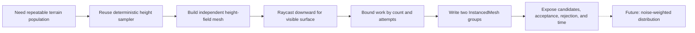

# 2026-10-07 — Seeded Terrain Scattering with Surface Queries and Instances

## Context

Class 06 opened a new procedural-content-generation track without adding more controls to Voxel Terrain. The first bounded question was how to place repeatable objects on visible terrain while keeping failed candidates, performance cost, and known random-distribution weaknesses observable.

The repository audit found two different terrain representations. Voxel Terrain uses chunked 3D density fields and extracted surfaces, while Cellular Noise exposes a deterministic world-coordinate `sampleHeight()` used by a non-chunked deformed plane. The new lab reuses the independent Cellular height sampler but owns its page, terrain mesh, scattering logic, tests, and documentation.

## Decision Path

### How to read this map

Solid arrows are implemented Round 01 decisions. The dotted arrow is the next research question and does not claim that Noise Distribution exists.

### Key insight

The scatterer separates proposing a location from proving that a surface exists. That separation makes the maximum-attempt budget, rejected candidates, and surface-query method visible study subjects rather than hidden implementation details.

## Implemented

- Added the independent `/experiments/pcg-terrain/` Vite page and `#pcg` website entry.
- Added Scattering, Paths & Splines, and Particles & Fields tabs; only Scattering is functional.
- Reused `sampleHeight()` from Cellular Noise to construct a static height-field mesh.
- Added downward `THREE.Raycaster` surface queries and documented the top-intersection limitation.
- Added seeded candidate generation, count/attempt limits, scale range, optional yaw, regeneration, and reset.
- Added two `THREE.InstancedMesh` groups for placeholder tree trunks and crowns.
- Added Candidate, Accepted, and Rejected point displays and eight visible Debug statistics.
- Added Sparse, Medium, and Dense presets.
- Added deterministic unit tests and a repeatable Playwright browser verification command.
- Added the learning record and Files & Notes deep link.

## Automated Results

Pure algorithm tests: **5 passed / 0 failed**.

The first full browser baseline with seed `CLASS-06` produced:

| Preset | Requested | Attempts | Accepted | Rejected | Rate | Generation time |
| --- | ---: | ---: | ---: | ---: | ---: | ---: |
| Sparse | 24 | 37 | 24 | 13 | 64.9% | 7.70 ms |
| Medium | 140 | 238 | 140 | 98 | 58.8% | 44.20 ms |
| Dense | 900 | 1,427 | 900 | 527 | 63.1% | 284.50 ms |

A second full browser run reproduced the attempt, acceptance, and rejection counts while timing varied to 6.70 ms, 39.30 ms, and 247.60 ms. This is expected timing variation, not a change in deterministic placement.

Browser verification also confirmed:

- same seed and parameters reproduce the placement signature;
- a different seed changes the signature;
- regeneration retains exactly one instance group and one debug group;
- all three debug visibility controls update;
- future tabs contain only their later-experiment message;
- the homepage entry and exact Files & Notes deep link work;
- direct load and refresh work;
- the 390 × 844 layout has no horizontal document overflow;
- Cellular Noise, Voxel Terrain, and Shader Basics still return HTTP 200;
- no browser or shader errors were recorded.

The production build transformed 742 modules and emitted `dist/experiments/pcg-terrain/index.html`. The existing shared-chunk size warning remains unrelated.

## Evidence Boundary

The code, tests, browser checks, and measured statistics are technically verified. Personal observations and the seven planned real screenshots remain intentionally incomplete. No conclusions about visual quality, perceived clustering, or usability were written for the learner.

## Next Session

1. Run `./dev.cmd` and open `http://localhost:5173/#pcg`.
2. Test Sparse, Medium, and Dense from one camera angle.
3. Regenerate the same seed twice, then change only the seed.
4. Toggle Candidate, Accepted, and Rejected separately and together.
5. Complete every observation block in [Seeds on the Surface: My First Terrain Scatter](../learning/pcg-terrain/random-scattering.md).
6. Capture the seven planned real evidence states under `docs/assets/screenshots/pcg-terrain/`.
7. Stop before implementing Noise Distribution, spacing rules, splines, fields, or particles.
