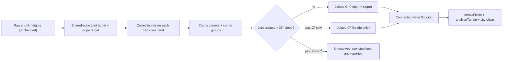

# 2026-10-19 — Procedural Mini World: Multi-Chunk Terrain and Water Seams Joined Where a Natural Slope Is Possible

## Context

Continuation of the [2026-10-18](./2026-10-18.md) session. Task **06.3a — Multi-Chunk Terrain & Water Seam**: make adjacent chunks of the 3 × 3 World Grid (06.2) form continuous, reproducible terrain and consistent water at shared edges, inside the existing transition bands, without hiding seams — and report every edge that cannot be joined.

The full task entry, with all numbers, is in [FINAL-EXPERIMENT-LOG.md](../procedural-mini-world/FINAL-EXPERIMENT-LOG.md) under "06.3a — Multi-chunk terrain and water seam". Review status: **implemented, verified, pending human review**. Nothing was committed, pushed, or deployed.

## Decision Path

## Implemented

- **Algorithm:** `experiments/world-grid/TerrainHarmonizer.js`.
  - Per shared edge, one joint target from both raw edge lines (blended to its corner-group target at the ends) and one slope target.
  - Each chunk is corrected only inside its own transition band, with the existing smoothstep edge weight; corners use a Coons boolean sum.
  - Edge samples are written to identical values on both sides.
  - Edges that would create slopes > 35° fall back from C¹ to C⁰, then become unresolved; the band is never widened automatically.
- **Water:** connected flooding from raw water bodies.
  - Sea may continue into the neighbour's band of that edge; rivers never continue into a neighbour without a channel.
  - Incompatible levels are reported, not connected.
- **Architecture:** `WorldGrid.js` now has raw → harmony → terrain → city layers with keys.
  - Raw heights are never modified; `?terrain=raw` restores the 06.2 behaviour.
  - A City ID change never re-runs harmonisation; a transition-width change rebuilds terrain and all city layers.
- **Debug:** World Grid page gains Terrain mode and Transition width controls.
  - Seam Debug shows edge status (green C¹ / yellow C⁰ / red unresolved), band limits, water state, and height risers; the panel lists each edge's join status, Δh, kink, band slope, and water reasons.
- **Tunnels:** the known 05.1b-2 failure combination is detected after the cut and isolated (cut removed, solid closed, reported); the tunnel algorithm is unchanged.
- **Regression:** `scripts/verify-world-grid.mjs` now checks 06.2 in raw mode and expects the known tunnel failure to be isolated; it passes.

## Verified Results

- **Default world (seed 6201, transition 128 m):**

  | Measure | Raw | Harmonised |
  | --- | --- | --- |
  | Edges joined | 0 / 12 | 4 / 12 (all C¹) |
  | Δh on joined edges | — | 0 at every sample; sampler and mesh identical |
  | Max seam step overall | 296 m | 296 m (on unresolved mountain edges) |
  | Slope kink on joined edges | — | median 0°, max 8.6° (near the closed corner) |
  | Interior corners closed | 0 / 4 | 1 / 4 |
  | One-sided water edges | 6 | 4 |
  | Cells changed outside bands | — | 0 |

- **Water:** 2 plain | coast edges resolved (shore moved inside the coast band). 4 retained, all on unresolved terrain edges, with named reasons:
  - river 31 m | mountain
  - river 29 m | plain
  - sea 0 m | river ≈ 30 m (incompatible levels)
  - sea | sea blocked by a 47 m terrain step
- **Other widths and seeds:**
  - W 64 → 5 / 12 joined; W 256 → 5 / 12 joined.
  - Seed 6202 → 6 / 12 joined, water edges 3 → 2.
  - Seed 6203 → 4 / 12 joined, water edges 6 → 3.
- **Architecture checks:** City ID switch leaves all terrain unchanged; reversed / rotated input gives identical output; reload is identical; all 9 solids are closed.
- **Downstream effect:** chunk_0_1 (cityId `auto`) switches from Lisbon to Manhattan because its harmonised terrain analysis changed; manual City IDs are unaffected.
- **Performance:**
  - Harmonisation 0.54–0.64 s for the whole world.
  - Full world build raw ≈ 22–24 s vs harmonised ≈ 22–25 s (within run noise).
  - Transition-width change ≈ 21–24 s; City ID change ≈ 4 s.

## Files

- New:
  - `experiments/world-grid/TerrainHarmonizer.js`
  - `scripts/verify-world-seam.mjs`
  - `experiments/world-grid/evidence/world-seam.json`
- Changed in `experiments/world-grid/`:
  - `WorldGrid.js`, `worldConfig.js` (`terrainMode`)
  - `SeamCheck.js`, `SeamView.js`
  - `main.js`, `index.html`
- Changed elsewhere: `scripts/verify-world-grid.mjs`.
- Not changed: anything in `experiments/seed-terrain/` (terrain generator, City DNA, network, parcels, buildings, tunnels), grid positions, chunk size.
- Screenshots:
  - [06-3a-world-harmonized-overall.png](../assets/screenshots/procedural-mini-world/06-3a-world-harmonized-overall.png)
  - [06-3a-seam-closeup-compare.png](../assets/screenshots/procedural-mini-world/06-3a-seam-closeup-compare.png)
  - [06-3a-seam-debug.png](../assets/screenshots/procedural-mini-world/06-3a-seam-debug.png)

## Unresolved Seam Issues

- Every mountain edge (raw steps 116–315 m) and the steep-bank river-valley edges cannot be joined within 32–256 m without slopes > 35°.
- Only 1 of 4 interior corners closes per seed; open corners keep 74–255 m spreads.
- Slope continuity is not achieved on C⁰ edges (kink up to 41.8°) or within ≈ 45 m of closed corners (up to 8.6°); rendered normals differ by up to 8.9° because each chunk computes its own normals.
- Water stays discontinuous on unresolved edges and where levels are incompatible; rivers end at edges whose neighbour has no channel.
- Edge ports are not paired or redirected; the outer world edge is not harmonised; the known tunnel failure is isolated, not fixed.

## Open Decision Waiting for Review

How to handle unresolvable edges before any cross-chunk road joins:

- a wider band by explicit user choice;
- a landform-compatibility rule at slot assignment;
- a dedicated escarpment / shore rule.

## How to Resume

- `/experiments/world-grid/` (harmonised), `?terrain=raw` (06.2), `?seams=1` (debug), `?transitionWidth=…`, `?worldSeed=…`, `?focus=x,z,d`.
- Re-check: `node scripts/verify-world-seam.mjs` (06.3a) and `node scripts/verify-world-grid.mjs` (06.2, raw mode).
- Working tree: branch `experiment/terrain-seam`, HEAD `a38c73d`, all new work uncommitted.

## Keywords

06.3a · Multi-Chunk Terrain & Water Seam · TerrainHarmonizer · seam harmonisation · transition band · Coons corner · C¹ / C⁰ join · unresolved edge · water interface · sea / river level · World Grid · worldSeed 6201 / 6202 / 6203 · tunnel isolation
