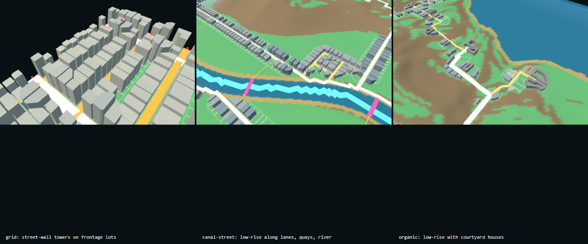

# Building Extrusion

Part of [03 Generative System](./system-architecture.md) · Status: **Verified** (heights are assumptions, **Unverified** against research)

## Purpose

Give each valid parcel zero or one grey-box building whose footprint follows the street frontage and setbacks, whose height follows the selected DNA, and whose base sits on the terrain without floating or cutting into it. These are massing volumes, not architectural models.

## Inputs → outputs

- **Inputs:** parcels (frontage lines, orientation, adjustable flag), fields, `cityMatch`, config.
- **Output:** `generateBuildings(parcels, fields, cityMatch, config)` returns footprints (with courtyard voids where the DNA allows), floors, height, base elevation, and stats (count, coverage, height percentiles, corner buildings). `BuildingView.js` extrudes and merges them for rendering.

## Rules (`buildingRules.js`, per DNA)

- Type `streetFrontage`: the footprint fills `occupancy` of the lot from the frontage, with side setback and maximum depth.
- Height = floors × floor height. Floors fall within the DNA's range, driven by weighted factors: distance to a seeded centre (`centreRadius`), street class, and lot area, plus seeded jitter. Values per DNA: [City DNA Library](../research/city-dna-library.md). For example, Manhattan has 3–32 floors × 3.6 m, and Fez has 1–4 floors with courtyards on lots ≥ 140 m².
- Ground contact is re-sampled on a 1 m lattice plus 0.5 m along the footprint edges (a fix from 05.1 testing, where 2 m sampling missed a local high point), so the base neither floats nor sits below the ground.
- All values are tagged A; no city's height distribution has been measured yet.

## Upstream / downstream

- **Upstream:** [Block & Parcel](./block-and-parcel.md), [Terrain & Water](./terrain-and-water.md), [City DNA Matching](./city-dna-matching.md).
- **Downstream:** rendering and statistics only. In the world, the city layer of each tile ([World Grid & Seam](./world-grid-and-seam.md)).

## Code

`experiments/seed-terrain/buildingRules.js`, `BuildingGenerator.js`, `BuildingView.js` · verifier `verify-buildings.mjs` · in Git since `7b21c3e`.

## Representative experiments

05.1 (grey boxes); 06.1 (Chicago / Amsterdam / Lisbon height rules). See [Urban Form Experiments](../04-experiments/urban-form-experiments.md).

*Seed 1101: grid street wall, canal-street lanes and quays, organic courtyards.*

## Verified / known limitations

- **Verified (05.1):** 9 / 9 runs, 0 issues. Grid: 1 664–1 702 buildings (91–92 % of parcels), mean height 60.1–60.5 m, p90 90–94 m, max 115 m, 236–249 corner buildings. Coverage 79 % of built parcels.
- **Limits:** grid heights are tall overall (mean ≈ 60 m), a prototype assumption not checked against Manhattan PLUTO data. Organic heights use only 3 floor counts. Canal-street buildings almost never face water (0–3 per run). The courtyard is a simplified ring void. Chicago's tower core is a seeded point, not a transit node (06.1).
