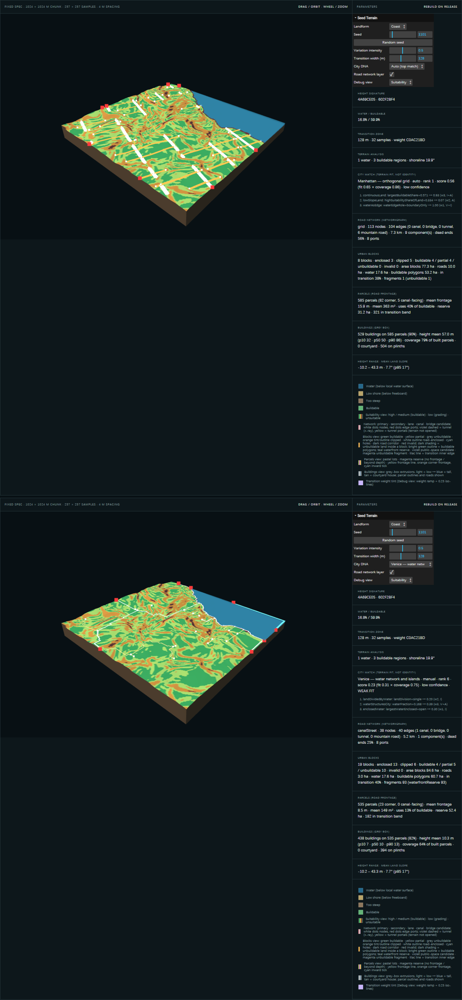

# City DNA Matching

Part of [03 Generative System](./system-architecture.md) · Status: **Verified** for 6 DNAs; thresholds **Unverified** (assumptions)

## Purpose

Rank the City DNAs by how well the analysed terrain suits their spatial rules, transparently and deterministically. This is the step where the design changed: the City DNA no longer *creates* the terrain (early design, 02.1), it is *matched* to terrain that was generated city-neutral (current design, from 02.2). See [Project Foundation](../01-foundation/project-foundation.md).

## Inputs → outputs

- **Input:** `terrainAnalysis` only ([Terrain Analysis](./terrain-analysis.md)) and an optional manual override (`dna=auto` or a DNA id; per tile in the world: City ID).
- **Output:** `matchCity(analysis, { override })` returns the ranking of all DNAs, `selectedDNA` (id, label, score, fit, coverage, confidence, decisive reasons, `identityRules`, `identityNote`, hints for later stages), and `unresolvedEvidence`.

## Rules (`cityMatchRules.js`)

- Each DNA lists weighted **conditions**. Each condition maps one analysis metric to 0–1 with a linear ramp or a lookup. A **conflict** caps the score (e.g. no water ⇒ Venice 0).
- `fitScore` = weighted mean of the evaluated conditions. `evidenceCoverage` = evaluated weight / total weight. **`rankScore = fitScore × evidenceCoverage`**, so missing research earns no credit.
- Evidence tags on every condition: **V** = sourced fact, **I** = inference, **A** = generator assumption (uncalibrated), **TBD** = evidence missing (never scored, always reported).
- `rankScore` < 0.4 is reported as a weak fit. "High" confidence is unreachable until thresholds are measured. Ties break in a fixed DNA order.
- The score measures **terrain fit only**. City identity comes from the network, parcel, and building rules ([City DNA Library](../research/city-dna-library.md)).

## Upstream / downstream

- **Upstream:** [Terrain Analysis](./terrain-analysis.md); research rules from [prototype-city-selection](../research/prototype-city-selection.md), [city-longlist-60](../research/city-longlist-60.md), and [manhattan-spatial-study](../research/manhattan-spatial-study.md).
- **Downstream:** `cityMatch.selectedDNA` selects the strategy and rules in [Road & Tunnel](./road-and-tunnel.md), [Block & Parcel](./block-and-parcel.md), and [Building Extrusion](./building-extrusion.md).

## Code

`experiments/seed-terrain/cityMatchRules.js`, `CityMatcher.js` · verifiers `verify-city-match.mjs`, `verify-city-dna.mjs` · in Git since `7b21c3e`.

## Representative experiments

02.6 (3 DNAs), 06.1 (3 → 6 by configuration); see [Urban Form Experiments](../04-experiments/urban-form-experiments.md).

*Coast 1101: auto → Manhattan, and Venice forced by hand, on the same terrain signature `4A69CE05 · 602F2BF4`.*

## Verified / known limitations

- **Verified:** 02.6: 12 / 12 runs; plain → Manhattan 0.80 > Fez 0.29 (weak) > Venice 0 (weak). 06.1: 72 / 72 runs; the original three DNAs bit-identical to the baseline; manual switch never changes the terrain or the ranking.
- **Limits:** every numeric threshold is tagged A. Venice never fits, because no landform produces a lagoon or islands. Chicago and Amsterdam never win auto-match on the 12 test terrains. Mountains are a weak fit for all six.
