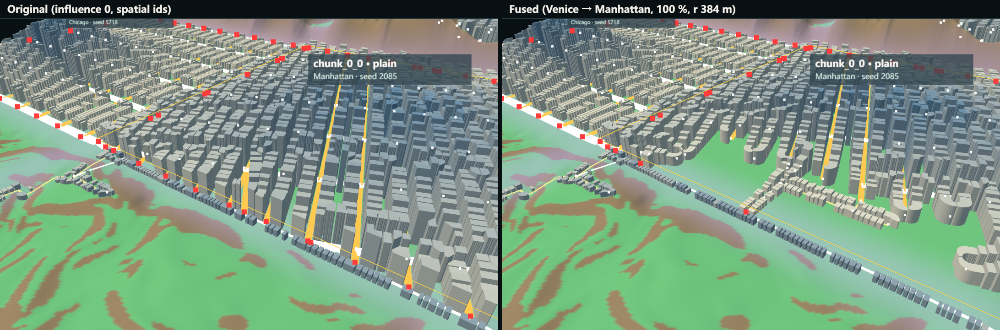

# City Influence & Fusion

Part of [03 Generative System](./system-architecture.md) · Status: **07.1 and 07.1a Implemented, verified, pending review** (one source city, one target chunk); City Expansion and Morphological Transition **Proposed**. The note below kept the title "City Influence (future stage)" until DOC-06 (2026-10-28).

| Navigation | |
| --- | --- |
| Parent study area | [Knowledge base home](../README.md), research path §4.1 |
| Prerequisite | [World Grid & Seam](./world-grid-and-seam.md) |
| This experiment | 07.1 City Invasion & Fusion; 07.1a stable generation with spatial ids |
| Next investigation | [Procedural Growth](./procedural-growth.md): the teacher's feedback on 2026-10-27 moved the mainline from mixing fixed chunks to growing cities |
| Code | [experiments/world-grid/CityInfluence.js](../../../experiments/world-grid/CityInfluence.js), `InfluenceView.js` · verifiers `verify-city-influence.mjs`, `verify-city-influence-stable.mjs` |
| Runtime entry | Local only (not on `main`): `/experiments/world-grid/?city=chunk_0_1:veniceWaterNetwork&invade=chunk_0_1>chunk_0_0&strength=100&radius=384&field=1&zone=1`; add `&ids=spatial` for 07.1a |
| Related commit | `79687a0` G00 checkpoint: City Influence & Fusion (07.1, 07.1a) before Procedural Growth (local, not pushed) |

## Implemented: 07.1 and 07.1a (2026-10-21)

- **Research question:** can one city's rules invade a neighbouring chunk so the boundary shows a mixed morphology that follows an influence weight, while terrain, water and other chunks stay unchanged?
- **Method:** per-edge network switch inside the target band; parcel and building rules blended by weight (log 07.1). 07.1a adds an opt-in spatial id mode: geometry-based ids and random streams keyed by world seed and stable identity.
- **Result and evidence:** the boundary changes from Manhattan towers to low, small Venice-rule lots along new lanes. With legacy ids, 46 parcels in the w = 0 zone (seed 6201) still changed outcome; with spatial ids, 0 did, and every remaining change is explained by a changed block, road or sibling lot.
- **Problems:** 07.1 street switching can leave gaps where base streets are removed before invader streets cover the area (log 07.1 next task).
- **What changed in understanding (from the log):** "unchanged outside the influence" is only testable once ids are tied to geometry rather than to generation order.
- **Limitations:** one source and one target only; no expansion, no multi-city competition.
- **Next question (as logged):** should spatial ids become the World Grid default? Not decided yet; the mainline moved to growth on 2026-10-27.



**What this shows:** inside the influence radius, tall Manhattan blocks near the Venice boundary are replaced by small Venice-rule lots and curved lanes; the Chicago chunk behind and the terrain are unchanged.
**Conditions:** world seed 6201, spatial ids, Venice chunk_0_1 → Manhattan chunk_0_0, strength 100 %, radius 384 m (log 07.1a).
**Why it matters:** it is the only experiment that tests the "mix" part of the original research question.
**Limit:** it does not show whether the fused zone reads as a plausible city; that is an open review question.

> Observation to complete after testing: at which strength does the boundary stop reading as Manhattan?

## Original plan (2026-10-19, historical)

Nothing in this note describes working code. It records what exists as a reserved interface and what the next stages are meant to answer.

## Why it is needed

Today a city is confined to its tile: the City ID selects one DNA for one 1024 m chunk ([World Grid & Seam](./world-grid-and-seam.md)). The research question also asks how identity behaves when rules **mix or are stitched together** ([Project Foundation](../01-foundation/project-foundation.md)). That requires a city whose rules reach beyond its tile and meet another city's rules.

## What exists in the code (interfaces only)

| Item | Where | State |
| --- | --- | --- |
| `applyNeighborConstraints(fields, neighbors)` | `seed-terrain/TerrainFields.js` | Returns the tile unchanged without neighbours; **throws** if neighbours are passed ("reserved for a later task") |
| Edge port `neighborPortId` and redirect anchor | NetworkGraph edge ports (03.1) | Reserved, never set; ports are not paired across tiles |
| City influence | concept defined in 06.2 as "a future cross-chunk field" | No data structure, no code |

## Proposed sequence (from the current design)

```text
City Placement → Seam Connection → City Influence → City Expansion → Morphological Transition
   (06.2, done)    (06.3a, partial)     (proposed)        (proposed)          (proposed)
```

- **Seam Connection, remaining part:** decide what to do with unjoinable edges; pair and redirect street ports across edges.
- **City Influence:** a field per city (street spacing, lot size, height) that weakens with distance and terrain resistance.
- **City Expansion:** a city boundary that follows suitable terrain and competition with neighbours, instead of the tile grid.
- **Morphological Transition:** where two fields overlap, measure where an identity is kept, weakened, or re-formed.

No parameters, results, or screenshots exist for these stages: **TBD**.
