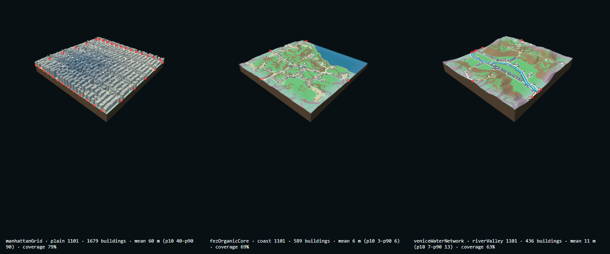

# System Architecture — Terrain-first Generation Chain

Part of [03 Generative System](../README.md) · Status: **implemented, pending review** (compass [§1, §5](../FINAL-EXPERIMENT-LOG.md))

| Navigation | |
| --- | --- |
| Parent study area | [Knowledge base home](../README.md), research path §4.1 |
| Prerequisite | [Research base](../research/city-longlist-60.md) and the 02.1 Manhattan greybox ([Terrain Experiments](../04-experiments/terrain-experiments.md), historical) |
| This experiment | T1–T6 single-chunk chain (log entries 02.2–05.1b-2) |
| Next investigation | [World Grid & Seam](./world-grid-and-seam.md) |
| Code | [experiments/seed-terrain/](../../../experiments/seed-terrain/) |
| Runtime entry | [Live](https://gameeeee-zc626.web.app/experiments/seed-terrain/) · local `/experiments/seed-terrain/?landform=plain&seed=2085&dna=manhattanGrid` |
| Related commit | [`7b21c3e`](https://github.com/Peterrr294/Peter_Chen_Gamingggg/commit/7b21c3e) M01 release snapshot: Procedural Mini World midterm (Firebase Hosting gameeeee-zc626) |

## Study Notebook Summary

- **Research question:** can a city be chosen to *fit* a city-neutral site and then drive a full street → block → parcel → building chain, reproducibly by seed?
- **Starting assumption:** in 02.1 a City DNA shaped its own terrain. On 2026-10-18 this was reversed: terrain first, DNA matched to it (log §1, 02.2).
- **Method:** one stage per task, each with its own browser verifier; every stage reads only upstream data.
- **Result and evidence:** all 22 verifiers passed on 2026-10-19; three network strategies and six DNAs on shared terrain (see the image below and the [Evidence Gallery](../README.md#7-evidence-gallery)).
- **Problems and weaker approaches:** 02.2 / 02.2b / 02.3 were superseded within one day (sea ring only; preset landforms instead of algorithms). One tunnel-geometry defect is isolated, not fixed (mountain 7922 + Chicago).
- **What changed in understanding (from the log):** terrain fit is not identity. The 02.6 match ranks DNAs by site, but Venice never fits and Chicago / Amsterdam never win auto-match, so identity must come from the rules, not from the match score.
- **Limitations:** every DNA threshold and building height is an assumption (tag A) without measured sources.
- **Next question:** what happens where two chunks meet? → [World Grid & Seam](./world-grid-and-seam.md).

> Observation to complete after testing: does each of the six DNAs read as a different city at street level, independent of the verifier numbers?



**What this shows:** the same chain produces three different structures: 1,679 buildings at mean 60 m (Manhattan grid), 589 at 6 m (Fez organic), 436 at 11 m (Venice water network), as printed under each tile.
**Conditions:** landform seed 1101, variation 0.5, transition 128 m, task 05.1 verifier capture.
**Why it matters:** it is the end of the single-chunk chain that every later world and growth experiment reuses unchanged.
**Limit:** heights are design assumptions, not measured city data.

## Purpose

One deterministic chain turns a seed and a few spatial parameters into terrain, a street network, blocks, plots, and grey-box buildings on a fixed 1024 m tile. Nine tiles form a 3 × 3 world. Every stage reads only the data of the stages before it and never edits it, so a downstream layer (for example the city) can be rebuilt without touching the upstream terrain.

## Data flow (as called in the code)

```text
config (landform, seed, variation, transitionWidth)
  → generateChunk          TerrainGenerator.js   height + water surface      [Terrain & Water]
  → deriveFields           TerrainFields.js      slope, masks, transition   [Terrain & Water]
  → analyseTerrain         TerrainAnalysis.js    terrainAnalysis            [Terrain Analysis]
  → matchCity              CityMatcher.js        cityMatch (DNA ranking)    [City DNA Matching]
  → generateNetwork        NetworkGenerator.js   NetworkGraph (+ tunnels)   [Road & Tunnel]
  → generateBlocks         BlockGenerator.js     blocks (+ refinement)      [Block & Parcel]
  → generateParcels        ParcelGenerator.js    parcels                    [Block & Parcel]
  → generateBuildings      BuildingGenerator.js  buildings                  [Building Extrusion]
World: WorldGrid.js layers  raw → harmony → terrain → city   (per tile, keyed)  [World Grid & Seam]
```

Order verified in `experiments/seed-terrain/main.js` (single tile) and `experiments/world-grid/WorldGrid.js` (`generateRawLayer`, `generateTerrainLayer`, `generateCityLayer`). Rendering (`*View.js`, `ChunkView.js`, `TerrainShell.js`, `TunnelGeometry.js`) is separate from data generation.

## Frozen engineering specification

| Spec | Value | Frozen? | Source |
| --- | --- | --- | --- |
| Tile (chunk) size | 1024 m × 1024 m | **Frozen** (`CHUNK`, `Object.freeze`, "not exposed as sliders") | `seed-terrain/config.js` |
| Height samples | 257 × 257 (256 segments) | **Frozen** | same |
| Sample spacing | 4 m | **Frozen** | same |
| Buildable slope / shore freeboard | ≤ 10° / 1 m above local water | **Frozen** in `CHUNK` | same |
| Transition width | 32–256 m, step 16, default 128 | **Adjustable** (snapped) | `TRANSITION` in `config.js` |
| Seed / variation | 1–9999 / 0–1 (default 0.5) | Adjustable | `createSeedTerrainConfig` |
| World | 3 × 3 tiles, gridX, gridY ∈ {−1, 0, 1}, world origin = grid × 1024 m, default world seed 6201 | **Frozen** layout size; world seed adjustable | `world-grid/worldConfig.js` |
| City DNA thresholds | spacing, lot sizes, floors, match weights | **Not frozen**: tagged A (assumption) or TBD | [City DNA Library](../research/city-dna-library.md) |

Historical specifications (2026-10-18, superseded): 02.2 used a 64 × 64 map with 129 × 129 samples and 8 abstract parameters. 02.1 used a 44 × 72 Manhattan greybox. See [Terrain Experiments](../04-experiments/terrain-experiments.md).

## Code and commits

All Procedural Mini World code first entered Git in commit `7b21c3e` (2026-10-19 snapshot of the work done on 2026-10-18 / 19; no per-task commits exist). Later commits only changed documentation and the release entry: `29bbe14` (M02) and `b59b26c` (M02b). Commits after the midterm are listed in the [commit map](../EXPERIMENT-INDEX.md#commit-map). Each stage has a browser verifier, `scripts/verify-<name>.mjs`; all 22 passed on 2026-10-19 ([Experiment Index](../EXPERIMENT-INDEX.md)).

## Subsystem notes

[Terrain & Water](./terrain-and-water.md) · [Terrain Analysis](./terrain-analysis.md) · [City DNA Matching](./city-dna-matching.md) · [Road & Tunnel](./road-and-tunnel.md) · [Block & Parcel](./block-and-parcel.md) · [Building Extrusion](./building-extrusion.md) · [World Grid & Seam](./world-grid-and-seam.md) · [City Influence & Fusion](./city-influence.md)
