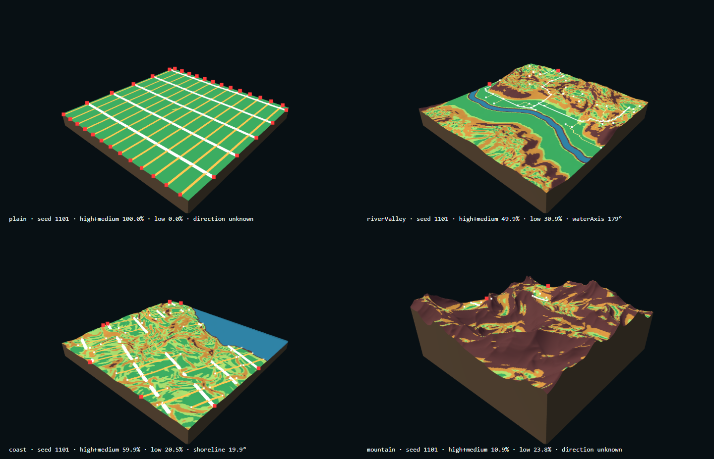

# Terrain Analysis

Part of [03 Generative System](./system-architecture.md) · Status: **Implemented · Verified · Pending review**

## Purpose

Read the generated tile as a *site*: how much is water, how much can be built on, where the buildable regions and water bodies are, which edges they touch, and whether the site has a dominant direction. This makes city matching depend on explainable terrain facts, not on the landform name.

## Inputs → outputs

- **Input:** the fields from [Terrain & Water](./terrain-and-water.md) (`height`, `slope`, `waterMask`, `buildableMask`, `waterSurface`, `boundarySamples`, `grid`) and the config. No regeneration.
- **Output:** `analyseTerrain(fields, config)` returns `terrainAnalysis` with `elevationStats`, `slopeStats` (incl. histogram), `waterCoverage`, `waterRegions`, `buildableRegions` (labelled components), `suitability` + `suitabilityMask`, `dominantDirection`, `boundaryConnections`, `thresholds`, and `signature`.

## Rules (`ANALYSIS_THRESHOLDS`)

- Suitability classes by slope: high ≤ 5°, medium ≤ 10° (= the buildable mask), low ≤ 20° and dry (needs grading, not buildable), unsuitable otherwise or on water / low shore.
- Regions under 2 500 m² (≈ one 50 m × 50 m block) count as fragments. 4-neighbour connectivity.
- A direction is reported only when the evidence passes its threshold: water elongation ≥ 4, shoreline elongation ≥ 3, relief anisotropy ≥ 0.3, slope coherence ≥ 0.5. Otherwise it is `unknown`.
- All thresholds are generator assumptions (not research measurements).

## Upstream / downstream

- **Upstream:** [Terrain & Water](./terrain-and-water.md).
- **Downstream:** [City DNA Matching](./city-dna-matching.md) (metrics), [Road & Tunnel](./road-and-tunnel.md) (water axis, shoreline, regions), [Block & Parcel](./block-and-parcel.md) (`suitabilityMask`).

## Code

`experiments/seed-terrain/TerrainAnalysis.js`; debug views `slope` and `suitability` in `ChunkView.js` · verifier `verify-terrain-analysis.mjs` · in Git since `7b21c3e`.

## Representative experiment

02.5, see [Terrain Experiments](../04-experiments/terrain-experiments.md).

*Seed 1101 · variation 0.5 · four landforms.*

## Verified / known limitations

- **Verified (02.5):** 12 / 12 runs pass, including exact area totals, component counts against an independent BFS, and suitability ⇔ buildable mask. Plain: 0 % water, 100 % buildable, direction `unknown`. River valley: water axis matches each crossing within 30°.
- **Limits:** the `signature` hashes masks and labels only, so two uniform plains (2202, 3303) share one signature although their statistics differ. The real plain tilt stays `unknown` (threshold not tuned to pass). On river and mountain terrain the buildable land is fragmented into 250–440 components.
