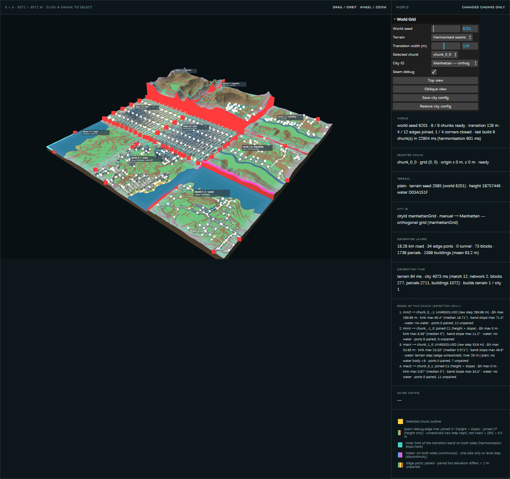

# World Grid & Seam

Part of [03 Generative System](./system-architecture.md) · Status: **World Grid Verified**; **seam joins Implemented (partial)** (4 / 12 edges in world 6201)

## Purpose

Place nine tiles in one world frame, let the designer choose a city per tile, and make shared edges meet where the terrain allows it. Where they can't meet, measure and report why, without hiding the seam.

## Three independent concepts

| Concept | What it is | Status |
| --- | --- | --- |
| **Chunk (fixed grid)** | A fixed 1024 m computation unit at a fixed grid coordinate (gridX, gridY ∈ {−1, 0, 1}; origin = grid × 1024 m). Its terrain seed is derived from the world seed, the grid coordinate, and the landform. | Implemented · Verified · Pending review (06.2) |
| **City ID (user choice)** | Per tile: `null` (empty), `'auto'` (best terrain fit), or a City DNA key. It drives only the city layers of that tile, never its terrain. | Implemented · Verified · Pending review (06.2) |
| **City influence (boundary)** | A future field by which a city could extend across tile edges and define its own boundary. | **Proposed, not implemented**: see [City Influence](./city-influence.md) |

## Inputs → outputs

- **Inputs:** `createWorldConfig({ worldSeed, transitionWidth, variation, terrainMode })` uses the default layout of 9 slots (landform + cityId each) from `worldConfig.js`. The terrain seed per slot is `1 + hash('world-grid-terrain', worldSeed, gridX, gridY, landform) mod 9999`.
- **Layers per tile (`WorldGrid.js`, each with a cache key):** **raw** (`generateChunk` in the tile frame, then placed at its world origin) → **harmony** (`harmonizeWorld` across all tiles) → **terrain** (`deriveFields` + `analyseTerrain` on the harmonised heights) → **city** (match → network → blocks → parcels → buildings). Changing a City ID invalidates only that tile's city layer.
- **Outputs:** per-tile summaries and signatures; a seam report per shared edge (height step, slope kink, water state, port pairing); save / restore (`serialiseWorld` / `restoreWorld`, which rejects a tampered seed).

## Seam rules (`TerrainHarmonizer.js`, 06.3a)

- Raw heights are never modified. Harmonisation writes a separate height and water-level field per tile, only inside the transition band.
- Per shared edge: joint target = mean of both edge heights (corners: group mean), applied with the existing edge weight (smoothstep) plus a slope-matching term (C¹). If that makes ground steeper than 35° (≈ angle of repose; and steeper than raw + 2°), the join falls back to height only (C⁰). If it is still too steep, the edge stays **unresolved** with its raw step. No wall is generated and the band is not widened.
- **Water** spreads by connected flooding only. Sea crosses an edge only where the neighbour lies below sea level, and rivers never continue without a channel. No artificial lakes are created.
- Deterministic and independent of input order and City ID.

## Upstream / downstream

- **Upstream:** the whole single-tile chain, unchanged ([System Architecture](./system-architecture.md)). `ChunkView.js` was changed only to translate a tile to its grid origin.
- **Downstream:** the World Grid page (`experiments/world-grid/`) and the live site ([Release & Resources](../06-release/release-and-resources.md)).

## Code

`experiments/world-grid/worldConfig.js`, `WorldGrid.js`, `TerrainHarmonizer.js`, `SeamCheck.js`, `SeamView.js`, `main.js` · verifiers `verify-world-grid.mjs` (06.2, raw mode), `verify-world-seam.mjs` (06.3a) · in Git since `7b21c3e`.

## Representative experiments

06.2, 06.3a, see [World Experiments](../04-experiments/world-experiments.md).

*World seed 6201 · transition width 128 m · edge status, band limits, water state; red = unresolved step.*

## Verified / known limitations

- **Verified:** the centre tile equals the single-tile page bit for bit. One City ID change rebuilds one tile (2.3–3.2 s) with its terrain unchanged. In world 6201, 4 / 12 edges are joined with zero height step (identical Float32 values); 0 cells were changed outside the band; all 9 solids are closed. Harmonisation takes 0.54–0.64 s.
- **Limits:** 8 / 12 edges in world 6201 stay unresolved (every mountain edge, steep river banks); 1 / 4 inner corners close. Slope kink up to 8.6° near closed corners and 41.8° on C⁰ joins (world 6202). Water stays discontinuous on unresolved edges and where levels are incompatible (river ≈ 30 m vs sea 0 m). Edge ports are not paired. The outer world edge is not harmonised. Tiles are a mosaic: noise is not continued across tiles.
