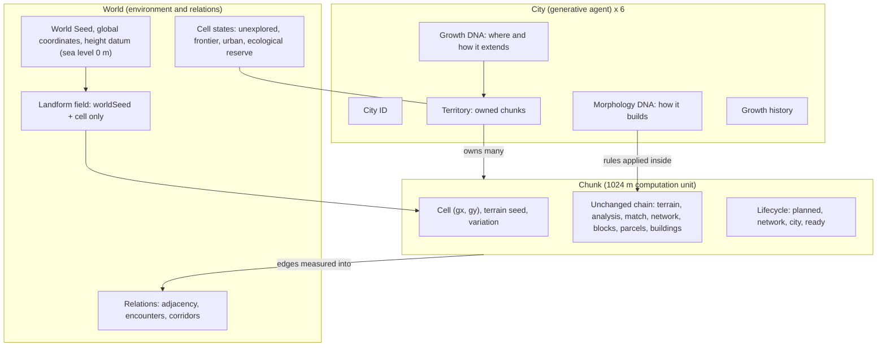
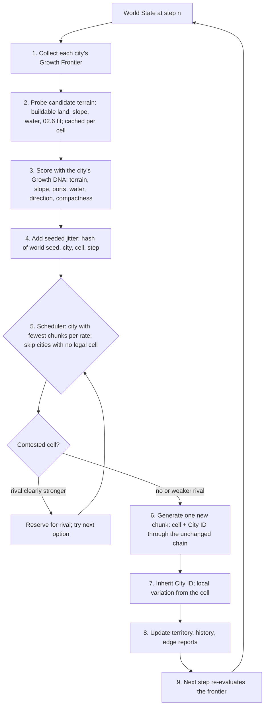
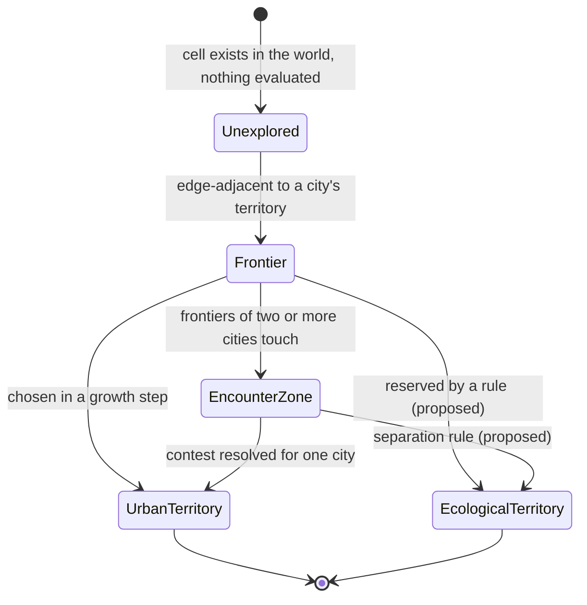

# A City of Cities — Research Compass

*The Emergence of a Plural Urban World through Procedural Growth*

> **Role of this page.** This page is the authority for the **research framing**: question, theory, system levels, hypotheses, experiments and roadmap. The authority for **stage status and the current single task** stays the project compass, [FINAL-EXPERIMENT-LOG.md §1 and §5](./FINAL-EXPERIMENT-LOG.md); its §2 now points here. The earlier compass framing (single-city identity, static assembly, invasion) is kept there as history. Written 2026-10-28 (task G00-R). Nothing on this page is accepted yet.

**Status words** (as in the [knowledge base home](./README.md)):

- **Implemented:** the code runs.
- **Verified:** its automated verifier passes. This is a data check, not a judgement of spatial quality.
- **Pending review:** waiting for a human decision.
- **Proposed:** not implemented.
- **Hypothesis (A):** a design assumption, not a verified fact about a real city.

**Reading route:**

1. **Framing:** §1 Research Question and §4 Design Argument.
2. **Theory and system levels:** §2 Theoretical Framework, §3 Old vs New Logic and §5 World / City / Chunk.
3. **The six cities:** §6 Six City DNA & Growth Hypotheses.
4. **How growth works:** §7 Growth Architecture and §8 Territory & Encounter Logic.
5. **What will be tested:** §9 Research Hypotheses and §10 Comparative Experiments.
6. **Plan and limits:** §11 Roadmap, §12 Reuse vs Missing, §13 Known Limitations and §14 Next Experiment.
7. **Rules and references:** §15 Rule Conflicts and §16 References.

---

## 1. Project Title and Research Question

**A City of Cities** — *The Emergence of a Plural Urban World through Procedural Growth*

> **How can distinct urban identities emerge, expand, and collectively form a world through procedural growth?**

Six cities with different spatial identities are independent growing agents: Venice, Manhattan, Fez, Amsterdam, Lisbon and Chicago.

- Each starts from its own core chunk.
- Each extends outward according to terrain, water, accessibility, spatial constraints and its own growth rules.
- While growing, cities may meet, compete, connect, limit each other, or leave space between them.

**The final form of the world is not designed in advance. It is the outcome of several independent generative processes acting together.**

The previous question (how a single city's identity is kept, weakened or re-formed when its rules change, mix or are stitched) is kept as the **sub-question of H1** (§9). It is not discarded: identity preservation is still measured, but now under growth instead of under stitching.

## 2. Theoretical Framework

### A. Urban Autonomy

**Claim:** each city is an autonomous generative agent with its own Morphology DNA (how it builds) and Growth DNA (where and how it extends). A city may grow larger without giving up its form in order to meet its neighbours. Meeting another city is a relation, not an obligation to merge.

**Consequences for the system:**

- DNA fusion is never the default at a boundary.
- City Invasion & Fusion (07.1) stays a separate, historical experiment line.
- Every chunk keeps exactly one City ID.

### B. Emergent Urban Form

**Claim:** the world map is produced by local rules applied by several agents step by step, not by a master plan.

**Points to examine:**

- **Local rules → global form.** Each growth step reads only local information: the frontier cell, its terrain, its neighbours and the parent's road ports. Territory shape, city size, adjacency and boundaries are global outcomes. They have to be measured (H2); they cannot be assumed.
- **Deterministic seed, controlled randomness.** Randomness only chooses among options the rules already allow. It is a keyed hash of (world seed, purpose, city, cell, step), with no shared random stream. The same seed always gives the same world, and changing one city's growth never changes another city's existing chunks.
- **Multi-agent growth.** Six agents share one world and one scheduler. A fair scheduler (fewest chunks per growth rate) prevents one agent from occupying the world through scheduling alone, so differences in territory come from the rules and the terrain.
- **Process and form.** The growth history is part of the result. Two worlds with the same final map but different histories are different results. History is recorded per step and must be replayable (G05).

**Randomness is not growth.** Adding chunks at random places is not procedural urban growth. Experiment B (§10) tests this difference explicitly.

### C. Urban Coexistence

**Claim:** relations between cities are richer than stitching or fusion. They include boundaries, competition, connection, coexistence, ecological separation and shared infrastructure, and each relation needs its own rule, record and representation (§8).

**Conceptual reference (borrowed idea, not a model):** O. M. Ungers, R. Koolhaas et al., *The City in the City: Berlin, A Green Archipelago* (1977 manifesto). It proposed a polycentric "archipelago" of distinct urban islands with differences kept side by side. That idea is borrowed here: plurality of identities in one world, and open land between urban islands as a positive element.

**The difference must stay explicit.** The manifesto responded to a **shrinking** existing city: West Berlin was losing population, and the proposal selectively kept and strengthened some areas while others returned to green space. This project **generates and expands** several cities from nothing. The archipelago here is not chosen by retention; it emerges from growth. This project is not a reconstruction or an application of the manifesto.

**Status of references** (details in §16):

| Reference | Status | How it is used |
| --- | --- | --- |
| Ungers, Koolhaas et al., *The City in the City* (1977; critical edition 2013) | **Bibliographic details verified** (publisher, editors, year) | Conceptual borrowing only: polycentric plurality and open land between cities. No quotation, no page reference. Content claims beyond the publisher description are to be checked against the book. |
| Batty, *Cities and Complexity* (MIT Press, 2005) | **Bibliographic details verified** | Conceptual borrowing only: urban form from local rules (cellular automata, agent-based models). No quotation. |
| "Local rules are enough to give each city a recognisable territory shape" | **Unverified hypothesis** | Tested by H2 and Experiment C |
| Growth DNA of the six cities (§6) | **Unverified hypothesis (A)** | Design assumptions, not historical facts about the real cities |

## 3. Old vs New Project Logic

| Aspect | Earlier work (kept, historical) | A City of Cities (current) |
| --- | --- | --- |
| Unit of study | One city on one chunk (T1–T6) | Six cities as agents in one world |
| World | Fixed 3 × 3 grid, pre-placed slots (06.2) | Sparse grid that grows; size not fixed (G01) |
| City position | User layout per slot | World seed + terrain suitability + spacing rule |
| Relation between chunks | **City Assembly:** stitch existing chunks (06.3a–06.3c) | **Procedural Urban Growth:** chunks are added by city rules |
| Relation between cities | **City Invasion:** one city changes another (07.1, 07.1a) | **City of Cities:** boundary, competition, connection, coexistence, ecological separation (§8) |
| Main question | How is identity kept when rules mix or are stitched? | How do distinct identities emerge, expand and form a world? |
| Randomness | Seed varies one chunk | Seed varies terrain, core sites and choices among allowed options |
| Seam | A defect to repair | A measured relation; not every boundary must be repaired |
| Open land | Empty slot (no city) | Two separate states: not yet generated, or reserved by a rule (§8) |

The four relation types:

- **City Assembly:** putting finished cities side by side.
- **City Invasion:** one city's rules change another city's chunk.
- **Procedural Urban Growth:** each city extends itself by its own rules. **Core of the project.**
- **City of Cities:** the whole that the relations between the growing cities produce. **Core of the project.**

## 4. Design Argument

1. **Identity is in spatial relations, not landmarks** (kept from the original proposal). Each city's identity is its Morphology DNA, applied by the unchanged chunk generators.
2. **A city is also a way of growing.** Two cities with similar blocks can still differ in where they extend: along water, along an axis, by branching, or compactly. Growth DNA makes that difference explicit and testable.
3. **Terrain first, city second.** Terrain is generated city-neutrally from the world seed and position. Cities respond to terrain, and terrain is never changed to suit a city.
4. **The world is a result.** The map, the territories and the boundaries are outputs of the process and are measured, not drawn.
5. **Plurality is a value to measure, not an assumption.** H3 asks whether six rule sets plus nature give more varied spatial relations than one uniform rule. The answer may be no.

## 5. World / City / Chunk — System Levels

Three levels, each with its own data, owner and lifecycle. **A city contains many chunks; a chunk is never a whole city.** Geometry (chunk), identity (city) and growth relations (world) are managed separately.

| Level | Holds | Implemented now | Missing |
| --- | --- | --- | --- |
| **World** | World seed, global coordinates, height datum, landform field, cell states, adjacency, non-urban space | Seed, coordinates, datum, landform field (`growthConfig.landformAt`), sparse cell map, shared-edge reports (identity, geometry, hydrology, transport) | An explicit cell-state map with an "ecological reserve" state; encounter and corridor records; world-scale water continuity (each chunk's water is local) |
| **City** | City ID, Morphology DNA, Growth DNA, territory, history, own development traits | City ID, Morphology DNA (existing rule tables), a partial Growth DNA (`CITY_GROWTH`: rate, landform, water, axis, compactness), territory (count of owned chunks), history (per-step list) | A City Agent record that groups these fields; the Growth DNA fields infrastructure dependency, branching tendency and barrier response; territory metrics |
| **Chunk** | Cell, seed, terrain, network, blocks, parcels, buildings, lifecycle | All of it, reused unchanged; immutable growth record per chunk (`WorldGrowthController.place`) | Growth-stage-dependent morphology (G04) |

## 6. Six City DNA & Growth Hypotheses

### 6.1 Morphology DNA (reused, not re-implemented)

The eight requested Morphology DNA fields already exist as configuration, and 07.1 named most of them as `RULES` in [CityInfluence.js](../../experiments/world-grid/CityInfluence.js). All values are design assumptions (A).

| Morphology DNA field | Existing source | Status |
| --- | --- | --- |
| Road Network Regularity | `STRATEGY_PROFILE[DNA_STRATEGY[dna]].regularity` (grid 1, canal-street 0.4, organic 0.15) | Reuse |
| Road Density | Measured on generated networks (`networkRegularity` / `streetDensity` in 07.1 `zoneStats`); spacing inputs in `networkStrategies.js` | Reuse; measurement exists in 07.1 bands only |
| Urban Block Scale | Emerges from street spacing (`DNA_NETWORK_OVERRIDES`, e.g. Chicago 200 / 100 m) and `BLOCK_RULES` | No direct parameter; needs a measured block-area distribution |
| Parcel Regularity | `1 − PARCEL_RULES.byDNA[dna].jitter / 0.35` | Reuse |
| Parcel Scale | `targetFrontage × maxDepth` per DNA | Reuse |
| Building Density | `BUILDING_RULES.byDNA[dna].occupancy` | Reuse |
| Building Height | Floor range × floor height per DNA | Reuse |
| Waterfront Relationship | `STRATEGY_PROFILE.waterfront` (canal-street 1, organic 0.3, grid 0.2) | Reuse |

### 6.2 Growth DNA — initial hypotheses

Every value is a **design hypothesis (A)**. None is calibrated against historical growth of the real city. "Now" marks what `CITY_GROWTH` in [growthConfig.js](../../experiments/growing-world/growthConfig.js) already implements; the other fields are proposed.

| Growth DNA field | Venice | Manhattan | Fez | Amsterdam | Lisbon | Chicago | Now in code |
| --- | --- | --- | --- | --- | --- | --- | --- |
| Growth Direction Preference | along usable shore and channels | along one regular axis | none fixed; follows existing lanes | along water and infrastructure lines | along valleys, ridges and roads | along the orthogonal axes, mainly one | `axis`: Manhattan y, Chicago x, others none |
| Terrain Suitability | coast > river valley > plain; mountain 0 | plain > coast > valley; mountain ≈ 0 | valley > plain > mountain > coast | coast = plain > valley; mountain 0 | coast > mountain > valley > plain | plain > coast > valley; mountain 0 | `landform` table + 02.6 fit score |
| Water Dependency | high (+1) | low (−0.3) | avoids (−0.5) | high (+0.6) | mild (+0.2) | low (−0.2) | `water` |
| Infrastructure Dependency | follows canal ports | high: needs road ports | follows lane ends | high: road and canal ports | follows road ports | high: needs road ports | Global weight `wRoads` only; per-city factor proposed |
| Growth Rate | 0.8 | 1.0 | 0.7 | 0.9 | 0.8 | 1.2 | `rate` |
| Expansion Compactness | 0.6 | 0.2 | 1.0 at the core | 0.7 | 0.4 | 0.1 | `compact` |
| Branching Tendency | medium (along channels) | low | high at the frontier | low (rings) | medium (along slopes) | low | Proposed |
| Natural Barrier Response | follows water edges; stops at cliffs | stops at water and cliffs | stops at water; climbs mild slopes | follows water; stops at slopes | climbs slopes; follows ridges | crosses rivers (bridges); stops at slopes | Partial: < 3 % buildable cells are excluded for all cities; per-city response proposed |

**Tensions to settle in review:**

- **Fez:** "organic branching" (requested) and the implemented `compact = 1` pull in different directions. Proposal: compact near the core, branching at the frontier, controlled by the distance to the core.
- **Manhattan / Chicago axis:** the implemented axis is a grid axis (x or y), not the generated street orientation. Aligning growth with `networkHints.orientation` is a G04 question.

### 6.3 Reuse vs new (Growth DNA)

- **Reuse:** rate, landform preference (Terrain Suitability), water, axis (Direction Preference), compactness, the 02.6 fit score per DNA, road / canal ports per side of the parent chunk (`NetworkGraph.edgePorts`).
- **New:** infrastructure-dependency factor per city, branching tendency, natural-barrier response, and a City Agent record that groups Morphology DNA, Growth DNA, territory and history.

## 7. Multi-Origin Growth Architecture

### 7.1 Components and responsibilities

| Component | Responsibility | Owns | Now |
| --- | --- | --- | --- |
| **Growth Controller** | Runs the step loop, schedules cities, resolves contests, enforces "one cell, one chunk, never overwritten" | Step counter, scheduler, contest rule | `WorldGrowthController` (G01, pending review) |
| **City Agent** | Proposes and scores moves for one city from its Growth DNA; holds its territory and history | Growth DNA, territory, history | Implicit: logic inside the controller + `CITY_GROWTH`; no agent object |
| **Growth Frontier** | Lists unoccupied cells edge-adjacent to a city, with the adjacent chunks and their facing ports | Derived, not stored | `frontier(cityId)` |
| **Chunk Generator** | Builds one chunk from cell + City ID; unchanged single-chunk chain | Nothing global | 06.2 layer functions + 07.1a spatial ids |
| **World State** | Serialisable state: parameters, cells, chunk records, edge reports, history, issues | All persistent data | `serialise()` / `restore()` (format v1) |

### 7.2 One growth step

### 7.3 Rules that the architecture must keep

- **Terrain does not adapt to cities.** Landform and terrain seed depend only on world seed and cell.
- **Randomness chooses among allowed options only.** Cells with < 3 % buildable land are never options. Jitter is bounded by the `jitter` parameter.
- **No monopoly by scheduling.** Fair queue by growth rate; a blocked city is skipped, not starved forever.
- **Immutability.** A chunk record never changes after creation; ownership is decided once (first occupant); contests are recorded.
- **Order independence.** A chunk regenerated alone from cell + City ID equals its record (verified in G01).

## 8. Urban Territory & Encounter Logic

### 8.1 Spatial states

| State | Produced by (rule) | Recorded as | Visualised as | Now |
| --- | --- | --- | --- | --- |
| **Unexplored** | Default for every cell | Absence from the cell map | Nothing drawn | Implemented (implicit) |
| **Urban Territory** | A growth step places a chunk for a city | Chunk record (cityId, parent, step, reason) | Real generated content + city-coloured ownership frame | Implemented (G01) |
| **Ecological Territory** | A rule reserves the cell: too little buildable land, landform protected by a world rule, or a separation band between two cities | Cell record with state `reserved`, reason, rule, step; terrain generated, no city | Terrain-only chunk (the 06.2 empty-slot path, `cityId = null`) with a reserve marker | **Proposed (G03).** Today such cells are only silently rejected candidates. |
| **Encounter Zone** | Frontier cells or shared edges where two or more cities touch | Contest records (claimant, rivals, scores, outcome) and city-boundary edge reports | Contested frontier cells (white); boundary edges classified by type, not a colour gradient | Partial: contests and boundary edges recorded; no zone object |
| **Connection Corridor** | Roads, canals or other infrastructure that cross a city boundary | Edge report with paired ports, joined network edges, corridor id | Corridor lines over the seam | **Proposed (G03).** Only port pairing is measured; nothing is joined. |

### 8.2 Boundary types

The geometry, hydrology and transport classes of every shared edge are already measured (G01). City-boundary types are derived from them.

| Boundary type | Derived from | Meaning |
| --- | --- | --- |
| Hard natural | geometry `cliff` or a water discontinuity at a city boundary | Cities stopped by terrain |
| Soft | geometry `continuous` or `step`, no paired ports | Cities touch without connection |
| Shared infrastructure | paired road or canal ports across the boundary | Candidate Connection Corridor |
| Ecological separation | a reserved cell between two cities (proposed) | Coexistence with space between |

### 8.3 Explicit non-goals

- Natural space is not urbanised by default; the world map may keep mountains, rivers and reserves.
- A city boundary does not trigger DNA fusion.
- A boundary is not automatically a road seam to repair.
- City relations are not shown as colour gradients.
- "Not yet generated" and "kept natural by a rule" are separate states and are never drawn the same way.

## 9. Research Hypotheses

Metric availability:

- **Available:** computed by existing code.
- **Data only:** the data exists, but a measurement function is missing.
- **Missing:** needs new data or a new module.

No hypothesis has been tested yet. The G01 numbers in the [log](./FINAL-EXPERIMENT-LOG.md) are verifier checks, not hypothesis tests.

### H1 — Identity Preservation

*While growing outward, do the six cities keep recognisable, measurable spatial identities?*

| Metric | Availability | Source |
| --- | --- | --- |
| Road orientation (edge-direction histogram, weighted by length) | Data only | `NetworkGraph.edges[].points` |
| Network density (km / km²) | Available | `network.stats.roadLength`; 07.1 `zoneStats` |
| Block size distribution | Data only | `blocks` polygons and areas |
| Parcel scale (frontage, area) | Available (mean) | parcels stats; 07.1 `zoneStats` |
| Building coverage | Available | 07.1 `zoneStats` |
| Building height distribution | Data only (mean available) | `buildings[].height` |

**Test:** within-city spread versus between-city distance of these metrics, over chunks of growth age 0 (core) to n. **Known confounder:** on poorly fitting terrain a DNA can produce almost nothing. In G01, 5 Amsterdam chunks had 0 roads; this must be reported, not averaged away.

### H2 — Emergent Organization

*Do the local rules of independent agents produce a world with organised relations?*

| Metric | Availability | Note |
| --- | --- | --- |
| Territory distribution (chunks per city) | Available | `summary().perCity` |
| Urban fragmentation | Missing | Each territory is one 4-connected component **by construction**, so fragmentation must be measured on urbanised land inside chunks (buildable or built share), not on chunk ownership |
| Spatial connectivity (inside a city) | Data only | Paired ports between same-city chunks (edge reports); no joined network |
| Growth direction (core → new chunk vectors over time) | Data only | Growth history |
| Development compactness (cells / perimeter, bounding-box fill) | Missing | Computable from the cell map |
| Polycentric structure (centres, spacing, rank-size) | Missing | Needs a definition of a centre (core, density peak) |

### H3 — Coexistence & Diversity

*Do several growth rules plus nature produce more varied spatial relations than one uniform rule?*

| Metric | Availability | Note |
| --- | --- | --- |
| Urban boundary types (§8.2) | Data only | Edge reports exist; classification function missing |
| Ecological territory ratio | Missing | Needs the reserve state (G03) |
| City adjacency (which cities touch, edge counts) | Available | City-boundary edge reports |
| Inter-city connectivity | Missing | Needs Connection Corridors |
| Urban morphological diversity (dispersion of H1 metrics across the world) | Missing | Needs the H1 metric module |

## 10. Comparative Experiments

All three use the same six DNAs, the unchanged chunk chain and world seeds 6201 / 1234 / 4242. None has been run.

### Experiment A — Static vs Growing

| Item | Definition |
| --- | --- |
| Research question | What differs between a pre-set layout and a procedurally grown world with the same cities and generators? |
| Controlled | Chunk generator, six DNAs, world seed, chunk count (9 in the static world vs cores + 3 grown chunks; and a 30-chunk world vs a static layout of 30 cells drawn by hand), raw terrain (no seam correction in either) |
| Independent | How positions and City IDs are decided: user layout (06.2) or growth (G01) |
| Metrics | Mean 02.6 fit of each chunk's DNA on its terrain; share of cells with suitability issues; boundary types; H1 identity metrics; number of empty-content chunks |
| Visualisation | Side by side top views at equal chunk count; table of fit scores per chunk |
| Limitations | The static grid has `auto` and empty slots and a fixed 3 × 3 shape, so an equal-count comparison is only partial; a larger hand-drawn layout is itself a design choice |

### Experiment B — Random vs Rule-Based

| Item | Definition |
| --- | --- |
| Research question | Do environmental and DNA rules produce different worlds from random choice under the same constraints? |
| Controlled | World seed, the six cores (same cells), number of added chunks (10 / 30 / 60), adjacency rule, fair scheduler |
| Independent | Selection rule: B0 uniform random among the scheduled city's legal frontier cells (seeded); B1 the weighted score (G01) |
| Metrics | Mean fit; cliff-edge share; unpaired ports; compactness; empty-content chunks; suitability issues; growth-direction coherence |
| Visualisation | Paired top views per seed and count; metric curves over steps |
| Limitations | B0 still uses adjacency and the < 3 % exclusion, so it is "random within constraints", not unconstrained noise; a fully unconstrained variant would only show the obvious |

### Experiment C — Uniform vs Plural Growth

| Item | Definition |
| --- | --- |
| Research question | Do six distinct Growth DNAs produce more varied relations than one shared growth rule? |
| Controlled | World seed, cores, chunk counts, Morphology DNA (unchanged), terrain |
| Independent | Growth DNA: C0 one averaged profile for all six cities; C1 each city's own profile (§6.2) |
| Metrics | H2 and H3 sets: compactness and direction per city, landform composition per city, boundary-type diversity, adjacency pattern |
| Visualisation | Paired top views; per-city territory shape tables |
| Limitations | The "averaged" profile is itself a choice; the core sites depend on the DNA fit, so C0 must reuse C1's core sites to isolate growth |

### Minimum viable demonstration

Six independent core chunks, then **10, 30 and 60 chunks added to the whole world** (not per city), for three world seeds. That is 16, 36 and 66 chunks in total. The current runtime gives about 2.75 s per chunk and about 853 MB of heap at 48 chunks in the browser. The 66-chunk world is therefore a **memory risk** (estimate ≈ 1.2 GB): run data-only in Node for metrics and render only screenshots, or add unloading first. No outcome is assumed: the worlds may show no clear organisation.

## 11. Development Roadmap (G00–G05)

Actual state on 2026-10-28, branch `experiment/procedural-growing-world`:

- **Mapping to earlier work:** the task logged as **"G01 (2026-10-27)"** implements this roadmap's **G01** completely and a **baseline of G02**: frontier, scoring and single-step growth. The log entry keeps its ID (past entries are never renamed).
- **Status:** G01 is implemented and verified but **uncommitted and pending review**.

| Stage | Goal | Reuse | New components | Depends on | Verification | Visual output | Status |
| --- | --- | --- | --- | --- | --- | --- | --- |
| **G00** Preserve & Recover | Keep every earlier experiment; Git baseline; independent chunk generator | `seed-terrain/`, `world-grid/`, all verifiers | none | — | Checkpoint commit; old pages unchanged; `verify-city-dna` regression 36 / 36 | — | **Done:** commit `79687a0`; World Grid code unchanged since |
| **G01** Multi-Origin Initialization | Six cores with stable ids, seeds, coordinates; spacing rule; suitability recorded | 06.2 layers, 02.6 match, 07.1a ids | City Agent record (proposed) | G00 | Six cores, distinct cells, min distance, issues logged, reproducible on 3 seeds | Six-cores top view | **Implemented, verified, pending review**, uncommitted |
| **G02** Rule-Based Growth | Frontier, environmental scoring with Growth DNA, single step, save / load | G01 controller | Missing Growth DNA fields (§6.3); random and uniform modes for Experiments B and C | G01 accepted | One chunk per step; adjacency; reproducible; save / load continuation; B0 vs B1 metrics | 10 / 30 / 60 growth maps | **Baseline implemented and verified** (frontier, score, step, save / load); Growth DNA fields and experiment modes proposed |
| **G03** City Territory & Encounter | Territory, boundary types, ecological reserve, encounter zones, corridors | Edge reports, contest records, empty-slot path (`cityId = null`) | Cell-state map, reserve rules, encounter records, corridor records, boundary classifier | G02 | Reserved cells counted and never urbanised; boundary types stable by seed; unexplored ≠ reserved | Territory / encounter / reserve map (no gradients) | **Partial:** contests and boundary edges recorded; the rest proposed |
| **G04** Morphological Growth | Roads, blocks and buildings express DNA and growth stage (core vs frontier), not only chunk count | Existing generators via their options hooks (07.1 `options`) | Stage-dependent rule inputs (for example density by distance to the core) | G03 | H1 metrics per growth age; generators unchanged at default | Core-to-frontier transects | **Not started** |
| **G05** Evaluation & Replay | Replay history, parameter comparison, metric reports | Growth history, `serialise()`, verifier pattern | Replay UI, metric module (§9), experiment runner (A–C) | G02, G03 | Replay reproduces every step; metric tables for A–C | Step replay; comparison sheets | **Partial:** history and save / load exist; the rest proposed |

## 12. Reuse List and Missing Modules

**Reuse (no rewrite):**

- **Terrain:** `TerrainGenerator`, `TerrainFields`, `TerrainAnalysis` (unchanged).
- **City match:** `CityMatcher` and `cityMatchRules`.
- **Generators:** `NetworkGenerator`, `BlockGenerator`, `ParcelGenerator`, `BuildingGenerator` with their rule tables (unchanged).
- **World Grid:** layer functions `generateRawLayer`, `generateTerrainLayer`, `generateNetworkLayer`, `generateUrbanLayer`; 06.2 `terrainSeedOf`; the empty-slot path.
- **Ids:** 07.1a spatial ids (`StableIdentity`).
- **City Influence:** `RULES` names and `zoneStats` (07.1) for the morphology metrics.
- **Seams:** `TerrainCoordinator` (06.3a-R2), as a candidate for one-sided seam correction later.
- **Rendering:** `ChunkView`, `NetworkView`, `BuildingView`.
- **Growing world:** `WorldGrowthController`, `growthConfig`, `GrowthView` (G01).
- **Verification:** `verify-growing-world.mjs` and the Playwright verifier pattern.

**Missing:**

- **Agent and Growth DNA:** City Agent record; the Growth DNA fields infrastructure dependency, branching and barrier response.
- **Experiment modes:** random selection mode (B0); uniform Growth DNA mode (C0).
- **World states:** cell-state map with ecological reserve; encounter-zone and corridor records; boundary-type classifier.
- **Measurement:** metric module (orientation histogram, block-size and height distributions, compactness, polycentricity, diversity); experiment runner and report.
- **Replay and scale:** replay; chunk unloading or level of detail for worlds above about 50 chunks; one-sided seam correction for new chunks.

## 13. Known Limitations

- **Geometry:** seams are not corrected in the growing world. At 48 chunks, 0 of 60 edges were continuous.
- **Hydrology:** water is local to each chunk; there is no world river or sea network.
- **Empty content:** a DNA can produce almost nothing on a cell it was allowed to grow into (Amsterdam case). The 02.6 fit does not predict generator output.
- **Uncalibrated values:** all Growth DNA values, score weights and the landform field are design assumptions; city research rows are still TBD (compass §4 asks for two sources per city).
- **Fixed chunk size:** the chunk is the frozen 1024 m unit, so growth resolution is one chunk. Finer growth inside a chunk is a G04 question.
- **Performance:** about 3 s per chunk; heap grows by about 15–18 MB per rendered chunk.
- **References:** only bibliographic details are verified; no quotation or page reference is used.

## 14. Next Experiment

**Proposed next single task: G01-R — Multi-Origin Initialization on the World / City / Chunk schema.**

The G01 code exists, so the minimal next step is not new growth. It is to make the implemented initialization match this compass:

- Introduce a data-only **City Agent** record: City ID, Morphology DNA reference, Growth DNA (the five implemented fields + the three new fields as `null`), territory and history.
- Introduce a **cell-state** field: `unexplored`, `frontier` or `urban`; `reserved` is defined but unused.
- Keep every output identical.

**Verification:**

- The serialised world for seeds 6201 / 1234 / 4242 is byte-identical to the current G01 output, apart from the added fields.
- The `verify-growing-world` checks still pass.
- One screenshot of the six cores per seed.

**Not in scope:** new growth rules, reserves, corridors, metrics, UI.

**Before that:** review and accept or reject the G01 entry, and decide whether to commit it.

## 15. Conflicts with Project Rules (proposed minimal revisions, not applied)

| Rule (where) | Conflict | Proposed minimal revision |
| --- | --- | --- |
| AGENTS.md, Source of Truth: "Project compass … is the only authority for stage status" | None for stage status, but research framing now lives on this page | Add one line: "Research framing: `docs/procedural-mini-world/A-City-of-Cities-Research-Compass.md`; stage status stays in the log." |
| AGENTS.md, Project Boundaries: "≥3 tiles that join or blend" | Growth adds tiles by rules, not by joining | "≥3 tiles that join, blend, or grow into one world" |
| Compass §3, item 4: "At least three city modules can be joined or mixed into one Mini World" | Same | "…joined, mixed, or grown into one Mini World" |
| AGENTS.md rule 6 / compass §4: "≤10 public parameters" | Growth DNA adds 8 fields × 6 cities | Clarify: per-DNA profile tables are configuration (like `PARCEL_RULES.byDNA`), not public parameters; public growth parameters stay 9 |
| Compass §4: "Use at least two reliable sources for every city" | Growth DNA has no sources | No rule change: label every Growth DNA value A (assumption) until sourced |
| AGENTS.md, Project Boundaries: "The 60-city list is a research database" | None | — |

## 16. References

- Ungers, O. M., Koolhaas, R., Riemann, P., Kollhoff, H. and Ovaska, A. *The City in the City: Berlin, A Green Archipelago* (manifesto, 1977). Critical edition, ed. F. Hertweck and S. Marot, Lars Müller Publishers, 2013, ISBN 978-3-03778-326-9. Publisher page: <https://www.lars-mueller-publishers.com/city-city>. Used as a conceptual reference only (§2 C).
- Batty, M. *Cities and Complexity: Understanding Cities with Cellular Automata, Agent-Based Models, and Fractals.* MIT Press, 2005, ISBN 978-0-262-02583-6. Publisher listing: <https://www.penguinrandomhouse.com/books/658555/cities-and-complexity-by-michael-batty/>. Used as a conceptual reference only (§2 B).

**Project sources:**

- [FINAL-EXPERIMENT-LOG.md](./FINAL-EXPERIMENT-LOG.md): entries G00, G01, G00-R; 06.2–07.1a.
- [Procedural Growth](./03-generative-system/procedural-growth.md).
- [City DNA Library](./research/city-dna-library.md).
- [City Influence](./03-generative-system/city-influence.md).
