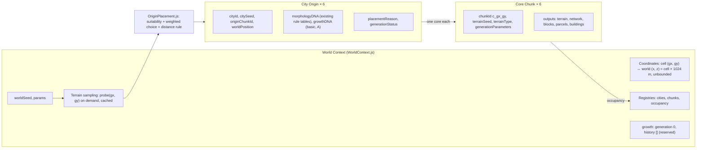
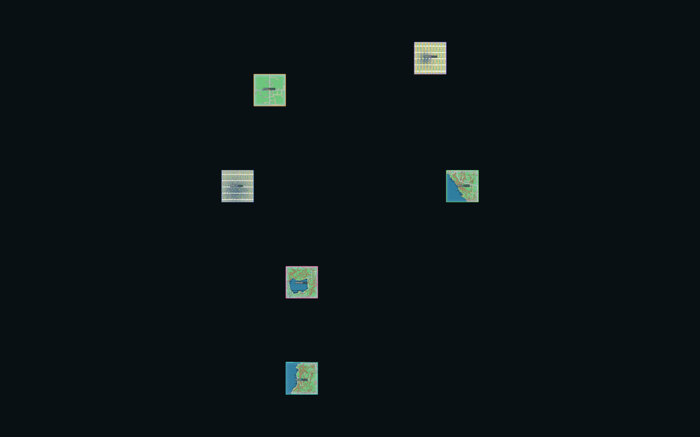
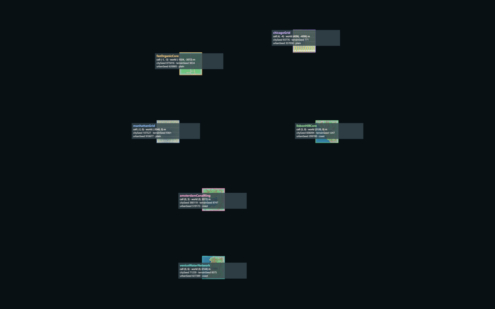
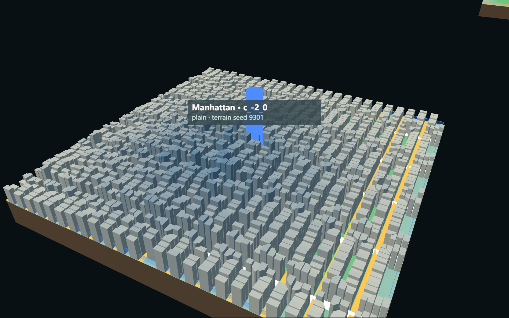
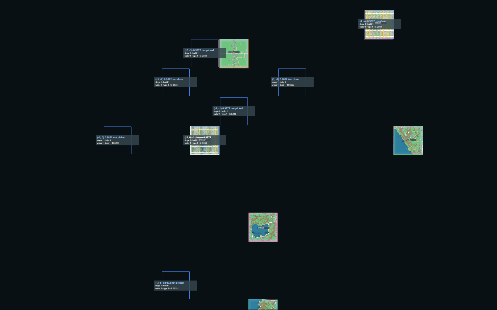
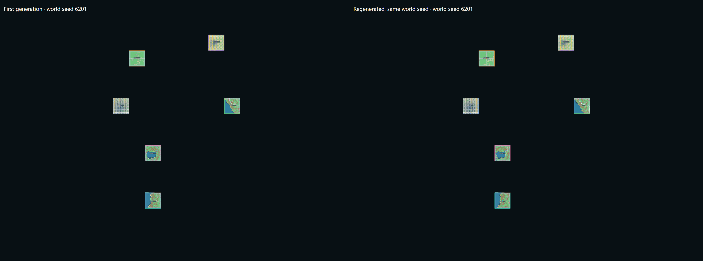

# G01 — Multi-Origin Initialization

Part of [A City of Cities — Research Compass](../A-City-of-Cities-Research-Compass.md), roadmap stage **G01**. Log entry: **G01-MO** in [FINAL-EXPERIMENT-LOG.md](../FINAL-EXPERIMENT-LOG.md).

**Status:** implemented, verified on 3 world seeds, **pending review**. Nothing here is accepted yet.

## 1. Goal

Create six reproducible, mutually independent city **core chunks** in one shared world coordinate system:

- one per City DNA: Venice, Manhattan, Fez, Amsterdam, Lisbon, Chicago;
- placed by the world seed and an origin suitability evaluation;
- each generated by the unchanged single-chunk chain with its own City DNA.

**Out of scope:** growth (no growth chunk, no Grow step), competition, DNA fusion, seam correction, any change to the generators.

**Entry point:** `/experiments/city-of-cities/` (`npm run dev`).

**Relation to the 2026-10-27 prototype:** the growth prototype (`/experiments/growing-world/`, log entry G01, commit `c3e2e5f`) stays runnable and unchanged. G01-MO is a separate, growth-free experiment. It reuses from the prototype only:

- the world landform field and cell identity (`growthConfig.cellOf`, `landformAt`, `unit`);
- the single-chunk helpers `terrainOf` and `networkOf`;
- `GrowthView`, for city frames and frontier outlines.

## 2. Architecture

| Level | Record fields (as implemented) |
| --- | --- |
| **World Context** | `worldSeed`, `params`, `chunkSize`, `cellToWorld` / `worldToCell`, `probe` (terrain + analysis + 02.6 metrics; no roads, parcels or buildings), `cities`, `chunks`, `occupancy`, `placement` report, `growth { generation: 0, history: [] }` |
| **City Origin** | `cityId`, `label`, `originChunkId`, `worldCoordinate`, `worldPosition`, `citySeed`, `morphologyDNA`, `growthDNA`, `originProfile`, `placementReason`, `generationStatus`, `growthGeneration` = 0 |
| **Independent Chunk** | `chunkId`, `cityId`, `role` = core, `parentChunkId` = null, `generation` = 0, `worldCoordinate`, `worldOrigin`, `terrainSeed`, `terrainType`, `generationParameters` (variation, transition width, chunk size, urbanSeed, id mode, terrain mode), `generationStatus`, `outputs` (resolved DNA, signatures, counts, timings) |

**Reserved for G02, read-only or empty now:**

- **`frontierOf(cityId)`:** the free edge-neighbour cells of a city, with landform and compatibility. It is a query and creates nothing.
- **`dependenciesOf(cityId)`:** which other origins a change could affect.
- **Parent–child relation:** `parentChunkId` / `generation` fields.
- **`growth.history`:** schema `{ step, chunkId, cityId, parentChunkId, reason }`.

## 3. Seed rules

| Seed | Derived from | Owns | Used by |
| --- | --- | --- | --- |
| `worldSeed` | user | everything below | landform field, city seeds, claim-order tie-break |
| `citySeed` | hash(worldSeed, cityId) | candidate sites, weighted choice | `OriginPlacement` |
| `urbanSeed` (chunk) | hash(citySeed, chunkId) | random streams of parcels and buildings | `generateUrbanLayer(…, { worldSeed: urbanSeed })`, the existing 07.1a option |
| `terrainSeed` (chunk) | 06.2 `terrainSeedOf(worldSeed, gx, gy, landform)` | terrain of the cell | terrain chain; the network generator keys its own stream on it (unchanged) |

- **Terrain is deliberately city-neutral.** It belongs to the world (world seed + cell), not to the city, so a future growth chunk on the same cell gets the same terrain whichever city reaches it.
- **No `Math.random`, no shared stream.** Every value is a keyed hash, so neither the generation order nor the display state can change a result.

## 4. Origin placement logic

All weights, thresholds and profiles are **design hypotheses (A)**, not calibrated against real-city data. They live in [originConfig.js](../../../experiments/city-of-cities/originConfig.js).

1. **Screen (per city, independent).** 40 keyed sites from the `citySeed` within `searchRadius` (6 chunks) of the world origin. The landform comes from the cheap world field. A landform with compatibility 0 for that city is rejected here; for example, mountain is rejected for Venice, Manhattan, Amsterdam and Chicago.
2. **Probe.** The 8 most compatible screened sites get a real terrain probe (terrain + analysis, about 100 ms, cached per cell, city-neutral). No roads, parcels or buildings are built for candidates.
3. **Hard rejections, each recorded with its reason:**
   - buildable share < 0.05;
   - a triggered 02.6 DNA conflict (for example `noWater` for Venice / Amsterdam);
   - water required but water share < 0.02;
   - suitability < 0.25.
4. **Suitability** = weighted mean of five terms (0–1):

   | Term | Meaning |
   | --- | --- |
   | `slope` | share of low-slope land; hill cities use a low + medium slope mix |
   | `buildable` | buildable share / 0.6 |
   | `water` | water in the cell + wet neighbour landforms; read per city as required, preferred, neutral or avoid |
   | `terrainType` | the city's landform compatibility |
   | `dnaFit` | 02.6 fit score of the city's DNA |

   | City | Profile (weights slope / buildable / water / type / fit) |
   | --- | --- |
   | Venice | flat, water required (1 / 1 / 3 / 2 / 2) |
   | Manhattan | flat, water neutral (3 / 3 / 0.5 / 2 / 2) |
   | Fez | moderate slope, avoids water (1 / 2 / 1 / 2 / 2) |
   | Amsterdam | flat, water required (2 / 1 / 2.5 / 2 / 2) |
   | Lisbon | moderate slope, water preferred (2.5 / 1 / 1 / 2 / 2) |
   | Chicago | flat, water neutral (3 / 3 / 0.5 / 2 / 1.5) |

5. **Weighted reproducible choice.** Qualified sites are ordered by key = −ln(u) / score^k, with u = hash(citySeed, cell) and k = `selectionSharpness` (4). This is weighted sampling without replacement; the first site is the choice.
6. **Between cities, the only coupling is the minimum distance.** Two origins must be ≥ `minOriginDistance` (3 chunks, Chebyshev) apart. Cities claim in an order derived from the data: fewest qualified sites first, ties by hash(worldSeed, cityId). That order never depends on the input list, on names, or on asynchronous completion. Blocked sites are recorded as `distanceRejectedBy` / `constrainedBy`.
7. **Failure.** A city with no legal site gets a `placement failure` with the reason and a suggestion (larger search radius or smaller distance). No constraint is relaxed silently. 0 failures occurred on the three test seeds.

**First run → fix:** in the first full run, ties in the claim order were broken by cityId, so Venice claimed last on every seed. The tie-break is now hashed by the world seed, and the claim order differs per seed (below).

## 5. City cores (seed 6201, default parameters)

| City | Origin chunk | Cell | World (m) | citySeed | terrainSeed | urbanSeed | Landform | Suitability | Choice | Roads / blocks / parcels / buildings |
| --- | --- | --- | --- | --- | --- | --- | --- | --- | --- | --- |
| Amsterdam | c_0_3 | (0, 3) | (0, 3072) | 380119 | 8747 | 519173 | coast | 0.677 | 1 of 5 | 5.28 km / 11 / 518 / 461 |
| Fez | c_-1_-3 | (−1, −3) | (−1024, −3072) | 875016 | 9834 | 620885 | plain | 0.742 | 1 of 8 | 6.07 km / 11 / 1035 / 859 |
| Lisbon | c_5_0 | (5, 0) | (5120, 0) | 606094 | 1247 | 299700 | coast | 0.803 | 1 of 8 | 6.83 km / 17 / 836 / 705 |
| Chicago | c_4_-4 | (4, −4) | (4096, −4096) | 93776 | 771 | 357058 | plain | 0.970 | 1 of 8 | 15.36 km / 66 / 2270 / 2021 |
| Venice | c_0_6 | (0, 6) | (0, 6144) | 71229 | 8575 | 827389 | coast | 0.787 | 1 of 8 | 5.10 km / 22 / 391 / 325 |
| Manhattan | c_-2_0 | (−2, 0) | (−2048, 0) | 107527 | 9301 | 910677 | plain | 0.987 | 4 of 8 (3 closer sites blocked by Fez and Chicago) | 18.43 km / 78 / 1795 / 1637 |

**Placement on all three seeds:**

| Seed | Claim order | Probes | Rejected sites | Distance-blocked | Note |
| --- | --- | --- | --- | --- | --- |
| 6201 | Amsterdam → Fez → Lisbon → Chicago → Venice → Manhattan | 41 | 33 (30 mountain at screen, 3 `noWater`) | 3 | — |
| 1234 | Amsterdam → Manhattan → Fez → Lisbon → Chicago → Venice | 38 | 13 (8 mountain, 5 `noWater`) | 5 | Amsterdam core c_1_-1 (coast, suitability 0.71) generates **0 km road, 0 buildings** (see limitations) |
| 4242 | Amsterdam → Lisbon → Chicago → Venice → Fez → Manhattan | 36 | 11 (6 mountain, 5 `noWater`) | 5 | Fez took its 6th-weighted site (3 cities blocked closer ones) |

Full per-seed records: [city-origins.json](../../../experiments/city-of-cities/evidence/city-origins.json). Saved world state (seed 6201): [world-6201-g01-state.json](../../../experiments/city-of-cities/evidence/world-6201-g01-state.json).

## 6. Files

**New:**

- `experiments/city-of-cities/`: `originConfig.js`, `WorldContext.js`, `OriginPlacement.js`, `OriginView.js`, `main.js`, `index.html`, `evidence/`
- `scripts/verify-city-of-cities.mjs`
- this note

**Changed:** `vite.config.js` (build inputs `growingWorld`, `cityOfCities`).

**Unchanged:** every generator (terrain, analysis, match, network, blocks, parcels, buildings, tunnels), the World Grid, Terrain Seam, City Influence and the growth prototype.

## 7. Tests (`node scripts/verify-city-of-cities.mjs`, all passed, 0 browser errors)

**Identity** (seeds 6201 / 1234 / 4242):

- exactly 6 origins and 6 chunks with the six City IDs;
- six distinct city seeds;
- no duplicate cell.

**Spatial:**

- Every chunk's world origin is cell × 1024 m.
- The minimum origin distance is 3 on all seeds (= parameter).
- Every chunk is a generation-0 core with no parent.
- **Explainable scores:** each stored score equals the weighted mean of its stored terms, and re-evaluating the chosen site reproduces it.
- **Rejections are recorded with reasons:** mountain-incompatible, `noWater`, distance-blocked.

**Determinism:**

- A repeat run gives an identical placement.
- Reversing the input city list gives an identical placement.
- Generating the six chunks in reversed order gives identical signatures.
- The three seeds give three different layouts.
- In the browser, Regenerate with the same seed gives an identical world state, including all signatures.
- Hiding and showing a city rebuilds nothing (build counters unchanged).

**Generation:**

- All six cores run terrain → analysis → network → blocks → parcels → buildings and resolve to their own DNA.
- **Non-zero origin regression:** the Manhattan cell generated at world origin 0 and at (−2048, 0) gives the same height signature and the same 148 network edges with 0 m point deviation after translation. With order-based ids it also gives 78 / 1795 / 1654 blocks / parcels / buildings and identical building heights.
- `verify-city-dna` (single-chunk regression, 06.1) passes: 36 / 36 identical.

**Persistence:**

- Node: JSON → restore re-derives seeds, landforms and parameters (a mismatch throws), and the regenerated chunks equal the saved signatures.
- Browser: Save → page reload → Load from browser storage gives 0 mismatches and the same state.
- The schema (`a-city-of-cities/world-state`, version 1) carries `growth.generation` = 0 and an empty `history`.

**Cross-runtime (reported, not hidden):**

- Node and Chrome give the same placement and identical terrain, water, block, parcel and building signatures.
- In 3 of 6 chunks the **network signature** differs. It hashes full-precision metadata (`axisDeg` from `Math.atan2`), which differs by ≤ 7e-16 relative between the two engines. Geometry is identical.
- A state saved in Node and loaded in a browser therefore reports a network-signature mismatch for those chunks. Within one runtime every signature matches.

**Performance (browser: headless Chrome, seed 6201, device scale 2):**

| Measure | Value |
| --- | --- |
| Placement (41 terrain probes) | 3.36 s |
| First city rendered (from Generate) | 6.62 s |
| All six cores generated and rendered | 25.2 s |
| Per core, data / render | Fez 2.90 s / 0.16 s · Manhattan 4.77 / 0.15 · Amsterdam 3.16 / 0.13 · Venice 1.88 / 0.10 · Chicago 5.73 / 0.18 · Lisbon 2.19 / 0.15 |
| JS heap after six cores | 209 MB |
| Page load to ready | 25.4 s |
| Restore (Load world state, six cores) | 21.5 s |
| Node, per seed (placement + 6 cores + repeat / order / restore runs) | 61–69 s; six cores 17–19 s |

## 8. Screenshots (seed 6201, default parameters, real runtime)

1. World overview, six cores with city frames (top): 
2. City ID, cell, world position and seeds per origin: 
3. Manhattan core c_-2_0, real roads, blocks and buildings: 
4. Origin suitability of Manhattan: chosen site (white), sites blocked by the distance rule ("too close"), qualified sites that lost the weighted choice ("not picked"), with all five terms: 
5. Regenerate with the same seed (left first generation, right regeneration): 

## 9. Known limitations

1. **Score does not predict generator output.** On seed 1234 the Amsterdam core (coast, suitability 0.71, fit 0.53) produces 0 km of road and 0 buildings. G01 reports this and does not hide it; placement does not check generator output.
2. **Scores saturate on plains.** All of Manhattan's qualified plain sites score 0.987 (seed 6201), so the weighted choice among them is uniform. The terms cap at 1 (buildable / 0.6, low slope), which leaves little discrimination.
3. **Cheap screen sees only the landform.** A mountain cell is rejected before probing even if parts of it are flat; the coarse world landform field decides compatibility.
4. **Claim order** is data-derived but still sequential, so cities claiming later have fewer sites (Fez's 6th choice on 4242).
5. **Network signature** is runtime-specific (§7); a saved state is only bit-exact in the runtime that wrote it.
6. **Each core is independent.** Terrain is raw (no seam work); neighbouring cells are not generated, by design.
7. **Morphology DNA** is read from the existing rule tables. **Growth DNA** is the basic prototype profile; infrastructure dependency, branching and barrier response stay `null`.

## 10. G02 — concrete suggestions for the Growth Frontier

1. **Frontier source.** Build on `WorldContext.frontierOf` and the occupancy registry; keep it a pure query. A step appends exactly one record to `growth.history` and one chunk with `parentChunkId`, `generation = parent + 1` and `urbanSeed = urbanSeedOf(citySeed, chunkId)`. Terrain stays world-owned.
2. **Scoring.** Reuse `evaluateSite` terms plus the prototype's road-port term. Add the three missing Growth DNA fields. Remove the plain-site saturation, for example with continuous buildable area instead of share / 0.6.
3. **Viability check after generation.** Record chunks whose DNA generates no network or no buildings as `nonViable`, as an explicit state, and decide in review whether growth may continue from them.
4. **Scheduler.** Port the prototype's fair queue (fewest chunks per rate), with a hashed tie-break as in the claim order.
5. **Experiment modes from the start.** Random selection (B0) and uniform Growth DNA (C0) as switches, so Experiments B and C need no new code paths later.
6. **Determinism tests carried over:** input order, generation order, save → load → continue, and cross-runtime (excluding network metadata, or rounding `axisDeg` in a signature adapter outside the generator).
