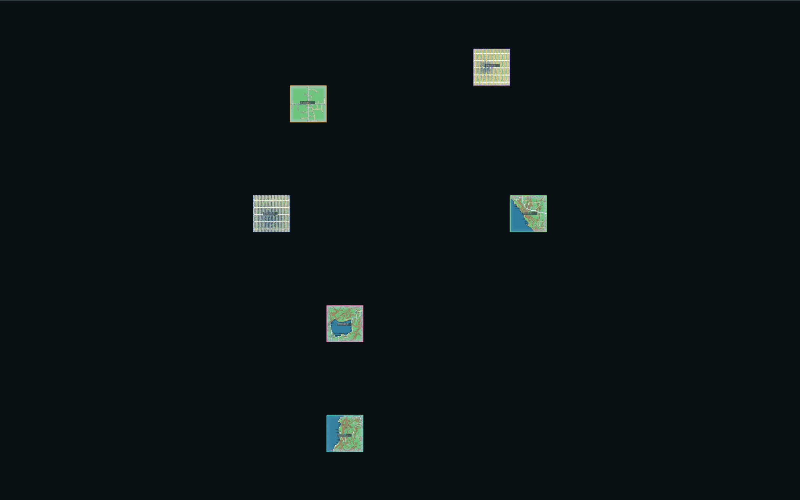
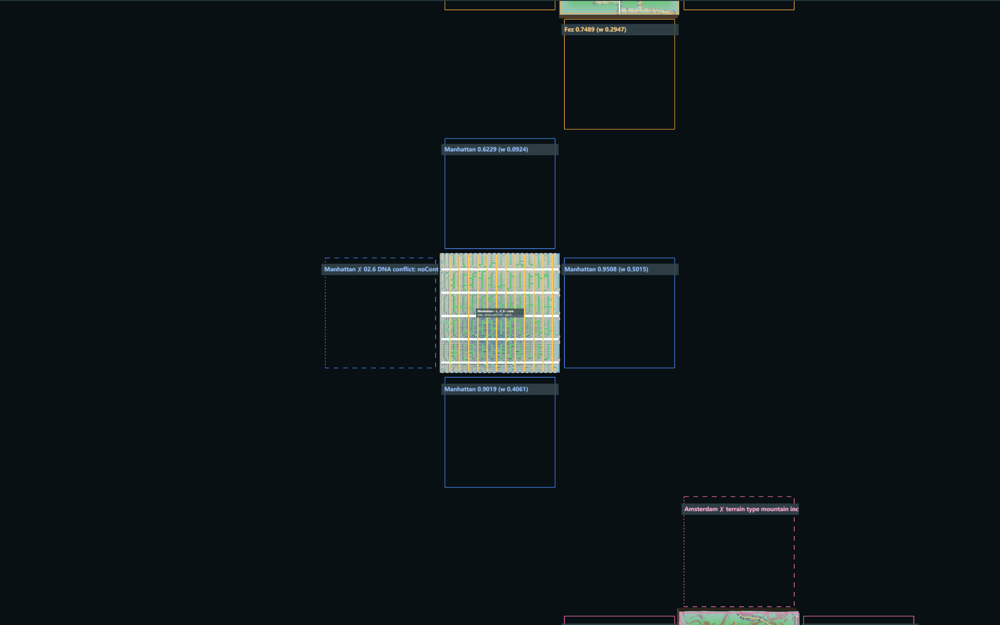
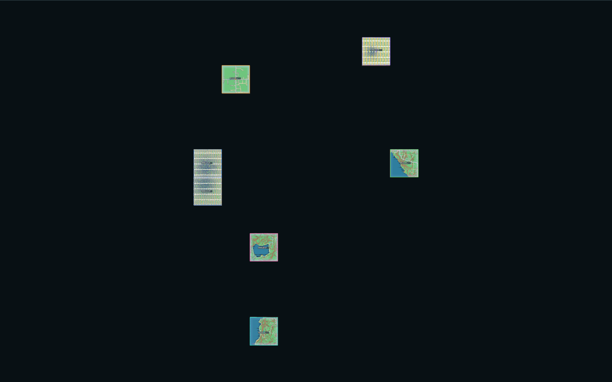
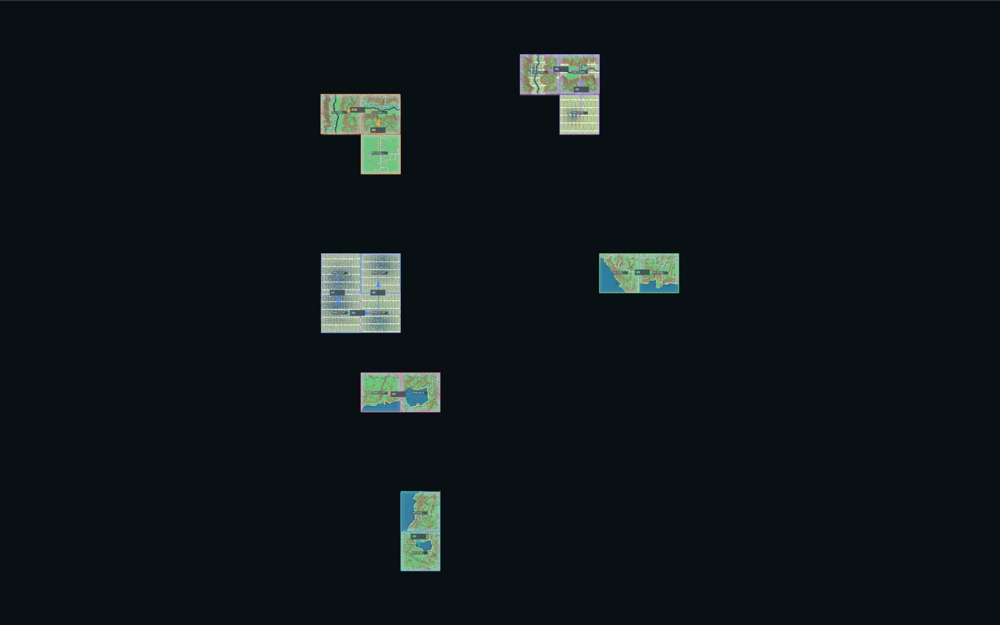
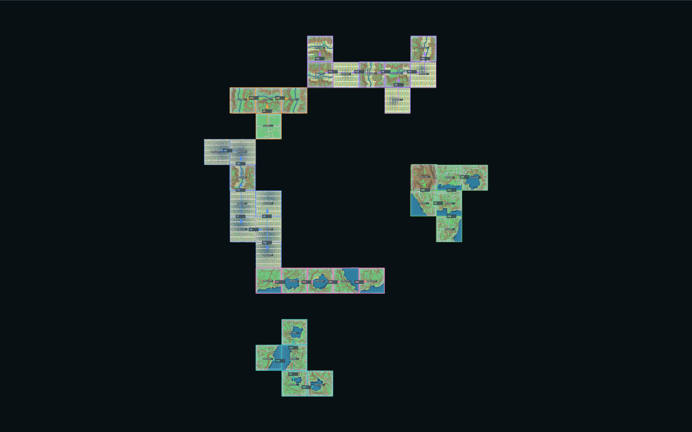
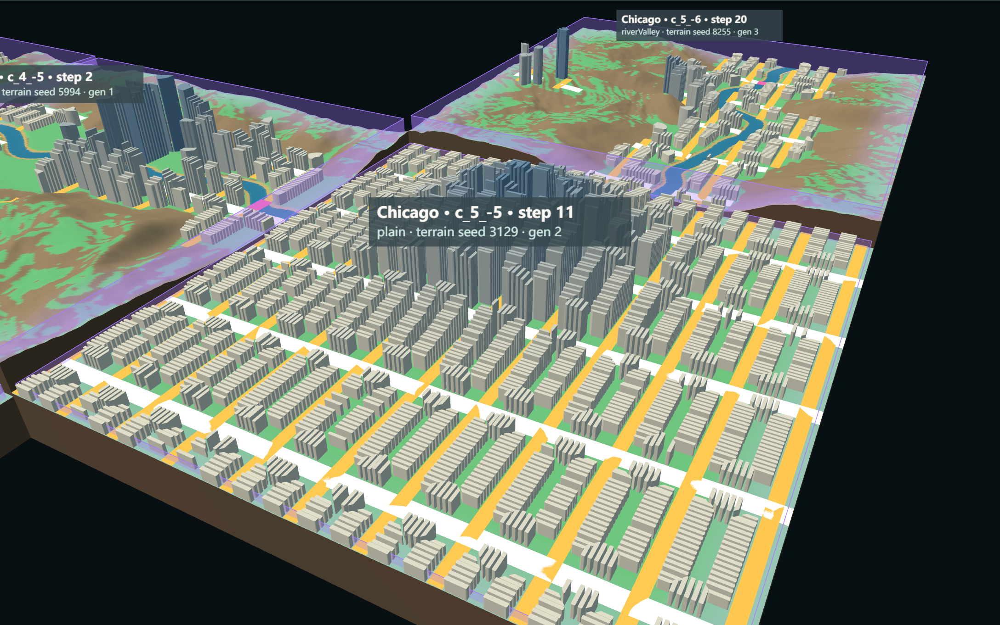
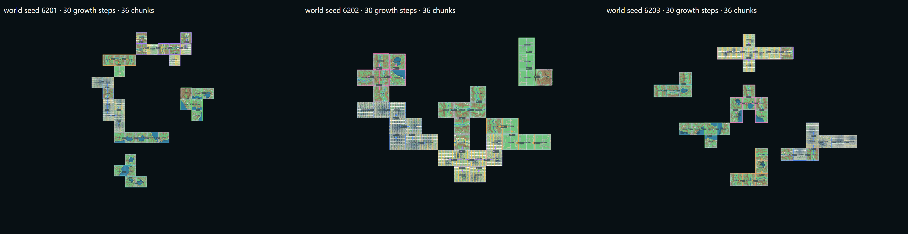

# G02 — Procedural Urban Growth

Part of [A City of Cities — Research Compass](../A-City-of-Cities-Research-Compass.md), roadmap stage **G02**. Log entries: **G02** (first run, stopped by a G01 defect), **G01-FIX**, **G02-V** (this verification) in [FINAL-EXPERIMENT-LOG.md](../FINAL-EXPERIMENT-LOG.md). Previous stage: [G01 Multi-Origin Initialization](./G01-Multi-Origin-Initialization.md).

**Status:** implemented and verified on world seeds 6201, 6202 and 6203, Node and browser, up to 30 growth steps. **Pending review.** Passing tests is not an accepted spatial design.

**Entry point:** `/experiments/city-of-cities/` (`npm run dev`). The growth panel (folder "Growth (G02)") has:

- Grow one step, Grow multiple steps (max 30), Stop, Reset to origins;
- layers: Show growth frontier, Show city territory, Show growth history;
- growth weights;
- chunk inspection by click.

**Verifier:** `node scripts/verify-city-growth.mjs`, with `--node-only`, `--browser-only` or `--seeds=…` to run part of it.

## 1. Research goal

Let the six cities grow outward from their cores, one chunk at a time, by their own growth rules. The world's shape comes from the process, not from a preset layout.

**Out of scope:** G03 relations (territory takeover, invasion / fusion, cross-city road fusion), seam repair, new assets, final UI.

## 2. Growth algorithm (`WorldGrowthController.js`)

One step, at most one new chunk:

1. **Read the World State:** chunks, occupancy, history.
2. **Growth frontier per city:** the free N / S / E / W neighbours of the city's chunks. No diagonals.
3. **Merge candidates:** one candidate per city and cell (`candidateId = cand:<cityId>:<gx>:<gy>`). The parent is the adjacent same-city chunk with the most road / canal ports toward the cell, then the lowest generation, then the chunk ID. A cell occupied by another city is listed as rejected ("occupied by …").
4. **Evaluate** each candidate (§4). Rejected candidates keep their reason.
5. **Scheduler:** every city with at least one eligible candidate bids `rate × best score / (1 + chunks grown) × (1 ± 10 % seeded)`. The highest bid grows; a tie is broken by a seeded hash, never by list order.
6. **Weighted, reproducible choice** among the winner's eligible candidates: key = −ln(u) / score⁴, with u = hash(worldSeed, candidateId, step).
7. **Deterministic occupation ruling:** other cities' candidates on the same cell lose this step ("cell taken by …").
8. **Generate:** `WorldContext.addGrowthChunk` re-checks occupancy, parent city and adjacency, then the unchanged chain runs (terrain → network → blocks → parcels → buildings) with the city's own DNA.
9. **Territory and frontier** follow from the registries; nothing is cached across steps.
10. **History event** records step, cityId, parent, new chunk, target, score, weight, reason (groups, terms, unavailable inputs, city bids, contested cells), worldSeed, generation parameters, output counts and shared-edge conflicts.

**Stalled:** when no city has an eligible candidate, the step returns `stalled` with per-city reasons and is not retried.

## 3. City Growth DNA (`growthDNA.js`, design hypotheses A)

| City | Rate | Slope | Water | Direction preference | Compactness | Infrastructure dependency | Barrier |
| --- | --- | --- | --- | --- | --- | --- | --- |
| Venice | 0.8 | flat | required (no water → reject) | waterfront | 0.6 | 0.5 | stops at slope > 12° |
| Manhattan | 1.0 | flat | neutral | main-road ports toward the cell | 0.4 | 1.0 | stops at slope |
| Fez | 0.7 | moderate | avoid | branches off the urban edge | 0.8 | 0.6 | tolerates slope |
| Amsterdam | 0.9 | flat | seek | ports + water | 0.7 | 0.9 | stops at slope |
| Lisbon | 0.8 | moderate | seek | contour: moderate slope + accessible joining edge | 0.4 | 0.8 | tolerates slope |
| Chicago | 1.1 | flat | neutral | main-road ports toward the cell | 0.2 | 1.0 | stops at slope |

Terrain-type compatibility per landform is the G01 Growth DNA table. **No water is ever created:** Venice's waterfront term only rises where the probed terrain has real water. A uniform profile (`UNIFORM_DNA`) is defined for a future Experiment C; it is not used.

## 4. Suitability parameters (`GrowthEvaluation.js`)

Weights are public parameters: `wTerrain` 3, `wWater` 1.5, `wInfra` 2 (× the city's infrastructure dependency), `wUrban` 2, `jitter` 0.08. Every input below is computed from the probed terrain or the generated parent networks.

| Group | Inputs | Source |
| --- | --- | --- |
| Terrain | mean land slope, P95 slope, maximum land slope, low-slope share, mixed-slope share, buildable share, landform compatibility | `TerrainFields.stats`, slope field, 02.6 metrics |
| Water | water coverage, distance from the cell centre to the nearest wet sample, wet neighbour landforms | water mask, landform field |
| Infrastructure | road / canal ports of the parent chunk(s) on the side facing the cell, main-road (primary) ports, buildable share of the cell's joining edge; accessibility = mean of ports and joining edge | `NetworkGraph.edgePorts`, `TerrainAnalysis.boundaryConnections` |
| Urban | 02.6 DNA fit, direction term, compactness (same-city neighbours of the cell) | 02.6 match, Growth DNA, registries |

**Unavailable (stated, not estimated):**

- **Flood risk:** no hydrology model.
- **Distance to water beyond the cell:** the fallback is wet neighbour landforms, flagged in the reason.

**Rejections:**

- incompatible landform;
- buildable < 5 %;
- triggered 02.6 DNA conflict (`noWater`, `noContinuousLand`);
- required water < 2 %;
- slope barrier (mean land slope > 12° for flat cities);
- score < 0.2;
- occupied by another city.

## 5. Deterministic seed

`worldSeed → citySeed → chunk urbanSeed` (G01).

- A growth chunk's urbanSeed is `hash(citySeed, chunkId)`.
- Its terrain seed and variation come from `worldSeed + cell`: terrain is world-owned.
- Every random value is a keyed hash of (worldSeed, purpose, candidateId or cityId, step).
- There is no `Math.random` and no shared stream, and the result does not depend on evaluation order.

## 6. Growth history and persistence

- **Format:** World State schema v2 (`a-city-of-cities/world-state`; v1 still loads). It stores parameters, growth parameters, cores and growth chunks (parent, core, generation, growth step, terrain seed, generation parameters, expected signatures) and the history events. No meshes and no candidate caches are stored.
- **Restore:** every growth chunk is re-checked against its history event and the world rules. The frontier is rebuilt from the registries, and growth continues from the saved step.

## 7. Verification results

**Part A (Node), seeds 6201 / 6202 / 6203; every stage passed:**

| Stage | Checks |
| --- | --- |
| A — 6 origins | Exactly 6 cores, correct City IDs, no overlap |
| B — 1 step | Exactly one new chunk, generated by the full chain with its own DNA |
| C — 10 steps | Invariants after every step: • no overlap • traceable to the core • 4-connected territory per city • generation = parent + 1 Determinism and persistence: • 10-step twin run identical • save at step 5 → load → regenerate (signatures equal) → continue to 10 = uninterrupted run |
| D — 30 steps | Run only after C passed. Invariants after every step; cores and the first five growth chunks unchanged at step 30 |
| Seeds | The three histories differ |
| Static scan | No use of the World Grid class, terrain seams, road seams or City Invasion functions in the growth code path |

**Part B (browser, all three seeds):**

- 6 origins; step 1 adds exactly one rendered chunk; then steps 10 and 30.
- The browser growth history (cells, cities, parents, scores, building counts) equals the Node run for every seed.
- Seed 6201: save at step 30 → one more step (reference) → page reload → load (36 chunks, 0 signature mismatches) → one step = the identical event.
- 0 browser errors.

**Chunks per city after 30 steps (36 chunks per seed, no stall):**

| City | 6201 | 6202 | 6203 |
| --- | --- | --- | --- |
| Venice | 5 | 5 | 4 |
| Manhattan | 8 | 8 | 8 |
| Fez | 4 | 5 | 5 |
| Amsterdam | 5 | 6 | 6 |
| Lisbon | 6 | 4 | 5 |
| Chicago | 8 | 8 | 8 |
| Max generation | 5 | 4 | 5 |

**Rejection reasons on the final frontier** (counts per city):

- **6201:** Manhattan 6× `noContinuousLand`, 1× slope barrier, 1× occupied by Amsterdam; Venice 3× mountain, 2× slope barrier; Chicago 3× slope barrier, 1× mountain; Amsterdam 3× mountain, 2× `noWater`, 1× occupied by Manhattan.
- **6202:** Venice 5× `noWater`, 1× mountain; Chicago 6× mountain, 2× occupied by Fez, 1× slope barrier (1 eligible left).
- **6203:** Venice 4× `noWater`, 5× mountain (**0 eligible left**, idle 5 steps); Chicago 5× mountain.

**Contested cells** (deterministic ruling) occurred only on 6202:

- step 16: Fez took (3, 1) over Chicago;
- step 27: Fez took (2, 0) over Chicago;
- step 30: Chicago took (0, 1) over Venice.

**Shared-edge conflicts (recorded, not repaired):**

| Seed | Edges | City boundaries | Continuous | Step | Cliff | Water discontinuous | Unpaired road ports |
| --- | --- | --- | --- | --- | --- | --- | --- |
| 6201 | 33 | 1 | 0 | 13 | 20 | 17 | 127 |
| 6202 | 37 | 4 | 0 | 21 | 16 | 9 | 105 |
| 6203 | 30 | 0 | 0 | 13 | 17 | 14 | 94 |

**Time and memory:**

- **Node:** origins 22.6–25.2 s; per growth step median 2.3 / 3.7 / 2.7 s, max 6.4 / 7.6 / 6.7 s (evaluation + full chain).
- **Browser (headless Chrome, device scale 2):**
  - origins 23–26 s;
  - step 1 4.5–4.6 s;
  - steps 11–30 53–64 s (median 2.3 s per step, seed 6201);
  - JS heap 141–250 MB at 6 chunks → 556–673 MB at 36 chunks;
  - restoring a 30-step world (36 chunks, all regenerated and checked) takes 96 s.

## 8. Screenshots (real runtime, default parameters)

1. Six origins, seed 6201: 
2. Growth frontier debug around the Manhattan core, before step 1. Labels show score and selection weight; dashed = rejected with reason. 
3. After the first step (Manhattan grows south): 
4. After 10 steps, history arrows on: 
5. After 30 steps, 36 chunks, history arrows: 
6. New Chicago growth chunk c_5_-5 (step 11, generation 2: 16.4 km roads, 66 blocks, 2,270 parcels, 2,071 buildings). The brown walls at the chunk edges are the recorded height conflicts. 
7. Seeds 6201 / 6202 / 6203 after 30 steps: 

## 9. Known limitations

1. **Near-fixed quotas.** The bid term 1 / (1 + chunks grown) dominates, so the growth rate sets the share. Manhattan and Chicago end with 8 chunks on all three seeds, and Venice / Fez / Amsterdam / Lisbon with 4–6. Suitability decides *where* a city grows much more than *how much*.
2. **Empty chunks.** Some Amsterdam chunks generate 0 buildings: on 6201 two growth chunks; on 6203 the core c_0_0 (coast) and two growth chunks. Growth continues from them; generator output is not part of the score.
3. **Trapped city.** On 6203 Venice ends with 0 eligible candidates (mountain or no water all around) and stops growing. This is not a stall, because other cities still grow.
4. **Seams.** 0 continuous shared edges and many unpaired road ports. Seam repair and road joining are out of scope (G03 or later).
5. **Few city boundaries** at 30 steps (0–4 edges). Cities meet rarely at this scale, so G03 questions need more steps or closer origins.
6. **Score above 1.** The seeded jitter (±0.08) can push a score slightly above 1 (for example 1.0075 on 6203); it only matters as a ranking.
7. **Performance.** Generation is synchronous per step (2–8 s UI pause); memory grows by about 15 MB per rendered chunk; there is no unloading or level of detail.
8. **Uncalibrated.** Every weight and profile is a design hypothesis, not calibrated against urban-growth data.

## 10. Next steps (proposals for review)

- **Review G02 spatially:** do the six territories read as different growth behaviours (compare the seed sheet)?
- **Scheduler:** decide whether the quota effect (limitation 1) is wanted; an alternative is to weight the bid by suitability more strongly.
- **Generator viability check:** record chunks that generate nothing as `nonViable` and exclude them as parents.
- **G03:** territory and encounter states, ecological reserves (Research Compass §8).
