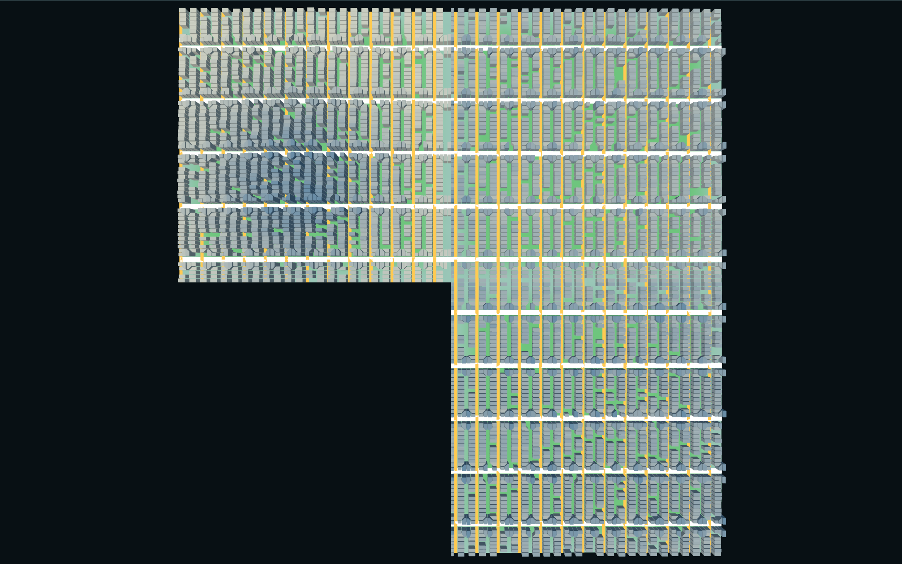
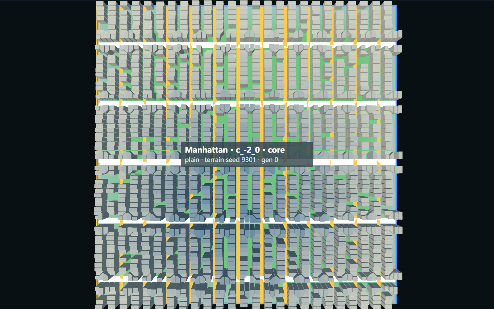
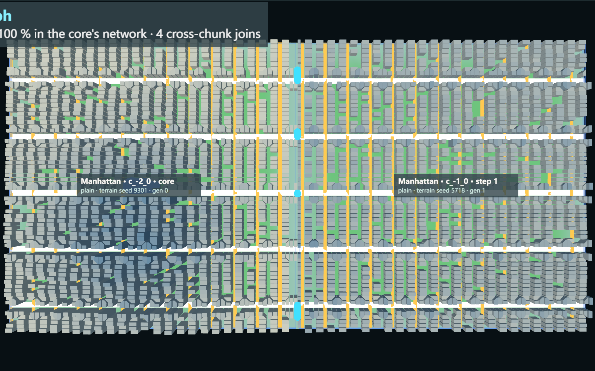
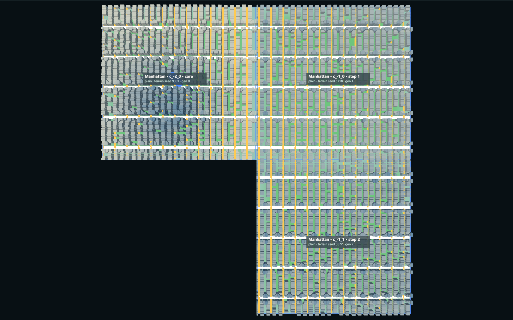
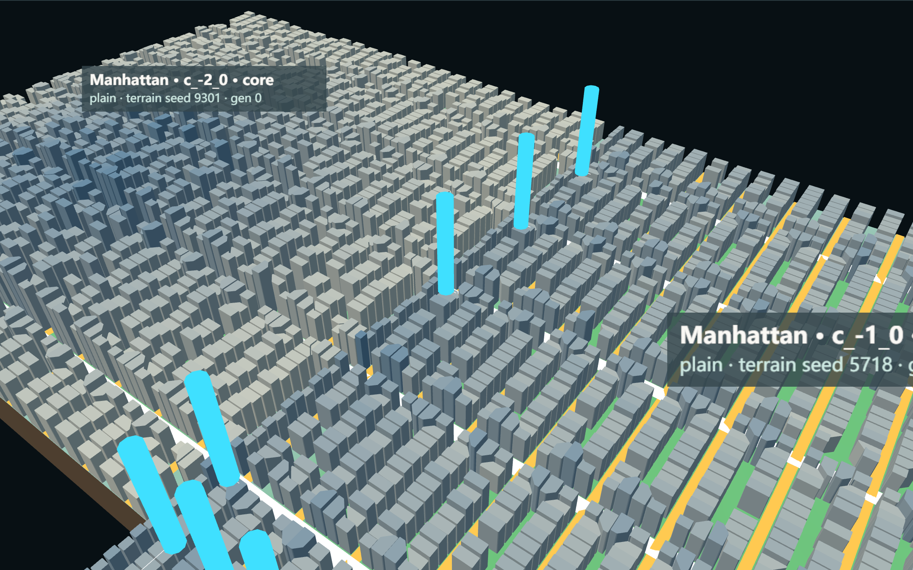
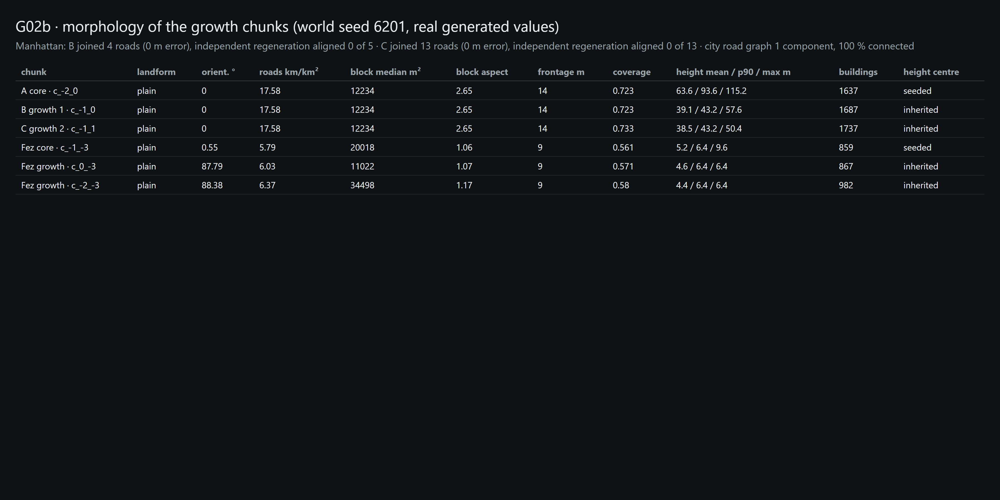
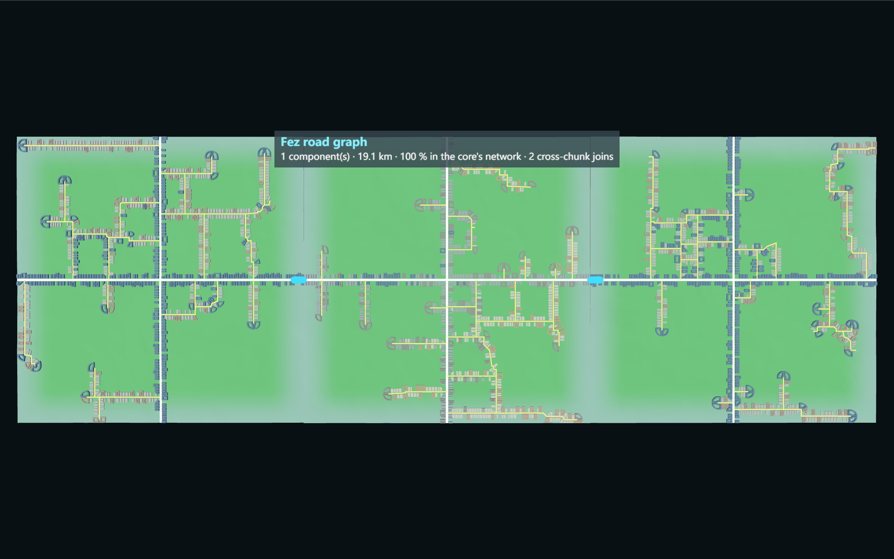

# G02b — Morphological Continuity & Urban Growth

Part of [A City of Cities — Research Compass](../A-City-of-Cities-Research-Compass.md), roadmap stage **G02** (second part). Log entry: **G02b** in [FINAL-EXPERIMENT-LOG.md](../FINAL-EXPERIMENT-LOG.md).

**Status:** minimum viable experiment implemented and verified on world seed 6201, in Node and the browser: Manhattan (grid) three chunks, Fez (organic) three chunks, Chicago failure path. **Pending review.**

**Principle (added to the compass):** *Growth is the extension of urban structure, not the replication of isolated city chunks.*

| Navigation | |
| --- | --- |
| Parent study area | [Knowledge base home](../README.md) · [Research Compass](../A-City-of-Cities-Research-Compass.md) §7 |
| Prerequisite | [G02 Procedural Urban Growth](./G02-Procedural-Urban-Growth.md) (chunk-based growth) |
| This experiment | Road-first, morphology-driven growth of one city (log entry G02b) |
| Next investigation | G02c, **Proposed** (§10) |
| Code | [MorphologicalGrowth.js](../../../experiments/city-of-cities/MorphologicalGrowth.js), [MorphView.js](../../../experiments/city-of-cities/MorphView.js), optional inputs in [NetworkGenerator.js](../../../experiments/seed-terrain/NetworkGenerator.js) and [BuildingGenerator.js](../../../experiments/seed-terrain/BuildingGenerator.js) · [verify-morph-growth.mjs](../../../scripts/verify-morph-growth.mjs) |
| Runtime entry | Local only: `/experiments/city-of-cities/`, folder "Morphological growth (G02b)" |
| Related commit | Working tree — uncommitted |

**Study notebook, in short:**

- **Question:** does a grown chunk continue its city, or does it only carry the City ID?
- **Starting assumption (risk named in the task):** G02 re-generates every chunk independently.
- **Confirmed in the code:**
  - the grid strategy draws new random phases per chunk (`NetworkGenerator.gridStrategy`);
  - every chunk draws its own height centre (`BuildingGenerator`), so each G02 chunk had its own "downtown".
- **Method:** road-first growth from the real road ports of the generated city. The child receives the parent's grid anchor or road entries and the city's height centre through optional generator inputs, and the joins are recorded by identity.
- **Result:** Manhattan's avenues continue through three chunks with 4 + 13 joins at 0 m error. The same cells generated independently line up with 0 of 5 and 0 of 13 parent roads.
- **What changed in my understanding:** continuity needs (1) an inherited anchor and (2) a terrain check at the entry points. Terrain, not the network, decides where a grid city can grow: Chicago on seed 6201 cannot grow at all under these rules.
- **Next question:** see §10.

**What this shows:** the core c_-2_0 and the growth chunks c_-1_0 (east) and c_-1_1 (south of it), with frames and labels hidden. The avenues and cross streets run through without a visible chunk break, and the tall downtown stays in the core.
**Conditions:** world seed 6201, G01 origins, two G02b road-first steps, real browser runtime.
**Why it matters:** the growth chunks read as one city fabric, not three generated squares.
**Limit:** this is the flat-plain case; the joins carry height steps up to 2.4 m (raw terrain seams are not repaired).

> Observation to complete after testing: with the borders hidden, can you find the chunk edges by eye?

## 1. Research objective

Turn chunk-based expansion into morphology-driven growth for one regular-grid city, then one organic city, without changing:

- the six origins and their placement;
- terrain;
- the City DNA tables;
- the default G01 / G02 generation path.

## 2. Algorithm (road-first growth step)

1. **Growth fronts.** Every side of a city chunk that faces a free cell is a front. All of its data comes from the generated chunk:
   - **road front:** the side's road ports, with node / edge ids, class and elevation;
   - **block front:** generated blocks that touch the side;
   - **waterfront:** wet edge samples and canal ports (recorded only);
   - **terrain front:** the G02 suitability evaluation of the target cell, plus an **entry check**: each road port's elevation is compared with the target cell's real terrain at the same boundary point, and only ports within 3 m (A) are usable.
2. **Choice:** the front with the most usable primary entries, then all usable entries, then the terrain score; a seeded tie-break.
3. **GrowthBoundaryContext → target chunk:**
   - parent chunk id;
   - growth front id and event id;
   - source road ids;
   - entry ports (connection id, world point, class, elevation, parent node / edge);
   - the parent's grid anchor (axis, phases, origin) for grid DNAs;
   - the city height centre (from the core);
   - generation index.

   It is stored in the chunk's generation parameters, so load regenerates the chunk identically.
4. **Unchanged chain with optional inputs:**
   - `NetworkGenerator` (grid) re-anchors the parent's phases, so the parent's lines continue;
   - `NetworkGenerator` (organic) uses the parent's entries as gates on the shared side;
   - `BuildingGenerator` uses the inherited height centre.

   Without these options every generator produces exactly the G01 / G02 output (verified).
5. **Connections by identity:** each entry port is joined to the child port at the same boundary point (≤ 0.5 m, same type). The record holds parent chunk / node / edge ↔ child chunk / node / edge, position error and height step. Unmatched entries and new child ports on the shared edge are reported with a reason. Nothing is joined only because it looks aligned.
6. **City road graph:** the union of the chunk road graphs plus the recorded joins; reachability is computed from the core.
7. **Spatial growth event:**
   - growthEventId, source city / chunk / road ids / front;
   - generated road ids (the continued roads), block ids, and the parcel ids fronting continued roads;
   - inherited rules, local adaptations, rejected fronts with reasons, generation step.

**No usable front → the step fails** with the measured reasons. No chunk is added; there is no fallback mode in G02b.

## 3. Inheritance rules

| Rule | Grid DNA (Manhattan, Chicago) | Organic DNA (Fez, Lisbon) | Source |
| --- | --- | --- | --- |
| Road orientation | Parent axis (not the child's terrain hint) | Follows terrain (local adaptation) | parent `outputs.grid` |
| Road hierarchy and spacing | Same lines continue: primary 200 m; secondary 80 m (Manhattan) / 100 m (Chicago) | DNA lane rules | DNA tables (unchanged) |
| Road entry | All usable parent ports | Parent ports become gates on the shared side | entry check (3 m) |
| Block, parcel, building rules | DNA tables (unchanged) | DNA tables (unchanged) | 05.1 / 04.2 |
| Height / density gradient | City height centre from the core: heights fall off with distance from it | same | core `buildings.source.centre` |
| Water (Venice, Amsterdam) | — | — | **Not implemented.** Interface needed: waterfront front from real wet edge samples and canal ports (already recorded per front); no canal may be created where the target has no water |

## 4. Parameters

| Parameter | Value | Note |
| --- | --- | --- |
| maxEntryStep | 3 m | A: largest height difference between a parent road end and the child's terrain at that point |
| portTolerance | 0.5 m | joining distance on the shared edge |

No public parameter was added.

## 5. Results (seed 6201)

**Backward compatibility:** the six G01 cores regenerate with their recorded signatures, and G02 steps 1–5 reproduce the G02 record. No option means no change.

**Chicago: honest failure.** The core c_4_-4 cannot grow road-first:

| Direction | Reason |
| --- | --- |
| North (river valley) | 10 road ends, terrain 33–46 m above them |
| South | mountain, incompatible |
| East | slope barrier, mean land slope 12.23° |
| West | slope barrier, mean land slope 12.40° |

No chunk is created. G02 had grown north across a 62 m cliff.

**Manhattan (grid):**

| Stage | Growth | Joins (usable entries) | Position error | Height steps | Rejected fronts | Independent regeneration |
| --- | --- | --- | --- | --- | --- | --- |
| A core | c_-2_0 | — | — | — | — | — |
| B | east → c_-1_0 | 4 of 4 (5 ports; 1 beyond 3 m) | 0 m | −0.15 / 2.23 / −0.87 / 2.41 m | south: entries 5–57 m off the terrain; west: `noContinuousLand` | 0 of 5 parent roads aligned |
| C | south → c_-1_1 | 13 of 13 | 0 m | −1.34 … 2.23 m | east: slope barrier 22.8° (+ the B rejections) | 0 of 13 aligned |

- **Grid continuity:** same axis, world-anchored phase error 0 m in B and C.
- **Road graph:** 1 component, 55.3 km, 100 % reachable from the core.
- **Dead ends:** 0 in every chunk.
- **Core:** unchanged after both steps.

**Morphology** ([metrics sheet](../../assets/screenshots/procedural-mini-world/g02b-metrics-comparison.png)):

| Chunk | Orientation | Roads km/km² | Block median m² | Block aspect | Frontage m | Coverage | Height mean / p90 / max m | Height centre |
| --- | --- | --- | --- | --- | --- | --- | --- | --- |
| A core c_-2_0 | 0° | 17.58 | 12,234 | 2.65 | 14 | 0.723 | 63.6 / 93.6 / 115.2 | seeded |
| B c_-1_0 | 0° | 17.58 | 12,234 | 2.65 | 14 | 0.723 | 39.1 / 43.2 / 57.6 | inherited |
| C c_-1_1 | 0° | 17.58 | 12,234 | 2.65 | 14 | 0.733 | 38.5 / 43.2 / 50.4 | inherited |

- **Grid quantities** are identical across the boundary because the grid is continued on flat plain; they would change where terrain truncates lines.
- **Heights** fall to 61 % of the core's mean. This is the rule (distance to the city centre), not a reset: an independent regeneration would place a new centre inside each child, for example (−968, −227) for B.

**Fez (organic):**

| Stage | Growth | Joins | Height step | Orientation vs core | Dead ends | Rejected fronts |
| --- | --- | --- | --- | --- | --- | --- |
| A core c_-1_-3 | — | — | — | — | 15 | — |
| B | east → c_0_-3 | 1 of 1 | 2.64 m | 2.8° | 13 | south: entry 33.9 m off the terrain |
| C | west → c_-2_-3 | 1 of 1 | −1.48 m | 2.2° | 12 | several entries 3.2–33.9 m off the terrain |

- **Road graph:** 1 component, 19.1 km, 100 % reachable from the core.
- **Caveat:** on these flat plain edges the independent regeneration also puts its single gate at the same midpoint (1 of 1 aligned). For Fez, inheritance guarantees the join by identity; the alignment is not evidence of inheritance by itself.

**Stability:**

- The same seed twice gives an identical history and outputs.
- Save after B → load → every chunk regenerates with its saved signatures → the joins are recomputed identically → growing C equals the uninterrupted run.
- In the browser: the page reproduces the Node growth and joins, and Save → reload → Load reproduces the connections. 0 browser errors.

## 6. Screenshots (seed 6201, real runtime)

1. Initial core (Stage A): 
2. First growth: cyan posts at the 4 recorded joins on the shared edge; continued roads in white: 
3. Three chunks, top view with chunk frames: 
4. Same view without chunk borders: see the image at the top of this note.
5. Boundary close-up of the core | growth-chunk edge: the joined avenues continue into the lower-rise growth chunk: 
6. Metrics comparison (real values of this run): 
7. Fez, three chunks without borders: one main lane through all three, two joins: 

## 7. Failures and limits

1. **Chicago (seed 6201) cannot grow road-first.** That is the correct result under the rules; a different seed or a bridging rule would be needed.
2. **Unjoined road ends.** One Manhattan parent road (B) is not joined because its end is more than 3 m from the child terrain; the child has a road ending at that point (reported as a new port on the shared edge).
3. **Height steps.** The joins carry steps up to 2.6 m because the raw terrain seams are not repaired; the road is joined in topology but not smoothed in geometry.
4. **Parcel traceability.** In step B no parcel lists one of the four continued edges as its frontage road (parcels take the longest frontage, usually a cross street); in C, 158 of 1,872 do.
5. **Fez evidence.** Inheritance and independent generation coincide on these flat edges, so the Fez result shows continuity but not its necessity.
6. **Morphology inheritance** covers grid anchor, entries and height centre. Parcel and building rules come unchanged from the DNA tables; no gradual parameter drift is modelled.
7. **Scope.** Water cities, multi-city interaction and G02 / G03a integration of road-first growth (the 30-step world still uses G02 chunk growth) are not done.

## 8. Changed files

- **New:** `experiments/city-of-cities/MorphologicalGrowth.js`, `MorphView.js`, `scripts/verify-morph-growth.mjs`, evidence `morph-growth.json`, 7 screenshots.
- **Changed (optional inputs, default path unchanged):**
  - `experiments/seed-terrain/NetworkGenerator.js`: `options.growth` (grid anchor, entry gates) and grid anchor metadata;
  - `experiments/seed-terrain/BuildingGenerator.js`: `options.centre`;
  - `experiments/city-of-cities/WorldContext.js`: growth-context path, port ids, road graph, boundary blocks, morphology metrics;
  - `main.js` / `index.html`: G02b folder, panel row.

## 9. Verification

`node scripts/verify-morph-growth.mjs` (Node ≈ 4 min, with `--max-old-space-size=8192`; browser ≈ 4 min; `--node-only`, `--browser-only`).

The first full run crashed with exit code 139, a native segmentation fault while several worlds were held in memory. The verifier now releases each world after use; the reruns of both parts passed.

## 10. Next stage — proposals

- **G02c:** use road-first growth inside the multi-city G02 scheduler (morphology mode as an option), then re-run the G03a territory analysis on it.
- **Smooth joins:** a one-sided entry ramp on the child side within the transition band, so joined roads have no height step. This is a terrain-local change that needs a decision.
- **Waterfront growth for Venice and Amsterdam:** fronts from real wet edge samples and canal ports.
- **A second grid seed where Chicago can grow,** for a Chicago comparison.
