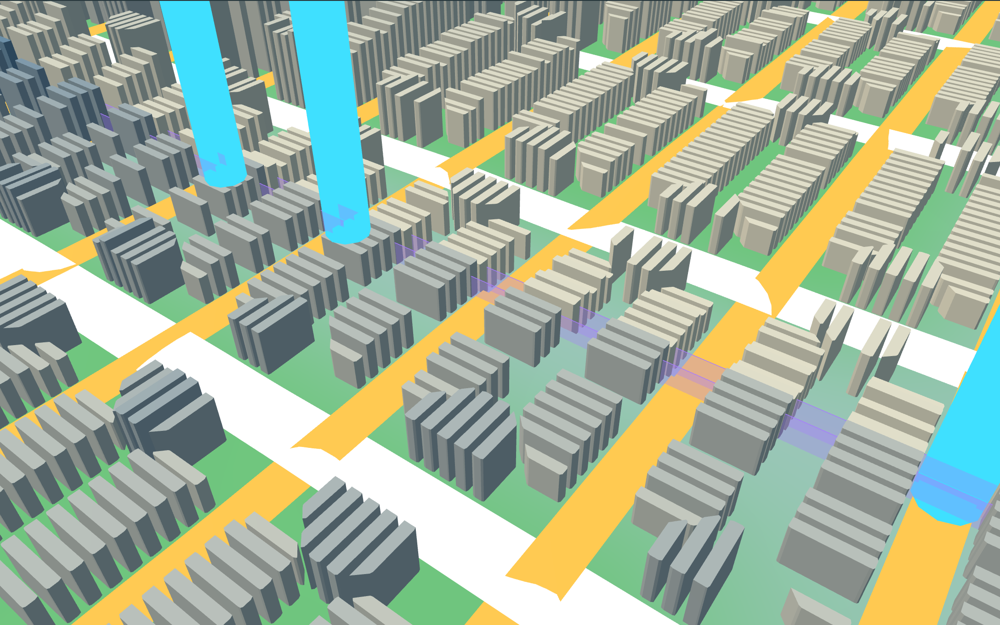
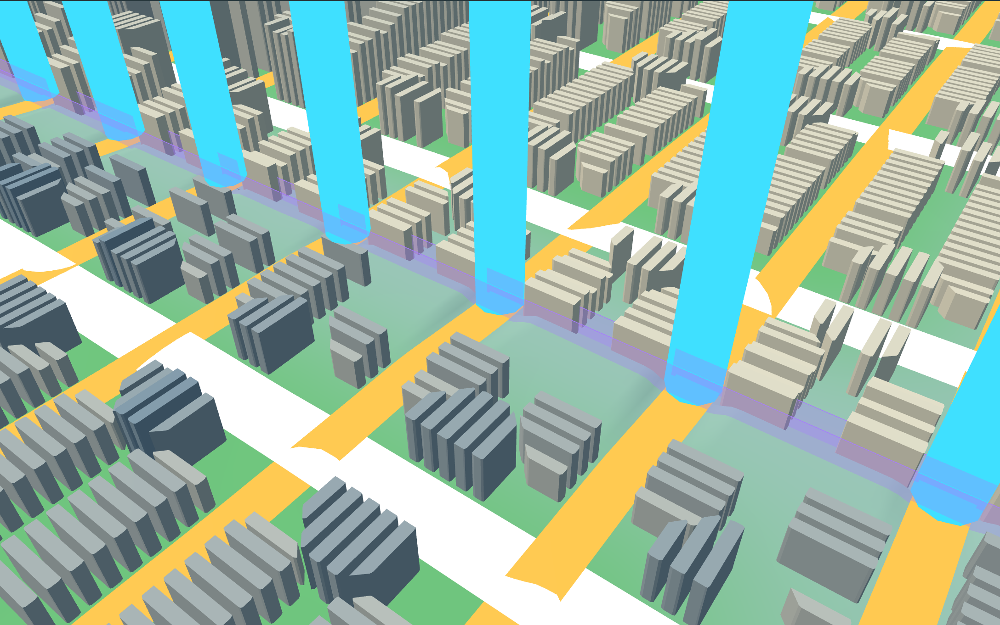
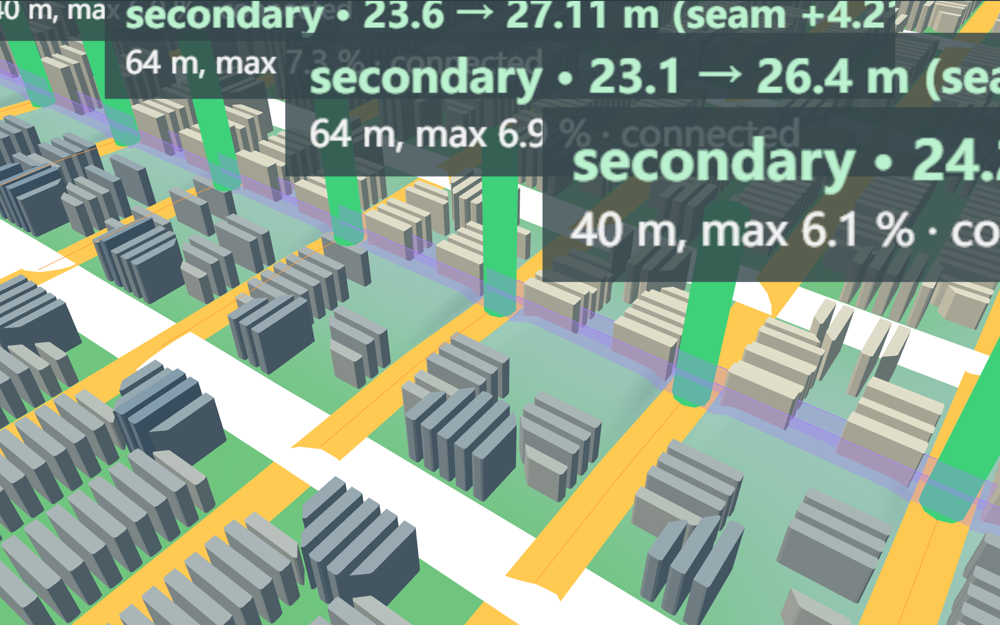
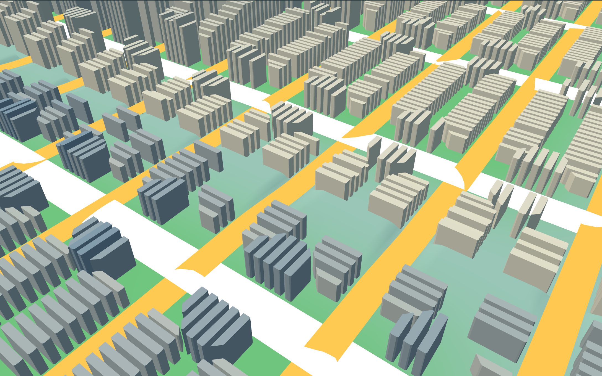
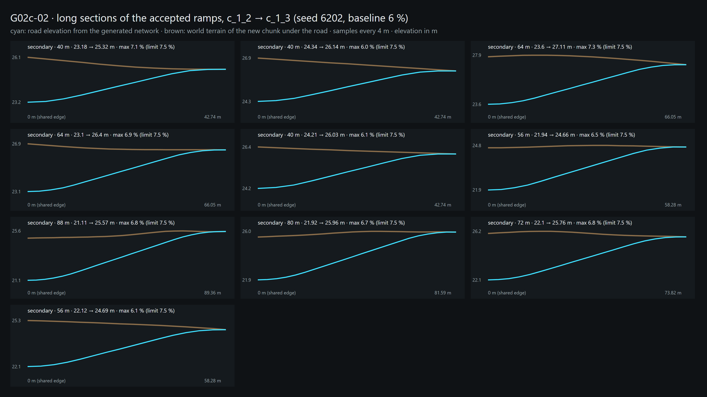
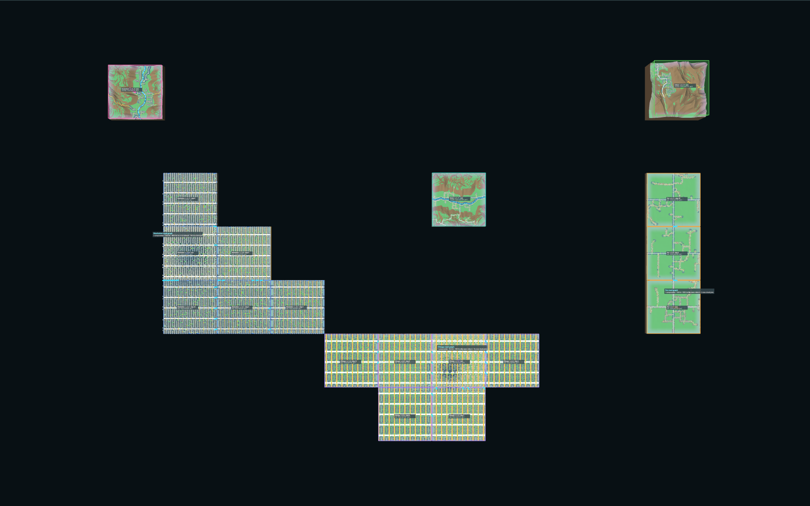

# G02c-02 — Grade-Aware Road Growth

Part of [A City of Cities — Research Compass](../A-City-of-Cities-Research-Compass.md), roadmap stage **G02**. Log entry: **G02c-02** in [FINAL-EXPERIMENT-LOG.md](../FINAL-EXPERIMENT-LOG.md). Baseline kept unchanged: [G02c-01 note](./G02c-Road-Driven-Growth.md), evidence `road-driven-growth.json`.

**Status:**
- **Implemented:** grade-aware connection (ramp plan with vertical alignment), opt-in by `gradeProfile`.
- **Verified:** Node and browser, seed 6202 replay, free scheduler on 6201 / 6202 / 6203.
- **Accepted:** no. **Pending review.**

| Navigation | |
| --- | --- |
| Code | [RoadRampPlanner.js](../../../experiments/city-of-cities/RoadRampPlanner.js), [RampView.js](../../../experiments/city-of-cities/RampView.js); changes in `WorldContext.js`, `MorphologicalGrowth.js`, `RoadGrowthFrontAdapter.js`, `WorldGrowthController.js`, `NetworkView.js` (stored elevations for ramps) |
| Verifier | [verify-grade-aware-growth.mjs](../../../scripts/verify-grade-aware-growth.mjs) · evidence `experiments/city-of-cities/evidence/grade-aware-growth.json` |
| Runtime entry | Local only: `/experiments/city-of-cities/?growthMode=road&grade=baseline`, folder "Road-driven growth" |

**Principle:** road continuity is negotiated through vertical alignment, not decided by a single height threshold.

## 1. Research question

Can a grown chunk continue its city's roads in three dimensions: same point, same height, one graph? And when it cannot, can the system say why?

## 2. Diagnosis of the old 3 m rule (seed 6202)

The G02c-01 run was regenerated, and every road end facing a grown chunk (73 from parents, 24 from older neighbours) was recorded by stable connection id with the fields the task lists (`diagnosis.rows` in the evidence).

**Finding:** in all 97 of 97 cases the road lies on its own chunk's terrain (within 0.005 m), and the horizontal distance between the two road ends is 0. **Every height step is the terrain seam.** Growth terrain is raw, so the two chunks' ground meets with a step. The roads had no elevation error of their own.

What each case needs, with the 6 % baseline:

| Class | Meaning here | Historic 41 (not joined) | Historic 32 (joined with steps) | Neighbour 24 |
| --- | --- | --- | --- | --- |
| A Road elevation mismatch, resolved | The seam can be carried by a ramp in the new chunk | 13 | 21 | 17 |
| B Terrain seam discontinuity | Seam above 6 m: needs a structure | 5 | 0 | 7 |
| C Geometry / topology mismatch | Ends not at one point, or a shared road | 0 | 0 | 0 |
| D Insufficient approach length | The road reaches a junction before it can climb | 23 | 11 | 0 |

The historic 32 joins had height steps up to 2.92 m. Under the new rule, 11 of them are not continuous and are no longer joined.

## 3. Ramp planning and vertical alignment

1. **Pair.** Each neighbouring road end is paired with the child port at the same point. XY tolerance is 0.05 m.
2. **Approach.** The child road is followed from that port through bend nodes to its first junction. The ramp must end 12 m before the junction, so the cross streets stay on the ground.
3. **Profile.** Starting at the neighbour's elevation, the planner searches 8 m length steps for the shortest profile that passes:
   - the shape is a parabola, then a constant grade, then a parabola (25 % of the length each curve);
   - it is checked on 4 m samples, including the sample after the ramp end, for maximum grade, grade change (at most 3 % per sample) and height off the ground (at most 6 m).
4. **Corridor.** The ground follows the road only under the ramp: flat under the road plus 1.5 m, then 1:2 side slopes. This is limited to the new chunk and recorded as cells.
   - The world terrain, every committed chunk and the seam beside the corridor are unchanged.
   - All measurements use the world terrain. The page draws the corridor.
5. **Buildings.** A building whose ground the corridor moves by more than 0.25 m stays vacant and is listed.
6. **Join and commit.** Only accepted or flush ends join. The child's boundary node takes the neighbour's elevation, so the join is one node in height as well. A grown chunk needs at least one join; otherwise the attempt is a `networkConflict` and is rolled back.

Plan geometry (network, blocks, parcels) is unchanged by the ramps: the replayed chunks carry the G02c-01 signatures.

## 4. Grade parameters (design assumptions, not road standards)

| Parameter | Value |
| --- | --- |
| Grade profiles | Conservative 4 %, Baseline 6 %, Permissive 8 % |
| Class factor | Primary × 1, secondary × 1.25, lane × 1.5 |
| Junction stand-off | 12 m |
| Most cut or fill without a structure | 6 m |
| Grade change per 4 m sample | 3 % |
| Endpoint tolerance | 0.05 m. Port elevations are stored to 0.01 m; terrain samples are 4 m apart |

All values are in `RAMP_RULES` and `GRADE_PROFILES`. No public parameter was added; the profile is a test setting.

## 5. Results

**Test A, Chicago c_1_2 → c_1_3 (seed 6202, 6 %):**
- **Joins:** 4 joins with height steps (G02c-01) become 10 continuous joins.
- **Ramps:** 40–88 m long, maximum sampled grade 7.3 % (secondary limit 7.5 %), all cut into the higher child ground.
- **Buildings:** 92 of 2,019 vacated (4.6 %).

**Test B, the 12 G02c-01 events replayed (6 %):**
- **Outcomes:** 51 accepted, 34 insufficient length, 12 terrain discontinuity.
- **Joins:** 34 parent and 17 neighbour, every one checked for XY, height and graph:

| Check | Result |
| --- | --- |
| Residual height at joins | 0 m |
| XY offset | 0 m |
| Maximum sampled grade | 7.48 % (secondary), 6.0 % (primary) |
| Maximum grade change | 2.89 % per sample |
| Road off the drawn ground | at most 0.13 m (bilinear 4 m sampling) |
| Graph joins | 51 of 51 |
| Fill / cut | at most 5.51 m / 5.91 m |
| Corridor area | 95,280 m² |
| Vacated buildings | 414 (2.1 %) |

- **Replay only:** 4 replayed chunks would have no parent join under the new rule (`c_-3_0`, `c_0_2`, `c_0_3`, `c_-4_1`). The replay keeps them so the run can be compared; a free run refuses them.

**Test C, sensitivity, replay:**

| Profile | Ramps | Joins (parent + neighbour) | Max grade | Median ramp | Vacated | Manhattan reach |
| --- | --- | --- | --- | --- | --- | --- |
| 4 % | 34 | 20 + 14 | 4.98 % | 80 m | 312 | 2 of 6 |
| 6 % | 51 | 34 + 17 | 7.48 % | 64 m | 414 | 3 of 6 |
| 8 % | 52 | 35 + 17 | 9.71 % | 48 m | 356 | 6 of 6 |

Plan geometry is identical at all three profiles: street pattern, blocks and parcels do not change. Only vacated buildings and the corridor change.

**Free scheduler, 12 steps** (chunks grown; G02c-01 for comparison):

| Seed | G02c-01 | 4 % | 6 % | 8 % |
| --- | --- | --- | --- | --- |
| 6201 | 12 (Fez 8, Manhattan 4) | 6, stalled | 7, stalled | 9, stalled |
| 6202 | 12 | 11, stalled | 12 | 12 |
| 6203 | 12 (Manhattan 9, Chicago 3) | 1, stalled | 1, stalled | 1, stalled |

**This is the main cost of the rule.** Grid primary streets reach a junction after 80–100 m, so seams of more than about 3 m cannot be graded before it. Candidates fail as `networkConflict`, and whole worlds stall. Every grown chunk stays reachable from its core.

**Cities:**

| City | Observation |
| --- | --- |
| Chicago | All 10 ramps of Test A pass on secondary streets (100 m apart, long approaches). Primary streets fail more often |
| Manhattan | Primary streets cross every 80 m, so most seams above about 2.5 m fail on length. Reach in the replay depends on the profile (2 / 3 / 6 of 6 chunks) |
| Fez | One ramp per event, all accepted. Organic gates take only usable entries |
| Lisbon | Still no growth. Its road ends lie 9–205 m off the next cell's terrain: a ramp cannot help, and the grade was not raised to force it |
| Venice, Amsterdam | Not part of this mode. Amsterdam on seed 6203 still has no road graph in its core (open blocker, not faked) |

## 6. Stability and performance

| Check | Result |
| --- | --- |
| Determinism | Seed 6202, 12 steps, identical with the chunk registry order reversed before every step |
| Candidate cache | Seed 6203: cache on and off give identical chunks and signatures. A cached failure is not generated again (up to 27 avoided per run). Its key holds front, parent network, terrain seed, neighbours, profile and rules |
| Save / load | Saved at step 6: 12 chunks and ramp records reproduced, 6 join events reproduced, the cache saved; 6 more steps equal the uninterrupted run. Browser: save, reload, load reproduce ramps and joins, 0 errors |
| Failure injection | Generator error leaves no chunk; another candidate grew |
| Long run | 20 steps requested; **stopped at 16** ("every eligible road candidate failed validation"), 482 s; 74 joins checked, all continuous |
| Time | 12 free steps took 92–222 s per run (G02c-01: about 50–60 s). Failed attempts and ramp search cost the difference. The full Node verifier took 4.4 h, partly while other verifiers ran in parallel |
| Regressions | G02c-01 verifier (`--no-record`, its record untouched), G02b and G03b Node verifiers: pass |

## 7. Screenshots (seed 6202, chicagoGrid, task G02c-02, real runtime)

Fixed camera on the largest accepted seam of Test A (+4.21 m, secondary road), recorded joins as cyan posts:

| Before (G02c-01, 4 joins with steps) | After (6 %, 10 continuous joins) |
| --- | --- |
|  |  |

- Ramp debug: green posts are connected ramps with start / end elevation, seam, length and maximum grade. The labels overlap at this distance: 
- Borders hidden: 
- Long sections of the 10 ramps, from the generated network. Cyan is the road and brown the world terrain of the new chunk: 
- Seed 6202, whole replay, before / after. Accepted, unconnected and seam layers are on, but they are hard to read at world scale:  

## 8. Terrain seam limits

- The ramp closes the seam **only under the road**. Beside the corridor the terrain still steps at the chunk edge; median seams along the grown edges are 0.7–4.6 m on seed 6202.
- Seams above 6 m stay unconnected as `terrainDiscontinuity` (12 in the replay).
- No bridge, wall or tunnel exists. Such cases are reported, not drawn.

## 9. Known limits

1. **Growth stalls.** See the free-scheduler table: the strict rule plus short grid approaches stop growth early on 6201 and 6203.
2. **Ramps stop before the first junction.** Grading through a junction (with its cross streets) is the obvious next step and was not done.
3. **Buildings are vacated, not redesigned.** The corridor's side slopes take 1.6–2.1 % of the buildings in the grown chunks.
4. **Debug labels** are too large at close range.
5. **Values are not calibrated.** All grades, the 6 m earthwork limit and the class factors are assumptions.
6. **Not verified:** Firefox, Safari; long runs beyond 16 steps (no world grew further).

## 10. For G03c

- **Available:** a ramp evaluation (`planVertical`), records with reasons per road end, and graph joins that are continuous in height.
- **Missing:**
  - cross-city ramps (both chunks are committed when cities meet, so a ramp needs a new rule);
  - `UrbanEncounter.path` reading `neighbourConnections`;
  - a connection hook for grid cities.
- **Risk:** stalled growth makes natural encounters rare.
