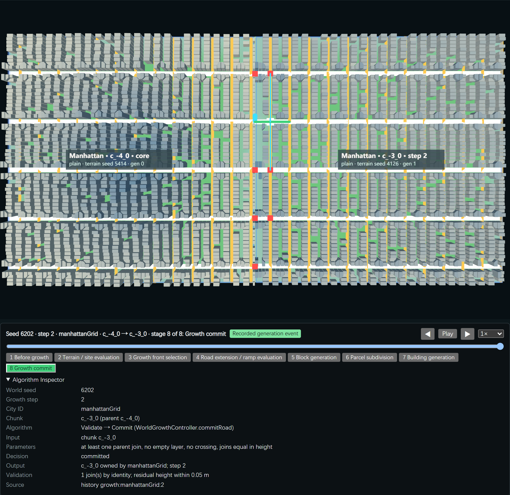
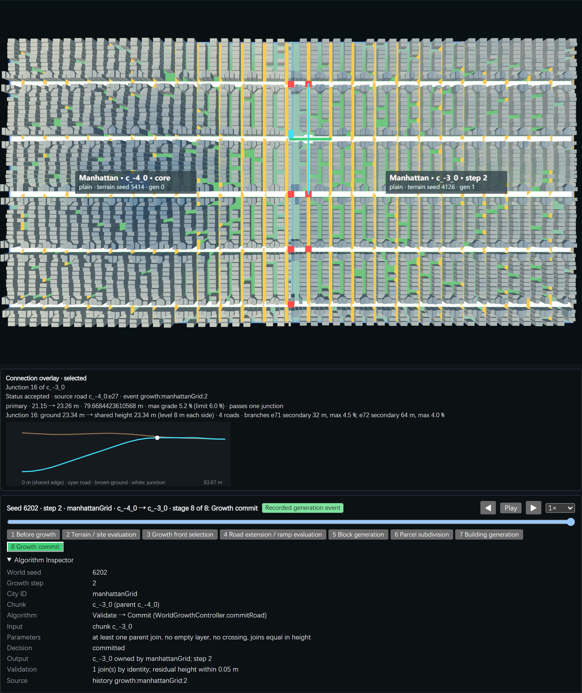
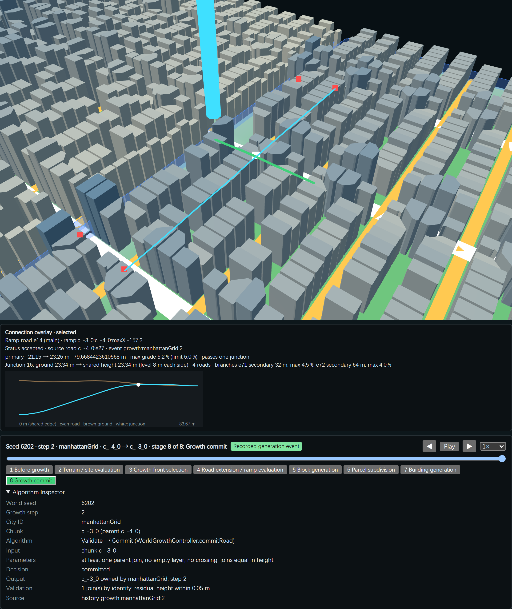
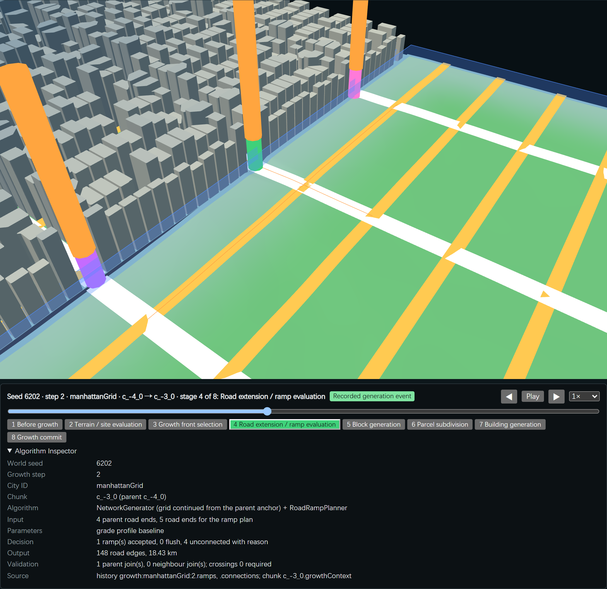
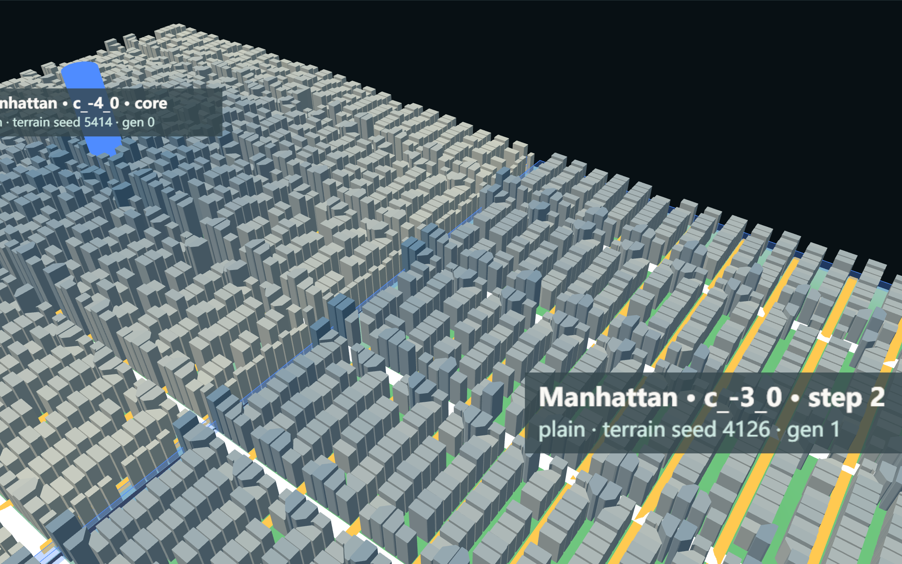
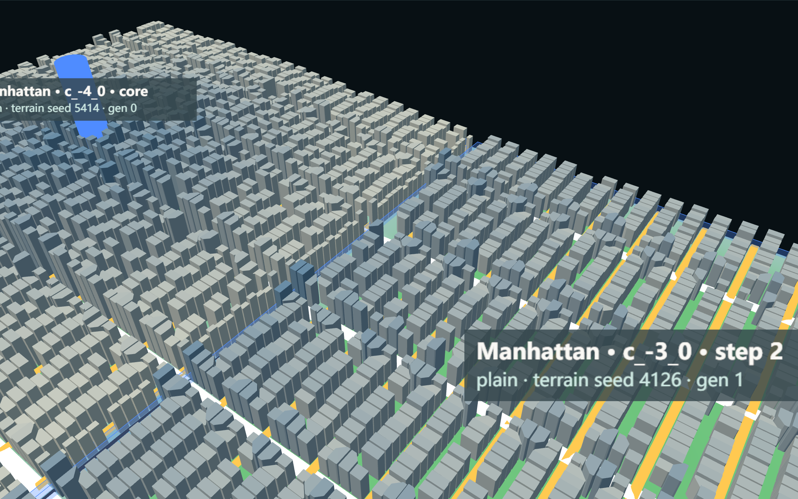

# G02c-03a — Intersection-Aware Ramp

Part of [A City of Cities — Research Compass](../A-City-of-Cities-Research-Compass.md), roadmap stage **G02**. Log entry: **G02c-03a** in [FINAL-EXPERIMENT-LOG.md](../FINAL-EXPERIMENT-LOG.md). Builds on [G02c-02](./G02c-02-Grade-Aware-Road-Growth.md).

**Status:**
- **Implemented:** a ramp may pass one junction, opt-in by `junctionRamps`.
- **Verified:** Node and browser.
- **Accepted:** no. **Pending human spatial review.**
- **Scope kept:** G02c-03b (several junctions) is not started. The G02c-03b brief requires this stage to pass first.

| Navigation | |
| --- | --- |
| Code | `RoadRampPlanner.js` (`planJunction`, `rampFromLevel`, `rampImpact`), [ConnectionOverlay.js](../../../experiments/city-of-cities/ConnectionOverlay.js), [junctionFixture.js](../../../experiments/city-of-cities/junctionFixture.js) (TEST ONLY); option plumbing in `MorphologicalGrowth.js`, `RoadGrowthFrontAdapter.js`, `WorldGrowthController.js`, `WorldContext.js`, `main.js`; `RampView.js` (new status) |
| Verifier | [verify-junction-ramp.mjs](../../../scripts/verify-junction-ramp.mjs) · evidence `experiments/city-of-cities/evidence/junction-ramp.json` |
| Runtime entry | Local only: `/experiments/city-of-cities/?worldSeed=6202&growthMode=road&grade=baseline&junctions=1`; add `&replay=2` for the event below; "Connection overlay (debug)" in the Road-driven growth folder |

**Principle:** a road intersection is a shared three-dimensional constraint, not an obstacle to bypass or a vertex to ignore.

## 1. The blocker, reproduced

- **Why the ramp stopped:** `approachOf` ends the approach at the first node of degree ≥ 3, and the ramp had to end 12 m before it.
  - Chicago's first cross street can lie 3 m inside the edge.
  - Organic gates meet a junction about 4 m in.
  - So the available length was often negative.
- **Junction height:** every node takes the height of its own chunk's terrain. Raising a junction moves the ends of every road that meets there, so all of them have to be re-graded.
- **The "92 buildings":** these were **new building candidates of the uncommitted chunk**, standing on ground the ramp corridor reshaped (flat shoulder plus 1:2 side slopes; Chicago builds on the street line).
  - No committed building was deleted: the planner only reshapes the chunk being generated.
  - This is now measured: committed chunks changed 0 in every run below.

**Baselines kept:**
- G02c-02 replay of seed 6202: 51 accepted, 34 insufficient length, 12 terrain.
- Historic 32 joins and 41 unjoined points (G02c-01).
- The default path (option off) reproduces 51 / 34 / 12 exactly.

## 2. Method

The single-junction plan runs only when a simple ramp fails for length and its approach ends at a junction J:

1. **Main road:** continues on the road at J closest to straight (within 30°) up to its own next node.
2. **Branches:** every other road at J, each up to its next node.
3. **One height zJ for J.** Twenty-one heights are tried between the source elevation and J's ground. A candidate must be within 6 m of the ground.
4. **Main profile:**
   - ramp from the shared edge to 8 m before J;
   - **level at zJ for 8 m on each side of J** (the cautious junction rule; an assumption, not a junction design standard);
   - ramp back to the ground before the next junction (12 m stand-off).
5. **Every branch:** level at zJ for 8 m, then back to the ground before its own next node.
6. **Checks:** every road is checked on 4 m samples for grade (class limit), grade change and height off the ground. **One failing branch refuses the whole plan** (`junctionConstraint`), and the reasons of all tried heights are kept.
7. **Choice:** among the heights that pass, the one with the least total earthwork (sum of |road − ground|) wins. This is a deterministic grid search, not an optimisation library.
8. **Commit:**
   - one corridor for all roads;
   - collision checks with other roads and ramps;
   - all graph nodes along the roads take the road height, including J and bend nodes;
   - then the usual Validate → Commit.
9. **Impact report per chunk:**
   - committed buildings affected (0, by construction and measured);
   - new candidates excluded and their footprint;
   - corridor area;
   - block and parcel area touched.

**Limits of the method:**
- Grades and lengths are the research parameters of G02c-02 (4 / 6 / 8 %, class factors), not road engineering.
- There is no design speed, junction type or pedestrian rule.

## 3. Test A: controlled fixture (TEST ONLY)

A synthetic 1024 m chunk, flat at 20 m. The main road enters 3 m higher and meets a cross street 60 m in.

| Variant | Simple ramp | Through the junction |
| --- | --- | --- |
| Feasible (3 m seam, 6 %) | Insufficient length: needs 67 m, 48 m available | **Accepted.** Junction raised to 20.75 m; main 92 m, max 5.8 %; both branches 32 m, max 4.2 % |
| Seam 8 m | Terrain discontinuity | Terrain discontinuity (refused) |
| Short branches (dead ends 20 m) | Insufficient length | **Refused:** branch 3 needs 54 m at 7.5 %, 12 m available |
| 4 % | Insufficient length | **Accepted.** Junction 21.5 m; main max 3.8 % |

For the accepted variants:
- the junction height is equal on all four roads (spread 0 m);
- the grade inside the level zone is 0;
- the graph paths from the shared edge reach J, the main road's far end and both branch ends.

## 4. Test B and C: real growth

**Seed 6202, the 12 G02c-01 events replayed** (same target cells and parents; ramps compare by connection id):

| | Before (G02c-02) | After |
| --- | --- | --- |
| Accepted | 51 | **62** (11 through a junction) |
| Insufficient length | 34 | 0 (now refused with a reason as junction constraint 15 or collision 7) |
| Terrain discontinuity | 12 | 13 |
| Parent joins / neighbour joins | 34 / 17 | 45 / 17 |
| Chunks without a parent join | 4 | **0** |
| Chicago / Manhattan chunks reachable from the core | 3 of 6 / 3 of 6 | **6 of 6 / 6 of 6** |
| Committed chunks changed | — | 0 |

**The 11 through-junction ramps:**

| Measure | Result |
| --- | --- |
| Height spread at the junction | Max 0.0045 m |
| Junctions raised or lowered off their ground | 10 of 11 |
| Branches graded | 22 |
| Max sampled grade, main | 7.36 % (secondary limit 7.5 %) |
| Max sampled grade, branch | 7.16 % |
| Grade in the level zone | 0 |
| Paths: start → J → main end and every branch end | All found |

**Refusals:**
- 8 branches cannot return to the ground before their next junction (Manhattan primary avenues 80 m apart);
- 7 main roads have no room past the junction;
- 7 collisions: another ramp's plan already uses the road.

**Free growth** (30-step budget; "before" = G02c-02, 12-step budget):

| Seed | Before | After | Through a junction | Committed chunks changed | Node / road height gap |
| --- | --- | --- | --- | --- | --- |
| 6201 | 7 steps, stalled | **19 steps**, stalled at step 20 | 25 | 0 | at most 0.028 m |
| 6202 | 12 steps | **30 steps** | 33 | 0 | at most 0.039 m |
| 6203 | 1 step, stalled | **30 steps** | 46 | 0 | at most 0.046 m |

**Read with care:**
- The budgets differ (12 against 30).
- Venice, Amsterdam and Lisbon still do not grow.
- Seed 6201 still stalls, now at step 20.

## 5. Building impact (hard constraint: committed buildings modified = 0)

| Run | Committed affected | New candidates excluded | Footprint excluded | Corridor | Block area touched | Parcel area touched |
| --- | --- | --- | --- | --- | --- | --- |
| Replay 6202 | 0 | 495 of 20,144 (2.5 %) | 104,182 m² | 106,992 m² | 36,912 m² | 24,256 m² |
| Free 6201 | 0 | 600 of 26,559 | 165,993 m² | 112,960 m² | 40,064 m² | 19,024 m² |
| Free 6202 | 0 | 952 of 49,873 | 224,758 m² | 216,912 m² | 69,344 m² | 44,512 m² |
| Free 6203 | 0 | 1,246 of 50,274 | 330,589 m² | 298,032 m² | 107,104 m² | 59,104 m² |

**The event shown in the browser** (seed 6202, step 2, Manhattan c_-4_0 → c_-3_0), same target cells with the option off and on:
- 1,669 → 1,660 buildings;
- 9 candidates excluded (2,247 m²);
- corridor 2,208 m²;
- 3 blocks and 5 parcels touched.

**Corridor width is unchanged** from G02c-02: road width + 1.5 m shoulder + 1:2 side slopes. Steeper slopes or walls would lose fewer candidates. They were not introduced.

## 6. Browser (real Chrome, headless)

| Check | Result |
| --- | --- |
| Page event equals Node | c_-4_0 → c_-3_0, 1 ramp through a junction |
| Real pointer click on the junction marker | Opens junction 16, its branches and the long section |
| Real pointer click on the ramp road | Opens ramp road e14 (main) |
| Overlay off, timeline seek to stage 4 | Nothing regenerated (chunk built once) |
| Building impact, off / on | Recorded |
| Browser errors | 0 |

**Bug found by the browser check:** the ramp layer had no colour for the new `junctionConstraint` status, so drawing failed and the replay never opened. It is fixed, and the verifier now stops on a page error instead of waiting.

**Screenshots** (seed 6202, step 2, Manhattan; ramp `ramp:c_-3_0:c_-4_0:maxX:-157.3`; junction node 16; validation: all checks pass):

- Top view with the overlay: green = ramp road, cyan = the junction's branch roads (the whole edges carrying the ramp), white = junction, red = unconnected ends. 
- Junction picked, with the long section (cyan road, brown ground, white junction): 
- 3D view at the junction: 
- Overlay off, roads stage, real road widths: 
- Building impact, option off and on, same camera:  

**In this real event** the shared height equals the junction's ground (23.34 m). The ramp reaches the junction height at the junction and uses its level zone. The controlled fixture shows a junction actually raised.

## 7. Stability and regressions

| Check | Result |
| --- | --- |
| Determinism | Seed 6202, 12 steps, identical with the registry order reversed |
| Save / load | Saved at step 6: ramp records and option restored; 6 more steps equal the uninterrupted run |
| Default path (option off) | Equals G02c-02 (51 / 34 / 12) |
| G02c-01 (record untouched), G02b, G03b Node verifiers | Pass |
| G03c-01, G03c-02 full verifiers | **Not re-run** this round: the option is off by default and the default replay equals G02c-02; the only shared change is that bend nodes along a ramp now take the road height |
| Viewer page regressions G02, G03a, G02b, G03b (browser) | Pass |
| G01 page regression | **Fails, pre-existing.** The saved G01 state predates two empty fields (`encounterDecisions`, `morphFailures`) that serialisation has emitted since G02b; placement, cities and chunks are equal. The baseline was not changed |
| VIS-01a replay | 16 of 16 (record and screenshots restored afterwards) |
| Algorithm Inspector | The 4 needs-review summaries (origins, growth, encounter) were re-read against the code by the AI and still hold on the default path; recorded with `--record-review`. **Human review: still 0 of 26 signed** |

Overwritten evidence and screenshots of those verifiers were restored, so the baselines are unchanged.

## 8. Known limits

1. **One junction only.**
   - Manhattan's primary avenues (80 m apart) often need a second junction.
   - Organic lanes may meet a second junction soon after the first.
2. **The overlay highlights whole edges** that carry a ramp, not only the graded part.
3. **Corridors still exclude new building candidates:** about 2 % of the new chunks' candidates.
4. **Not engineering:** a level zone of 8 m is a research rule.
5. **Venice, Amsterdam, Lisbon** are unchanged; Lisbon's road ends are off by 9–205 m.
6. **Not tested:** Firefox, Safari.

## 9. Next

- **G02c-03b** (corridors through up to two junctions): only after human review of this stage.
- **G03c-02:** can be retried with this option. That retry was not run, because this stage stops here.
- **Chicago Hierarchical Polycentricity:** recorded as a **Proposed Design Decision** for the next City DNA stage. It is not implemented.
