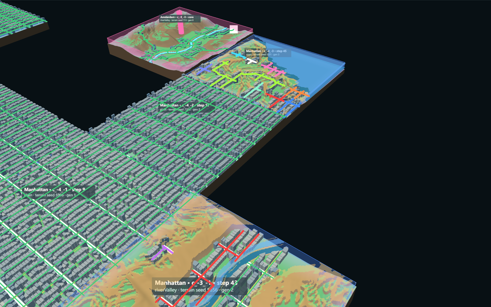
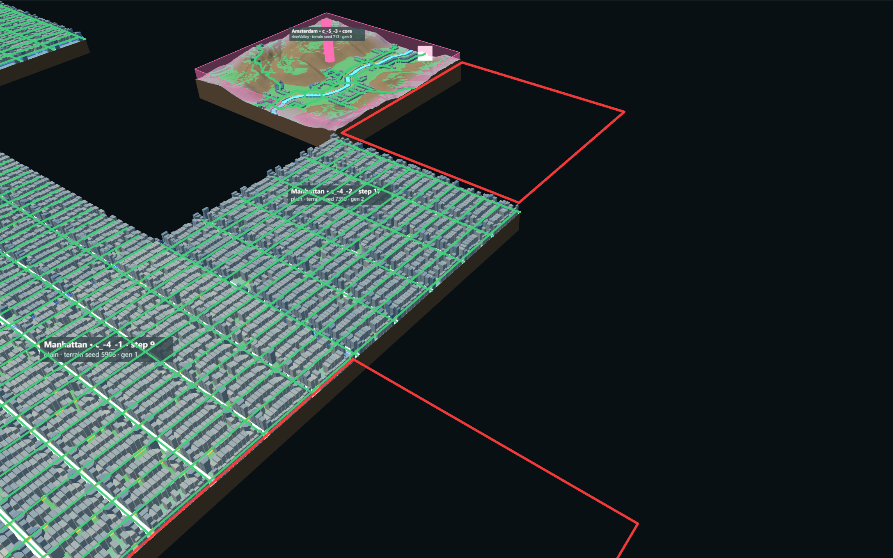
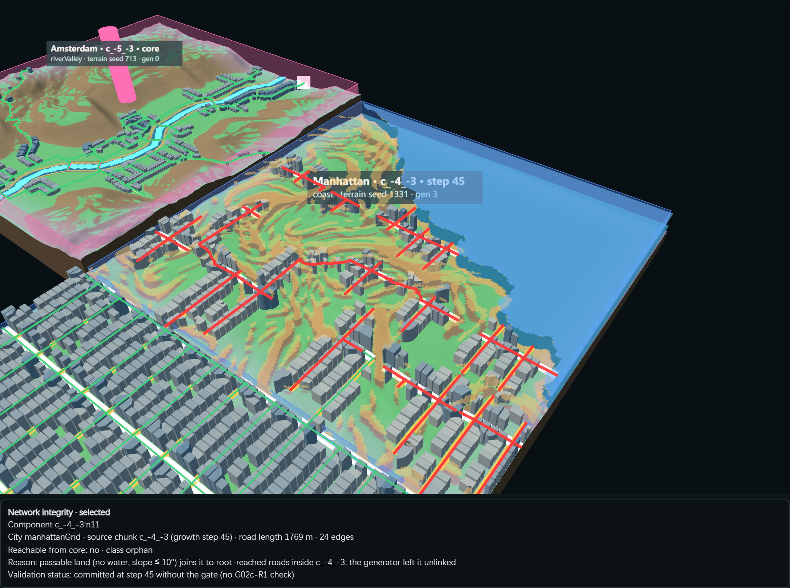
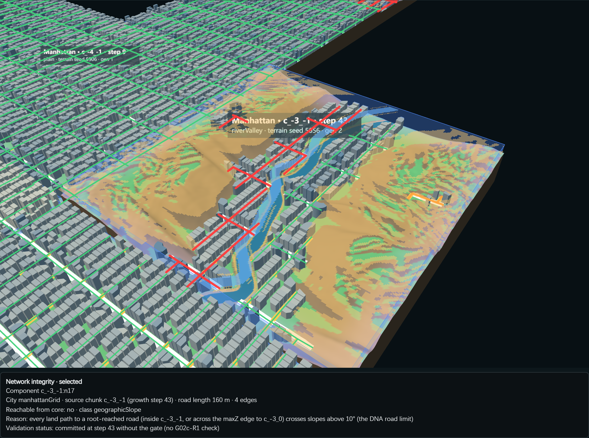
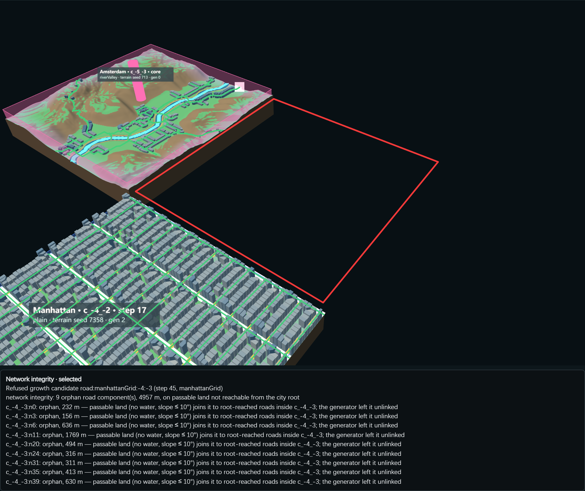

# G02c-R1 Network Integrity Gate

- **Task:** G02c-R1, 2026-11-04.
- **Branch:** `experiment/procedural-growing-world`.
- **Question:** Can road growth refuse new chunks whose roads cannot be traced to the city, and explain every piece it still keeps?
- **Status:** Implemented. Verified in Node and in the browser. **Pending human review**; not Human Accepted.
- **Then frozen:** by the P00a brief (G02c / G03c feature work paused).
- **G02c-R state:** CONDITIONAL GO, unchanged. G02c-03b is **not implemented**.

## 1. Root Cause of the 14 / 15 / 8 Components

Three things combine:
1. **Grid lines are cut where terrain fails.** The grid strategy cuts every grid line where the generator's land test fails (water, or slope above the DNA limit; Manhattan 10°). Stubs shorter than `minStubLength` are dropped (`NetworkGenerator.js`, `gridStrategy`). On coast and river-valley cells this leaves several street pieces. There are no bridge candidates in these cases.
2. **Only very short pieces are removed.** `pruneShortComponents(150 m)` deletes only pieces under 150 m. Longer pieces stay.
3. **Growth validation required one parent join only** (`RoadGrowthFrontAdapter.validate`). So a chunk whose roads are mostly separate pieces was committed.

**Not the cause:** the ramp plan. It changed no edge of the affected chunks; the raw network and the final network are equal.

Diagnosis of the G02c-R runs (gate off), every piece classified:

| Seed | Chunk | City | Landform | Growth step | Pieces | Classes |
|---|---|---|---|---|---|---|
| 6202 | `c_-4_-3` | Manhattan | coast | 45 | 9 (4,957 m) | 9 orphan; only 221 m of the chunk reached the city |
| 6202 | `c_-3_-1` | Manhattan | river valley | 43 | 4 (2,718 m) | 3 orphan (land runs to edges shared with `c_-3_0` / `c_-4_-1`), 1 slope |
| 6203 | `c_2_10` | Manhattan | river valley | 18 | 4 | 3 orphan, 1 slope |
| 6203 | `c_4_14` | Manhattan | coast | 41 | 10 | 9 orphan, 1 slope |
| 6203 | `c_-1_-1` | Chicago | coast | 10 | 7 (2,077 m) | 7 orphan |

Totals: 6202 has 12 orphan and 1 slope piece; 6203 has 19 orphan and 2 slope pieces. **No piece is separated by water alone.**

## 2. City Root and Classification

The code is in `experiments/city-of-cities/NetworkIntegrity.js`.

| Term | Definition |
|---|---|
| City root | The longest road component of the city's core chunk. Road edges only; canals are a separate network type. A core with no road edge has **no root**; none is invented. |
| Root reach | Every city node reachable from the root over committed chunk road graphs, parent joins and neighbour joins. Parent connectivity alone is not enough: a join to an unreached piece of the parent does not count. |
| Component | A connected piece of one chunk's road graph. Stable id: `${chunkId}:n${smallest node id}`. |

Every piece the root cannot reach is classified with the generator's own land rule: water, or slope above the DNA's `maxSlopeDeg`.

| Class | Rule | Spatial meaning |
|---|---|---|
| `rootConnected` | Reached by the road graph | Connected urban network |
| `orphan` | Passable land joins it to root-reached roads inside the chunk, **or** runs to an edge shared with a root-connected same-city chunk | Unintended orphan network |
| `geographicSlope` | Some land path exists, but every one crosses slopes above the limit | Geographically isolated (slope) |
| `geographicWater` | Its land reaches no root-reached road and no connected edge | Geographically isolated (water) |

The edge rule was added during this task. The first version looked inside one chunk only, and the browser capture showed why that is wrong: it called the riverside piece `c_-3_-1:n0` "isolated by water" although its bank continues into connected Manhattan. Land towards an **empty** cell is not counted, because it may connect later.

## 3. Gate (opt-in)

- **Where it runs:** `RoadGrowthFrontAdapter.validate`, after the existing checks and before commit: Evaluate → Generate → Analyze Network → Validate → Commit.
- **How to enable it:** option `networkIntegrity` (URL `&integrity=1`). It is saved and restored with the world. Off by default, so every older baseline is unchanged.

**Refused** (failure class `networkConflict`; the reason and the pieces are kept in `roadAttempts[].integrity`):
- no city root;
- no road of the new chunk reaches the root;
- any orphan piece.

**Accepted:**
- `connected`;
- `acceptedWithGeographicIsolation`. The geographic pieces are listed as **pending** because separate-settlement growth does not exist, and they are not counted as root-connected.

**Public rule (1):** `geographicIsolation: record | reject`.

**Not done:**
- No trimming. A refused candidate is regenerated in full or not at all; no edge, block, parcel or building is cut out.
- No bridge, no fake edge, no change to committed chunks.

**Cache:** the failure-cache signature now includes the parent and neighbour road ends the root reaches. A refusal is reused only while they are unchanged. In seed 6203, `c_2_10` was retried at step 23 after a neighbour changed.

## 4. Results

Measured by `scripts/verify-network-integrity.mjs` and `--long6202`. All runs use grade baseline 6 % with ramps through one junction.

| Run | Steps | Root-reachable road ratio | Disconnected pieces | Gate refusals | Valid commit rate |
|---|---|---|---|---|---|
| 6201, gate off | 19 (stall 20) | Manhattan 1, Fez 1 | 0 | — | 0.80 (12 steps) |
| 6201, gate on | 19 (stall 20) | identical | 0 | **0** | 0.80 |
| 6202, gate off, 30 | 30 | all 1 | 0 | — | 0.882 |
| 6202, gate on, 30 | 30 | all 1 | 0 | 0 | 0.882 |
| 6202, gate off, 60 (G02c-R) | 60 | Manhattan 0.991 | 13 | — | — |
| 6202, gate on, 60 | 60 | **all 1** | **0** | 2 (`c_-3_-1` step 43, `c_-4_-3` step 45) | — |
| 6203, gate off, 30 | 30 | Chicago 0.9789, Manhattan 0.9985 | 11 | — | 0.714 |
| 6203, gate on, 30 | 30 | **all 1** | **0** | 3 (Chicago `c_-1_-1`; Manhattan `c_2_10` twice) | 0.638 |

- **Growth success:** steps reached are unchanged on every seed.
- **6203 change:** Chicago grew 5 chunks instead of 6, and Manhattan 25 instead of 24. The valid commit rate fell from 0.714 to 0.638, and the gate rejection rate is 6.4 %. That is lower short-term success with higher network quality.
- **Committed chunks changed:** 0 in every run. No duplicate occupancy; city identity is kept.
- **Fabric (6203, 30 steps):** gate on built 2,376 blocks, 57,385 parcels and 51,300 buildings; gate off built 2,249, 54,884 and 49,028. Different cells were grown, so the totals are not like for like.
- **Stability (6202, gate on):**
  - reversed registry order gives an identical history;
  - save at 15, then load: signatures, the option, the integrity report and the rejection history are all reproduced;
  - continuing to 30 equals the uninterrupted run.

## 5. False Rejection Check

- **Seed 6201:** 0 refusals.
- **Every refusal** in 6202 and 6203 names orphan pieces on passable land. No candidate was refused for a slope or water piece.
- **Waterfront land is not refused as such.** The gate refuses chunks whose own grid fails to link on passable shore land, but this costs cells: on 6202 the coast cell `c_-4_-3` and the river cell `c_-3_-1` stay empty in the 60-step run.

## 6. Browser Evidence (real mouse input, 9 of 9)

Script: `scripts/verify-network-integrity-browser.mjs`.
- **Before:** the G02c-R state (6202, 60 steps, no gate).
- **After:** the gate-on state (6202, 60 steps).

The page shows 4 known cross-runtime network-signature mismatches when loading a Node-saved state (G02c-R, fix 3). Manhattan is not affected.

1. Component colour map, before. Seed 6202; Manhattan `c_-4_-3` (step 45) and `c_-3_-1` (step 43); one colour per city-level component, green = reached from the root:
   
2. Same camera, after (gate on). Every grown Manhattan chunk is green; the two refused cells are outlined in red and stay empty:
   
3. Selected orphan: `c_-4_-3:n11`, 1,769 m, committed without the gate at step 45:
   
4. Terrain / water overlay, `c_-3_-1` (step 43). Blue: water; orange: land steeper than 10°. The riverside piece `c_-3_-1:n0` is an orphan, because land runs to connected `c_-3_0`:
   
5. Geographic piece `c_-3_-1:n17` (`geographicSlope`, 160 m):
   
6. Refused candidate `road:manhattanGrid:-4:-3` at step 45, gate on; the panel lists its 9 orphan pieces:
   
7. Road network top views: [before](../../assets/screenshots/procedural-mini-world/g02c-r1-network-top-before.png) and [after](../../assets/screenshots/procedural-mini-world/g02c-r1-network-top-after.png).

## 7. Amsterdam 6203 Core (audit only; no change)

| Question | Finding |
|---|---|
| Does origin validation require a usable network? | **No.** `OriginPlacement.js` scores five terrain terms (slope, buildable, water, terrain type, DNA fit) and never builds the network. |
| Does `canalStreet` fail silently? | **Yes.** Its inputs are present: 2 water regions above the minimum area, and 551 passable quay cells. But the only piece it built was under 150 m, and `pruneShortComponents` (`NetworkGenerator.js`) removed it (`removed.shortComponents: 1`). The result is 0 nodes, 0 edges, 0 ports, and no warning. |
| Are road and canal ports confused? | **No.** Ports carry `type: road / canal`; the core simply has none of either. |
| Does the scheduler see a core that cannot grow? | **Only indirectly.** canalStreet cities are refused as "waterfront growth mode not implemented". With the gate on, a core without roads is reported as "no road network root". |

**Proposed G01 Origin Viability task (separate; not started):**
1. Warn when the final network has no road edge.
2. Probe the chosen site's network at placement and take the next qualified site when it has no road port.
3. Find why the quay paths stay under 150 m on this site.

## 8. Architectural Review

| Finding | Category |
|---|---|
| Orphan pieces come from grid lines cut by terrain inside one chunk | Algorithmic defect (generator), now refused at growth |
| The gate refuses a chunk rather than repairing its grid; coast and river cells stay empty (6202: 2 cells) | Unresolved constraint: trimming, or a generator that links its pieces, is needed to grow there |
| Slope-separated pieces exist (1 on 6202, 2 on 6203) | Geographic separation, recorded as pending |
| Cities still form a single connected structure only where the grid links; the gate does not force extra roads | Design choice |
| Buildings on refused pieces never enter the world; no building without access is created by the gate | No new defect |
| Network quality rises (all ratios 1), while 6203 grows one Chicago cell less | Needs human judgment |

## 9. Preconditions for G02c-03b

1. The gate should be on when G02c-03b is tested, so that a two-junction corridor cannot hide an orphan piece.
2. The refused coast and river cells (6202 `c_-4_-3` and `c_-3_-1`; 6203 `c_-1_-1` and `c_2_10`) are the natural test cases for any later trimming rule.

## 10. Files

**New:**
- `experiments/city-of-cities/NetworkIntegrity.js`
- `experiments/city-of-cities/NetworkIntegrityView.js`
- `scripts/verify-network-integrity.mjs`
- `scripts/verify-network-integrity-browser.mjs`

**Changed (option plumbing only):**
- `RoadGrowthFrontAdapter.js`
- `WorldGrowthController.js`
- `WorldContext.js`
- `main.js`

**Evidence:**
- `network-integrity.json`, `network-integrity-long.json`, `network-integrity-browser.json`
- `world-6202-g02c-r1-long-state.json`
