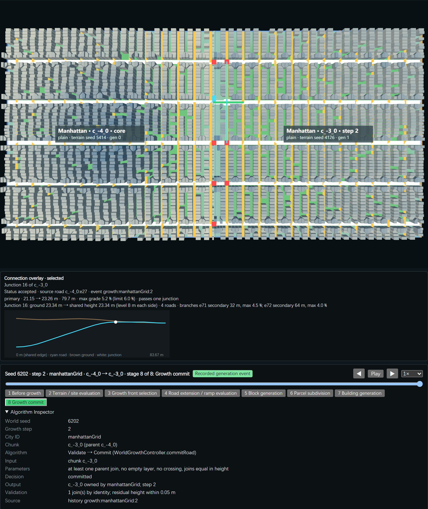
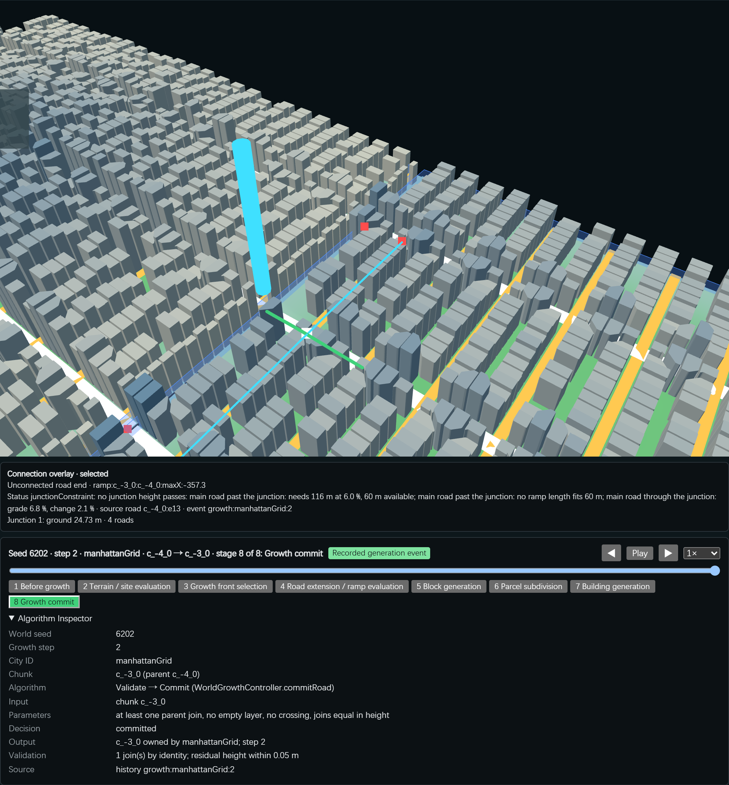

# G02c-R Road Growth Milestone Review

- **Task:** G02c-R (review only; no generator was changed).
- **Date:** 2026-11-04.
- **Branch:** `experiment/procedural-growing-world`.
- **Question:** Does the road system support continuous, terrain-aware and morphologically meaningful urban growth?
- **Status:** Automated review done. **Pending human review**; nothing here is Human Accepted.
- **Short note:** [G02c-R Road Growth Review](./G02c-R-Road-Growth-Review.md).

## 1. Summary

The road system is **continuous and terrain-aware where it accepts a join**:

- every recorded join has residual 0;
- grade stays at or below 7.36 % (limit 7.5 %);
- committed chunks are never changed;
- growth is deterministic and survives save / load.

It is **not yet continuous as a city network**:

- About one third of aligned same-city road ends on shared edges stay unjoined: 213 of 634 on seed 6202 after 60 steps.
- Some accepted chunks carry street pieces with no road link to the city. Manhattan 6202 has 14 components; the cause is in the base network, not in the ramps.
- Only 3 of 6 City DNAs grow by road. The Amsterdam core on seed 6203 still has **no road graph**.
- **G02c-03b (ramps through two junctions) is NOT IMPLEMENTED.**

**Recommendation: CONDITIONAL GO** (section 12).

## 2. Scope and Gate

| Item | State |
|---|---|
| G02c-01 road-driven scheduler | Implemented, logged, pending human review |
| G02c-02 grade-aware ramps (one road, no junction) | Implemented, logged, pending human review |
| G02c-03a ramp through one junction (opt-in `junctionRamps`) | Implemented, verified (Node and browser), pending human review |
| **G02c-03b ramp corridor through two junctions** | **NOT IMPLEMENTED** (no code); recorded as such in every matrix below |
| G03c-02 retry with junction ramps | Not started. Out of scope: this review stops before G03c-02 |

## 3. Method and Reproduction

**Configuration:** grade `baseline` (6 %), `junctionRamps` on, default City DNAs (Chicago DNA untouched).

**Scripts** (only minimal test scripts were added):

| Script | Content | Time |
|---|---|---|
| `scripts/review-road-growth.mjs` (Node) | Historic comparison on 6202; free growth with a 60-step budget on 6201 / 6202 / 6203 (milestones 12 / 30 / 60); per-city graph metrics; fabric checks; determinism; save / load | About 15 min |
| `scripts/review-road-growth-browser.mjs` | 10 interactions with real mouse input | — |
| `scripts/render-road-review-board.mjs` | Review Board, 3840 x 2160 | — |

**Records:**
- `experiments/city-of-cities/evidence/road-growth-review.json`
- `road-growth-review-browser.json`
- `world-6202-g02c-review-state.json`, the 60-step world

**Definition used for every run.** For each same-city shared chunk edge, a road end on one side is **aligned** when the other side has a road end within 0.5 m. It is **joined** when a growth event recorded a join between exactly those two nodes. A **component** is a connected piece of the city's road graph: chunk road graphs plus the recorded joins.

## 4. Review Matrix

| # | Item | Implementation | Test method | Measured result | Visual evidence | Limitation | Assessment | Status |
|---|---|---|---|---|---|---|---|---|
| A1 | Join continuity | Joins only at road ends; residual checked | Replay 6202 (12 events); free growth | Every recorded join continuous (residual 0); parent join in 19/19, 60/60, 41/41 events | Board panel 2 | Only joins that were accepted are checked | Sound | PASS |
| A2 | Aligned ends joined | Ramp plan per road end | Shared-edge count, one definition | 6202 replay: 36 → 51 → 62 of 97 (G02c-01 → 02 → 03a). Free growth, joined of aligned: 6201 107/150, 6202 421/634, 6203 290/433 | Board panel 4 | One third stay unjoined, mostly junctionConstraint, collision, terrain | Improves each step, still incomplete | PARTIAL |
| A3 | One network per city | — (no rule) | Components and core reach (Dijkstra) | Fez 1, Chicago 6202 1. Manhattan 6202: 14 components; 6203: 15. Chicago 6203: 8. All chunks still reach the core | Section 5 | Validation needs one parent join only | Defect, see section 11 | FAIL |
| A4 | Cross-chunk paths | `cityRoadReach` | Reachable chunks / chunks | 100 % for every grown city on every seed | Board panel 4 | Chunk level, not node level | Sound at chunk level | PASS |
| B1 | Grade limit | RoadRampPlanner profiles | Max grade over all ramps | Max 7.36 % main, 7.16 % branch (limit 7.5 %) | Board panel 3 | Single profile tested in free growth | Sound | PASS |
| B2 | Junction height | planJunction | Height spread at junction | 0.0045 m max; 10 of 11 junctions raised (replay) | Board panel 3 | **One junction only; G02c-03b NOT IMPLEMENTED** | Sound for one junction | PASS (scope-limited) |
| B3 | Terrain respected, no edits to old chunks | Ramps only in the new chunk | Signature diff of committed chunks | 0 committed chunks changed on all seeds | — | — | Sound | PASS |
| B4 | Refusal instead of forcing | RAMP_STATUS reasons | Status counts | 6202 (60 steps): 411 accepted, 90 junctionConstraint, 73 terrain, 46 collision, 24 networkConflict, 4 grade | Board panel 7 | Ramp accept rate 64 % | Honest refusals | PASS |
| C1 | Committed buildings | vacateBuildings in new chunk only | `rampImpact` sum | 0 on all seeds | Board panel 5 | — | Sound | PASS |
| C2 | Corridor cost on new fabric | Corridor 1.5 m shoulder + 1:2 slopes | Excluded candidates | 600/26,559 (2.3 %), 2,319/97,769 (2.4 %), 1,636/67,295 (2.4 %); worst chunk 143/1,714 (8.3 %) | Board panel 5 | Excluded footprint 0.64 km² on 6202 | Acceptable, human judgment | PARTIAL |
| C3 | Parcels and frontage | Unchanged generator | Parcels < 30 m² or without frontage; buildings without frontage | 0 / 0 on all seeds; mean coverage 0.687 → 0.670 (6202) | — | Frontage on a disconnected street piece still counts as frontage | Sound by this check | PASS |
| D1 | 12 steps | Scheduler | Free growth | 6201, 6202, 6203 all reach 12 | Board panel 6 | — | — | PASS |
| D2 | 30 steps | Scheduler | Free growth | 6202, 6203 reach 30; 6201 stalls at step 20 (19 steps) | Board panel 6 | — | Seed-dependent | PARTIAL |
| D3 | 60 steps | Scheduler | Free growth | Only 6202 reaches 60 (340 s); 6203 stalls at 42 | Board panel 6 | Stall reasons are honest | Seed-dependent | PARTIAL |
| D4 | Determinism | keyedPick | Registry order reversed, 30 steps | Identical history | — | One seed | Sound | PASS |
| D5 | Save / load (same runtime) | serialise / restore | Node: save at 15, continue to 30; Node: rebuild the 60-step state | Signatures reproduced (66 of 66 chunks); continuation equals uninterrupted run | — | One seed | Sound | PASS |
| D5b | Save / load across runtimes | — (no rule) | Node-saved 60-step state loaded in Chrome 157 | **4 network signatures differ** (cores of Amsterdam, Venice and Lisbon, and Fez c_3_-1). A fresh 6202 world already differs between Node (V8 13.6) and Chrome on the same three cores. The 60 recorded growth connections still reproduce | Section 8 | Cause not located (Pending) | Older defect in the network stage | FAIL |
| D6 | All City DNAs grow | Road-led only | Grown per city | Venice, Amsterdam, Lisbon grow 0 on every seed | Board panel 7 | canalStreet has no waterfront growth mode; Lisbon road ends far off target terrain | Not implemented | NOT IMPLEMENTED |
| D7 | Amsterdam 6203 core | Network stage | Core road graph | **Still 0 nodes, 0 edges, 0 ports, no warning** | Board panel 7 | — | Defect, see section 11 | FAIL |
| E1 | Browser interactions | Viewer, overlay, timeline | 10 real-mouse interactions | See section 9 | Board panels 3, 6, 7 | Headless Chrome | — | See section 9 |
| E2 | Review Board | Real screenshots and record charts | Rendered 3840 x 2160 | `g02c-r-review-board-after.png` | Section 9 | — | — | PASS |
| E3 | Two-junction corridor | — | — | **G02c-03b NOT IMPLEMENTED** | Pending | — | — | NOT IMPLEMENTED |

Automated PASS is not Human Accepted.

## 5. A: Road Network Continuity

**Historic comparison on seed 6202.** The same 12 target cells and parents, by one definition. There are 14 shared edges with 97 aligned road ends.

| Run | Joined | Not joined |
|---|---|---|
| G02c-01 (joins with steps up to 3 m) | 36 | 61 |
| G02c-02 replay (6 % ramps) | 51 | 46 |
| G02c-03a replay (ramps through one junction) | 62 | 35 |

The earlier logs counted "41 unjoined" and "32 joins" by narrower rules (parent joins of the growing edge only). The table above recounts all three runs one way.

**Free growth (60-step budget).**

| Seed | Steps | Shared edges | Aligned | Joined | Not joined | Ends with no partner |
|---|---|---|---|---|---|---|
| 6201 | 19 | 22 | 150 | 107 | 43 | 0 |
| 6202 | 60 | 76 | 634 | 421 | 213 | 24 |
| 6203 | 41 | 51 | 433 | 290 | 143 | 38 |

**Components.**

| Seed | City | Chunks | Nodes | Edges | Components | Chunks reachable from the core |
|---|---|---|---|---|---|---|
| 6201 | Manhattan | 13 | 1,313 | 1,924 | 1 | 13 |
| 6201 | Fez | 8 | 346 | 377 | 1 | 8 |
| 6202 | Manhattan | 48 | 4,806 | 6,989 | **14** | 48 |
| 6202 | Chicago | 10 | 821 | 1,183 | 1 | 10 |
| 6202 | Fez | 5 | 226 | 259 | 1 | 5 |
| 6203 | Manhattan | 36 | 3,589 | 5,176 | **15** | 36 |
| 6203 | Chicago | 7 | 580 | 782 | **8** | 7 |

**Where the extra components come from (Manhattan, seed 6202).**

- All 13 small components lie inside two chunks: `c_-4_-3` (10 pieces, coast) and `c_-3_-1` (5 pieces, river valley).
- Each piece is a tree of 4 to 25 nodes.
- The raw network of those chunks already has 10 and 5 components, with 0 bridge candidates and no warning. The ramp plan changed none of their edges.
- Growth accepted both chunks because validation only asks for at least one parent join.

So the cause is in the base grid network on split land. Road growth does not create these pieces, but it does accept them.

## 6. B: Vertical Alignment and Terrain

- Every road elevation equals the chunk's own raw terrain. A step at a shared edge is the terrain seam (97 of 97 ends, horizontal offset 0; G02c-02).
- Ramps are planned only in the uncommitted chunk. Committed chunks changed: 0 (all seeds, all steps).
- Max grade 7.36 % main and 7.16 % branch; level-zone grade 0; junction height spread at most 0.0045 m (G02c-03a record).
- Ramps through a junction, free growth: 25 / 81 / 64 (6201 / 6202 / 6203). Junctions left unresolved: 5 / 90 / 54. Unresolved junctions are the largest single refusal class on 6202 and 6203.
- **G02c-03b is NOT IMPLEMENTED.** Any corridor that meets a second junction is refused (`junctionConstraint`). This is the main open lever for continuity.

## 7. C: Urban Fabric Integrity

| Seed | New chunks | Committed buildings affected | New candidates excluded | Corridor area | Abnormal parcels | Mean coverage before → after |
|---|---|---|---|---|---|---|
| 6201 | 19 | 0 | 600 / 26,559 (2.3 %) | 112,960 m² | 0 | 0.674 → 0.660 |
| 6202 | 60 | 0 | 2,319 / 97,769 (2.4 %) | 509,808 m² | 0 | 0.687 → 0.670 |
| 6203 | 41 | 0 | 1,636 / 67,295 (2.4 %) | 386,784 m² | 0 | 0.699 → 0.681 |

- Worst chunk: `c_-6_3` on 6202, with 143 of 1,714 candidates excluded (8.3 %).
- "Abnormal parcel" means area under 30 m² or no road frontage. "Coverage" means built footprint over parcel area.
- Parcels on a disconnected street piece (section 5) have frontage but no road link to the city. This check does not catch them.

## 8. D: Autonomous Growth Stability

**Growth runs** (grade baseline, ramps through one junction):

| Seed | Reached 12 | Reached 30 | Reached 60 | Steps | Stall reason | Time |
|---|---|---|---|---|---|---|
| 6201 | yes (61 s) | **no** | no | 19 | Step 20: every eligible candidate failed validation | 108 s |
| 6202 | yes (68 s) | yes (167 s) | **yes** (340 s) | 60 | — | 341 s |
| 6203 | yes (92 s) | yes (198 s) | **no** | 41 | Step 42: every eligible candidate failed validation | 297 s |

**Cities grown:**
- 6201: Manhattan 12, Fez 7.
- 6202: Manhattan 47, Chicago 9, Fez 4.
- 6203: Manhattan 35, Chicago 6.

**Main refusal reasons at the stall:**
- Road ends too far from the target terrain.
- No parent road joined a child road (20 Manhattan candidates on 6203).
- Slope barrier; DNA conflict `noContinuousLand`.
- Occupied cells.
- canalStreet: waterfront growth mode not implemented.

**Run statistics:**
- Candidate pass rate (eligible / all frontier candidates): 0.19 / 0.29 / 0.20.
- Ramp accept rate: 71 % / 64 % / 64 %.
- Cache hits: 5 / 100 / 180.

**Stability:**
- Reversed registry order gives an identical 30-step history (seed 6202).
- Save at step 15 → signatures reproduced → continued to 30, equal to the uninterrupted run.
- No duplicate occupancy.
- City identity is kept on every event.

**Cross-runtime check (found in the browser review):**
- The Node-saved 60-step state loaded in Chrome 157 gives 4 `network` signature mismatches:
  - `c_-5_-3` (Amsterdam core);
  - `c_1_-1` (Venice core);
  - `c_5_-3` (Lisbon core);
  - `c_3_-1` (Fez, step 21).
- In Node, the same state rebuilds with 0 mismatches, whether chunks are rebuilt in growth order or chunk-id order.
- A fresh seed 6202 world shows the same split before any growth. The Amsterdam, Venice and Lisbon core networks differ between Node (V8 13.6) and Chrome; Manhattan, Chicago and the Fez core match.
- Sampled Math functions (`pow`, `hypot`, `atan2`, `exp`, `cbrt`) return identical values in both runtimes. The cause is somewhere else in the network stage and is not located (**Pending verification**).
- Growth is not affected in this case: all 60 recorded connections reproduce in the browser. Grown chunks of road-led cities can still differ, as `c_3_-1` shows. A state saved in one runtime is therefore not guaranteed to load exactly in the other.

**Amsterdam 6203, rechecked:**
- Core `c_0_0` has 0 nodes, 0 edges and 0 ports, with no warning.
- The strategy is canalStreet on a coast site (mean slope 8.7°, waterline 2.6 km on the block boundary).
- One block with no road frontage → 0 parcels → 0 buildings.
- Placement still accepted the site (score 0.71).

## 9. E: Visual and Research Evidence

**Review Board: Pending.** The renderer (`scripts/render-road-review-board.mjs`) is written but was not run, because two of its panels need the world captures of check 10, which did not complete.

- 3840 x 2160, 8 panels: lineage, corridor plan, vertical profile, graph validation, fabric impact, real world growth, failure case, conclusion.
- Panels are real runtime screenshots, or charts drawn from `road-growth-review.json`. A panel without a capture says Pending.
- Seed and settings are printed on each panel.

**Browser review** (`road-growth-review-browser.json`): seed 6202, replay step 2 (Manhattan c_-4_0 → c_-3_0), then the 60-step review state.

| # | Interaction (real mouse) | Result |
|---|---|---|
| 1 | Open the replay of a real growth event | PASS: c_-4_0 → c_-3_0, 3 ramps through a junction |
| 2 | Click Play, then click again to pause | PASS |
| 3 | Click stage 4, then Next | PASS |
| 4 | Click the end of the timeline slider | PASS |
| 5 | Click the GUI checkbox "Connection overlay (debug)" | PASS: 22 overlay items (14 ramp, 4 junction, 4 unconnected) |
| 6 | Click the junction marker → long section | PASS: junction 16 and its long section |
| 7 | Click the ramp road → ramp record | PASS: ramp e14 (main) |
| 8 | Drag on the canvas → camera orbits | PASS: junction moved 97 px on screen |
| 9 | Toggle the overlay; click an unconnected road end → refusal reason | PASS: refusal reason shown (junctionConstraint: needs 116 m at 6 %, 60 m available) |
| 10 | Click "Load world state" → 60-step 6202 world rebuilt, signatures checked | **FAIL**: the Node-saved 60-step world loads, but 4 network signatures differ (cross-runtime defect, section 8). The same-runtime Save / Load check (10b) and the world captures were **not completed**: the page was reloaded by Vite when source files changed during the run. No record file was written; the results above come from the run log |

**Screenshots:**
- 
- The first failure-case capture was clipped wrong (page header instead of canvas); it was re-taken in the second run: 
- World-growth captures: **Pending** (check 10).

**Follow-up:** G02c-R1 addressed fix 1; see [G02c-R1](./G02c-R1-Network-Integrity.md).

## 10. Architectural Quality Review

| Finding | Category | Evidence |
|---|---|---|
| Accepted chunks hold street pieces with no road link to the city (Manhattan 6202: 13 pieces in 2 chunks; 6203: 14; Chicago 6203: 7) | **Confirmed Algorithmic Defect** (validation accepts one join; base grid network splits on coast / river land without bridges) | Section 5 |
| Amsterdam 6203 core has no road graph and no warning | **Confirmed Algorithmic Defect** (network stage, canalStreet) | Section 8 |
| One third of aligned road ends stay unjoined on long runs | **Potential Architectural Problem** (most are second-junction cases that need G02c-03b) | Sections 5, 6 |
| Corridor excludes 2.4 % of new building candidates, up to 8.3 % in one chunk | **Needs Human Judgment** | Section 7 |
| Venice, Amsterdam and Lisbon do not grow by road | **Intentional Urban Difference** for canal cities (no waterfront mode yet). For Lisbon, a **Potential Architectural Problem** (road ends 9–205 m off the target terrain) | Section 8 |
| Manhattan dominates long runs (47 of 60 on 6202) | **Needs Human Judgment** (bid weights are assumptions) | Section 8 |
| Node and Chrome generate different networks for some cores (Amsterdam, Venice, Lisbon) and for Fez c_3_-1 | **Confirmed Algorithmic Defect** (cross-runtime determinism, network stage; cause Pending) | Section 8 |
| Joins: no height step or horizontal offset; no committed geometry edited | No defect found | Sections 5, 6 |

No **Confirmed Geometric Defect** was found in accepted joins or ramps.

## 11. Blocking Issues and Minimal Fixes (recorded, not applied)

**1. Disconnected street pieces accepted.**
- Reproduce: `node --max-old-space-size=8192 scripts/review-road-growth.mjs`, then the components of `manhattanGrid` on 6202. The pieces are in chunks `c_-4_-3` and `c_-3_-1`.
- Files: `RoadGrowthFrontAdapter.js` (validate), `experiments/seed-terrain/NetworkGenerator.js` (grid on split land).
- Minimal fix: in validation, count the child's road components that the joins do not reach. Report them as `unreachableStreets`. Refuse the candidate, or drop the unreachable streets before parcels, when their share is above a stated threshold.

**2. Amsterdam 6203 empty core.**
- Reproduce: seed 6203, generate `c_0_0` → `outputs.roadGraph.length === 0`.
- Files: `NetworkGenerator.js` (`canalStreetStrategy`) and the G01 placement scoring.
- Minimal fix: when canals and quays produce no road, warn and fall back to land streets, as the no-water branch already does. Placement should also refuse a core site whose network has no road port.

**3. Node and Chrome disagree on some networks.**
- Reproduce: generate seed 6202 in Node and in the page (`?worldSeed=6202`), then compare `outputs.signatures.network` of `c_-5_-3`, `c_1_-1` and `c_5_-3`.
- Files: `experiments/seed-terrain/NetworkGenerator.js` (canalStreet, organic and hill paths).
- Minimal next step: hash the intermediate results of each sub-stage in both runtimes and find the first that differs. Then remove the runtime-dependent operation, for example a sort comparator that is not total, or ties broken by float noise.

**4. Second junction.** This is G02c-03b, not implemented. It is a planned task, not a bug.

## 12. Decision Matrix

| Criterion | Evidence | Verdict |
|---|---|---|
| Continuous where joined | Residual 0, deterministic, save / load | GO |
| Reproducible across Node and the browser | 4 network signatures differ on a 60-step state (older network-stage defect) | CONDITIONAL: within one runtime only, until fix 3 |
| Terrain-aware | Grade ≤ 7.36 %, ramps only in new chunks, honest refusals | GO |
| Fabric preserved | 0 committed buildings; 2.4 % new candidates excluded | GO (human judgment on the cost) |
| One network per city | 14 / 15 / 8 components in three city runs | NO-GO until fix 1 |
| Long autonomous growth | 60 steps on 1 of 3 seeds; stalls are honest | CONDITIONAL |
| City DNA coverage | 3 of 6 DNAs grow by road; Amsterdam 6203 core empty | CONDITIONAL |
| Two-junction corridor | **G02c-03b NOT IMPLEMENTED** | Not assessed |

**Recommendation: CONDITIONAL GO.**

The road-growth chain is fit to build on, on three conditions:
1. fix 1 (unreachable street pieces) is done before any result relies on whole-city connectivity;
2. the Amsterdam 6203 empty core is recorded as a known defect;
3. G02c-03b stays an open task.

This is a recommendation, not Human Accepted.

## 13. Human Review Package (5 items)

1. **Board panel 2 / 3:** does the ramp through junction 16 (seed 6202, step 2) read as a believable street, given its level zone and graded branches?
2. **Section 7:** is losing about 2.4 % of new building candidates (up to 8.3 % in one chunk) to ramp corridors acceptable for the semester target?
3. **Section 5:** should an accepted chunk be allowed to carry street pieces with no road link to the city, or must growth refuse or trim them?
4. **Section 8:** should Manhattan's dominance on long runs (47 of 60 steps on 6202) be accepted as emergent, or treated as a weighting issue?
5. **Decision:** is CONDITIONAL GO acceptable, and should the next task be fix 1, G02c-03b, or G03c-02 with junction ramps?

## 14. Not Tested and Limits

- Free growth was tested at grade `baseline` only, and with `junctionRamps` on. Conservative and permissive grades were not re-run on long budgets.
- Determinism and save / load were tested on seed 6202 only.
- G03c-01 and G03c-02 full verifiers were not re-run in this review.
- The G01 page verifier fails on an outdated saved state. This is pre-existing and unchanged.
- The browser runs headless Chrome. The page was not checked on a phone.
- Graph reach is measured at chunk level; node-level shortest paths between all chunk pairs were not computed.
- **G02c-03b: NOT IMPLEMENTED.**

## 15. Next Step and Stop

The review stops here. G03c-02 is **not** started.

Suggested single next task, after human review: fix 1, a validation-level check for street pieces unreachable from the city. After that, G02c-03b.
