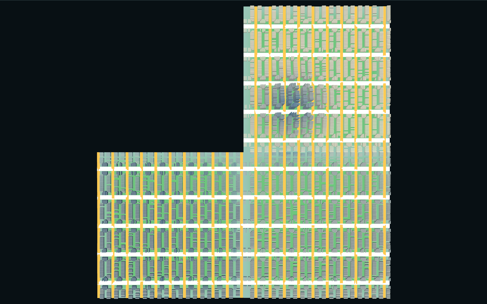
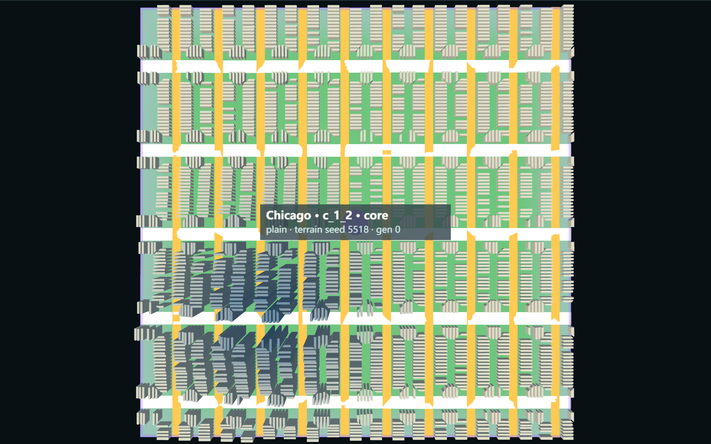
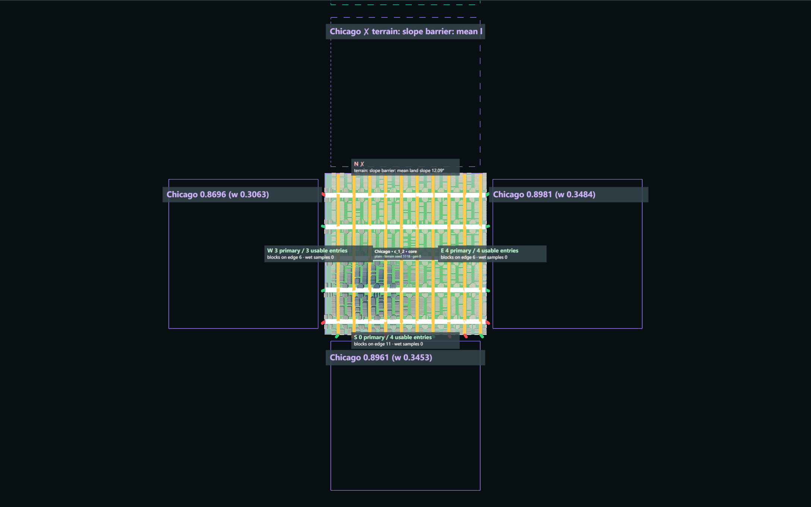
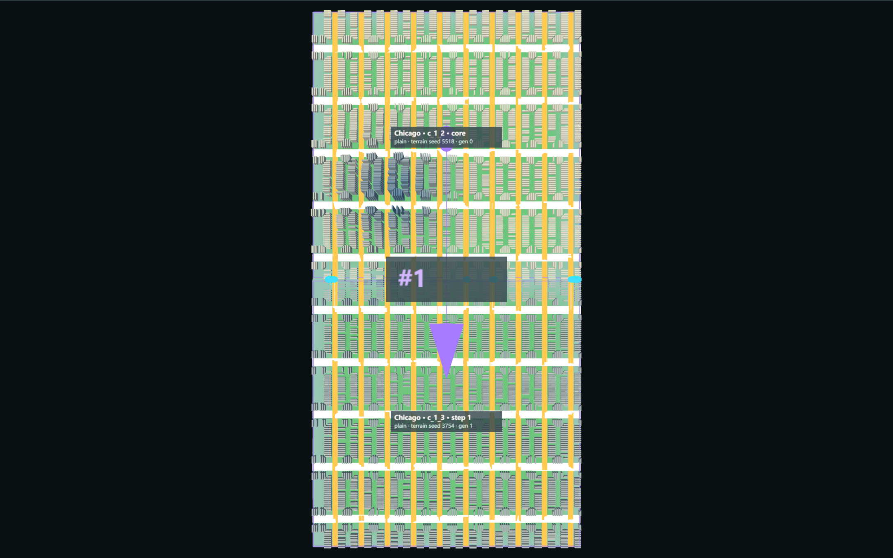
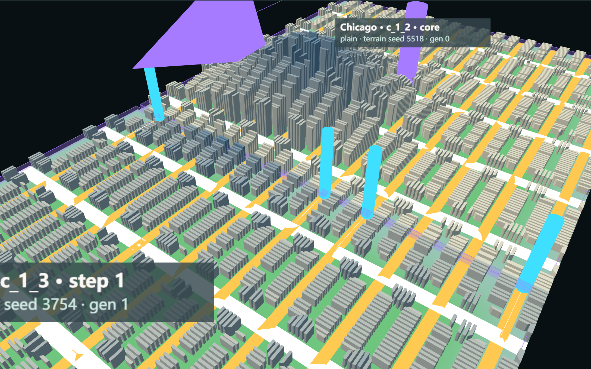
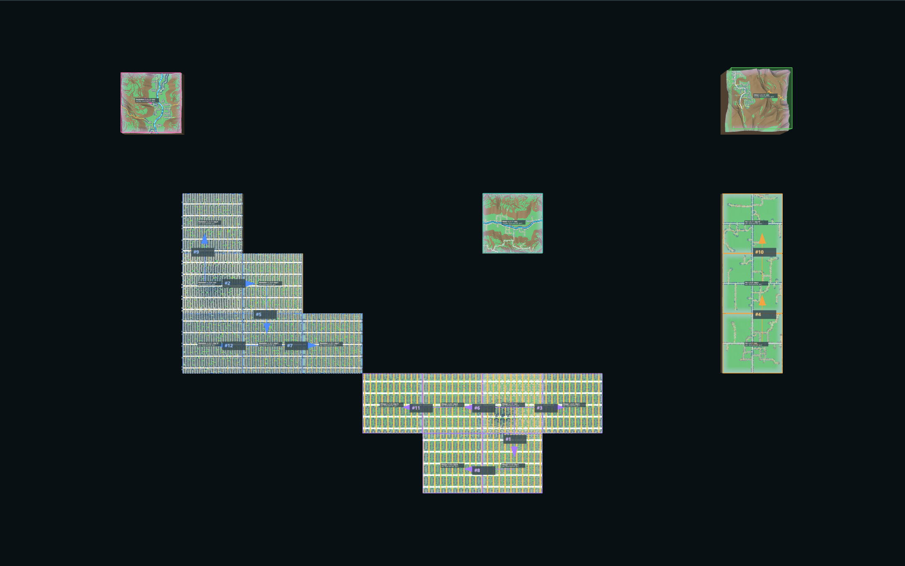

# G02c — Road-Driven Growth

Part of [A City of Cities — Research Compass](../A-City-of-Cities-Research-Compass.md), roadmap stage **G02** (third part). Log entry: **G02c-01** in [FINAL-EXPERIMENT-LOG.md](../FINAL-EXPERIMENT-LOG.md).

**Status:**
- **Implemented:** G02c-01, road-driven candidates in the existing multi-city scheduler, as an opt-in mode.
- **Verified:** Node and browser, world seeds 6201 / 6202 / 6203, 12 steps each.
- **Accepted:** no. **Pending review.**

| Navigation | |
| --- | --- |
| Parent study area | [Knowledge base home](../README.md) · [Research Compass](../A-City-of-Cities-Research-Compass.md) |
| Prerequisites | [G02 Procedural Urban Growth](./G02-Procedural-Urban-Growth.md) (scheduler) · [G02b Morphological Growth](./G02b-Morphological-Growth.md) (road fronts, joins by identity) |
| Next investigation | **Proposed** (§10) |
| Code | [RoadGrowthFrontAdapter.js](../../../experiments/city-of-cities/RoadGrowthFrontAdapter.js), [WorldGrowthController.js](../../../experiments/city-of-cities/WorldGrowthController.js), [MorphologicalGrowth.js](../../../experiments/city-of-cities/MorphologicalGrowth.js) · [verify-road-driven-growth.mjs](../../../scripts/verify-road-driven-growth.mjs) · evidence `experiments/city-of-cities/evidence/road-driven-growth.json` |
| Runtime entry | Local only: `/experiments/city-of-cities/?growthMode=road`, folder "Road-driven growth (G02c-01)" |
| Website | Not connected. Nothing here is marked Accepted |

**Study notebook, in short:**

- **Question:** can the six-city scheduler choose growth from real road ends instead of empty neighbouring cells, without a second scheduler?
- **Method:** the scheduler keeps its bids and weighted pick. Only the source of its candidates changes, and each choice passes Plan → Generate → Validate → Commit.
- **Result:** every one of the 36 scheduled growth events continues a real parent road, and each grown chunk is reachable from its city core through the road graph. Chicago now grows on seeds 6202 and 6203, and G02's 62 m cliff growth on seed 6201 no longer occurs.
- **What changed in my understanding:** the scheduler now shows that terrain and road form decide who grows. Only 3 of the 6 cities grew at all: two have no road-led growth mode, and Lisbon's entries fail the 3 m rule on all three seeds.
- **Main weakness:** on seed 6202, 32 roads are joined and 41 more meet at the same boundary point but stay unjoined. The image looks more connected than the graph is (§7).

**What this shows:** the Chicago core c_1_2 and two road-driven chunks with frames hidden.
**Conditions:** world seed 6202, chicagoGrid, single-city test, task G02c-01, real browser runtime.
**Why it matters:** the grid continues through both growth steps, and the second step grows from the first growth chunk.
**Limit:** the edges remain visible as pale strips, and building heights drop sharply outside the core.

> Observation to complete after review: with the borders hidden, does this read as one city?

## 1. Architecture change

| | G02 chunk mode (default, unchanged) | G02c road mode (`growthMode: 'road'`) |
| --- | --- | --- |
| Candidate source | Free cells next to a city chunk | Real road ports facing a free cell |
| Scoring | `evaluateCandidate` | Same function; the infrastructure term counts only usable ports |
| City bid, weighted pick, occupation ruling | Shared code | Shared code |
| Generation | Independent chunk | Parent grid anchor, entry ports, height centre (G02b inputs) |
| On failure | Not applicable | Chunk removed, attempt recorded, next choice tried |

Interfaces from G02b checked before integration:

- **Reused as they were:** `fronts`, `connect`, `connectivity`, `verifyConnections`, the optional generator inputs, the road graph per chunk.
- **Minimal changes:**
  - `MorphologicalGrowth.grow` is split, so `buildFront` generates without touching the history.
  - Entry checks are cached per front, so terrain fields can be released.
  - `connectNeighbours` was added (§3).
  - `evaluateCandidate` accepts an optional port list.
  - `WorldContext.removeGrowthChunk` was added, and the state stores the growth mode and the attempts.
- **Not reusable for road growth:** `canalStreet` ignores entry ports while a canal region exists, so a join there would be coincidence.

No public parameter was added.

## 2. Candidate algorithm

1. **Road Growth Front.** Each road port of a generated chunk facing another cell is a record. The id comes from chunk, side and position (`rgf:c_1_2:maxZ:1498.4`), never from traversal order. It holds `cityId`, `sourceChunkId`, `sourceRoadId`, `growthFrontId`, `targetChunkCoordinate`, `roadClass`, `roadDirection`, `roadElevation`, `terrainConstraints` and `rejectionReason`.
2. **Candidate.** One per target cell (`road:chicagoGrid:1:3`). The parent is the front with the most usable primary entries, then most entries, then lowest generation, then chunk id. It adds `inheritedMorphology` and `candidateScore`.
3. **Terrain first.** The G02 rules apply, then each road end must lie within 3 m of the target terrain at that point.
4. **Scheduler.** The G02 bid `rate × best score / (1 + chunks grown) × seeded ±10 %` orders the cities, and the keyed pick orders each city's candidates.
5. **Plan → Generate → Validate → Commit.** A candidate must pass:
   - at least one parent road joined;
   - network, blocks, parcels and buildings all present;
   - no road crossing without a shared node.

   Only then does the event enter the history and the step advance.

**Failure classes:**

| Class | Meaning | Example |
| --- | --- | --- |
| `candidateRejected` | Not a valid choice now | Cell occupied, no road on that side, waterfront mode missing, DNA conflict |
| `terrainConflict` | Geography refuses it; not an error | Slope barrier, landform, road ends more than 3 m off the terrain |
| `networkConflict` | Generated, but the roads do not join or cross illegally | `road:manhattanGrid:3:4` on seed 6203 |
| `generationFailure` | Generator error or an incomplete chunk | Injected in the test only; none occurred naturally |
| `growthStalled` | A world or city with nothing left to try | Injected in the test only |

## 3. Road continuity

- Each new road join names parent chunk / node / edge and child chunk / node / edge, as in G02b. It exists in the graph, not only in the image.
- **New in G02c:** a new chunk can also touch older chunks of its city that are not its parent. Those road ends join by the same identity rule, with the 3 m limit. Others are listed in `neighbourUnjoined`.
- Existing roads are never removed, and no existing chunk is regenerated.
- Venice and Amsterdam submit no road candidates. They are reported as `waterfront growth mode not implemented`.

## 4. Test A: one city through the scheduler

| City, seed | Step | Growth | Roads joined | Refused entries | Max height step | Generation | Independent regeneration aligned |
| --- | --- | --- | --- | --- | --- | --- | --- |
| Chicago, 6202 | 1 | c_1_2 → c_1_3 | 4 | 6 | 2.92 m | 1 | 0 of 10 |
| Chicago, 6202 | 2 | c_1_3 → c_0_3 | 2 | 3 | 1.20 m | 2 | 0 of 5 |
| Manhattan, 6201 | 1 | c_-2_0 → c_-2_1 | 7 | 6 | 2.11 m | 1 | 0 of 13 |
| Manhattan, 6201 | 2 | c_-2_0 → c_-1_0 | 4 | 1 | 2.41 m | 1 | 0 of 5 |

- **Network:** all road length of the three chunks lies on the core's network, 100 % in both cities. The Chicago route from the core reaches 3,093 m into the second growth chunk.
- **Direction and class:** 0° deviation at each join (last road segment on each side, read as direction through the boundary); class kept at every join.
- **Grid:** axis difference 0°, world-anchored phase error 0 m.
- **Core:** signatures unchanged after every step.
- **Limit of the second step in Manhattan:** the scheduler chose another side of the core, so that run extends the core twice. Chicago's run shows the continuation from a growth chunk.

## 5. Test B: six cities, 12 scheduled steps

| Seed | Venice | Manhattan | Fez | Amsterdam | Lisbon | Chicago | Parent joins | Neighbour joins | Neighbour unjoined | Max height step | Failed attempts |
| --- | --- | --- | --- | --- | --- | --- | --- | --- | --- | --- | --- |
| 6201 | 0 | 4 | 8 | 0 | 0 | 0 | 29 | 14 | 2 | 2.93 m | 0 |
| 6202 | 0 | 5 | 2 | 0 | 0 | 5 | 32 | 4 | 20 | 2.92 m | 0 |
| 6203 | 0 | 9 | 0 | 0 | 0 | 3 | 46 | 0 | 0 | 2.98 m | 2 |

**Cities that did not grow, measured at the end of each run:**

| City | Reason |
| --- | --- |
| Venice, Amsterdam | Waterfront growth mode not implemented, on all sides. No canal connection was invented |
| Lisbon | Road ends more than 3 m off the target terrain on every side with roads, on all three seeds |
| Chicago, seed 6201 | 1 side road ends off the terrain, 2 slope barrier, 1 mountain. Same result as G02b |
| Fez, seed 6203 | 2 sides road ends off the terrain, 1 side without roads, 1 occupied by Manhattan |

Common to all three seeds:

- Every event comes from a real port, and the verifier looks each one up in the parent's data.
- No cell was occupied twice.
- Every earlier chunk kept its signatures after each later step.
- `TerritoryModel` accepts the events, and its chunk count matches the world.
- Road crossings: 0 in all new chunks.
- Inter-city contact is recorded, not connected: 1 shared edge each on seeds 6201 and 6203, 0 on seed 6202.

**Natural failure and retry (seed 6203):** at steps 6 and 11 the chosen cell (3, 4) was generated but no road joined. The chunk was removed, the attempt was stored, and the next candidate grew in that step.

## 6. Morphological inheritance

Ratios are child / parent, from generated data.

| Quantity | Grid cities (Manhattan, Chicago) | Fez | Source |
| --- | --- | --- | --- |
| Dominant orientation difference | 0° | 0.39–4.03° | Grid: parent anchor. Fez: terrain |
| Road density | 0.94–1.07 | 0.88–1.20 | DNA spacing on the local terrain |
| Median block area | 1.00 | **0.023–12.7** | Fez is not stable (below) |
| Parcel frontage | 1.00 | 1.00 | DNA tables |
| Building coverage | 0.98–1.02 | 0.97–1.03 | DNA tables |
| Mean height, first ring from the core | 0.47–0.65 | 0.74–0.89 | Inherited height centre |
| Mean height, later rings | 0.93–1.02 | 0.96–1.04 | Inherited height centre |

**Reading:**

- Grid cities keep their street pattern exactly because they share one anchor.
- Fez keeps its rules, not its scale: one join and a few gates can leave very large blocks, so a median block can jump by a factor of over 10 between parent and child. This is not a continuity result.
- All chunks use the height centre of their core.

Chicago metrics (seed 6202):

| Chunk | Orientation | Roads km/km² | Block median m² | Frontage m | Coverage | Height mean / p90 / max m |
| --- | --- | --- | --- | --- | --- | --- |
| c_1_2 core | 0° | 14.65 | 13,590 | 7 | 0.520 | 39.4 / 95 / 171 |
| c_1_3 growth 1 | 0° | 14.65 | 13,590 | 7 | 0.518 | 19.9 / 22.8 / 38 |
| c_0_3 growth 2 | 0° | 15.63 | 13,590 | 7 | 0.515 | 19.4 / 22.8 / 26.6 |

## 7. Known limits

1. **Visually joined, not joined in the graph.** The grid child draws its lines at every inherited position, including where the parent's road end failed the 3 m rule. On seed 6202: 32 joins and 41 more boundary points where both sides have a road. They stay reported as new ports on the shared edge. Crossing there in the image is not a route. See the 4 posts against about 10 continuous avenues below.
2. **Height steps remain.** Joins carry steps up to 2.98 m, and terrain seams are not repaired. Neighbour edges can exceed 3 m, which produced 20 unjoined neighbour ends on seed 6202.
3. **Sharp height drop at the core.** Chicago's maximum height falls from 171 m to 38 m in one chunk step. It follows the inherited centre, but the boundary reads as a hard change.
4. **Only 3 of 6 cities grow.** Whether the 3 m rule is too strict for hill cities like Lisbon is an open question. Growth is also unequal (for example Fez 8 of 12 on seed 6201), because the others run out of valid candidates. All thresholds are design assumptions.
5. **Fez joins are single roads.** Most Fez events have one join, and the network reads as a thin tree across chunks.
6. **Repeated work.** A failed candidate is not remembered, so `road:manhattanGrid:3:4` is generated and refused again at step 11.
7. **Direction check is local.** It compares the last segment on each side, which is coarse for organic lanes.
8. **Amsterdam, seed 6203.** Its core holds no road graph, so its reach is 0 of 1. It did not grow, and the cause was not investigated.
9. **Not done:** a test beyond 12 steps, calibration, a person's spatial review.

## 8. Screenshots

All are real captures. World seed 6202, City DNA chicagoGrid unless stated, task G02c-01.

1. Core before growth: 
2. Road Growth Front debug. Green and red posts are usable and refused road ends, and the squares are accepted and rejected candidates with scores or reasons: 
3. First growth chunk with the parent-to-child arrow: 
4. Boundary close-up. Cyan posts mark recorded joins and white lines the continued roads. Other avenues look continuous without a post (§7, item 1): 
5. Chunk borders hidden: see the top of this note.
6. Scheduler result: six cities, 12 steps, numbered events. Venice, Amsterdam and Lisbon stay at their cores: 

## 9. Verification

`node --max-old-space-size=8192 scripts/verify-road-driven-growth.mjs` (Node about 12 min, browser about 3 min; `--node-only`, `--browser-only`).

| Check | Result |
| --- | --- |
| Default G02 path | 30 steps, 36 chunks, order and signatures equal to the saved state |
| G02b, G03b Node verifiers | Pass after the changes (G02b 4 + 13 and Fez 1 + 1 joins; G03b three scenarios) |
| Graph reach | Every grown chunk reachable from its core; road length on the core network 100 % |
| Join position | At most 0.5 m by rule, each join looked up in real port data |
| Join height | Parent joins at most 2.98 m; neighbour joins limited to 3 m |
| Illegal crossings | 0 in the 36 new chunks and in the Test A chunks |
| Occupancy | Unique on all seeds |
| Parent traceability | Candidate front, road and join ids resolve to real ports |
| Stability | Every earlier chunk unchanged after every step |
| Reproducibility | Seed 6202 identical with the chunk registry order reversed before every step |
| Save / load (Node) | Saved at step 6: 12 chunks, 6 join events reproduced; 6 more steps equal the uninterrupted run |
| Save / load (browser) | Save, reload, load, then 6 more steps equal Node; 0 browser errors |
| Failure injection | Generator error: no chunk left, another candidate grew. All validation refused: 7 attempts, world stalled, chunks unchanged, step unchanged |

**Bug found by the browser check:** placement clears the growth state, so the page lost `road` mode before saving. A load then reverted to chunk mode, and the territory comparison caught the difference. Fixed in `main.js`.

**Inspector audit:** `verify-inspector-docs.mjs` now reports 3 "needs review" items, because `WorldContext.js`, `WorldGrowthController.js` and `GrowthEvaluation.js` changed. The default path is proved unchanged, and the released site on `main` still holds the old files. The review record was not changed: it must be re-read when this work reaches the site.

**Not verified:** Firefox, Safari. The evidence covers 3 seeds and 12 steps.

## 10. Next stage (Proposed, not started)

**G03c prerequisites** (encounters in the scheduler):

1. Decide what the 41 unjoined boundary points mean first. A cross-city rule built on an unreliable same-city join would inherit the problem.
2. `UrbanEncounter.path` reads `connections` only. It must also read `neighbourConnections`.
3. The grid connector hook from G03b is still missing, so a grid newcomer still cannot adapt.
4. Occupation currently ends growth at a contact. Contacts are few (0–1 shared edges in 12 steps), so encounters need longer runs.

**Other proposals:**

- A waterfront growth mode for Venice and Amsterdam, as its own defined mode.
- A review of the 3 m rule against Lisbon, or a short entry ramp.
- A memory of failed candidates.
