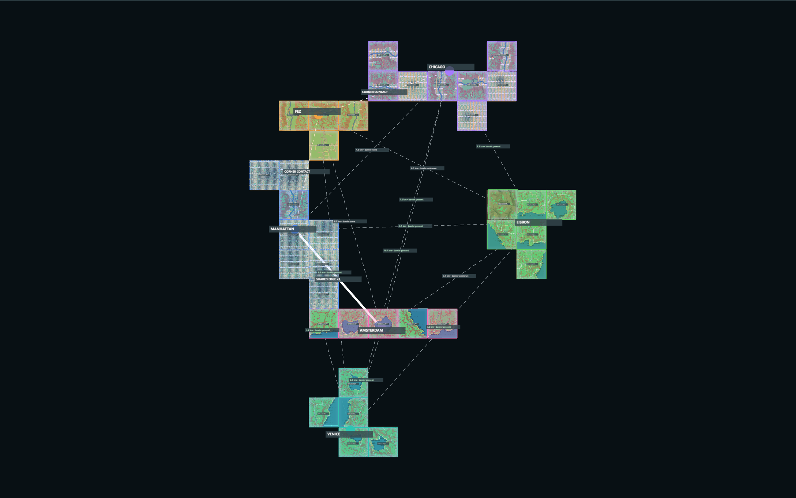
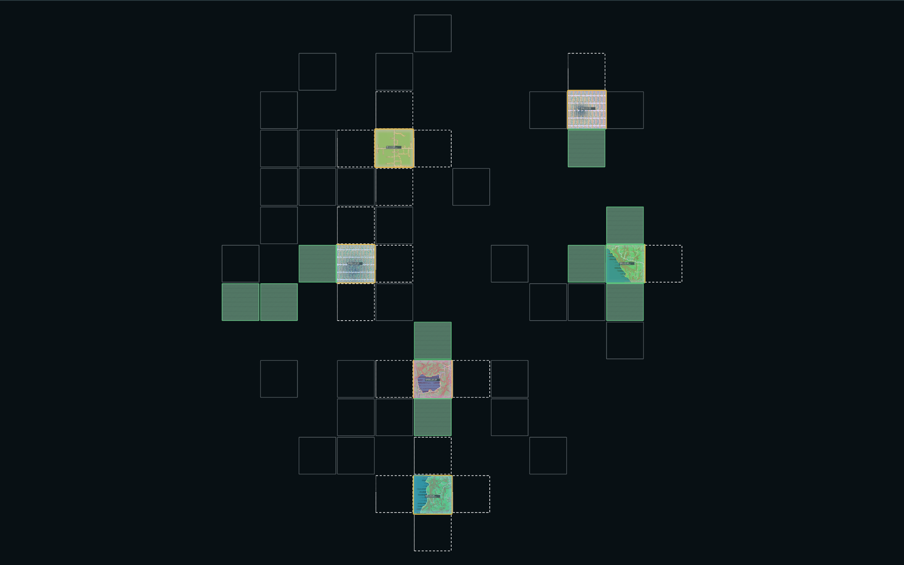
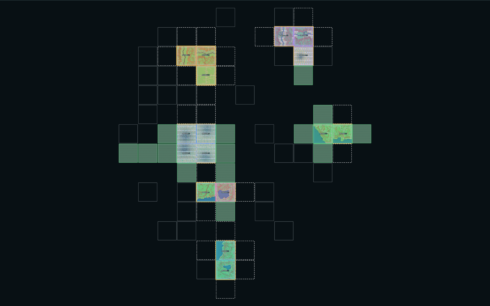
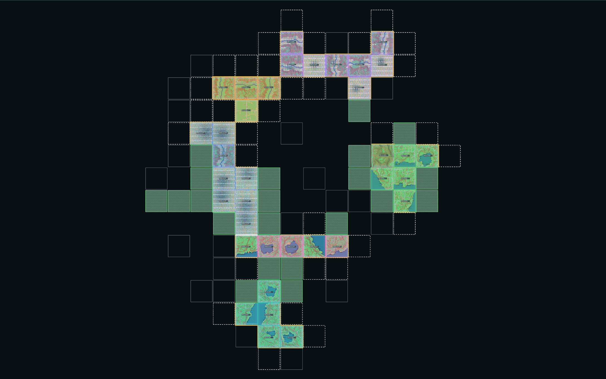
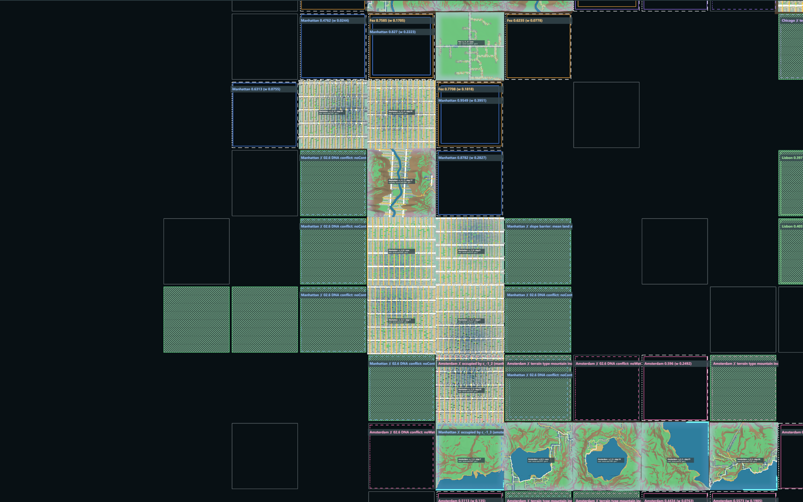
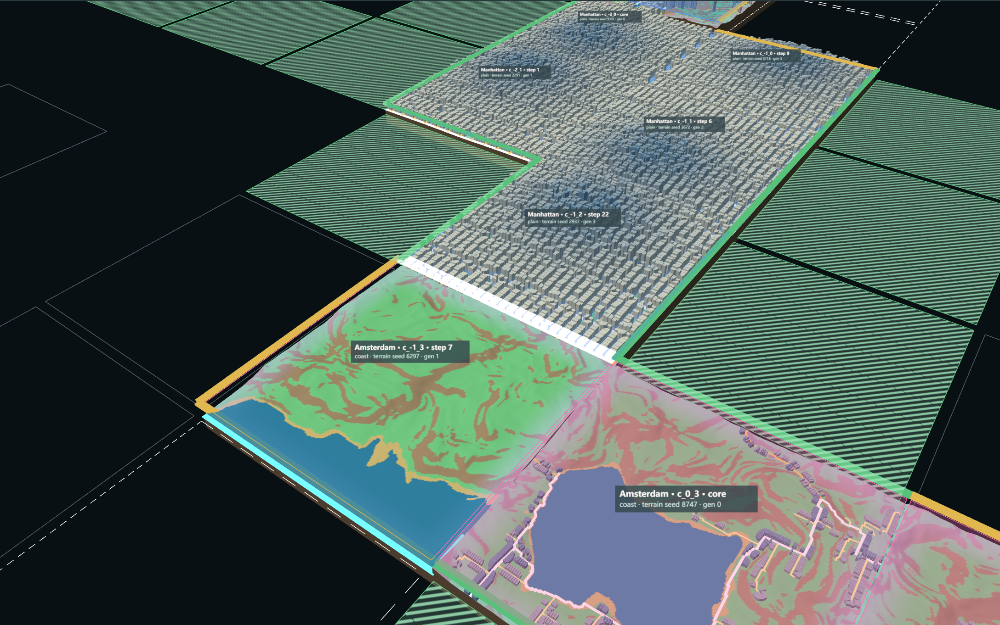

# G03a — Urban Territory & Spatial Relationships

Part of [A City of Cities — Research Compass](../A-City-of-Cities-Research-Compass.md), roadmap stage **G03** (first part). Log entry: **G03a** in [FINAL-EXPERIMENT-LOG.md](../FINAL-EXPERIMENT-LOG.md). Previous stage: [G02 Procedural Urban Growth](./G02-Procedural-Urban-Growth.md).

**Status:** implemented and verified on world seeds 6201, 6202 and 6203 (Node and browser, 0 / 10 / 30 growth steps). **Pending review.**

| Navigation | |
| --- | --- |
| Parent study area | [Knowledge base home](../README.md), research path §4.2 · [Research Compass](../A-City-of-Cities-Research-Compass.md) §8 |
| Prerequisite | [G02 Procedural Urban Growth](./G02-Procedural-Urban-Growth.md) |
| This experiment | G03a analysis layer (log entry G03a) |
| Next investigation | G03b encounter zones, **Proposed** (§10) |
| Code | [TerritoryModel.js](../../../experiments/city-of-cities/TerritoryModel.js), [TerritoryView.js](../../../experiments/city-of-cities/TerritoryView.js) · [verify-city-territory.mjs](../../../scripts/verify-city-territory.mjs) |
| Runtime entry | Local only: `/experiments/city-of-cities/`, folder "Territory (G03a)" |
| Related commit | Working tree — uncommitted |

**Study notebook, in short.** *Question:* can the G02 growth be read as organised space without changing growth? *Starting assumption:* territories, non-urban land and boundaries can be derived from the growth record alone. *Method:* a read-only `TerritoryModel` re-run after every step and checked against independent re-derivations. *Result:* all per-step checks pass on three seeds. *Observation (logged):* cities rarely meet: 1 / 4 / 0 shared edges at step 30, all on stepped or cliff seams; the only constraint rule that fires is steep terrain. *What changed in understanding (from the log):* at 30 steps the relationship questions of H3 have very little data; "ecological constraint" currently means "mountain". *Next question:* where do frontiers of several cities meet over time (G03b)?

**What this shows:** of fifteen city pairs, one shares an edge (Manhattan | Amsterdam), two touch at a corner (Fez with Chicago and with Manhattan), and the rest are separations with a distance and a barrier status (present, none or unknown).
**Conditions:** world seed 6201, 30 G02 steps, default G03a constraint rules, real browser runtime.
**Why it matters:** city relationships become measurable data rather than a visual impression.
**Limit:** "barrier present" is a straight-line test, not route proof (limitation 2); adjacency is never a road connection.

> Observation to complete after testing: do the territory boundaries in the step-30 map match where you would draw the city edges by eye?

**Entry point:** `/experiments/city-of-cities/` (`npm run dev`). The folder "Territory (G03a)" has five layer switches:

- Show city territories
- Show territory boundaries
- Show ecological constraints
- Show growth frontiers
- Show city relationships

Click a city to see its territory. The panel rows "City territory", "World territory" and "City relationships" show the analysis.

**Verifier:** `node scripts/verify-city-territory.mjs` (≈ 25 min; `--node-only`, `--browser-only`, `--seeds=…`).

## 1. Research objective

Move from *more chunks* to *organised territory*. G03a builds the data layer that records, for the multi-city growth of G02:

- each city's territory;
- the non-urban space (evaluated, ecologically constrained, unexplored);
- the boundaries;
- the measurable relationships between cities.

**Out of scope:** invasion, DNA fusion, takeover, cross-city roads, seam repair, any change to terrain, growth or city generation.

## 2. World spatial state (`TerritoryModel.js`)

| State | Definition (as implemented) | Source |
| --- | --- | --- |
| **unexplored** | Never evaluated by the world algorithms (no terrain probe). Not stored, never a constraint | absence from `WorldContext.probes` |
| **evaluated** | Terrain probed (origin placement or growth frontier), not occupied, no constraint rule, not eligible now | probe cache |
| **frontier** | Evaluated and eligible for at least one city in the next growth step | `WorldGrowthController.evaluate(step + 1)`, the same evaluation the next step uses |
| **ecologicalConstraint** | Evaluated and meets an explicit, city-neutral rule (below) | probe metrics |
| **urbanTerritory** | Occupied by a city chunk. `viable` = the chunk generated buildings | registries + chunk outputs |

**Rules:**

- **Priority:** urban > ecological > frontier > evaluated > unexplored.
- **City rejections are not ecology:** a cell that a city rejects for its own reasons (Venice: no water; Manhattan: `noContinuousLand`; flat-city slope barrier) stays *evaluated*, with the reason recorded per city. A rejection never becomes ecological.
- **Constraints do not block growth:** G03a does not change growth. A city that may grow onto constrained terrain (Lisbon, Fez tolerate slope) still can; the result is counted as `urbanOnConstrainedTerrain`.
- **No protection policy exists.** No cell is "protected" (count 0), and none is invented.

**Constraint rules** (design assumptions A). Their thresholds come from the measured distribution of 243 probed cells on seeds 6201–6203:

- mountains have a mean land slope of 22–36°, all other landforms ≤ 13°;
- no cell has less than 5 % buildable land;
- coast water is ≤ 37 %.

| Rule | Condition | Meaning |
| --- | --- | --- |
| steepTerrain | mean land slope ≥ 18° | too steep for urban fabric |
| unbuildable | buildable share < 5 % | same threshold as G01 / G02 |
| waterBody | water share ≥ 50 % | mostly water |

In practice only `steepTerrain` fires on the test seeds. Ecological constraints therefore coincide with mountain cells; no water body or unbuildable cell occurs in range.

## 3. Territory data structure

**Ownership is incremental.** `applyEvent(event)` adds the new chunk to its city's territory. It refuses:

- a step out of order;
- a chunk already owned by another city;
- a parent outside the territory;
- a mismatch with the world registry.

`TerritoryModel.build(world)` replays the history; it is used after load and checked to be identical to the incremental result.

Per city, after `refresh(controller)`:

| Field | Content |
| --- | --- |
| `cityId`, `originChunkId`, `occupiedChunkIds`, `territoryGrowthHistory` | identity, chunk list, step / parent / generation per chunk |
| `chunkCount`, `viableChunks`, `maxGeneration` | counts |
| `territoryArea` | **Chunk coverage** (km²: chunks × 1.048576), kept separate from **real built quantities**: building footprint area and parcel area (summed from the generated buildings and parcels), road length, plus water and other non-buildable land inside the territory (from the probes) |
| `activeFrontiers`, `blockedFrontiers`, `blockedReasons` | eligible cells with score; rejected cells with reason (including "occupied by …") |
| `status`, `stopReason` | `growing`, or `stopped` with the aggregated reasons when no frontier cell is eligible |
| `neighboringCities` | cities sharing a chunk edge |
| `boundarySegments`, `boundaryLengthM` | every chunk edge with its class (§4), endpoints, frontier flag; external length by class |

## 4. Boundary classification

Every edge of every city chunk is one segment (4 per chunk):

| Class | Neighbour cell |
| --- | --- |
| urbanUnexplored | not evaluated |
| urbanEvaluated | evaluated or frontier land (frontier flag set when eligible) |
| urbanEcological | ecological constraint |
| urbanSameCity | chunk of the same city (internal; not part of the external boundary length) |
| urbanOtherCity | chunk of another city → also an **adjacency record** |

Each adjacency record (two cities in direct contact) holds:

- **Identity and location:** City A / City B, both chunks, location (edge end points and midpoint), length 1024 m.
- **Terrain conditions:** the G02 conflict record of that edge (geometry class, maximum height step, hydrology) and both landforms.
- **Road interface:** road ports on both sides and how many align (≤ 48 m, same type).
- **Water interface:** samples wet on both sides.
- **Connection:** always "not verified". G02 joins no cross-chunk road, so adjacency is never reported as a connection.

## 5. Relationship graph

There are six city nodes and fifteen pairs. Each pair records:

- **relation:** `directAdjacency` (at least one shared chunk edge) or `spatialSeparation`. A separation where the territories touch only at a chunk corner is flagged `cornerContact`.
- **nearest:** the closest chunk pair, its centre distance in metres and the number of cells between (4-neighbour).
- **environmentalBarrier:** what the data *shows* on the straight cell line between the nearest chunks:
  - `present` — ecological-constraint cells are on the line;
  - `unknown` — unexplored cells are on the line;
  - `none` — every cell on the line is evaluated and unconstrained.

  This is evidence on one line, not proof that every route is blocked.
- **verifiedConnection:**
  - `unknown: road ports aligned … not joined` for adjacent pairs with aligned ports;
  - otherwise `none`.

  Distance or adjacency is never read as a connection.

## 6. Parameters

| Parameter | Value | Note |
| --- | --- | --- |
| steepTerrain | ≥ 18° mean land slope | A, measured gap 13° → 22° |
| unbuildable | < 5 % buildable | A, G01 / G02 threshold |
| waterBody | ≥ 50 % water | A |
| Port alignment | ≤ 48 m, same type | as G02 conflict records |

No public parameter was added. The growth and placement parameters are unchanged.

## 7. Actual test results

`node scripts/verify-city-territory.mjs` passed: Part A in Node (1,337 s, three seeds), Part B in the browser (seed 6201), 0 browser errors.

**Checks after every growth step (all seeds, steps 0–30):**

1. City IDs of existing chunks never change.
2. Territory lists equal the real occupancy. Coverage = chunks × 1.048576 km². Built footprint = sum of the generated outputs, always ≤ coverage.
3. All 4 × chunk-count boundary segments are re-derived independently from coordinates and probes, and every class and frontier flag matches.
4. Every ecological cell is a probed cell that meets a rule. No non-urban state is ever assigned to an unexplored cell.
5. The adjacency set equals a brute-force scan of chunk edges. `directAdjacency` holds exactly when a shared edge exists, and adjacency is never a verified connection.

**Run-level checks:**

- Incremental ownership = full replay of the history.
- The same seed run twice gives identical analyses at 0 / 10 / 30.
- Save at step 10 (World State + analysis) → load → regenerate → the saved analysis is reproduced exactly → continue to 30 = uninterrupted.
- The G02 growth history is unchanged against the G02 verifier record.
- The static scan finds no World Grid class, seam or City Invasion call.
- **Browser:** the analysis at step 30 equals the Node analysis, and Save → reload → Load restores it exactly.

**World metrics:**

| Seed / step | Chunks | Coverage km² | Built footprint km² | Viable chunks | Frontier / evaluated / ecological cells | Ecological km² | Shared edges (pairs) | Corner contacts | Stopped |
| --- | --- | --- | --- | --- | --- | --- | --- | --- | --- |
| 6201 / 0 | 6 | 6.29 | 0.99 | 6 | 15 / 29 / 9 | 9.4 | 0 | 0 | — |
| 6201 / 10 | 16 | 16.78 | 2.74 | 15 | 22 / 27 / 14 | 14.7 | 0 | 0 | — |
| 6201 / 30 | 36 | 37.75 | 5.40 | 34 | 32 / 22 / 21 | 22.0 | 1 (1) | 2 | — |
| 6202 / 0 | 6 | 6.29 | 1.01 | 6 | 15 / 33 / 12 | 12.6 | 0 | 0 | — |
| 6202 / 10 | 16 | 16.78 | 3.53 | 16 | 16 / 35 / 17 | 17.8 | 0 | 1 | — |
| 6202 / 30 | 36 | 37.75 | 7.13 | 36 | 23 / 26 / 19 | 19.9 | 4 (3) | 2 | — |
| 6203 / 0 | 6 | 6.29 | 0.87 | 5 | 22 / 34 / 2 | 2.1 | 0 | 0 | — |
| 6203 / 10 | 16 | 16.78 | 2.43 | 14 | 30 / 31 / 7 | 7.3 | 0 | 0 | — |
| 6203 / 30 | 36 | 37.75 | 5.85 | 33 | 43 / 25 / 12 | 12.6 | 0 | 1 | Venice |

**Built footprint is 14–19 % of chunk coverage at step 30.** The chunk count overstates the urbanised land by a factor of 5–7.

**Per city at step 30, seed 6201:**

| City | Chunks | Built footprint km² | Active / blocked frontiers | External boundary km | Neighbours |
| --- | --- | --- | --- | --- | --- |
| Manhattan | 8 | 3.49 | 5 / 8 | 16.4 | Amsterdam |
| Chicago | 8 | 1.04 | 10 / 4 | 18.4 | — |
| Lisbon | 6 | 0.35 | 10 / 0 | 12.3 | — |
| Amsterdam | 5 | 0.10 | 5 / 7 | 12.3 | Manhattan |
| Venice | 5 | 0.18 | 4 / 5 | 12.3 | — |
| Fez | 4 | 0.25 | 8 / 0 | 10.2 | — |

**Inter-city adjacencies at step 30:**

| Seed | Cities | Chunks | Terrain | Road interface | Water interface |
| --- | --- | --- | --- | --- | --- |
| 6201 | Amsterdam \| Manhattan | c_-1_3 \| c_-1_2 | step, 16.3 m | ports not aligned | none |
| 6202 | Amsterdam \| Manhattan | c_-5_-2 \| c_-5_-1 | cliff, 50.8 m | ports aligned (not joined) | none |
| 6202 | Chicago \| Fez | c_2_1 \| c_2_0 | cliff, 53.7 m | ports not aligned | none |
| 6202 | Chicago \| Fez | c_2_1 \| c_3_1 | step, 7.5 m | ports aligned (not joined) | none |
| 6202 | Chicago \| Venice | c_0_1 \| c_0_0 | cliff, 34.3 m | ports not aligned | none |
| 6203 | — | — | — | — | — |

**Relationships at step 30** (15 pairs per seed):

| Seed | Direct adjacency | Corner contact | Barrier present / unknown / none |
| --- | --- | --- | --- |
| 6201 | 1 | 2 (Chicago–Fez, Fez–Manhattan) | 8 / 2 / 2 |
| 6202 | 3 | 2 | 2 / 4 / 4 |
| 6203 | 0 | 1 (Amsterdam–Lisbon) | 2 / 7 / 5 |

**Stopped city:** on 6203 Venice is `stopped`, reason "no eligible frontier cell (DNA conflict: noWater ×4; terrain type mountain incompatible ×5)". Its frontier cells stay *evaluated* or *ecological* by the city-neutral rules; they are not marked protected.

**Terrain conflicts:** urban chunks on constrained terrain are 1 on 6201 (a Lisbon growth chunk on a mountain) and 1 on 6202 (the Lisbon core on a mountain).

**Cost:** analysis per growth step mean 154–223 ms, max 498 ms (Node), mostly probing new frontier cells.

## 8. Screenshots (seed 6201, real runtime)

1. Six origins: territories, evaluated (grey), frontier (dashed white), ecological constraint (hatched green); unexplored cells are not drawn. 
2. Step 10 territory map: 
3. Step 30 territory map: 
4. Growth frontier (G02 labels: score and weight, or the rejection reason) over the ecological constraints, around the Manhattan core. Cells Manhattan rejects (`noContinuousLand`) are not hatched unless a rule holds. 
5. Boundary close-up at the only inter-city edge, Amsterdam c_-1_3 | Manhattan c_-1_2. White = other city, green = ecological, amber = evaluated land. 
6. City relationship graph: shared edge (thick white), corner contacts (dashed white), separations (grey, distance + barrier status). 

## 9. Known limitations

1. **Constraint rules equal mountains.** On the test seeds only `steepTerrain` fires. Water bodies never reach 50 % in a cell, and no protection policy exists, so "protected territory" is empty by design, not by omission.
2. **Barrier evidence is one line.** `barrier present` means constrained cells lie on the straight line between the nearest chunks; it does not prove that every route is blocked. `unknown` is common (2–7 pairs per seed) because many cells were never evaluated.
3. **Evaluated depends on what the algorithms probed.** Origin placement and frontier evaluation decide which cells are evaluated. The evaluated set is saved with the analysis so that load is exact.
4. **Few adjacencies.** At 30 steps cities touch rarely (0–4 shared edges), and every contact edge has a height step or cliff (seams are not repaired). Interfaces are reported; no connection is verified.
5. **Constraint vs growth.** Growth may urbanise constrained terrain (1 case each on 6201 and 6202). G03a reports it and does not prevent it.
6. **Chunk-level analysis.** Territory, boundaries and states are per 1024 m chunk. Inside a chunk only aggregate quantities (built footprint, parcels, water, non-buildable land) are used.
7. **Performance.** The territory refresh adds about 0.2 s per growth step. The map-scale relationship graph is readable at 30 steps but will crowd at larger worlds.

## 10. Next stage — G03b proposals

- **Encounter zones:** cells where frontiers of two or more cities meet (shared eligible cells, contests), recorded over time, with the G02 occupation ruling as the outcome. This needs no growth change.
- **Ecological reserve as a rule that acts:** an opt-in growth rule that removes `ecologicalConstraint` cells from frontiers, compared against the current behaviour (Experiment C-style comparison). This would change growth and needs a decision.
- **Connection corridors:** only after a cross-chunk road join exists. Until then, keep aligned ports as candidate corridors.
- **Route-based barrier analysis:** shortest 4-neighbour path through evaluated, unconstrained cells instead of a straight line, still reporting `unknown` where unexplored cells decide.
