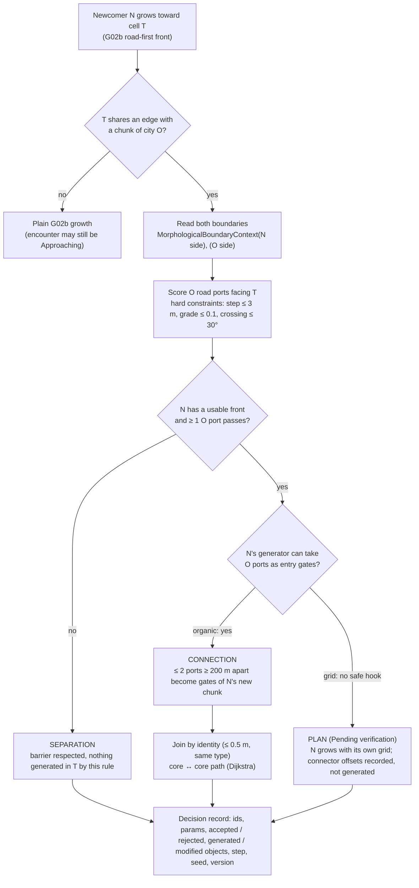
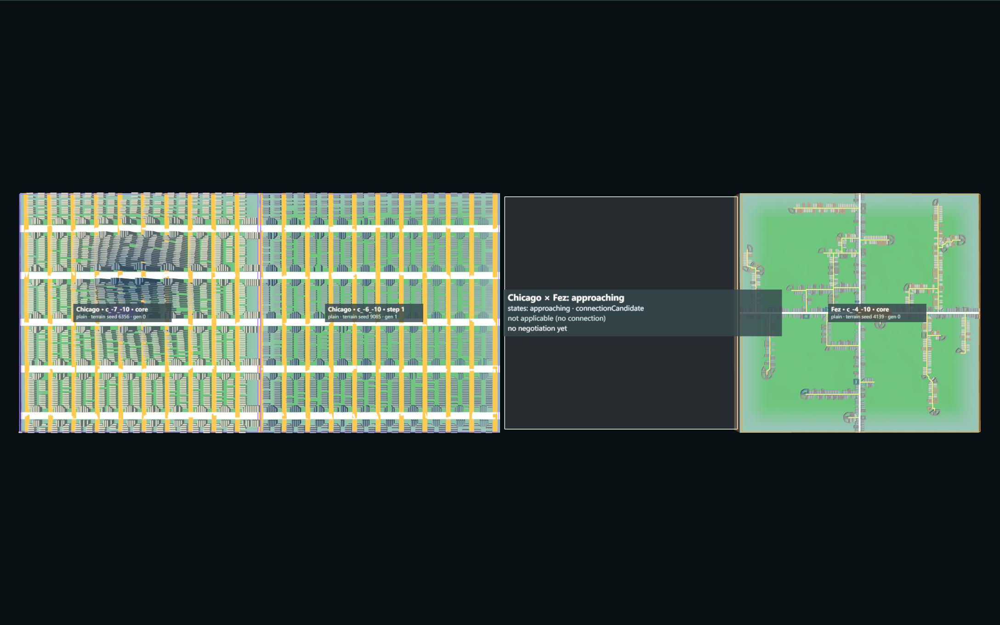
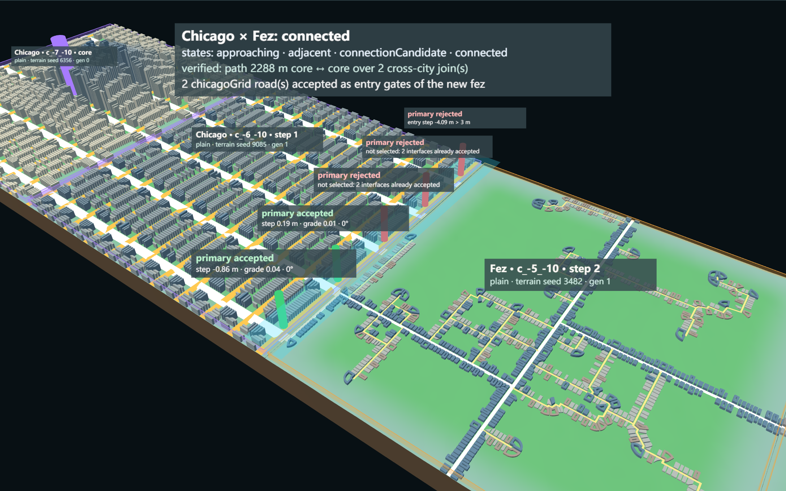
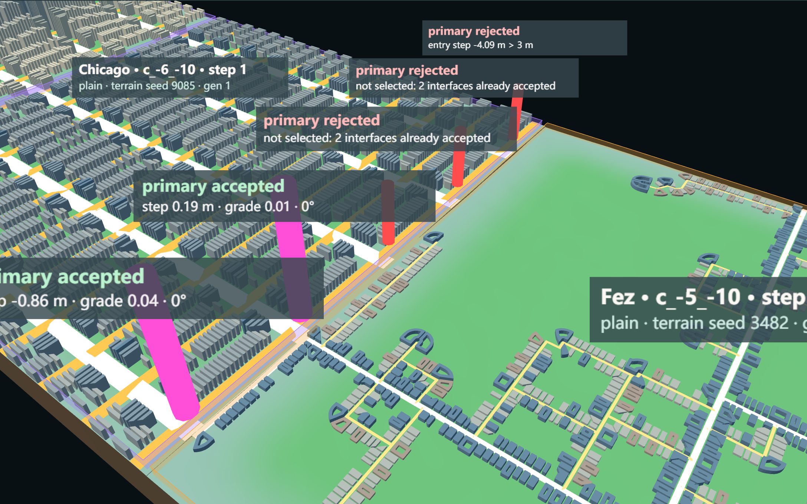
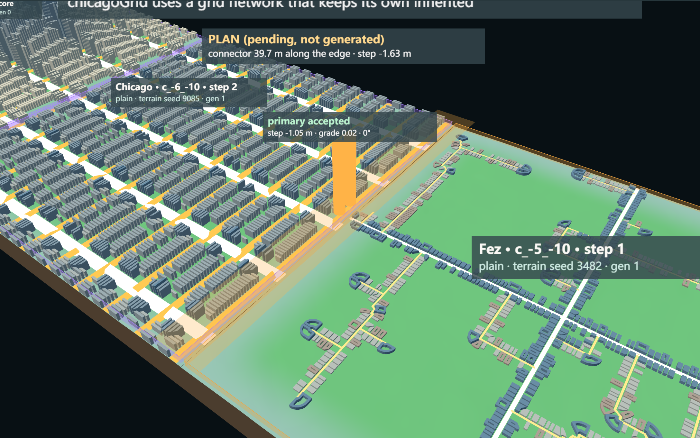
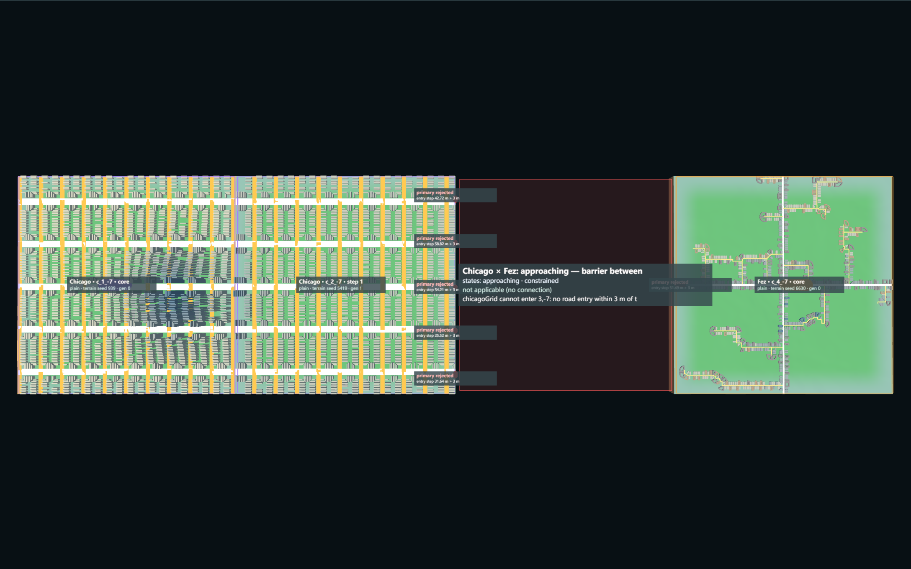
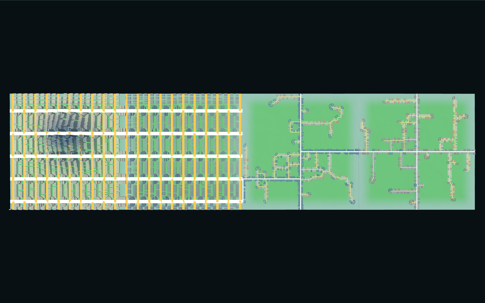
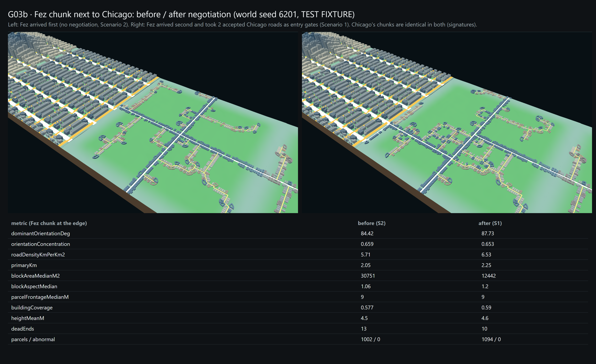
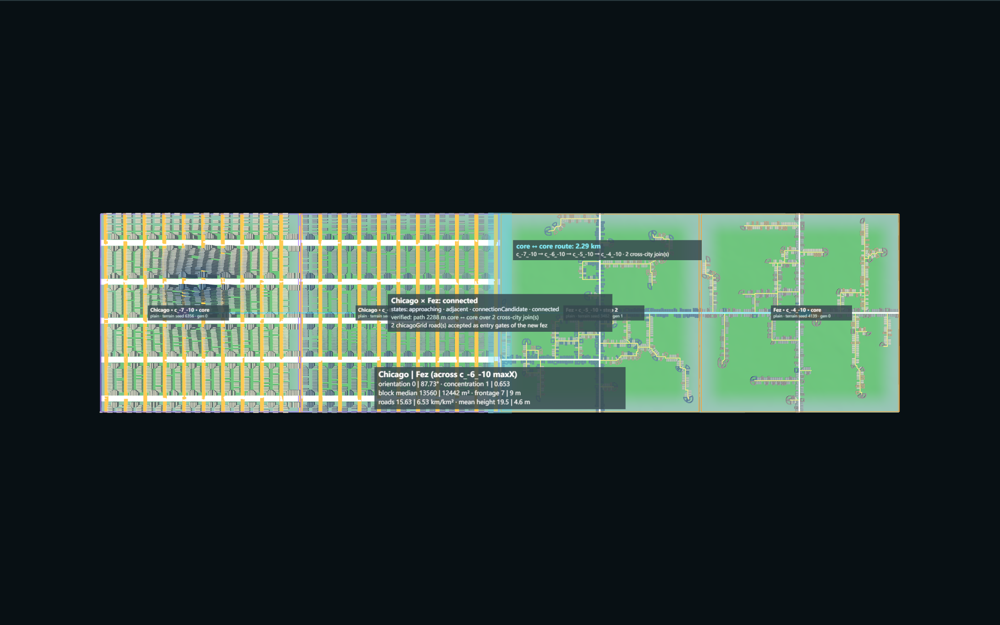

# G03b — Urban Encounter & Morphological Negotiation

Part of [A City of Cities — Research Compass](../A-City-of-Cities-Research-Compass.md), roadmap stage **G03** (second part). Log entry: **G03b** in [FINAL-EXPERIMENT-LOG.md](../FINAL-EXPERIMENT-LOG.md).

**Status:**
- **Implemented:** the minimum experiment for Chicago × Fez on a test fixture.
- **Verified:** in Node and the browser, world seed 6201, three scenarios.
- **Accepted:** no. **Pending review.**

| Navigation | |
| --- | --- |
| Parent study area | [Knowledge base home](../README.md) · [Research Compass](../A-City-of-Cities-Research-Compass.md) |
| Prerequisites | [G02b Morphological Growth](./G02b-Morphological-Growth.md) (road-first growth, joins by identity) · [G03a Urban Territory](./G03a-Urban-Territory.md) (constraint rules) |
| This experiment | Detection of an encounter between two growing cities, the reading of both boundaries, and a negotiation at the shared edge (log entry G03b) |
| Next investigation | **Proposed** (§10) |
| Code | [UrbanEncounter.js](../../../experiments/city-of-cities/UrbanEncounter.js), [encounterFixture.js](../../../experiments/city-of-cities/encounterFixture.js), [EncounterView.js](../../../experiments/city-of-cities/EncounterView.js) · [verify-urban-encounter.mjs](../../../scripts/verify-urban-encounter.mjs) · evidence `experiments/city-of-cities/evidence/urban-encounter.json` |
| Runtime entry | Local only: `/experiments/city-of-cities/?fixture=compatible` (or `incompatible`, `barrier`), folder "Urban encounter (G03b, test fixture)" |
| Related commit | Working tree — uncommitted |

**Study notebook, in short:**

- **Question:** what happens when two cities with different morphologies grow into each other? Can the newcomer meet the other city's fabric without changing it?
- **Method:**
  1. Two cores are placed by hand (test fixture) so that Chicago (grid) and Fez (organic) meet after one or two road-first growth steps.
  2. A detector reads the meeting.
  3. Both boundaries are read, and the other city's road ports are scored against hard constraints.
  4. The negotiation outputs one of three outcomes: connection, a pending plan, or separation.
- **Result:** all three outcomes appear on real terrain and real generators:
  - Fez joins Chicago's grid with 2 roads, and a core-to-core route of 2.29 km exists;
  - Chicago's grid cannot bend toward Fez, so a connector plan is recorded but not generated;
  - a 25–59 m river-valley step keeps the cities apart.
- **What changed in my understanding:** negotiation is asymmetric. The organic newcomer can adapt at its edge; the grid newcomer cannot without a new generator hook. Who arrives second decides whether the edge connects.

## 1. Research Question

When two cities' growth fronts meet, can the encounter be detected from generated data, read from both sides, and resolved by a rule that changes only the new chunk? The resolution must be one of:

- connection (with verified topology);
- separation (a natural barrier is respected);
- a verifiable plan, where the generator cannot adapt safely.

## 2. Test Fixture (TEST ONLY)

The fixture is not a placement rule. Cores are placed by hand in one row of cells: Chicago at x, Fez at x + 3. Everything else is the real chain:
- world terrain;
- City DNA;
- network, block, parcel and building generators;
- G02b road-first growth with its 3 m entry check.

The rows were chosen from a landform search over seeds 6201 / 6202 / 6203 and a probe of the real road ports. For example, on seed 6202 the plain row (1, -7) was rejected because Chicago's east ports are 3.6–6.0 m below the next cell.

| Scenario | Seed | Row (x, y) | Steps (newcomer → cell) | Purpose |
| --- | --- | --- | --- | --- |
| 1 Compatible road interface | 6201 | (-7, -10), four plain cells | Chicago → (-6, -10); Fez → (-5, -10) | Fez arrives second, next to Chicago |
| 2 Incompatible street geometry | 6201 | (-7, -10), same cells | Fez → (-5, -10); Chicago → (-6, -10) | Chicago's grid arrives second, next to Fez |
| 3 Natural barrier | 6201 | (1, -7): plain, plain, river valley, plain | Chicago → (2, -7); Fez → (3, -7); Chicago → (3, -7) | Both try to enter the river valley |

## 3. Encounter Detection

`UrbanEncounter.detect()` builds one encounter per city pair (`enc:chicagoGrid|fezOrganicCore`). The states coexist; they are not one enum:

| State | Rule (thresholds are hypotheses) |
| --- | --- |
| Approaching | Nearest chunks of the two cities are ≤ 3 cells apart (Manhattan distance) |
| Adjacent | The two cities share a chunk edge |
| Constrained | A free cell between them meets a G03a ecological-constraint rule, or every growth front into it is refused. For a shared edge: ≥ 50 % water, or a median height step > 3 m |
| ConnectionCandidate | At least one road port passes the hard interface constraints toward the other city (or did when negotiated) |
| Connected | A recorded cross-city join exists **and** a core-to-core path is found (Dijkstra on the union of both cities' road graphs, their G02b joins and the cross-city joins) |

Each record holds:
- `encounterId`, `cityA` / `cityB`, `participatingChunkIds`, `boundaryLocation` (shared edge or gap cells);
- `relevantGrowthFrontIds`, `terrainConditions`, `roadInterfaceConditions`;
- `currentRelationship`, `decisionReason`, `validationStatus`.

Identifiers are stable, so re-running adds no duplicate.

## 4. Morphological Boundary Context

`boundaryContext(world, chunk, side)` reads one chunk side from generated data only:

- **Road:**
  - orientation and orientation concentration;
  - hierarchy (ports by class);
  - endpoints (position, class, elevation, crossing angle);
  - port spacing (grid primary spacing, or `unavailable (no fixed grid: organic / canal network)`);
  - reachability share from the core.
- **Morphology:**
  - block median area, orientation and aspect;
  - boundary blocks;
  - parcel frontage median;
  - building coverage;
  - heights (mean / p90 / max);
  - parcel depth: `unavailable (parcel depth is not stored by the parcel generator)`.
- **Geography:**
  - edge height profile (min / median / max);
  - cell mean slope;
  - edge water and buildable shares;
  - G03a constraint hits.

## 5. Negotiation Rules

The newcomer N wants to grow into cell T, and T shares an edge with a chunk of city O. The rule reads **both** sides:

1. **Hard constraints** apply to every O road port facing T. All three thresholds are hypotheses:
   - entry step |ground(T) − port elevation| ≤ 3 m;
   - grade over the first 32 m into T ≤ 0.1;
   - crossing angle ≤ 30° from perpendicular.
2. **Selection:** passing ports are scored (class 0.4 / 0.2, step 0.3, angle 0.3). At most 2 are accepted, at least 200 m apart along the edge. Every rejected port keeps its reason.
3. **Outcome:**
   - **Separation:** N has no usable front into T, or no O port passes. Nothing is filled, flattened or deleted.
   - **Connection (with local adaptation):** N's network DNA is organic. The accepted O ports become entry gates on that side of N's new chunk, through an optional generator input. After generation, joins are made by identity (same type, ≤ 0.5 m), as in G02b.
   - **Plan, Pending verification:** N's DNA is a grid, which keeps its own inherited lines; the generator has no safe hook to bend them. A connector plan is computed from the real outputs and recorded, but **not generated**.
4. **Allowed changes:** only the entry gates of N's new chunk. Never changed:
   - O's chunks;
   - either core;
   - any DNA;
   - terrain.

   Each decision records `modifiedObjects` (always empty) and `generatedObjects`.

Generator changes are optional and backward compatible:

- `NetworkGenerator.organicStrategy` accepts entry ports that carry their own `side`, so entries can replace the proxy gate on more than one side.
- `WorldContext` passes `growthContext.crossCityEntries`, saves `world.growth.encounterDecisions`, and adds `directionDeg` to the port records.
- `MorphologicalGrowth.grow` accepts `target`, `crossCityEntries` and `encounterId`, and `verifyConnections` re-checks cross-city joins.
- G02b's own verifier reproduces its whole Node record after these changes, except timing: six G01 cores identical, G02 steps 1–5 identical, Manhattan 4 + 13 joins, Fez 1 + 1.

## 6. Actual Results (world seed 6201, Node = browser)

**Scenario 1, compatible: connection, verified.**
- Chicago grows (-6, -10) with 5 same-city joins; Fez grows (-5, -10) with 1 same-city join.
- Chicago offered 5 primary ports on the shared edge:

| Chicago port (z, m) | Entry step | Grade | Crossing | Decision |
| --- | --- | --- | --- | --- |
| -10600.3 | -4.09 m | 0.13 | 0° | rejected: step > 3 m, grade > 0.1 |
| -10400.3 | -2.65 m | 0.09 | 0° | passed, not selected (2 already accepted) |
| -10200.3 | 1.40 m | 0.03 | 0° | passed, not selected (2 already accepted) |
| -10000.3 | 0.19 m | 0.01 | 0° | **accepted** |
| -9800.3 | -0.86 m | 0.04 | 0° | **accepted** |

- **Joins:** 2 cross-city joins (primary ↔ primary) at 0.3 m position error, with elevation steps 0.19 m and -0.85 m.
- **Path:** core ↔ core over c_-7_-10 → c_-6_-10 → c_-5_-10 → c_-4_-10, 2288 m long, 31 nodes.
- **Edge:** median height step 1.51 m (max 4.12 m), no water.

**Scenario 2, incompatible: plan, Pending verification.**
- Fez arrives first. Chicago then grows (-6, -10) with its inherited grid (5 same-city joins).
- Fez's only port on the shared edge (z = -10240, step -1.05 m, grade 0.02, 0°) passes the hard constraints.
- Chicago's grid has no hook to reach it, so no connector is generated:
  - nearest Chicago port at 39.7 m along the edge, step -1.63 m, grade along the edge 0.04;
  - coincident joins (≤ 0.5 m): 0;
  - nearest offsets of all 5 Chicago ports: 360 / 160 / 39.7 / 240 / 440 m.
- **Encounter:** adjacent and connectionCandidate, not connected; relationship "adjacent — connection plan pending".

**Scenario 3, barrier: separation, twice.**
- Chicago grows (2, -7) with 4 same-city joins.
- The river-valley cell (3, -7) has a mean slope of 11.2°, 46 % buildable land and 3.4 % water. It meets **no** G03a constraint rule; the barrier is the valley depth.
- Fez's port lies 51.5 m above the valley ground. Chicago's 5 ports lie 25.5–58.8 m above it.
- Both entries are refused, the cell is not urbanised, and no terrain is changed.
- **Encounter:** approaching and constrained; relationship "approaching — barrier between".

## 7. Screenshots

All are real captures from the page (Playwright, system Chrome), world seed 6201, City DNA chicagoGrid and fezOrganicCore, task G03b, rules as in §5.

**What this shows:** Scenario 1 after step 1. Chicago has grown one chunk east, and Fez is at its core. The white square marks the free cell between them (Approaching).
**Why it matters:** the encounter is detected before any contact.

**What this shows:** Fez's G02b growth fronts. Green and red posts are its road entries within or beyond the 3 m step; the label shows the encounter zone.
**Limit:** Chicago's interfaces are scored only when the negotiation runs (next image).

**What this shows:** Scenario 1 after negotiation: all 5 Chicago ports with accepted (green) or rejected (red) and the reason. The cyan strip is the connected shared edge.

**What this shows:**
- magenta posts: the 2 cross-city joins;
- red posts: rejected or unselected interfaces, with reasons;
- Fez lanes start at Chicago's avenue ends.

**Why it matters:** the original Chicago roads are unchanged; only the new Fez chunk adapted.

**What this shows:** Scenario 2. The amber line is the 39.7 m connector proposed between Fez's accepted port and the nearest Chicago avenue.
**Limit:** not generated (Pending verification).

**What this shows:** Scenario 3. The red square is the river-valley cell, which stays empty (not generated, hence dark). Every interface is rejected with a 25–59 m entry step.

**What this shows:** Scenario 1 with no chunk borders or overlays: one continuous strip from grid to lanes.
**Limit:** the edge is still readable as a hard change of fabric. Nothing blends; that is by design (no DNA mixing).

**What this shows:** the same Fez cell without negotiation (Scenario 2, left) and with it (Scenario 1, right), with real metrics. Chicago's chunks are identical in both (signatures).

**What this shows:** Scenario 1 overview with:
- encounter states;
- validation status;
- the core ↔ core route (2.29 km);
- the morphological difference across the edge.

## 8. Quantitative Verification

`node --max-old-space-size=8192 scripts/verify-urban-encounter.mjs`: Part A (Node) passed, about 20 s per scenario. Part B (browser) passed: decisions and encounters are equal to Node, with 0 page errors.

| Check | Result |
| --- | --- |
| **Topology** | |
| Cross-city joins (S1) | 2; position error max 0.3 m (tolerance 0.5 m); elevation step max 0.85 m |
| Duplicate ids / nodes | none (unique connection ids, unique parent and child nodes) |
| Unmatched accepted entries | 0 |
| Path core ↔ core (S1) | reachable, 2288 m |
| Invalid crossings | **not measured** (no segment-intersection test). Joins are identities of existing boundary nodes; no segment is generated across the edge |
| Dangling ends (Fez edge chunk) | dead ends 13 without negotiation → 10 with |
| **Morphology** | |
| Existing fabric | Chicago core, Chicago growth chunk and Fez core: identical signatures in S1 and S2; `modifiedObjects` empty in every decision |
| Fez edge chunk, without → with negotiation | road density 5.71 → 6.53 km/km²; block median 30751 → 12442 m²; frontage 9 → 9 m; coverage 0.577 → 0.59; mean height 4.5 → 4.6 m; orientation concentration 0.659 → 0.653 |
| Boundary blocks at the edge | Chicago 6 (9672 m²) · Fez 2 (448 k m² with negotiation, 487 k m² without) |
| Abnormal parcels (< 30 m² or no frontage, hypothesis) | 0 in every growth chunk |
| Orientation difference across the edge | 2.27° (S1), 5.58° (S2). **Not informative:** the 4θ dominant orientation folds both fabrics onto near-axis values |
| **Identity** (hypothesis) | |
| Chicago | all chunks resolved to chicagoGrid, orientation concentration 1.0 (≥ 0.8): grid recognisable |
| Fez | all chunks resolved to fezOrganicCore, orientation concentration 0.647–0.755. The hypothesis "organic ≤ 0.6" **failed for every Fez chunk, including the untouched cores**, so this metric and threshold do not measure organic identity. Relative reading only: the Fez edge chunk changed by 0.006 |
| **Stability** | |
| Cores | equal to independent generation (Chicago, Fez) |
| Reproducibility | twin run identical (history, decisions, signatures, encounters) |
| Save after step 1 → load → continue | signatures reproduced; result identical to the uninterrupted run |
| Save at the end → load | joins reproduced (2 events), encounters identical; re-running adds no decision, chunk or join |
| Browser | save → reload → load: joins reproduced, encounter identical; continue adds nothing |
| Old generators | G02b Node verifier reproduces its record (timing excluded) |
| Scope | 2 cities, ≤ 4 chunks; no City Invasion, six-city mixing, 3×3, new DNA, bridges / tunnels, hydrology or terrain edits |

## 9. Known Limitations

1. **Test fixture:** the cores are placed by hand. Whether such encounters occur under G01 / G02 placement and growth is not shown here; G03a measured only 0–4 shared edges in 30 steps.
2. **One encounter per city pair:** several separate meeting zones of the same pair would share one record (multi-zone encounters are proposed).
3. **Grid adaptation:** the grid newcomer cannot adapt. The connector plan is recorded, not generated (Pending verification), and a generator hook for boundary connectors is needed.
4. **Barrier detection:** the scenario 3 barrier is caught by the entry-step rule, not by a G03a constraint rule; the valley cell itself passes all three constraint rules.
5. **Identity metric:** orientation concentration does not separate organic from grid well enough (§8). The identity claim for Fez rests on the resolved DNA and the images, not on a metric.
6. **Missing checks:** invalid road crossings are not measured, and parcel depth is unavailable.
7. **Scoring:** the interface score weights and all thresholds are hypotheses; nothing is calibrated against real cities.
8. **Join error:** the 0.3 m join error comes from port rounding against the 4 m sample grid, inside the 0.5 m tolerance.

## 10. Next Stage (Proposed, not started)

- **G03c:** encounters in the multi-city scheduler (no hand placement): do Approaching / Adjacent occur in G02 runs with road-first growth (G02c)?
- **Grid connector hook (optional):** a minimal generator input that adds a short boundary connector for an accepted plan, then the same topology checks.
- **Identity metric:** replace orientation concentration with a measure that separates organic lanes, such as an intersection-angle distribution or the dead-end ratio, before any identity claim.
