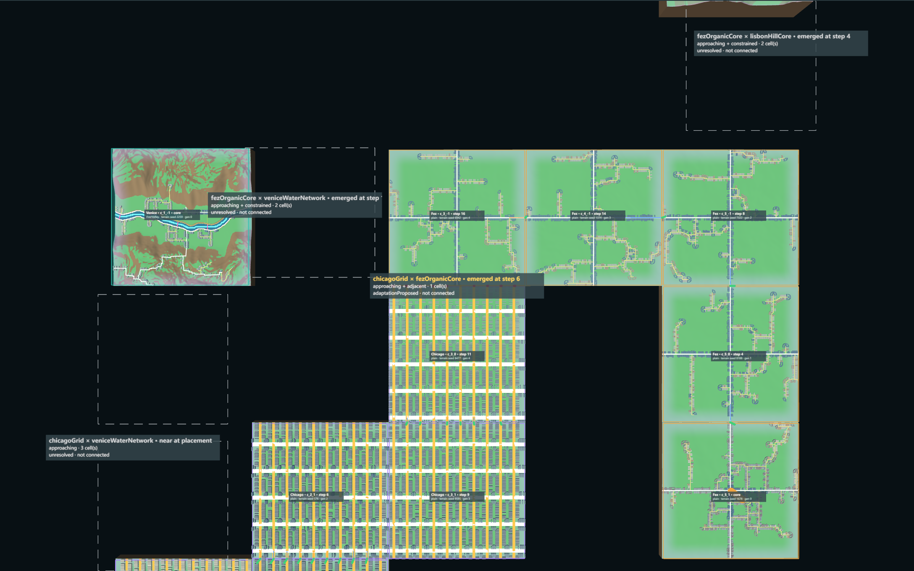
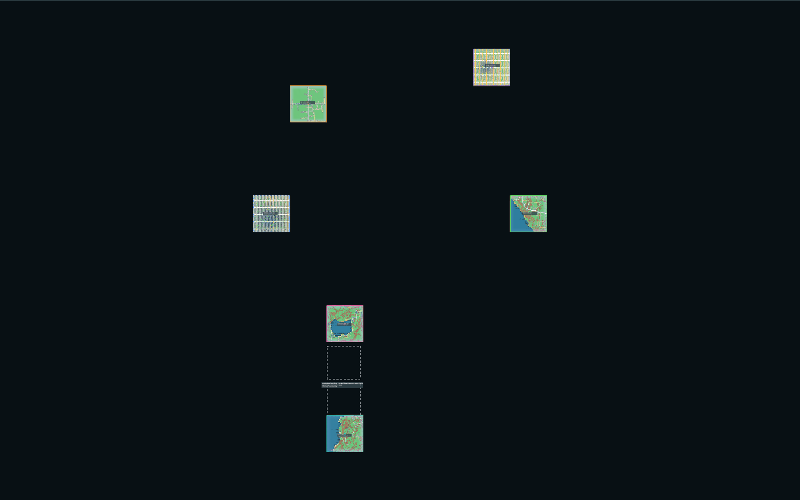
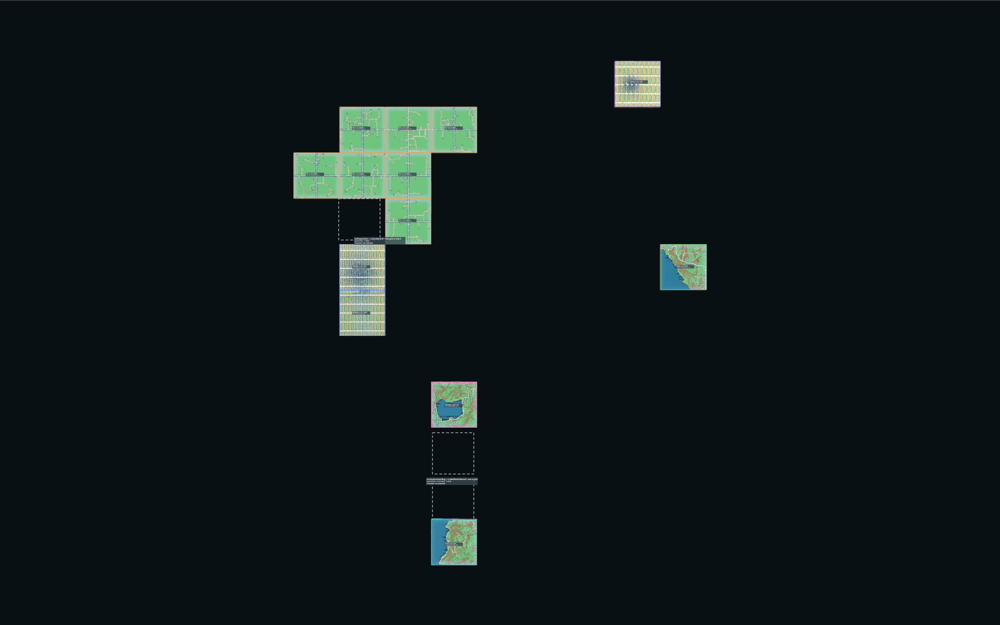
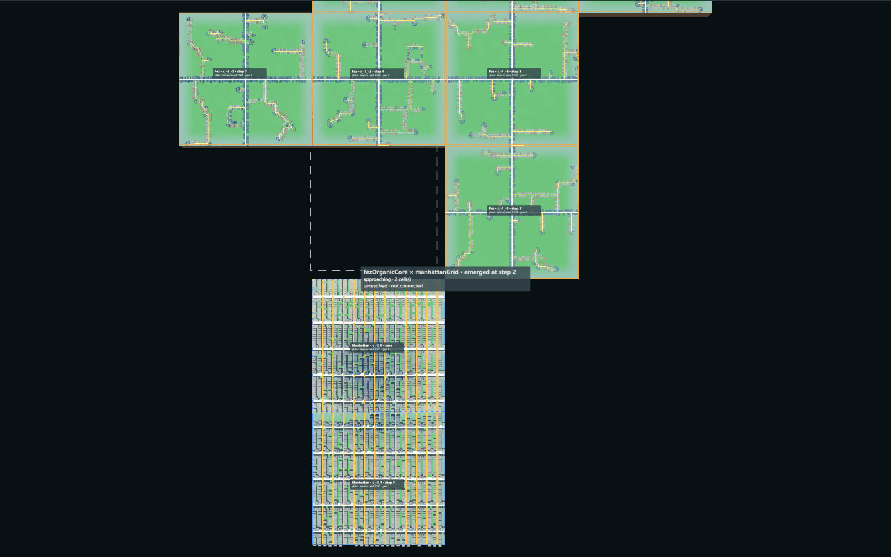
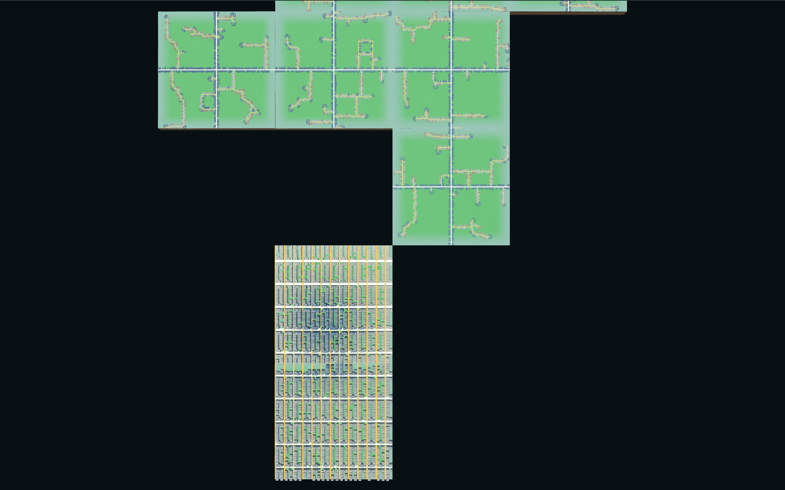

# G03c-01 — Emergent Urban Encounter

Part of [A City of Cities — Research Compass](../A-City-of-Cities-Research-Compass.md), roadmap stage **G03**. Log entry: **G03c-01** in [FINAL-EXPERIMENT-LOG.md](../FINAL-EXPERIMENT-LOG.md). The [G03b Chicago × Fez case](./G03b-Urban-Encounter.md) stays a **Controlled Experiment** and is not used as evidence here.

**Status:**
- **Implemented:** encounter detection inside the real six-city growth (road-driven scheduler with the G02c-02 ramp plan).
- **Verified:** Node and browser, seeds 6201 / 6202 / 6203, plus a 30-seed search.
- **Accepted:** no. **Pending review.**
- Natural encounters are **detected and classified**. **None is connected**: no cross-city road is built in this stage.

| Navigation | |
| --- | --- |
| Code | [EmergentEncounter.js](../../../experiments/city-of-cities/EmergentEncounter.js), [EmergentEncounterView.js](../../../experiments/city-of-cities/EmergentEncounterView.js); changes in `WorldGrowthController.js`, `UrbanEncounter.js` (path), `WorldContext.js`, `main.js`, `index.html` |
| Verifier | [verify-emergent-encounter.mjs](../../../scripts/verify-emergent-encounter.mjs), [search-emergent-encounters.mjs](../../../scripts/search-emergent-encounters.mjs) · evidence `emergent-encounter.json`, `emergent-encounter-search.json`, `world-6201-g03c-state.json`, `world-6206-g03c-encounter-state.json` |
| Runtime entry | Local only: `/experiments/city-of-cities/?growthMode=road&grade=baseline&emergent=1`, folder "Natural encounters (G03c-01)" |

**Principle:** urban encounters should emerge from independent growth, not from arranged positions. A connection is a verified relationship, not a visual coincidence.

## 1. Research question

Do cities meet when they grow by their own rules from real placements? When they do, what does the meeting look like in roads, terrain and morphology?

## 2. Gate: G02c-02

Read from its record before any work:
- 51 of 51 joins are continuous in XY, height and graph, with residual 0 m;
- all 97 diagnosed steps are terrain seams;
- save / load reproduces the ramps.

**Pass.** Free growth stalls early under that rule, which limits encounters (§6).

## 3. Integration

The detection runs inside the real growth loop: **growth commit → territory (registries) → detection → evaluation → record**. Details:

- `WorldGrowthController` with `encounters: true` calls `EmergentEncounterTracker.afterCommit` after each commit.
- Only the new chunk and other cities' chunks within 3 cells of it are examined; there is no world scan.
- Detection reads; it never generates, and growth is identical with it on or off.
- Pairs of cores already within 3 cells at placement are recorded once at step 0, marked `placement`, so they are kept apart from encounters made by growth.

**Segment identity:** `enc:<cityA>|<cityB>:<chunk A>:<chunk B>`, the closest pair when first seen.
- A later contact near the segment's chunks updates the same record.
- A contact elsewhere starts a new segment.
- No id depends on iteration order. The verifier reverses the chunk registry before every step, and the ids stay the same.

**States** (co-existing): approaching (≤ 3 cells), adjacent (shared edge), constrained (G03a rule in a cell between, or seam above 6 m or water on the shared edge), connectionCandidate, connected.

**Decision per road end across a new shared edge.** Each end is evaluated with the ramp planner of G02c-02 against the newer chunk's real network and world terrain:

| Proposal | When |
| --- | --- |
| Connection proposed | Same point, same height |
| Ramp connection proposed | Same point; a ramp in the newer chunk would pass every sampled check |
| Adaptation proposed | The nearest road of the other city is within 48 m along the edge: a connector would be needed. No generator hook exists |
| Separation accepted | Seam above 6 m, water, or no road of the other city within 48 m |
| Unresolved | The ramp does not fit before a junction, or the cities are not adjacent yet |

`UrbanEncounter.path` now reads parent joins, same-city `neighbourConnections` and cross-city joins.
- A join enters only if both nodes exist in the road graphs and it is no duplicate.
- Where a ramp plan exists, the two ends must also meet in height.
- Rejected ends are never joins.
- Checked on seed 6202: 63 recorded joins of Chicago and Manhattan, 63 used, 0 invalid.
- **Connected** needs a cross-city join and a core-to-core path. Neither exists in this stage.

## 4. Results: real growth (6 % ramp plan, budget 60 steps)

| Seed | Steps run | End | Encounters | By growth | Adjacent | Decisions |
| --- | --- | --- | --- | --- | --- | --- |
| 6201 | 7 | stalled | 2 | 1 | 0 | 2 unresolved |
| 6202 | 16 | stalled | 6 | 5 | 1 | 5 unresolved, 1 adaptation proposed |
| 6203 | 1 | stalled | 0 | 0 | 0 | — |

The 12 / 30 / 60 step milestones: only seed 6202 reached 12. **No seed reached 30 or 60**: all three stalled, with the reason recorded.

**Encounters that emerged by growth:**

| Seed | Encounter | First step | Closest | States at the end | Decision |
| --- | --- | --- | --- | --- | --- |
| 6201 | Fez × Manhattan | 2 | 2 cells | approaching | unresolved |
| 6202 | Fez × Lisbon | 4 | 2 cells | approaching, constrained | unresolved |
| 6202 | **Chicago × Fez** | 6 (adjacent at 16) | shared edge c_3_0 / c_3_-1 | approaching, adjacent | **adaptation proposed** |
| 6202 | Amsterdam × Manhattan | 12 | 3 cells | approaching | unresolved |
| 6202 | Fez × Venice | 14 | 2 cells | approaching, constrained | unresolved |
| 6202 | Chicago × Manhattan | 15 | 3 cells | approaching, constrained | unresolved |

**The adjacent case (seed 6202, step 16):** Fez grew c_3_-1 next to Chicago's c_3_0.
- **Edge:** median terrain seam 4.11 m (maximum 7.17 m), no water.
- **Road ends:** Chicago's 10 secondary streets reach the edge; Fez's lanes reach it at one point.
- **Result:** no pair meets at one point.
  - The nearest pair is 26.4 m apart along the edge, so a connector is proposed (adaptation).
  - The other 9 are 73–474 m from any Fez road and are separated.
- **Nothing is built.**

## 5. Reference run without the ramp plan (G02c-01 joins, labelled as reference)

The same detection with G02c-01 growth runs longer, because joins may keep height steps up to 3 m. This is not a 3D-continuous world.

| Seed | Steps | Encounters | Adjacent |
| --- | --- | --- | --- |
| 6201 | 14, stalled | 4 | 1: Fez × Manhattan, adaptation proposed (one Manhattan street 14.1 m from a Fez lane) |
| 6202 | 30 | 6 | 1: Chicago × Fez on two edges, adaptation proposed; one edge has a 7.2 m seam |
| 6203 | 30 | 1 | 1: Fez × Manhattan, separation (seam median 42 m, nearest road 99 m) |

## 6. Seed search (no hand placement)

Settings:
- 30 seeds, 6204–6233;
- full placement v2, six cores;
- road-driven scheduler with the 6 % ramp plan and encounter detection;
- stop at a stall or after 30 steps.

The record holds every seed, including failures. The summary is in the log entry G03c-01 and in `emergent-encounter-search.json`.

## 7. Verification

Every encounter of the three runs was checked item by item:

| Item | Result |
| --- | --- |
| City ids | Pair from the six ids, sorted, unchanged |
| Territory | Every involved chunk owned by its city in `TerritoryModel` |
| Adjacency | Shared edges recomputed from the registry: equal |
| Road fronts | Each front id resolves to a real port |
| Road ports | 10 of 10 evaluated ends on seed 6202 exist with the stored elevation |
| Height and grade | From the ramp records. Heights differences: none, because no pair met at one point |
| Proposal ≠ connected | No proposal is reported as connected |
| Occupancy | Unique |
| Cores | Signatures unchanged after all steps |
| Determinism | Seed 6202, 12 steps: identical encounters and growth with the registry order reversed |
| Save / load | Saved at step 6 with 3 encounters: restored exactly; 6 more steps equal the uninterrupted run; ids stable. Browser: save, reload, load keep the encounters |
| Detection on / off | Identical growth. Detection took a mean of 128–281 ms per event (maximum 0.6 s); total run time showed no measurable difference (91 s with, 97 s without, within noise) |
| Regressions | G03b Node verifier passes with the new path |

**Bug found by the browser check:** the page builds its scheduler before the cores, so the placement scan read empty chunks. It now waits until every core is generated. The encounter label showed only "enc"; it now names the pair.

## 8. Screenshots (real runtime, task G03c-01)

All with the encounter layers (boundaries, proposals, states) on, camera at overview top unless stated:

- Seed 6201, step 0, six cores; one pair near at placement (Amsterdam × Venice): 
- Seed 6201, step 7, stalled: 
- Seed 6201, Fez × Manhattan approaching (2 cells, dashed free cell), camera fitted to the pair: 
- Same camera, debug and borders hidden: 
- Seed 6202, step 16, Chicago × Fez adjacent: the image above in §4.

## 9. Known limits

1. **Few encounters.** The strict ramp rule stalls growth (6201 at step 7, 6203 at step 1), so 30 and 60 steps were not reached on the three seeds.
2. **No connection.** The one adjacency on the known seeds has no pair of road ends at one point. Fez's lanes do not adapt to a neighbour that exists after commit.
3. **Separation by distance.** A road end with no road of the other city within 48 m is counted as separated. That is a geometric reading, not a judgement of the city.
4. **Approaching uses a cell metric** (3 cells, Manhattan distance). Terrain between is read only for the cells on one L-shaped path.
5. **Placement pairs.** Amsterdam × Venice and Chicago × Venice start near each other because placement put them there; they are marked so.
6. **Time.** Detection costs up to 0.6 s per event on larger cities. It is fine at this scale and not tested on long runs.

## 10. G03c-02 prerequisites

1. **Organic newcomers:** read the other city's road ends before commit (the G03b gate rule), so that a ramp can be planned in the uncommitted chunk. Committed chunks stay untouched.
2. **Grid newcomers:** a connector hook (still missing).
3. A connection must pass XY, height and graph checks, and **Connected** needs a core-to-core path.
