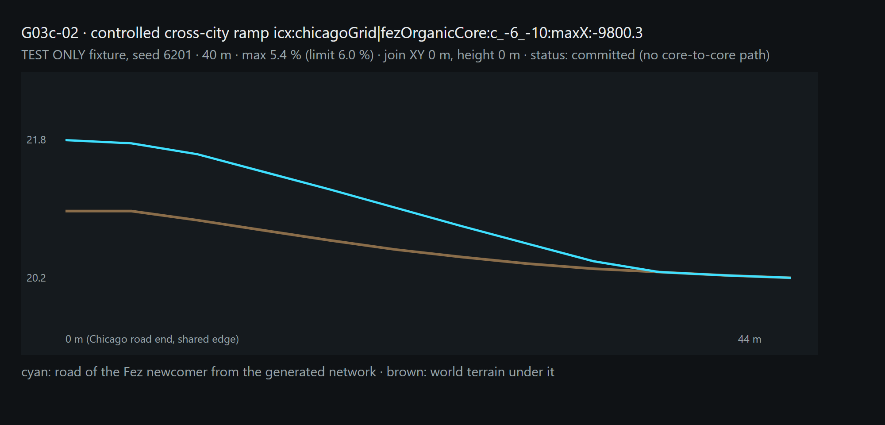
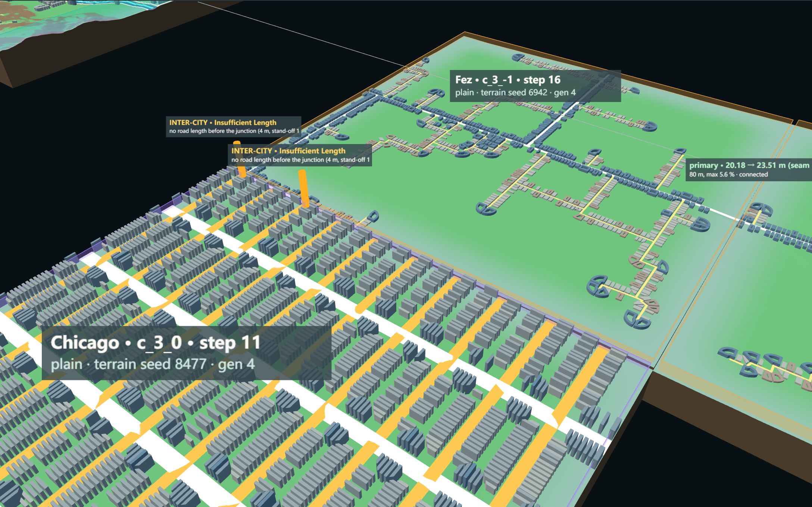

# G03c-02 — Inter-City Road Connection

Part of [A City of Cities — Research Compass](../A-City-of-Cities-Research-Compass.md), roadmap stage **G03**. Log entry: **G03c-02** in [FINAL-EXPERIMENT-LOG.md](../FINAL-EXPERIMENT-LOG.md).

**Status:**
- **Implemented:** inter-city connection inside the growth commit (opt-in `interCity`).
- **Verified:** Node and browser.
- **Result:** **no inter-city connection exists in real growth**, and the controlled fixture has no Connected case either.
- **Accepted:** no. **Pending review.**
- **Blocker:** upstream, in the ramp planner (§6).

| Navigation | |
| --- | --- |
| Code | [InterCityConnectionPlanner.js](../../../experiments/city-of-cities/InterCityConnectionPlanner.js); changes in `MorphologicalGrowth.js` (cross-city entries in the ramp plan and joins), `RoadGrowthFrontAdapter.js`, `WorldGrowthController.js` (records after commit), `RoadRampPlanner.js` (snap tolerance), `EmergentEncounter.js`, `WorldContext.js`, `RampView.js`, `main.js` |
| Verifier | [verify-inter-city-connection.mjs](../../../scripts/verify-inter-city-connection.mjs) · evidence `experiments/city-of-cities/evidence/inter-city-connection.json` |
| Runtime entry | Local only: `/experiments/city-of-cities/?growthMode=road&grade=baseline&emergent=1&intercity=1` |

## 1. Research question

Can two cities that meet by growth be joined by a road that is continuous in XY and height, is a real join in the graph, and gives a path from core to core? The two cities must keep their own City IDs and fabric.

## 2. Gate

| Prerequisite | State |
| --- | --- |
| G02c-02 | Pass: ramps in 3D, graph joins, seams told apart, save / load |
| G03c-01 | Pass: encounters from real growth, adjacent ≠ proposed ≠ connected, path reads neighbour joins, one traceable adaptation proposal (seed 6202) |

## 3. Implementation

Nothing committed is touched. A connection can only be built in the **newcomer chunk before its commit**, as part of its own Plan → Generate → Validate → Commit.

1. **Interfaces.** Every road end of another city's committed chunk on the edge the newcomer will share is read from both sides:
   - the other city's class, direction and elevation;
   - the newcomer's real ground at that point.

   An interface is refused when:
   - the seam is above the 6 m earthwork limit;
   - or the crossing is more than 30° from perpendicular (G03b).

   Scores (class 0.4 / 0.2, height 0.3, angle 0.3) are uncalibrated.
2. **Negotiation by DNA** (the G03b rule):
   - An **organic** newcomer takes at most two accepted interfaces, 200 m apart, as entry gates of its lanes.
   - A **grid** newcomer keeps its inherited lines. Only its own road end at the same point can meet; a mismatch stays a plan, because no connector hook exists.
3. **Ramp plan (G02c-02).** The newcomer's road is graded from the other city's elevation.
   - **Snap:** a gate placed on the 4 m terrain grid lands up to 2 m from its target, so the uncommitted road end may move onto the target (snap tolerance 2 m, half a terrain sample; every move is recorded as `xySnapM`). The joined ends must then meet within 0.05 m in XY and height.
   - **Validation:** a join that does not meet is refused.
4. **After commit:**
   - one record per join: `icx:<cityA>|<cityB>:<chunk>:<side>:<position>`, with the full field list of the task and validation results;
   - duplicates are refused;
   - **Connected** is set only when a core-to-core path exists in the graph.
5. **No new City ID, no merged territory.** The road built belongs to the newcomer's chunk; the record names both cities.

## 4. Test A: controlled (TEST ONLY, cores placed by hand, not an emergent result)

Under the scheduler's rule (a grown chunk must join a parent road):

| Scenario | Result |
| --- | --- |
| 1 Compatible interface | Chicago's step east is **refused**: its grid meets a junction 3 m inside the edge, so seams of 0.3–1.0 m have no room for a ramp. Fez then grows next to nothing of Chicago: no encounter |
| 2 Incompatible geometry | Fez grows; Chicago's step is refused as in 1 |
| 3 Terrain barrier | Both entries into the river valley are refused (no usable front): separation |
| 4 Ramp connection (new test-only row: Fez reaches the Chicago core) | Fez's second step is refused: its own parent ramp needs more than its 16 m before a junction |
| 5 Invalid ramp | Scenario 1, construction check below: one accepted interface fails with insufficient length (4 m to the junction) |

**Construction check** (scenario 1 with the scheduler rule off; it shows the mechanism, not a valid world):

- **Built:** `icx:chicagoGrid|fezOrganicCore:c_-6_-10:maxX:-9800.3`.
  - **Road:** primary on both sides.
  - **Ramp:** 40 m, from 21.8 m down to 20.2 m (seam −0.85 m), maximum 5.4 % (limit 6.0 %), fill 0.85 m, 52 points of real geometry.
  - **Join:** XY 0 m, height 0 m, after a 0.3 m snap of the Fez gate.
- **Graph:**
  - the join reaches the Fez core;
  - Chicago's core does **not** reach Fez, because Chicago's own growth chunk joined no parent road.
  - Status: **committed, not Connected**, which is exactly the case where a join count above zero must not count as a connection.
- **Save / load:** 4 chunks and 2 join events reproduced.

## 5. Test B: real encounters (6 % ramp plan, encounter detection, inter-city on)

| Seed | Newcomer at another city | Interfaces | Cross-city ramp outcomes | Connections |
| --- | --- | --- | --- | --- |
| 6202, step 16 | Fez c_3_-1 at Chicago c_3_0 | 10 Chicago ends; 2 accepted as gates (seams 0.97 / 1.26 m); 7 not selected; 1 seam 7.1 m | 2 × insufficient length: Fez lanes reach a junction 4 m inside the edge (gates snapped 1.6 m) | 0 |
| 6209, step 12 | Chicago c_-1_-1 (grid) at Fez c_-1_0 | 1 Fez end accepted | Network conflict: nearest Chicago road 37.8 m along the edge; no connector hook | 0 |
| 6209, step 15 | Fez c_0_-1 at Chicago c_0_-2 and c_-1_-1 | 15 ends; 2 refused for seams 7.9 / 8.4 m; 4 accepted | 4 × insufficient length (4 m to a junction; one needs 92 m) | 0 |
| 6215, step 14 | Chicago c_2_-1 (grid) at Fez c_1_-1 | 1 Fez end; seam 49.6 m | Refused before planning | 0 |

Result:
- **No inter-city connection** exists in the three worlds.
- The encounters stay unresolved, adaptation proposed or separated, as G03c-01 reported.
- **Growth is affected only on seed 6209:** with inter-city on, the Fez newcomer of step 15 takes Chicago gates, its network changes, and the later sequence differs. On 6202 and 6215 the chunk sequence equals the run without inter-city connection.

## 6. Why nothing connects: the blocker

Every failure has the same cause as G02c-02's 34 insufficient-length cases: **a ramp must end before the first junction.**
- Organic gates join their lanes about 4 m inside the edge.
- Grids reach a cross street within 3–100 m.

Even seams below 1 m cannot be graded there. Raising the grade does not help (the approach is negative after the 12 m stand-off). A grid newcomer also has no connector hook.

**Minimal upstream fix (proposed, not done):** G02c-03, ramps through the first junction in the uncommitted chunk.
- The junction takes an intermediate height.
- Each other road at that junction gets its own sampled ramp back to the terrain.
- Each must pass the same checks, or the whole plan is refused.

## 7. Verification

| Check | Result |
| --- | --- |
| Determinism | Seed 6202, 16 steps, inter-city on: identical with the registry order reversed |
| Save / load | Saved at step 10, continued to 16: history, encounters and connection records equal the uninterrupted run; mode restored |
| Proposal ≠ connection | No encounter reports Connected without a record; no proposal enters the graph |
| Regressions | G02c-02 replay statuses with the new snap tolerance: unchanged (51 / 34 / 12). G03c-01 encounters of seed 6202: unchanged |
| Browser | Cross-city outcomes equal Node; 0 errors |

## 8. Known limits

1. **No real connection, no Connected case.**
2. **Snap tolerance is now 2 m.** This moves only an uncommitted road end, and only along the edge.
3. **Grid newcomers cannot connect** unless a road end coincides (no connector hook).
4. **Interface weights and limits are assumptions.**
5. **Seed 6209 diverges** with inter-city on (above): enabling the rule changes growth.

## 9. For G03c-03

**Interface type A (connected urban interface) does not exist yet.** Every inter-city morphology work stays a classification and a proposal until G02c-03 (ramps through a junction) exists.
