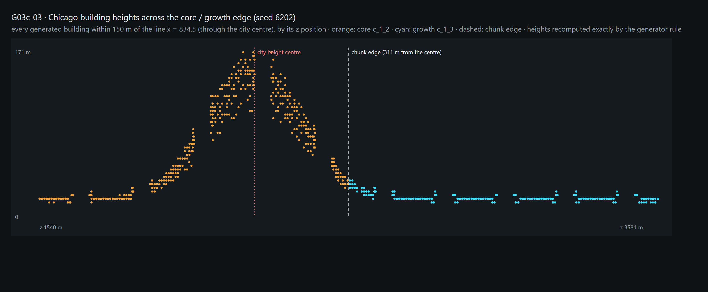
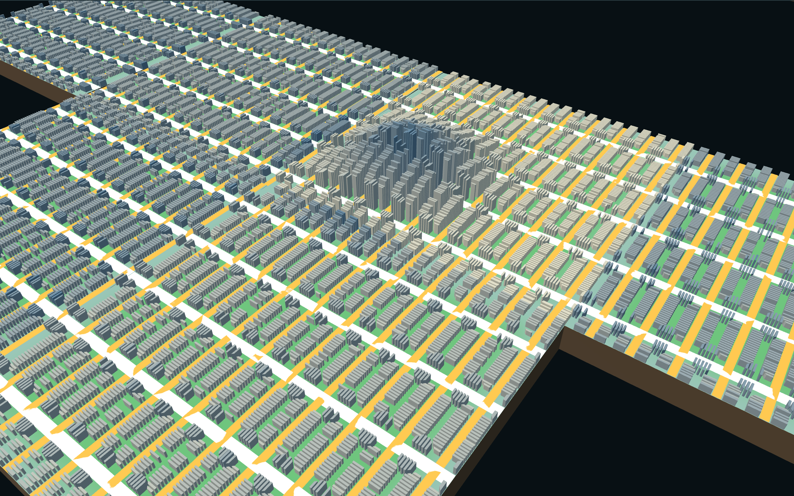

# G03c-03 — Urban Interface

Part of [A City of Cities — Research Compass](../A-City-of-Cities-Research-Compass.md), roadmap stage **G03**. Log entry: **G03c-03** in [FINAL-EXPERIMENT-LOG.md](../FINAL-EXPERIMENT-LOG.md).

**Status:**
- **Phase A** (same-city morphology): diagnosis, lineage and continuity measurement implemented and verified. **No building height was changed**, because no chunk reset exists (§2).
- **Inter-city part:** classification only. Nothing was generated, because no verified inter-city connection exists ([G03c-02](./G03c-02-Inter-City-Road-Connection.md)).
- **Accepted:** no. **Pending review.**

| Navigation | |
| --- | --- |
| Code | [UrbanMorphologyField.js](../../../experiments/city-of-cities/UrbanMorphologyField.js) (analysis only) |
| Verifier | [verify-urban-interface.mjs](../../../scripts/verify-urban-interface.mjs) · evidence `experiments/city-of-cities/evidence/urban-interface.json` |

## 1. Research question

Does the city keep one morphology across its chunks? Is the reported Chicago drop from 171 m to 38 m a generator reset or a real gradient?

## 2. Diagnosis of the Chicago drop

The case was regenerated from the saved G02c-01 state (seed 6202). The maxima are reproduced: core c_1_2 171 m, growth c_1_3 38 m.

**Rule** (`BuildingGenerator`, Chicago in `buildingRules.js`):
- floors = 2 + 43 × mix, where mix = (0.9 centre + 0.08 road + 0.02 area) × jitter;
- centre = exp(−d² / 220²).
- The rule's own comment: towers concentrated in one tight core; the core is the seeded centre, not a transit node.
- Since G02b every growth chunk inherits the core's height centre, so no chunk draws its own.

**Measured at the same distance from the centre** (100 m rings, buildings on both sides of the core / growth edge):

| Ring | Core mean | Growth mean | Difference |
| --- | --- | --- | --- |
| 300–400 m | 32.5 m | 28.0 m | −4.5 m |
| 400–500 m | 21.5 m | 22.3 m | +0.8 m |
| 500–1000 m | 19.1–19.7 m | 19.3–20.0 m | below 0.8 m |

**Finding:** the field is continuous across the chunk edge.
- **Not a generator reset.** At the same distance, the two sides differ by about one floor or less. The 300–400 m ring has the core's buildings nearer the centre, which accounts for its larger difference.
- **171 against 38 compares two maxima:** the peak is in the core. The edge is 311 m from the centre, where the rule already gives about 25 m.
- **The real morphological issue is the rule:** a single narrow centre. Beyond about 450 m all of Chicago is a uniform 19–23 m plateau, set by road class and parcel area. That is the "single radial function" the task warns against.
- **No building was changed.** Raising or lowering heights would only smooth the image without a cause.

## 3. Morphology lineage (`UrbanMorphologyField`)

Every building height is decomposed into the rule's terms and recomputed with the generator's own random stream (occupancy draw, then jitter draw, keyed by the parcel's stable key).

**The recomputation must equal the generated height exactly**, so the lineage is the rule itself:

| World | Buildings | Reproduced |
| --- | --- | --- |
| Chicago, seed 6202, G02c-01 state | 12,195 | 12,195 |
| Fez, same state | 2,561 | 2,561 |
| Chicago, seed 6202, 6 % ramp run | 12,000 | 12,000 |
| Manhattan, same run | 9,938 | 9,938 |
| Manhattan, seed 6201, G02b chain | 5,061 | 5,061 |

Each building record answers "why this height":
- objectId, cityId, chunk, parent chunk, generation step;
- frontage road;
- centre and the chunk it came from;
- DNA parameters;
- the factors (distance, centre, road, area, jitter, mix) and each term's contribution;
- the applied constraint and a sentence.

**Example:** a Chicago growth building 1,337 m from the centre has 4 floors (15.2 m) — centre 0, secondary road 0.04, area 0.01.

## 4. Continuity across same-city edges

20 same-city edges were measured (Chicago, Fez, Manhattan; three worlds):

| Reading | Count |
| --- | --- |
| Continuous field (same-distance difference up to 1.5 floors) | 18 |
| Flagged | 1: Chicago c_1_2 / c_1_3 in the 6 % run, 7.5 m |
| No common distance | 1: Fez, one edge |

**The flagged edge is explained, and it is not a reset.**
- On the same edge without ramps the difference is 4.5 m.
- In the 6 % run, the ramp corridors of G02c-02 vacated 92 buildings on the growth side of that edge: within 100 m of the edge, 131 remain instead of 223.
- The vacated ones are the nearest to the centre, so the tallest.
- **The corridor removes height, not the rule.**

**Fabric across the edges:**
- Grid cities: orientation, road density, median block, frontage and coverage equal across every edge (shared grid anchor).
- Fez: median block varies by large factors (G02c-01 §6). The cause is road topology (one or two joins per edge, few lanes), not a morphology parameter. It is reported as a road problem.

**Stability:**
- The core's lineage before growth equals the one after 12 steps.
- The lineage after save / load is identical.

## 5. Inter-city interface classification (real encounters only)

The 11 encounters of the G03c-01 and G03c-02 records:

| Class | Count | Examples |
| --- | --- | --- |
| A Connected urban interface | **0** | — |
| B Adjacent but disconnected | 3 | 6202 Chicago × Fez; 6209 Chicago × Fez |
| C Geographic separation | 1 | 6215 Chicago × Fez (seam 49.6 m) |
| D Unresolved | 7 | approaching pairs, 4 with a constrained cell between |

- No negotiation zone was generated and no public space was placed. A Road Junction Public Node needs a verified inter-city connection, and none exists.
- The G03b fixture was not used.

## 6. Known limits

1. **Single-centre gradient.** This is the real morphological gap: one narrow centre and a plateau beyond 450 m, with no road or node intensity. Changing it is a City DNA design decision, not a continuity fix.
2. **Ramp corridors remove buildings at edges** (§4), which lowers heights there.
3. **No viewer layers were added** for the height field. The evidence is the lineage record and two sheets.
4. **Inter-city morphology** waits for a verified connection.
5. **Inspector:** source files of the site's summaries changed in G02c / G03c, and `verify-inspector-docs.mjs` reports needs-review items. The site on `main` is unchanged.

## 7. Next

- G02c-03, ramps through the first junction (unblocks G03c-02 and therefore type A).
- A decision on Chicago's morphology rule: a road-node intensity term, if the research rows support it.
