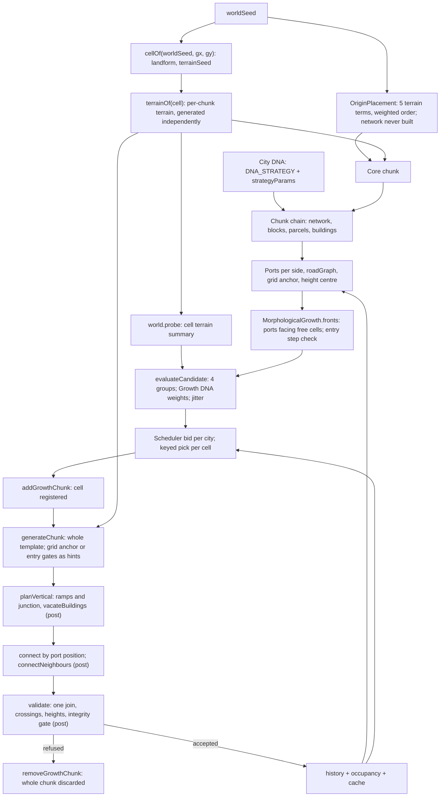
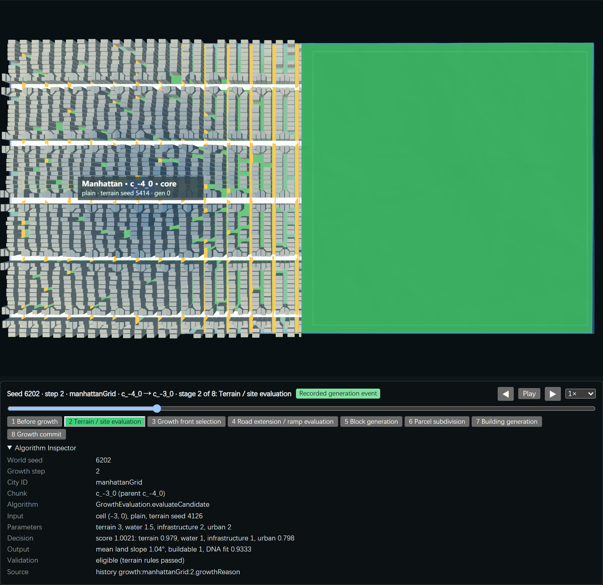
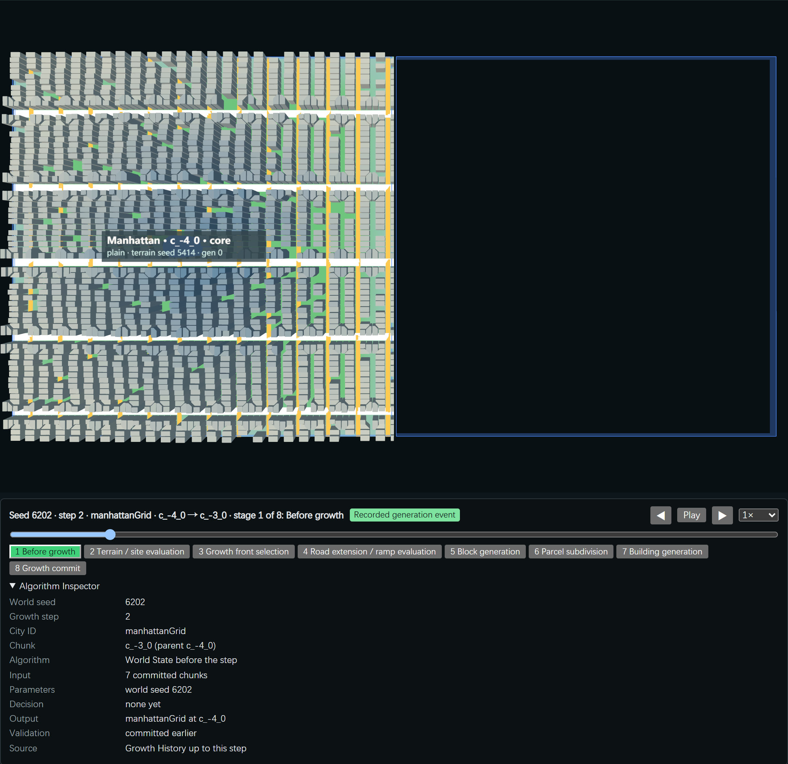
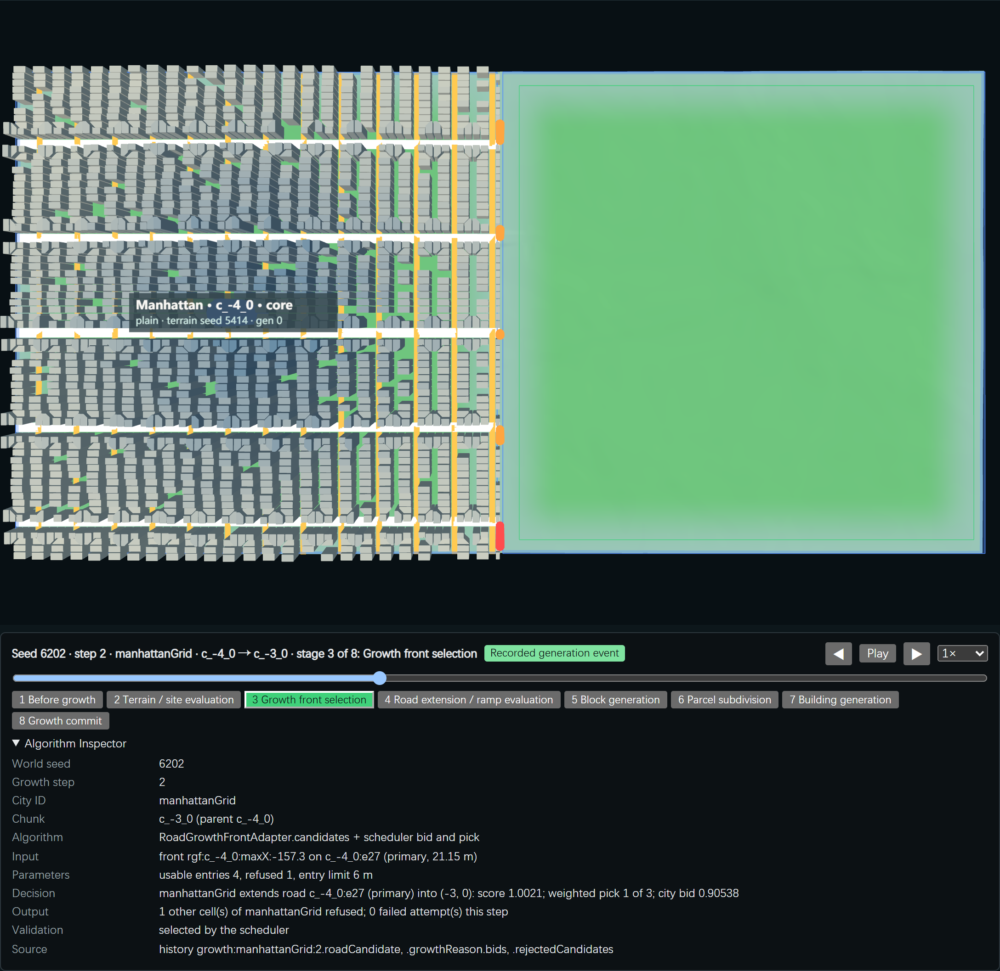
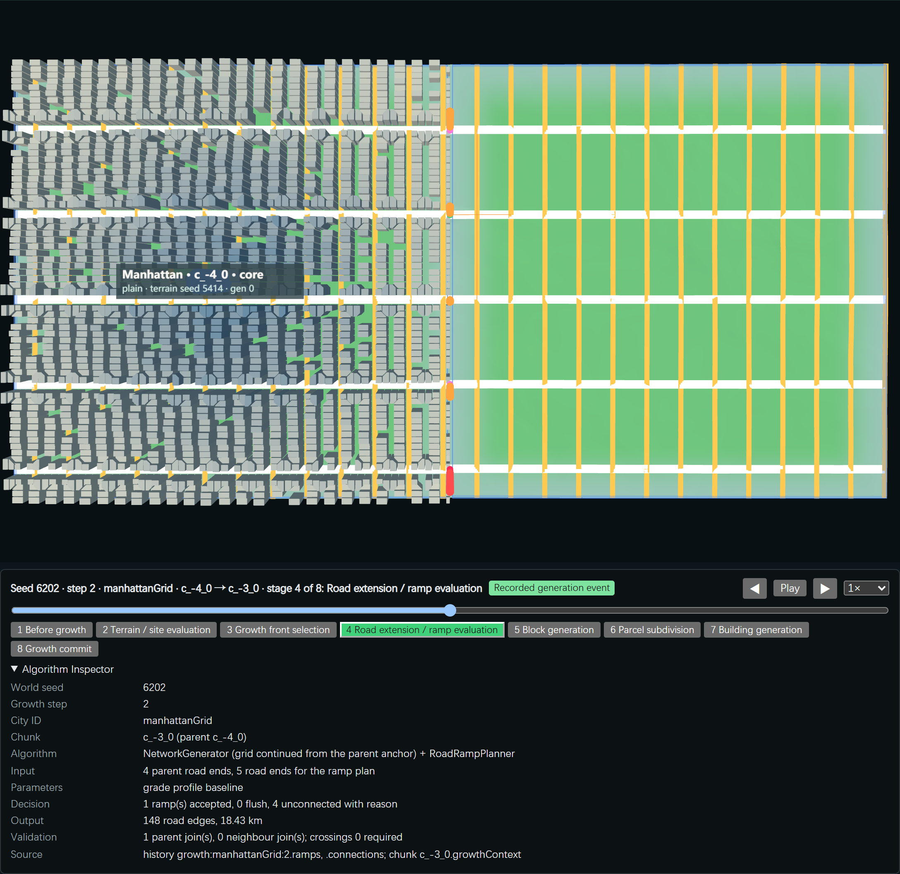
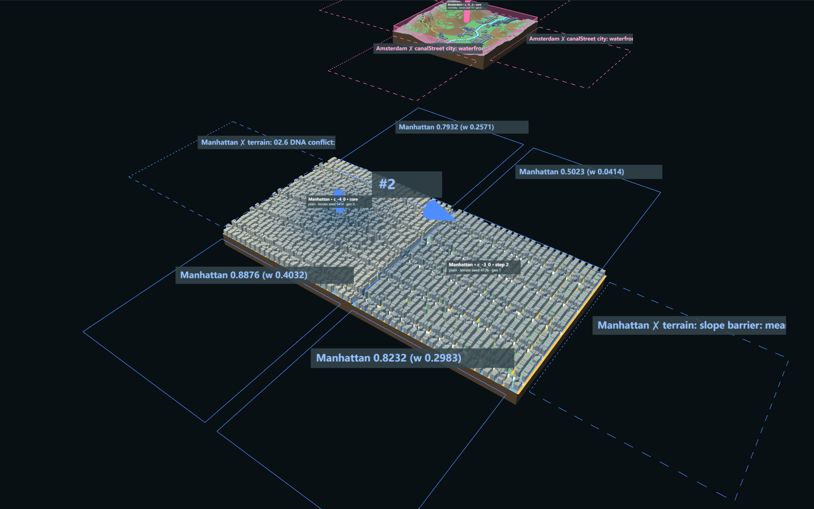
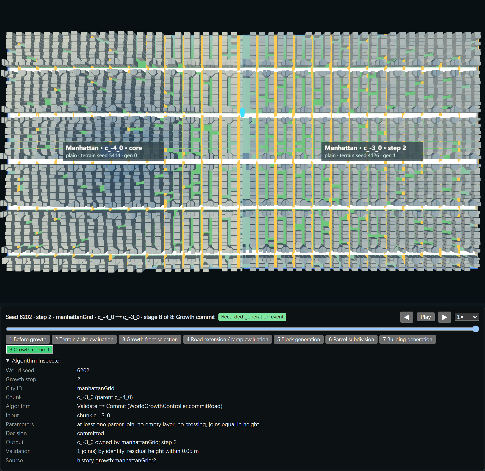
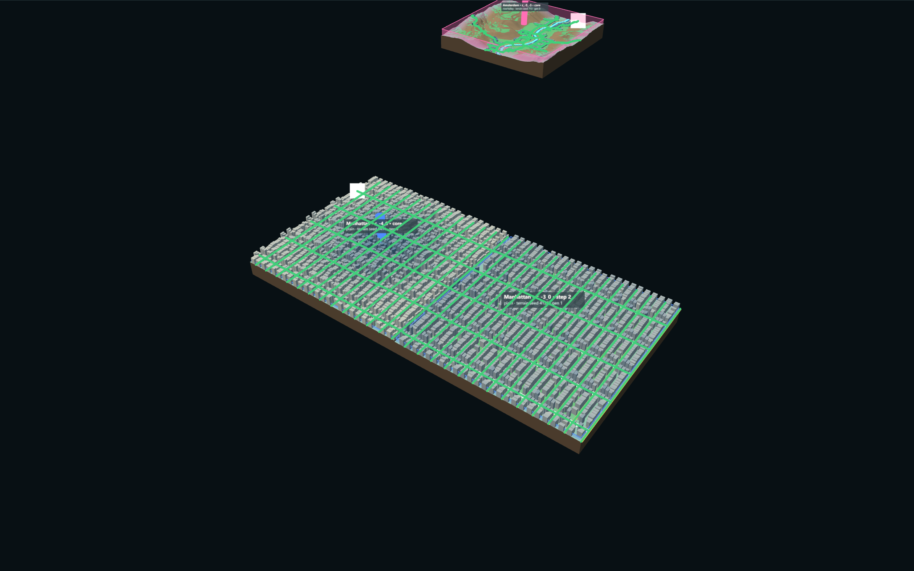

# P00a Generative Causality Audit

- **Series:** P-Series, Procedural Emergence Research. Task P00a, 2026-11-04.
- **Branch:** `experiment/procedural-growing-world`.
- **Research question:** Who decides where a city grows, and why?
- **Scope:** audit only. No generator, rule or random draw was changed. G02c / G03c feature work is frozen.
- **Status:** the audit is Implemented and Verified (records and captures below). The P00b proposal is **Proposed**. Nothing here is Human Accepted.

## 1. Answer in Short

| Decision | Made by | Evidence |
|---|---|---|
| **Which city** grows | The scheduler bid: `rate × best cell score / (1 + chunks grown) × seeded ±10 %` | §3, step 4 |
| **Where** it grows | The best whole 1024 m cell next to the city, scored from that cell's terrain probe and the parent's port counts. The decision unit is the **chunk cell**, not a road. | §3, steps 4–5 |
| **What** grows there | A **complete generator template** of the city's DNA strategy, laid over the whole cell at once. The growing road only supplies hints: the grid anchor for grid cities, gate cells for organic cities. | §3, steps 6–8 |
| **Whether it stays** | Post-generation checks: joins by position, ramp plan, crossings, integrity gate. A refusal discards the whole generated chunk. | §3, step 9; §5 |

Decision power lies mostly with the **chunk generator and its DNA template**. The environment acts in two ways: cell scores before generation, and repairs or refusals after. The growing road network does not decide the geometry of the next piece of city.

## 2. Real Generation Dependency Graph (current code)

## 3. One Real Growth Event, Traced

**Event:** `growth:manhattanGrid:2`. Seed 6202, step 2, Manhattan `c_-4_0` → `c_-3_0`. Road mode, grade baseline, ramps through one junction, gate off.

**Record:** `experiments/city-of-cities/evidence/growth-causality-audit.json`, written by `scripts/audit-growth-causality.mjs`. The same event comes out of free growth and out of the replay, so it is reproducible.

| # | Stage | Source (function) | Input | Output | Decided by |
|---|---|---|---|---|---|
| 1 | World seed → environment | `WorldContext.cell` → `cellOf`; `terrainOf(cell)` (`growing-world/WorldGrowthController.js`) | worldSeed, (gx, gy) | Landform `plain`, terrainSeed 4126; the chunk terrain is generated **on its own** | Seeded landform field + per-cell terrain seed |
| 2 | City origin | `OriginPlacement.js` | 5 terrain terms (slope, buildable, water, terrain type, DNA fit) | Manhattan core at `c_-4_0` | Weighted score; **the network is never built at placement** (see the Amsterdam 6203 empty core) |
| 3 | City DNA | `DNA_STRATEGY` / `strategyParams` (`seed-terrain/networkStrategies.js`); `GROWTH_DNA` (`growthDNA.js`) | cityId | Strategy `grid`, spacing 200 / 80 m, max slope 10°; Growth DNA `roadAxis`, rate 1.0, `stopAtSlope` | DNA chooses a **generator template** and **score weights**, not a growth behaviour |
| 4 | Scheduler picks the city | `WorldGrowthController.step` | Best cell score per city, chunks grown | Bids: Manhattan 0.905, Chicago 0.546, Fez 0.531, Lisbon 0.235; Venice and Amsterdam none | Bid formula; a city that grew more bids less |
| 5 | Growth front | `MorphologicalGrowth.fronts` | Parent ports on side `maxX`, target terrain | Front `rgf:c_-4_0:maxX:-157.3`: 5 road ends, 4 usable (entry step ≤ 6 m), 1 refused | Ports of the parent chunk and the target ground height at each port |
| 6 | Candidate road direction | **None computed.** For a grid DNA, the child continues the parent's grid anchor (axis 0°, phases); for organic, entry ports become gate cells (`organicStrategy`) | Grid anchor from `c_-4_0` | — | Inherited grid template |
| 7 | Terrain, water and slope | Before generation: `evaluateCandidate`, the entry check. During: `landTest` cuts grid lines. After: `planVertical` (ramps), `vacateBuildings`, `validate` | Cell probe: slope 1.04°, water 0, buildable 1 | Score 1.0021 (terrain 0.979, water 1, infrastructure 1, urban 0.798) | Cell summary before; road geometry is **not** planned on terrain before generation |
| 8 | Chunk created | `buildFront` → `addGrowthChunk` **before** any road exists | Target cell, growthContext (4 entry ports, grid anchor, height centre from the core) | Cell `c_-3_0` registered | The scheduler chose a cell; the chunk is the unit of generation |
| 9 | New roads joined to old | `generateChunk` → `planVertical` → `connect` (by position, ≤ 0.5 m) | Generated network: **148 edges, all `grid-line`, 0 cut**, the same count as the core | 1 parent join; 4 child ports on the shared edge unmatched; ramps: 1 accepted, 2 `junctionConstraint`, 1 collision, 1 terrain | Position matching after generation; ramps repair heights after generation |
| 10 | Blocks, parcels, buildings | `growthUrban`: `generateBlocks` / `generateParcels` / `generateBuildings` | Network, chunk terrain, the core's height centre | 78 blocks, 1,820 parcels, 1,660 buildings; 9 vacated by the ramp corridor | Template generators; heights follow one city-wide centre (G03c-03) |
| 11 | Feedback to the next step | `commitRoad` → history, occupancy | — | Road edges 667 → 815; the new chunk has 36 road ports; those facing free cells become fronts; Manhattan grown count 1 (its bid divisor rises) | Ports and counts only |

**Known before generation:**
- the cell terrain summary;
- the parent ports and their entry steps;
- the Growth DNA weights;
- the occupancy.

**Used only after generation:**
- road geometry inside the cell;
- whether roads join;
- ramp feasibility;
- crossings;
- network integrity;
- building impact.

**In the replay page:** the stage-4 road reveal is presentation (an order computed from the joins). The generator builds the whole network in one call.

## 4. Rule Classification

| Rule | Code | Class |
|---|---|---|
| Grid lines at fixed spacing, inherited axis and phase | `gridStrategy` (`NetworkGenerator.js`) | Generative Rule |
| Organic least-cost lanes from centres and gates; loop closure | `organicStrategy`, `closeLoops` | Generative Rule |
| Blocks / parcels / buildings from the network | `generateBlocks` / `generateParcels` / `generateBuildings` | Generative Rule |
| Height gradient from one city centre | `ctx.centre` (`buildFront`), `generateBuildings` | Generative Rule (city-wide) |
| Origin site score and weighted order | `OriginPlacement.js` | Generative Rule (site choice) |
| Cell score, four groups with Growth DNA weights | `evaluateCandidate` (`GrowthEvaluation.js`) | Generative Rule (where); Environmental Constraint (terms) |
| Land test cuts lines at water and slope | `landTest`, `sampleSegment` | Environmental Constraint (during generation) |
| Terrain incompatible, DNA conflict, slope barrier, min buildable | `evaluateCandidate` | Environmental Constraint (before generation) |
| Entry step ≤ limit at each port | `MorphologicalGrowth.fronts` | Environmental Constraint (before generation) |
| Occupancy: one city per cell | `addGrowthChunk`, `candidates` | Structural Invariant |
| Bid divided by chunks grown; compactness term; ports toward the cell | `step`, `evaluateCandidate` | Feedback Mechanism |
| New ports become fronts | `fronts` reads committed ports | Feedback Mechanism |
| Failure cache by signature | `roadStep`, `candidateSignature` | Feedback Mechanism (efficiency; does not change results) |
| Join by position ≤ 0.5 m; neighbour joins | `connect`, `connectNeighbours` | Post-Generation Repair (connection) |
| Ramp plan and junction plan; vacate buildings in the corridor | `planVertical`, `planJunction`, `vacateBuildings` | Post-Generation Repair (vertical) |
| Remove pieces under 150 m | `pruneShortComponents` | Post-Generation Repair (generator) |
| Refuse: no join, crossings, height step, integrity gate | `validate`, `integrityOfCandidate` | Post-generation validation (refusal; the chunk is discarded) |
| Unique ids, signatures, save / load re-check | `WorldContext.restore` | Structural Invariant |
| Per-DNA generator overrides (Chicago spacing 200 / 100 m, Amsterdam slope 10°, Lisbon centres) | `DNA_NETWORK_OVERRIDES` | Case-Specific Override (per city DNA, **not** per seed) |
| Replay forcing, `replayKeepsUnconnected`, junction and encounter fixtures | `forcedParents`, `junctionFixture.js`, `encounterFixture.js` | Case-Specific Override (test only; off on the default path) |
| Canal cities refused as "waterfront growth mode not implemented" | `RoadGrowthFrontAdapter.candidates` | Case-Specific Override (per strategy) |
| Stage reveal order, overlays, labels, debug layers | `GrowthReplay.js`, `ConnectionOverlay.js`, `NetworkIntegrityView.js` | Presentation Logic |

**No seed-specific rule was found** in the generation path. Seed numbers appear only as UI defaults and in a comment. Not every repair is wrong: joins by identity and the structural invariants are correctness conditions.

## 5. Architectural Coupling

| Question | Answer | Code evidence | Risk |
|---|---|---|---|
| Does road growth come before chunk creation? | **No.** The cell is chosen and registered (`addGrowthChunk`) before any road is planned; roads come with the whole chunk | `buildFront` | High: roads follow the chunk |
| Does a new chunk reset road form? | **Mostly yes.** It is a fresh template: grid cities keep only axis and phase; organic cities rebuild from the new cell's own terrain centroid. The traced event got a full 148-edge grid, as the core had | `gridStrategy`, `organicStrategy` | High |
| Do chunk edges decide where roads connect? | **Yes.** Joins exist only at boundary ports, matched by position; inside the cell nothing extends the parent road | `connect`, `portsBySide` | High |
| Is the RoadGraph continuous at city level? | **No** stored city graph. It is assembled on demand from chunk graphs plus join records; pieces can be committed (fixed only by the opt-in G02c-R1 gate) | `cityRoadReach`, `NetworkIntegrity.cityGraph` | Medium |
| Does City DNA decide behaviour or a template? | **A template and weights.** `DNA_STRATEGY` picks the generator; Growth DNA only weights cell scores | `networkStrategies.js`, `growthDNA.js` | High |
| Are building heights inherited from existing structure? | **Only from the core's centre** (one gradient); not from neighbours or the road hierarchy | `ctx.centre`; G03c-03 | Medium |
| Are there special rules for a seed? | **No** (§4) | — | Low |
| Do terrain and slope enter before path generation? | **As cell summaries and port entry steps only.** Road geometry meets terrain inside the generator (cuts), then in repairs (ramps) or refusals. Terrain itself is generated per chunk, so shared edges have seams that ramps must bridge | `terrainOf`, `landTest`, `planVertical` | High |

## 6. Causal Visualization (real captures)

Seed 6202, step 2, Manhattan `c_-4_0` → `c_-3_0`, ramps through one junction. Captured by `scripts/capture-growth-causality.mjs`; record in `growth-causality-capture.json`; 0 browser errors.

1. **Environmental input** (replay stage 2, recorded): target cell terrain and the evaluation terms.
   
2. **Existing road network** (stage 1, recorded).
   
3. **Growth front** (stage 3, recorded): parent road ends on the shared edge, usable (orange) and refused (red); the Inspector shows front `rgf:c_-4_0:maxX:-157.3`, score 1.0021, bid 0.90538.
   
4. **Real candidate roads: Missing Evidence.** The code has no road candidates. A candidate is a cell; one network is generated per attempt, and a discarded attempt leaves only its reason, no geometry. The image shows the one network the generator built (stage 4; reveal order is presentation).
   
5. **Candidate evaluation** (step 2, recorded data):

   | Cell | Status | Score / reason |
   |---|---|---|
   | (-3, 0) | selected | 1.0021 |
   | (-4, 1) | eligible | 0.8491 |
   | (-4, -1) | eligible | 0.827 |
   | (-5, 0) | refused | DNA conflict `noContinuousLand` |

   The other cities' frontiers: Chicago 3 eligible; Fez 1; Lisbon 1; Venice and Amsterdam 0.
6. **Selected / rejected decision.** The capture shows the frontier **after** step 2, that is the candidates of step 3, with scores and weights. The step-2 frontier is the table above. Free growth, no replay forcing:
   
7. **Committed geometry** (stage 8, recorded).
   
8. **Resulting network state**: road network by city-level component after step 2 (G02c-R1 debug layer).
   

## 7. Three-Seed Diagnostic

Same code and parameters for every seed; 12 steps; gate off.

| Seed | Grown | Chunks generated | Discarded after generation | Time on discarded / committed | Cached refusals | Parent / neighbour joins | Ramp statuses |
|---|---|---|---|---|---|---|---|
| 6201 | Manhattan 8, Fez 4 | 15 | 3 | 7.8 s / 45.4 s | 0 | 51 / 13 | 63 accepted; 14 collision, 8 terrain, 3 grade |
| 6202 | Chicago 5, Manhattan 5, Fez 2 | 13 | 1 | 1.2 s / 52.4 s | 5 | 45 / 17 | 62 accepted; 15 junction, 13 terrain, 7 collision |
| 6203 | Chicago 6, Manhattan 6 | 18 | 6 | 25.2 s / 57.6 s | 8 | 76 / 0 | 73 accepted; 12 terrain, 8 network, 5 junction, 5 collision |

**Where refusals happen:**
- Every discarded generation failed for the same reason: "no parent road joined a child road". This is a connection failure, found only after the whole chunk was built.
- Before generation, the frequent refusal observations (counted per step) are:
  - canalStreet cities not implemented (96 per seed: Venice and Amsterdam, 4 cells × 12 steps each);
  - road ends farther than 6 m from the target ground;
  - DNA conflict `noContinuousLand`;
  - mountain terrain;
  - slope barrier;
  - occupied cells.

**By diagnostic dimension:**

| Dimension | Finding |
|---|---|
| Growth front source | Always the parent chunk's boundary ports |
| Road candidate | Implicit: the generator template of the target cell |
| Terrain constraint | Cell probe and entry step (before); cuts (during); ramps (after) |
| Connection result | Joins by port position |
| Chunk dependency | Each attempt builds a complete chunk |
| Feedback | Ports, bid divisor, compactness |

Venice, Amsterdam and Lisbon grew 0 chunks on all three seeds, and Fez grew 0 on 6203. Their refusals happen before generation: canal strategy not implemented, or road ends too far from the target ground (Lisbon 9–205 m, G02c-R).

## 8. Post-Generation Repairs and Manual Interventions

1. Join by boundary position (`connect`, `connectNeighbours`).
2. Ramp and junction planning with building vacating (`planVertical`, `planJunction`, `vacateBuildings`).
3. Short-piece pruning (`pruneShortComponents`), which also emptied the Amsterdam 6203 core.
4. Validation refusals that discard a whole chunk (`validate`, G02c-R1 integrity gate).
5. Ramp height overrides for nodes along ramps (G02c-03a).
6. Test-only forcing: replay parents, `replayKeepsUnconnected`, fixtures. These are off on the default path.

There is no seed-specific patch. Most of the repair code exists because the network inside a cell is generated without the parent's roads as fixed input, and because terrain is generated per chunk.

## 9. Three Highest-Leverage Architectural Changes

### 9.1 The chunk decides; it should only store

- **Current architecture:** the scheduler picks a 1024 m cell, then the chunk chain generates a full DNA template there. The parent road only gives an anchor or gates.
- **Why it limits emergence:** city form is the sum of templates. The growing network cannot bend, branch or stop inside a cell; it is joined at the edges afterwards. The traced event shows 148 template edges and 1 joined road.
- **Minimum change:** grow **road segments** from root-reached road ends (a city-level front) on world coordinates. Assign chunks only as storage for whatever has been built in their area. Blocks follow once the roads close loops.
- **Modules to reuse:** `MorphologicalGrowth.fronts` (front records), `NetworkGraph` (graph and finalize), `NetworkIntegrity.cityRoot` (root reach), the land test and the generator's least-cost search.
- **Validation:** root-reachable ratio 1 **by construction**, with 0 post-generation joins needed. Compare street spacing and orientation with the grid template on seed 6202.

### 9.2 Environment enters too late

- **Current architecture:**
  - before generation, terrain is a cell summary and a port entry step;
  - road geometry meets terrain only inside the template (cuts) or in repairs (ramps, refusals);
  - terrain is generated per chunk, so shared edges have seams.
- **Why it limits emergence:** roads cannot follow terrain as they grow. Refusals cost whole chunks (6203: 6 discarded, 25 s, a third of the generation time). Ramps and seam handling exist mainly to fix that.
- **Minimum change:** plan each road extension on a **continuous world height and water field**, with slope and water as path costs, **before** anything else is generated. Only an accepted extension leads to blocks.
- **Modules to reuse:** `searchPath` / `MinHeap` (least-cost search), `landTest`, `RoadRampPlanner` profiles (as grade limits in the cost, not as repair).
- **Validation:** on seeds 6201 / 6202 / 6203, 0 generations discarded for "no parent road joined"; maximum grade within the profile without a ramp pass. Count refusals before generation against after.

### 9.3 City DNA is a template; history barely feeds back

- **Current architecture:**
  - `DNA_STRATEGY` picks a generator;
  - Growth DNA weights four cell-score groups;
  - feedback is limited to the ports toward a cell, the bid divisor and the compactness count;
  - no city-level field (accessibility, density, frontage demand) is built up from history.
- **Why it limits emergence:** cities differ by template, not by behaviour, so the same rules cannot produce different forms in different places. Growth cannot respond to its own structure; for example, heights follow one centre.
- **Minimum change:** express DNA as **behaviour parameters of the extension rule** (segment length, branching angle and probability, block-closing distance, slope tolerance). Score extensions with one city-level field derived from the committed graph (network distance from the root).
- **Modules to reuse:** `GROWTH_DNA` fields as starting values, `cityRoadReach` (Dijkstra distances), `evaluateCandidate` terms where they still apply.
- **Validation:** two DNAs from the same rule on the same terrain give measurably different street statistics (intersection density, mean block size, orientation spread). Changing only the DNA values changes the form; changing only the seed varies it within the DNA.

## 10. Proposed P00b: Minimal Autonomous Growth Prototype (not implemented)

- **Question:** can one city grow a connected street network segment by segment on a continuous terrain field, with chunks used only as storage, and without post-generation joins or ramps?
- **Isolated folder:** `experiments/p00b-road-front/`. No change to `city-of-cities`.
- **Scope:**
  - one city;
  - one rule with at most 6 public parameters (segment length, branch probability, branch angle, slope cost, water cost, loop-closing distance);
  - roads only (blocks later);
  - deterministic by seed.
- **Reuse:**
  - the world landform and height sampling (one continuous field, not per-chunk terrain);
  - `MinHeap` / least-cost search;
  - `NetworkIntegrity` root reach for the check.
- **Pass criteria:**
  - root-reachable ratio 1 at every step;
  - 0 discarded generations;
  - grade within limit without a repair pass;
  - the same seed gives the same network.
- **Comparison:** against the seed 6202 Manhattan template (street length, intersection density, orientation).
- **Evidence:** a top view per 10 steps, and a slope / water cost overlay.

## 11. Status

| Item | Status |
|---|---|
| Dependency graph, traced event, rule classes, coupling answers | Implemented and Verified (code and records) |
| Three-seed diagnostic | Verified (`growth-causality-audit.json`) |
| Causal captures 1–8 | Verified (real captures); panel 4 is **Missing Evidence** by design of the code |
| Three changes and P00b | **Proposed**; not started |
| Human review | Pending |

## 12. Files Added

**Scripts** (read-only):
- `scripts/audit-growth-causality.mjs`
- `scripts/capture-growth-causality.mjs`

**Records:**
- `experiments/city-of-cities/evidence/growth-causality-audit.json`
- `experiments/city-of-cities/evidence/growth-causality-capture.json`

**Screenshots:** `p00a-1` to `p00a-8`.
