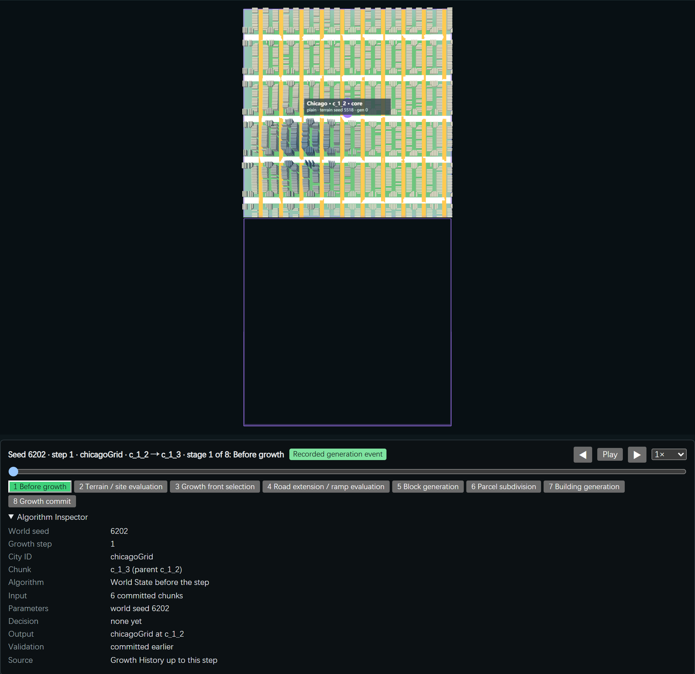
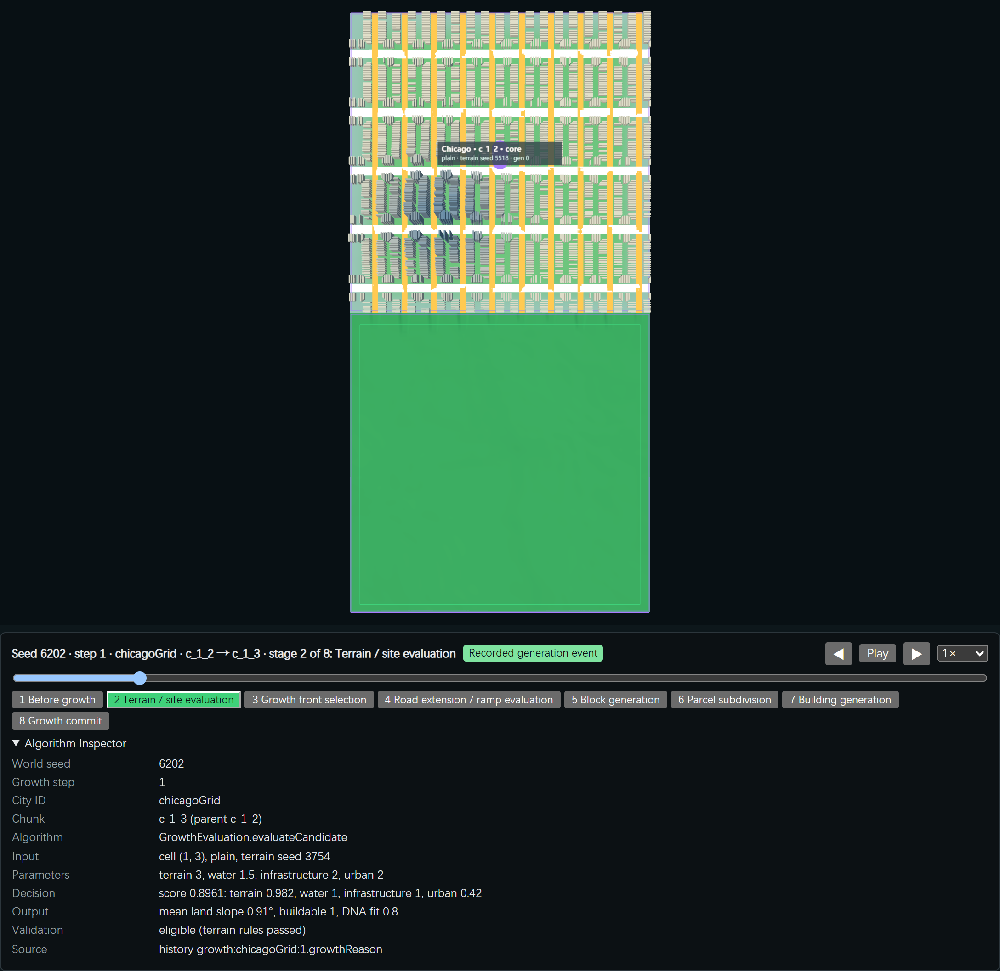
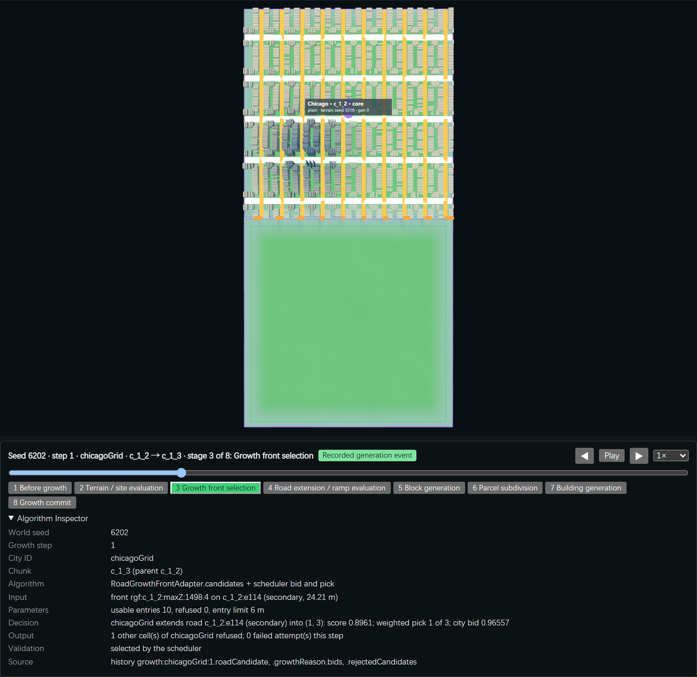
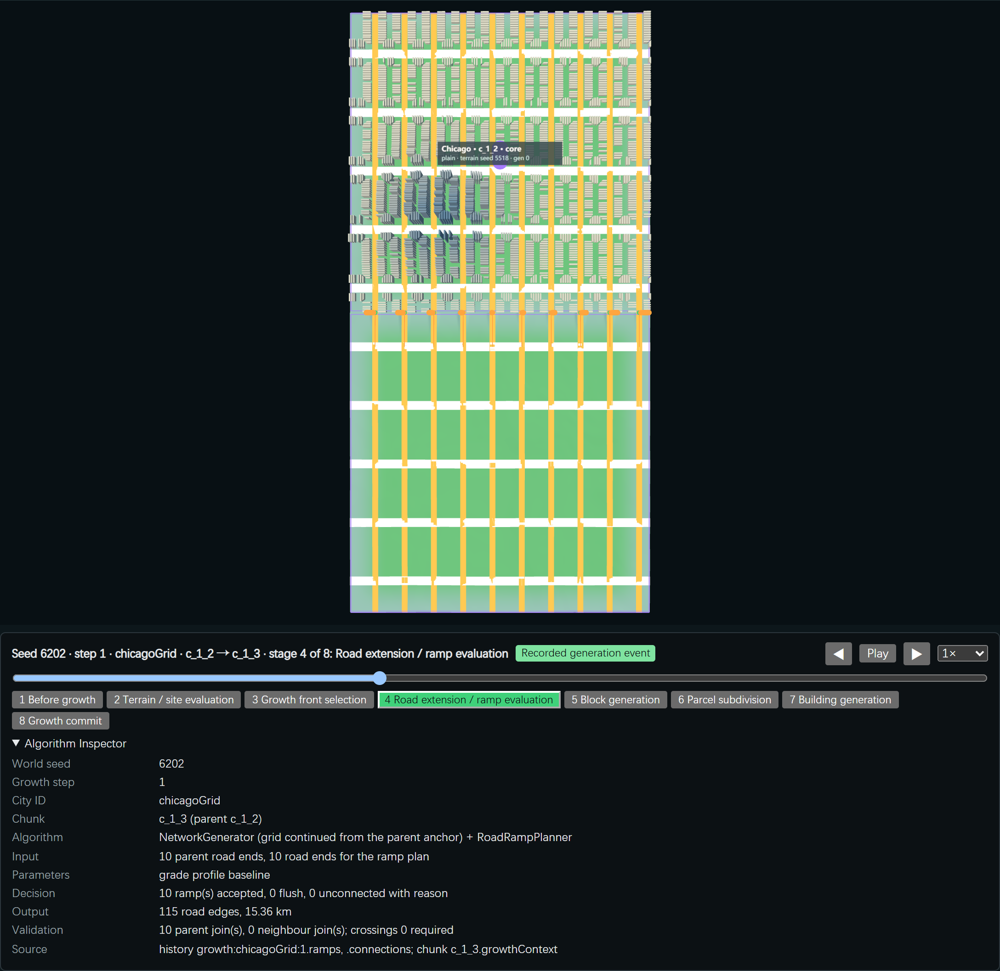
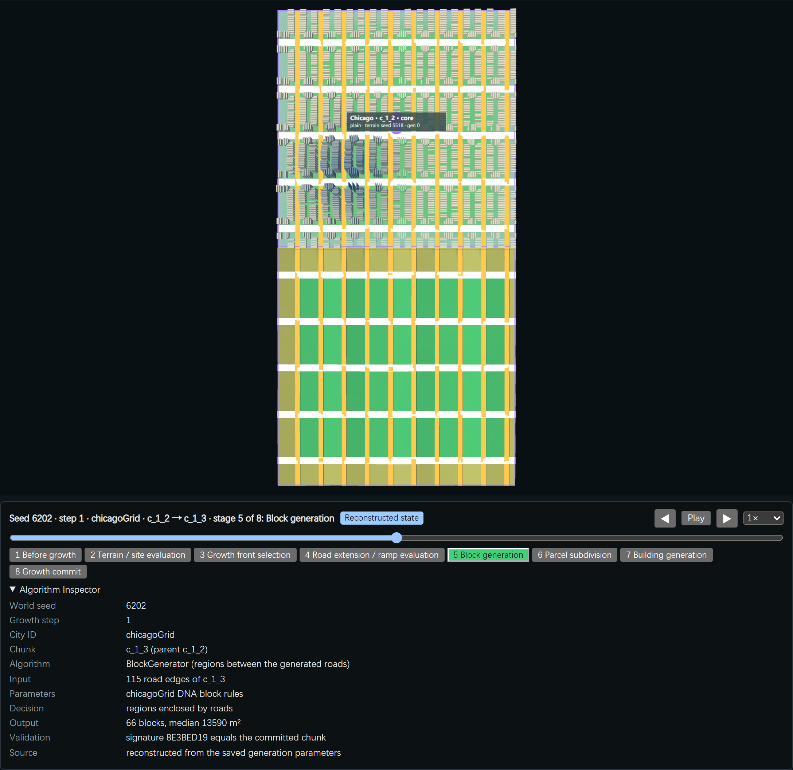
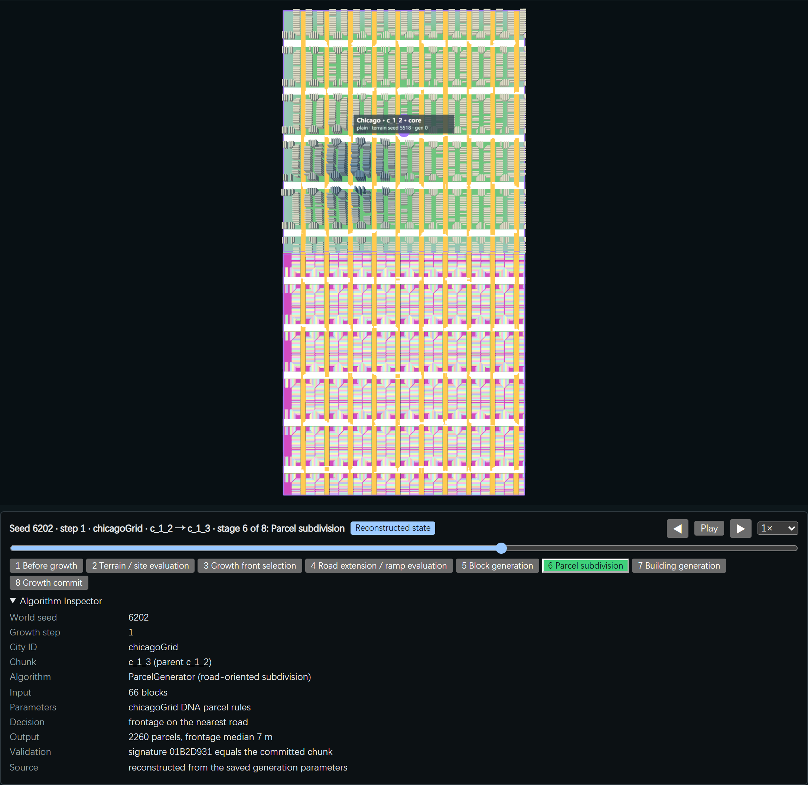
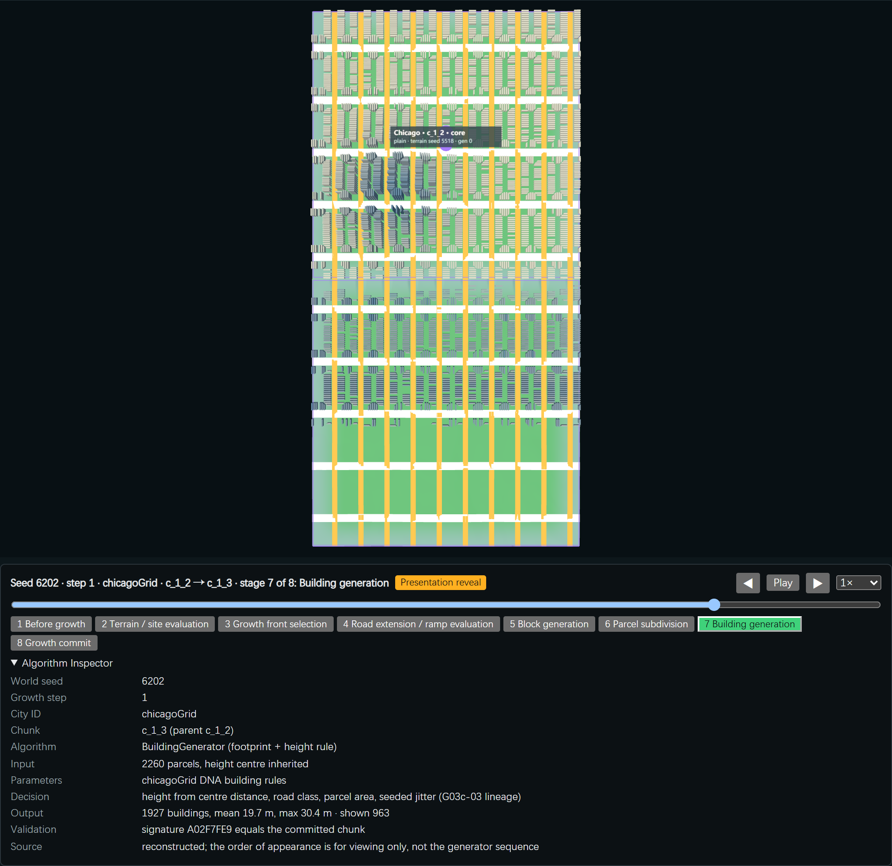
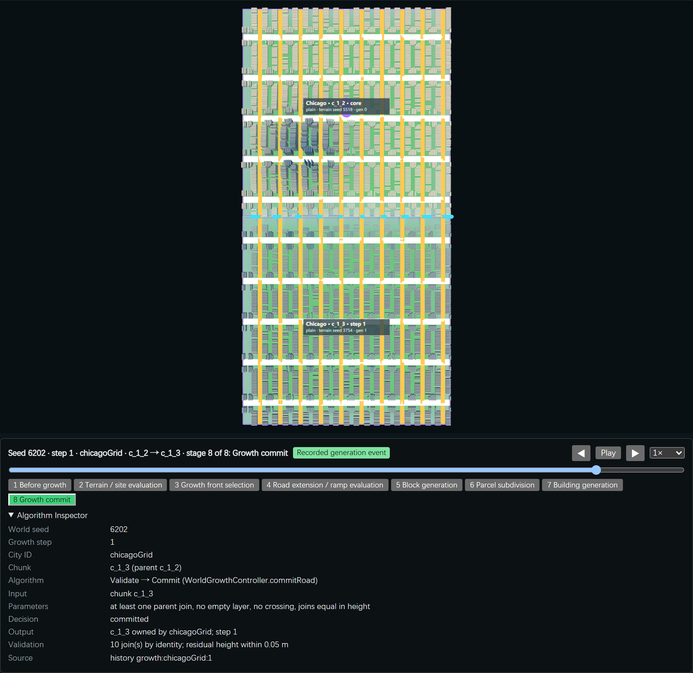

# VIS-01 — Procedural Growth Observatory

Part of [A City of Cities — Research Compass](../A-City-of-Cities-Research-Compass.md). Log entry: **VIS-01a** in [FINAL-EXPERIMENT-LOG.md](../FINAL-EXPERIMENT-LOG.md).

**Status:**
- **VIS-01a** (one real growth event, stage by stage) is implemented and verified in the browser (16 of 16 checks).
- **VIS-01b, VIS-01c and VIS-01d have not started**, as the task's stop condition requires.
- **Accepted:** no. **Pending review.**
- No generator was changed, and the WEB-01 site was not touched.

| Navigation | |
| --- | --- |
| Code | [GrowthReplay.js](../../../experiments/city-of-cities/GrowthReplay.js) (stages, Inspector content, road origin), [ReplayController.js](../../../experiments/city-of-cities/ReplayController.js) (timeline, visibility, overlays); `main.js` (`&replay=N`, click on a road) |
| Verifier | [verify-growth-observatory.mjs](../../../scripts/verify-growth-observatory.mjs) · evidence `experiments/city-of-cities/evidence/growth-observatory.json` |
| Runtime entry | Local only: `/experiments/city-of-cities/?worldSeed=6202&growthMode=road&grade=baseline&replay=1` |

## 1. Capability audit

| Stage | Data | Kind |
| --- | --- | --- |
| World initialisation, six origins | G01 placement records, core chunks | Recorded |
| Growth step (which city, where, why) | History event: candidate, score terms, bids, refused candidates, failed attempts | Recorded |
| Road extension, ramps, joins | Event ramps and connections, chunk growth context | Recorded |
| Blocks, parcels, buildings | Regenerated from the saved inputs; signatures equal the committed chunk | Reconstructed |
| Order in which buildings appear | Not produced by the generator | Presentation only |
| Morphology lineage | G03c-03 lineage (every height reproduced) | Reconstructed |
| Natural encounters | G03c-01 records | Recorded; no connection exists |
| Inter-city connection | None in real growth (G03c-02) | Not available |

**Viewer layers that already existed:**
- terrain views: classes, suitability, slope, blocks, parcels;
- network ribbons, buildings;
- growth frontier, history arrows;
- G02b fronts and joins, G02c-02 ramps, G03c-01 encounters, territory.

## 2. VIS-01a: the stage timeline of one event

**Event:** seed 6202, growth step 1, Chicago c_1_2 → c_1_3. It is generated once by the scheduler in the page, and is equal to an independent Node run (chunk, joins, ramps, signatures).

The timeline (t from 0 to 8) only switches visibility, terrain colouring and overlays; it never generates. Each stage carries a badge:

| Stage | Shown | Kind |
| --- | --- | --- |
| 1 Before growth | The city without the new chunk | Recorded |
| 2 Terrain / site evaluation | The target cell's terrain in the suitability view; score and terms in the Inspector | Recorded |
| 3 Growth front selection | Selected cell (solid) and refused cells (dashed); parent road ends (orange: usable, red: refused) | Recorded |
| 4 Road extension / ramp evaluation | The new network; ramp lines and refused ends | Recorded |
| 5 Block generation | Terrain coloured by the real blocks | Reconstructed |
| 6 Parcel subdivision | Terrain coloured by the real parcels | Reconstructed |
| 7 Building generation | Real buildings in 12 batches, nearest the joined road ends first, with a stable hash order | **Presentation reveal**, labelled as not the generator's sequence |
| 8 Growth commit | Full chunk; cyan posts at the 10 joins; validation in the Inspector | Recorded |

**Controls:**
- previous / next stage, Play / Pause;
- the six speeds (0.25× to 4×), a slider, stage buttons;
- a collapsible Algorithm Inspector: world seed, step, city, chunk, algorithm, input, parameters, decision, output, validation, source.

**Click a road of the new chunk** to see its origin:
- a continued road names its parent road, connection and ramp, for example `c_1_3:e55 ← c_1_2:e60`;
- a road made inside the chunk says "Not available": only roads crossing the shared edge have a parent.

## 3. Browser verification (system Chrome, headless)

| Check | Result |
| --- | --- |
| Page event equals the Node reference | Pass (10 joins, ramps, signatures) |
| Each of the 8 stages shows what it says | Pass: buildings 0, 0, 0, 0, 0, 0, 963 and 1,927 of 1,927; terrain mode and roads as listed |
| Same t gives the same state after seeking away and back | Pass |
| Play at 4× | Pass: t 4.81 after 3.0 s (expected 4.8) |
| Pause, seek, play regenerate nothing | Pass: the chunk was built once |
| Road origin | Pass for a continued and an internal road |
| Inspector names the event as source | Pass |
| Browser errors | 0 |

**Screenshots** (one fixed camera, top view of both chunks; seed 6202, step 1, chicagoGrid; layers per stage):

| | |
| --- | --- |
|  |  |
|  |  |
|  |  |
|  |  |

**Problems found while capturing:** the first captures showed the whole page, and the timeline panel sat thousands of pixels below the view. The panel now sits directly under the 3D view, and the captures show view and panel together.

## 4. Known limits

1. **Ramps are hard to read** at this camera: the lines are thin at world scale. Long sections exist (G02c-02); a close camera preset belongs to VIS-01c.
2. **The real mouse click** on a road mesh is wired, but the verifier tests the same function by edge id, not by a pointer event.
3. **Only one event** is shown; there is no world step timeline yet (VIS-01b).
4. **Other page verifiers** of the World Viewer (G01–G03b) were not re-run after the additive page changes.

## 5. Next (not started)

- **VIS-01b:** world step timeline over the history, with city and world cameras.
- **VIS-01c:** ramps, road topology and the G03c-03 height lineage. There is no "after" morphology to compare, because no height was changed.
- **VIS-01d:** natural encounters, shown as "No verified connection" where none exists.
