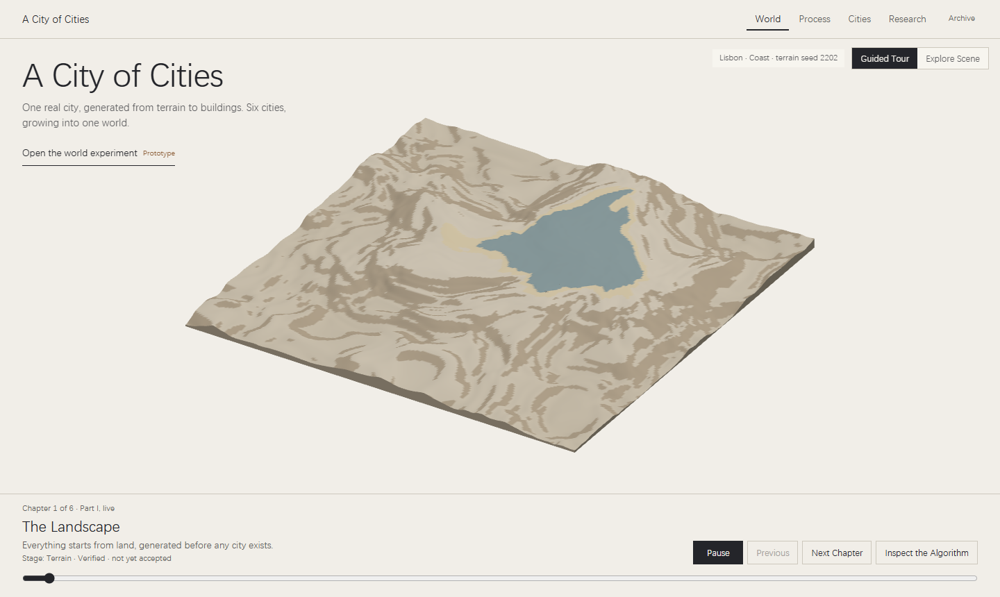

# WEB-01 — Interactive Research Website

Written for anyone maintaining or reviewing the site. Status: **stage complete, in Maintenance Mode.** Release details: log entry WEB-01f in the [compass and log](../FINAL-EXPERIMENT-LOG.md).

WEB-01 ending does not finish the research. Natural city encounters, road-first growth in the scheduler and calibration of the City DNA stay open as separate research tasks.

## Release

| | |
| --- | --- |
| Public site | <https://gameeeee-zc626.web.app> |
| Commit and tag | `ad6acd6`, `release/city-of-cities-web-v1` |
| Released | 2026-11-02 UTC, by the `main` workflow |
| Final checks | 141 / 141 local; 22 / 22 and `verify:live` 10 / 10 at the public address |
| Rollback | `firebase hosting:clone gameeeee-zc626:pre-web01-backup gameeeee-zc626:live`, for 30 days |

## Structure

| Page | Holds |
| --- | --- |
| World (`#home`) | Film: Guided Tour and Explore Scene on one timeline |
| Process (`#process`) | Nine stages with real captures |
| Cities (`#cities`) | Six rule sets at one scale |
| Research (`#research`) | Question, method, parameters, results, limits; Research Archive folded |
| Archive (`#archive`) | Earlier exercises and Files & Notes. Old hash routes stay valid |

## What each scene is

| Scene | Kind | Source |
| --- | --- | --- |
| Stages 1–6 | Live Generation | Generators run in a Worker on the page |
| Stage 7 Six Urban Origins | Recorded Replay of a verified run | `world/world-6201-step30.json`, each chunk equal to the saved signatures |
| Stage 8 Procedural Urban Growth | Recorded Replay; data verified, urban form Prototype | Same file, 30 saved events |
| Stage 9 Urban Encounter | Controlled Experiment, hand-placed | `world/encounter-case.json` |
| Natural encounters in the grown world | Planned | Not implemented |

## Features

Six playback speeds, Watch and Inspect, Algorithm Inspector with data source and limits, debug layers, object selection in Part I and chunk selection in Part II, camera presets, three views of Part II (Live 3D, Lightweight Replay, Recorded Film), reduced motion and no-WebGL fallbacks.

## Main technical parts

- `experiments/procedural-film/`: timeline, scene manifest, reveal model, scenes, Inspector content. The film is a function of t: shaders read reveal times, so scrubbing never rebuilds geometry.
- `scripts/bake-film-world.mjs`: runs the real generators offline and stops if a chunk differs from the saved signatures.
- `scripts/record-film-part2.mjs`: records the Live 3D render frame by frame and checks the video against live frames.
- `scripts/verify-procedural-film.mjs`, `verify-inspector-docs.mjs`, `verify-preview.mjs`, `measure-film-performance.mjs`.

## Known limits

- Part II on a device without a strong GPU falls back to Recorded Film. Lightweight Replay is not smooth on the software-rendering test profile.
- Roads and buildings appearing inside a chunk present final geometry; the record holds one event per chunk.
- G02 chunks are independent: no road is inherited or joined, and terrain steps at chunk edges are real.
- All City DNA and growth values are uncalibrated design assumptions.
- [Algorithm Review](./Algorithm-Review.md): no statement is signed by a human.
- Firefox, Safari, real phones and real low-end devices are not tested.

## Maintenance Mode

Allowed: bug fixes, security fixes, corrections of content, necessary compatibility fixes, data updates from existing research.

Not planned: new page features. New research results enter through three existing paths:

1. A new scene entry in `sceneManifest.js` and `stageManifest.js`.
2. A new item in `RESEARCH` in `web-pages.js`.
3. New baked data from `scripts/bake-film-world.mjs`, then `record-film-part2.mjs` and `verify-inspector-docs.mjs`.
