# Procedural Mini World — Final Experiment Log

> This file is the single master record of experiments for this semester's final procedural-world project. Each completed stage records its goal, operations, evidence, conclusion, failures, and next step here. It does not replace the technical notes beside the code, and it is not mixed with the old Assignment 1 checklist. (Sections originally written in Chinese were translated to English on 2026-10-20; the original wording is in Git history, commit `7b21c3e`.)

## 1. Project Status

- **Project type:** a controllable procedural world, not a traditional game
- **Restructure start date:** 2026-10-17
- **Pipeline (from 2026-10-18, Terrain-first):** Seed terrain → geographic feature detection → City DNA matching → road network → parcels → building extrusion. Terrain is generated city-neutral first; City DNA is matched to detected features instead of being imposed on a fixed city-shaped tile.
- **Current stage (2026-10-19):** Midterm review. T1–T6 implemented, T7 partial (see §5); all pending review.
- **Current state:** T1 implemented in `experiments/seed-terrain/` (entries 02.2–02.4; frozen 1024 m chunk, 4 landform algorithms, adjustable transition weight field); T2 terrain analysis (02.5), T3 terrain-to-City-DNA matching (02.6), T4 road / canal network (03.1), mountain roads + tunnels (03.2), T5 urban blocks (04.1), organic / canal-street loop closure (03.3), block refinement (04.1b), road-oriented parcels (04.2), grey-box buildings (05.1), closed solid terrain (05.1b-1), tunnel excavation (05.1b-2), City DNA 3 → 6 by configuration (06.1: + Chicago, Amsterdam, Lisbon), the 3 × 3 World Grid with per-chunk City ID and seam detection (06.2), and multi-chunk terrain / water seam harmonisation with unresolved-edge reporting (06.3a) implemented. All pending review. Stage 0 research outputs (00.2, 00.3, 01.1) and 02.1 Manhattan greybox remain pending review. Deployed to Firebase Hosting (M01); GitHub knowledge base and `main` updated (M02, M02b); Midterm Review entry: [midterm-review/00-midterm-review.md](./midterm-review/00-midterm-review.md) (M03).
- **Update (2026-10-20, task 06.3 by user instruction):** world development resumed. 06.3a re-verified (verifier passes, numbers reproduced); 06.3b cross-chunk road network seam implemented, pending review (entry 06.3b in §7).
- **Update (2026-10-21, task 06.3a-R by user instruction):** world-coherent terrain (global macro base + shared boundary surface) implemented as the default World Grid terrain, pending review (entry 06.3a-R in §7). 06.3a (`?terrain=harmonized`) and 06.2 (`?terrain=raw`) stay runnable.
- **Update (2026-10-21, task 06.3a-R2 by user instruction):** core-preserving world terrain (world datum + band-only seam correction) is now the default World Grid terrain, pending review (entry 06.3a-R2 in §7). 06.3a-R stays runnable as `?terrain=macroRamp`, 06.3a as `?terrain=harmonized`, 06.2 as `?terrain=raw`.
- **Update (2026-10-21, task 06.3c by user instruction):** seam classification (geometry / landform / hydrology / transport per shared edge) added to the World Grid; R2 corner pin shortened to one band width. Pending review (entry 06.3c in §7).
- **Update (2026-10-21, release M06):** checkpoint commit `1f63e6f` on `experiment/terrain-seam` and `main`, deployed by CI to <https://gameeeee-zc626.web.app>; World State saved in `experiments/world-grid/checkpoints/world-6201-checkpoint-v1.json`. Hand-off: [NEXT_SESSION.md](./NEXT_SESSION.md).
- **Update (2026-10-21, task 07.1 by user instruction):** City Influence & Fusion — one source city invades one neighbouring chunk (network switch per edge, parcel and building rules blended by weight; terrain, water, tunnels and other chunks unchanged). Pending review (entry 07.1 in §7).
- **Update (2026-10-21, task 07.1a by user instruction):** City Influence is now a formal experiment line of T7 (blend), no longer a forbidden item. 07.1a adds an opt-in spatial identity mode (geometry ids, random streams keyed by worldSeed + stable identity) so that unaffected areas stay identical under invasion; legacy ids stay the default and keep every verified signature. Pending review (entry 07.1a in §7).
- **Update (2026-10-27, G00 by user instruction):** checkpoint commit `79687a0` on `experiment/terrain-seam` preserves the 3 × 3 World Grid, Terrain Seam and City Invasion & Fusion work (07.1, 07.1a) with evidence and screenshots; new work continues on branch `experiment/procedural-growing-world`.
- **Research mainline (from 2026-10-27, by teacher feedback): Multi-Origin Procedural Urban Growth.** The world is no longer a static assembly of pre-placed chunks (06.2–07.1a) but the result of a process: six City DNAs each start from one core chunk and grow outward chunk by chunk; map size, city territories and boundaries emerge from the growth rules (terrain-first scores, fair scheduling, first-occupant ownership). Reason: in a fixed 3 × 3 grid the world size, the neighbourhoods and the city boundaries were decided before any rule ran, so they could not be studied as outcomes. The static World Grid and the City Influence line stay runnable as earlier experiments.
- **Update (2026-10-27, task G01 by user instruction):** `WorldGrowthController` + Growth Debug UI in `experiments/growing-world/` — six city cores, one chunk per step from a growth frontier, save / load and continuation; verified on 3 world seeds. Pending review (entry G01 in §7).
- **Update (2026-10-28, task G00-R by user instruction):** research framing re-established as **A City of Cities — The Emergence of a Plural Urban World through Procedural Growth** in [A-City-of-Cities-Research-Compass.md](./A-City-of-Cities-Research-Compass.md). That page is the authority for question, theory, World / City / Chunk levels, hypotheses H1–H3, experiments A–C and the G00–G05 roadmap; this section and §5 stay the authority for stage status. Roadmap mapping: the entry logged as G01 (2026-10-27) covers roadmap G01 and a baseline of G02.
- **Update (2026-10-28, task G01-MO by user instruction):** roadmap G01 Multi-Origin Initialization implemented as `experiments/city-of-cities/` (World Context, City Origins, independent core chunks, origin suitability, World State v1, no growth). Verified on 3 seeds; pending review (entry G01-MO). It replaces the proposed G01-R. The 2026-10-27 growth prototype stays runnable as an earlier exploratory experiment.
- **Update (2026-10-28, task G02 by user instruction):** growth frontier, suitability, scheduler and single-step growth implemented in `experiments/city-of-cities/`; Node verification passed on seeds 6201 and 6203 (30 steps). **Stopped:** seed 6202 cannot initialise six cities because of a G01 origin-screen defect (entry G02). Browser stage, screenshots and the G02 note pending.
- **Update (2026-10-28, tasks G01-FIX and G02-V by user instruction):** G01 origin placement v2 (water-aware screen, waterfront check, bounded expansion, atomic failure) fixes seed 6202; G01 re-verified on 6201 / 6202 / 6203; G02 verified on all three seeds in Node and the browser up to 30 steps. Both pending review (entries G01-FIX, G02-V).
- **Update (2026-10-28, task PRESENTATION-01 by user instruction):** 75 s class film *A City of Cities* rendered from the real seed-6201 world (G01 origins + 30 verified G02 steps) in `presentation/city-of-cities/`; no generator, experiment or deployment changed (entry PRESENTATION-01). Day hand-off in [NEXT_SESSION.md](./NEXT_SESSION.md).
- **Update (2026-10-28, task G03a by user instruction):** urban territory and spatial-relationship analysis layer (`TerritoryModel`) on top of G02: world spatial states, territories, boundary classes, inter-city adjacencies, relationship graph, metrics; verified on 6201 / 6202 / 6203 (entry G03a). Growth, placement and generation unchanged.
- **Update (2026-10-28, task G02b by user instruction):** principle added to the compass: **Growth is the extension of urban structure, not the replication of isolated city chunks.** Road-first morphological growth implemented as a minimum viable experiment (Manhattan grid, Fez organic, Chicago failure path) on seed 6201 and verified; default G01 / G02 generation unchanged (entry G02b).
- **Update (2026-10-28, task G03b by user instruction):** Urban Encounter & Morphological Negotiation implemented as a Chicago × Fez minimum experiment on a hand-placed **test fixture** (seed 6201, three scenarios: connection, pending plan, separation) and verified in Node and the browser; default G01 / G02 / G02b generation unchanged (entry G03b).
- **Update (2026-11-01, task WEB-01a / WEB-01b by user instruction):** the website is restructured around an Interactive Procedural Film (`experiments/procedural-film/`, new read-only playback layer): one real chunk from terrain to buildings, six verified city configurations, main navigation Explore the World / The Process / Urban Identities / Research / Archive. No generator changed; all old routes keep working. Implemented and verified in a local browser, pending review, **not deployed** (entry WEB-01). WEB-01c (multi-city film) and WEB-01d not started.
- **Update (2026-11-01, task WEB-01b-R1 by user instruction):** six playback speeds, Watch / Inspect modes and a semi-transparent Algorithm Inspector added to the film; debug layers and object picking read the same scene. No generator changed. Verified in a local browser, pending review, **not deployed** (entry WEB-01b-R1).
- **Update (2026-11-01, task WEB-01c by user instruction):** the film now has two chapters. Part I is the live single chunk; Part II replays the recorded world of seed 6201 (six origins, 30 growth steps) and the Chicago × Fez controlled case study, on one timeline. No generator changed. Verified in a local browser, pending review, **not deployed** (entry WEB-01c).
- **Update (2026-11-02, task WEB-01d by user instruction):** the site is organised as an exhibition: a Guided Tour of six chapters on the existing timeline, four main navigation entries with Archive apart, scale-based camera presets, a Research page with methods and a collapsed archive, an audit that ties the Inspector to the source code, and a light view for slow devices. No generator changed. Verified in a local browser, pending review, **not deployed** (entry WEB-01d).
- **Update (2026-11-02, task WEB-01e by user instruction):** first public preview. Branch pushed; site commit `84488ab` deployed to Firebase Preview Channel `web01e-rc1` (https://gameeeee-zc626--web01e-rc1-jt90taw2.web.app), expiring after 14 days. Production Hosting and `main` are unchanged. Part II has three viewing levels. Pending review (entry WEB-01e).
- **Update (2026-11-02, task WEB-01f by user instruction):** WEB-01 is complete as a stage and in Maintenance Mode ([summary](./A-City-of-Cities/WEB-01-Interactive-Research-Website.md)). Release details: entry WEB-01f.
- **Update (2026-11-01, task G02c-01 by user instruction):** the multi-city scheduler can take its candidates from real road fronts (opt-in `growthMode: 'road'`), with Plan → Generate → Validate → Commit. Default G01 / G02 path unchanged. Verified on 6201 / 6202 / 6203, pending review (entry G02c-01).
- **Update (2026-11-02, task G02c-02 by user instruction):** grade-aware road connection: ramps with sampled vertical alignment in the uncommitted chunk, joins continuous in height and graph; the old 3 m steps were all terrain seams (entry G02c-02). Default paths and G02c-01 unchanged. Pending review.
- **Update (2026-11-02, task G03c-01 by user instruction):** natural encounters are detected inside real six-city growth (6 % ramp plan); one adjacency on the known seeds (6202, Chicago × Fez, adaptation proposed); nothing connected (entry G03c-01). Pending review.
- **Update (2026-11-03, task G03c-02 by user instruction):** inter-city connection planned inside the newcomer's commit; no connection in real growth (6202 / 6209 / 6215) and none Connected in the controlled cases; blocker: ramps end before the first junction (entry G03c-02). Pending review.
- **Update (2026-11-03, task G03c-03 by user instruction):** Phase A: the Chicago 171 m / 38 m drop is a continuous single-centre gradient, not a chunk reset; every building height is decomposed and reproduced (41,755 of 41,755); no height changed; inter-city interfaces classified (no connected type) (entry G03c-03). Pending review.
- **Update (2026-11-03, task VIS-01a by user instruction):** stage timeline of one real growth event in the World Viewer, every stage labelled recorded / reconstructed / presentation; browser 16 of 16 (entry VIS-01a). Pending review.
- **Current single task:** Review VIS-01a; VIS-01b only after that review.
- *Previous (superseded 2026-11-03, VIS-01a):* "VIS-01 Procedural Growth Observatory, VIS-01a first (by user instruction 2026-11-03)."
- *Previous (superseded 2026-11-03, G03c-03):* "G03c-03 Urban Interface (by user instruction 2026-11-03): Phase A (same-city morphology); inter-city part limited to classification."
- *Previous (superseded 2026-11-03, G03c-02):* "G03c-02 Inter-City Road Connection (by user instruction 2026-11-02), after the G03c-01 gate."
- *Previous (superseded 2026-11-02, G03c-01):* "G03c-01 Emergent Urban Encounter (by user instruction 2026-11-02), after the G02c-02 gate."
- *Previous (superseded 2026-11-02, G02c-02):* "Review G02c-01 ([note](./A-City-of-Cities/G02c-Road-Driven-Growth.md)), especially the 41 visually aligned but unjoined road ends. G03c is not started."
- *Previous (superseded 2026-11-01, G02c-01):* "Return to urban growth research: choose G02c / G03c (road-first growth and encounters in the multi-city scheduler). Website work: maintenance only."
- *Previous (superseded 2026-11-02, WEB-01f):* "Human review of the preview and of [Algorithm-Review.md](./A-City-of-Cities/Algorithm-Review.md), a test on a real phone and an ordinary laptop; then a production decision."
- *Previous (superseded 2026-11-02, WEB-01e):* "Human review of the site in a browser (WEB-01b to WEB-01d) and of the Inspector checklist; then a deployment decision; then G02c / G03c (road-first growth and encounters in the multi-city scheduler)."
- *Previous (superseded 2026-11-02, WEB-01d):* "Review WEB-01c in the browser (with WEB-01b, WEB-01b-R1), and G03b and G02b, G03a (with G01-FIX, G02); then choose G02c / G03c (road-first growth and encounters in the multi-city scheduler)."
- *Previous (superseded 2026-11-01, WEB-01c):* "Review WEB-01b and WEB-01b-R1 in the browser (then WEB-01c), and G03b and G02b, G03a (with G01-FIX, G02); then choose G02c / G03c (road-first growth and encounters in the multi-city scheduler)."
- *Previous (superseded 2026-11-01, WEB-01b-R1):* "Review WEB-01b in the browser (then WEB-01c), and G03b and G02b, G03a (with G01-FIX, G02); then choose G02c / G03c (road-first growth and encounters in the multi-city scheduler)."
- *Previous (superseded 2026-11-01, WEB-01):* "Review G03b and G02b, G03a (with G01-FIX, G02); then choose G02c / G03c (road-first growth and encounters in the multi-city scheduler)."
- *Previous (superseded 2026-10-28, G03b):* "Review G02b and G03a (with G01-FIX, G02); then choose G02c (road-first growth in the multi-city scheduler) or G03b (encounter zones)."
- *Previous (superseded 2026-10-28, G02b):* "Review G03a (with G01-FIX, G02); then choose G03b (encounter zones proposed)."
- *Previous (superseded 2026-10-28, G03a):* "Review G01-FIX and G02 (spatial review of the seed comparison); no G03 work before the review."
- *Previous (superseded 2026-10-28, G02-V):* "Decide the G01 origin-screen fix (or a replacement seed for 6202); then finish G02 verification."
- *Previous (superseded 2026-10-28, G02):* "Review G01-MO (and G01 prototype, G00-R); G02 Rule-Based Growth only after the review."
- *Previous (superseded 2026-10-28, G01-MO):* "Review G01 and the Research Compass (G00-R); if accepted, G01-R (City Agent record and cell-state field, outputs unchanged; compass §14)."
- *Previous (superseded 2026-10-28):* "Review G01 (growth rules, territories, reported seams); then choose G02 (see the G01 entry)."
- **Forbidden now:** City Invasion & Fusion in the growing world, cross-city road fusion, new tunnel system, new building assets, rewriting the Terrain Seam system, new cities beyond the six DNAs, gameplay, visual polish — until the G01 review sets the next task.
- *Previous (superseded 2026-10-27):* Current single task "Review 06.3c (and 06.3a-R2, 06.3a-R, 06.3b), then the midterm review of T1–T7"; forbidden: new cities, City DNA / road topology / parcel / building / tunnel-algorithm changes outside the City Influence experiment line, multi-source city competition, bridges, ramps, canal joins, city expansion beyond one source and one neighbouring target, complex UI, new assets, gameplay, visual polish.
- *Previous (superseded 2026-10-19):* Current stage T1 — Seed terrain; single task "Review T1 terrain fields (height, water, slope, buildability)"; forbidden: city, road, parcel, or building generation; new assets; gameplay; world stitching; visual polish.
- *Previous (superseded 2026-10-18):* Stage 0 — research framework and city candidate set; the single task was to choose 3 prototype cities and the first city to implement.

## 2. Core Proposition

> **Current research question (from 2026-10-28):** *How can distinct urban identities emerge, expand, and collectively form a world through procedural growth?* See [A City of Cities — Research Compass](./A-City-of-Cities-Research-Compass.md) §1–§4. The proposition and question below are the original framing (2026-10-17); they are kept as history and as the sub-question of hypothesis H1 (identity preservation).

A city's identity does not come only from its landmarks, but from the spatial relations between terrain, water, streets, plots, and buildings. This project turns those relations into adjustable parameters and, through different seeds, parameter changes, and city-mixing experiments, studies within what range a city's identity is kept, and when it is weakened, transformed, or recombined.

### Core Question

> How can a city's characteristics be encoded as controllable procedural rules? When those rules change continuously, mix with each other, or are stitched together, how is the city's identity kept, weakened, or re-formed?

## 3. Minimum Complete Result by the End of the Semester

1. Three City DNAs with clearly different structures.
2. One complete generation chain: terrain → network → parcels → building volumes.
3. Parameter changes produce stable, explainable spatial change.
4. At least three city modules can be joined or mixed into one Mini World.
5. Seeds are reproducible; key results have debug views, numeric statistics, and source evidence.
6. A runnable program, project documentation, parameter documentation, process images, and a demo video.

The 60 cities form a research database; they are not the number of cities to implement this semester.

## 4. Non-Negotiable Work Rules

- Advance only one verifiable question at a time.
- Do not start a downstream system before the upstream data structure is frozen.
- A seed only produces reproducible variation within the rules; it does not represent city identity.
- Every public parameter must correspond to a clear spatial relation.
- Use at least two reliable sources for every city.
- Distinguish source facts, analytical inferences, and artistic choices.
- A successful build does not mean a correct spatial result; check both the data and the image.
- Do not add features just because a new idea is interesting. Work outside the current stage goes to the post-semester candidate list.
- Do not commit, push, or deploy without an explicit instruction.

## 5. Stage Roadmap

### Terrain-first pipeline (current, 2026-10-18)

| Stage | Content | Evidence of completion | Status |
| --- | --- | --- | --- |
| R | Research base: city longlist, families, prototype cities, Manhattan study | Docs, CSV, sources | Pending review |
| T1 | Seed terrain: continuous height + water, slope, buildability fields | Same-seed reproducibility, 3 seeds, stats, 1 screenshot | Implemented, pending review |
| T2 | Geographic feature detection (coast, rivers, ridges, flats, basins) | Feature maps + counts per seed | Implemented, pending review (02.5) |
| T3 | City DNA matching to detected features | Match scores for ≥3 DNAs | Implemented, pending review (02.6; 6 DNAs in 06.1) |
| T4 | Road / canal network | Connectivity, hierarchy, boundary interface | Implemented, pending review (03.1, 03.2, 03.3, 05.1b-2) |
| T5 | Blocks and parcels | Parcel stats, conflict checks | Implemented, pending review (04.1, 04.1b, 04.2) |
| T6 | Building extrusion | Density, height, coverage, collision checks | Implemented, pending review (05.1, 05.1b-1) |
| T7 | ≥3 tiles joined or blended; final delivery | Continuity of roads, water, height, density; video | Partial, pending review: 3 × 3 World Grid (06.2); terrain + water seams joined where a natural slope is possible, others reported unresolved (06.3a); road ports joined across harmonised edges into one world NetworkGraph, the others reported with a reason (06.3b); world-coordinated terrain: every shared edge and corner one continuous C¹ surface, edges whose zone exceeds 35° reported unresolved (06.3a-R); default since 06.3a-R2: world datum + band-only correction, chunk cores unchanged, unresolved edges reported as escarpment candidates; 06.3c: every edge classified smooth / valid escarpment / candidate / failed with separate geometry, landform, hydrology and transport status; City Influence (formal experiment line): one source city invades one neighbouring chunk with rule fusion (07.1), stable generation of unaffected areas with spatial ids (07.1a) |

### A City of Cities roadmap (current, from 2026-10-28)

Goals, reuse, new components, dependencies, verification and visual output per stage: [Research Compass §11](./A-City-of-Cities-Research-Compass.md). The T1–T6 single-chunk chain runs unchanged inside every chunk.

| Stage | Content | Status (2026-10-28) |
| --- | --- | --- |
| G00 | Preserve & Recover: earlier experiments, Git baseline, independent chunk generator | Done: checkpoint `79687a0` (entry G00) |
| G01 | Multi-Origin Initialization: six cores, spacing, suitability recorded | Implemented, verified, pending review: `experiments/city-of-cities/` (entry G01-MO); earlier prototype with growth in `experiments/growing-world/` (entry G01, commit `c3e2e5f`) |
| G02 | Rule-Based Growth: frontier, Growth DNA scoring, single step, save / load; random and uniform modes | Implemented, verified, pending review: [G02 note](./A-City-of-Cities/G02-Procedural-Urban-Growth.md) (entries G02, G01-FIX, G02-V); G02b road-first morphological growth (minimum viable experiment, one city): [G02b note](./A-City-of-Cities/G02b-Morphological-Growth.md); random / uniform modes proposed |
| G03 | City Territory & Encounter: reserves, encounter zones, corridors, boundary types | G03a implemented, verified, pending review: [G03a note](./A-City-of-Cities/G03a-Urban-Territory.md) (spatial states, territories, boundary classes, relationships, constraints as analysis); G03b encounter & negotiation (Chicago × Fez test fixture) implemented, verified, pending review: [G03b note](./A-City-of-Cities/G03b-Urban-Encounter.md); encounters in the scheduler, acting reserves and corridors proposed |
| G04 | Morphological Growth: DNA and growth stage in roads, blocks, buildings | Not started |
| G05 | Evaluation & Replay: replay, metrics, experiments A–C | Partial (history, save / load); rest proposed |

### Procedural growth pipeline (2026-10-27, superseded 2026-10-28 by the roadmap above)

| Stage | Content | Status then |
| --- | --- | --- |
| G00 | Protect the static-world experiments; reliable Git checkpoint | Done: `79687a0` |
| G01 | Multi-origin growth: cores, frontier, scheduler, territories, save / load, Growth Debug UI | Implemented, pending review |
| G02 | Proposed in the G01 entry | Not started |

### Original roadmap (superseded 2026-10-18, kept for history)

| Stage | Content | Evidence of completion | Status |
| --- | --- | --- | --- |
| 0 | Project proposition, research template, 60-city candidate set, city families, 3 prototypes | Documents, CSV, sources, and selection rationale | In progress |
| 1 | Research and City DNA of the first city | Analysis drawings, parameter configuration, three core rules | Not started |
| 2 | Terrain system of the first city | 3 reproducible seeds, debug views, statistics | Not started |
| 3 | Road or canal network | Connectivity, hierarchy, and boundary-interface checks | Not started |
| 4 | Blocks and parcels | Parcel states, size statistics, conflict checks | Not started |
| 5 | Building volumes | Density, height, coverage, and collision checks | Not started |
| 6 | Second and third City DNA | Structural differences within the same generation framework | Not started |
| 7 | Module joining or city mixing | Continuity of roads, water, elevation, and density | Not started |
| 8 | Final presentation and delivery | Runnable version, documents, video, and backup | Not started |

## 6. Experiment Record Format

EXP-00 to EXP-00.2 used the original format below (written in Chinese, translated 2026-10-20). From 2026-10-18, new entries are written in English with the template that follows; agent rules live in [AGENTS.md](../../AGENTS.md).

```text
Experiment ID and name: / Date: / Stage: / Single question: / Inputs: / Explicitly out of scope:
Operations: / Verification evidence (files, values, visual check, sources): / Result: / Limits or failures: / Conclusion: / Next single task:
```

```text
### <Task ID> — <short title>
- Date / Stage / Single question:
- Reused files or functions:
- Changed files + commit or working-tree state:
- Seed / City DNA / key parameters:
- Entry point + verification method:
- Result + checked data:
- Screenshots: image link to ../assets/screenshots/procedural-mini-world/<task-id>-<subject>-after.png + seed, params — or "none (text-only)"
- Confirmed:
- Open issues:
- Review status: Pending review | Accepted | Rejected
- Next single task:
```

## 7. Experiment Records

### EXP-00 — Project reset and research framework

- **Date:** 2026-10-17 to 2026-10-18
- **Stage:** Stage 0
- **Single question:** How can a divergent idea of a city world be narrowed into a procedural system that can be completed, explained, and verified within two months?
- **Inputs:** the instructor's core requirements, existing project experience, the City DNA concept.
- **Out of scope:** no generation code, no new assets, no world stitching.

#### Operations

1. Redefined the project from a "game" to a "controllable procedural world".
2. Froze the core proposition that "city identity is kept, transformed, and mixed under parameter change".
3. Built a unified city research template and a CSV data table.
4. Defined the 60 cities as a research database, not the number of cities to implement this semester.

#### Verification evidence

- `research/city-research-template.md`: field definitions, scoring criteria, the distinction between fact / inference / artistic choice, the two-source requirement, and the seed principle.
- `research/city-research-template.csv`: 40 fields, 60 data rows.
- The first three candidate records are Venice, Manhattan, and Fez el-Bali, all with status "to be researched".
- The field count declared in the Markdown matches the actual CSV field count: 40 in both.
- This experiment did not change the generator, terrain, buildings, or assets.
- **Visual check:** not applicable; this experiment only builds the research structure.

#### Result

The research framework can now compare different cities in one format and condense research findings into programmable city rules. The template structure check passed.

#### Limits

The 60-city candidate list did not exist yet, and it had not been checked whether the city families cover enough spatial types. The three prototype cities were still only provisional candidates.

#### Conclusion

The Stage 0 research tools are in place. Candidate city selection can begin, but procedural generation code still cannot start.

#### Next single task

Build a longlist of 60 candidate cities with sufficiently different geography, street-network structure, block scale, and building types, and group them into 8–12 city families.

### EXP-00.2 — 60-city longlist and classification

- **Date:** 2026-10-18
- **Stage:** Stage 0
- **Single question:** How can a global set of candidate cities be built from codable dominant spatial logics, without reducing cities too early to unverified parameters?
- **Inputs:** the project compass, the unified city research template, authoritative source anchors for representative cities.
- **Out of scope:** no complete City DNA, no final prototype choice, no change to code, branches, or assets.

#### Operations

1. Defined 10 city families, each by one kind of dominant spatial generation logic.
2. Chose 6 cities per family, 60 in total, and limited a study area for each city.
3. Recorded 3 candidate spatial features, potential generation rules, and a research priority for each city.
4. Marked everything without completed two-source verification explicitly as "to be verified".
5. Recorded each family's shared patterns, representative cities, and differences from other families.

#### Verification evidence

- `research/city-longlist-60.md`: 60 cities, 10 families, and classification statistics.
- City entries: 60; unique cities: 60; duplicate entries: 0.
- Families: 10, with 6 cities each.
- IDs run continuously from 01 to 60; missing IDs: 0.
- Venice, Manhattan (New York), and Fez el-Bali are all included, without presetting the final selection.
- The document uses standard Markdown tables and links and does not rely on HTML.
- **Visual check:** this task is a Markdown research document; no visual check of the procedural world was done.

#### Result

The Stage 0 candidate-city coverage framework is in place. The classification can be translated into different generation problems: water networks, grids, radial plans, organic growth, boundaries, hillsides, hydrology, superblocks, linear corridors, and polycentric networks.

#### Limits

The longlist is not a complete research conclusion. Most cities do not yet have two-source support, study-area scales are not yet unified, and secondary families and mixing ratios between cities are not defined.

#### Conclusion

Task 00.2 passes its structural check and can move on to prototype comparison. Until source verification is complete, candidate features must not be written directly as final parameters or generation code.

#### Next single task

Starting from the 10 high-priority candidates, complete two-source verification, compare structural differences, source quality, and implementation feasibility, and choose 3 prototype cities and the first city to implement.

### OPS-01 — Codex + Obsidian collaboration rules

- **Date / Stage / Single question:** 2026-10-18 / Stage 0 (per §1) / How do agents and notes stay aligned with this compass without duplicate documents?
- **Reused files or functions:** this log (§1–5 as compass, §6–7 as log), `docs/standards/documentation/knowledge-base-rules.md`, `scripts/verify-markdown-links.mjs`, screenshot path already used by `scripts/verify-manhattan-terrain.mjs`.
- **Changed files + working-tree state:** new `AGENTS.md`; this log (§6 template, this entry); `docs/_meta/project-map.md` (one row). Uncommitted on `experiment/terrain-seam`. No generator, scene, dependency, branch, or asset change.
- **Seed / City DNA / key parameters:** n/a.
- **Entry point + verification method:** `node scripts/verify-markdown-links.mjs`.
- **Result + checked data:** link check passed before and after edits.
- **Screenshots:** none (text-only).
- **Confirmed:** vault = repository root; no prior `AGENTS.md` or standalone compass file exists; screenshot folder `docs/assets/screenshots/procedural-mini-world/` is reserved but not yet created.
- **Open issues (Pending verification):** §1 still says Stage 0, while `research/prototype-city-selection.md` (00.3), `research/manhattan-spatial-study.md` (01.1) and `experiments/manhattan-terrain-greybox/` exist without log entries or screenshots; their status needs human review before §1 is updated. `experiment/venice-vertical-slice` worktree sits at the same commit as `main` history (`a38c73d`) with no extra commits.
- **Review status:** Pending review.
- **Next single task:** Human confirms the current stage in §1 and whether 00.3 / 01.1 / greybox should be logged as accepted or pending.

### 02.1 — Manhattan terrain / water / buildability greybox (reuse run)

- **Date / Stage / Single question:** 2026-10-18 / Stage 2 work, while §1 still reads Stage 0 (see OPS-01) / Can an existing seeded terrain + water + buildable-area greybox for the first city (Manhattan, per `research/prototype-city-selection.md`) run reproducibly?
- **Reused files or functions:** existing `experiments/manhattan-terrain-greybox/` (already built, never verified); `sampleHeight`, `checksum` from `experiments/cellular-noise/noise.js`; `hashParts` from `experiments/flavor-clash-prototype/world/SeededRandom.js`; `SurfaceQuery` from `experiments/iceland-region/`; `scripts/verify-manhattan-terrain.mjs`. `terrain-seam` (asset/seam focus) and `venice-vertical-slice` (no extra commits) were not needed.
- **Changed files + working-tree state:** no code changed. Generated `experiments/manhattan-terrain-greybox/evidence/seed-validation.json` and the screenshot below. All untracked on `experiment/terrain-seam`.
- **Seed / City DNA / key parameters:** seeds `MANHATTAN-1101 / 2202 / 3303`; map 44 × 72, resolution 112, waterLevel 0, baseElevation 0.78, relief 0.24, coastTransition 2.4, shoreSetback 2.8, maxBuildableSlope 8°. City DNA is only an implied two-river island strip; not yet derived from 01.1 measurements.
- **Entry point + verification method:** `/experiments/manhattan-terrain-greybox/?seed=<seed>` via Vite; `node scripts/verify-manhattan-terrain.mjs` loads each seed twice and compares height-field checksums.
- **Result + checked data:** each seed reproducible across 2 loads; 3 unique signatures; 0 browser errors. Samples (total 12,769) water / buildable / buffer: 1101 → 3208 / 7637 / 1924 (sig `7A91A32A`); 2202 → 3090 / 7765 / 1914 (`1DE833E4`); 3303 → 3132 / 7723 / 1914 (`9654BA61`).
- **Screenshots:** 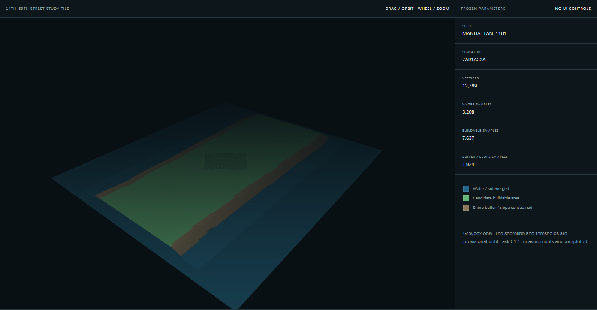 — seed `MANHATTAN-1101`, default parameters, 1440 × 1000 viewport.
- **Confirmed:** terrain, water, and buildability mask render; same seed → identical heights; different seeds → different heights.
- **Open issues:** seed variation is small (class counts differ by < 2%); a dark square artifact sits mid-tile (likely the default shadow-camera bounds); config exposes 11 non-seed values, some not spatial (resolution), which conflicts with the ≤10 spatial-parameter rule once UI is added; shoreline and thresholds remain provisional until 01.1 measurements exist.
- **Review status:** Pending review.
- **Next single task:** Human accepts or rejects this greybox as the Stage 2 terrain base; if accepted, reduce the public parameter set to ≤10 spatially meaningful values.

### 02.2 — T1 Seed terrain with live parameters and terrain fields

- **Date / Stage / Single question:** 2026-10-18 / T1 (Terrain-first) / Can a city-neutral seeded terrain expose reproducible height, water, slope, and buildability fields with a live preview?
- **Reused files or functions:** `IcelandTerrain` (height generation, unchanged) from `experiments/iceland-region/`; `checksum` from `experiments/cellular-noise/noise.js`; slope method from `experiments/manhattan-terrain-greybox/ManhattanTerrain.js`; lil-gui panel pattern from `iceland-region/ControlPanel.js`; page CSS from the Manhattan greybox; `scripts/verify-manhattan-terrain.mjs` as the verifier template. `terrain-seam` was not reused: its terrain is tied to Venice/Japan presets and assets.
- **Changed files + working-tree state:** new `experiments/seed-terrain/` (`index.html`, `main.js`, `config.js`, `TerrainFields.js`), new `scripts/verify-seed-terrain.mjs`; compass §1 and §5 updated to the Terrain-first pipeline. No other experiment, dependency, or branch changed. Uncommitted on `experiment/terrain-seam`.
- **Seed / City DNA / key parameters:** seeds `TERRAIN-01/02/03`; no City DNA. Map 64 × 64, 129 × 129 samples (fixed). Public parameters (8): heightScale 6, largeNoiseScale 18, detailNoiseScale 4, ridgeStrength 0.5, coastFalloff 0.25, waterLevel 0.8, shoreFreeboard 0.3, maxBuildableSlope 12°.
- **Entry point + verification method:** `/experiments/seed-terrain/?seed=<seed>` (any parameter can be added as a URL query); `node scripts/verify-seed-terrain.mjs` loads each seed twice and compares height and buildability checksums. Field data: `window.__seedTerrainLab.fields()` or the *Export fields JSON* button.
- **Result + checked data:** all 3 seeds reproducible; 3 unique signatures; 0 browser errors. Counts (16,641 samples) water / buildable / steep / low shore: 01 → 3371 / 5540 / 7362 / 368 (`1C504EDD`); 02 → 3320 / 5324 / 7646 / 351 (`DDE36D41`); 03 → 3331 / 5764 / 7189 / 357 (`145B5383`). Mean land slope 17.7–18.8°.
- **Screenshots:** 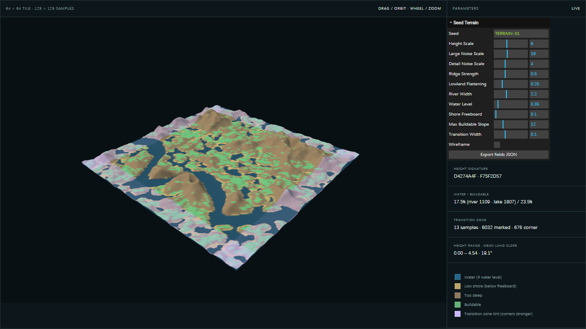 — seed `TERRAIN-01`, default parameters, 1440 × 1000 viewport.
- **Confirmed:** same seed → identical fields; different seeds → different fields; live sliders regenerate the fields; no city, road, parcel, or building output.
- **Open issues:** water appears only as the outer sea ring (no inland rivers or lakes), so T2 will find few water features; the coast reads as a square plateau edge; aggregate class ratios barely change between seeds (variation is mainly spatial); field export was not exercised by the verifier; `experiments/seed-terrain/` is not yet in the `vite.config.js` build inputs (dev server only).
- **Review status:** Pending review.
- **Next single task:** Decide whether T1 needs inland water (river/lake) before T2 feature detection starts.

### 02.2b — T1 revision: full square tile, inland water, transition zone

- **Date / Stage / Single question:** 2026-10-18 / T1 / Can the seed terrain cover the whole square tile (no island/sea), hold inland rivers, lakes, and plains, and mark an edge transition zone with boundary samples?
- **Reused files or functions:** `IcelandTerrain` unchanged (run with `coastFalloff: 0`); `sampleHeight`, `checksum` (cellular-noise); `hashParts` (flavor-clash); 02.2 page, fields, and verifier. No river code existed in earlier experiments.
- **Changed files + working-tree state:** new `experiments/seed-terrain/TileShape.js` (fixed noise floor 0.5, lowland flattening, seeded edge-to-edge river, water plane clipped to the tile); updated `config.js`, `TerrainFields.js` (transition mask, boundary lines, river/lake counts), `main.js`, `index.html`, `scripts/verify-seed-terrain.mjs`. Uncommitted; no other experiment changed.
- **Seed / City DNA / key parameters:** seeds `TERRAIN-01/02/03`; no City DNA. 10 public parameters: heightScale 6, largeNoiseScale 18, detailNoiseScale 4, ridgeStrength 0.5, lowlandFlattening 0.25, riverWidth 2.2, waterLevel 0.35, shoreFreeboard 0.1, maxBuildableSlope 12°, transitionWidth 0.10 (= 13 of 128 segments). Water defaults were picked from a height-percentile probe (water ≈ lowest 10% of ground).
- **Entry point + verification method:** `/experiments/seed-terrain/?seed=<seed>`; `node scripts/verify-seed-terrain.mjs` loads each seed twice and also asserts complete boundary lines (outer + inner, 129 samples per edge) and 4 corners shared by two edges.
- **Result + checked data:** all seeds reproducible, unique signatures, 0 browser errors. Water river / lake · buildable · steep · shore: 01 → 1109 / 1807 · 3906 · 8279 · 1540 (`D4274A4F`); 02 → 1121 / 1674 · 3638 · 8903 · 1305 (`87566160`); 03 → 1123 / 1877 · 3735 · 8308 · 1598 (`68F6BC81`). Transition 6032 samples, corners 676 (= 4 × 13²), identical for all seeds. Each river crosses two opposite edges (axis x for 01/03, z for 02); water runs per outer edge 3–8.
- **Screenshots:**  — seed `TERRAIN-01`, defaults above, 1440 × 1000 viewport (replaces the 02.2 island capture at the same path).
- **Confirmed:** no surrounding sea; inland river and lakes present for every seed; transition zone only marked (heights not flattened, no stitching); corners carry both edge bits; boundary heights and water flags exported via `window.__seedTerrainLab.boundary()` and the JSON export.
- **Open issues:** about half of the land is steeper than 12° (mean land slope 18–20°), so buildable plains are limited (22–23%); the river is a carved channel at a flat water level, not a downhill flow; per-edge water runs are high because lakes touch edges; per-tile boundary matching with neighbours is untested by design.
- **Review status:** Pending review.
- **Next single task:** Accept or tune T1 defaults (slope vs. plains balance), then start T2 feature detection on the exported fields.

### 02.3 — T1 frozen chunk with four landform rule sets

- **Date / Stage / Single question:** 2026-10-18 / T1 / Can one frozen chunk format produce plain, river valley, coast, and mountain terrain, where water appears only by landform rule, through one shared data interface?
- **Reused files or functions:** `IcelandTerrain` unchanged; `sampleHeight`, `checksum`, `hashParts`; 02.2b `TileShape`, `TerrainFields` (slope, transition mask, boundary lines), page, and verifier.
- **Changed files + working-tree state:** `experiments/seed-terrain/config.js` (chunk constants + 4 landform presets), `TileShape.js` (rule per landform: ponds / valley + river / one-sided sea / none), `TerrainFields.js` (river / sea / pond counts), `main.js`, `index.html`, `scripts/verify-seed-terrain.mjs`. Uncommitted; no other experiment changed.
- **Seed / City DNA / key parameters:** frozen chunk 1024 × 1024 m, 257 × 257 samples (4 m), 128 m edge zone (32 samples), freeboard 1 m, buildable slope ≤ 10°. UI: landform, seed slider 1–9999 (rebuild on release) + random button, variation intensity 0–1 (default 0.5; scales relief and river/coast irregularity). Seeds 1101 / 2202 / 3303. Preset relief at default variation: plain 24 m, river valley 90 m, coast 60 m, mountain 150 m. No City DNA.
- **Entry point + verification method:** `/experiments/seed-terrain/?landform=<plain|riverValley|coast|mountain>&seed=<1–9999>&variation=<0–1>`; `node scripts/verify-seed-terrain.mjs` runs 12 landform × seed pairs twice each and asserts 257² samples, a 32-sample zone with 4 × 32² corner samples, 257-sample boundary lines, and each water rule (plain: ponds only; valley: river only, wet on exactly 2 opposite edges; coast: sea only, sea edge wet and opposite edge dry; mountain: no water; no landform except plain may be wet on all 4 edges).
- **Result + checked data:** all 12 pairs reproducible, 12 unique signatures, 0 browser errors. Water / buildable / mean land slope ranges over 3 seeds: plain 2.6–4.3% / 75–80% / 2.8–2.9°; river valley 6.0–6.1% / 51–56% / 8.9–10.4°; coast 29–34% / 57–63% / 6.1–6.6° (sea edges maxZ, minX, maxX); mountain 0% / 3.7–4.3% / 37–40°.
- **Screenshots:** 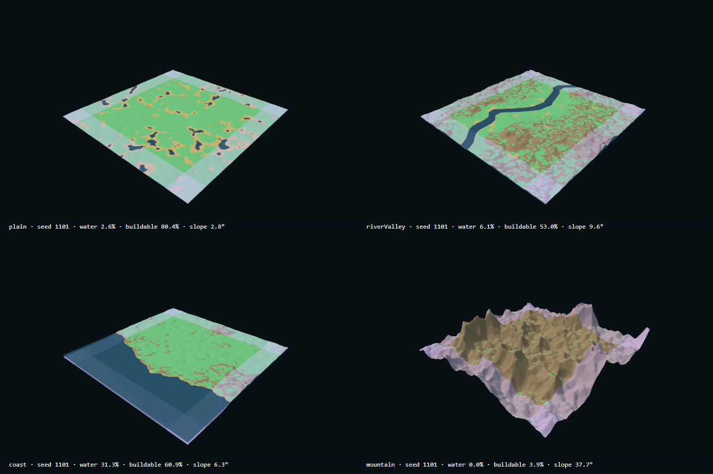 — 2 × 2 grid of four real canvas captures, seed 1101, default variation.
- **Confirmed:** one chunk format and one data interface (`stats`, `boundary`, `fields`) for all landforms; water no longer surrounds the chunk; edge zone marked only, not flattened.
- **Open issues:** plain ponds touch 3 edges for some seeds (allowed by the rule, but they will need edge matching later); plain shore band is wide (17–21%) because 1 m freeboard is large on 3° ground; heights are true metres, so plain relief looks almost flat in 3D; the river is a carved channel at one level, not a downhill flow; landform presets are tuned by probe for these 3 seeds only.
- **Review status:** Pending review.
- **Next single task:** Accept the T1 chunk format and landform presets, then start T2 feature detection on the shared field interface.

### 02.4 — Landform algorithms and adjustable transition zone

- **Date / Stage / Single question:** 2026-10-18 / T1 / Can each landform come from an explicit algorithm (fBm, valley cut, warped shoreline, ridged multifractal) inside the frozen chunk, with an adjustable, continuous edge transition weight that leaves terrain untouched?
- **Reused files or functions:** three's bundled `SimplexNoise` (seeded with `SeededRandom` from flavor-clash; no new dependency); `checksum` (cellular-noise); 02.3 page, lil-gui controls, slope method, boundary-sample layout, and Playwright verifier. `IcelandTerrain` and `TileShape.js` were dropped from this experiment: the cellular-F1 base cannot express fBm or ridged noise, and it computed heights inside the mesh class. `IcelandTerrain` itself is unchanged.
- **Changed files + working-tree state:** new `experiments/seed-terrain/TerrainGenerator.js` (pure height generator in world metres), `ChunkView.js` (render-only terrain + water meshes, transition debug view); rewritten `TerrainFields.js` (pure fields), `config.js`, `main.js`; edited `index.html`; deleted `TileShape.js`; `scripts/verify-seed-terrain.mjs` rewritten for 02.4. Uncommitted; no other experiment changed.
- **Seed / City DNA / key parameters:** chunk 1024 × 1024 m, 257 × 257 samples, 4 m spacing (fixed, shown not editable). Controls: landform, seed 1–9999 (+ random), variation 0–1 (default 0.5), transition width 32–256 m in 16 m steps (default 128), debug view. Rules: plain base 20 m + 7 m fBm + 0.2–0.5° tilt, no water; river valley 32 m channel, 3 m deep, 18 m banks, 230 m valley half-width, water surface falling 2 m/km; coast sea level 0, warped shoreline ±90 m, open sea or enclosed bay chosen by seed; mountain ridged multifractal (4 octaves, base 1/900 m⁻¹) on a 1/1600 m⁻¹ massif mask, relief 300 m. Seeds 1101 / 2202 / 3303. No City DNA.
- **Entry point + verification method:** `/experiments/seed-terrain/?landform=…&seed=…&variation=…&transitionWidth=…&view=transition`; `node scripts/verify-seed-terrain.mjs`. Data API: `window.__seedTerrainLab.fields()` → `height`, `slope`, `waterMask`, `buildableMask`, `transitionWeight`, `boundarySamples` (+ `grid`, `stats`); `neighbors(edges)` is the reserved neighbour-constraint interface.
- **Result + checked data:** all 12 landform × seed pairs reproducible; height and water identical at 32 / 128 / 256 m widths (only the weight field changes); 12 unique height fields; 0 browser errors. River: 0 off-channel water, 0 bank samples below the water surface, max depth 3.0 m, river crosses the chunk for every seed. Coast: 0 land/sea mismatches against the shoreline potential; seed 2202 gives an enclosed bay, 1101 / 3303 cross two edges; water 9–17%. Plain: no water, mean slope 0.8–1.0°, p95 < 2°. Mountain: mean slope 27–30°, p95 54–60°, about 175–200 local peaks/km². Transition: max adjacent weight step 0.1836 / 0.0468 / 0.0235 at 32 / 128 / 256 m vs smoothstep bound 1.5·4/W (+1e-4 export rounding); corners = 1, outer edges = 1, interior = 0, symmetric under both diagonal flips; boundary lines 257 samples, inner line at exactly W. Neighbour interface: identity without neighbours, explicit refusal with neighbour data.
- **Screenshots:** 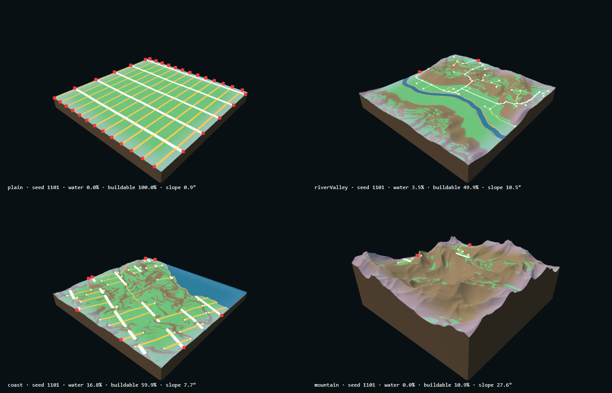 — overall view, seed 1101, variation 0.5, width 128 m. 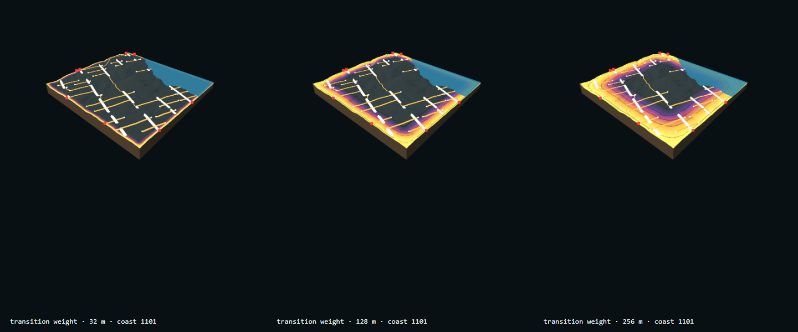 — weight ramp with 0.25 iso-lines; corners round off continuously.
- **Confirmed:** four rule-based landforms in one chunk format; water only where a rule puts it; transition zone stays inside the chunk and is a weight field only; data generation is separate from rendering.
- **Open issues:** neighbour blending itself is not implemented (interface only, by scope); the mountain still has a steep tail (p99 62–71°) and dense small peaks from ridge creases at 4 m sampling; the plain reads as flat in 3D at true metre scale; the continuity bound needed one correction during testing (a diagonal near a corner may move both edge weights, so the bound is 2× rather than √2×); presets are tuned on 3 seeds only; the 02.3 rule "plain has ponds" was replaced by "plain has no water" to match the 02.4 spec.
- **Review status:** Pending review.
- **Next single task:** Review landform presets and the transition weight; then define the neighbour boundary-blend contract before any multi-chunk test.

### 02.5 — T2 terrain analysis: constraints for city generation

- **Date / Stage / Single question:** 2026-10-18 / T2 / Can explainable geographic features and buildability be extracted automatically from the existing 02.4 fields, as one renderer-independent `terrainAnalysis` object?
- **Reused files or functions:** 02.4 `fields` only (`height`, `slope`, `waterMask`, `buildableMask`, `waterSurface`, `boundarySamples`, `grid`) — no regeneration; `EDGES` from `TerrainFields.js`; `checksum` (cellular-noise); `ChunkView` debug-view mechanism; 02.4 verifier helpers (server, browser, composite capture).
- **Changed files + working-tree state:** new `experiments/seed-terrain/TerrainAnalysis.js`; `ChunkView.js` (+ slope and suitability views), `main.js` (+ analysis call, `analysis()` API, two view options), `index.html` (+ one stats row, one legend row); new `scripts/verify-terrain-analysis.mjs`. Generator, chunk spec, and transition logic unchanged (02.4 verifier re-run: pass). Uncommitted.
- **Seed / City DNA / key parameters:** 4 landforms × seeds 1101 / 2202 / 3303, variation 0.5, transition 128 m. Thresholds (all exported in `analysis.thresholds`): suitability high ≤ 5°, medium ≤ 10° (= absolute `buildableMask`), low ≤ 20° and dry above 1 m freeboard (needs grading, not buildable), otherwise unsuitable; fragment < 2,500 m²; direction evidence — linear water elongation ≥ 4, shoreline elongation ≥ 3, relief anisotropy ≥ 0.3, slope coherence ≥ 0.5 and ≥ 0.1°.
- **Entry point + verification method:** `/experiments/seed-terrain/?landform=…&seed=…&view=suitability` (or `view=slope`); `window.__seedTerrainLab.analysis()`; `node scripts/verify-terrain-analysis.mjs` checks reproducibility, exact area totals, component counts against an independent BFS, label/area/edge-contact consistency, suitability ⇔ buildableMask, boundary samples ⇔ waterMask and edge water lengths, direction claims only with passing evidence, and river/coast water–land relations.
- **Data interface (`terrainAnalysis`):** `elevationStats` (min, max, range, area-weighted mean, p5/p50/p95), `slopeStats` (mean, land mean, land p50–p99, 8-bin area histogram), `waterCoverage`, `waterRegions` / `buildableRegions` (count, significant/fragment counts, largest share, up to 12 regions with area, centroid, world/grid bounds, touched edges, plus a full label grid), `dominantDirection` (primary type or `unknown`, every candidate with metric, value, threshold, pass), `boundaryConnections` (per edge: water and buildable runs in world metres with region ids), `suitabilityMask` (0–3 per sample), plus `units`, `grid` (layout and world-coordinate formulas), `areaCheck`, and `signature`. Areas use vertex Voronoi weights (edge ½, corner ¼), so the total is exactly 1,048,576 m².
- **Result + checked data:** 12/12 pass, 0 browser errors. Water / buildable / significant buildable regions / direction: plain 0% / 100% / 1 / unknown (tilt coherence 0.29–0.50 < 0.5); river valley 3.3–3.5% / 49–50% / 19–22 / waterAxis 179°, 83.7°, 4.3° (matches each crossing within 30°); coast 8.6–16.8% / 53–60% / 3–9 / shoreline 19.9° with seaward 297° and 136.9° with seaward 46° (toward the wet edges), enclosed bay 2202 → unknown; mountain 0% / 11–16% / 7–10 / unknown, unknown, reliefGrain 84.6° (anisotropy 0.52).
- **Screenshots:** 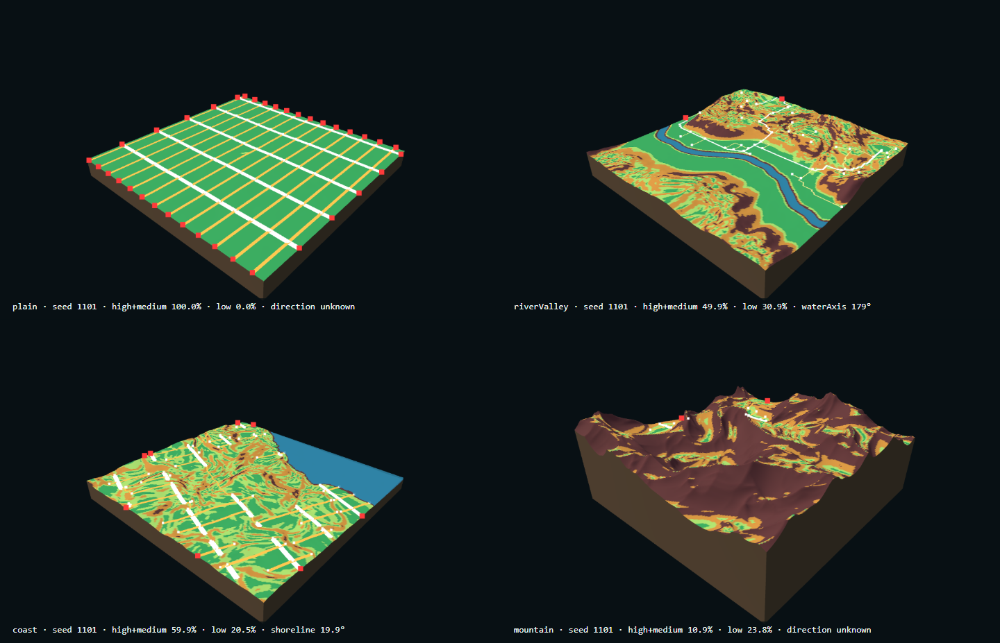 — dark green high, light green medium, orange low (grading), maroon unsuitable, blue water; seed 1101, variation 0.5.
- **Confirmed:** statistics, regions, edge connections, and suitability come from existing fields with traceable thresholds; directions are reported only with passing evidence; analysis is independent of rendering.
- **Open issues:** `signature` hashes masks and labels only, so uniform plains (2202, 3303) share one signature although their statistics differ; plain tilt is real in the generator but below the coherence threshold, so it stays `unknown` (threshold not tuned to pass); buildable areas on river/mountain terrain are fragmented (250–440 components, most below 2,500 m²); 4-neighbour connectivity is a stated choice; direction thresholds are judged on 12 samples only. No upstream data errors found.
- **Review status:** Pending review.
- **Next single task:** Review the `terrainAnalysis` contract and thresholds; then define how T3 City DNA matching reads it.

### 02.6 — T3 terrain-to-city matching (terrain fit, not identity)

- **Date / Stage / Single question:** 2026-10-18 / T3 / Can the existing `terrainAnalysis` rank the three prototype City DNAs by terrain fit, transparently and deterministically, without claiming city identity or inventing research thresholds?
- **Reused files or functions:** `terrainAnalysis` (02.5) only — no re-analysis; prototype decision and rules M1–M3 / V1–V3 / F1–F3 (`research/prototype-city-selection.md`), families F1 / F2 / F4 (`research/city-longlist-60.md`), Manhattan evidence and TBD list (`research/manhattan-spatial-study.md`), evidence classes from `research/city-research-template.md`; page, GUI, panel rows, and verifier helpers.
- **Changed files + working-tree state:** new `experiments/seed-terrain/cityMatchRules.js` (all weights, thresholds, evidence tags, hints), `CityMatcher.js` (pure matcher); `main.js` (+ match after analysis, City DNA override, `cityMatch()` / `selectDNA()` API), `index.html` (+ match row with top-3 reasons); new `scripts/verify-city-match.mjs`. Terrain, transition, and analysis code unchanged (02.4 and 02.5 verifiers re-run: pass). Uncommitted.
- **Seed / City DNA / key parameters:** 4 landforms × seeds 1101 / 2202 / 3303, variation 0.5, width 128 m. DNAs: `manhattanGrid` (F2), `veniceWaterNetwork` (F1), `fezOrganicCore` (F4). Scoring: fitScore = weighted mean of scored conditions (linear ramps / lookups, conflicts cap it); evidenceCoverage = scored weight / total weight (TBD counts in total); rankScore = fit × coverage; weak fit < 0.4; confidence "medium" needs coverage ≥ 0.8 and ≥ 50% V-tagged weight, otherwise "low". The research CSV rows are empty, so every numeric threshold is tagged A (design assumption, uncalibrated); TBD conditions are never scored.
- **Entry point + verification method:** `/experiments/seed-terrain/?landform=…&seed=…&dna=<auto|manhattanGrid|veniceWaterNetwork|fezOrganicCore>`; `window.__seedTerrainLab.cityMatch()`; `node scripts/verify-city-match.mjs` checks determinism, required keys, no geometry in hints, sorted ranks, score = fit × coverage, weak-fit flags, TBD never scored, auto = top, plausibility rules (no water ⇒ Venice 0 via conflict; plain ⇒ grid top and not weak; mountain ⇒ all weak; orientation hint only from a passing direction), manual override for all 3 DNAs without changing terrain, analysis, or ranking, and empty / partial analysis handled without errors.
- **Result + checked data:** 12/12 pass, 0 browser errors. Rankings (rankScore, w = weak): plain → Manhattan 0.80 > Fez 0.29w > Venice 0w (all seeds); river valley → Fez 0.23–0.25w > Venice 0.19w > Manhattan 0.04–0.05w; coast 1101 / 2202 → Manhattan 0.56 / 0.48 > Fez 0.43 > Venice 0.22–0.23w; coast 3303 → Fez 0.40w > Manhattan 0.22w > Venice 0.20w; mountain → all weak (≤ 0.09). Empty analysis → all scores 0, all conditions missing/TBD.
- **Screenshots:** 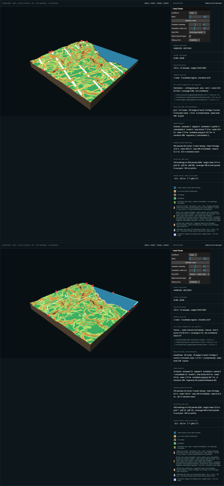 — same terrain signature `4A69CE05 · 602F2BF4` in both; panel shows score, fit × coverage, confidence, and the three decisive reasons.
- **Confirmed:** ranking is config-driven, deterministic, and traceable to tagged conditions; terrain fit and identity are separate fields (`selectedDNA.identityRules`, `identityNote`); hints are constraints only; unknowns are listed in `unresolvedEvidence`.
- **Open issues:** first ranking draft let Fez win coast with fit 1.00 from two lenient A-tagged conditions (5 TBD) — fixed by ranking on fit × coverage, which penalises missing research rather than terrain; Venice never fits because no landform makes lagoons or islands (island metric derived from water labels exists, but no terrain produces islands); Fez has no discriminating terrain condition in the research yet; all thresholds are uncalibrated assumptions; plain gives identical scores for every seed (uniform buildable land); an empty analysis still names Manhattan via tie-break (flagged weak fit, score 0); confidence can never reach "high" until research values exist.
- **Review status:** Pending review.
- **Next single task:** Review the rule table in `cityMatchRules.js` (weights, A-tagged ramps, rank formula); then decide whether research calibration (01.1 measurements) or T4 network generation comes first.

### 03.1 — T4 procedural road / canal network (NetworkGraph)

- **Date / Stage / Single question:** 2026-10-18 / T4 / Can one NetworkGraph structure, driven by three strategy configs (Grid, Organic, Canal-Street), produce deterministic, terrain-legal networks with chunk edge ports from fields + terrainAnalysis + cityMatch?
- **Reused files or functions:** `SurfaceQuery.sampleHeight` (iceland-region; bilinear height via a surfaceData adapter); `RoadMeshBuilder` + `DEFAULT_ROAD_MESH_OPTIONS` (road-mesh; debug ribbons, recoloured per class); `SeededRandom` (flavor-clash); `checksum` (cellular-noise); `terrainAnalysis` (regions, labels, boundary runs) and `cityMatch` (selected DNA, orientation hint); page, GUI, DNA override, verifier helpers. Reviewed but not reused: `RoadProjector` (bound to Iceland's single water level), `WFCRoadGenerator` (tile solver, no graph), flavor-clash Venice canal lanes (hand-placed polylines, not generated water).
- **Changed files + working-tree state:** new `experiments/seed-terrain/networkStrategies.js` (all spacings, widths, limits), `NetworkGraph.js` (GraphBuilder, chain collapse, ports, stats), `NetworkGenerator.js` (sampler, Dijkstra, three strategies), `NetworkView.js` (debug layer); `main.js` (+ network after match, layer toggle, `network()` API), `index.html` (+ network row, legend); new `scripts/verify-road-network.mjs`. Terrain, transition, analysis, and matching code unchanged (02.4–02.6 verifiers re-run: pass). Uncommitted on `experiment/terrain-seam`.
- **Seed / City DNA / key parameters:** seeds 1101 / 2202 / 3303 × 4 landforms × 3 DNAs. DNA → strategy: manhattanGrid → grid, fezOrganicCore → organic, veniceWaterNetwork → canalStreet. Grid: avenues 200 m / cross streets 80 m, widths 20 / 12 m, slope ≤ 10°, orientation from `cityMatch.networkHints.orientation` (else 0°, recorded), seed sets lattice phase, primary-only bridge candidates ≤ 80 m. Organic: slope ≤ 20°, gates = longest buildable boundary run per side, centres = buildable-region centroids (proxies; real gates/markets TBD), 26 lanes 40–320 m, widths 8 / 4 m. Canal-Street: canals = least-cost paths inside generated water (kept central), quays 2 cells (8 m) inland, bridge candidates every 260 m ≤ 70 m span, 14 lanes. All values are design assumptions (A); research spacing/width values are TBD. Transition width 128 m (existing control).
- **Entry point + verification method:** `/experiments/seed-terrain/?landform=…&seed=…&dna=…&network=on|off`; `window.__seedTerrainLab.network()`; `node scripts/verify-road-network.mjs` recomputes in the page: determinism (signature + full JSON), finite in-chunk coordinates, edge endpoints = nodes, every 2 m road sample off water and within the strategy slope, canal samples in water, bridge ends on legal land and span limit, duplicate edges, proper crossings (canal ↔ bridge excepted), nodes on other edges' interiors, port side / elevation / legality / outward direction / incidence, components and dead-end ratio vs stats, terrain + analysis unchanged across DNAs, and structural differences.
- **Result + checked data:** 36/36 combinations pass with 0 issues of every type; 0 browser errors. Plain: grid 148–175 edges, 18.4–19.5 km, 1 component, 0% dead ends, mean degree 2.93–3.02, orientation entropy 0.85–0.90, straightness 1.00, 36–38 ports; organic 40–44 edges, ≈ 5.3 km, 44% dead ends, degree ≈ 1.95, entropy 1.19–1.23, straightness 0.94–0.96, 4 ports. River valley canal-street: 1 canal, 4–5 bridge candidates, 1 road component, 23–27% dead ends, 9–10 ports. Grid on river valley / coast: 4–7 / 14–15 components, 62–66% dead ends (strict 10° limit and no secondary bridges). Mountain: every strategy ≤ 3 km of road.
- **Screenshots:** 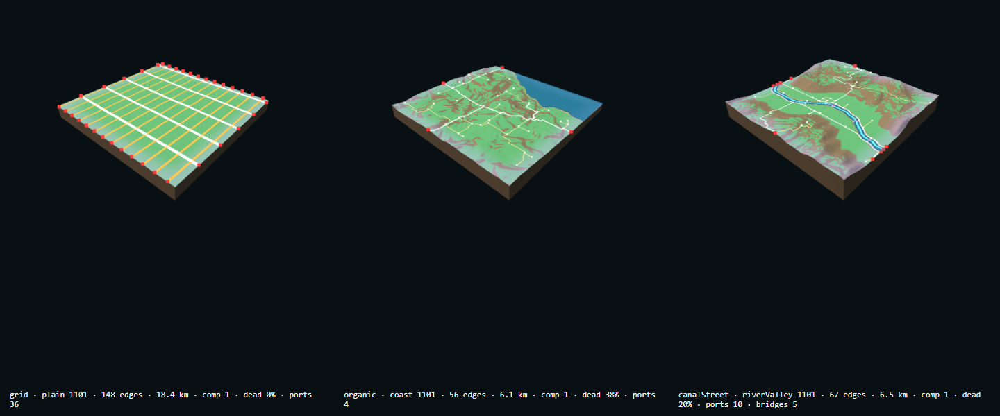 — terrain classes view; white primary, orange secondary, sand lanes, cyan canal, pink bridge candidates, white dots nodes, red dots edge ports. 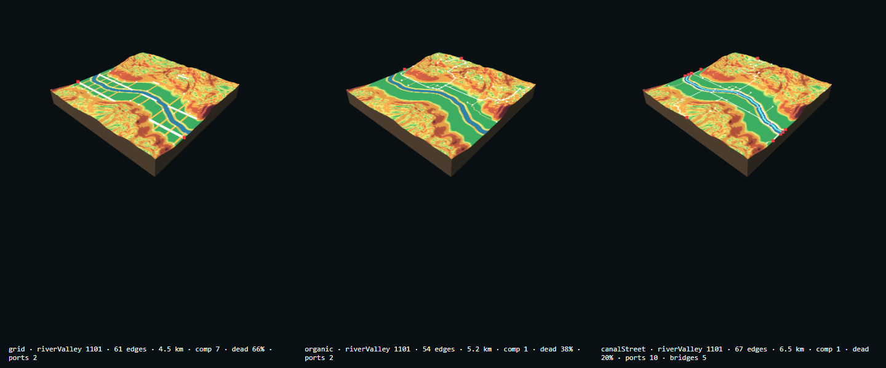 — same terrain, different DNA overrides.
- **Confirmed:** one graph structure and builder for all strategies; networks only read upstream data; roads never on water or beyond the strategy slope, water crossings only as bridge candidates; every edge port lies on its side, is incident to a network edge, and carries a redirect anchor at the transition inner line (`neighborPortId` reserved, unused).
- **Open issues:** grid fragments on coast and river valley (14–15 components, many dead-end stubs) because truncation is strict and cross streets never bridge — needs a design decision; organic and canal-street are trees (mean degree < 2, few loops), and their gates/centres are terrain proxies, not researched nodes; organic does not cross rivers (gates on the far bank stay unconnected); the enclosed bay (coast 2202) gets no canal, only quays; canal-street on waterless terrain falls back to land streets with a warning; road grade along edges is checked only via terrain slope at samples; the terrain-unchanged check compares the analysis signature and a 4,000-value height prefix, not the full height array; spacings and widths are uncalibrated.
- **Review status:** Pending review.
- **Next single task:** Decide grid truncation / bridge policy and whether organic needs loops; then start T5 block closure from the NetworkGraph.

### 03.2 — Mountain roads and tunnel connectivity

- **Date / Stage / Single question:** 2026-10-18 / T4 / When steep terrain cuts the network, can the generator link it with a grade-limited surface road first and, only when justified, a small number of checked tunnels — inside the existing NetworkGraph?
- **Reused files or functions:** 03.1 `GraphBuilder` (extended), `MinHeap`, `findCrossings`, `createSampler` (`SurfaceQuery` heights), Dijkstra pattern, `terrainAnalysis` / fields; `NetworkView` and `RoadMeshBuilder` ribbons; 03.1 verifier helpers.
- **Changed files + working-tree state:** new `experiments/seed-terrain/TunnelPlanner.js`, new `scripts/verify-tunnels.mjs`; `networkStrategies.js` (+ `CONNECTIVITY`), `NetworkGraph.js` (tunnel kind, `portal` nodes, `splitEdgeAt`, graded split elevations, tunnel stats), `NetworkGenerator.js` (planner call after pruning; exports), `NetworkView.js` (x-ray tunnel line, portal markers; tunnels excluded from ribbons), `main.js` / `index.html` (counts, legend), `scripts/verify-road-network.mjs` (mountain-road and tunnel rules). Terrain, analysis, matching, and DNA rules unchanged. Uncommitted.
- **Seed / City DNA / key parameters:** mountain seeds 1101 / 2202 / 3303 × 3 DNAs; transition 128 m. Demands: road components ≥ 200 m cut off from the main network, and chunk sides without a road port that have ≥ 40 m of legal boundary land; water-separated demands are skipped (bridge policy). Mountain road (A): 16-direction moves, terrain slope ≤ 30°, step grade ≤ 15%. Tunnel (A, test assumptions): 80–700 m, grade ≤ 6%, clearance 7 m, cover ≥ 10 m outside 30 m portal zones, ground ≥ road level in portal zones, no water, entirely outside the transition zone, portals reached by grade-limited approach roads, cost 8 × length + approaches. A tunnel is built only if no surface route exists, or detour > 3 and tunnel cost < 0.6 × surface cost; ≤ 2 per chunk, a second only for a component ≥ 500 m.
- **Entry point + verification method:** `/experiments/seed-terrain/?landform=mountain&seed=…&dna=…&view=slope`; `network().connectivity.decisions`; `node scripts/verify-tunnels.mjs` recomputes each tunnel profile from raw heights (length, grade, cover, daylight, water, transition), portal level vs ground (< 0.5 m), portals joined to surface roads, necessity (removing the tunnel disconnects the graph), justification against the recorded surface alternative, duplicates, reproducibility, unchanged analysis, and scenario coverage. `verify-road-network.mjs` re-run on all 36 combinations with mountain-road grade rules: pass.
- **Result + checked data:** 9/9 mountain runs pass, 0 browser errors. Tunnels: 2202 → 0 for every DNA (side demands have no reachable portal outside the transition zone); 1101 → 0 for grid (15 feasible alignments, all rejected because their approach roads would cross the network) and 1 for organic / canal-street (630 m, −0.38%, min cover 11.2 m); 3303 → 1 for every DNA (146–150 m, 2.5–4.5%, min cover 19.5–21.6 m) chosen from 47 feasible of 18,178 evaluated alignments. Every built tunnel had no surface alternative, is necessary, and its portals sit on ground joined to surface roads. Mountain roads: 1–6 per run. Other landforms: 0 tunnels; surface connectors only where slopes split the grid (coast / river valley).
- **Screenshots:** 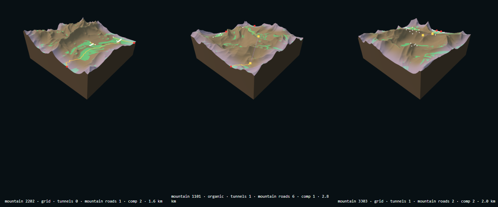 — classes view; sand mountain roads, violet dashed tunnels, yellow portals. 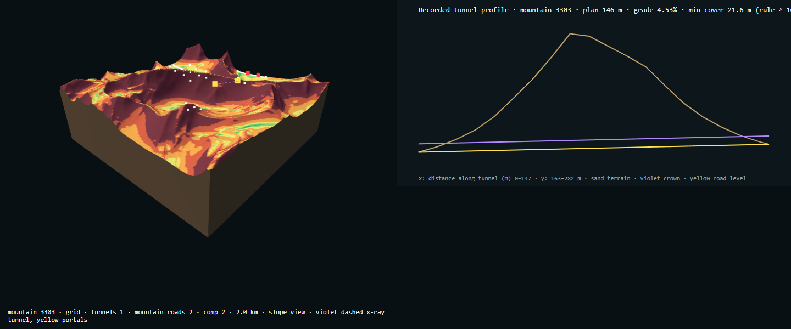 — slope view with x-ray line; profile plotted from the stored `tunnel.profile` data.
- **Confirmed:** tunnels are ordinary NetworkGraph edges (`kind: 'tunnel'`) with portals, plan / 3D length, grade, cover profile, approach lengths, demand, surface alternative, candidate counts, and cost; surface roads are always tried first; no tunnel is forced to reach the limit; upstream terrain is never modified.
- **Open issues:** terrain mesh is not opened at portals — geometry is centreline + markers only (TODO: portal cut or frame mesh); the x-ray line is faint at full-chunk camera distance; most side demands on mountains stay unresolved (no grade-limited route and no valid tunnel); during testing two defects were found and fixed — a connector joined the wrong edge in a shared cell (now attaches to the sample closest to the cell centre) and a split point on a mountain road took terrain height instead of the graded profile (now interpolated); mountain-road grade is checked per vertex segment (≥ 3 m), not continuously between vertices; all engineering thresholds are uncalibrated assumptions; no seed produced two tunnels, so the second-tunnel rule is untested.
- **Review status:** Pending review.
- **Next single task:** Decide on portal geometry (terrain cut vs frame mesh) and whether unresolved side demands need another strategy; then resume T5 block closure.

### 04.1 — T5 procedural urban blocks

- **Date / Stage / Single question:** 2026-10-18 / T5 / Can valid closed block polygons (with holes) be extracted from the existing surface roads (real widths), water, and chunk edge, with buildability from the existing fields, for all three network strategies?
- **Reused files or functions:** NetworkGraph (surface edges, widths, node/edge ids), fields (`height`, `waterSurface`, `slope`, `buildableMask`), `terrainAnalysis.suitabilityMask`, `cityMatch` (selected DNA, parcel hint), grid spacing from `networkStrategies.js`, `checksum`, ChunkView debug-view mechanism, verifier helpers. No geometry library is installed; none was added.
- **Method:** availability field on a 1 m grid = min(exact distance to each surface road / bridge centreline − ½ width, bilinear height − water surface); tunnels and canals never enter it. Blocks = 4-connected positive regions; boundaries = marching-squares zero contours with saddles resolved to match the labelling, so rings are closed, simple, and disjoint; holes come out naturally. Each boundary vertex records its cause (road edge id, water, chunk edge). Douglas–Peucker 0.3 m is kept only if the block stays valid. Buildable status from the share of the block in `buildableMask` (≥ 0.8 buildable, ≥ 0.3 partial). Pieces < 100 m² are remnants.
- **Changed files + working-tree state:** new `experiments/seed-terrain/blockRules.js`, `BlockGenerator.js`, `BlockView.js`, `scripts/verify-blocks.mjs`; `ChunkView.js` (+ "Blocks" debug view), `main.js` (+ block generation after the network, `blocks()` API, `waterSurface` added to `fields()` export, view option), `index.html` (+ blocks row, legend). Terrain, analysis, matching, network, and tunnel code unchanged (03.1 and 02.6 verifiers re-run: pass). Uncommitted.
- **Seed / City DNA / key parameters:** seeds 1101 / 2202 / 3303; grid (manhattanGrid) on plain, organic (fezOrganicCore) on coast, canal-street (veniceWaterNetwork) on river valley, plus grid and organic on mountain for tunnel checks. Resolution 1 m, field cap 3 m, min block 100 m², status thresholds 0.8 / 0.3 (all A).
- **Data interface:** `blocks()` → `{ blocks[], terrainBlockIndex (257² lookup: block index, −2 road, −3 water, −4 remnant), stats, signature, units, rules }`; each block has `id, polygon, holes, area, sampleArea, centroid, boundaryEdges {roads[{edgeId,length}], waterLength, chunkBoundaryLength}, adjacentRoads [{edgeId, roadClass, kind, frontage, nodes}], terrainStats, buildableStatus, enclosure (roads | roadsAndWater | waterOnly | clipped), clippedByBoundary, metrics, dnaContext, valid`. Example: grid plain 1101 `B15`, 12,218.5 m², enclosed by edges 1, 15 (primary) and 71, 77 (secondary), buildable share 1.0 (grid design block 12,512 m²; corners are rounded by the road distance field).
- **Entry point + verification method:** `/experiments/seed-terrain/?landform=…&seed=…&dna=…&view=blocks`; `node scripts/verify-blocks.mjs` checks in the page: ring length, self-intersection, orientation, holes inside, area ≥ 100 m², chunk bounds, overlap / water / road-corridor occupancy on a 2 m lattice (tolerances 0.3 m water, 0.6 m road edge), NetworkGraph references, no tunnel frontage, tunnel invariance (blocks recomputed without tunnel edges must match), area accounting, reproducibility.
- **Result + checked data:** 15/15 runs pass with 0 issues of every type; 0 invalid blocks; 0 browser errors; area residual < 1 m²; lattice area within 1% of polygon area. Grid / plain: 83–84 blocks, 48–60 road-enclosed, 23–36 clipped, all buildable; blocks 78–80 ha, road corridors 24.7–26.4 ha. Organic / coast: 4–5 blocks, 0 road-enclosed (1 road + water), 4 clipped regions; blocks 84–92 ha, roads 3.7–4.3 ha, water 9.1–17.6 ha, buildable inside blocks 52–59 ha. Canal-street / river valley: 7–10 blocks, 2–3 enclosed by quays + water, 4–7 clipped, 71–135 remnants; blocks ≈ 98 ha, roads 3.5 ha, water 3.7 ha, buildable inside 50–51 ha. Mountain: 1–2 clipped regions, mostly unbuildable (11–16 ha buildable in ≈ 103 ha); with tunnels present, blocks are identical with or without tunnel edges.
- **Screenshots:** 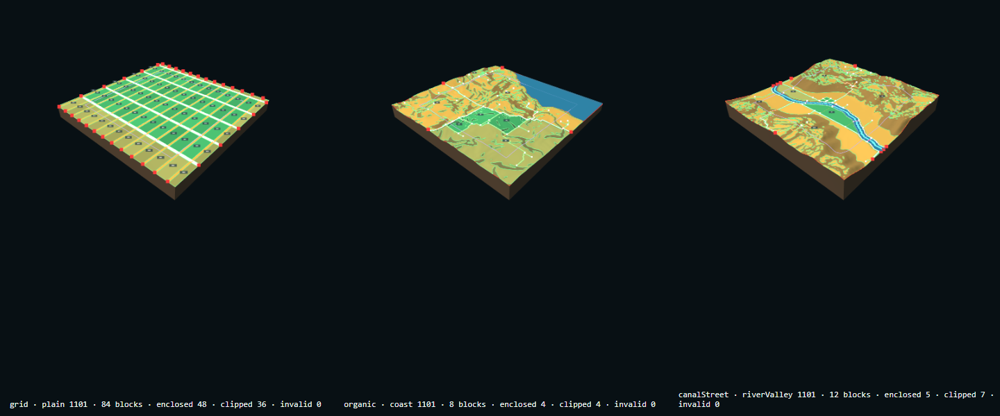 — status colours, clipped tint, outlines. 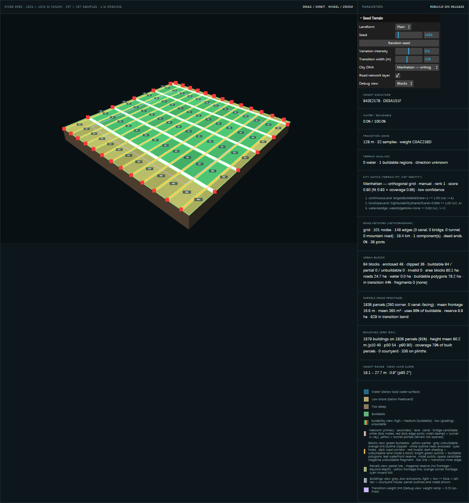.
- **Confirmed:** blocks are valid, disjoint, inside the chunk, off water and road corridors, linked to NetworkGraph edges and nodes; tunnels never cut blocks; buildability is measured, not assumed; data is separate from rendering.
- **Open issues:** organic and canal-street networks are tree-like, so they form almost no road-enclosed blocks — their "blocks" are large clipped open regions; a closed-block result for them needs loop-forming networks (not faked here); canal-street leaves 71–135 thin remnants between quays and water; grid blocks have rounded corners (distance-field geometry) instead of sharp road-boundary corners; unbuildable land is reported per block, not cut out of the polygon; transition-zone share per block is not yet recorded; port 4190 would not serve during testing (verifier moved to 4195; cause not investigated).
- **Review status:** Pending review.
- **Next single task:** Decide whether organic / canal-street need loop closure before parcels, and whether steep land should be cut out of blocks; then start parcel subdivision on grid blocks.

### 03.3 — Organic / canal-street loop closure

- **Date / Stage / Single question:** 2026-10-18 / T4 → T5 / Can a local loop-closure step make the tree-like organic and canal-street networks form real enclosed blocks, without faking closures, flattening their character, or touching grid and tunnels?
- **Reused files or functions:** 03.1 `CellNetwork` (shared cells become nodes), `searchPath` (extended), `landCost`, `cellDistance`, seeded `random`; 04.1 Block Generator unchanged (re-run for Before/After); verifier helpers.
- **Algorithm (after lanes, before emitting edges; organic and canal-street only):** (1) dead ends in seeded order, at most `closeShare` of them: try a straight extension along the dead end's heading (greedy 4-neighbour march), else a least-cost link; (2) branch links from mid-lane cells sampled every 40 m. Other road cells are barriers in the search (reached, never crossed), so every meeting point is a shared cell → topological node. A candidate is accepted only if: every interior cell is land, within the strategy slope, outside the transition zone, and not a road; length ≤ `maxLinkLength`; loop perimeter (network distance + new path) within [min, max]; network distance ≥ 2.5 × new path (a real shortcut, not a parallel road); ≥ 2 cells (8 m) from other roads except near its ends; ≥ 50% of cells buildable. Bridges are not in the cell network, so no loop closes across water. Each accepted link is recorded in `network().loops.links`.
- **Changed files + working-tree state:** `experiments/seed-terrain/NetworkGenerator.js` (`closeLoops`, `networkDistances`, `searchPath` gains step count + barrier, `generateNetwork(..., options)`), `networkStrategies.js` (`loops` blocks for organic and canal-street), `main.js` (`?loops=off` reproduces the Before network); new `scripts/verify-loops.mjs`. Grid, tunnels, terrain, analysis, matching, and blocks code unchanged. Uncommitted.
- **Seed / City DNA / key parameters:** seeds 1101 / 2202 / 3303; organic (fezOrganicCore) on coast and plain; canal-street (veniceWaterNetwork) on river valley and coast. Organic loops: link ≤ 200 m, extension ≤ 120 m, perimeter 180–1,000 m, close ≤ 50% of dead ends, ≤ 6 branch links. Canal-street loops: link ≤ 140 m, extension ≤ 100 m, perimeter 140–700 m, close ≤ 60%, ≤ 6 branch links. All A: cityMatch gives no numeric block scale for Fez or Venice (research TBD). During tuning the organic link limit was raised from 160 m to 200 m and the max perimeter from 900 m to 1,000 m because organic lanes are ≈ 180 m apart; the search cost budget was raised from 6× to 10× link length.
- **Entry point + verification method:** `/experiments/seed-terrain/?landform=…&seed=…&dna=…&view=blocks[&loops=off]`; `node scripts/verify-loops.mjs` compares Before/After per run and checks every recorded link (transition, water, slope, length, perimeter, goal on the network), invalid blocks, exactly one new cycle per link, all EdgePorts kept, dead-end ratio > 15%, straightness < 0.99, reproducibility. `verify-road-network`, `verify-tunnels`, `verify-blocks` re-run: pass (tunnel results identical to 03.2).
- **Result + checked data (Before → After):** organic coast 1101 / 2202 / 3303: cycles 0→4 / 0→5 / 0→13, dead ends 45→38 / 44→36 / 44→25%, enclosed blocks 0→4 / 1→6 / 0→13 (0→6.4 / 0.1→8.8 / 0→7.1 ha). Organic plain: cycles 0→8–10, dead ends 44→28–29%, enclosed blocks 0→8–10 (10.4–15.4 ha). Canal-street river valley: cycles 3–4→7–8, dead ends 23–27→19–20%, enclosed blocks 2–3→5–9 (≤ 3.8→2.8–4.2 ha). Canal-street coast: cycles 0→1–4, enclosed 6–14→7–18 (0.1–0.3→1.0–4.6 ha). Road length +0.2–1.2 km. Invalid blocks 0→0 everywhere; remnants unchanged or lower.
- **Screenshots:** 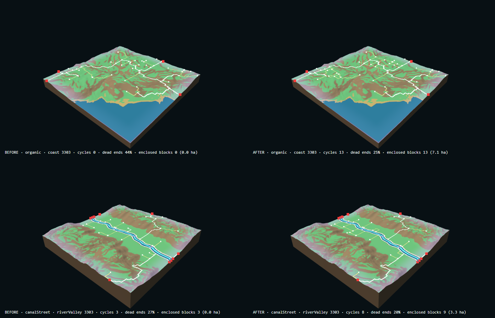 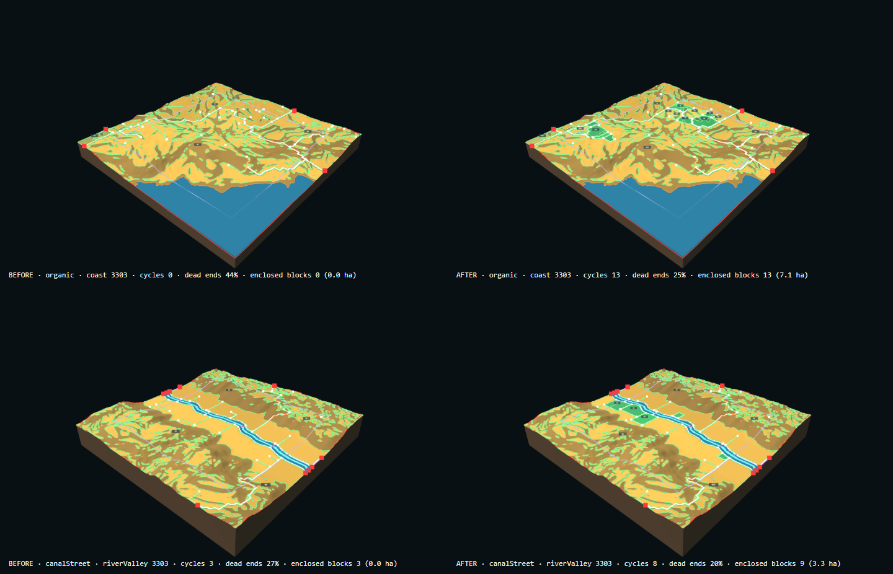
- **Confirmed:** new links always create topology (shared cells), never cross water or the transition zone, never remove EdgePorts; organic keeps 25–38% dead ends and curved paths (straightness < 0.99); grid and tunnels unaffected.
- **Open issues:** gains are uneven — coast 1101 / 2202 organic and coast 2202 canal-street add only 1–5 loops; most `noPath` rejections come from sparse networks where no acceptable goal lies within the link limit; enclosed areas stay small relative to the chunk (most land is still in large clipped regions); canal-street enclosed blocks are mostly small quay + water strips; loop size limits are assumptions, not Fez / Venice measurements; two link types (endpoint joins and branch links) were validated, but extension links were rarely accepted (1 per run at most).
- **Review status:** Pending review.
- **Next single task:** Accept or tune the loop limits; then begin parcel subdivision on enclosed blocks.

### 04.1b — Block refinement: buildable polygons, waterfront fragments, transition shares

- **Date / Stage / Single question:** 2026-10-18 / T5 / Can each existing block carry an accurate buildable MultiPolygon, classified fragments (nothing deleted), and transition-band shares, without changing block outlines, roads, or terrain?
- **Reused files or functions:** 04.1 availability field, labelling, marching squares, `dedupeRing` / `simplifyRing` / `ringsIntersect` (now exported); fields (`slope`, `height`, `waterSurface`), `CHUNK.maxBuildableSlope` (10°) and `CHUNK.shoreFreeboard` (1 m) as the existing buildable rule; ChunkView "Blocks" view and BlockView outlines; verifier helpers.
- **Method:** (1) Buildable field on the same 1 m grid = min(block availability, distance to the block's final simplified edges − 0.6 m, (10° − bilinear slope)·0.2, height − water surface − 1 m); contoured with the 04.1 marching squares → MultiPolygons with holes, each inside its block (pieces < 25 m² counted as unbuildable; a simplified piece is kept only if valid and contained, else the raw contour). (2) Former remnants (< 100 m²) are kept as `fragments`; they and thin water-touching blocks (< 2,500 m², width 2A/P < 10 m) are classified in order: buildableFragment → publicSpaceCandidate → waterfrontReserve → unbuildable, with reasons. Merge candidates (regions within 2 samples) are recorded with their separator; a merge is legal only with no road, water, or chunk edge between. (3) Transition areas by exact Sutherland–Hodgman clipping against the inner square (corners counted once), for blocks and buildable pieces.
- **Changed files + working-tree state:** new `experiments/seed-terrain/BlockRefinement.js`, `scripts/verify-block-refinement.mjs`; `BlockGenerator.js` (remnants kept as fragments, helpers exported, refinement call, fragment codes ≤ −10 in `terrainBlockIndex`), `blockRules.js` (`buildable`, `fragments`), `ChunkView.js` / `BlockView.js` (unbuildable shading, buildable outlines, fragment colours, transition inner line), `main.js` / `index.html` (panel, legend). Block outlines, roads, tunnels, terrain unchanged (04.1 and 03.3 verifiers re-run: pass). Uncommitted.
- **Data interface (added per block; polygon, id, road refs, DNA context unchanged):** `buildablePolygons [{polygon, holes, area}]`, `buildableArea`, `unbuildableArea`, `buildableRasterArea`, `buildableAreaError`, `transitionArea`, `transitionAreaRatio`, `buildableTransitionArea`, `buildableTransitionRatio`, `fragmentClassification` (null or `{source, class, reasons, width, area, roadFrontage, waterFrontage, buildableShare, meanSlope}`). New `result.fragments[]` (same buildable/transition fields) and `result.refinement` (before/after fragment counts, classes, merge candidates, area totals, transition totals).
- **Seed / City DNA / key parameters:** seeds 1101 / 2202 / 3303; grid / plain, organic / coast, canal-street / river valley and coast; transition 128 m (+ 32 / 256 m width test). Edge margin 0.6 m, min piece 25 m², fragment thresholds as in `blockRules.js` (all A, test parameters, not building codes).
- **Entry point + verification method:** `/experiments/seed-terrain/?…&view=blocks`; `blocks()`; `node scripts/verify-block-refinement.mjs` checks with stratified-jitter sampling (one random point per 2 m cell): ring validity / orientation / holes, buildable inside its own block and chunk, not on water (freeboard), not steep, not on road corridors, area relations, polygon vs sample area (total < 1%, mean boundary offset < 1 m), transition area vs samples, band upper bound, fragments all classified and none deleted, no legal merge forced, reproducibility, width series.
- **Result + checked data:** 12/12 runs + width series pass, 0 invalid / uncontained pieces, 0 browser errors. Grid / plain: blocks 78–80 ha → buildable 76–78 ha; the 1.9–2.0 ha difference is the 0.6 m edge margin (all of it is otherwise buildable). Organic / coast: 84–92 ha → buildable 51–59 ha, unbuildable 25–35 ha (steep land). Canal-street / river valley: ≈ 98 ha → buildable 49–50 ha. Area error vs samples: total ≤ 0.04%, mean boundary offset ≤ 0.24 m. Fragments: canal-street river valley 72–134 classified (almost all waterfrontReserve, 0.09–0.2 ha in total), coast 36–93 (waterfrontReserve, plus 2 publicSpaceCandidate on 3303); organic coast 2202: 3 waterfrontReserve + 1 publicSpaceCandidate; grid plain 3303: 15 unbuildable; deleted 0 everywhere. Merge candidates 0–145 per run, legal 0 (separated by water or road). Transition band (128 m): 39–48% of block area, buildable share in band 40–51%; width 32 / 128 / 256 m → grid plain block area in band 10.0 / 34.9 / 59.8 ha with unchanged block polygons; river valley network geometry changes with width (03.3 loops avoid the band), so its blocks differ by width.
- **Screenshots:** 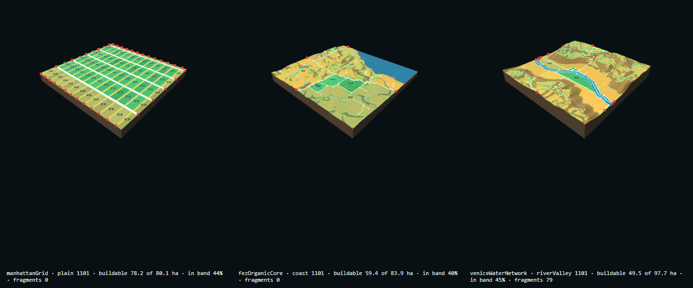 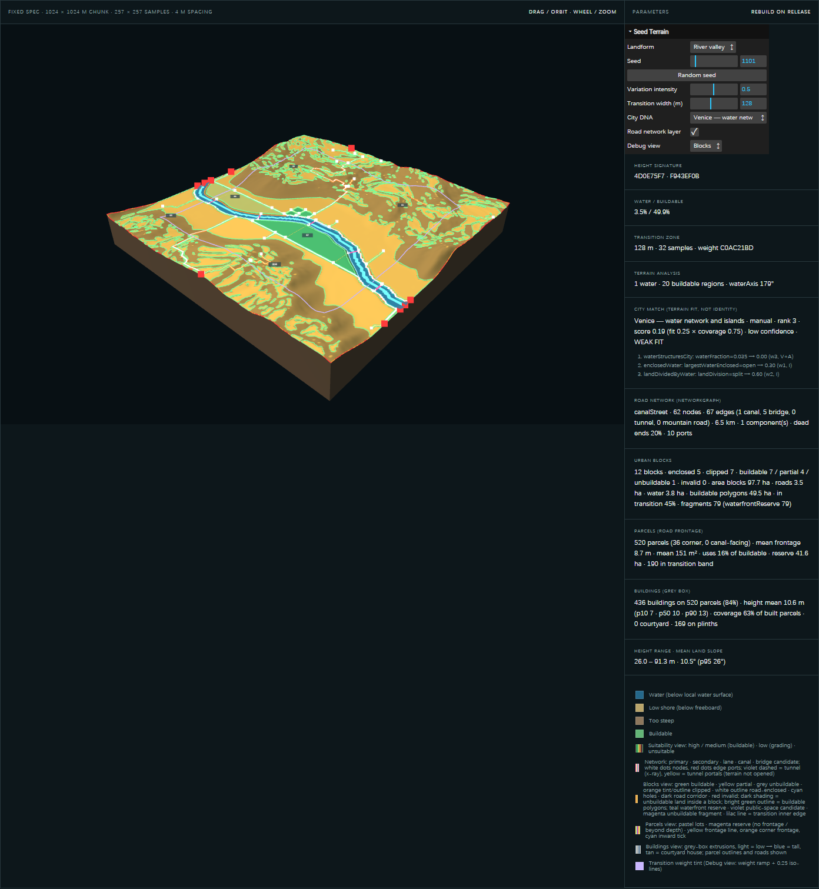
- **Problems found during testing (fixed / explained):** buildable outlines could cross block outlines where both were simplified independently → margin now measured to the final block edges, and applied to samples outside the block too (one sample had sat exactly on a raw edge); the verifier's regular 2 m lattice aliased against the grid (≈ 2% bias) → stratified jitter; per-block relative error was meaningless for thin blocks → mean boundary offset; "network changes with width" was metadata only on the grid → geometry-only comparison.
- **Open issues:** no legal fragment merge exists under the current geometry (every pair is separated by water or road), so merging is effectively a no-op; waterfront fragments are mostly 1–50 m² slivers — classified, not consolidated; the 0.6 m margin removes ≈ 2% of buildable area on grid blocks; transition shares for canal-street depend on the network, which depends on the width; buildable rule uses only slope and freeboard (no flood, legal, or setback rules, by scope).
- **Review status:** Pending review.
- **Next single task:** Start parcel subdivision on `buildablePolygons` of enclosed grid blocks first; decide later whether waterfront reserves become a public-edge layer.

### 04.2 — Road-oriented parcel subdivision

- **Date / Stage / Single question:** 2026-10-18 / T5 → T6 / Can parcels be generated from real surface-road frontage inside `buildablePolygons`, at the selected DNA's lot scale, with valid geometry, real topological frontage, and explicit reserve for land that cannot be parcelled?
- **Reused files or functions:** 04.1 / 04.1b block field, labels, buildable field (exposed as hidden `_internal`), `contours`, `label`, `dedupeRing`, `simplifyRing`, `ringsIntersect`, `transitionArea`; NetworkGraph edges (surface roads, widths, nodes); `cityMatch.selectedDNA`; `SeededRandom`; Blocks debug view and BlockView; verifier helpers.
- **Method:** (1) Frontage runs: every `road` edge (bridges and tunnels excluded) is walked in 2 m steps; on each side a probe 2 m inside the road edge finds the fronting block; consecutive hits form a run on the road-edge line (road id, class, nodes). (2) Runs are cut at the DNA target frontage (grid equal, organic / canal seeded jitter); remainders below `minFrontage` are merged. End pieces of two different roads within 12 m in one block form a corner lot. (3) Lot cells: each buildable 1 m sample takes its nearest lot; the cell value is min over other lots X of (dX − dP) / |eP − eX| (first-order distance to the shared bisector), capped by the depth limit, combined with the buildable field and a 0.25 m inset; the pairwise term is antisymmetric, so neighbours share one boundary and cannot overlap. (4) Polygons by local marching squares per lot; disconnected parts and lots that fail area, contact, or validity rules become residuals with reasons. (5) Frontage contact is measured, not assumed: each piece is walked in 1 m steps and probed inward up to 2.35 m for samples of the kept polygon; only roads with measured contact count. (6) Buildable land in blocks not covered by a valid parcel is reserve (reason: no road frontage, or beyond lot depth / unresolved).
- **Changed files + working-tree state:** new `experiments/seed-terrain/parcelRules.js`, `ParcelGenerator.js`, `ParcelView.js`, `scripts/verify-parcels.mjs`; `BlockGenerator.js` (hidden `_internal`), `BlockRefinement.js` (exports `transitionArea`, keeps the buildable field), `ChunkView.js` ("parcels" view), `main.js` (parcel step, `parcels()` API, view option, `?focus=x,z,distance` camera start), `index.html` (row, legend). Terrain, network, tunnels, and block outlines unchanged (04.1 and 04.1b verifiers re-run: pass). Uncommitted.
- **Seed / City DNA / key parameters:** seeds 1101 / 2202 / 3303; grid (manhattanGrid) / plain, organic (fezOrganicCore) / coast, canal-street (veniceWaterNetwork) / river valley. Targets (A, lot sizes TBD in research): grid frontage 15 m, depth ≤ 32 m, min frontage 6 m, min area 90 m²; organic 10 m ± 35%, depth ≤ 22 m, min 5 m / 50 m²; canal-street 9 m ± 25%, depth ≤ 20 m, min 5 m / 50 m². Inset 0.25 m, simplify 0.2 m, corner join 12 m.
- **Data interface:** `parcels()` → `{ parcels[], residuals[], reserve[], terrainParcelIndex, stats, signature, rules }`; each parcel: `id, blockId, polygon, holes, area, frontageRoadId, frontages[{edgeId, roadClass, length, roadNodes}], frontageType (road | corner), frontageLength (measured contact), canalFrontage, orientation{inwardDeg, frontageAxisDeg}, depth, terrainStats, buildableStatus, transitionRatio, mayBeAdjusted, clippedBlock, roadNodes, frontageLines, buildingInputs {setback, coverage, height: null — TBD}`. Example: grid plain 1101 `B15-P0` corner lot, 217.8 m², frontage 16 m on primary edge 1 + 14 m on secondary edge 71; `B15-P5` 387.8 m², 14 m on primary edge 15, depth 31.7 m.
- **Entry point + verification method:** `/experiments/seed-terrain/?landform=…&seed=…&dna=…&view=parcels[&focus=x,z,distance]`; `node scripts/verify-parcels.mjs` checks ring validity and orientation, min area, chunk bounds, frontage topology (fronting edge is a `road` of the parcel's own block and the parcel reaches its road edge within 2.35 m), overlap / buildable containment (0.6 m edge tolerance) / water / slope / road corridor on stratified 2 m samples, polygon vs sampled area (< 1%), reproducibility, abnormal blocks (> 1,000 m² buildable with no parcel).
- **Result + checked data:** 9/9 runs pass with 0 issues; valid frontage 100%; 0 browser errors; area error ≤ 0.29%; abnormal blocks: none. Grid / plain: 1,810–1,862 parcels (260 corner), mean frontage 16.0–16.6 m, mean 359–366 m², depth 28.4–28.5 m, uses 86.3–86.4% of buildable land, reserve 8.7–9.3 ha; 3303 has 50 lots below 90 m² left unresolved. Organic / coast: 660–717 parcels (40–75 corner), mean frontage 9.4–10.2 m, mean 169–182 m², uses 20.9–21.9%, reserve 39.8–45.9 ha. Canal-street / river valley: 465–520 parcels (30–36 corner), mean frontage 8.3–8.7 m, mean 151–153 m², uses 14.4–15.8%, reserve ≈ 42 ha. Unresolved lots per organic / canal run: 300–600 (below min area, disconnected by steep land, no real contact, nothing buildable within depth). Parcels in the transition band (flagged `mayBeAdjusted`): 137–874 per run.
- **Screenshots:** 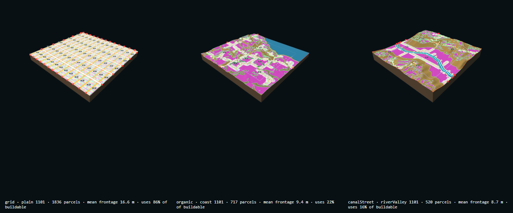 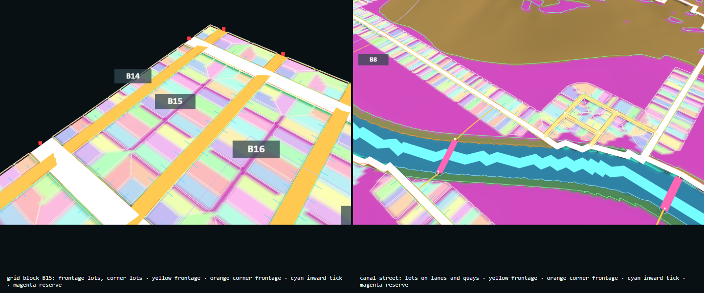
- **Problems found during testing (fixed):** the first lot-cell term ((d2 − d1)/2) is not a metric distance; with the inset it shrank lots to ≈ 7 m width → replaced by the first-order bisector distance (grid utilisation 49% → 86%); corner lots recorded a frontage road they did not reach → frontage is now measured contact on the kept polygon part only; per-lot neighbour evaluation was slow (4.5 s) → foreign samples use only their nearest lot (same shared boundary), now ≈ 2.3 s for grid chunks.
- **Open issues:** organic and canal-street use only 14–22% of buildable land: most of it lies farther than one lot depth from any road (sparse networks), so it stays reserve — not forced into parcels; canal-street lots almost never face water (0–4 canal-facing parcels) because quays sit 8 m inland and the quay–water strip is a waterfront fragment; parcel fills in the 3D view are blurry (4 m vertex colours) while outlines are exact; lot sizes, depths, and courtyard rules are assumptions (research TBD); building envelope inputs are placeholders; grid chunks take ≈ 2.3 s to parcel.
- **Review status:** Pending review.
- **Next single task:** Decide whether interior reserve in organic / canal-street needs secondary access lanes (upstream network) or stays reserve; then define the building envelope rules (setback, coverage, height) for grid parcels.

### 05.1 — Building footprints and grey-box extrusion

- **Date / Stage / Single question:** 2026-10-18 / T6 / Can each valid parcel receive 0 or 1 grey-box building whose footprint follows its road frontage and setbacks, whose height follows the selected DNA, and whose base sits on the terrain without floating or cutting it?
- **Pre-check:** all 04.2 parcels carry a valid polygon, measured frontage lines, a road reference, buildable status, and terrain stats (verified in 04.2); no random point placement was needed.
- **Reused files or functions:** 04.2 parcels (`frontageLines`, `frontages`, `orientation`, `mayBeAdjusted`), `contours`, `label`, `dedupeRing`, `simplifyRing`, `ringsIntersect`, `edgePointLocal` (now exported); `SeededRandom`; three's `ExtrudeGeometry` and `BufferGeometryUtils.mergeGeometries`; ParcelView, network ribbons, debug-view mechanism; verifier helpers.
- **Method:** footprint = contour of a per-parcel local field min(signed distance inside parcel − side setback, distance from frontage line − front setback, max depth − distance from frontage line) at 1 m; footprints not contained (≥ setback − 0.1 m inside, no edge crossing) are recomputed at 0.5 m, then 0.25 m, else the parcel stays vacant. Organic (Fez) parcels ≥ 140 m² use a 4.5 m ring band; the courtyard is kept only if the void is ≥ 12 m², otherwise a solid footprint is used. Occupancy and height jitter use a per-parcel random stream keyed by the parcel id (independent of terrain / network seeds). Height = DNA floor range × clamp(centre gradient around a seeded centre + road class + parcel area, × bounded jitter). Ground: terrain sampled under the footprint (edges every 0.5 m + 1 m lattice); ground floor at the highest point, mesh bottom 0.5 m below the lowest point (plinth); drops > 4 m leave the parcel vacant. One merged mesh for all buildings.
- **Changed files + working-tree state:** new `experiments/seed-terrain/buildingRules.js`, `BuildingGenerator.js`, `BuildingView.js`, `scripts/verify-buildings.mjs`; `ParcelGenerator.js` (exports `edgePointLocal`), `main.js` (building step, "Buildings" view, `buildings()` API), `index.html` (row, legend). Terrain, network, tunnels, blocks, parcels unchanged (04.2 verifier re-run: pass). Uncommitted on `experiment/terrain-seam` (`experiments/seed-terrain/` and `scripts/` untracked).
- **Seed / City DNA / key parameters (all A, research TBD):** seeds 1101 / 2202 / 3303. Grid (manhattanGrid) / plain: occupancy 0.92, floors 3–32 × 3.6 m, max depth 26 m, centre radius 380 m. Organic (fezOrganicCore) / coast: occupancy 0.85, floors 1–4 × 3.2 m, depth 16 m, courtyard ring 4.5 m. Canal-street (veniceWaterNetwork) / river valley: occupancy 0.85, floors 2–6 × 3.3 m, depth 14 m. Side setback 0.4 m, front setback 0 m.
- **Data interface:** `buildings()` → `{ buildings[], vacant[{parcelId, blockId, reason}], stats, signature, rules }`; each building: `id, parcelId, blockId, footprint{polygon, holes}, footprintArea, baseElevation, groundMin, plinthHeight, bottomElevation, height, floorsEstimate, coverageRatio, frontageRoadId, frontageType, orientationDeg, buildingType (streetFrontage | cornerFrontage | courtyard), validationFlags{inTransition, plinth, courtyard, canalFacing, multiPartDropped, refinedResolution}`. Example: grid `B15-P5-H` 330 m², 12 floors / 43.2 m, coverage 0.85, plinth 0.42 m; organic `B0-P0-H` courtyard house, 204 m² with one void, 2 floors, plinth 1.69 m.
- **Entry point + verification method:** `/experiments/seed-terrain/?…&view=buildings[&focus=x,z,distance]`; `node scripts/verify-buildings.mjs` checks footprint validity / orientation / holes, containment in the parcel with setback, chunk bounds, height = floors × floor height within the DNA range, ground contact re-sampled independently (mesh bottom below the lowest ground, floor not below the highest ground, plinth ≤ 4 m), collisions / water / slope / road corridor on stratified 2 m samples, footprint area vs samples (< 2%), occupancy within the density rule, ≥ 3 distinct floor counts, grid p90 / p10 ≥ 1.8, street-wall share, orientation deviation, reproducibility, upstream signatures unchanged.
- **Result + checked data:** 9/9 runs pass with 0 issues; 0 browser errors. Grid: 1,664–1,702 buildings (91–92% of parcels), mean height 60.1–60.5 m (p10 36–40, p50 54, p90 90–94, max 115; 25–26 floor counts), coverage 79% of built parcels (72–73% of all parcels), 236–249 corner buildings. Organic: 517–589 buildings (78–82%), mean 5.1–5.6 m (1–3 floors), coverage 69–71%, 98–132 courtyard houses. Canal-street: 374–436 buildings (79–84%), mean 10.0–10.8 m (2–5 floors), coverage 63–64%. Street-wall share 100% everywhere (footprint within 3.0 m of the road edge); mean axis deviation from frontage 9–14°. Vacant: density rule plus 8–36 narrow footprints per organic / canal run and 1 terrain drop > 4 m.
- **Screenshots:** 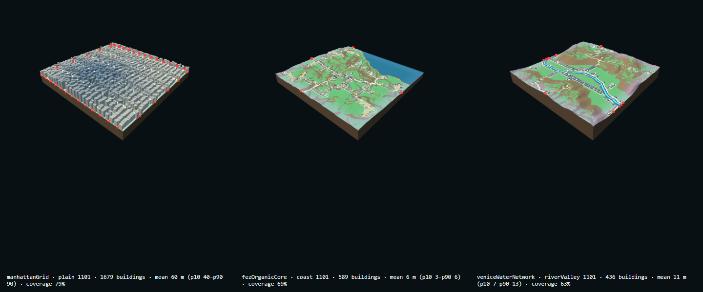 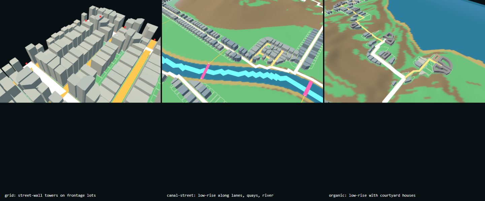
- **Problems found during testing (fixed / explained):** 54 grid footprints crossed sharp parcel corners at 1 m resolution → containment check with finer-grid retry; one organic floor sat below a local ground high point missed by 2 m sampling → 1 m lattice + 0.5 m edge sampling; street-wall share first used an arbitrary 2.0 m threshold (70% on seed 1101, all buildings actually within 2.5 m) → derived 3.0 m threshold from the intended offsets; in-page regeneration used 3-decimal exported heights, so it now only checks that upstream state is untouched (reproducibility comes from reload comparison).
- **Open issues:** grid heights are tall overall (mean ≈ 60 m) — a prototype assumption with no Manhattan measurement yet; organic heights use only 3 floor counts; canal-street buildings almost never face water (0–3 per run) because lots front lanes / quays; courtyard ring is a simplified void; full page rebuild for grid chunks now takes ≈ 5–6 s (blocks + parcels + buildings); no façades, roofs, or materials by scope.
- **Review status:** Pending review.
- **Next single task:** Review DNA height / coverage assumptions against research (Manhattan PLUTO heights first); decide whether pipeline performance needs work before multi-chunk tests.

### 05.1b-1 — Volumetric terrain foundation (closed solid chunk)

- **Date / Stage / Single question:** 2026-10-18 / T6 (tunnel prerequisite) / Can the open terrain surface become a closed, manifold solid (surface + walls + base) without a second terrain, voxels, or any change to heights and downstream interfaces?
- **Reused files or functions:** the rendered surface `PlaneGeometry` (257 × 257, indexed) in `ChunkView` and its vertex positions; fields `height` (sole elevation authority); `checksum`-style hashing; 02.4 evidence for height comparison; verifier helpers.
- **Mesh structure:** surface unchanged (66,049 vertices, 131,072 triangles). Walls: one quad per surface boundary half-edge (edges used by exactly one surface triangle), wound opposite to it, down to a flat base → 1,024 quads; consistent outward orientation by construction. Base: fan from one centre vertex to the 1,024-vertex base ring (a corner fan would create degenerate triangles, since ring points along each side are collinear). Welded result: 67,074 vertices, 201,216 edges, 134,144 faces, Euler characteristic 2. Walls + base are a separate flat-shaded mesh whose top ring copies the surface boundary coordinates bit for bit. Base elevation = min(−60 m, min terrain − 20 m) (A; one common base simplifies later joins and leaves room below roads for tunnels).
- **Changed files + working-tree state:** new `experiments/seed-terrain/TerrainShell.js` (shell builder, closed-mesh check, prism volume), `scripts/verify-solid-terrain.mjs`; `ChunkView.js` (shell mesh, `solidReport`), `main.js` (`?camera=side`, `solid()` API). Terrain generator, heights, water, roads, tunnels, blocks, parcels, buildings unchanged (02.4 and 05.1 verifiers re-run: pass). Uncommitted.
- **Seed / parameters:** plain 1101, river valley 2202, coast 3303, mountain 1101 at variation 0.5; low-elevation coast 1101 and high-relief mountain 3303 at variation 1.0; transition 128 m; base −60 m, min thickness 20 m.
- **Entry point + verification method:** `/experiments/seed-terrain/?landform=…&seed=…[&camera=side]`; `window.__seedTerrainLab.solid()`; `node scripts/verify-solid-terrain.mjs` welds the rendered surface and shell by exact position and checks open / non-manifold / inconsistently oriented edges, degenerate and duplicate faces, Euler characteristic, signed (divergence) volume vs the exact prism volume of the height field, base below terrain by ≥ 20 m, rendered surface y = height field, heights identical to the 02.4 evidence, reproducibility, plus a synthetic terrain dipping to −75 m (base must move to −95 m).
- **Result + checked data:** 6/6 cases + synthetic pass; 0 browser errors. Every case: 0 open, 0 non-manifold, 0 inconsistent edges, 0 degenerate / duplicate faces, χ = 2, volume relative error ≤ 1.4e-14 (positive → outward normals). Terrain vs base: plain 18–28 m (78 m thick), river valley 26–92 m (86 m), coast −10–45 m (50 m), mountain 157–337 m (217 m), low coast −10–60 m (50 m), high mountain 150–471 m (210 m). Heights for the four default cases are identical to 02.4. Synthetic low case: base −95 m, watertight, χ = 2.
- **Screenshots:** 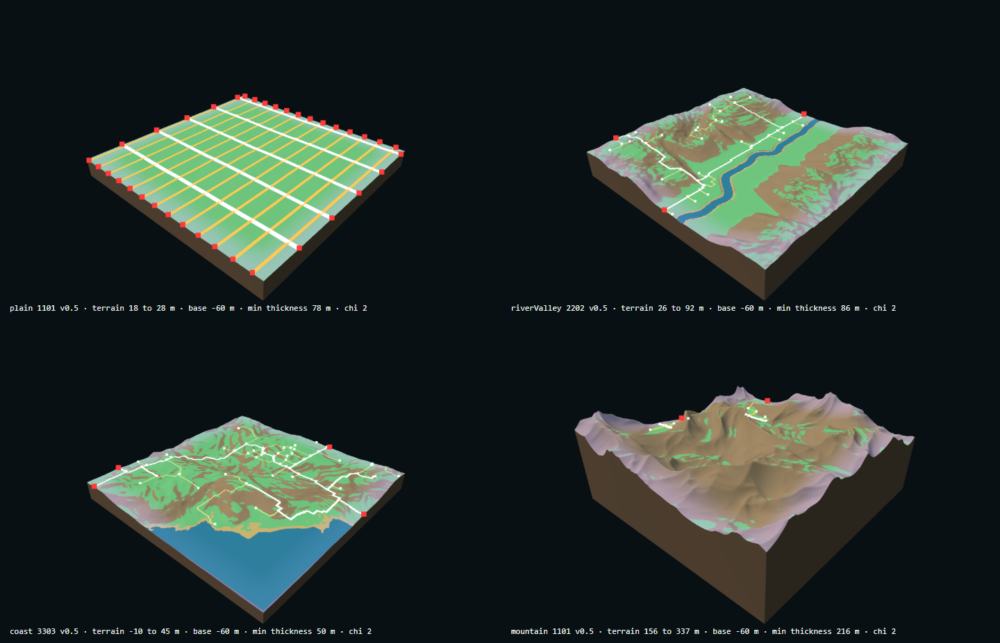 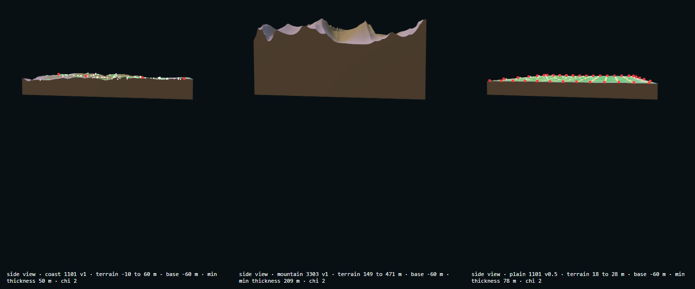
- **Confirmed:** a closed, consistently oriented, manifold solid from the existing surface plus 1,024 wall quads and a base fan; no second terrain, no voxels; all world coordinates and sampling interfaces unchanged.
- **Open issues:** water stays a separate open sheet (the sea is not part of the solid); the debug view is a side camera, not a capped cross-section (a capped cut needs stencil or boolean work — deferred with the tunnel step); the solid exists only as render geometry plus its check, no exported mesh file yet; a common base of −60 m is an assumption that later chunk joins should confirm.
- **Review status:** Pending review.
- **Next single task:** 05.1b-2 — cut real tunnel openings into this solid at the planned portals (local surface re-triangulation + tube), keeping the closed-mesh check passing.

### 05.1b-2 — Tunnel excavation and geometry

- **Date / Stage / Single question:** 2026-10-18 / T6 / Can each valid NetworkGraph tunnel edge become a real excavated passage — open cuts, portal faces, and an arch tube — inside the closed solid, while the solid stays a valid closed manifold and the height field stays untouched?
- **Pre-checks:** 05.1b-1 solid closed (χ = 2, 0 open edges); tunnel edges carry portals, straight plan line, linear road level (grade ≤ 6%), cover profile. Existing tools: no mesh boolean / CSG / SDF-mesh library in the repo (`three-mesh-bvh` is ray acceleration and `webgl-sdf-generator` is text SDF, both pulled in by drei); only `ShapeUtils` (earcut) and the 04.x marching-squares helpers. A global boolean or voxel pass was therefore replaced by local reconstruction.
- **Geometry strategy (local reconstruction):** portal stations sA / sB = first points from each end where ground covers the arch by ≥ 1 m; open cuts [u0, sA] and [sB, u1] = rotated rectangles 12 m wide (9 m tube + 2 × 1.5 m) whose start u0 / end u1 is as far out as ground stays ≥ 0.2 m above the road. Surface triangles crossed by a cut are replaced by T − R from an exact boundary walk (only canonical edge-intersection points and rectangle corners, shared by both neighbours) triangulated with earcut; fully covered triangles are dropped. Each cut is rebuilt as road floor at design level (centroid fan), two vertical side walls and a lip wall (strips from the hole boundary down to road level), and a vertical portal face with an arch notch (earcut on the simple polygon; a zipper triangulation folded under the arch dome and was replaced). The tube is an arch section (9 m wide, 7 m clearance, 2.5 m walls + semicircle) lofted every ≈ 4 m between the portal rings, which are the portal notches themselves. Expected topology: χ = 2 − 2·tunnels; expected volume = prism − cut volume − tube volume (both exact).
- **Rejection rules (tunnel kept in the graph, solid left untouched):** no portal location, tube < 20 m, tube vertex with < 1 m ground above (daylight), cut needing fill or not monotone, cut / tube over water, road < 5 m above the base, cut within 8 m of the chunk edge, portal road > 0.5 m off the ground, open approach > 1.5 m off the ground, overlap with an accepted tunnel's cuts or tube, cut crossing another surface road or a building, per-chunk limit (2).
- **Changed files + working-tree state:** new `experiments/seed-terrain/TunnelGeometry.js`, `scripts/verify-tunnel-excavation.mjs`; `ChunkView.js` (full index kept, cut-aware surface index, rim and tunnel meshes, rim recolouring, `setXray`, tunnel-aware `solidReport`), `TerrainShell.js` (Euler count uses referenced vertices only), `main.js` (tunnel step after buildings with current heights, `tunnels()` API, `?xray=1`, debug handle `__seedTerrainScene`). Network, terrain, parcels, buildings, chunk size, DNA unchanged (05.1b-1, 03.2, 05.1 verifiers re-run: pass). Uncommitted on `experiment/terrain-seam` (37 untracked paths incl. `experiments/seed-terrain/`, `scripts/`).
- **Seed / DNA / parameters (all A):** A — plain 1101 grid, mountain 2202 grid (no tunnels); B — mountain 3303 grid, mountain 1101 organic, mountain 3303 organic (one tunnel each); C — synthetic candidates on mountain 3303 (4 m shifted copy, 60° crossing copy, limit 0); D — tunnel raised 20 m, tunnel across the plain, tunnel from the sea on coast 1101. Width 9 m, clearance 7 m, cut margin 1.5 m, portal cover 1 m, min rock 1 m, min cut depth 0.2 m, ring step 4 m.
- **Entry point + verification method:** `/experiments/seed-terrain/?landform=mountain&seed=3303&dna=manhattanGrid[&xray=1][&focus=x,z,d]`; `window.__seedTerrainLab.tunnels()` and `solid()`; `node scripts/verify-tunnel-excavation.mjs` checks the rendered solid (open / non-manifold / inconsistent edges, degenerate / duplicate faces, χ vs 2 − 2·tunnels, volume vs prism − excavation), through-passage rays at the centre (half clearance) and near both walls from cut start to cut end against every solid triangle, floor at design level, clearance and half-width, cover over tube vertices, patch-edge / surface-triangle crossings, grade change against approach roads, reproducibility, identity with 05.1b-1 when there is no tunnel, and the C / D refusals leaving the solid untouched.
- **Result + checked data:** all checks pass, 0 browser errors. A: 67,074 V / 134,144 F, χ = 2, identical to 05.1b-1. B: 3 tunnels built — mountain 3303 grid: tube 120.5 m, cuts 12.5 / 10.5 m, lips 0.48 / 1.15 m, grade 4.53%, min tube cover 4.5 m; mountain 1101 organic: tube 601.2 m, cuts 14.5 / 11.0 m, lips 0.85 / 0.55 m, grade −0.38%, cover 3.4 m; mountain 3303 organic: tube 123.4 m, cuts 11.5 / 13.5 m, grade 2.52%, cover 4.4 m. Each: χ = 0, 0 open / inconsistent / degenerate, volume error ≤ 5.9e-12, rays blocked 0 / 3, crossings 0, clearance 7 m, floor at design level. C: real accepted, 4 m copy rejected (intersects tunnel real), 60° copy rejected (cut would need fill), limit 0 rejects. D: raised (portal road 20 m off the ground), plain (no portal location), sea (portal road 0.6 m off the ground) — all rejected with nothing cut. Geometry time ≈ 25–30 ms per tunnel.
- **Screenshots:** 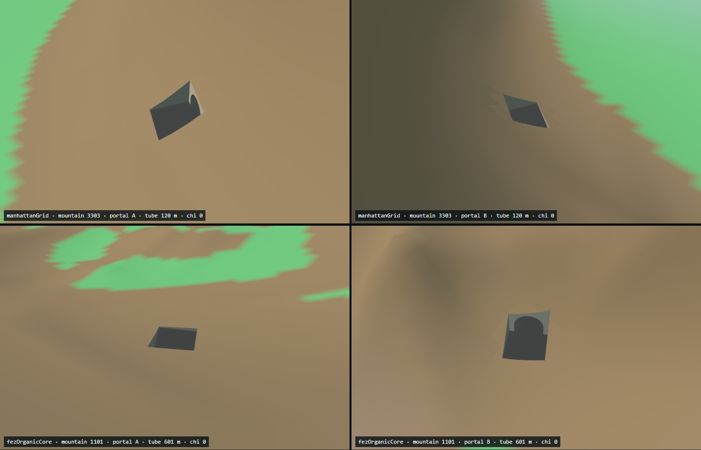 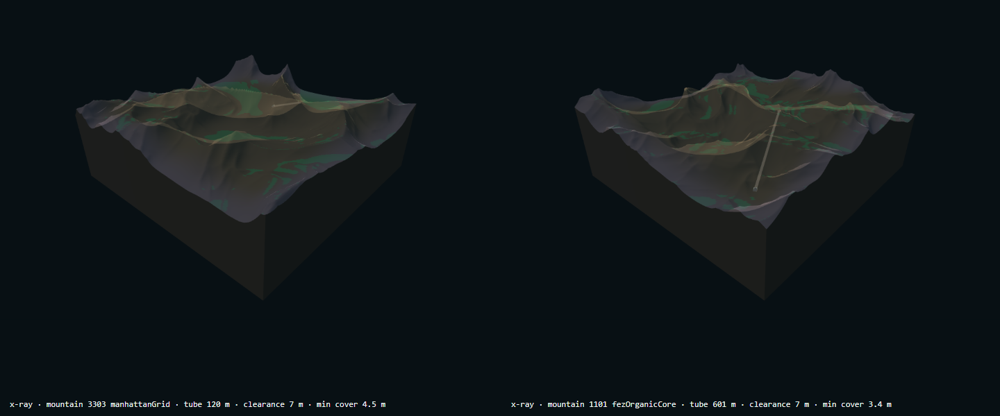
- **Problems found during testing (fixed):** zipper portal triangulation folded under the arch (8–10 inconsistent edges) → earcut on the portal polygon; a tunnel raised 20 m above the ground was accepted because portals were only searched inside the hill → portal ground-contact and open-approach rules; tunnel rebuild first ran before the new seed's heights were written → ordering fixed; Euler count included cut-away grid vertices → counts referenced vertices only.
- **Open issues:** grade change at portals reaches 12.8–19.0% (15% mountain approach roads meet 0.4–4.5% tunnels) — reported, not enforced; the water rule was not exercised by scenario D (the sea candidate failed ground contact first); lips of 0.25–1.15 m remain where the open cut starts (a step, not a ramp); minimum tube cover inside the portal zones is 3.4–4.5 m (the 10 m rule applies only beyond 30 m); portal close-ups at 70 m height show the cut and arch only partly (no near-ground camera); no portal frame / lining / lighting by scope; the 60° crossing candidate was rejected by its own cut rule, so a geometric crossing between two otherwise valid tunnels was not directly exercised.
- **Review status:** Pending review.
- **Next single task:** Decide whether portal grade transitions need vertical curves on the approach roads (03.2 rule change) before any visual polish of portals.

### 06.1 — City DNA 3 → 6 (Chicago, Amsterdam, Lisbon by configuration)

- **Date / Stage / Single question:** 2026-10-18 / T3–T6 / Can three more cities (Chicago, Amsterdam, Lisbon) be added purely as City DNA configuration on the existing Grid / Organic / Canal-Street strategies, selectable manually and in auto-match, while the original three DNAs and all upstream terrain stay bit-identical?
- **Pre-checks:** schema = `CITY_DNA` (conditions, conflicts, hints) + `DNA_STRATEGY` + `PARCEL_RULES.byDNA` + `BUILDING_RULES.byDNA`; the network read `STRATEGIES[strategy]` only, so a per-DNA parameter variant was impossible without one hook. Research available: longlist rows 02 Amsterdam (F1), 10 Chicago (F2), 35 Lisbon (F6) — candidate features only, all "to be verified", no study, no source anchor, no research-template row. Baseline of the original DNAs recorded first (`city-dna-baseline.json`, 36 runs).
- **Changes:** `networkStrategies.js` — 3 `DNA_STRATEGY` entries, `DNA_NETWORK_OVERRIDES`, `strategyParams(dna)` (strategy defaults + one-level merge); `NetworkGenerator.js` — params from `strategyParams`, optional `fixedAxisDeg` in the grid strategy (2 lines); `BlockGenerator.js` — expected grid block for any grid-strategy DNA (informational stat); `cityMatchRules.js` — 3 DNA entries with conditions / conflicts / hints and a new `unsupported` list, order extended to 6; `CityMatcher.js` — two report strings; `parcelRules.js`, `buildingRules.js` — 3 `byDNA` entries; `scripts/verify-city-match.mjs` — 6 DNAs, Amsterdam no-water check; new `scripts/verify-city-dna.mjs`. No new generator, no terrain / tunnel / chunk / transition change. The selector lists DNAs from `CITY_DNA`, so no UI code changed.
- **New DNA configs (all numbers A; "src TBD" = commonly cited figure without a registered source):**
  - `chicagoGrid` (Grid): 200 × 100 m spacing, widths 30 / 20 m, fixed cardinal axis 0°, bridges on every street (span ≤ 120 m); lots 7.6 × 38 m (25 × 125 ft, src TBD); 2–45 floors, centre weight 0.9, radius 220 m (tight tower core). Match: continuous land (w3), flat land (w2), water crossing the grid (w2: splitsLand 1 / boundaryOnly 0.6 / none 0.3), 2 TBD.
  - `amsterdamCanalRing` (Canal-Street): canal width 20 m, bridges every 120 m (Venice 260), 24 lanes, max slope 10°, loop close share 0.85; lots 7 m × 30 m deep; 3–5 floors, occupancy 0.95, building depth 18 m. Match: water fraction ramp 0.03–0.2 (w3), flat land (w2), land split by water (w1), 2 TBD (ring canals, widths); no-water conflict cap 0.
  - `lisbonHillCore` (Organic): 5 hill centres, slope penalty 1.5 + climb penalty 2 (contour-following lanes), 32 lanes, valley primary 10 m; lots 8 m, depth 18 m; 3–6 floors, street-driven height. Match: mixed-slope share ramp 0.4–0.8 (w2), buildable core (w1), water as edge (w1), 2 TBD (hill count, valley axis).
- **Unsupported (recorded in `CITY_DNA.*.unsupported`, not faked):** Chicago — mid-block alleys, height peaks at transit nodes, lake vs river edge, diagonal arterials. Amsterdam — concentric ring canals (would need canals written into the height field = upstream change), canal-facing perpendicular lots, back gardens. Lisbon — stairs / funiculars, orthogonal Baixa grid in the valley, hill-top centres / viewpoints, terraced platforms.
- **Seed / parameters / method:** 4 landforms × seeds 1101 / 2202 / 3303 × 6 DNAs = 72 runs via manual `selectDNA` on one loaded terrain; variation 0.5, transition 128 m. Shared terrain for the visual comparison: coast 1101. Suitable terrain per DNA = test terrain with the highest rankScore (data, not hand-picked). `node scripts/verify-city-dna.mjs [baseline]` checks config validity, selection / GUI label / strategy / network params / parcel + building rule = config, terrain signatures unchanged by a city switch, ranking unchanged by a manual switch, fresh `?dna=` load = switch result, switch-back stability, and baseline regression.
- **Result:** 72 / 72 runs ok and non-empty; 0 invalid blocks; 0 browser errors; mean rebuild 2.0 s (max 4.7 s, Chicago on plain). Original DNAs 36 / 36 bit-identical to the baseline (network, blocks, parcels, buildings signatures). Reproducibility 6 / 6; switch-back stable. All 13 seed-terrain verifiers re-run: pass. Auto-match change: 1 of 12 (coast 3303 Fez 0.40 → Lisbon 0.46); plain still Manhattan; mountain weak for all 6. Chicago and Amsterdam never win auto-match on the 12 test terrains (best: plain 1101 0.62 and coast 1101 0.31) — the landform set has no flat land with a river or canal belt.
- **Shared terrain (coast 1101):** Manhattan 7.34 km road, 8 blocks, 585 parcels, 529 buildings, mean 57 m, FAR 4.5; Chicago 6.64 km, axis 0° (vs 19.9°), 10 blocks, 536 parcels (6.9 m frontage, 33.5 m deep), 468 buildings, p50 22.8 m / p90 98.8 m / max 163 m, FAR 1.45; Venice 5.21 km, 438 buildings, mean 10.3 m; Amsterdam 5.68 km, 564 parcels (6.3 m frontage), 513 buildings, 2 distinct heights (10.2 / 13.6 m), FAR 0.32; Fez 6.12 km, 589 buildings, 132 courtyards, mean 5.6 m; Lisbon 7.06 km, 37 junctions, 1001 parcels, 866 buildings, mean 11.9 m, FAR 0.49. Bridges on river valleys: Chicago 1–3 (Manhattan 0), Amsterdam 5–9 (Venice 4–5).
- **Similarity to the sibling DNA (median relative difference of 13 metrics):** Chicago 0.07–0.32, Amsterdam 0.01–0.28, Lisbon 0.14–0.28. Low-difference cases (< 0.1), with causes measured: Amsterdam vs Venice on mountain 1101 (0.01) — no water, so canals, quays, and bridges never run; the remaining lane routine produces identical roads (primary 630 m, mountain road 1912 m); only lots and heights differ. Chicago vs Manhattan on mountain 1101 (0.10) and coast 2202 (0.07) — the land mask truncates 103 / 115 (coast 2202) and 115 / 115 (mountain 1101) grid lines, so road length follows the buildable area (coast 2202: 5.44 vs 5.52 km), not the spacing; parcels and heights still differ by 30–75%. No decoration was added to separate them.
- **Screenshots:** 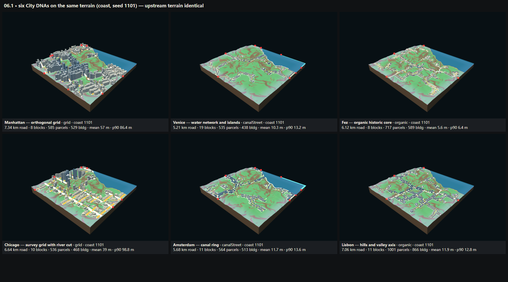 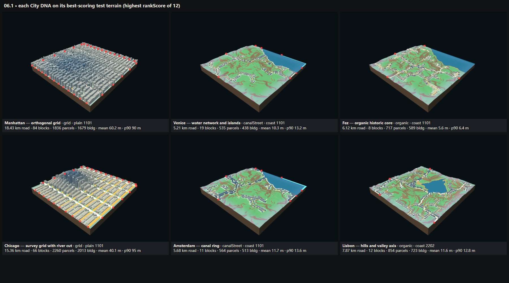 Evidence: `experiments/seed-terrain/evidence/city-dna-comparison.json`, `city-dna-baseline.json`.
- **Problems found during testing (fixed):** verifier read `network.meta` (meta is spread onto the graph) and `parcels.rules.byDNA` (stored as `rules.target`); one 404 from the composed screenshot page's favicon.
- **Open issues:** every new threshold is A and the three cities have no research row or source anchor; Amsterdam's identity rule A1 (ring canals) is absent from the output; Chicago's tower core is a seeded point, not a transit node; Lisbon's lanes are climb-averse least-cost paths, not checked against real contour alignment; canal-facing lots remain rare for both canal DNAs (0–2 per chunk).
- **Review status:** Pending review.
- **Next single task:** Decide whether a terrain-side rule (river through a plain; canal belt) is needed so Chicago and Amsterdam can be auto-selected, or keep them manual-only.

### 06.2 — World Grid and city placement (3 × 3 chunks)

- **Date / Stage / Single question:** 2026-10-18 / T7 preparation / Can nine fixed chunks share one world frame, each running the unchanged single-chunk chain with its own derived terrain seed and a user-chosen City ID, so that editing one slot rebuilds only that slot's invalidated layers, while seams are measured but not hidden?
- **Concepts kept apart:** chunk = fixed 1024 m computation unit at a fixed grid coordinate; cityId = user identity choice per slot (`null` empty / `'auto'` / a `CITY_DNA` key); city influence = future cross-chunk field, not implemented (no expansion, no network blending).
- **Pre-checks:** downstream generators always offset by `fields.grid.originX/Z`; `ChunkView` built its plane at (0, 0) and tunnel cutting combines those surface vertices with world-coordinate portals, so it assumed origin 0. The landform rules sample absolute coordinates (river centred near x = 0, coast potential linear in x / z), so sampling a chunk at x ∈ [512, 1536] would lose its river or coast.
- **Placement decision:** each chunk is generated in the chunk-local frame (origin 0, exactly as the single-chunk page) and placed by translating its grid origin before `deriveFields`, so every downstream layer is in world coordinates. Consequence (accepted, measured): same-seed noise is not continued across chunks. Terrain algorithm untouched.
- **World Grid data structure:** `createWorldConfig` → `{ version, worldSeed, transitionWidth, variation, chunkSize, slots[9] }`; slot = `{ chunkId: 'chunk_<gx>_<gy>', gridX, gridY ∈ {−1, 0, 1}, worldOrigin: { x: gx·1024, z: gy·1024 }, landform, terrainSeed, cityId, cityMode }`; `terrainSeed = 1 + hash('world-grid-terrain', worldSeed, gridX, gridY, landform) mod 9999` (slot order never enters the hash). Runtime `WorldGrid`: per chunk `terrain` layer (key = landform, seed, variation, transition, origin) and `city` layer (key = terrain key + cityId), status, build counters; `dirty()` lists invalidated layers; `build(chunkId)` reruns only those. Saved form = `serialiseWorld` (worldSeed, transition, variation, per slot landform / cityId / terrainSeed); `restoreWorld` re-derives seeds and rejects a saved seed that does not match.
- **Changed files + working-tree state:** new `experiments/world-grid/` (`worldConfig.js`, `WorldGrid.js`, `SeamCheck.js`, `SeamView.js`, `main.js`, `index.html`, `evidence/world-grid.json`), new `scripts/verify-world-grid.mjs`; `experiments/seed-terrain/ChunkView.js` — terrain plane translated to the grid origin when it is non-zero (origin 0 path unchanged). No change to terrain, analysis, matching, network, blocks, parcels, buildings, tunnels (`TunnelPlanner.js`, `TunnelGeometry.js`, `TerrainShell.js`), chunk size, or transition. Single-chunk verifiers re-run after the change: seed-terrain, solid-terrain, tunnels, tunnel-excavation pass. Uncommitted on `experiment/terrain-seam` (HEAD a38c73d; `experiments/seed-terrain/`, `experiments/world-grid/`, `scripts/` untracked).
- **World configuration tested (world seed 6201, variation 0.5, transition 128 m):** row gy = −1: mountain 5704 empty · mountain 2264 auto → Fez · river valley 9187 Fez; gy = 0: plain 5718 Chicago · plain 2085 Manhattan · river valley 2361 auto → Fez; gy = 1: coast 1385 Amsterdam · coast 3051 auto → Lisbon · coast 6678 Lisbon. Tunnel cases: chunk_0_-1 (mountain, origin x 0 / z −1024) set to Chicago in world seeds 6203 (terrain seed 5326) and 6202 (terrain seed 7922); the default world produces no accepted tunnel (one candidate in world seed 6204 is rejected by the 05.1b-2 approach rule at origin 0 as well).
- **Interaction:** oblique view of the whole 3 × 3 world (`?camera=top` for plan, `?focus=x,z,d` close-up); click a chunk (or the Selected chunk list) to select it (yellow outline); City ID list = Empty slot / Auto / every `CITY_DNA` label (from the database, not hard-coded); panel shows chunk id, grid, origin, landform, terrain seed, cityId → resolved DNA, status, layer counts, stage times, and the measured state of each of its edges; Save / Restore city config (localStorage + `__worldGridLab.save / restore`); Seam debug layer (`?seams=1`). Each chunk carries a label `chunkId · landform` / `DNA · seed`.
- **Verification:** `node scripts/verify-world-grid.mjs` — placement (data origin = gridX · 1024, mesh bounds error < 1 mm, overlap 0, covered area = 3072²), seed formula and slot independence (editing chunk_1_1's landform changes only chunk_1_1's seed; a new world seed changes all 9), three slot states and ≥ 4 DNAs, cityId = resolved DNA for manual / = auto top for auto / no city layers for empty, 12 shared edges + 4 interior corners coincide (position error 0, 257 samples in the same increasing order, equal transition widths), one City ID change (chunk_1_0 → Amsterdam) rebuilds only that chunk's city layer with its terrain signatures unchanged and the other 8 summaries identical, GUI / panel label = DNA label, empty → Manhattan reproduces the original signatures, save → edit two slots → restore = saved config and saved signatures, tampered seed rejected, all 9 solids closed, tunnel at a non-zero origin = same chunk at origin 0, reload identical, centre chunk = single-chunk page bit-identical, every placed chunk = its origin-0 generation (heights, counts).
- **Result:** all checks pass, 0 browser errors. Centre chunk signatures (height, water, network, blocks, parcels, buildings) identical to `seed-terrain/?landform=plain&seed=2085&dna=manhattanGrid`; 7 / 7 placed city chunks have identical heights and identical block / parcel / building / port counts to their origin-0 generation. Tunnel at a non-zero origin (6203): 1 tunnel accepted, solid watertight, χ = 0, excavated 15,307 m³ = origin-0 result (relative difference 1e-14). All 9 default chunks closed (χ = 2, no tunnels).
- **Performance (3 runs):** first full world build 18.3–21.8 s data + render for 9 chunks (one at a time, the page stays responsive between chunks); per chunk: terrain 75–120 ms, city 1.1–5.2 s (grid plains slowest: parcels 2.3–2.7 s), render 90–210 ms; empty slot 0.2 s; one City ID change 2.3–3.2 s (one chunk, city layer only); restore of two changed slots 5.5–7.1 s; reload ≈ 18 s; JS heap 338–382 MB. No simplified distant view was needed.
- **Seams (detection only, nothing flattened):** all 12 shared edges have height discontinuities (|Δh| max 5.2 m plain | plain … 296 m mountain | plain; mean 2.3–227 m); one-sided water on 6 / 12 edges (e.g. river valley | coast 257 / 257 samples, coast | coast 146 + 111 shared); edge ports: 7 paired by position on 2 edges (plain | plain Chicago–Manhattan: 6 pairs, all offset 9.5 m, 3 with elevation difference > 2 m, up to 5.1 m), 9 edges flagged (unpaired or elevation mismatch; e.g. plain | mountain 12 unpaired), 2 edges n/a (empty slot), 1 edge without ports; interior corner height spread 25–251 m. Expected: chunks have independent seeds and landforms and no neighbour constraint is applied yet (`applyNeighborConstraints` stays the reserved interface).
- **Screenshots:** 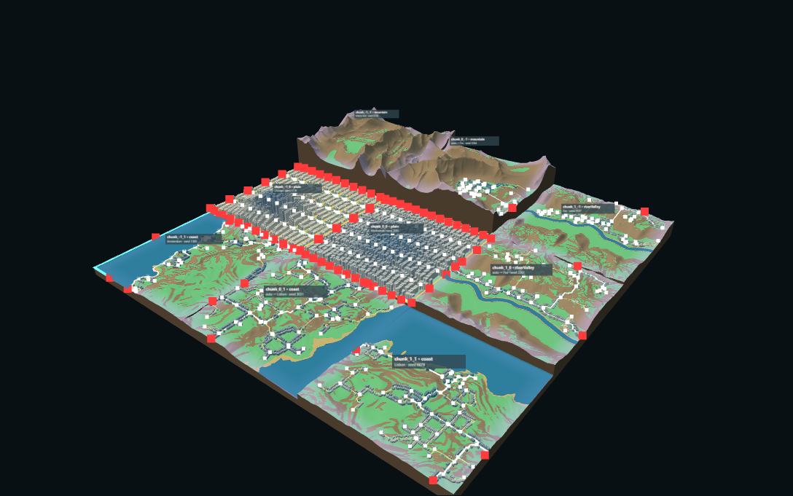 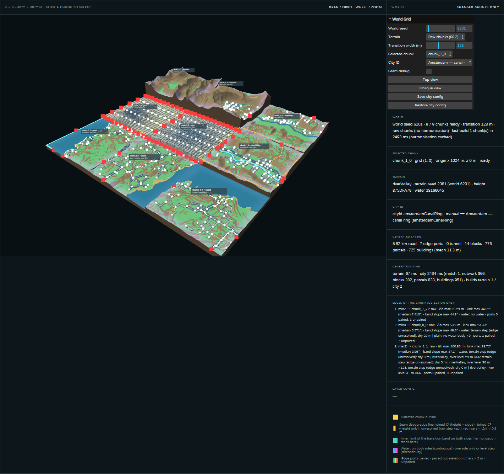 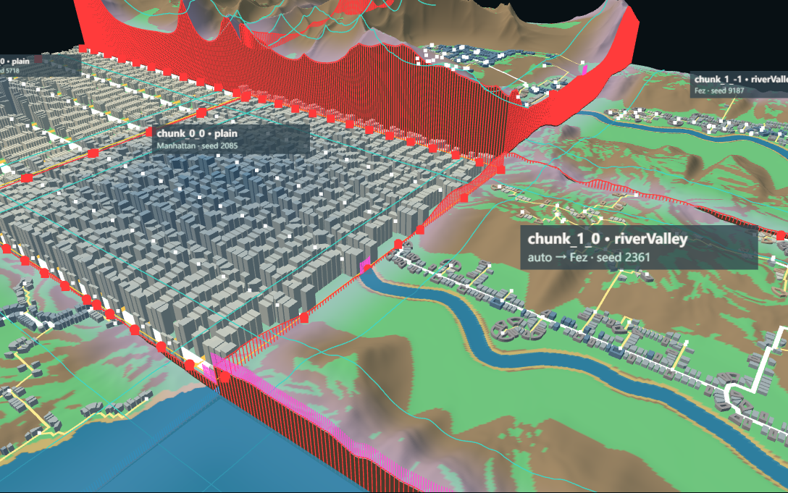 Evidence: `experiments/world-grid/evidence/world-grid.json`.
- **Problems found during testing (fixed):** canvas rendered at the default 300 × 150 (shared CSS sizes `#terrainCanvas` only) → own canvas rule; plan-view seam capture could not show height steps → `?focus` oblique close-up.
- **Defect found in a frozen system (not fixed, reported):** on mountain terrain seed 7922 with Chicago grid, the 05.1b-2 tunnel geometry accepts tunnel 8 but the cut solid is not closed — 6 non-manifold / 6 inconsistent edges, 8 degenerate and 3 duplicate faces, χ = 6 (expected 0), trench volume NaN. Reproduced identically on the single-chunk page at origin 0 (`seed-terrain/?landform=mountain&seed=7922&dna=chicagoGrid`), so it is a pre-existing 05.1b-2 issue exposed by a new terrain / DNA combination, not a world-placement effect. Tunnel system left unchanged per the 06.2 scope.
- **Open issues:** seams everywhere (expected; blending / neighbour constraints not started); landforms sample a chunk-local frame, so the world is a mosaic, not one continuous terrain; NetworkView's edge-port and node markers are sized for one chunk and clutter the world view; first build 18 s with nine full chunks (sequential, main thread; no worker); the default world produces no tunnel (covered by the 6204 case); outer world edges are not checked; the City ID list shows long DNA labels truncated in the 330 px panel.
- **Review status:** Pending review.
- **Next single task:** Define the neighbour constraint for one shared edge (height + water + port pairing through `applyNeighborConstraints` / port `redirect`) and measure it on the plain | plain edge before any city influence.

### 06.3a — Multi-chunk terrain and water seam (3 × 3 world)

- **Date / Stage / Single question:** 2026-10-19 / T7 / Can adjacent chunks of the 3 × 3 world get one continuous, reproducible terrain surface and consistent water at shared edges — inside the existing transition bands, without hiding seams — and where that is impossible, is the reason measured and reported?
- **Pre-checks / reuse:** `experiments/terrain-seam` + `flavor-clash-prototype/generation/TerrainGenerator.js` blend two continuous height functions across a band (`connectedTransitionHeight`, smoothstep) — the principle is reused (shared target, smoothstep weight inside the band), but chunks here are discrete 257² fields whose neighbour has no data inside the other chunk, so the blend is applied as a per-chunk correction field. Reused unchanged: `edgeWeight` (TerrainFields), `deriveFields`, `analyseTerrain`, the whole city chain, `ChunkView` shell / tunnel rebuild, `boundarySamples`, `NetworkGraph.edgePorts`. 06.2 seams (world seed 6201): 12 / 12 edges with height steps (5.2–296 m), 6 one-sided water edges, interior corner spread 25–251 m.
- **Algorithm (`experiments/world-grid/TerrainHarmonizer.js`):**
  - Raw height fields are never modified; harmonisation produces a separate height and water-level field per chunk (layer `harmony` between `raw` and `terrain`).
  - Per shared edge (A | B, identical 257 samples): joint target T(i) = (hA + hB) / 2, blended at both ends to the corner target of its corner group; slope target S(i) = −(sA + sB) / 2 (raw inward first differences) plus a term that cancels the discrete first difference of the corner ramp.
  - Each side gets D(i)·w(d) + S(i)·b(d) inside its own transition band (w = 1 − smoothstep(0, W, d), the existing edge weight; b(d) = d (1 − d/W)², normalised so the first difference at the edge equals S). Corners use a Coons boolean sum of the four edge terms (value Dc, slopes S1c, S2c, zero twist), so an active edge keeps its exact target inside the corner square. Edge samples are finally set to T(i): both chunks hold the identical Float32 value.
  - Corner groups: chunks meeting at a point are grouped through active edges; each group gets the mean of its members' raw corner heights (an unresolvable neighbour never pulls a joinable edge toward its height).
  - Resolution: a cell is "made steep" if its harmonised slope > 35° (A, ≈ angle of repose) and > raw slope + 2°. Each edge is first tested alone: slope-matched (C¹) join → if made steep, height-only (C⁰) join → if still made steep, unresolved. Then all surviving edges together; a blamed edge drops C¹, then is deactivated; repeated until no made-steep cell remains. An unresolved edge keeps its raw step (no wall is generated, the band is not widened).
  - Water: connected flooding only — from each chunk's raw water cells (sea level or local river surface) through band cells below level + freeboard; sea crosses an edge only where the neighbour's edge sample lies below sea level (+ freeboard) and only into that edge's band; rivers never continue into a neighbour without a channel; band cells lowered below a raw river surface but not connected stay dry (no fake lakes). Outside the bands the water level equals the raw one. Then `deriveFields` recomputes slope, waterMask, buildableMask, boundarySamples; `analyseTerrain` recomputes the analysis.
  - Deterministic and order-independent: canonical chunk order, simultaneous edge exchange rounds; independent of City ID.
- **Changed files + working-tree state:** new `experiments/world-grid/TerrainHarmonizer.js`, `scripts/verify-world-seam.mjs`, `experiments/world-grid/evidence/world-seam.json`; changed `experiments/world-grid/WorldGrid.js` (raw → harmony → terrain → city layers with keys; raw-vs-harmonised difference), `worldConfig.js` (`terrainMode` 'harmonized' | 'raw'), `SeamCheck.js` (slope kink, band slope, water-interface classification), `SeamView.js` (edge status, band limits, water state), `main.js` (Terrain mode + Transition width controls, harmonisation step, tunnel isolation, lab checks), `index.html` (legend), `scripts/verify-world-grid.mjs` (06.2 checks run with `terrain=raw`). No change to `experiments/seed-terrain/` (terrain generator, City DNA, network, parcels, buildings, tunnels), grid positions, or chunk size. Uncommitted on `experiment/terrain-seam` (HEAD a38c73d; `experiments/world-grid/`, `experiments/seed-terrain/`, `scripts/` untracked).
- **Parameters:** world seeds 6201 / 6202 / 6203; transition width 128 m (also 64 and 256 m on 6201); variation 0.5; maxTransitionSlopeDeg 35, createdSlopeMargin 2°, water level tolerance 1 m, freeboard 1 m, 2 sea-exchange rounds.
- **Entry point + method:** `/experiments/world-grid/` (harmonised, default) and `?terrain=raw` (06.2); `?seams=1` debug; GUI Terrain + Transition width. `node scripts/verify-world-seam.mjs` checks every shared edge (positions, Δh, bilinear sampler at off-grid points, rendered vertex normals, slope kink, band slope), corners, made-steep cells, cells changed outside the band, rendered mesh = fields, all 9 solids closed, water interfaces vs the raw world, City ID switch without terrain rebuild, input-order independence (reversed / rotated input), reload identity, transition widths 64 / 256 / 128 with stale-layer check, three world seeds, and the known tunnel failure; `node scripts/verify-world-grid.mjs` re-checks 06.2 in raw mode.
- **Result (6201, W 128):** all checks pass, 0 browser errors. 4 / 12 edges joined (all C¹): plain | plain (raw step 5.2 m), plain | coast ×2 (34.1, 26.0 m), coast | coast (17.5 m) — Δh 0 at all 257 samples (identical Float32 values), bilinear sampler difference 0 at off-grid points, rendered mesh = fields (height and plan error 0). Slope kink across joined edges: median 0.000°, max 8.6° (within ≈ 45 m of the closed corner, where the Coons corner terms cannot meet both slope targets); rendered vertex normals across joined edges: median 0.06–1.0°, max 8.9°. No cell made steeper than 35° by the join (band max 34.3°, raw relief included). 8 / 12 edges unresolved, each already when tested alone: 4 mountain edges (raw steps 164–296 m; the join would create 73–74° slopes), river valley | mountain (25.3 m, 37.5° in 7 cells), plain | river valley (53.9 m, 44° in 29 cells), river valley | coast (100.9 m, 51.3°), coast | coast (47.1 m, 40.6° in 39 cells) — they keep their raw step and are drawn red. Corners: 1 / 4 closed (x −512 / z 512, spread 25.3 → 0 m); the 3 others stay open (spread 248, 211, 74.5 m; 3–4 corner groups). Changed cells: 23.4% of each joined chunk, only inside the band (0 outside); max height change 17.7 m, mean 1.6–2.5 m. All 9 solids closed (χ 2, volume error < 1e-6).
- **Water (6201):** raw one-sided edges 6 → 4. Resolved (2): plain | coast chunk_-1_0 | chunk_-1_1 (60 one-sided samples) and plain | coast chunk_0_0 | chunk_0_1 (9) — the joined edge lies above sea level, the shore moved inside the coast band (wet cells 20 850 → 19 585 and 11 040 → 10 660), both sides now dry at the edge. Retained (4), all on unresolved terrain edges, with the water bodies named: river 31 m | mountain without water (8), river 29 m | plain without water (9), sea 0 m | river valley with river level 29–31 m (257 — incompatible levels: the river would have to drop ≈ 30 m), sea 0 m | sea 0 m on coast | coast (169; levels compatible, terrain step 47 m blocks the join; 146 one-sided in the raw world, 23 more after the neighbouring joins changed chunk_0_1's corner band). No river channel was generated across an edge. Other seeds also show river 29 m | river 31 m (6203, level step) and river 31 m | sea 0 m (6202).
- **Widths and seeds:** 6201: W 64 → 5 / 12 joined (river valley | mountain joins C⁰; band slope 36.6°), W 128 → 4 / 12, W 256 → 5 / 12 (coast | coast joins C⁰, coast | coast 17.5 m drops to C⁰; band slope 44.5°); water discontinuous 4 / 4 / 3. Wider is not always better: a wider band also spreads the slope-matching term over more existing relief. Seeds at W 128 (raw → harmonised): 6201 joined 4 (4 C¹), water edges 6 → 4; 6202 joined 6 (4 C¹, 2 C⁰), water 3 → 2; 6203 joined 4 (3 C¹, 1 C⁰), water 6 → 3. Max seam step on joined edges 0 m in every run; max seam step overall unchanged (296 / 315 / 293 m, all on unresolved mountain edges). Edges joined C⁰ keep a slope kink (6202 max 41.8°, 6203 24.3°); interior corners closed 1 / 4 in every seed.
- **Architecture checks:** City ID change (chunk_0_1 → Amsterdam): harmonisation not re-run, 0 raw rebuilds, 1 chunk city layer only, all terrain signatures unchanged. Reversed and rotated input → identical output checksums. Reload → identical signatures and edge report. Transition-width change rebuilds terrain and every city layer (no stale roads / parcels / buildings); raw layers are reused. Raw fields unchanged (raw checksums identical to the raw world). Downstream effect: chunk_0_1 (cityId 'auto') changes its auto-matched DNA from Lisbon to Manhattan because the harmonised terrain changes its terrainAnalysis; manual City IDs are unaffected.
- **Tunnels:** the existing 05.1b-2 flow re-cuts tunnels from the current network on the harmonised fields. Known failure (world seed 6202, chunk_0_-1, Chicago, tunnel 8: 6 non-manifold / 6 inconsistent edges, χ 6) is detected after the cut and isolated — cut removed, tunnel edge kept in the network data, solid closed (χ 2), reported in the panel and `tunnelIsolation()`; the valid case (6203) keeps its tunnel (χ 0). Tunnel algorithm not changed.
- **Performance:** harmonisation of the whole world 0.54–0.64 s (one pass + edge screening, main thread); full world build raw 22.3–24.1 s vs harmonised 21.6–24.5 s (difference within run-to-run noise, < 1 s); transition-width change rebuilds the whole world in 21–24 s (all terrain + city layers, raw layers cached); City ID change 4.0 s (one chunk, no harmonisation).
- **Screenshots:** 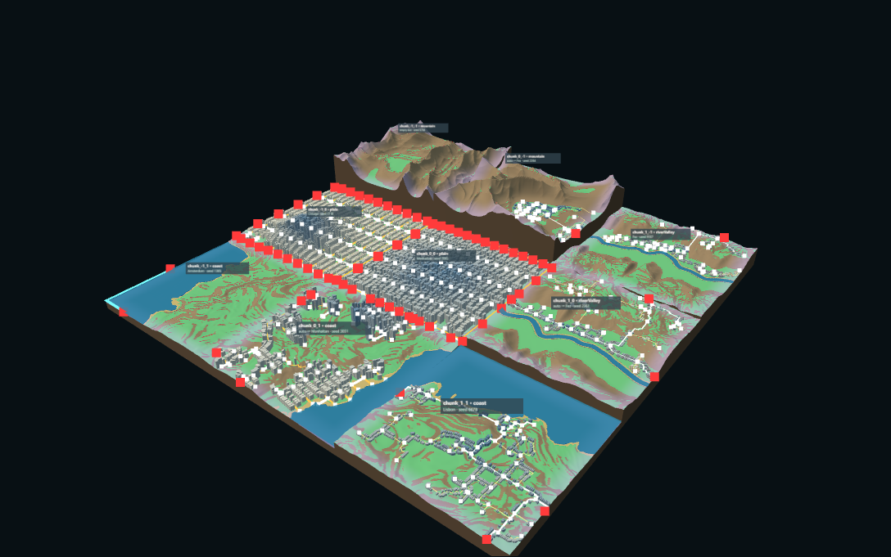 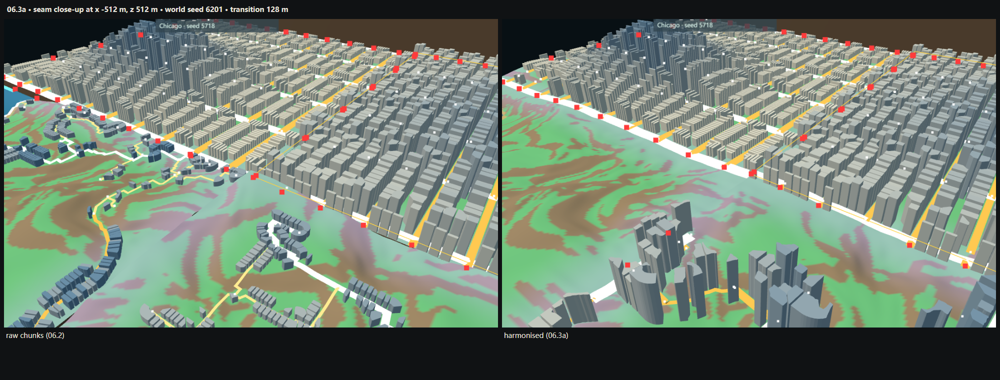 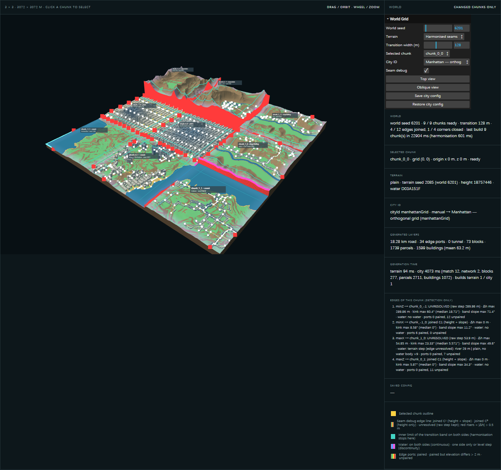 Evidence: `experiments/world-grid/evidence/world-seam.json`.
- **Problems found during testing (fixed):** the 4-chunk corner target averaged mountain heights into a 5 m plain | plain edge, which then failed the slope rule → corner groups through active edges + each edge screened alone first; slope matching transplanted steep raw banks across the edge and blocked otherwise joinable edges → C¹ first, C⁰ fallback per edge; first-difference kink from the corner ramp → compensated in S.
- **Unresolved seam issues:** (1) 8 / 12 edges in world 6201 cannot be joined within 32–256 m without slopes > 35°: every mountain edge (raw steps 116–315 m across seeds) and the river-valley edges with steep banks; (2) only 1 of 4 interior corners closes per seed; open corners keep 74–255 m spreads; (3) slope continuity is not achieved on C⁰ edges (kink up to 41.8°) or within ≈ 45 m of closed corners (up to 8.6°); rendered normals differ by up to 8.9° at joined edges because each chunk computes its own vertex normals; (4) water stays discontinuous on unresolved edges and where levels are incompatible (river ≈ 30 m vs sea 0 m; river 29 vs 31 m); rivers end at chunk edges where the neighbour has no channel; (5) edge ports are not paired or redirected (out of scope); (6) the outer world edge is not harmonised; (7) the known tunnel failure (6202 / chunk_0_-1 / Chicago) is isolated, not fixed.
- **Review status:** Pending review.
- **Next single task:** Decide how unresolvable edges are handled (wider band by explicit user choice, a landform-compatibility rule at slot assignment, or a dedicated escarpment / shore rule) before any city-network join across edges.

### M01 — Procedural Mini World midterm release (Firebase Hosting)

- **Date / Stage / Single question:** 2026-10-19 / release (no stage change) / Can the locally verified Procedural Mini World be published to the existing Firebase Hosting site and be confirmed working at the public URL?
- **Target (confirmed, nothing created):** Firebase project `gameeeee-zc626` (`.firebaserc` default); the only Hosting site `gameeeee-zc626`; public dir `dist` (`firebase.json`); build `npm run build` (Vite). CI deploys `live` on push to `main` (`.github/workflows/firebase-hosting-merge.yml`); this release was deployed locally with `firebase deploy --only hosting` (firebase-tools 15.31.0), so `main` was not pushed and Firestore rules / Authentication / Storage were not touched.
- **Pre-release finding:** the live site (released 2026-09-28 23:14:19, entry `/assets/main-D55VH64K.js`) did not contain Procedural Mini World — `seed-terrain` and `world-grid` were not Vite inputs, and `/experiments/world-grid/` fell through the SPA rewrite to the hub page.
- **Changed files (release only, no generator change):** `vite.config.js` (+ `seedTerrain`, `worldGrid` inputs); `site.js` (+ `miniWorld` → `experiments/world-grid/`, `seedTerrain` → `experiments/seed-terrain/` sections); `index.html` (+ "Mini World" nav link). During the task an external process replaced the working-tree `index.html` with the old R3F scene from commit 221f957; with the user's approval it was rebuilt from the hub version read earlier in the session plus the nav link.
- **Release snapshot:** tag `release/m01-2026-10-19` → commit `7b21c3e` (parent HEAD `a38c73d`), built from a temporary index: the full working tree of `experiment/terrain-seam` at deploy time except `*.glb`, `*.fbx` (≈ 390 MB of untracked terrain-seam models, not in the build) and `.firebase/`. Not on any branch, not pushed; working tree, index, and branch unchanged.
- **Build / tests:** `npm run build` ok (6.8 s, 255 files, 5.8 MB; chunk-size warnings only: three.module 705 kB, firebase 533 kB). `verify-world-grid` pass (147 s), `verify-world-seam` pass (321 s), `verify-city-dna` pass (218 s), `verify-seed-terrain` pass (143 s), `verify-flavor-clash` pass. `verify-markdown-links` fails on 20 pre-existing targets, all in `docs/projects/flavor-clash/terrain-seam-building-scatter.md` (missing `flavor-clash/terrain-seam-buildings/2026-10-13-*` screenshot folders) — unrelated to this release, not changed.
- **Deploy:** 2026-10-19 21:42:54–21:43:22 −0400, message "M01 Procedural Mini World midterm (tag release/m01-2026-10-19, 7b21c3e)"; `live` release time 2026-10-19 21:43:20. Public URL: <https://gameeeee-zc626.web.app/#miniWorld> (direct pages `/experiments/world-grid/`, `/experiments/seed-terrain/`).
- **Online verification (Playwright + system Chrome against the public URL, same script run first on `vite preview` of `dist`; 11 / 11 checks pass in both):** `/`, `/experiments/world-grid/`, `/experiments/seed-terrain/` return 200 with their own entry scripts (live hub entry now `/assets/main-CIzbo2qH.js`), JS assets served as JavaScript; 22 / 22 browser requests 200, 0 console / page errors; hub `#miniWorld` opens the world-grid iframe; 3 × 3 World Grid (world seed 6201, W 128 m, harmonised) reaches READY in 17.2 s — 9 / 9 chunks ready, 4 / 12 edges joined, 1 / 4 corners closed, 6 resolved DNAs incl. Chicago, Manhattan, Fez, Lisbon, Amsterdam; City ID switch chunk_1_0 Fez → Amsterdam rebuilds one chunk in 2.3 s with height signature unchanged (725 buildings); `?worldSeed=6202` yields different terrain seeds; single chunk `?landform=plain&seed=2085&dna=manhattanGrid` generates (1619 buildings).
- **Screenshots:** 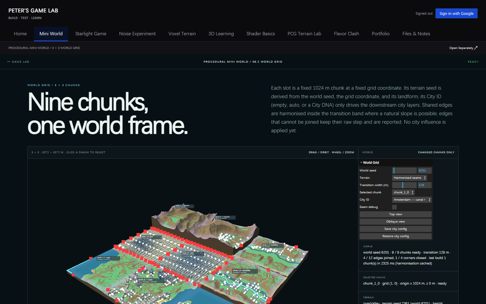 world seed 6201, transition 128 m, harmonised terrain, chunk_1_0 City ID amsterdamCanalRing, 1600 × 1000.
- **Rollback:** previous live version cloned to preview channel `m01-rollback` (<https://gameeeee-zc626--m01-rollback-tyjrl79u.web.app>, expires 2026-10-26 21:32:32); it also stays in Firebase Console → Hosting → Release history (roll back from there, or redeploy the 2026-09-28 tree).
- **Known limitations:** first world build ≈ 17 s on the main thread (no worker); open seams and corners as recorded in 06.3a; known 05.1b-2 tunnel defect (world seed 6202 / chunk_0_-1 / Chicago) isolated, not fixed; Amsterdam on chunk_-1_1 (coast 1385) produces 0 buildings in the default world; Google sign-in on the hub not re-tested in this task; the deployed source is not on `main`, so the next push to `main` will redeploy whatever `main` contains (currently the older hub without Mini World).
- **Review status:** Pending review.
- **Next single task:** Decide whether the release source goes to `main` (so CI deployments keep Procedural Mini World) — requires an explicit commit / merge instruction.

### M02 — GitHub midterm knowledge base

- **Date / Stage / Single question:** 2026-10-19 / documentation (no stage change) / Can a first-time reader of the GitHub repository understand the project, how to run it, its past experiments, and its current results within about three minutes, without duplicating long documents?
- **Changed files:** `README.md` (rewritten for Procedural Mini World: concept, research question, status, live link, run steps, knowledge-base entry, screenshot, limitations; earlier Game Lab work condensed to links); new [EXPERIMENT-INDEX.md](./EXPERIMENT-INDEX.md) (8 categories + archived experiments; per task: purpose, files, logged result, screenshot, test status, lifecycle, next step — all taken from this log, nothing new claimed); `docs/README.md` and `docs/_meta/project-map.md` (point to the index); `docs/projects/flavor-clash/terrain-seam-building-scatter.md` (20 image embeds for four capture runs whose folders no longer exist turned into "Image not preserved" notes; text kept); `.gitignore` (secrets / `.env*`, Firebase deploy cache, Obsidian per-device state, logs, `*.glb` / `*.fbx`, OS files); `.firebase/hosting.ZGlzdA.cache` and `.obsidian/workspace.json` untracked (local files kept). No generator, page, or site code changed.
- **Counts:** 24 logged tasks indexed (20 active, 4 superseded: 02.1, 02.2, 02.2b, 02.3); 2 research files without a log entry (00.3, 01.1) marked Pending verification; 11 earlier experiments marked archived, 4 of them still imported by active code (dependency).
- **Commits:** before M02, all Procedural Mini World work was uncommitted. The branch `experiment/terrain-seam` was fast-forwarded to the M01 release snapshot `7b21c3e` (`git reset --soft`, working tree untouched; it holds the pre-M02 working tree, including the previous README), and M02 is committed on top.
- **Verification:** all 22 `scripts/verify-*.mjs` browser verifiers pass on 2026-10-19 (5 during M01, 17 during M02). These runs rewrite evidence JSON and screenshots, so the 35 files they changed during M02 were restored to the committed versions to keep the evidence consistent with the logged numbers. The M01 runs had already rewritten the evidence of world-grid, world-seam, city-dna, and seed-terrain before the snapshot, so those files hold the 2026-10-19 re-run output. `node scripts/verify-markdown-links.mjs`: no broken local link or image targets (was 20 broken before M02). `npm run build` ok.
- **Screenshots:** none (text-only).
- **Open issues:** compass §5 still lists T2–T6 as "Not started" while §1 records them as implemented — needs a human decision (not changed here). The large Terrain Seam models are not in Git, so that archived page runs without models after a fresh clone. The release smoke test (M01) is not in `scripts/`. `main` does not contain this work yet; merging triggers a Firebase deploy.
- **Review status:** Pending review.
- **Next single task:** Human review of the README and index; then decide whether `experiment/terrain-seam` is merged into `main`.

### M02b — Follow-up: main branch, compass §5, Terrain Seam models, live verifier

- **Date / Stage / Single question:** 2026-10-19 / documentation + release (no stage change) / Can the four M02 open issues the user decided on be closed without changing generators or site features?
- **Decisions (user, 2026-10-19):** fast-forward `main`; align §5 with §1; document the Terrain Seam models only; add the M01 smoke test to `scripts/`.
- **Changed files:** this log §5 (Status column of T2–T7 only: "Implemented, pending review" + task IDs; T7 "Partial, pending review"; §1 unchanged); `docs/projects/flavor-clash/terrain-seam-building-scatter.md` (new "Local Model Files" section); new `scripts/verify-live-release.mjs` + `package.json` script `verify:live`; `README.md` (source branch, run step, limitations); `EXPERIMENT-INDEX.md` (M01, M02b, Terrain Seam rows).
- **Pre-checks for `main`:** `npm ci --dry-run` accepts the lockfile; a build from a clean `git archive` of the commit gives the same 256 output files as the local build, with byte-identical world-grid, seed-terrain, and three.js chunks (other chunks differ only by CRLF inside preserved comments and bundled Markdown).
- **Terrain Seam finding:** checked with Playwright. With the local models, the page loads 11 model requests and exposes `__terrainSeamLab`. With the models blocked (fresh clone), `tiny_tokyo.glb` returns 404 and the uncaught top-level `await` stops `main.js`. On the public site since M01 the same URL falls through the SPA rewrite to `index.html` ("Unexpected token '<'"), so the deployed Terrain Seam page does not initialise. The previous release (2026-09-28) had no Terrain Seam page. Not fixed (document-only decision); the M01 smoke test did not cover this page.
- **Verification:** `node scripts/verify-live-release.mjs` against the public site: 10/10 checks, 51 / 51 requests 200, 0 browser errors (before the `main` push). `verify-markdown-links`: clean.
- **`main` push and CI deploy:** `main` fast-forwarded `a38c73d..b59b26c` (no force); the merge workflow published a new `live` release at 2026-10-19 22:51:43 −0400 (hub entry `/assets/main-CF2seIHF.js`). `verify-live-release.mjs` after the CI deploy: 10/10, 51 / 51 requests 200, 0 browser errors. (Recorded after the push, so this line is not in `b59b26c`.)
- **Screenshots:** none (text-only).
- **Open issues:** the live Terrain Seam page (see above); §1 "Current stage: T1" / "Current single task" / "Forbidden now" still describe T1 and were not changed.
- **Review status:** Pending review.
- **Next single task:** Decide how the Terrain Seam page should behave without its models (catch the reference-model load, drop it from the build, or ship the models).

### M03 — Obsidian Midterm Review entry

- **Date / Stage / Single question:** 2026-10-19 / midterm review (documentation only) / Can an architecture-design teacher read the research statement, generation logic, actual results, and limitations in a fixed order inside the existing vault, without a copy of this log?
- **Changed files:** new folder `docs/procedural-mini-world/midterm-review/` with [00-midterm-review.md](./midterm-review/00-midterm-review.md) (home, reading order, status words, missing-evidence list) and chapters 01 Project Statement, 02 System Workflow, 03 Key Parameters, 04 Experiments, 05 Midterm Results, 06 Limitations, 07 Next Steps (each with previous / home / next links); this log §1 (current stage, state, single task, forbidden scope; old values kept as "superseded 2026-10-19"); `README.md` and `EXPERIMENT-INDEX.md` (link to the review). No generator, page, or deployment change.
- **Sources reused:** this log (§1–§7), `research/` (prototype selection, Manhattan study, 60-city longlist), `experiments/seed-terrain/config.js` and `experiments/world-grid/worldConfig.js` for parameter ranges, `experiments/seed-terrain/evidence/city-dna-comparison.json` (best-fit terrain per DNA), existing screenshots. Every number in the review is taken from a logged verifier run or the M01 / M02b live check.
- **Screenshots:** none new. The review embeds 19 existing captures (18 from task verifiers, 1 from the live check), each captioned with seed / world seed, landform, City DNA, and transition width as recorded in its task entry.
- **Checks:** `verify-markdown-links` (all relative links and image paths); Obsidian wikilinks: none used in the vault; duplicate files: `docs/assets/screenshots/firebase-hosting-home.png` and `game-lab-home.png` are byte-identical (the Assignment 1 checklist presents them as separate local and hosted captures; not changed), `.obsidian/app.json` = `appearance.json` (both `{}`); many folders contain `README.md` (unambiguous with relative links).
- **Missing evidence (TBD), listed in the review home:** T7 video; Manhattan DEM / street-centreline / PLUTO measurements; log entries for 00.3 and 01.1; research rows for Chicago, Amsterdam, Lisbon; screenshot of the failing tunnel case (mountain 7922, Chicago); cross-tile streets, city influence, and DNA mixing (not implemented); human review of every task; original 02.2 capture (overwritten by 02.2b).
- **Review status:** Pending review.
- **Next single task:** Instructor / author review of T1–T7 using the Midterm Review; record accept or reject per task in this log.

### DOC-01 — Obsidian knowledge base reorganisation

- **Date / Stage / Single question:** 2026-10-19 / 20 / documentation only (no stage change) / Can the existing vault present research logic, implementation, results, and next stage in six categories, without moving files, duplicating records, or claiming unverified results?
- **Inventory:** active vault = repository root; the other registered vault (`URBAN DATA`) holds one empty note; the Venice worktree's untracked experiments are a file-identical subset of the main tree. Before the change: 54 notes + 65 asset files (manifest kept in session scratch); `HEAD` `b59b26c`.
- **Changes:** no file moved, renamed, or deleted. 21 new notes: [HOME](./HOME.md) (six categories + attachments, by index); `01-foundation/project-foundation.md` (original proposal kept verbatim, design evolution early → current → future, three independent concepts, roadmap mirroring §5); `research/city-dna-library.md` (values read from the config modules, all tagged A); `03-generative-system/` (architecture + 7 subsystem notes + City Influence marked planned); `04-experiments/` (Terrain, Network, Urban Form, World, Archived: one card per task with date, question, method, reuse, seed / parameters, test numbers, screenshots, conclusion, open issues, commit); `06-release/` (release and resources, deployment history); `99-attachments/screenshot-index.md`; `docs/_meta/doc-01-migration-report.md`. `midterm-review/00-midterm-review.md` rewritten in place as the Midterm Overview (8 sections); chapter 5 targets aligned with §3; superseded banner on `docs/_meta/current-project-state.md`; one HOME link each in `README.md`, `docs/README.md`, `docs/_meta/project-map.md`, `EXPERIMENT-INDEX.md`.
- **Checks:** links and images resolve (`verify-markdown-links`); 0 wikilinks; 0 orphan notes; 34 / 34 PMW screenshots indexed and referenced; 119 / 119 pre-change files present; external project URLs 200 (GitHub 404 anonymously: private); research-source URLs on four sites 403 to automated requests (Unverified).
- **Not changed:** Three.js code, generators, Git branches, Firebase deployment. Nothing committed.
- **Open items:** see the [migration report](../_meta/doc-01-migration-report.md) §6 (duplicate Assignment 1 screenshot, orphan note naming, 3D model licences TBD, 00.3 / 01.1 log entries, Terrain Seam page, 403 sources).
- **Review status:** Pending review.
- **Next single task:** Human review of the knowledge base (HOME and Midterm Overview); then decide the open items.

### DOC-02 — Standalone experiment archive (one page)

- **Date / Stage / Single question:** 2026-10-20 / documentation only / Can the later phase (02.1 → 06.3a + release) be read top to bottom in one note, with every stage's real screenshots in place?
- **Changes:** new folder `docs/procedural-mini-world/04-experiments/EXP-Procedural-Mini-World/` with one note, [Procedural-Mini-World.md](./04-experiments/EXP-Procedural-Mini-World/Procedural-Mini-World.md) (13 sections in build order, incl. superseded algorithms and fixed failures), and `Screenshots/` holding 35 images. Of these, 34 are byte-identical copies of the committed captures under stage names (`NN-stage-x-subject-kind.png`) and 1 is the 2026-10-19 22:52 live-site capture from `verify-live-release.mjs`, previously only in `%TEMP%`. Originals not modified. One entry link each in the Midterm Overview and HOME; the storage notes in HOME and the screenshot index updated to mention the copies.
- **Checks:** 35 / 35 `![[…]]` embeds resolve to exactly one vault file; each image embedded once, in its stage; 1 H1, 13 H2 in order, no level skip; 14 / 14 heading links resolve; `verify-markdown-links` clean.
- **Coverage:** stages 02–09, 11–13 have screenshots; 01 is text only; **10 Tunnel-Building Constraints has no capture** (Partial; rules exist in 04.1 / 05.1b-2, no dedicated test).
- **Missing screenshots:** 02.2 original; 03.2 defects (before images); tunnel near buildings; failing tunnel 7922 + Chicago; cross-tile streets (not implemented); T7 video.
- **Not changed:** code, models, branches, deployment. Nothing committed.
- **Review status:** Pending review.
- **Next single task:** Human review of the archive page.

### M04 — Public midterm experiment archive + complete Flavor Clash assets

- **Date / Stage / Single question:** 2026-10-20 / midterm review release (no stage change) / Can every prior experiment be reached from the public site, with all five Flavor Clash labs actually runnable online?
- **Reused files or functions:** existing Firebase project `gameeeee-zc626`, Vite multi-page inputs, M01 `verify-live-release.mjs`, Flavor Clash runtime-ready hooks, and the local active Terrain Seam model set.
- **Changed files + working-tree state:** `site.js` and `site.css` add grouped experiment switchers; new `scripts/verify-hosted-experiments.mjs`; this entry; screenshot below. Existing dirty and untracked documentation work was preserved. No generator, City DNA, asset transform, branch, commit, push, Firestore, Authentication, or Storage change.
- **Seed / City DNA / key parameters:** no generator parameter change. Flavor Clash screenshot uses its default `FLAVOR-CLASH-01` world seed. Terrain Seam ships only the 11 model files referenced by the current page (`tiny_tokyo`, Japan `04`–`11`, Venice `v_01`–`v_02`), 129,376,672 bytes in the release; inactive local models remain excluded.
- **Entry point + verification method:** <https://gameeeee-zc626.web.app/#flavor>; `node scripts/verify-hosted-experiments.mjs https://gameeeee-zc626.web.app`; `node scripts/verify-live-release.mjs https://gameeeee-zc626.web.app`.
- **Result + checked data:** Vite production build passed (297 published files after active models were added to `dist`; size warnings only). The fully verified release was Hosting version `5b309451df21cb8d`, release `1792472195310000`, at 2026-10-20 00:56:35 −0400; a final log-sync release published the same experiment payload plus this M04 entry as version `ff8f42787443ff0f`, release `1792472347592000`, at 00:59:07 −0400. All 12 experiment routes returned their own HTML entry and JavaScript asset with HTTP 200. The five Flavor Clash pages (map prototype, Iceland, road projection, road mesh, Terrain Seam) and Manhattan greybox reached their runtime-ready hooks with 0 console, page, or HTTP errors. The hub exposes five Flavor Clash tabs and three Mini World tabs. The existing Mini World live verifier passed 10 / 10 checks and 51 / 51 browser requests (3 × 3 world ready, City ID switch, alternate world seed, single chunk), with 0 errors.
- **Screenshots:**  — public Firebase site, `FLAVOR-CLASH-01`, 1440 × 900.
- **Confirmed:** the previous live Terrain Seam failure was missing deployment assets, not a generator defect; shipping the active GLBs makes the public page initialise normally. All public experiment entries remain available; the switcher changes only discovery/navigation.
- **Open issues:** active GLBs remain ignored local files, so a future clean-clone or GitHub Actions deployment will omit them and can break Terrain Seam again unless an explicit durable asset-hosting decision is made. The current live release is verified, but this release state is not committed or pushed.
- **Review status:** Pending review.
- **Next single task:** Instructor review of the public experiment archive; separately decide durable versioned hosting for the 11 active Terrain Seam models before the next CI deployment.

### DOC-03 — English-only Markdown

- **Date / Stage / Single question:** 2026-10-20 / documentation only / Can every Markdown file in the vault be fully English, with no Chinese characters, without changing any recorded fact?
- **Rule (user, 2026-10-20):** all Markdown files are written in English only; no Chinese may appear in any note.
- **Changes:** full faithful translations of the four research notes (`city-research-template.md`, `city-longlist-60.md`, `prototype-city-selection.md`, `manhattan-spatial-study.md`), each with a translation note pointing to the original wording in Git (`7b21c3e`); this log's compass §1–§6 and entries EXP-00 / EXP-00.2 translated line by line (96 lines, structure unchanged); Chinese fragments replaced in `docs/logs/2026-10-18.md`, `2026-10-19.md`, `project-foundation.md` (proposal quote now in English), `EXPERIMENT-INDEX.md`, `city-dna-library.md`, `archived-experiments.md`, `doc-01-migration-report.md`. The repository folder name, which ends in a full-width exclamation mark, is written with an ASCII "!" and the difference stated in words.
- **Not changed:** `research/city-research-template.csv` (not Markdown); its header row keeps the original field names, mapped one-to-one by position to the English field list.
- **Checks:** CJK / full-width scan over all 76 Markdown files: 0 lines; `verify-markdown-links`: clean.
- **Review status:** Pending review.

### DOC-04 — Visual knowledge-base entry for the midterm review

- **Date / Stage / Single question:** 2026-10-20 / documentation only / Can a first-time reader see the question, the pipeline, the T1–T7 status, the evidence, and the decisions the next step waits for, on one page?
- **Audit findings:** no `docs/procedural-mini-world/README.md`; `HOME.md` was a file map without diagrams; 0 Mermaid diagrams in the PMW notes; no `.canvas` files; status words Completed / Partial / Planned did not separate Verified from Accepted. The site's Files & Notes page lists no `docs/procedural-mini-world/` notes (no matching category in `site.js`, no fallback group), and its image lookup only covers the top level of `docs/assets/screenshots/`. Both need a `site.js` change and were **not changed** (out of scope).
- **Changes:** new [README.md](./README.md) with the 10 requested sections; 3 Mermaid diagrams (Terrain-first pipeline, stage dashboard with status classes, study loop); review-status table; 7-step reading route; stage dashboard with code / screenshot / data / verifier per stage; 8-image evidence gallery with standard Markdown embeds; decisions table. `HOME.md` kept as a one-line pointer; 12 entry links repointed to README. Status vocabulary in 17 existing notes changed to Implemented / Verified / Pending review / Implemented (partial) / Proposed / Historical, with status words only, no content change. No task is recorded as Accepted or Rejected.
- **Checks:** all 5 Mermaid diagrams in the PMW notes and dated logs parse and render with Mermaid 11 in headless Chrome; `verify-markdown-links` clean; English-only scan clean.
- **Not changed:** code, page features, Firebase, generated results, `.obsidian/`, screenshots, the in-progress changes of other work in the tree (`site.js`, `site.css`, `experiments/terrain-seam/main.js`, `.gitignore`, new `.glb` files and `m04-…` screenshot). Nothing committed.
- **Review status:** Pending review.
- **Next single task:** Human review of the README and of the decisions table (accept / reject per task).

### DOC-05 — Knowledge base on the website's Files & Notes page

- **Date / Stage / Single question:** 2026-10-20 / documentation delivery (no stage change) / Can the website's Files & Notes page list the Procedural Mini World notes and show their nested screenshots and Mermaid diagrams, without disturbing other work in `site.js`?
- **Pre-check:** `site.js` already held another task's uncommitted change (sections / experiment switcher / `navigate()`, 38 added lines). No other agent session was running; my edits touch different regions. The file was backed up first, and afterwards all 38 lines of the other change were confirmed present.
- **Changes (`site.js` only, 3 hunks):**
  - (1) document-image lookup widened from `./docs/assets/screenshots/*` to `./docs/**/*.{png,jpg,jpeg,webp,gif,svg}`, excluding the Experiment Archive's `Screenshots/` copies (byte-identical, Obsidian-only `![[…]]` references, 11.8 MB);
  - (2) new category "PROCEDURAL MINI WORLD / MIDTERM KNOWLEDGE BASE" for `docs/procedural-mini-world/`, with its README pinned first;
  - (3) fallback group "OTHER NOTES" for any note no rule matches.
  - The Markdown renderer (`markdown-viewer.js`, which already normalises relative image paths and loads Mermaid 11 once from the CDN) is unchanged; no library added.
- **Build:** `npm run build` ok; the README and every knowledge-base note are bundled; all 8 README gallery images are emitted; 0 archive copies emitted. Images in `dist`: 16.9 MB (previously 1.8 MB). `dist` is 145 MB in total, of which ≈ 124 MB are 11 Terrain Seam `.glb` models added by the other task's uncommitted `experiments/terrain-seam/main.js` change, not by DOC-05.
- **Verification (headless Chrome on `vite preview` of `dist`):**
  - Files & Notes lists 77 / 77 notes (previously 40; 36 PMW notes and `AGENTS.md` were not listed). The new group has 36 notes with the README first; "OTHER NOTES" holds `AGENTS.md`.
  - README: 8 / 8 images decoded, 3 / 3 Mermaid diagrams rendered as SVG. A note link from the README opens the Midterm Overview (2 / 2 images). `02-system-workflow.md` 8 / 8 images; `world-grid-and-seam.md` 1 / 1.
  - Regression: the 10 old categories have identical counts under the old and new rules. Images load in `docs/README.md` (1 / 1, top level), `terrain-seam-building-scatter.md` (12 / 12, nested folder, previously not resolvable), `first-shader-experiments.md` (16 / 16), and `experiments/voxel-terrain/README.md` (5 / 5). Home shows 10 cards; World Grid reaches READY. 0 page errors, 0 HTTP errors.
- **Screenshots:**  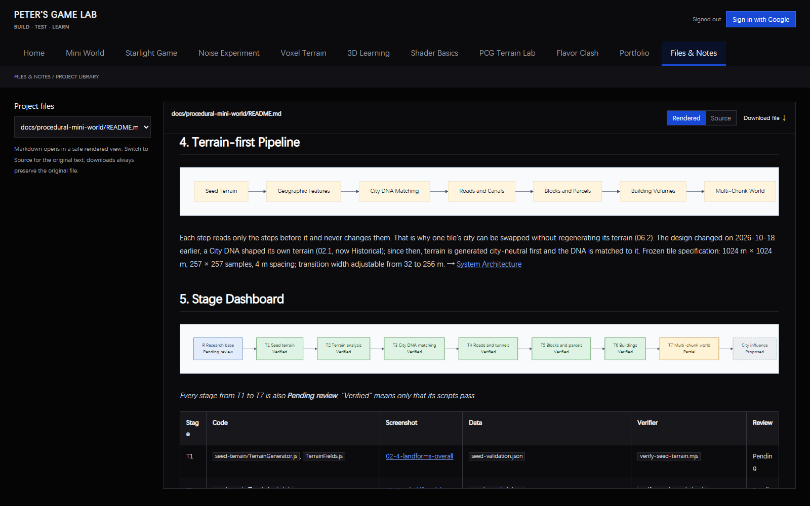 Local preview of `dist` (not the public site), 1600 × 1000.
- **Open issues:** the Experiment Archive note shows its 35 `![[…]]` embeds as plain text on the site (Obsidian-only syntax; the renderer was not extended). In the README stage table the narrow first and last columns wrap. Not deployed and not pushed: the public site still runs the M02b build.
- **Review status:** Pending review.

### M05 — Durable Terrain Seam model bundling

- **Date / Stage / Single question:** 2026-10-20 / release repair (no stage change) / Can a clean GitHub Actions build include every active Terrain Seam model and initialise the production page without changing terrain or scene geometry?
- **Changed files:** `.gitignore` explicitly unignores the 11 active runtime GLBs; `experiments/terrain-seam/main.js` imports those files with Vite `?url` handling and passes the emitted URLs to the existing loaders. No terrain algorithm, geometry, City DNA, placement transform, or Venice / Tokyo scene logic changed.
- **Active assets:** `tiny_tokyo.glb`, Japan `04.glb`–`11.glb`, Venice `v_01.glb`–`v_02.glb`; 11 files, 129,376,672 bytes total. All exist and are no longer ignored, but remain untracked until explicitly staged and committed.
- **Clean-build verification:** bundled Node `npm ci` passed, followed by `npm run build` (Vite 7.3.6). The working-tree build transformed 1056 modules; an isolated `git archive` of `HEAD` overlaid with only this runtime fix and the 11 models transformed 956 modules and also passed. `dist/assets/` contains exactly 11 hashed GLBs whose combined byte count matches the sources. Production preview served every model with HTTP 200 and `model/gltf-binary`; 0 console or page errors.
- **Runtime verification:** `window.__terrainSeamLab.ready = true`; Seam Check max and mean height error = 0, compared vertices = 121, left / right spacing = 0.45 / 0.45, shared boundary x = 0; Venice / Japan buildings = 1021 / 51; Japan GLB meshes = 151. Canvas rendered at 1008 × 650 in the headless production-preview check.
- **Screenshots:** none; request/response and runtime metrics provide the verification evidence.
- **Deployment status:** locally verified only. Nothing committed, pushed, or deployed. The currently working public Firebase release is the earlier manual M04 release; the durable CI fix remains Pending deployment.
- **Review status:** Pending review.
- **Next single task:** After approval, stage only the two source-control changes, these 11 GLBs, and this log hunk; commit on the experiment branch, integrate into `main`, and let the existing Firebase Hosting merge workflow build and publish it.

### 06.3b — Road network seam across chunks (3 × 3 world)

- **Date / Stage / Single question:** 2026-10-20 / T7 / On the shared edges that 06.3a joined, can road EdgePorts of neighbouring chunks become one connected network topology (one joint node, routable across chunks), changing roads only inside both transition bands, with every port that is not joined carrying a measured reason?
- **Step 1 — 06.3a re-check (gate):** `node scripts/verify-world-seam.mjs` re-run before any change: passes, numbers identical to the 06.3a entry (6201 W 128: 4 / 12 edges joined C¹, Δh 0 on joined edges, 8 / 12 unresolved with reasons, corners 1 / 4 closed, one-sided water edges 6 → 4; seeds 6202 / 6203: 6 / 4 joined; W 64 / 256: 5 / 5). Committed evidence restored after the run. Judgement: 06.3a passes its own definition (join where possible, report where not). Unresolved edges are an upstream limit, handled in 06.3b as "no road join, reason = terrain edge unresolved" — not repaired, not bypassed.
- **Changed files:** new `experiments/world-grid/RoadSeam.js` (stitching, world graph, Dijkstra), `scripts/verify-road-seam.mjs`, `experiments/world-grid/evidence/world-road-seam.json`; changed `WorldGrid.js` (city layer split: network → world road seam → blocks / parcels / buildings on the stitched network), `worldConfig.js` (`roadMode` 'joined' | 'independent'), `main.js` (two-pass rebuild, Roads control, panel, lab `roadSeam / roadAudit / reach / roadOrderTest`), `SeamView.js` (port join status, joints, connectors), `index.html` (legend); `scripts/verify-world-seam.mjs` runs with `roads=independent`; `scripts/verify-world-grid.mjs` compares signatures without the new `rawNetwork` field and asserts it equals `network` in raw mode. Unchanged: everything in `experiments/seed-terrain/` (single-chunk entry, terrain, City DNA, network generator, tunnels 05.1b-2), chunk size, City IDs, TerrainHarmonizer. Nothing committed.
- **Algorithm (`RoadSeam.js`):** input = each chunk's unchanged NetworkGraph + harmonised fields + the 06.3a edge report. Per shared edge in canonical order: (1) gate — empty neighbour → pending; canal ports → pending (canal joins not in this task); terrain edge unresolved / raw → rejected. (2) Pairs — road ports grouped by boundary node, candidates within 2·W·tan 25° (119 m at W 128), nearest first: class gap ≤ 1, approach ≤ 60° from the edge normal, joint J = midpoint (or the frozen side's position: bridges, tunnels, and graded mountain roads are never moved), joint heights equal within 0.5 m, each road re-routed from its redirect anchor (inner band line) or its first inner node straight to J — lean ≤ 25°, bend ≤ 40°, on land, cell slope ≤ the DNA's road limit (`maxSlopeDeg`, same land test as the network), no crossing or node contact without a junction. (3) Stubs — a remaining road port may continue straight into the neighbour's band to the nearest neighbour road (T-junction; split, or snap ≤ 2 m), same checks. Changed chunks get a rebuilt NetworkGraph via the existing `GraphBuilder.finalize` (ports, stats, signature recomputed); unchanged chunks keep the original object. World graph = all chunk graphs + one zero-length seam link per connection. 6 public rules, all spatial.
- **Data:** connection = { edge, kind pair | stub, joint {x, z, yA, yB}, port positions, offset, shifts, classes, Δy, grade, bend, lean, connector polylines + width, node id in each stitched graph }; port record = { chunk, edge, side, position, class, status connected | rejected | pending, reason, failed pair attempt }.
- **Shared-edge statistics (W 128):** 6201 — 12 edges, 4 terrain-joined, 2 with road joins; 68 ports: 14 connected, 44 rejected, 10 pending; 8 joins = 6 pairs on chunk_-1_0 | chunk_0_0 (Chicago | Manhattan, offset 9.48 m, re-route lean 4.4° per side, connectors ≤ 71 m deep) + 2 stubs on chunk_0_0 | chunk_0_1 (17 m and 67 m, bends 8° and 20°). 6202 — 6 terrain-joined, 6 with road joins, 26 joins (0 pairs, 26 stubs); ports 26 / 34 / 11. 6203 — 4 terrain-joined, 2 with road joins, 9 joins (5 pairs, 4 stubs); ports 14 / 45 / 12. Rejection reasons (6201): terrain edge unresolved 22; no neighbour road inside its band 13 (Amsterdam chunk_-1_1 has 0 km of road; the Chicago and Manhattan ports facing it have nothing to join); stub turn > 40° 6; connector over terrain steeper than the 10° Manhattan limit 3. Pending: empty slot 10.
- **Tests (`node scripts/verify-road-seam.mjs`, all pass, 0 browser errors):** every joint = one `port` node in each stitched graph, position error 0, Δy 0 (all seeds); visual-only contacts (ports of both chunks at one point without a link) 0; new crossings 0 per chunk; connectors: 0 wet samples, inside the band, cell slope within the DNA limit (along-road grade max 8.7° / 16.1° / 10.9° per seed); no join on an unresolved or raw edge; every unjoined port has a reason; every joint traversable in the world graph; chunks sharing a world component routed by Dijkstra (6201: chunk_-1_0 → chunk_0_1 1932 m over 2 seam links; 6202: chunk_-1_0 → chunk_1_1 5210 m over 3 seam links; components {-1_0, 0_0, 0_1} in 6201 / 6203, {-1_0, -1_1, 0_0, 0_1, 1_1} + {1_-1, 1_0} in 6202); terrain signatures identical to independent roads; unchanged chunks bit-identical to independent roads (network, blocks, parcels, buildings); changed chunks: city layer rebuilt on the stitched graph (`blocks.source.networkSignature` = stitched signature), 0 buildings on a connector corridor; input-order independence (reversed / rotated) identical; reload identical; each seed loaded twice identical; all 9 solids closed. City ID change chunk_0_1 → Amsterdam: 0 terrain rebuilds, 1 network rebuilt, city layers rebuilt for chunk_0_1 + chunk_0_0 (its stub set changed), others unchanged; back to auto → seam signature and all layers identical to the start. Regression: `verify-world-seam.mjs` (06.3a) and `verify-world-grid.mjs` (06.2, raw) pass; their evidence files and screenshots restored to the committed versions.
- **Downstream change (6201, independent → joined):** chunk_-1_0 Chicago buildings 2066 → 2056 (mean height 40.5 → 39.8 m); chunk_0_0 Manhattan blocks 73 → 74, parcels 1739 → 1732, buildings 1599 → 1597; chunk_0_1 blocks 12 → 13, parcels 464 → 462, buildings 416 → 405. No stale buildings kept.
- **Performance:** road seam 7–12 ms per world; full world load 21–23 s (independent 22.5 s; unchanged within noise); one City ID change next to joined edges 7.4–8.2 s (2 city layers instead of 1).
- **Screenshots (seed 6201, W 128, `?seams=1`; spheres = port status green connected / red rejected / orange pending, green cubes = joints, white = re-routed connector, pink = stub):** 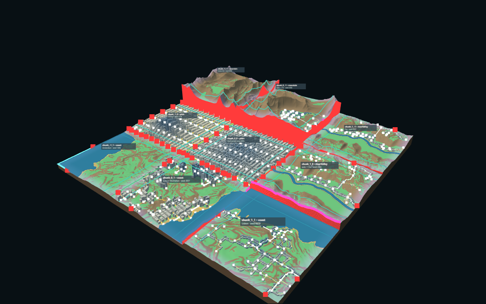 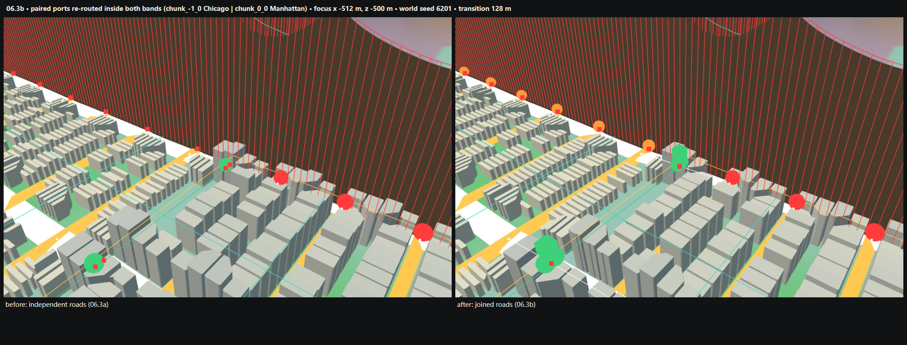 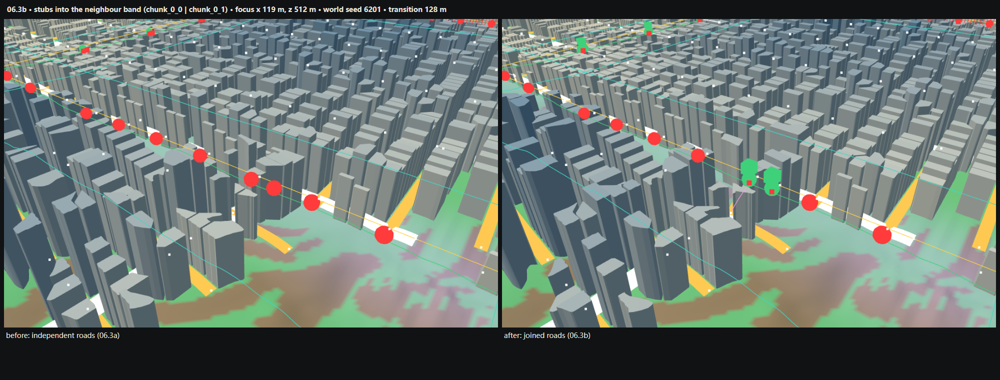 Evidence: `experiments/world-grid/evidence/world-road-seam.json`.
- **Problems found during testing (fixed):** after a re-stitch, an unchanged chunk's city layer kept the previous (identical-signature) graph object → rebound to the current stitched graph; the reachability test anchored on each chunk's largest component and missed a smaller joined component → anchors per shared component.
- **Observations:** on seed 6202 the Chicago | Manhattan ports are offset 61 m. A straight re-route would lean 28.7° (> 25°), so each street ends as a T on the neighbour's first parallel street (10 stubs, staggered junctions) instead of 5 through-streets — connected, but a different street pattern. A wider lean limit would turn them into pairs.
- **Open issues:** (1) 8 / 12 edges (6201) cannot carry roads because 06.3a left them unresolved; no ramp / bridge / escarpment rule exists (upstream decision still open). (2) Canal ports are pending (canal joins not implemented). (3) Along-road grade is not limited separately — connectors use the network's cell-slope test, so a connector can climb 16° along its line where the DNA limit is 20° (organic). (4) The stub rule can create many parallel T-junctions on one edge; there is no spacing or hierarchy preference beyond the class gap. (5) Several rejections sit at the bend (40°) and slope (10°) thresholds (e.g. 40.3°, 10.2°); thresholds are A, not calibrated. (6) NetworkView's port markers still clutter the world view. (7) The outer world edge and the known tunnel defect (6202 / chunk_0_-1 / Chicago) are unchanged.
- **Review status:** Pending review.
- **Next single task:** Decide the rule for unresolved edges (ramp / escarpment road, bridge over a level step, or landform compatibility at slot assignment) — the main limit on world-wide road connectivity.

### 06.3a-R — World-coherent terrain (global macro terrain + shared boundary surface)

- **Date / Stage / Single question:** 2026-10-21 / T7 / Can the 3 × 3 world get one continuous large-scale relief in world coordinates — same height and slope on every shared edge, one value at every corner — while each chunk keeps its landform, the transition width stays user-set, and edges that cannot be joined within a reasonable slope are reported instead of being cliffed or flattened?
- **Pre-checks / reuse:** 06.3b report: 8 / 12 edges (6201) carried no road because 06.3a left them unresolved; raw steps up to 296 m cannot be absorbed by an edge-local join inside 128 m without slopes > 35°. Reused: raw single-chunk generation + seeds (`generateRawLayer`, `terrainSeedOf`), `edgeWeight` (smoothstep band weight), `deriveFields` / `analyseTerrain`, `slopeField`, the 06.3a water rules (extracted unchanged into `floodWater`), `SeamCheck`, `SeamView`, the 06.3b `RoadSeam` and audit hooks.
- **Algorithm (`experiments/world-grid/WorldTerrain.js`, terrain mode `coordinated`, now the default):**
  - **Global macro base:** one C¹ field over the chunk lattice in world coordinates. Control values: chunk base b_c = mean raw height (coast: sea level, its datum) and relief R_c = landform relief × variation strength. Every shared edge (mid-point) and every corner (2 or 4 chunks) gets one relief-weighted value (weights 1 / R: base = weighted mean, relief = harmonic mean), so the flatter landform keeps its level and the rougher one carries the climb (foothills). Along an edge the value runs corner → mid → corner with smoothstep.
  - **Local layer:** L = T_c + E_c·(raw − b_c). T_c ramps from b_c to the edge values over the landform ramp distance D (Coons sum over shared sides; φ = 1 − smoothstep(0, D, d), so zero slope at the edge); E_c fades the local relief toward the shared relief over the same distance (never amplifies). Cells farther than D from every shared edge are raw exactly.
  - **Shared boundary surface S (inside the user band W):** relief-weighted mean of both raw edge profiles, low-passed along the edge (64 m) and pinned at the ends to the shared corner value, plus worldSeed fBm in world metres (share 0.35 of the shared relief, wavelength 400 m), faded out below sea level so a sea crossing the edge stays sea. At 4-chunk corners: corner value + the same fBm. Both chunks evaluate the same function.
  - **Final height:** h = L(1 − w) + S·w with w = `edgeWeight` (w = 1, w′ = 0 at the edge); corner squares use the bilinear combination with the corner surface. So both chunks hold the same height and the same cross-edge slope on every shared edge (C¹ by construction) and all chunks share one corner value. No edge is flattened or clamped.
  - **Check:** a cell is made steep if slope > 35° and > raw slope + 2° (06.3a rule); it is blamed on the nearest shared edge whose zone (D) contains it. Such an edge is unresolved: geometry stays continuous (no cliff), the reason gives the steep cells in band vs ramp, and a feasible adjustment is estimated (transition width needed, longer ramp, landform pair, escarpment rule). The band is never widened automatically.
  - **Water:** sea keeps level 0; a river level takes the same transform as its ground; wet cells come only from connected flooding from raw water; river water stays in its raw channel cells (`riverSpread: false`), so no lake is created by lowered ground. Then `deriveFields` recomputes slope, water, buildability, boundary samples; `analyseTerrain` recomputes the analysis.
- **Public parameters (6, spatial):** `rampDistance` plain 0 / coast 128 / river valley 384 / mountain 512 m (never < W, ≤ 512 m); `sharedReliefShare` 0.35; `sharedWavelength` 400 m; `boundarySmoothing` 64 m; `maxTransitionSlopeDeg` 35°; `createdSlopeMargin` 2° (water tolerances reused from 06.3a). Transition width stays the user slider (32–256 m).
- **Changed files:** new `experiments/world-grid/WorldTerrain.js`, `scripts/verify-world-terrain.mjs`, `experiments/world-grid/evidence/world-terrain.json`; changed `TerrainHarmonizer.js` (water section extracted into exported `floodWater`, new option `riverSpread`; 06.3a output verified bit-identical: height, water, network, building signatures and edge water interfaces of seeds 6201 / 6202 before = after), `WorldGrid.js` (mode `coordinated`; harmony key includes the world seed), `worldConfig.js` (default `coordinated`; `harmonized` / `raw` kept), `main.js` (Terrain control, lab `waterAudit / crossability / landformStats / memory`, order test per mode), `SeamView.js` (difference overlay: |coordinated − raw| colour ramp, magenta = made-steep cells), `index.html` (legend, intro); `scripts/verify-world-seam.mjs` and `scripts/verify-road-seam.mjs` pinned to `terrain=harmonized` (their tasks were measured on 06.3a terrain). Unchanged: `experiments/seed-terrain/` (single-chunk page, terrain generator, City DNA, network, parcels, buildings, tunnels), chunk size, sampling (257², 4 m), road topology rules. Nothing committed.
- **Results, world seed 6201, W 128 (raw 06.2 → harmonised 06.3a → coordinated 06.3a-R):** edges with a height step 12 → 8 → 0 (max 296.4 → 296.4 → 0 m); resolved 0 → 4 → 7 / 12; interior corners shared 0 → 1 → 4 / 4 (spread 250.7 m → 0); off-grid sampler difference across edges 295 m → 0; slope kink max over all edges 88.0° → 88.0° → 27.4° (resolved edges 8.6° → 6.2°); rendered normal difference max 93.5° → 26.4°; one-sided water samples 489 → 443 → 11, discontinuous water edges 6 → 4 → 1 (river reaches the mountain edge, neighbour has no channel — not extended); road-candidate transects (dry, ≤ 20°, no step, through both bands) 1.5% → 24.8% → 49.2% of edge positions, edges with a ≥ 40 m crossable run 1 → 4 → 12; 06.3b road joins 0 → 8 → 22. All 9 solids closed; rendered mesh = fields; raw fields unchanged; sea cells all at level 0; 0 river cells outside the raw channel.
- **Unresolved edges (6201), all continuous, each with reason + suggestion:** mountain | mountain (raw 163.5 m; 5550 cells > 35°, max 73.1°, 4098 in the band → would need W ≈ 608 m, beyond the 256 m slider), mountain | plain ×2 and mountain | river valley (raw 235–296 m; 1040–2298 cells, max 62.7–63.2°, almost all in the 512 m mountain ramp → a 200 m base drop with mountain relief does not fit in half a chunk under 35°), coast | coast chunk_0_1 | chunk_1_1 (raw 47.1 m; 27 cells, max 40.0°, all in the band → W ≈ 160 m by explicit choice).
- **Seeds (W 128, harmonised → coordinated):** 6201 resolved 4 → 7, crossable 24.8 → 49.2%, road joins 8 → 22; 6202 resolved 6 → 6 (one different set: coast | coast 0_1 | 1_1 resolved → unresolved, plain | river valley 0_0 | 1_0 unresolved → resolved), crossable 27.6 → 47.9%, road joins 26 → 37, water discontinuous 2 → 0; 6203 resolved 4 → 5 (river valley | coast 1_0 | 1_1 resolved → unresolved; coast | coast -1_1 | 0_1 and plain | river valley 0_0 | 1_0 unresolved → resolved — *corrected 2026-10-21 in 06.3a-R2: this line first said coast | coast -1_1 | 0_1 "resolved → unresolved", the reverse of the data*), crossable 18.3 → 42.9%, road joins 9 → 18. Every seed: 0 edges with a step, 4 / 4 corners shared, mountain edges always unresolved. Each coordinated seed loaded twice → identical signatures and edge report.
- **Transition widths (6201):** W 64 → 5 / 12 resolved (resolved band slope 27.2°, crossable 61.4%), W 128 → 7 / 12 (35.6°, 49.2%), W 256 → 8 / 12 (53.0°, 46.7%); geometry valid at every width (Δh 0, corners 0, mesh = fields, solids closed, no non-finite height); each width change rebuilt every changed terrain layer and its city layer (no stale roads / parcels / buildings; city layers on the current stitched network). "Resolved" means no cell made steeper than 35° *and* its raw slope + 2°; the band maximum on resolved edges (up to 53° at W 256) is existing raw relief (river banks, coastal hills), not created by the join.
- **Landform character (6201, raw → coordinated):** plains relief 5.1–5.7 → 5.2–10.3 m, mean slope 0.9 → 1.3–1.6°, buildable 100%; river valleys mean slope 11.1 → 8.9–11.6°, river wet share 3.4 → 3.1–3.6%; coasts wet share 31.6 / 16.7 / 33.2% → 29.2 / 11.3 / 21.6%; mountains mean slope 29–32 → 27–30°, relief range p5–p95 128–141 → 227–268 m (the massif now descends to its foothills at the plain / valley edges). Untouched (raw) share: plains 56–66%, coasts 66–77%, river valleys 16–39%, mountains 0.2–25% (512 m ramps on three sides).
- **Architecture checks:** City ID change (chunk_0_1 → Amsterdam): coordination not re-run, 0 raw rebuilds, raw / height / water signatures of all 9 chunks unchanged; city layers of chunk_0_1 and chunk_0_0 rebuilt (06.3b stub change), all on the current stitched graph. Reversed / rotated input → identical coordination output. Reload identical. Auto-matched DNAs follow the new terrain analysis (6201: chunk_1_0 auto → Lisbon, chunk_0_1 auto → Fez, previously Fez / Manhattan); manual City IDs unaffected.
- **Performance (heap after forced GC):** coordination 736–752 ms per world (harmonisation 06.3a 493–540 ms); full world load 21.2–24.4 s coordinated vs 20.8–23.0 s harmonised vs 20.4–23.5 s raw (within run-to-run noise); heap 327–333 MB coordinated vs 319–368 MB harmonised vs 309–351 MB raw. Transition-width change rebuilds the world in 18.4–22.1 s.
- **Regression:** single-chunk `verify-seed-terrain.mjs` and `verify-solid-terrain.mjs` pass with identical evidence except timestamps (files restored to the committed versions); `verify-world-grid.mjs` (06.2), `verify-world-seam.mjs` (06.3a) and `verify-road-seam.mjs` (06.3b) pass with their logged numbers; their evidence files and screenshots restored.
- **Screenshots (6201, W 128):**  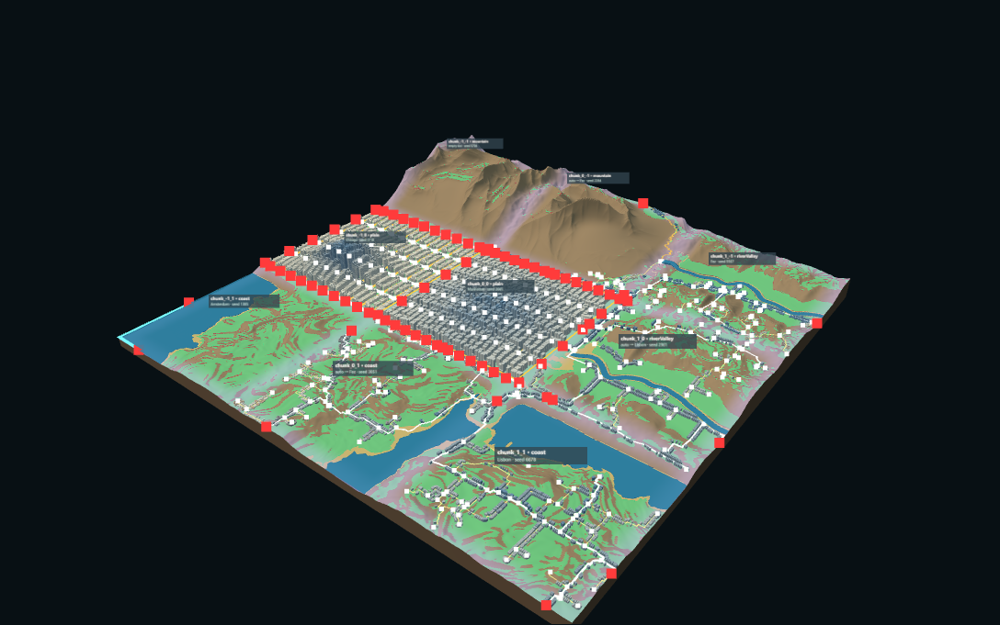 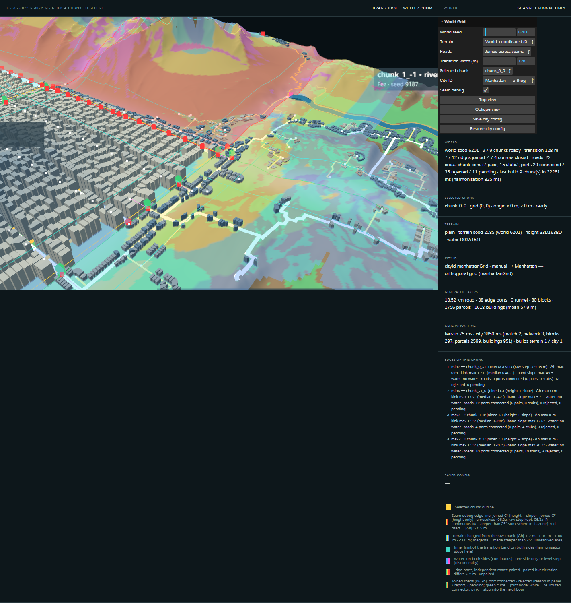 Evidence: `experiments/world-grid/evidence/world-terrain.json`.
- **Problems found during testing (fixed):** (1) a boundary surface built from chunk-mean bases lifted the sea along coast | coast edges to land (all edges reported "no water") → surface from the weighted raw edge profiles + noise faded below sea level; (2) lowered band ground let river water spread into a lake strip along a plain | river edge (87 wet edge samples; river wet cells +45%) → river water kept in its raw channel cells; (3) coast bases from the chunk mean (13–19 m, a land / sea share effect) lifted sea floors → coast base = sea level; (4) heap readings without GC varied 454–1971 MB → measured after forced GC.
- **Measured trade-off (not adopted):** coast ramp 256 m instead of 128 m gives gentler coastal transitions (band slope 17–24° vs 27–31°) and more road joins (47 vs 22) but loses much more sea (6201 chunk_1_1 wet cells 21 913 → 8 218 vs 14 240).
- **Open issues:** (1) every edge touching a mountain stays unresolved in all seeds: the base difference (~200 m) plus mountain relief does not fit under 35° within a 512 m ramp, and a mountain | mountain join would need W ≈ 600 m; options: landform-compatibility rule at slot assignment, an escarpment rule, or a lower slope criterion for mountain zones (all decisions). (2) Coasts next to a higher landform lose sea (6203 chunk_0_1 wet 18.4 → 6.1%). (3) Not monotone per edge: some edges resolved by 06.3a are unresolved here (6202 coast | coast 0_1 | 1_1, 6203 river valley | coast 1_0 | 1_1; *corrected 2026-10-21*) and vice versa. (4) Discrete slope kink up to 6.3° on resolved edges and 27° on unresolved mountain edges, although the construction is C¹ (finite differences on steep relief, per-chunk normals). (5) Rivers still end at chunk edges where the neighbour has no channel; river levels follow the ramp but monotonic flow along the channel is not checked. (6) The mountain chunk next to plains is almost entirely re-based (0.2% untouched). (7) Auto-matched City DNAs change with the coordinated terrain.
- **Review status:** Pending review.
- **Next single task:** Decide the handling of mountain-adjacent edges (landform compatibility at slot assignment vs escarpment rule vs a mountain-specific slope criterion) before any bridge, ramp or further road work.

### 06.3a-R2 — World terrain preservation & seam constraints

- **Date / Stage / Single question:** 2026-10-21 / T7 / Can the world stay geometrically continuous at every shared edge and corner while each chunk's core (farther than W from all four edges), its water and its buildable land are kept exactly, with seam corrections confined to the user transition band and edges that need a steep step reported as escarpment candidates instead of being repaired by large-scale deformation?
- **Problem in 06.3a-R (measured there):** macro ramps up to 512 m re-shaped whole chunks (mountain chunk_0_-1 0.2% untouched; 6203 chunk_0_1 sea 18.4 → 6.1%); some 06.3a joins were lost. Review of the 06.3a-R entry also found one reversed statement (6203 coast | coast), corrected in place and marked.
- **Datum audit (task 1.4):** the single-chunk landform rules each add their own base elevation: plain `baseHeight` 20 m (+ tilt, 0–7 m relief), river valley 30 m (surface datum), coast sea level 0, mountain `baseHeight` 120 m + relief term 0–300 m (mean ≈ 100). The mountain floor therefore sits ≈ 100 m above every neighbour before any noise — an architectural step that no edge blend should be asked to hide. It is now removed at the datum level, not by the seam.
- **Layers (`experiments/world-grid/TerrainCoordinator.js`, terrain mode `coordinated`, default):**
  - `rawLocalTerrain` — the unchanged single-chunk generation (seed → local landform), kept for comparison.
  - `worldMacroTerrain` — one world datum field D = 20 m + 6 m·fBm(worldSeed, world metres, wavelength 4096 m). Each land chunk gets one constant shift s = D(chunk centre) − its landform datum (coast: s = 0, sea level is the world zero). World base = raw + s; river levels + s. Shifts (6201): mountains −99.8 / −102.8 m, river valleys −13.0 / −9.6 m, plains +1.4 / 0 m, coasts 0. A constant shift keeps core shape, slope, water extent and buildability identical.
  - `coordinatedTerrain` — correction inside the band only: h = base·(1 − w) + S·w (w = existing smoothstep `edgeWeight`: w′ = 0 at the edge and at d = W, so no crease where the band meets the core); corner squares h = base(1−w1)(1−w2) + S1·w1(1−w2) + S2·w2(1−w1) + Sk·w1·w2 (joint corner, no double lift). Outside every band h = base exactly.
  - Shared surface S of an edge (one world function for both chunks): S = P(s) + G(s)·n — P = relief-weighted mean of both base edge profiles, G = relief-weighted mean of both cross-edge slopes (8 m stencil), both low-passed 64 m along the edge and pinned at the ends to the corner values; corner Sk = Pk + Gx·dx + Gz·dz. So the edge keeps a natural cross slope (C¹, no level shelf). Fallback: an edge whose pass-1 join makes cells too steep drops its cross slope (G = 0) and is checked again (06.3a C¹ → C⁰ idea).
  - Sea: where only one side is sea at an edge sample, P is held ≥ 1 m (freeboard) below sea level; the lowering is spread along the edge (max filter + low-pass over W/2) so the profile has no along-edge cliff. The land side then drops inside its band; if that is too steep the edge is a `waterConflict` (sea-cliff candidate). Water is never removed to make a join pass.
  - Check: a band cell is made steep if slope > 35° and > its base slope + 2°. Unresolved edge → `escarpmentCandidates` (runs along the edge with from / to, both base heights, max step, max slope, cause: base step vs the band's slope budget W·tan 35° / 0.75 = 119.5 m at W 128, existing relief, or waterConflict). No escarpment geometry is built; the band is never widened.
  - Water: sea level 0; connected flooding from raw water only (`floodWater`, river water kept in its raw channel cells); core water untouched by construction.
- **Parameters (7):** macroDatum 20 m, macroAmplitude 6 m, macroWavelength 4096 m, boundarySmoothing 64 m, maxTransitionSlopeDeg 35°, createdSlopeMargin 2°, smoothKinkTargetDeg 2° (test target only). Transition width = user slider 32–256 m.
- **Changed files:** new `experiments/world-grid/TerrainCoordinator.js`, `scripts/verify-terrain-coordinator.mjs`, `experiments/world-grid/evidence/terrain-coordinator.json`; changed `WorldGrid.js`, `worldConfig.js` (modes `coordinated` R2 default · `macroRamp` R1 · `harmonized` · `raw`), `WorldTerrain.js` (mode label only), `main.js` (Terrain list, lab `coreAudit`, `section`, order test per mode), `SeamCheck.js` (passes escarpment candidates), `SeamView.js` (magenta posts on escarpment-candidate runs), `index.html` (legend); `scripts/verify-world-terrain.mjs` pinned to `terrain=macroRamp`. Unchanged: `experiments/seed-terrain/` (single chunk, City DNA, roads, parcels, buildings, tunnels), chunk size, sampling, 06.3a / 06.3b algorithms. Nothing committed.
- **Results (W 128; 06.3a → 06.3a-R → 06.3a-R2):**
  - Max height discontinuity on shared edges: 296 / 315 / 293 m → 0 → 0 m (6201 / 6202 / 6203); interior corners shared 1 → 4 → 4 / 4 per seed; off-grid sampler difference 0.
  - Resolved edges: 6201 4 → 7 → 5; 6202 6 → 6 → 7; 6203 4 → 5 → 6. Degradations against 06.3a: 0 / 0 / 0. 06.3a coast | coast successes (6201 -1_1 | 0_1; 6202 -1_1 | 0_1 and 0_1 | 1_1; 6203 has none) are all resolved in R2. Against 06.3a-R, R2 resolves fewer edges on 6201 (plain | river 0_0 | 1_0 and river | coast 1_0 | 1_1 become escarpment candidates) — the price of not re-shaping cores.
  - Chunk cores changed against the world base: 0 cells in every chunk, every seed, every width. Against raw, cores differ only by the constant datum shift.
  - Measured slope kink (one-sided 4 m differences): resolved edges max 2.22° / 1.80° / 2.91° (06.3a 8.6 / 41.8 / 24.3°; R1 6.2 / 6.3 / 3.7°); resolved edges over the 2° target: 1 (6201 river | river 1_-1 | 1_0, 2.22°), 0, 2 (6203 plain | river 0_0 | 1_0 2.86°, river | coast 1_0 | 1_1 2.91°); escarpment-candidate edges max 7.7° / 8.6° / 9.6° (separate class). With 4 m spacing a first difference resolves ≈ 0.2° per 1.4 cm, so ≥ 2° is a real kink, mainly where the base step is 30–55 m within 128 m.
  - Modified area (band) per chunk: 23–44% (the band itself: one / two / three / four shared sides); max |Δh| vs base: mountains 135–215 m, river valleys 31–82 m, plains 4.9–30 m, coasts 14–47 m; mean |Δh| of changed cells: mountains 24–51 m, river valleys 5.7–17.8 m, plains 1.3–4.9 m, coasts 1.9–9.0 m. Slope change in the band (p50 / p95): plains 0.1–1.2° / 1.8–13.4°, coasts −1.2–0.5° / 3.5–15.2°, river valleys −0.8–1.4° / 5.8–26.5°, mountains 2.8–7.7° / 23–39°.
  - Coast water coverage (raw → R2): 6201 31.6 / 16.7 / 33.2% → 31.6 / 16.4 / 34.3%; 6202 18.6 / 17.2 / 18.7% → 18.6 / 16.6 / 18.7%; 6203 33.6 / 18.4 / 29.6% → 33.5 / 22.4 / 30.8% (06.3a-R had 24.4 / 6.1 / 25.0%). Core water lost: 0 everywhere. Band losses are listed per edge (e.g. 6202 coast | coast 0_1 | 1_1 399 cells, 6201 river | coast 1_0 | 1_1 307); gains are the sea entering band ground lowered below sea level next to it (6203 chunk_0_1 +2680 cells, plain chunk_0_0 +1585).
  - Escarpment candidates (6201): every mountain edge (base steps 145–195 m > 119.5 m budget, max slopes 70.8–74.5°), river | coast 1_0 | 1_1 (91 m, 50.9°, waterConflict), coast | coast 0_1 | 1_1 (47 m, 41.9°, waterConflict), plain | river 0_0 | 1_0 (44 m, 40.1°, existing relief). 6203 coast | coast -1_1 | 0_1 (61 m, sea against a 61 m coast, 38.1°) is a waterConflict — it was also unresolved in 06.3a.
  - Second width: W 256 resolves 7 / 8 / 8 edges (kink on resolved max 0.73 / 0.44 / 0.61°), but band shorelines move more (6202 chunk_0_1 17.2 → 12.7%, 6203 chunk_-1_1 33.6 → 25.5%; core water still 0 lost); W 64 (6201) resolves 3 / 12 with kink 4.57°. Every width: Δh 0, corners shared, cores unchanged, solids closed, dependent city layers rebuilt.
  - Reproducibility and architecture: each seed loaded twice → identical; reversed / rotated input identical; City ID change → no terrain rebuild and all terrain signatures unchanged; city layers always on the current stitched network.
  - Performance (heap after GC): coordination 0.35 s per world (06.3a-R 0.74 s, 06.3a 0.49–0.54 s); world load 21.5–24.1 s (06.3a 21.7–23.7 s); heap 324–336 MB (06.3a 313–342 MB).
- **Regression (2026-10-21, final code):** `verify-world-grid` (06.2, raw), `verify-world-seam` (06.3a, pinned `harmonized`), `verify-road-seam` (06.3b, pinned `harmonized`), `verify-world-terrain` (06.3a-R, pinned `macroRamp`) all pass with their logged numbers; single-chunk `verify-seed-terrain` and `verify-solid-terrain` pass with evidence identical except timestamps. All their evidence files and screenshots restored to the committed / previous versions.
- **Screenshots (6201, W 128):** 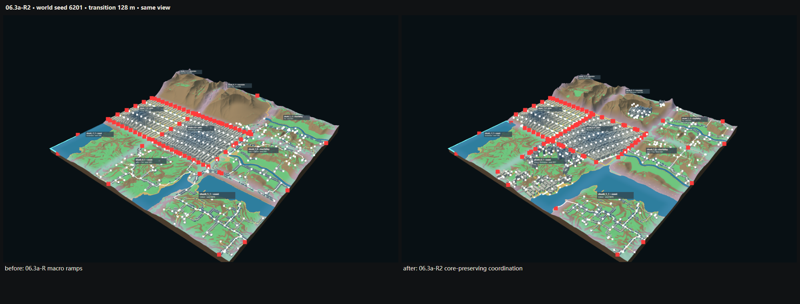 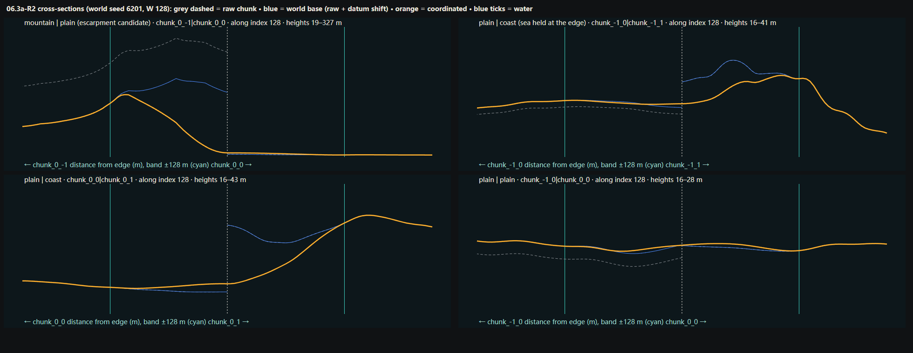 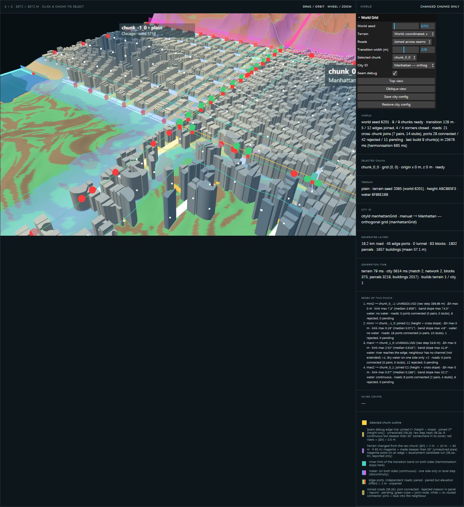 The overlay compares with the raw chunk, so plain cores show the uniform +1.4 m datum shift as a light tint; the band correction is the stronger colour along the edges. Evidence: `experiments/world-grid/evidence/terrain-coordinator.json`.
- **Problems found during testing (fixed):** (1) holding a sea joint at the sea-floor depth dropped neighbouring land below sea level and flooded land bands (6203 plain +3474 wet cells) → joint held only freeboard below sea level; (2) the per-sample sea clamp made an along-edge cliff in the shared profile (6201 plain | coast 72°) → lowering spread along the edge; (3) the C¹ cross slope made 6202 coast | coast 0_1 | 1_1 marginally steep (35.6°) → per-edge cross-slope fallback.
- **Open issues:** (1) all mountain edges stay escarpment candidates: after the datum fix their base steps (115–215 m) still exceed the 119.5 m band budget at W 128 — an escarpment rule (task out of scope) or a mountain-relief taper at the edge are the next options. (2) Coasts next to higher land: waterConflict instead of water loss, so two coast | coast edges and one river | coast edge stay unresolved; the sea can gain band cells where land is lowered next to it. (3) 3 resolved edges exceed the 2° kink target (≤ 2.91°). (4) All unresolved edges used the cross-slope fallback (level cross-section at the edge). (5) Datum shifts change absolute core heights (mountains −100 m); shapes are unchanged, but auto-matched City DNAs and any absolute-height rule downstream see the new values. (6) Rivers still end at chunk edges without a channel (no river joins, as required).
- **Review status:** Pending review.
- **Next single task:** Decide the escarpment handling for mountain edges and the waterConflict rule for coasts (accept as reported candidates, or a dedicated escarpment / sea-cliff geometry task).

### 06.3c — Seam classification and geometric continuity

- **Date / Stage / Single question:** 2026-10-21 / T7 / Can every shared edge be classified by four separate questions — is the surface continuous, what landform seam is it (smooth, valid escarpment, candidate, unresolved), how do the waters meet, can a road cross — so that steep but natural seams are no longer counted as failures, while nothing unresolved is renamed into a success?
- **Pre-checks:** 06.3a-R2 regression round finished before this task (all pass, see the R2 entry). History note honoured: 6203 has no 06.3a coast | coast success; the 06.3a coast | coast regression cases are 6201 -1_1 | 0_1 and 6202 -1_1 | 0_1, 0_1 | 1_1.
- **Seam status interface (`experiments/world-grid/SeamClassifier.js`, pure data, run after every seam check; lab `seamClasses()`):** per edge `{ geometryStatus, geometry, landformStatus, landform, hydrologyStatus, hydrology, transportStatus, transport, overall, color, legacyStatus }`.
  - `geometryStatus`: continuous (Δh 0 on all 257 samples, corner spread 0, finite heights) · discontinuous · invalid. Geometry details: max step, corner spread, band max slope, measured kink (max, p95, median).
  - `landformStatus`: smooth (no cell made steeper than 35° and its base slope + 2°) · escarpment (made-steep cells, but continuous geometry AND a landform pair that carries a scarp — at least one side mountain, river valley or coast — AND max slope ≤ 75° (steepest face a 4 m heightfield represents; one cell rises ≥ 15 m) AND no pit / ridge: coordinated heights stay within both sides' base range ± 1 m along every steep run, in corner squares within the four chunks' corner-square range) · escarpmentCandidate (a check fails: reason names it and the geometry still needed, e.g. "needs a cliff mesh") · unresolved (discontinuous, or steep with no landform reason, e.g. plain | plain).
  - `hydrologyStatus`: none · continuousWater · riverValleyContinues · shoreline (sea held at the edge, gentle land side) · coastalEscarpment (sea held, land side is a scarp) · riverEndsAtEdge (not extended, not a failure) · incompatibleLevels · coreWaterLost · discontinuous.
  - `transportStatus`: passable (continuous and a ≥ 40 m stretch whose transects through both bands are dry and ≤ 20°) · impassable. Terrain only: the 06.3b road seam still joins smooth (legacy resolved) edges only; a passable stretch on a scarp edge is reported, not used.
  - `overall`: smooth · smoothKink (smooth, measured kink > 2°) · escarpment · candidate · failed (geometry, unexplained scarp, incompatible water or lost core water). Guard: legacy resolved edges = smooth edges exactly (asserted), so no unresolved edge became a success by renaming.
- **Change to 06.3a-R2 (TerrainCoordinator):** the shared corner value used to fade into the edge profile over half the edge (512 m); with two mountains and two plains at a corner, the plain-weighted corner value pulled the mountain | mountain profile ~100 m below both mountains (pit) up to 156 m from the corner (overshoot 61 / 40 / 100 m on seeds 6201 / 6202 / 6203). New parameter `cornerPinBands` = 1: the corner value fades in over one band width (the corner square). Tested 2·W (pits 24–47 m remain) and 1·W (none). R2 verifier re-run with 1·W: resolved 5 / 7 / 6 (unchanged), regressions vs 06.3a 0, 06.3a coast | coast cases resolved, measured kink on resolved edges max 1.23° / 0.57° / 1.40° (before 2.22 / 1.80 / 2.91°; now 0 edges over the 2° target), cores unchanged, coast water 31.6 / 16.7 / 33.2% → 31.6 / 16.8 / 35.2% (6201), 6203 18.4 → 23.0%. The R2 evidence file keeps the R2 run; the 1·W numbers are recorded here.
- **Datum audit (task 8, lab `datumAudit()`):** each chunk analysed on raw terrain and on raw + its exact world datum shift (no seam correction): relative terrainAnalysis metrics differ in 0 values, water / buildable masks flip in 0 cells, auto City DNA identical for every chunk and seed; only absolute values move (elevation statistics, heights, water levels: 6 values per shifted chunk). All City Match conditions use relative metrics (buildable shares, slope classes, water fraction / role), and water metrics compare height with a water level shifted by the same amount. Auto DNA changes seen since 06.3a-R come from the band correction (e.g. 6201 chunk_0_1 Lisbon → Manhattan, chunk_0_-1 Fez → Manhattan), not from the shift. Manual City IDs unchanged in every run. *Correction:* an interim statement in this task that Float32 rounding moved chunk_1_-1 slope statistics by 0.011° was wrong — the audit had used the 2-decimal rounded shift for water levels (76 river cells flipped); with the exact shift (`macro.shiftExact`) every difference is 0.
- **Classification, W 128 (overall · hydrology · transport):**
  - 6201 (5 smooth, 7 escarpment, 0 candidate, 0 failed): mountain | mountain -1_-1 | 0_-1 escarpment 71.4° · none · impassable; mountain | plain -1_-1 | -1_0 escarpment 73.0° · impassable; mountain | river 0_-1 | 1_-1 escarpment 70.8° · passable (44 m stretch); mountain | plain 0_-1 | 0_0 escarpment 74.5° · impassable; river | river 1_-1 | 1_0 smooth (kink 0.57°) · passable; plain | plain -1_0 | 0_0 smooth (0.06°) · passable 1028 m; plain | coast -1_0 | -1_1 smooth (1.23°) · shoreline · passable; plain | river 0_0 | 1_0 escarpment 39.0° (valley wall) · continuousWater · passable; plain | coast 0_0 | 0_1 smooth (0.55°) · shoreline · passable; river | coast 1_0 | 1_1 escarpment 50.9° · coastalEscarpment · impassable; coast | coast -1_1 | 0_1 smooth (0.30°) · passable; coast | coast 0_1 | 1_1 escarpment 41.9° · coastalEscarpment · impassable.
  - 6202 (7 smooth, 5 escarpment): four mountain escarpments (60.5–72.3°), plain | river 0_0 | 1_0 escarpment 39.0°; all other edges smooth (kink ≤ 0.57°), river | coast 1_0 | 1_1 riverEndsAtEdge; passable 9 / 12.
  - 6203 (6 smooth, 6 escarpment): four mountain escarpments (58.7–67.0°), coast | coast -1_1 | 0_1 and 0_1 | 1_1 coastalEscarpment (38.1°, 42.3°); smooth edges kink ≤ 1.40°; passable 6 / 12 (plain | coast 0_0 | 0_1 smooth but impassable: no 40 m dry stretch).
- **Other widths:** W 64 — 6201: 2 smooth, 1 smoothKink (2.95°), 6 escarpment, 3 candidate (mountain scarps 75.4–79.5° > 75°: need a cliff mesh); 6202: 4 / 1 / 5 / 2 / 0; 6203: 0 smooth, 2 smoothKink (up to 4.9°), 7 escarpment, 2 candidate (one pit 3.2 m on mountain | mountain, one 75.4° scarp), 1 failed (plain | plain -1_0 | 0_0: 28 cells at 36.8°, no landform reason for a scarp). W 256 — 6201: 7 smooth, 4 escarpment, 1 candidate (coast | coast 0_1 | 1_1, pit 2.98 m); 6202: 8 / 0 / 4 / 0 / 0; 6203: 8 / 0 / 4 / 0 / 0; smooth kink ≤ 0.74°. Narrow bands produce scarps the heightfield cannot represent; wide bands move more shoreline (6202 chunk_0_1 17.2 → 12.7%).
- **Negative controls:** raw terrain (6201) → 12 / 12 failed (discontinuous); macro-ramp terrain (06.3a-R, no run data) → 4 smooth, 3 smoothKink, 5 candidate, 0 escarpment — the classifier never validates a scarp without evidence.
- **Checks per run (all seeds × W 128 / 64 / 256, `node scripts/verify-seam-classes.mjs`, all pass, 0 browser errors):** every edge has four statuses and one overall class consistent with them; geometry continuous on all 12 edges; cores unchanged against the world base and 0 core water lost; legacy resolved = smooth; datum audit exact; classes reproducible on reload.
- **Debug layer (reused):** the seam debug edge line takes the class colour (green smooth · yellow-green kink > 2° · blue valid escarpment · orange candidate · red failed), drawn twice for visibility; magenta posts mark escarpment runs; the |Δh| overlay and band limits are unchanged; the panel lists the four statuses per edge. No new UI controls.
- **Changed files:** new `experiments/world-grid/SeamClassifier.js`, `scripts/verify-seam-classes.mjs`, `experiments/world-grid/evidence/seam-classes.json`; changed `TerrainCoordinator.js` (`cornerPinBands`, exact shift in the report), `main.js` (classification after the seam check, panel line, lab `seamClasses / datumAudit`, crossability through `transectFeasibility`), `SeamView.js` (class colours), `index.html` (legend). Unchanged: roads, tunnels, parcels, buildings, City DNA, `experiments/seed-terrain/`. Nothing committed.
- **Regression (final code):** `verify-terrain-coordinator` (06.3a-R2, numbers above), `verify-world-terrain` (06.3a-R), `verify-world-seam` (06.3a), `verify-world-grid` (06.2), `verify-road-seam` (06.3b) pass with their logged numbers; single-chunk `verify-seed-terrain` and `verify-solid-terrain` pass with evidence identical except timestamps. Their evidence files and screenshots restored.
- **Performance:** world load 21.4–28.6 s, terrain coordination 0.52–0.89 s (W 64–256), classification inside the seam check; heap after GC 327–352 MB.
- **Screenshots (6201, W 128):** 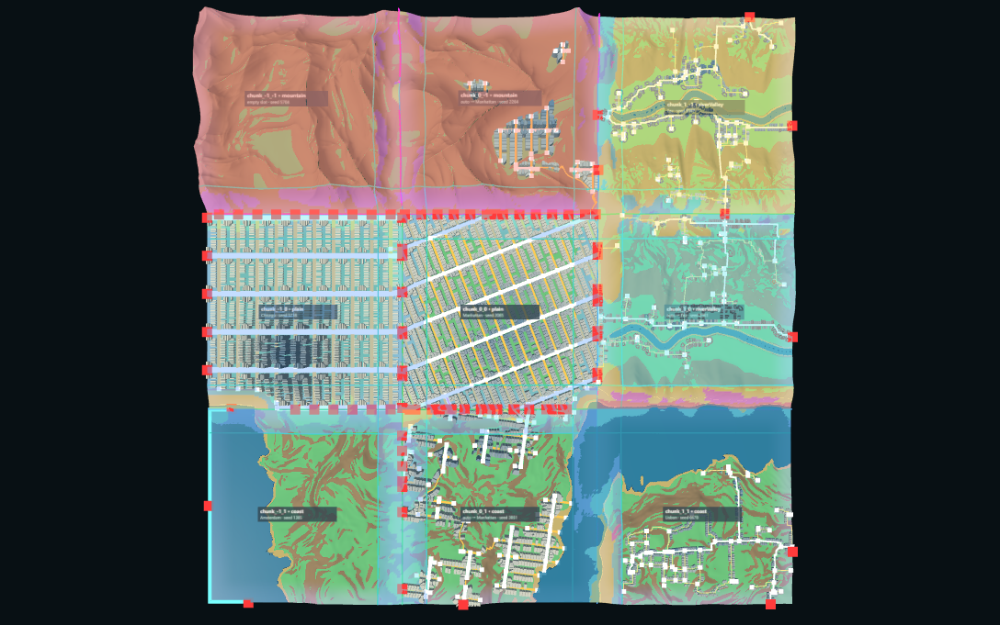 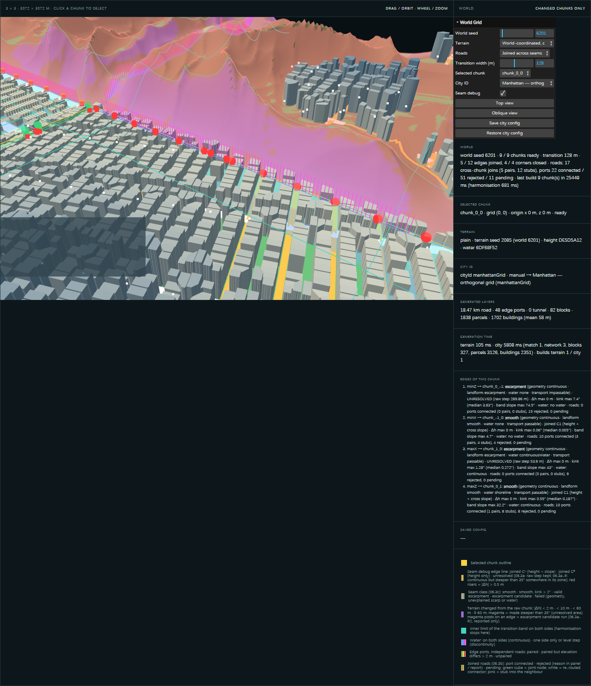 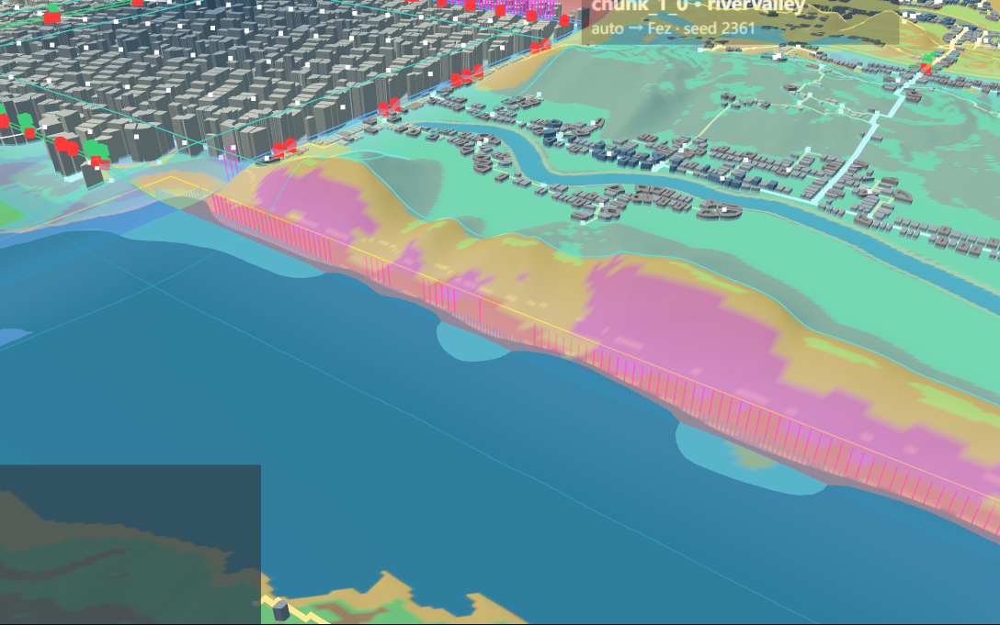 In the top view the class lines are thin at full-world scale; the close-ups show them clearly. Evidence: `experiments/world-grid/evidence/seam-classes.json`.
- **Acceptance (self-check against the task):** statuses split (yes); smooth seams still measured by height and finite-difference slope with the 2° target, no threshold relaxed (yes); mountain steps become continuous scarps inside the band without touching cores (yes); scarps validated only with geometry + landform + representability + no pit / ridge (yes); waterConflict split into coastal escarpment / river ends / incompatible (yes; no incompatible case occurred); no extra river network or cliff mesh (yes, candidates name the missing geometry); datum audit (yes, exact); seeds × widths (yes); Seam Debug reused (yes).
- **Open issues:** (1) at W 64, mountain scarps exceed 75° and stay candidates — they need cliff geometry (a near-vertical face or overhang the heightfield cannot hold). (2) Sea water enters plain bands lowered toward a sea-held corner (6203 plain | plain reports continuousWater; R2 measured +1585 wet cells in plain chunk_0_0). (3) The road seam joins smooth edges only; passable stretches on scarp edges (e.g. 6201 mountain | river 44 m) are not used. (4) The 75° limit, 1 m pit tolerance and 40 m / 20° transport test are A, not calibrated. (5) No `incompatibleLevels` case appeared in these seeds, so that branch is untested on real data.
- **Review status:** Pending review.
- **Next single task:** Decide whether valid escarpments and coastal escarpments need dedicated geometry (cliff mesh for > 75°) or whether the road seam should use passable stretches on scarp edges — one at a time.

### M06 — Checkpoint commit, World State checkpoint, Firebase release

- **Date / Stage / Single question:** 2026-10-21 / release (no stage change; requested as "M04", renumbered because M04 is the 2026-10-20 archive release) / Can the verified state be committed and pushed, the working world saved as a reproducible checkpoint, the site deployed through the existing pipeline and checked at the public URL, and the next session given one clear entry?
- **Pre-checks:** branch `experiment/terrain-seam`, `origin/main` = branch = `b59b26c`; Firebase project `gameeeee-zc626` (`.firebaserc`), Hosting `dist`, CI "Deploy to Firebase Hosting on merge" on push to `main` (last runs success); 77 uncommitted paths (06.3b–06.3c work, DOC-01–05, M04 / M05 work incl. the 11 active Terrain Seam GLBs, 0.2–26 MB each, needed by the CI build after M05); no secrets among them. Two root screenshots (`terrain-seam-overview.png`, `terrain-seam-topology.png`) are deleted in the working tree with no copy anywhere and no record of why — the deletion was left out of the commit (files stay in Git).
- **World State checkpoint:** `experiments/world-grid/worldCheckpoint.js` wraps the existing `serialiseWorld` / `restoreWorld` in a versioned JSON (`procedural-mini-world/world-checkpoint`, v1): world seed, transition width, variation, terrain / road mode, the 3 × 3 layout (grid, origin, landform, terrain seed, City ID, Auto / Manual / Empty), rule parameters and version labels of every stage, expected per-chunk signatures and seam classes. Saved: `experiments/world-grid/checkpoints/world-6201-checkpoint-v1.json` (10.7 KB, the default working world: seed 6201, W 128, coordinated, joined). Restore: `?checkpoint=default` (bundled via Vite `?url`), GUI **Load world checkpoint** (file), **Export world checkpoint** (download); the existing localStorage Save / Restore now also restores transition width, terrain and road mode in the GUI. No meshes stored.
- **Tests before the commit:** `vite build` (11 GLBs + checkpoint in `dist`); against `vite preview`: `verify-world-checkpoint` 7 / 7 (URL checkpoint reproduced, content, export equal, file load reproduced, tampered checkpoint reported as mismatch, localStorage across reload, default world = checkpoint), `verify-live-release` 10 / 10, `verify-hosted-experiments` pass; `verify-world-grid` pass (evidence restored). The 06.3a–06.3c, 06.3a-R2, single-chunk verifiers had passed on the same generator code (06.3c entry). A clean `git archive` export of the commit built on its own (11 GLBs, checkpoint asset).
- **Git:** commit `1f63e6f` "M06 checkpoint: World Grid seams, terrain coordination, World State checkpoint" (134 files) on `experiment/terrain-seam`; pushed; `main` fast-forwarded to `1f63e6f` (`git push origin HEAD:main`, no force, no reset, no branch switch). This entry, `NEXT_SESSION.md` and the two live screenshots are a follow-up documentation commit on `experiment/terrain-seam` only, so `main` and the live site stay at `1f63e6f` (no second deployment).
- **Deployment:** GitHub Actions run 39550615439 (push of `1f63e6f` to `main`) success, 2026-10-21 05:37:35–05:38:43 UTC; no manual `firebase deploy`. Live World Grid entry `assets/worldGrid-Dm_EG34_.js`.
- **Public verification (2026-10-21 05:39 UTC, <https://gameeeee-zc626.web.app>):** `verify-world-checkpoint` 7 / 7 — `/experiments/world-grid/?checkpoint=default` reaches READY in 19.1 s with "reproduced: all signatures match", 9 / 9 chunks ready, 17 road joins, buildings in every city chunk except Amsterdam on coast chunk_-1_1 (0 km road, 0 buildings — known since 06.3b); `verify-live-release` 10 / 10 (hub → Mini World iframe, City ID switch rebuilds one chunk, world seed, single-chunk page); `verify-hosted-experiments` all routes; 0 console / page errors, 0 HTTP ≥ 400.
- **Screenshots (public site):** 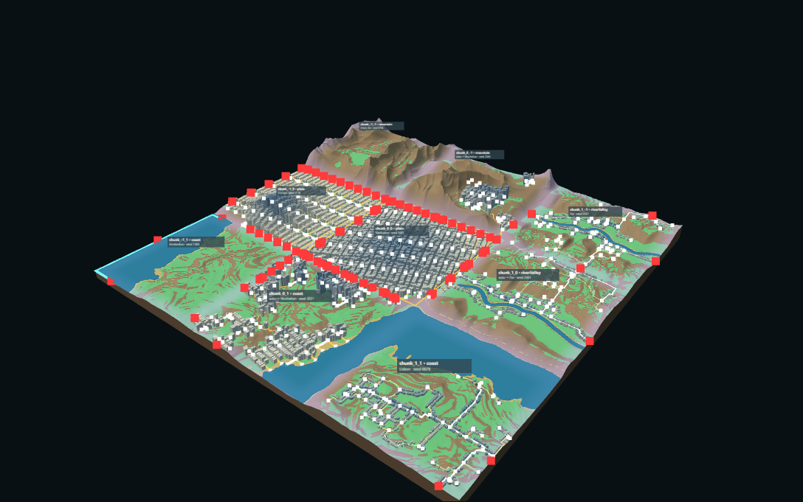 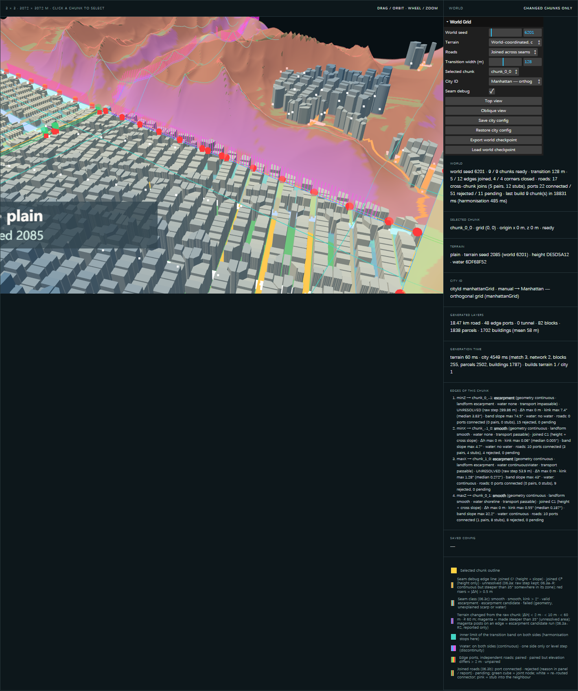
- **Restart test:** all Vite servers stopped; fresh `npm run dev` (bundled Node 24.19, Vite 7.3.6, ready in 271 ms) → `verify-world-checkpoint http://localhost:5173` 7 / 7, `/experiments/seed-terrain/` 200. `dev.cmd` launched from the agent shell failed ("not recognized" in a new `cmd`, likely the full-width character in the folder name) — not verified, documented in NEXT_SESSION §8.
- **Hand-off:** [NEXT_SESSION.md](./NEXT_SESSION.md) (linked from the knowledge base Start Here and compass §1).
- **Open issues:** `dev.cmd` start unverified (use `npm run dev`); root-screenshot deletion undecided; Amsterdam chunk without roads on seed 6201; the CI build warns about large chunks (three.js 705 kB, firebase 533 kB) as before; all 06.3x tasks still pending review.
- **Review status:** Pending review.
- **Next single task:** see NEXT_SESSION.md §7.

### 07.1 — City Invasion & Fusion (single source city)

- **Date / Stage / Single question:** 2026-10-21 / T7 (blend), by user instruction / Can one city's spatial rules invade a neighbouring chunk so that the boundary shows a mixed morphology (streets, parcels, buildings) that changes with an influence weight, while chunk grid, terrain, water and unaffected chunks stay unchanged?
- **Reused files or functions:** World Grid pipeline (`WorldGrid.js`: network → road seam → city layers, keyed caches), `generateNetwork` / `matchCity` (the invader network is the unchanged generator with the source DNA forced on the target terrain), `GraphBuilder` (`splitEdgeAt`, `pruneShortComponents`, `finalize` → ports and stats), `findCrossings`, `PARCEL_RULES` / `BUILDING_RULES` per DNA, `RoadSeam.stitchRoads` (unchanged), verifier pattern of `verify-road-seam.mjs`.
- **Model:**
  - *Influence field:* d = distance to the source chunk square; w = strength · (1 − smoothstep(d / radius)). Applied only inside the target chunk. Seam guard: w × smoothstep((e − W) / W), e = distance to the nearest target side not shared with the source, W = transition width (128 m) — added after the first run showed the fusion zone reaching the target | Chicago seam and changing Chicago through the road seam.
  - *Base / invading DNA:* base = target's resolved DNA (manual > auto; empty slots are not invaded), invading = source's resolved DNA.
  - *Continuous rules (interpolated by w, 65-level table):* parcel target frontage, depth, jitter, min frontage, min area (per frontage run / per lot); building occupancy, setbacks, depth, floor range, floor height, height weights, centre radius (per parcel centroid).
  - *Discrete rules (switch + smooth transition):* street topology (grid / organic / canal-street incl. quays and canals) — every edge of the base network and of the invader network is clipped at its own threshold τ ∈ [0.35, 0.65] (hashed from its end points); base kept where w < τ, invader where w ≥ τ, so the switch is a band, not a line. Road crossings between the two systems become junctions; cut ends are joined to the other system by a straight lane when ≤ 40 m, dry and ≤ 15°. Courtyard rule from w ≥ 0.5. Base tunnels kept, invader tunnels dropped (tunnel algorithm untouched). No numeric averaging of topologies.
  - *Rule summary (`RULES`, 8 named rules):* networkRegularity, waterfrontPreference, organicity (strategy-level, A, discrete); streetDensity (measured per band); parcelRegularity, parcelScale, buildingDensity, buildingHeight (continuous, from the DNA configs).
  - *Local regeneration:* only the target's network (fused, before the road seam) and its blocks / parcels / buildings; the road seam then rebuilds the city layer of any chunk whose stitched roads changed (here the source, through its shared edge). Influence 0 → no fusion layer, every cache key as before.
- **Changed files (working tree, nothing committed):** new `experiments/world-grid/CityInfluence.js` (field, mixed rules, `fuseNetwork`, band statistics), `experiments/world-grid/InfluenceView.js` (debug layer), `scripts/verify-city-influence.mjs`, `experiments/world-grid/evidence/city-influence.json`; changed `experiments/world-grid/WorldGrid.js` (`setInfluence`, `influenceWeight`, `influenceState`, `fuse`, fused network into the road seam and city key), `main.js` (GUI folder, rebuild step, panel summary, lab API, URL parameters), `index.html` (panel row, legend, intro); `experiments/seed-terrain/ParcelGenerator.js` and `BuildingGenerator.js` take an optional last `options` argument (`targetAt`, `maxDepthBound` / `ruleAt`) — without it the code path and output are unchanged (checkpoint signatures below).
- **Seed / City DNA / key parameters:** world seed 6201, W 128, terrain coordinated, roads joined (defaults). Source chunk_0_1 (coast) set manually to Venice (`veniceWaterNetwork`); target chunk_0_0 (plain) Manhattan (`manhattanGrid`, default layout). Radius 384 m; strength 0 / 50 / 100 %. Reverse run: source chunk_0_0 Manhattan → target chunk_0_1 Venice, 100 %, 384 m.
- **Entry point + verification method:** `/experiments/world-grid/?city=chunk_0_1:veniceWaterNetwork&invade=chunk_0_1>chunk_0_0&strength=100&radius=384&field=1&zone=1` (GUI folder "City Influence (07.1)": Source city, Invasion target, Strength (%), Radius (m), Show influence field, Show fusion zone; panel "City influence (07.1)" lists the rule changes and band statistics). `node scripts/verify-city-influence.mjs` (own Vite server) — passes, 0 browser errors.
- **Result + checked data (target bands use the 100 % field, before → after):**
  1. *Influence 0 = original world:* all 9 chunk signatures (raw, height, water, network, blocks, parcels, buildings) identical to the world without influence; also after returning from 100 % to 0.
  2. *Fusion core w ≥ 0.65 (0.09 km²), Venice → Manhattan 100 %:* invader street share 0 → 92.5 %, road density 19.7 → 4.6 km/km² (Venice rules on dry plain land give a sparse lane network), mean parcel 354.5 → 239.7 m², mean frontage 16.9 → 9.8 m, parcel coverage 0.76 → 0.53, mean building height 57.6 → 17.1 m (max 79.2 → 30.5 m). Network: 148 base edges → 123 kept, 10 clipped, 15 dropped; 3 invader edges in; 11 cut ends, 3 connectors, 0 junctions, 0 remaining crossings. Target totals 18.47 → 16.72 km road, 82 → 66 blocks, 1705 → 1602 buildings.
  3. *Gradient:* band 0.35–0.65: road 17.1 → 10.5 km/km², parcel 357 → 440 m², height 67.6 → 36.8 m; band 0–0.35: parcel 359 → 323 m², frontage 16.6 → 15.4 m, height 72.6 → 63.5 m. At 50 %: only 5 base edges dropped / 3 clipped and no invader edge (w ≤ 0.5 rarely passes τ), core band parcels 311.5 m², height 33.4 m — the continuous rules move before the street switch.
  4. *Unaffected areas:* the 7 chunks other than source and target are bit-identical at 50 % and 100 % (both directions). Source and target terrain / water signatures unchanged. In the target's w = 0 band 98.9 % of parcels and 91.2 % of buildings are identical (see open issue 2). The source chunk changes only through the road seam on the shared edge (its ports 18 → 10, buildings 410 → 428).
  5. *Reproducible:* same parameters → identical signatures and fused-network signature after 0 → 100 % (cache path) and after a page reload with the URL parameters.
  6. *Reverse, Manhattan → Venice 100 %:* core band invader share 100 %, road 7.2 → 11.8 km/km², parcel 177 → 321 m², frontage 9.6 → 16.7 m, coverage 0.55 → 0.72, mean height 12.7 → 66.7 m (max 93.5 m); 15 + 5 invader edges in, 3 connectors; other 7 chunks identical.
- **Performance:** world load 31.6 s; changing strength rebuilds 2 chunk city layers in 9–14 s; fusion step 5 ms (invader network cached per target terrain + DNA).
- **Regression:** `verify-world-checkpoint` 7 / 7 against a local server (M06 checkpoint reproduced: all signatures match, including parcels and buildings through the changed generators).
- **Screenshots (seed 6201, W 128, Venice chunk_0_1 → Manhattan chunk_0_0, radius 384 m):**
  - Overall, 100 %, fusion zone on: 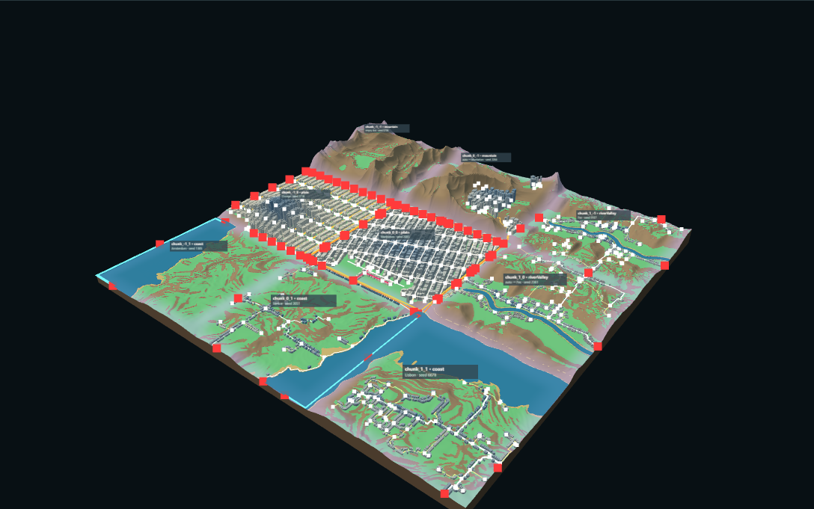
  - Boundary close-up before (0 %) and after (100 %), same camera (`focus=-120,400,620`): 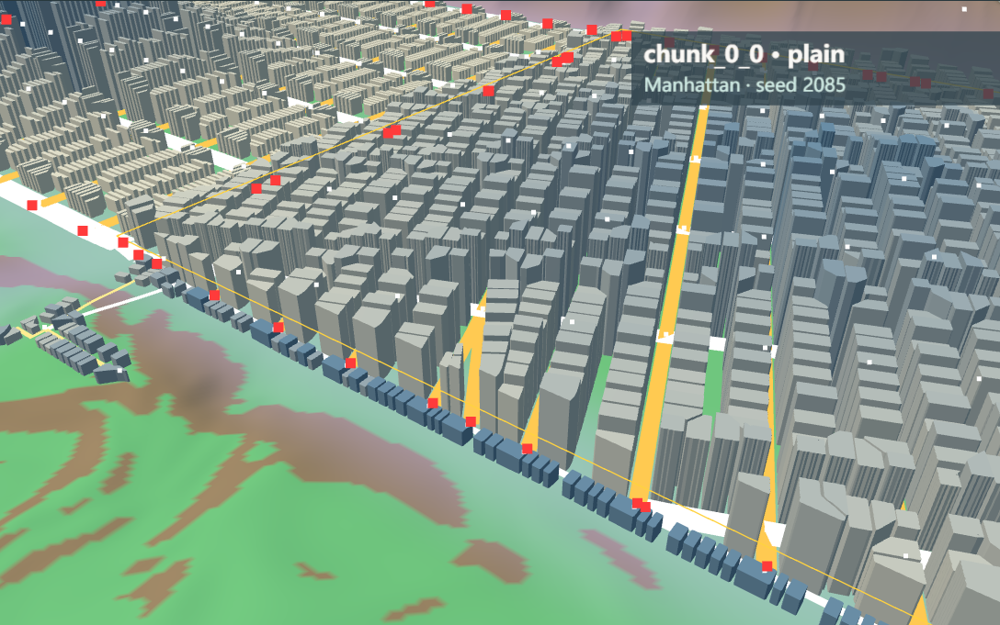  Manhattan towers on frontage lots give way to low, small Venice-rule lots along new lanes; Venice quay buildings across the seam unchanged.
  - Influence debug, 100 %, top-down (`camera=top&focus=0,256,1500`):  Ownership: Chicago violet, Manhattan blue, Venice teal, Amsterdam pink, Lisbon green, Fez amber; heat fades at the guarded seams.
- **Confirmed:** influence 0 identical; morphology change measured in all three layers and in both directions; unaffected chunks bit-identical; reproducible; terrain, water, tunnels, seams untouched.
- **Open issues:** (1) Dropping base streets is not always matched by invader streets: Venice rules on dry land are sparse, so the core road density falls (19.7 → 4.6 km/km²) and at 50 % base streets disappear with no replacement; 0 junctions formed between the two systems in the forward run. (2) Block and parcel ids are order-based: where fusion removes blocks, later ids shift and their per-parcel random stream (occupancy, height jitter) changes — 8.8 % of buildings in the w = 0 band differ in height or occupancy though their parcels are identical. (3) waterfrontPreference only acts through the invader network; with little water in the zone it has no visible effect. (4) The seam guard keeps a W-wide strip of the target at the base rules even next to the source corner. (5) Thresholds (τ 0.35–0.65, connector 40 m / 15°, courtyard 0.5) and the strategy-level rule values are A, uncalibrated. (6) Only edge-adjacent invasion was run; corner (diagonal) targets are allowed by the code but untested. (7) The source chunk is rebuilt through the road seam (expected, but its city layer changes slightly).
- **Review status:** Pending review.
- **Next single task:** Review 07.1; then decide whether the street switch should keep base streets until an invader street covers the same area (no gaps), before any multi-source or larger-radius work.

### 07.1a — City Invasion stable generation (spatial ids, local random streams)

- **Date / Stage / Single question:** 2026-10-21 / T7, City Influence line (formal since this task) / After an invasion, do areas with w = 0 and unchanged upstream geometry keep exactly the same blocks, parcels and buildings (occupancy, height, type, footprint), instead of the 07.1 result where 8.8 % of w = 0 buildings changed?
- **Order dependencies found (legacy code):**
  - **Blocks:** `B${index}` / `F${index}` in flood-fill label order; removing one block shifts every later id.
  - **Network:** edge ids are array indices; the fused graph (07.1) and the road-seam rebuild renumber them. Blocks and parcels key their frontage on them and use them as a sort tie-break.
  - **Parcels:**
    - one jitter random stream through all frontage runs, consumed in graph edge order;
    - lots, the corner-lot union-find and nearest-lot ties follow piece order, which follows edge order;
    - ids are `${block.id}-P${k}`.
  - **Buildings:** the random stream (occupancy, height jitter) is keyed by the order-based parcel id; the height area factor divides by the chunk-wide largest parcel, which is not local.
- **Scheme (`options.identity = { worldSeed }`, opt-in; new `experiments/seed-terrain/StableIdentity.js`):**
  - **Block id:** `B` + a 64-bit hash of the canonical plan geometry: the 3-decimal world coordinates already stored, with the ring rotated to its smallest (x, z) vertex and holes sorted.
  - **Parcel id:** `${blockId}-P` + a hash of the parcel's own canonical geometry. Its `stableKey` (geometry only) keys the building stream, so an identical parcel keeps its building even if its parent block id changes.
  - **Collisions:** two distinct shapes with the same hash get a suffix ordered by their canonical strings, never by array order. 0 collisions in all runs.
  - **Frontage runs:** sorted canonically (block id + run end points + side). Jitter comes from one stream per run: `(worldSeed, 'parcel-run', DNA, run key)`.
  - **Buildings:** stream `(worldSeed, 'building', DNA, parcel stableKey)`; the area reference is the largest parcel of the same block (local).
  - **What counts as the same object:** the same coordinates under a different parent block are not assumed to be the same object; matching uses the full canonical shape.
  - **What still changes:** any geometric change gives a new key, so the object is regenerated (no stale building is kept). Network, terrain and tunnels are untouched.
- **Mode:** World Grid `idMode` `legacy` (default; the M06 checkpoint world) or `spatial` (`?ids=spatial`, GUI "Generation ids"); the city cache key carries the mode. The 07.1 fusion hooks are unchanged and combine with the identity option.
- **Stability check (`stabilityReport` in `CityInfluence.js`, page panel + `?stability=1` tiles):** each w = 0 parcel of the last unfused city (same id mode) is matched to the current city by geometry, never by array index. Classes:
  - `stable`: same building outcome.
  - `unstable` (defect): same parcel, same block, same roads, different outcome.
  - `unexplained` (defect): parcel replaced with block, roads and every w > 0 lot of the block unchanged.
  - Legal changes, reported separately:
    - `blockChanged`: same parcel, but its block changed shape;
    - `roadChanged`: block or frontage road geometry / class changed;
    - `siblingChanged`: the block straddles the fusion zone and one of its w > 0 lots was regenerated; lots of one block share boundaries and the block area reference;
    - `added`.
- **Changed files (working tree, nothing committed):**
  - New: `experiments/seed-terrain/StableIdentity.js`, `scripts/verify-city-influence-stable.mjs`, `experiments/world-grid/evidence/city-influence-stable.json`.
  - Changed: `BlockGenerator.js` (optional last `options` argument), `ParcelGenerator.js` and `BuildingGenerator.js` (identity branch in the existing `options`), `WorldGrid.js` (`idMode`, `cityKeyOf`, baseline city per chunk), `CityInfluence.js` (`stabilityReport`), `InfluenceView.js` (stability tiles), `main.js` (URL / GUI / panel / lab), `index.html` (legend).
- **Setup:** seeds 6201 / 6202 / 6203, W 128, terrain coordinated, roads joined. Venice set manually on chunk_0_1 invades Manhattan on chunk_0_0, radius 384 m, strength 0 / 25 / 50 / 100 %. Reverse run: Manhattan invades Venice at 100 %.
- **Legacy regression (no option = old output):**
  - `verify-blocks`, `verify-parcels` and `verify-buildings` (single chunk, generators without options) pass. Their evidence is identical except `testedAt`; evidence and screenshots restored.
  - `verify-world-checkpoint` 7 / 7: the M06 checkpoint is reproduced with all signatures.
  - World Grid legacy influence 0 = original on all 3 seeds.
  - Spatial mode leaves raw, height, water and network signatures of every chunk identical to legacy. Only blocks, parcels and buildings get new ids, streams and the block area reference.
- **Results, w = 0 zone of the target (base parcels):**

| Seed | Legacy 100 %: stable / unstable / sibling / block + road / added | Spatial 25 % | Spatial 50 % | Spatial 100 % |
| --- | --- | --- | --- | --- |
| 6201 | 1202 / **46** / 57 / 12 / 14 | 1309 stable, 8 sibling, 8 added | 1308, 9 sibling, 9 added | 1287, 15 block, 3 road, 12 sibling, 14 added |
| 6202 | 1179 / **82** / 6 / 0 / 0 | 1267 stable | 1267 stable | 1265, 2 sibling |
| 6203 | 628 / **465** / 164 / 8 / 5 | 1262, 3 sibling, 2 added | 1259, 4 block, 1 road, 1 sibling, 2 added | 1247, 13 block, 1 road, 4 sibling, 5 added |

  - Spatial ids: **0 unstable and 0 unexplained** in every seed and strength. At 100 % (6201) 97.7 % of the w = 0 parcels are stable; the rest are legal upstream changes on the zone edge.
  - Influence 0 (spatial) = the spatial original; back from 100 % to 0 restores it. The other 7 chunks are bit-identical at 25 / 50 / 100 %. A reload with the same URL reproduces the result.
  - Reverse, Manhattan invades Venice (Venice lots use jitter, so this tests the per-run streams):
    - 6201: 225 stable, 175 road-changed, 170 added, 0 defects.
    - 6202: 271 stable, 87 road-changed, 85 added, 0 defects.
    - 6203: uninformative; the Venice chunk has no parcels in its baseline (7 network edges).
- **Affected zone (w ≥ 0.65 band, spatial, 100 %):**
  - 6201: invader streets 0 → 92.5 %, mean parcel 354.5 → 224.4 m², mean height 61.9 → 16.6 m.
  - 6202: invader streets → 100 %, mean parcel 439.1 → 235.5 m², mean height 73.7 → 19.7 m.
  - 6203: invader streets → 100 %, 45 → 4 parcels, mean height 73.6 → 22.0 m.
  - Of the 525 / 513 / 386 baseline parcels with w > 0, 32 / 12 / 31 keep their outcome at 100 %.
- **Screenshots (seed 6201, spatial ids, Venice → Manhattan, radius 384 m):**
  - 
  - 
- **Performance:** world load 15.8–37.8 s; one strength change rebuilds 2 city layers in 3.0–10.8 s.
- **Confirmed:** the order-dependent sources are removed in spatial mode; w = 0 buildings on unchanged parcels, blocks and roads are identical on 3 seeds × 3 strengths and in the reverse direction; the legacy output and checkpoint are unchanged.
- **Open issues:**
  1. Spatial ids are opt-in. The default World Grid and the M06 checkpoint stay legacy, so the 07.1 instability persists there. Making spatial the default needs a new checkpoint version, and the checkpoint does not yet record the id mode.
  2. The block-level area reference changes heights against legacy: in the spatial original, Manhattan core mean height is 61.9 m against 57.6 m in legacy.
  3. Frontage runs are keyed by their end points. An edge that is clipped in the zone (or split by the road seam) gives new runs along its whole remaining length, so road-changed counts are large in the reverse run (6201: 175), even far from the zone.
  4. The sibling class allows w = 0 lots in blocks that straddle the zone to change. This is legal by construction, but it is not tested separately.
  5. Fragment ids (`F${index}`) stay order-based; nothing downstream uses them.
  6. The 6203 reverse run had no parcels to test.
- **Review status:** Pending review.
- **Next single task:** Review 07.1a; then decide whether spatial ids become the World Grid default (checkpoint v2 with the id mode recorded).

### G00 — Checkpoint before Procedural Growth

- **Date / Stage / Single question:** 2026-10-27 / G00, by user instruction / Are the static-world experiments safe before the world model changes?
- **Operations:** The uncommitted 07.1 / 07.1a work (City Influence code, verifiers, evidence, 6 screenshots, log entries) is committed as checkpoint `79687a0` on `experiment/terrain-seam`. New branch: `experiment/procedural-growing-world`. The working-tree deletion of `terrain-seam-overview.png` / `terrain-seam-topology.png` (origin unknown, see M06) is left unstaged. No reset, no rewrite. The single-chunk page `/experiments/seed-terrain/` and the World Grid `/experiments/world-grid/` are unchanged.
- **Review status:** Done (checkpoint only).

### G01 — Multi-Origin Procedural World Growth

- **Date / Stage / Single question:** 2026-10-27 / G01, by user instruction (teacher feedback) / Can six City DNAs each start from one independent core chunk and grow a map chunk by chunk from a terrain-first, seeded and reproducible growth frontier? The map size, the territories and the boundaries should come out of the process, not out of a fixed grid.
- **Why the change (Static Chunk Assembly → Procedural Growth):** In the 3 × 3 World Grid the world size, every chunk position, the neighbourhoods and every city boundary were fixed by the layout before any rule ran. They could only be stitched, never studied as results. Growth makes them outcomes of rules that can be tuned and reproduced: where a city can go, who reaches a cell first, and how large the map becomes.
- **Reused files or functions:**
  - **Single-chunk chain, unchanged:** 06.2 layer functions `generateRawLayer`, `generateTerrainLayer`, `generateNetworkLayer`, `generateUrbanLayer` (`WorldGrid.js`).
  - **Ids and seeds:** 07.1a spatial ids (`identity = { worldSeed }`); 06.2 `terrainSeedOf`; `hashParts`.
  - **City Match:** 02.6 `matchCity` / `computeMatchMetrics` give the terrain fit of all six DNAs per cell.
  - **Rendering:** `ChunkView`, `NetworkView`, `BuildingView`.
  - **Verifier pattern:** `verify-world-grid.mjs`.
- **Model:** see [Procedural Growth](./03-generative-system/procedural-growth.md). In short:
  - **Cells:** the map is a sparse integer grid with no fixed size.
  - **Landform:** from a world value-noise field (worldSeed + cell only).
  - **Cores:** each city in fixed order takes the best of 10 sampled sites at Chebyshev distance ≥ `coreMinDistance`.
  - **Scheduling:** a fair scheduler picks the city with the fewest chunks / rate.
  - **Scoring:** frontier cells are scored on real terrain probes. Score = weighted terrain fit, slope, roads toward the cell, water and DNA tendency, plus seeded jitter keyed by (worldSeed, city, cell, step). Cells with < 3 % buildable land are excluded.
  - **Contests:** a contested cell is reserved for a rival scoring > 0.05 higher.
  - **Parent:** the adjacent same-city chunk with the most ports toward the cell.
  - **Records:** immutable once created; the first occupant keeps a cell; no DNA fusion.
  - **Seams:** every shared edge is measured once (identity / geometry / hydrology / transport) and not corrected.
- **Record per chunk:** chunkId, cityId, originCityId, coreChunkId, parentChunkId, worldGridCoordinate, worldOrigin, generationIndex, growthStep, terrainSeed, landform, variation (0.35–0.65 by cell), growthReason (score, terms, jitter, options, contests, text), generationStatus (network → city → ready), suitability (fitScore, autoTopId, conflicts), ports per side, edge profiles (8 m), signatures.
- **Changed files:**
  - **New:** `experiments/growing-world/` (`growthConfig.js`, `WorldGrowthController.js`, `GrowthView.js`, `main.js`, `index.html`, `evidence/growing-world.json`), `scripts/verify-growing-world.mjs`, `docs/procedural-mini-world/03-generative-system/procedural-growth.md`.
  - **Changed:** `vite.config.js` (one build input `growingWorld`).
  - No existing generator was modified.
- **Parameters (9 public):** worldSeed; coreMinDistance 3; coreSpread 5; jitter 0.12; weights terrain 3 / slope 2 / roads 2 / water 1 / DNA 2. Run controls: steps, target chunk count. All weights and the six growth profiles are design hypotheses, uncalibrated. The first run used coreMinDistance 4 / coreSpread 7: cities did not meet within 48 chunks, so the defaults were tightened to 3 / 5 (first contact at 20–27 chunks on seeds 6201 / 4242 / 1234).
- **Entry point:** `/experiments/growing-world/` (`npm run dev`). Panel controls:
  - World seed; Generate six city cores; Grow one step; Grow multiple steps; Target chunk count + Grow to target; Stop.
  - Reset world; Save / Load growth state (browser storage); Export / Import state (JSON).
  - Show growth frontier; Show city ownership; Show seam conflicts; growth rules folder; click a chunk to inspect it.
  - URL: `?worldSeed=…&steps=N&target=N&frontier=1&seams=1&camera=top`.
- **Verification:** `node scripts/verify-growing-world.mjs` (Part A in Node, Part B in the browser with its own Vite server). Passes, 0 browser errors. Seeds 6201 / 1234 / 4242, 24 steps each in Part A.
  1. *Six cores:* exactly 6 chunks after initialisation, one per City ID, distinct cells, min Chebyshev distance 3 = parameter, on all seeds. Seed 6201 cores:
     - Venice (−3, −4) coast, fit 0.62
     - Manhattan (1, −3) plain, fit 0.93
     - Fez (−1, 3) coast, fit 1.0
     - Amsterdam (4, 2) coast, fit 0.53
     - Lisbon (4, −1) mountain, fit 0.32 (recorded as a suitability issue, City ID kept)
     - Chicago (−2, 0) plain, fit 0.80
  2. *One step = one chunk:* checked after every step; 0 stalls.
  3. *Traceable:* every chunk is edge-adjacent to a same-city parent with a lower generation index, and its parent chain ends at its own core (originCityId = core city).
  4. *No overlap:* unique chunk ids and cells; `place` throws on an occupied cell.
  5. *Free shape:* bounds after 30 chunks 10 × 9, 11 × 10, 9 × 14 cells (not 3 × 3); in the browser at 48 chunks x −6…6, y −5…3.
  6. *Reproducible:* a second controller with the same seed / parameters / steps serialises identically (timings excluded).
  7. *Seed variation:* the three seeds give different core layouts and growth histories.
  8. *Unchanged:* cores and the 14 chunks of step 8 are identical after 16 more steps (records), and the rendered content signatures (network, blocks, parcels, buildings) of cores and early chunks are unchanged at 48 chunks. A chunk regenerated alone from its cell + City ID matches its record, so content is order-independent.
  9. *Save / load:* 12 steps → JSON → restore → 12 steps equals 24 uninterrupted steps (Node). In the browser, the 16-chunk save loaded into a fresh page regenerates all 16 chunks with identical signatures (0 mismatches), and Grow one step continues at step 11 / 17 chunks.
  10. *Original generators:* every core and every grown chunk resolves to its own City DNA (`resolvedDNA = cityId`). `verify-city-dna.mjs` passes (72 / 72 runs, regression 36 / 36 identical; its re-rendered 06.1 screenshots and evidence were restored from Git).
- **Territories (seed 6201, 48 chunks, step 42):**
  - Chunks per city: Venice 7, Manhattan 9, Fez 6, Amsterdam 8, Lisbon 7, Chicago 11 (the scheduler follows the rates 0.8 / 1 / 0.7 / 0.9 / 0.8 / 1.2; no city monopolises).
  - 60 shared edges: 47 inside one city, 13 city boundaries (Manhattan | Chicago ×5, Venice | Chicago ×2, Manhattan | Lisbon ×3, Venice | Manhattan, Fez | Chicago, Fez | Amsterdam).
  - Contests in Part A: 21 / 2 / 22 (6201 / 1234 / 4242), each resolved by the margin rule; no chunk was overwritten.
- **Scale and performance (browser, seed 6201, headless Chrome):**
  - Times: six cores 23.2 s; +10 steps 32.1 s; 16 → 48 chunks 108.4 s; per chunk median 2.75 s, mean 3.15 s, max 6.35 s (placement + urban layer + render; the page yields a frame between chunks, and Stop ends a run after the current chunk); restoring 16 chunks 48.5 s.
  - JS heap 853 MB at 48 chunks (≈ 15–18 MB per rendered chunk, mostly geometry).
  - Content: 444.4 km roads, 46,813 buildings.
  - Node, data only (terrain + network, no urban layer): ≈ 0.8 s per placed chunk including terrain probes; the state JSON is ≈ 7 kB per chunk.
- **Screenshots (seed 6201, default parameters, real runtime, top view unless noted):**
  - Six cores (step 0): 
  - Early growth, 16 chunks, frontier on (white dashed = contested): 
  - Large world, 48 chunks, frontier + seams: 
  - Oblique debug, 48 chunks: ownership walls, seam lines (yellow = step, red = cliff, dashed = city boundary), height risers: 
- **Confirmed:** six independent cores with stable ids and seeds; one chunk per step from a frontier; full traceability; no overlap; no fixed map size; reproducible by seed; seed changes the layout; chunks never change after creation; save / load continues growth; the original single-chunk generators and the six DNAs are unchanged. City identity (ownership, DNA per chunk) and map geometry (seams) are verified separately.
- **Open issues (reported, not hidden):**
  1. **Geometry:**
     - Seed 6201, 48 chunks: 0 of 60 shared edges are continuous (≤ 2 m); 34 are steps (≤ 30 m) and 26 are cliffs.
     - Plain | mountain boundaries reach Δh 270–297 m (Manhattan | Lisbon).
     - The Terrain Seam system (06.3a-R2) is not applied to grown chunks; independent chunks share only the world frame and the height datum.
  2. **Hydrology:** 18 of 60 edges have wet / dry mismatches (sea and lakes end at chunk edges).
  3. **Transport:** 212 unpaired road / canal ports; no cross-chunk road joining in G01.
  4. **Empty Amsterdam chunks:** 5 of 8 Amsterdam chunks (seed 6201) generate 0 km of road and 0 buildings on coast cells (fit 0.53). The 02.6 fit score does not predict generator output; growth still extends into such cells.
  5. **Suitability issues kept as specified:** 6 on seed 6201. Examples: the Lisbon core on a mountain (fit 0.32); inherited Venice on a river valley (0.25); Amsterdam on a river valley (0.18).
  6. **Performance:** generation is synchronous per chunk (2–6 s UI pause per chunk); memory grows linearly (853 MB at 48 chunks), and no level of detail or unloading exists.
  7. **Rendering:**
     - Tunnel excavation is not cut in grown chunks (tunnels stay in the network data).
     - Port / portal markers are hidden because they are screen-sized.
  8. **Calibration:** the landform field and all growth weights and profiles are design hypotheses, not calibrated against real urban growth.
- **Review status:** Pending review.
- **Next single task (proposal G02):** seam-aware growth. When a chunk is placed, correct only the new chunk's transition band toward its already generated neighbours, so that existing chunks stay unchanged. This reuses the 06.3a-R2 band-only correction one-sidedly, and edges that cannot be joined are still reported. Measure how many edges become continuous on the same three seeds. Alternatives for the review: a generator-output check in the score (avoid cells where the DNA produces no network), or chunk unloading / level of detail for worlds above 50 chunks.

### G00-R — A City of Cities: research compass and generative framework

- **Date / Stage / Single question:** 2026-10-28 / framing task between G01 and G01-R, by user instruction / Can the project's direction be restated as one research framework (question, theory, system levels, hypotheses, experiments, roadmap) that matches the code as it actually is?
- **Checked state before writing:**
  - Branch `experiment/procedural-growing-world`; last commit `79687a0` (G00 checkpoint).
  - G01 (`experiments/growing-world/`, verifier, 4 screenshots, docs) is implemented and verified, but **uncommitted and pending review**. No task in the project is accepted yet.
  - The World Grid, Terrain Seam and City Influence code is unchanged since `79687a0`.
- **Outputs:**
  - New [A-City-of-Cities-Research-Compass.md](./A-City-of-Cities-Research-Compass.md): title, question, theory (Urban Autonomy, Emergent Urban Form, Urban Coexistence), design argument, old vs new logic, World / City / Chunk diagram, Morphology DNA mapped to existing rule tables, Growth DNA hypotheses for six cities, growth architecture and step flow, territory / encounter state model, H1–H3 with metric availability, Experiments A–C, minimum demonstration (+10 / 30 / 60 chunks), G00–G05 roadmap with real status, reuse and missing lists, limitations, next task, rule conflicts.
  - Updated: compass §1 (framing update, current single task), §2 (pointer to the new question; original kept as history), §5 (G00–G05 roadmap; the 2026-10-27 table kept as superseded); [README](./README.md); [Procedural Growth](./03-generative-system/procedural-growth.md); [Project Foundation](./01-foundation/project-foundation.md); [NEXT_SESSION](./NEXT_SESSION.md); [Experiment Index](./EXPERIMENT-INDEX.md).
- **References:** only the bibliographic details were checked (publisher and library listings) for Ungers, Koolhaas et al., *The City in the City* (2013 critical edition, Lars Müller) and Batty, *Cities and Complexity* (MIT Press, 2005). Both are used as conceptual references only, with no quotations. The difference to the Berlin manifesto (shrinking city, selective retention vs generation and expansion) is stated in the compass.
- **Rule conflicts (proposed, not applied):** AGENTS.md source-of-truth line; "join or blend" in AGENTS.md and compass §3 item 4; ≤ 10 public parameters vs per-city Growth DNA tables; two sources per city vs unsourced Growth DNA. See compass §15.
- **Not done (by scope):** no code change, no generator change, no UI, no deployment, no new screenshots (text-only task).
- **Verification:** `node scripts/verify-markdown-links.mjs` passes. All 3 Mermaid diagrams render without error with Mermaid 10.9.1 in headless Chrome (scratch check, no dependency installed). Display inside the Obsidian app was not opened in this task (**Pending verification** in Obsidian).
- **Review status:** Pending review.
- **Next single task:** G01-R (Research Compass §14), after the G01 review.

### G01-MO — Multi-Origin Initialization (A City of Cities, roadmap G01)

- **Date / Stage / Single question:** 2026-10-28 / G01, by user instruction / Can six reproducible, independent city core chunks be created in one shared, unbounded world frame, each placed by the world seed and an explainable origin suitability evaluation, and each generated by the unchanged single-chunk chain with its own City DNA, with no growth?
- **Preflight:**
  - G00 is done (checkpoint `79687a0`).
  - The earlier uncommitted work (growth prototype, entry G01; research compass, entry G00-R) was committed as checkpoint `c3e2e5f` before this task's docs were edited.
  - Branch: `experiment/procedural-growing-world`.
  - The single-chunk entry `/experiments/seed-terrain/` is unchanged.
- **Note:** [A-City-of-Cities/G01-Multi-Origin-Initialization.md](./A-City-of-Cities/G01-Multi-Origin-Initialization.md): architecture, seed rules, placement logic, core table, tests, screenshots, limitations, G02 suggestions.
- **Implementation:** new isolated experiment `experiments/city-of-cities/`:
  - `WorldContext.js`: world seed, cell ↔ world coordinates, on-demand terrain probes, city / chunk / occupancy registries, read-only `frontierOf`, `dependenciesOf`, versioned World State with `growth.generation = 0`.
  - `OriginPlacement.js`: per-city keyed sites, terrain probes, hard rejections, five-term suitability, weighted reproducible choice, data-derived claim order, minimum distance, explicit failures.
  - `originConfig.js`: 4 public parameters; origin profiles (A); seed hierarchy worldSeed → citySeed → chunk urbanSeed; Morphology DNA read from the 07.1 `RULES`; basic Growth DNA.
  - `OriginView.js`, `main.js`, `index.html`: UI.
  - Verifier: `scripts/verify-city-of-cities.mjs`.
  - Changed: `vite.config.js` (build inputs).
  - No generator changed: the urban seed reaches parcels and buildings through the existing optional 07.1a `identity` argument.
- **Parameters:** worldSeed; minOriginDistance 3 chunks; searchRadius 6 chunks; selectionSharpness 4. Profiles and weights are design hypotheses (A).
- **Results (seeds 6201 / 1234 / 4242):**
  - 6 origins each, 0 placement failures, minimum distance 3.
  - 41 / 38 / 36 terrain probes, placement 3.4–3.8 s.
  - Rejected sites: 33 / 13 / 11 (mountain incompatible at screen; 02.6 `noWater`); distance-blocked sites: 3 / 5 / 5.
  - Seed 6201 cores (cell, suitability):

    | City | Cell | Landform | Suitability |
    | --- | --- | --- | --- |
    | Amsterdam | (0, 3) | coast | 0.68 |
    | Fez | (−1, −3) | plain | 0.74 |
    | Lisbon | (5, 0) | coast | 0.80 |
    | Chicago | (4, −4) | plain | 0.97 |
    | Venice | (0, 6) | coast | 0.79 |
    | Manhattan | (−2, 0) | plain | 0.99, 4th weighted site; 3 blocked by Fez and Chicago |

  - Every core resolves to its own DNA. Seed 6201 roads 5.1–18.4 km, buildings 325–2021 per core.
- **Verification:** `node scripts/verify-city-of-cities.mjs` passes, 0 browser errors.
  - Identity: six cores, correct and distinct ids, seeds and cells.
  - Determinism: repeat, reversed input order, reversed generation order, Regenerate in the page.
  - Visibility toggles rebuild nothing.
  - Explainable scores (stored score = weighted mean of stored terms, re-evaluation equal).
  - Non-zero origin regression: same terrain, network (0 m deviation), blocks, parcels, buildings at origin 0 and at (−2048, 0).
  - Save / load: Node JSON round trip; browser Save → reload → Load, 0 mismatches.
  - `verify-city-dna` 36 / 36 identical (06.1 artifacts restored from Git afterwards).
- **First-run finding fixed:** claim-order ties were broken by cityId, so Venice always claimed last. They are now broken by hash(worldSeed, cityId), and the order differs per seed.
- **Performance (headless Chrome, seed 6201):** placement 3.36 s; first city rendered 6.62 s; all six cores 25.2 s (per core 1.9–5.7 s data, 0.10–0.18 s render); heap 209 MB; restore 21.5 s.
- **Screenshots (seed 6201, default parameters):**
  - 
  - 
  - 
  - 
  - 
- **Open issues:**
  1. Seed 1234 Amsterdam core: suitability 0.71, but 0 km road and 0 buildings. The score does not predict generator output.
  2. Plain sites saturate (Manhattan's qualified sites all score 0.987), so the weighted choice among them is uniform.
  3. The screen rejects a cell by its coarse landform only.
  4. The sequential claim leaves later cities fewer sites.
  5. Network signatures differ between Node and Chrome in 3 / 6 chunks (`axisDeg` at ≤ 7e-16 relative; geometry identical), so cross-runtime restore reports them.
  6. Growth DNA still lacks three fields.
- **Review status:** Pending review.
- **Next single task:** after review, G02 Rule-Based Growth on `WorldContext` (suggestions in the note §10). Stop here.

### G02 — Procedural Urban Growth (in progress: blocked by a G01 placement defect on seed 6202)

- **Date / Stage / Single question:** 2026-10-28 / G02, by user instruction / Can the six cities grow chunk by chunk from their own growth frontiers, with explainable suitability, a fair seeded scheduler and real chunk generation, reproducibly and with save / load continuation?
- **Status:** **Implemented, partially verified, stopped.**
  - Required seeds: 6201 / 6202 / 6203.
  - Seed **6202 cannot initialise six cities** with the G01 rules. Per the task rule, G02 stopped at this point and waits for a decision on G01.
  - Browser verification, screenshots and the G02 Obsidian note are **Pending**.
- **G01 defect found (not patched):**
  - On seed 6202 Amsterdam gets a placement failure: all 8 probed sites are dry plains rejected by `noWater`.
  - The G01 screen ranks sites only by landform compatibility. For Amsterdam, plain and coast both rate 0.9, so wet coast / river-valley cells are never probed.
  - The failure message's suggestion is also wrong: searchRadius 8 still fails (checked).
  - A fix (make the screen water-aware for water-required cities) would change G01 origins on other seeds, so it needs a review decision.
- **Implementation (uncommitted), in `experiments/city-of-cities/`:**
  - `growthDNA.js`: 5 public growth weights; six Growth DNA profiles (A); rule constants.
  - `GrowthEvaluation.js`: terrain, water, infrastructure and urban groups from real probes; flood risk marked unavailable; distance to water beyond the cell falls back to wet neighbour landforms (flagged).
  - `WorldGrowthController.js`: N / S / E / W frontier, merged candidates and parent rule, city bid = rate × best score / (1 + grown) × seeded ±10 %, weighted seeded choice, deterministic occupation ruling, stalled state, conflict records, history events.
  - `GrowthOverlay.js`: frontier and history overlays.
  - `WorldContext.js` extended: probe slope / water / edge inputs, ports and edge profiles per generated chunk, `addGrowthChunk`, World State schema v2 (v1 still loads).
  - `main.js` / `index.html`: Grow one / multiple (cap 30), Stop, Reset to origins, frontier / territory / history layers, chunk inspection.
  - Verifier: `scripts/verify-city-growth.mjs`.
  - No generator changed.
- **Part A results (Node, seeds 6201 and 6203; stages A–D all passed):**
  - Exactly one chunk per step; no overlap; every chunk traces to its core; each city territory 4-connected; generation = parent + 1.
  - Every growth chunk generated by the full chain with its own DNA.
  - 10-step twin run identical; save at step 5 → load → regenerate → continue to 10 identical to uninterrupted growth; cores and first five growth chunks unchanged at step 30; the two seeds give different histories.
  - The static scan finds no call path into the World Grid class, seams or City Invasion.
  - 30 steps, 36 chunks on both seeds, no stall, 0 contested cells.
  - Chunks per city (Amsterdam / Chicago / Fez / Lisbon / Manhattan / Venice): 6201: 5 / 8 / 4 / 6 / 8 / 5; 6203: 5 / 8 / 5 / 6 / 8 / 4.
  - Shared edges: 33 (6201) and 32 (6203), each with 1 city boundary; geometry 13 / 16 steps and 20 / 16 cliffs, 0 continuous; water discontinuous on 17 / 14; unpaired road ports 127 / 101.
  - Per-step time median 2.3 s (6201) and 3.0 s (6203), max 6.4 / 7.6 s; 30 steps + checks 4.2–4.6 min per seed.
- **Open issues (seen so far):**
  1. The G01 placement defect above blocks seed 6202.
  2. City chunk counts are almost identical across seeds: the bid's 1 / (1 + grown) term dominates, so the growth rate sets near-fixed quotas.
  3. Empty chunks: Amsterdam growth chunks (and the 6203 Amsterdam core) generate 0 buildings.
  4. 6203 Venice ends with 0 eligible candidates (mountain and `noWater` all around).
  5. Seams are recorded, not repaired.
  6. Jitter can push a score slightly above 1.
- **Review status:** Pending; G02 is not complete.
- **Next single task:** decide the G01 fix (water-aware origin screen) or a replacement seed for 6202; then run the browser stage and screenshots and write the G02 note.

### G01-FIX — Origin placement v2 (water-aware screen, waterfront check, bounded expansion, atomic failure)

- **Date / Stage / Single question:** 2026-10-28 / G01 fix, by user instruction (option 1 after entry G02) / Can seed 6202 initialise six cities by fixing only the origin screen for water-required cities, verifying real water, waterfront access and buildable land, without changing terrain, City DNA or growth rules?
- **Changed files:**
  - `experiments/city-of-cities/OriginPlacement.js`: water-aware screen, waterfront rejection, failure categories, bounded expansion rounds, `placementVersion`.
  - `originConfig.js`: `waterfrontMin` 0.005, `expansionStep` 2, `maxExpansions` 2, `PLACEMENT_VERSION` 2.
  - `WorldContext.js`: `waterfrontBuildable` probe field; atomic initialise; placement version in the saved state.
  - `scripts/verify-city-of-cities.mjs`: seeds 6201 / 6202 / 6203, forced-failure test, legacy-state test.
  - Legacy copy `experiments/city-of-cities/evidence/legacy/world-6201-g01-state.placement-v1.json`.
- **Calibration:** a 12 m waterfront band was tried first and rejected all Venice sites on 6201 / 4242. Measuring 46 wet cells gave 32 m and 0.5 %.
- **Before → after:**
  - 6202: Amsterdam failure → 6 origins.
  - 6201 and 4242: unchanged.
  - 6203: 3 origins moved.
  - 1234: 3 origins moved.
  - Details: [G01 note §11](./A-City-of-Cities/G01-Multi-Origin-Initialization.md) and `evidence/placement-v1-v2-compare.json`.
- **Verification:** G01 verifier passes on 6201 / 6202 / 6203 (Node + browser):
  - forced failure classified, 0 cities registered;
  - pre-fix saved state loads unchanged;
  - `verify-city-dna` 36 / 36 identical (06.1 artifacts restored from Git afterwards).
- **Review status:** Pending review.

### G02-V — Procedural Urban Growth, verification completed (seeds 6201 / 6202 / 6203)

- **Date / Stage / Single question:** 2026-10-28 / G02 / Does the G02 growth (entry G02) pass stages A–D on the three required seeds after G01-FIX, in Node and in the browser, with reproducible history, persistence and real chunk generation?
- **Code:** unchanged since entry G02. No growth rule was changed; G02 results change only through the new origins on 6202 / 6203.
- **Note:** [A-City-of-Cities/G02-Procedural-Urban-Growth.md](./A-City-of-Cities/G02-Procedural-Urban-Growth.md): algorithm, Growth DNA, suitability parameters, scheduler, seeds, history, results, screenshots, limitations.
- **Results:** `node scripts/verify-city-growth.mjs` passed: Part A in Node (824 s), Part B in the browser, 0 errors.
  - All stages A (6 origins) / B (1 step) / C (10 steps) / D (30 steps) pass on all three seeds, with invariants after every step: no overlap, traceable to the core, 4-connected territory, generation = parent + 1.
  - Determinism and persistence: 10-step twin identical; save at 5 → load → continue = uninterrupted; earlier chunks unchanged; the three histories differ.
  - The browser history equals Node on every seed. Save at 30 → reload → load (0 mismatches) → step 31 equal to the uninterrupted step.
  - Static scan: no World Grid class, seam or City Invasion calls.
- **Chunks per city at step 30 (Venice / Manhattan / Fez / Amsterdam / Lisbon / Chicago):**
  - 6201: 5 / 8 / 4 / 5 / 6 / 8
  - 6202: 5 / 8 / 5 / 6 / 4 / 8
  - 6203: 4 / 8 / 5 / 6 / 5 / 8
  - No stall. 3 contested cells, all on 6202.
- **Performance:**
  - Node: step median 2.3–3.7 s, max 7.6 s.
  - Browser: steps 11–30 53–64 s; heap 556–673 MB at 36 chunks; restore of 36 chunks 96 s.
- **Screenshots:**
  - 
  - 
  - 
  - 
  - 
  - 
  - 
- **Open issues:**
  1. Near-fixed quotas from the bid's 1 / (1 + grown) term.
  2. Empty Amsterdam chunks (6201: 2; 6203: core + 2).
  3. Venice trapped on 6203 (0 eligible).
  4. Seams: 0 continuous edges, 94–127 unpaired road ports.
  5. Few city boundaries (0–4).
  6. Jitter can push a score above 1.
  7. Synchronous generation, memory without unloading.
- **Review status:** Pending review.
- **Next single task:** spatial review of G02 (seed sheet), then a decision on the scheduler quota effect and a generator viability check before G03.

### PRESENTATION-01 — Class film "A City of Cities"

- **Date / Stage / Single question:** 2026-10-28 / presentation, by user instruction; G-stage development paused / Can a 60–80 s research film be produced from the real program output, showing terrain → city chain → six origins → procedural growth, without new generation features?
- **Preflight:** checkpoint commit `91efb1e` (G02 + G01-FIX) before starting. All film work is in the new folder `presentation/city-of-cities/`; `experiments/`, `scripts/` and `docs/` were not modified by it.
- **Method:**
  - `index.html` + `film.js` build the real world in Chrome: seed 6201, G01 origins, 30 steps of the verified `WorldGrowthController`, the unchanged chunk chain.
  - Frames are rendered deterministically from a timeline (orthographic axonometric camera, 2D typography).
  - Encoding is H.264 in the page (WebCodecs `avc1.640028`, 8 Mbit/s) with mp4-muxer 5.1.3 from a pinned CDN URL. **FFmpeg is not installed**, and nothing was installed.
  - `capture.mjs` (Playwright) checks that the film's growth history equals the G02 verifier record (30 / 30 steps), saves the stills, poster and MP4, and verifies the MP4 by decoding and playing it in Chrome.
- **Result:** `presentation/city-of-cities/A-City-of-Cities.mp4`: 75.0 s, 1920 × 1080, 16:9, 30 fps, 2,250 frames, H.264 High, 73.9 MB, no sound (git-ignored).
  - Poster: `poster.png`.
  - Storyboard: `storyboard.md` + 16 rendered stills + 10 frames decoded from the MP4.
  - Settings: `capture-config.json`.
  - Render on an RTX 4060 (ANGLE / D3D11): world build ≈ 105 s, encode ≈ 15 s.
- **Scenes:**
  - Title (0–4 s)
  - S01 terrain of c_5_0 (4–12 s)
  - S02 six pipeline stages on the same chunk (12–28 s)
  - S03 six origins + six-panel comparison (28–42 s)
  - S04 growth steps 0–30 on a fixed camera (42–62 s)
  - S05 close-up → whole world + final title, marked "Procedural Growth Prototype" (62–75 s)
- **Honesty notes:** no invented steps or geometry. A new chunk's rise animation is an animation of the real chunk. The parcels stage shows interior land without lots in a presentation-only grey instead of the debug magenta, and says so on screen. Seams, empty Amsterdam chunks and the yellow "partial" block are shown as generated.
- **Review status:** Done (film delivered); presentation folder uncommitted.

### G03a — Urban Territory & Spatial Relationships

- **Date / Stage / Single question:** 2026-10-28 / G03 (first part), by user instruction / Can the multi-city growth of G02 be read as organised space, using a data layer that does not change growth? The layer records territories, non-urban space (evaluated, ecologically constrained, unexplored), boundaries and measurable city relationships.
- **Preflight:**
  - G01-FIX and G02 are verified on record (`city-origins.json`, `city-growth.json`; commit `91efb1e`).
  - Venice / Amsterdam placement fixed; six cores stable; one chunk per step; reproducible; save / load / continue exact.
  - No blocking issue.
- **Note:** [A-City-of-Cities/G03a-Urban-Territory.md](./A-City-of-Cities/G03a-Urban-Territory.md).
- **Changed files:**
  - **New:** `experiments/city-of-cities/TerritoryModel.js` (spatial states, territories, boundaries, adjacencies, relationship graph, metrics, snapshot / restore), `TerritoryView.js` (five overlays), `scripts/verify-city-territory.mjs`, evidence `city-territory.json` and `world-6201-g03a-step30-territory.json`.
  - **Changed:** `WorldContext.generateChunk` (additive: `outputs.areas` = building footprint and parcel m²); `main.js` / `index.html` (Territory folder, three panel rows; the analysis follows every growth step and is saved with the World State).
  - No terrain, growth, placement or city-generation rule changed.
- **Constraint rules (A, from 243 probed cells):** steepTerrain (mean land slope ≥ 18°), unbuildable (< 5 %), waterBody (≥ 50 % water). Only steepTerrain fires on the test seeds. No protection policy exists (0 protected cells).
- **Verification:** `node scripts/verify-city-territory.mjs` passed (Node 1,337 s on 6201 / 6202 / 6203; browser on 6201; 0 errors).
  - **After every step 0–30:** City IDs unchanged; territories = occupancy; areas = generated outputs; every boundary segment and frontier flag re-derived independently; ecological cells only where a rule holds, never unexplored; adjacencies = brute-force edge scan; adjacency never claimed as a connection.
  - **Run level:** incremental = replay; same seed twice identical; save at 10 → load (analysis reproduced) → continue to 30 = uninterrupted; G02 history unchanged; no World Grid / City Invasion call path.
  - **Browser:** reproduces the Node analysis; Save → reload → Load exact.
- **Results at step 30 (6201 / 6202 / 6203):**
  - 36 chunks each; chunk coverage 37.75 km²; built footprint 5.40 / 7.13 / 5.85 km² (14–19 % of coverage).
  - Ecological cells 21 / 19 / 12.
  - Inter-city shared edges 1 / 4 / 0 (pairs 1 / 3 / 0); corner contacts 2 / 2 / 1. All contact edges are steps or cliffs; aligned ports on 2 edges, roads not joined.
  - 6203: Venice stopped (no eligible frontier: noWater ×4, mountain ×5).
  - Urban chunks on constrained terrain: 1 / 1 / 0.
  - Analysis cost: 154–223 ms per step (mean).
- **Screenshots (seed 6201):**
  - 
  - 
  - 
  - 
  - 
  - 
- **Open issues:**
  1. Constraint rules coincide with mountains.
  2. Barrier evidence is a straight line, not route proof; `unknown` is common.
  3. The evaluated set depends on which cells the algorithms probed (it is saved).
  4. Few adjacencies, all on stepped or cliff edges.
  5. Growth may urbanise constrained terrain (reported, not prevented).
  6. Chunk-level analysis only.
- **Review status:** Pending review.
- **Next single task (proposal):** G03b encounter zones (shared frontier cells and contests over time), data only; see the note §10.

### DOC-06 — Teacher-facing entry: exercises, commits, research path, AI feedback

- **Date / Stage / Single question:** 2026-10-28 / documentation only (no stage change), by user instruction / Can a teacher find every main exercise with its link, record, and real commit, see where work is happening now, follow why each exercise led to the next, and read AI feedback on every part of the project, without the GitHub entry becoming long?
- **Checked before writing:** branch `experiment/procedural-growing-world`; `main` and `origin/main` at `1f63e6f`; `79687a0`, `c3e2e5f`, `69b3a1f`, `91efb1e` exist only locally (`git branch -r --contains` empty; GitHub commit pages 404), `4d2c3b6` and earlier return 200. Public URLs: `/experiments/seed-terrain/` and `/experiments/world-grid/` serve their pages; `/experiments/growing-world/` and `/experiments/city-of-cities/` fall back to the hub (not deployed). All 79 screenshots in `docs/assets/screenshots/procedural-mini-world/` were already referenced; none moved. Files & Notes globs `docs/**/*.md`, so no `site.js` change was needed.
- **Changed files (working tree, uncommitted):**
  - Root `README.md`: rewritten as a short entry: question, Current Work (stage, branch, code, uncommitted items, review queue), one representative image with conditions, Exercises table (7 rows, open link or local path, study record, commit), learning route, record links, short run section. Midterm-era detail stays in the knowledge base.
  - [README.md](./README.md): new §4 Research Path (two Mermaid diagrams with reason labels, transition table separating chronology, dependency and motivation); status table completed (06.3b–06.3c, 07.1 / 07.1a, M06, PRESENTATION-01) and reordered; stage dashboard City Influence node updated; §11 marked as the historical midterm state.
  - [EXPERIMENT-INDEX.md](./EXPERIMENT-INDEX.md): rows for 06.3b, 06.3a-R, 06.3a-R2, 06.3c, 07.1, 07.1a, PRESENTATION-01, M03–M06, DOC-06; growth rows in chronological order; new Commit map.
  - New [PROJECT-FEEDBACK.md](./PROJECT-FEEDBACK.md): AI feedback per area with Confirmed / Inference / Next check / Pending tags.
  - Navigation tables and short study-notebook summaries with one captioned screenshot each: [System Architecture](./03-generative-system/system-architecture.md), [World Grid & Seam](./03-generative-system/world-grid-and-seam.md) (+ later seam work section), [City Influence & Fusion](./03-generative-system/city-influence.md) (status corrected from "Proposed"; original plan kept as historical), [Procedural Growth](./03-generative-system/procedural-growth.md), [G01](./A-City-of-Cities/G01-Multi-Origin-Initialization.md), [G02](./A-City-of-Cities/G02-Procedural-Urban-Growth.md), [G03a](./A-City-of-Cities/G03a-Urban-Territory.md).
  - [docs/README.md](../README.md): one pointer line.
- **Not changed:** code, generators, `site.js`, `.obsidian/`, `sources/`, earlier log entries, screenshots. No commit, push, or deploy.
- **Screenshots:** none new (text-only task); existing images reused with captions.
- **Verification:** `node scripts/verify-markdown-links.mjs` passes (86 files, no broken local link or image). New in-page anchors (`#exercises`, `#commit-map`, `#7-evidence-gallery`, `#later-seam-work-063b063c`) checked against their headings by hand; the link script does not check anchors. All 5 Mermaid blocks of [README.md](./README.md) render with Mermaid 10.9.1 in headless Chrome (scratch check, nothing installed). No CJK or full-width characters in the changed files. Commit links: pushed commits return 200, local ones are not linked. Display in the Obsidian app and on the site's Files & Notes page was not opened (**Pending verification**); no build was run because no code or site index changed.
- **Review status:** Pending review.
- **Next single task:** unchanged (compass §1): review G03a, G02, G01-FIX.

### G02b — Morphological Continuity & Urban Growth (minimum viable experiment)

- **Date / Stage / Single question:** 2026-10-28 / G02 (second part), by user instruction / Does a grown chunk continue its city's structure (roads, blocks, density gradient) or only carry the City ID? Can road-first growth make it continue?
- **Preflight:**
  - G02 is verified (entries G02, G02-V).
  - The risk was confirmed in the code: the grid strategy draws new phases per chunk, and buildings draw a new height centre per chunk.
  - The working tree held uncommitted documentation from DOC-06 and G03a; it was left untouched.
- **Note:** [A-City-of-Cities/G02b-Morphological-Growth.md](./A-City-of-Cities/G02b-Morphological-Growth.md).
- **Changed files:**
  - **New:** `experiments/city-of-cities/MorphologicalGrowth.js`, `MorphView.js`, `scripts/verify-morph-growth.mjs`, evidence `morph-growth.json`.
  - **Optional inputs (default path unchanged, verified):** `NetworkGenerator` `options.growth` (grid anchor, entry gates) + grid anchor metadata; `BuildingGenerator` `options.centre`.
  - **Data layer:** `WorldContext` growth-context path (stored in the chunk parameters), port ids, road graph, boundary blocks, morphology metrics.
  - **Page:** `main.js` / `index.html` G02b folder.
- **Rules:** road-first fronts from real ports; entry check 3 m (A); joins by identity at ≤ 0.5 m; city height centre inherited.
- **Results (seed 6201):**
  - **Backward compatibility:** six G01 cores identical; G02 steps 1–5 identical.
  - **Chicago:** road-first growth refused with measured reasons (river valley 33–46 m above the road ends, mountain, two slope barriers); no chunk created.
  - **Manhattan (grid):**
    - B east 4 / 4 joins, C south 13 / 13 joins, all at 0 m position error; height steps ≤ 2.41 m;
    - grid phase error 0 m; road graph 1 component, 55.3 km, 100 % reachable;
    - core unchanged;
    - independent regeneration of the same cells aligns 0 of 5 and 0 of 13 parent roads.
  - **Morphology:** grid quantities identical across the boundaries (flat plain); mean height 63.6 → 39.1 / 38.5 m (inherited centre gradient instead of one downtown per chunk).
  - **Fez (organic):** 2 growth steps, 1 / 1 joins each, road graph 1 component (19.1 km). Independent regeneration happens to align as well on these flat edges (stated).
  - **Stability:** twin identical; save → load → joins recomputed identically → continue = uninterrupted; the browser reproduces Node; 0 errors.
- **Verification:** `node scripts/verify-morph-growth.mjs` passed. The first full run crashed with a native segmentation fault (exit 139) while holding several worlds in memory; the verifier now releases them, and both parts passed on rerun.
- **Screenshots:**
  - 
  - 
  - 
  - More in the note §6.
- **Open issues:**
  1. Chicago cannot grow on seed 6201.
  2. One unjoined Manhattan road end (> 3 m).
  3. Height steps at the joins (seams not repaired).
  4. Parcel frontage traceability is weak in B.
  5. The Fez evidence does not prove the necessity of inheritance.
  6. Water cities not implemented (interface recorded).
  7. Road-first growth not yet used by the multi-city scheduler.
- **Review status:** Pending review.
- **Next single task (proposal):** G02c, road-first growth as an option of the multi-city scheduler, then G03a re-analysis.

### G03b — Urban Encounter & Morphological Negotiation (Chicago × Fez minimum experiment)

- **Date / Stage / Single question:** 2026-10-28 / G03 (second part), by user instruction / When two growing cities meet, can the encounter be detected, both boundaries read, and the shared edge resolved by connection, separation or a pending plan, changing only the new chunk?
- **Preflight:**
  - Verified upstream: G02b record (Manhattan joins 4 + 13, graph 1 component; Fez 1 + 1; save / load / continue) and G03a record (3 seeds, browser). No blocker.
  - G03a's relationship graph needs six cities, so the fixture uses its own detector and reuses `constraintOf`.
  - Chicago's G01 core on 6201 cannot grow (G02b), so the cores are placed by hand: a **test fixture, not a placement rule**.
- **Note:** [A-City-of-Cities/G03b-Urban-Encounter.md](./A-City-of-Cities/G03b-Urban-Encounter.md).
- **Changed files:**
  - **New:** `experiments/city-of-cities/UrbanEncounter.js`, `encounterFixture.js`, `EncounterView.js`, `scripts/verify-urban-encounter.mjs`, evidence `urban-encounter.json`.
  - **Optional inputs (default path unchanged, verified by the G02b verifier):**
    - `NetworkGenerator` organic entries may carry their own side;
    - `MorphologicalGrowth.grow` options `target` / `crossCityEntries` / `encounterId`;
    - `verifyConnections` re-checks cross-city joins;
    - `WorldContext` passes cross-city entries, saves `encounterDecisions`, and adds `directionDeg` to the ports.
  - **Page:** `main.js` / `index.html`: `?fixture=` mode, G03b folder, panel row.
- **Rules (hypotheses):**
  - approaching ≤ 3 cells;
  - interface entry step ≤ 3 m, grade ≤ 0.1 over 32 m, crossing ≤ 30°;
  - ≤ 2 interfaces, ≥ 200 m apart;
  - shared-edge barrier: ≥ 50 % water or median step > 3 m.
- **Results (seed 6201, Node = browser):**
  - **S1 compatible (row -7,-10):**
    - Fez arrives second; 2 of 5 Chicago avenues accepted as Fez entry gates (1 rejected: step -4.09 m; 2 passed but not selected);
    - 2 cross-city joins at 0.3 m; core ↔ core path 2288 m; Chicago unchanged.
  - **S2 incompatible (same row):** Chicago's grid arrives second and cannot adapt. A connector plan of 39.7 m is recorded, **Pending verification (not generated)**; 0 coincident joins.
  - **S3 barrier (row 1,-7):**
    - both cities refused at the river valley (entry steps 25.5–58.8 m), giving separation twice;
    - the cell is not urbanised; it meets no G03a constraint rule (the barrier is the valley depth).
  - **Morphology:**
    - Chicago core, Chicago edge chunk and Fez core identical across S1 and S2;
    - Fez edge chunk with vs. without negotiation: road density 5.71 → 6.53 km/km², block median 30751 → 12442 m², dead ends 13 → 10, frontage 9 → 9 m;
    - 0 abnormal parcels.
  - **Identity:**
    - Chicago concentration 1.0 (grid recognisable);
    - the Fez hypothesis "concentration ≤ 0.6" **failed for every Fez chunk, including untouched cores** (0.647–0.755), so the metric is not valid for organic identity.
  - **Stability:**
    - twin identical; save after step 1 → load → continue = uninterrupted;
    - save at the end → load: joins and encounters reproduced, re-run adds nothing;
    - 0 page errors.
- **Verification:** `node --max-old-space-size=8192 scripts/verify-urban-encounter.mjs` passed (Node and browser). Regression: `verify-morph-growth.mjs --node-only` reproduced the G02b Node record (timing excluded); the saved record was kept.
- **Screenshots** (seed 6201, chicagoGrid × fezOrganicCore, task G03b, test fixture):
  - 
  - 
  - 
  - 
  - More in the note §7.
- **Open issues:**
  1. The test fixture is placed by hand.
  2. Grid connector not generated (plan pending).
  3. One encounter record per city pair.
  4. Invalid crossings not measured.
  5. The identity metric failed for organic.
  6. All thresholds are hypotheses.
- **Review status:** Pending review.
- **Next single task (proposal):** G02c / G03c, encounters inside the multi-city scheduler with road-first growth (no hand placement); see the note §10.

### WEB-01 — Interactive research website and procedural film (WEB-01a navigation, WEB-01b terrain-to-building film)

- **Date / Stage / Single question:** 2026-11-01 / presentation layer, by user instruction (the visual work overrides the compass "visual polish" limit for this task only) / Can a first-time visitor watch one real city generate from terrain to buildings, with a timeline that never alters the model, and find the research structure without the old exercise list?
- **Reused, unchanged:** the single-chunk chain (`generateChunk` … `generateBuildings`, same order as `seed-terrain/main.js`), `ChunkView` (terrain, water, solid), `RoadMeshBuilder`, `NetworkView.samples`, `createSampler`, `SeededRandom`, the `film.js` axonometric idea, Growth DNA hypotheses (read for the city page).
- **New:** `experiments/procedural-film/`: `stageManifest.js`, `snapshotWorker.js` + `SnapshotSource.js` (generation in a Worker, one job at a time, cache of 3), `revealModel.js`, `TimelineController.js`, `CameraRig.js`, `FilmScene.js`, `main.js`, `index.html`, `film.css`. Root `web-pages.js`, `web.css`. `scripts/verify-procedural-film.mjs`. Evidence `experiments/procedural-film/evidence/film-acceptance.json`.
- **Changed:** `site.js` (main sections, Firebase loaded only on archive pages, old home removed), `index.html` (navigation), `vite.config.js` (one build input), `scripts/verify-live-release.mjs` (two expectations of the old navigation).
- **Method:** each element carries its reveal time as a vertex attribute; `setTime(t)` only writes uniforms, so play, pause, scrub and replay never rebuild or change geometry. Roads grow along graph edges by weighted distance from the best-connected main-network node (main roads first, seeded ± 12 % speed); a block appears after its adjacent roads end; parcels follow their block; buildings rise from real footprints, taller ones longer.
- **Honest limit of the animation:** the generators log no events. The order is **derived from the data's own topology**, not a replay of the algorithm's run. The page says so under Advanced.
- **Configurations (no free seed input):** the terrain each DNA scored best on in 06.1: Lisbon coast 2202 (default), Venice / Fez / Amsterdam coast 1101, Manhattan / Chicago plain 1101.
- **Verification:** `node scripts/verify-procedural-film.mjs` 54 / 54 in real Chrome at 1440 × 860 and 390 × 844, 0 browser errors. `verify-live-release` 10 / 10 and the film (same signatures) against a production build served locally, 2026-11-01. `verify-markdown-links` passes.
  - **Real output:** network, block, parcel and building signatures of all six cities equal `city-dna-comparison.json`; City ID correct; numbers on the city page equal the same file.
  - **Timeline:** play, pause, previous, next, stage labels, slider, restart, camera presets, orbit without a jump, refresh restores position paused.
  - **Determinism:** same t after scrubbing and after a reload gives the same frame (worst 4 of 1,238,400 pixels differ, by 1 / 255: GPU rasteriser noise, tolerance stated in the script); reveal signature 80264A8D (Lisbon) stable.
  - **Camera:** largest 50 ms step along the film 3.2 m, 0.96°, 1.2 % zoom.
  - **Fallbacks:** reduced motion (no autoplay, finished model, stages step); no WebGL (real stills on the same controls).
  - **Site:** 5 navigation entries; `#noise`, `#voxel`, `#flavor`, `#miniWorld`, `#seedTerrain`, `#world` and Files & Notes still open; no horizontal overflow on a phone.
- **Bugs found by testing, fixed:** an empty still image covered the canvas (CSS overrode `hidden`); the slider snapped back because `pause()` re-synced it before it was read; the frustum offset drifted with zoom and clipped the model; a one-vertex road mark showed before the road stage; Vite reloaded open pages when the verifier wrote images (screenshots are now written at the end).
- **Performance (headless Chrome, RTX 4060; not an ordinary laptop, Pending verification there):** fresh visit to playing 1.9 s (Lisbon); city load 2.0–4.7 s (generation in the Worker, so the page stays responsive); scene build on the main thread 101–245 ms; ≈ 190–211 k triangles; 142 fps during playback, worst frame at least 100 ms (timer capped). Production output is 192 MB in total, mostly earlier experiment assets; the film page loads only its own scripts and one poster.
- **Screenshots (real runtime, default parameters, seeds as above):**
  - Home, stage 1 (Lisbon coast 2202): 
  - Road stage: 
  - Building stage, close view: 
  - Six cities at one scale: 
  - Nine stages: 
  - Phone: 
- **Known issues:**
  1. Stages 7–9 (origins, growth, relationships) are not in the film: they link to the existing experiment and show its dark debug captures. WEB-01c.
  2. Explore World opens the existing `/experiments/city-of-cities/` debug page (Prototype), with its dense panel. Its name is close to the navigation entry "Explore the World", which opens the film.
  3. Road ribbons show small notches at junctions in close view (existing `RoadMeshBuilder` joins). Tunnels are not drawn; the six configurations have none.
  4. Files & Notes and the archived pages keep their dark look; the written visual standard (`docs/standards/visual-language/interface-system.md`, black and Klein Blue) now differs from the new pages and needs a decision.
  5. The 77 MB MP4 stays git-ignored, so the no-WebGL fallback uses stills, not video. The stills show the default city only.
  6. Terrain Analysis looks almost uniform on the plain configurations (Manhattan, Chicago: 100 % buildable). This is real data.
  7. Not tested: real phones, Safari, Firefox, a low-end laptop.
- **Not done (by scope):** no deployment, no commit. A push to `main` deploys automatically, so this reaches the public site only when `main` moves.
- **Review status:** Pending review.
- **Next single task:** human review of WEB-01b in the browser; then WEB-01c (six origins and growth history in the timeline).

### WEB-01b-R1 — Variable playback speed and Algorithm Inspector

- **Date / Stage / Single question:** 2026-11-01 / presentation layer, by user instruction / Can a visitor control the pace of the film and read, in a panel over the same scene, what each stage really computed, without changing the model?
- **Changed:** `experiments/procedural-film/`: new `inspectorContent.js`; `main.js` (one state for player, Inspector and layers), `FilmScene.js` (layers, picking, live counts), `CameraRig.js` (framing makes room for the panel), `SnapshotSource.js` (counts generator runs), `index.html`, `film.css`. `scripts/verify-procedural-film.mjs` extended. No generator changed.
- **Speed:** 0.25, 0.5, 1, 1.5, 2, 4 ×, default 1 ×. The rate scales real elapsed time on the one timeline; t is clamped at the end. Measured rates: 0.250, 0.500, 0.998, 1.500, 2.005, 3.999. The 0.25 × and 4 × runs end on the same frame (0 pixels differ) with full counts; no generator re-ran.
- **Modes:** Watch keeps Play / Pause, timeline, speed, stage, city, camera and the Inspect entry. Inspect opens a panel over the same scene and adds Prev, Next, Restart and stage metrics. Switching keeps t, City, camera direction and target; the framing eases to make room. Keys: I toggles, Esc closes.
- **Inspector, what it shows:** identity summary; stage input, process, output; parameters per stage; generated so far; debug layers; world and city identity; How it works with source links; saved world data.
- **Inspector, what it refuses to show:**
  - The film chunk stands alone, so world seed, chunk ID, growth step and parent chunk read **Not Available**.
  - Counts rise only as the timeline reaches them.
  - Origins, growth and encounter (Phase D) read the saved verifier files `world-6201-g02-step30-state.json` and `urban-encounter.json`, labelled as not the chunk on screen. Encounter is Prototype on a hand-placed fixture, shown for Chicago and Fez only.
- **Debug layers:** surface colours come from the existing `ChunkView` views (classes, transition, slope, suitability, blocks, parcels); node and port markers from the existing `NetworkView`. Footprint lines are new, drawn from real footprints. Layers of later stages stay locked until the timeline reaches them. Not Available here: contours, City ID territory, growth frontiers, parent-child links, encounter candidates.
- **Picking:** a click in Inspect selects a road, building, parcel, block or chunk by stable ID, only if the timeline has revealed it. It reads the snapshot and runs no generator. A click on empty space returns to the stage overview. A click no longer takes the camera out of the film; only a drag or wheel does.
- **Verification:** `node scripts/verify-procedural-film.mjs` 87 / 87 in real Chrome, desktop and phone, 0 browser errors. Against a production build served locally: `verify-live-release` 10 / 10, and the Inspector with saved world data opens without errors.
- **Performance (headless Chrome, RTX 4060; an ordinary laptop is Pending verification):** 143 fps with the panel open, 142 fps without; scene build 98–148 ms for the coast cities; fresh visit to playing 1.9 s. Inspector counters update at most 4 times per second.
- **Screenshots (real runtime, Lisbon coast 2202, default parameters):**
  - Watch mode, t 30 s: 
  - Inspect mode, t 38 s: 
  - Debug layers, close-up, buildings off, road nodes and footprints on: 
  - Picked road edge 26: 
  - Phone: 
- **Known issues:**
  1. Stages 7–9 are still not on the timeline, so growth appears only as saved data in the panel (WEB-01c).
  2. The Inspector's "How it works" steps are hand-written summaries checked against generator code and comments; no test compares them to the code.
  3. Close-up camera views can pass under the panel; the panel can be collapsed.
  4. On a phone the sheet takes 32 % of the height; the model stays visible above it, smaller.
  5. Not tested: real phones, Safari, Firefox, a low-end laptop.
- **Review status:** Pending review.
- **Next single task:** human review in the browser; then WEB-01c.

### WEB-01c — From one city to a world: Part II of the film

- **Date / Stage / Single question:** 2026-11-01 / presentation layer, by user instruction / Can the verified multi-city results play on the same player as the single chunk, without inventing data or presenting separate runs as one simulation?
- **Regression first:** the full acceptance was re-run after the last WEB-01b-R1 text change: 87 / 87.
- **New:** `experiments/procedural-film/sceneManifest.js` (source of truth per scene: source type, seeds, files, validation, limitations), `WorldScene.js`, `worldWorker.js`; `scripts/bake-film-world.mjs`; replay data `experiments/procedural-film/world/world-6201-step30.json` (8.8 MB, 2.6 MB gzip) and `encounter-case.json` (4.5 MB).
- **Changed:** `stageManifest.js`, `TimelineController.js`, `CameraRig.js`, `FilmScene.js`, `inspectorContent.js`, `main.js`, `index.html`, `film.css`; `web-pages.js`, `web.css` (The Process and Research; historical work moved into a collapsed Research Archive); `scripts/verify-procedural-film.mjs`.
- **Why a bake:** generating 36 chunks takes minutes, too long for a page. The bake runs the real generators once in Node and **stops if any chunk differs from the signatures in the saved verifier state**. All 36 world chunks and all three encounter scenarios matched. Baked from the working tree after commit `91efb1e`.
- **Scenes:**
  - Part I, stages 1–6: Live Generated Scene, unchanged.
  - Stage 7 Six Urban Origins: Recorded Replay. The six saved origin chunks at their saved positions, shown in claim order.
  - Stage 8 Procedural Urban Growth: Recorded Replay. The 30 saved events in order (parent, new chunk, score, bids, seams).
  - Stage 9 Urban Encounter: Controlled Case Study, three scenarios equal to the G03b evidence, labelled hand-placed on a card, a permanent tag and the Inspector.
- **Honest limits, stated on the page:**
  - Part II is a separate run. A card says it does not continue the city of Part I.
  - The record holds one event per chunk. Roads, lots and buildings appearing inside a chunk present its final geometry; they are not recorded events.
  - G02 generates chunks independently: Inherited Road reads Not Available, Verified Connections reads 0, height steps at chunk edges stay visible.
  - Terrain in Part II is resampled to 16 m; roads and buildings keep their geometry.
- **Verification:** `node scripts/verify-procedural-film.mjs` 114 / 114 in real Chrome, desktop and phone, 0 browser errors. Production build served locally: replay loads, `verify-live-release` 10 / 10.
  - **Chapters and separation:** Part I shows no world seed and Chunk ID Not Available; Part II shows seed 6201 and its source file.
  - **Replay:** Stage 7 shows exactly the 6 saved origins; steps 1, 2, 7, 15, 22, 30 equal the saved history; after step 30 exactly the 36 saved chunks.
  - **Speed:** measured in the world replay 0.25, 1.00, 4.00; same t gives the same frame after 4 × playback; 0.25 × and 4 × reach the same final frame.
  - **Missing data:** with the replay file blocked, the page shows a clear message and a retry, the film waits and draws nothing.
  - **Selection and layers:** clicking a chunk or city generates nothing; world layers change the view.
- **Bugs found by testing, fixed:** a failed replay load retried forever and never showed its error; a panel opened before the data arrived kept a wrong Version row; on a phone the panel covered the stage title when the control bar grew.
- **Performance (headless Chrome, RTX 4060; an ordinary laptop is Pending verification):** Part I playback 142 fps; world ready about 3 s here; up to about 780 k triangles at step 11 and more at step 30. Part II is the heaviest part of the site, and its behaviour on weak hardware is unknown.
- **Screenshots (real runtime, world seed 6201 unless noted):**
  - Six origins: 
  - Growth replay, step 23: 
  - Growth Inspector, step 15: 
  - Case study, compatible road interface: 
  - Inspect on the same frame as the replay above: 
  - Phone: 
- **Not connected, and why:**
  1. G02b road-first growth: its data covers Manhattan and Fez only and is not part of this run, so it stays on the Research page.
  2. G03a territory analysis: not baked. The City ID colours are chunk ownership only.
  3. Active growth frontiers per step: not saved in the history.
  4. Object-level selection in Part II: only chunks can be selected.
  5. Natural encounters: the multi-city scheduler does not produce them yet (proposed G02c / G03c).
- **Known issues:** the world is small on screen at full extent (click a city to enter); labels crowd on a phone; the City selector keeps its last value in Part II; "Terrain Analysis" shortens on the timeline; replay data adds 13 MB to the repository; real phones, Safari, Firefox and low-end devices not tested.
- **Review status:** Pending review.
- **Next single task:** human review in the browser; then WEB-01d or G02c / G03c.

### WEB-01d — Curated research exhibition and production readiness

- **Date / Stage / Single question:** 2026-11-02 / presentation layer, by user instruction / Can an outside viewer follow the research without help, and can the Inspector's explanations be traced to the code?
- **Status check first:** WEB-01c is real: Part II runs on baked data with 114 / 114 at its last acceptance, so nothing had to be limited.
- **New:** `experiments/procedural-film/algorithmSources.js`, `algorithm-review.json`; `scripts/verify-inspector-docs.mjs`, `scripts/measure-film-performance.mjs`; evidence `film-performance.json`.
- **Changed:** `stageManifest.js` (TOUR), `main.js`, `index.html`, `film.css`, `CameraRig.js`, `inspectorContent.js`; root `index.html`, `site.js`, `web.css`, `web-pages.js`; `scripts/verify-procedural-film.mjs`.
- **Guided Tour:** six chapters over the one timeline, so the tour and Explore share one loaded scene and switching regenerates nothing. It plays straight through; Next Chapter jumps ahead. The last chapter is marked as a controlled case study with natural encounters Planned.
- **Navigation:** Explore, Process, Cities, Research; Archive is a small link apart. All old hash routes still open.
- **Camera presets:** Terrain, Network, Morphology and Close-up in Part I; World, Network and Close-up in Part II; Encounter in the case study.
- **Algorithm audit:** `node scripts/verify-inspector-docs.mjs` checks 49 bound symbols and 759 parameter rows on real data of all six cities and the whole recorded run, and fails when a bound source file changes until the summary is re-read. It proves references, not meaning: 24 statements are in a checklist with their basis, compared with the code by an AI. **Human review of the checklist is pending.**
- **Errors the audit and its review found, fixed:** the case-study barrier scenario showed "undefined" in the Inspector (the last acceptance had missed it); `placeOrigins` was not a real function name; the building summary left out the occupancy rule; the grid summary left out short bridges.
- **Verification:** `node scripts/verify-procedural-film.mjs` 129 / 129 in real Chrome, desktop and phone, 0 browser errors. Production build served locally: `verify-live-release` 10 / 10 (its navigation check updated for the Archive link); Part II loads.
  - Keyboard: N, Space, I, Esc, Tab to the tour buttons. Text contrast of 12 sampled elements: lowest 4.92 : 1. Reduced motion and no-WebGL fallbacks pass. No dead internal links on the main pages.
- **Performance (`film-performance.json`, headless, automated):**

  | Measure | RTX 4060 | Low-end proxy: software WebGL, CPU ÷ 4, 1366 × 768 |
  | --- | --- | --- |
  | Controls visible | 0.3 s | 0.5 s |
  | First model | 2.4 s | 3.6 s |
  | Part I, buildings stage | 144 fps | 18 fps |
  | Part I with Inspector | 143 fps | 17 fps |
  | City switch, new / cached | 6.4 s / 0.25 s | 7.2 s / 1.1 s |
  | Part II, full, step 30 | 144 fps | 3 fps |
  | Part II, light view, with Inspector | not triggered | 7 fps |
  | JS heap, Part I / with world | 221 / 340 MB | 225 / 314 MB |
  | Geometries after six city switches | 10 → 10 | 10 → 10 |

  The proxy is not a real device. The heaviest view has 1.57 million triangles.
- **Light view:** when Part II stays under 12 fps for 2.5 s, building volumes and lots are hidden, a tag says so, and the viewer can turn them back on. Events and chunks do not change. It helps but does not make Part II smooth on the proxy. The timeline now follows real elapsed time, so a slow device shows fewer frames, not a slower film.
- **Screenshots (real runtime; Lisbon coast 2202):**
  - Guided Tour: 
  - Phone: 
  - Site home: 
- **Not complete:**
  1. A City of Cities chapter is a hand-placed case study; cities do not meet in the grown world.
  2. No Save / Load in the film: viewing state survives a refresh, and saving worlds stays in `/experiments/city-of-cities/`, not re-tested here.
  3. Animation and tour pacing have not been judged by a person.
  4. Part II on weak hardware stays poor. A recorded video fallback was not added: the 77 MB film is git-ignored.
  5. Files & Notes and archived pages keep their dark look.
  6. Firefox, Safari, real phones and real low-end devices are not tested; Firefox and WebKit are not installed here.
- **Review status:** Pending review.
- **Next single task:** human review, then the deployment decision.

### WEB-01e — Release candidate, performance fallback and content audit

- **Date / Stage / Single question:** 2026-11-02 / release, by user instruction / Can a first outside viewer reach an accurate, watchable preview, with a way back at each step?
- **Git:** checkpoint before any change: `ea9905a` (G02b, G03a, G03b), `fced166` (WEB-01 to WEB-01d), `45b7200` (records), then `84488ab` (WEB-01e). Branch `experiment/procedural-growing-world` is pushed. Scan before committing: no secrets, env files or personal paths; the Firebase Web key in `src/firebase.js` was already public config. The 77 MB film stays git-ignored. The working-tree deletion of two root PNGs (origin unknown) stays uncommitted.
- **Bottleneck, measured:** of 1,572,723 triangles at step 30, about 323 k were water surface, mostly hidden under dry land; walls 586 k; roofs 236 k; terrain 313 k. Removing the hidden water changed no visible result (Live 3D 1,249,695).
- **Three levels of Part II, one timeline:**
  - **Live 3D:** full geometry.
  - **Lightweight Replay:** same stored data: roofs at real positions and heights instead of full volumes, 32 m terrain, centreline roads, no parcel lines, per-vertex light. 389,333 triangles.
  - **Recorded Film:** `part2-film.mp4`, 8.9 MB, 1280 × 720, 70 s, recorded frame by frame from the Live 3D render, so video time = t − 52 s. FFmpeg is not installed; encoded in Chrome (WebCodecs). The check compares the decoded video with live renders at 4 times: mean difference about 1 of 255. The file is written only if the check passes.
  - **Choice:** by measured frames per second, not device names: Part I under 24 starts Part II lightweight; Live under 20 and Lightweight under 12 step down over a 2.5 s window. These are starting values. The viewer can choose by hand, and a manual choice is not overridden.
  - **Honest limits:** Recorded Film has no selection, layers or free camera, and says so. If the film file is missing, the page says so and stays in 3D.
- **Performance, automated and headless:**

  | Part II at step 30 | RTX 4060 | Low-end proxy: software WebGL, CPU ÷ 4, 1366 × 768 |
  | --- | --- | --- |
  | Live 3D, before | 144 fps | 3 fps |
  | Live 3D, after | 144 fps | 3.3 fps |
  | Lightweight, before | not triggered | 7 fps |
  | Lightweight, after | 141 fps | 10.7 fps |
  | Recorded Film | 143 fps | 76 fps page rate; video decoding not measured separately |

  Part I on the proxy: about 19 fps. No real low-end device was tested. On the proxy, Auto ends on Recorded Film.
- **Algorithm review:** [Algorithm-Review.md](./A-City-of-Cities/Algorithm-Review.md) holds 25 statements (the brief counted 24; one was added for the origin order): 19 Accurate, 3 Simplified, 3 Corrected, by an AI reading of the code. **0 signed by a human; all stay Needs Human Review.** The audit fails if a statement is no longer shown or its symbol is gone.
- **UI:** navigation **World**, Process, Cities, Research, with Archive apart; film button **Explore Scene**; Files & Notes in the light system with its function unchanged; **Controlled Experiment** used for Chicago × Fez everywhere; natural encounters listed as **Planned**; archived experiments untouched.
- **Verification:**
  - Local: `verify-procedural-film.mjs` 140 / 140 in real Chrome, desktop and phone; `verify-inspector-docs.mjs` passes; `verify-markdown-links.mjs` passes.
  - Public, at the preview address: `verify-preview.mjs` 22 / 22; `verify-live-release` 10 / 10. Real film file plays; signatures equal the evidence; six speeds measured; replay load 1.9 s and film first frame 0.45 s from this connection.
  - Save / Load: the entry exists on the world experiment page, and the film's source is the saved World State. The round trip was last verified by G02-V, not re-run.
  - Production: `live` channel last released 2026-10-21, still the old title; `main` still `1f63e6f`.
- **Preview:** https://gameeeee-zc626--web01e-rc1-jt90taw2.web.app · commit `84488ab` · deployed 2026-11-02 · anyone with the link can open it, so it is not private. It uses the production Firebase backend: signing in and saving in archived pages would reach real data; not exercised, and the preview domain may not be authorised for sign-in.
- **Screenshots (real runtime, public preview):**
  - 
  - Recorded Film: 
  - Controlled Experiment: 
  - Phone: 
  - Levels:  
- **Not tested or not solved:** Firefox, Safari, real phones and real low-end devices; thresholds not tuned on real hardware; Lightweight Replay is not smooth on the proxy; the Part I live chunk has no lighter level (about 19 fps on the proxy); pacing not judged by a person; no accepted task yet.
- **Go / No-Go:** **Go** for sharing this preview for review. **No-Go** for production until a person signs the review, watches the film, and tests a real phone and laptop.
- **Review status:** Pending review.
- **Next single task:** human review of the preview, stop here.

### WEB-01f — Final release and project freeze

- **Date / Stage / Single question:** 2026-11-02 / release, by user instruction / Can the verified site go public, traceable to its source, and WEB-01 close?
- **Release:** https://gameeeee-zc626.web.app · commit `ad6acd6` · tag `release/city-of-cities-web-v1` · `main` fast-forwarded from `1f63e6f` to `ad6acd6` · GitHub Actions run 41380010790, success · live channel released 2026-11-01 21:53 local time.
- **Order followed:** acceptance, commit and tag, preview channel `web01f-rc` (https://gameeeee-zc626--web01f-rc-ihg8f2tg.web.app) checked at its public address, backup of the old live site, fast-forward of `main`, deployment by the existing workflow, check of the public address.
- **Rollback:** the previous site (`1f63e6f`) is kept on channel `pre-web01-backup` (https://gameeeee-zc626--pre-web01-backup-u7vghh10.web.app), expiring after 30 days. To restore it: `firebase hosting:clone gameeeee-zc626:pre-web01-backup gameeeee-zc626:live`. After 30 days: a new release from a chosen commit.
- **Content corrected:**
  - Amsterdam read as a "Canal ring" though the run holds 1 canal and no ring. Venice read as a water network with 1 canal. Cities page and Inspector now say so.
  - How it works states that it is a simplified summary compared by an AI, human review pending.
  - Road inheritance (Not Available in G02), growth history (saved events only), Controlled Experiment and Planned labels were re-checked.
- **Recorded film:** the 77 MB class film is real output but older, dark and edited, with its own timing, and stays git-ignored. The release uses `part2-film.mp4` (8.9 MB), recorded from the current Live 3D render with a quality check, and present in the deployed build.
- **Review:** [Algorithm-Review.md](./A-City-of-Cities/Algorithm-Review.md) holds 26 statements (the brief counted 24; origin order and canals were added): 19 Accurate, 3 Simplified, 4 Corrected, by an AI reading of the code. **0 signed by a human.**
- **Verification:**
  - Before release: `verify-procedural-film.mjs` 141 / 141, desktop and phone; `verify-inspector-docs.mjs` passes; `verify-markdown-links.mjs` passes.
  - Preview address: `verify-preview.mjs` 22 / 22, `verify-live-release` 10 / 10.
  - **Production address: `verify-preview.mjs` 22 / 22, `verify:live` 10 / 10,** 0 browser errors. First model 2.8 s, replay 1.9 s, film first frame 0.8 s from this connection.
- **Performance, automated and headless:** RTX 4060: about 143 fps in all views. Low-end proxy (software WebGL, CPU ÷ 4, 1366 × 768, not a real device): Part I 19.6 fps; Part II Live 3D 3.4, Lightweight Replay 11.5, Recorded Film plays. Geometries after six city switches: 10 → 10.
- **Screenshots (production):**
  - 
  - 
  - 
  - 
- **Not verified:** Firefox, Safari, real phones, real low-end devices; sign-in and saving on archived pages; the Save / Load round trip (last verified in G02-V).
- **Noted, not changed:** `website-submission.zip` has been tracked since `effd5b9` (3 files, 1 MB, no sensitive file names). The two deleted root PNGs stay uncommitted. Nobody has accepted a task yet, and film pacing has not been judged by a person.
- **Status:** WEB-01 complete as a stage, Maintenance Mode. Natural encounters, road-first growth in the scheduler and DNA calibration stay open as research.
- **Next single task:** G02c / G03c, in the growth research.

### G02c-01 — Road-driven growth integration

- **Date / Stage / Single question:** 2026-11-01 / G02 / Can the six-city scheduler grow from real road fronts, without a second scheduler?
- **Reused:** G02 bids, weighted pick and occupation ruling; G02b fronts, joins, generator inputs and connection checks.
- **Changed (working tree, uncommitted):**
  - new `RoadGrowthFrontAdapter.js`, `verify-road-driven-growth.mjs`, evidence `road-driven-growth.json`, `world-6202-g02c-step12-state.json`;
  - changed `WorldGrowthController.js` (road mode), `MorphologicalGrowth.js` (`buildFront`, `connectNeighbours`, entry cache), `WorldContext.js` (rollback, mode in the state), `GrowthEvaluation.js` (optional port list), `TerritoryModel.js` (error detail), `main.js`, `index.html`, `MorphView.js`.
- **Seed / City DNA / parameters:** world seeds 6201, 6202, 6203; 12 steps; Test A Chicago on 6202, Manhattan on 6201. No public parameter added. Entry limit 3 m, join tolerance 0.5 m (from G02b).
- **Entry and verification:** `/experiments/city-of-cities/?growthMode=road`; `node --max-old-space-size=8192 scripts/verify-road-driven-growth.mjs`, Node and browser pass.
- **Result:**
  - Test A: Chicago c_1_2 → c_1_3 (4 joins) → c_0_3 (2 joins); Manhattan c_-2_1 (7), c_-1_0 (4). Graph reaches all 3 chunks. Independent regeneration aligned 0 of 10, 0 of 5, 0 of 13, 0 of 5.
  - Test B growth counts: 6201 Manhattan 4, Fez 8. 6202 Chicago 5, Manhattan 5, Fez 2. 6203 Manhattan 9, Chicago 3. Venice, Amsterdam and Lisbon did not grow.
  - All 36 events came from real ports. Max join height step 2.98 m, 0 crossings, unique occupancy, earlier chunks unchanged.
  - A real `networkConflict` on seed 6203 (steps 6, 11) rolled back and the next candidate grew.
  - Reproducibility, save / load / continue in Node and the browser, and failure injection pass. Default G02 path equals the saved 30-step state.
- **Screenshots (seed 6202, chicagoGrid except the last, which shows all six; task G02c-01):**
  - 
  - 
  - 
  - 
  - 
  - 
- **Confirmed:** road-driven candidates work in the existing scheduler on three seeds; the default path did not change.
- **Open issues:**
  - seed 6202 holds 32 joins and 41 boundary points where roads meet in the image but are not joined;
  - only 3 of 6 cities grow;
  - Fez median block ratio ranges from 0.023 to 12.7;
  - heights fall sharply beside the core;
  - height steps remain at joins;
  - `verify-inspector-docs.mjs` reports 3 needs-review items (changed source files), review record unchanged;
  - the site on `main` is unchanged.
- **Review status:** Pending review.
- **Next single task:** Review G02c-01, then decide the unjoined road ends before G03c.

### G02c-02 — Grade-aware road growth and ramp connection

- **Date / Stage / Single question:** 2026-11-02 / G02 / Can grown chunks continue roads in 3D (same point, same height, one graph), and say why not when they cannot?
- **Reused:** G02c-01 scheduler, fronts, joins, rollback; terrain samplers; NetworkView ribbons.
- **Changed:** new `RoadRampPlanner.js`, `RampView.js`, `verify-grade-aware-growth.mjs`, evidence `grade-aware-growth.json`; changed `WorldContext.js`, `MorphologicalGrowth.js`, `RoadGrowthFrontAdapter.js`, `WorldGrowthController.js`, `main.js`, `NetworkView.js`; `verify-road-driven-growth.mjs` gained `--no-record`. Baseline commit `e3457f4` (G02c-01).
- **Seed / parameters:** 6202 replay of the G02c-01 run; free runs 6201 / 6202 / 6203; profiles 4 / 6 / 8 %, class factors 1 / 1.25 / 1.5, junction stand-off 12 m, earthwork limit 6 m, tolerance 0.05 m (all assumptions).
- **Result:**
  - Diagnosis: 97 of 97 steps are terrain seams, 0 m horizontal offset.
  - Historic 41: 13 resolved, 23 insufficient length, 5 seam above 6 m.
  - Historic 32 (joined with steps up to 2.92 m): 21 resolved, 11 now unjoined.
  - Replay 6 %: 51 continuous joins, residual 0 m, max grade 7.48 %, 414 buildings vacated (2.1 %).
  - Free runs stall: 6201 at 7 chunks, 6203 at 1, long run at 16 of 20 steps.
  - Determinism, cache on / off, save / load / continue, failure injection, browser parity pass.
- **Screenshots (seed 6202, chicagoGrid, task G02c-02):**
  - 
  - 
  - 
- **Open issues:**
  - growth stalls under the strict rule;
  - ramps stop before the first junction;
  - vacated buildings;
  - seams beside the corridor remain;
  - `verify-inspector-docs.mjs` needs-review items (see below);
  - Amsterdam 6203 core without roads.
- **Review status:** Pending review. Note: [G02c-02](./A-City-of-Cities/G02c-02-Grade-Aware-Road-Growth.md).
- **Next single task:** G03c-01 (user instruction), gate on this entry.

### G03c-01 — Emergent urban encounter

- **Date / Stage / Single question:** 2026-11-02 / G03 / Do cities meet when they grow by their own rules, and what does the meeting say about roads, terrain and morphology?
- **Gate:** G02c-02 pass (51 of 51 joins continuous; save / load).
- **Reused:** G03b detection ideas, boundary context and path; G02c-02 ramp planner; G03a constraint rules; the road-driven scheduler.
- **Changed:** new `EmergentEncounter.js`, `EmergentEncounterView.js`, `verify-emergent-encounter.mjs`, `search-emergent-encounters.mjs`; changed `WorldGrowthController.js` (detection after commit), `UrbanEncounter.js` (path reads neighbour joins, validates joins), `WorldContext.js` (encounters in the state, world terrain in the layers), `main.js`, `index.html`.
- **Seeds / parameters:** 6201 / 6202 / 6203, 6 % profile, budget 60 steps; approaching 3 cells, adaptation offset 48 m (assumptions). Seed search 6204–6233, 30 steps.
- **Result:**
  - 6201: 7 steps, stalled; Fez × Manhattan approaching from step 2.
  - 6202: 16 steps, stalled; 5 encounters by growth. Chicago × Fez became adjacent at step 16: 10 Chicago street ends, 1 Fez lane end; nearest pair 26.4 m apart, so adaptation proposed; 9 separated.
  - 6203: 1 step, stalled.
  - No connection. Every check of the task list passes; detection does not change growth.
  - Determinism, save / load / continue, browser parity pass.
  - Reference run without the ramp plan: 3 adjacencies (adaptation proposed twice, separation once).
- **Seed search:** in progress at this checkpoint; finished afterwards: 30 of 30 seeds placed, 21 stalled before 30 steps, 24 with an encounter by growth, **17 with an adjacency by growth** (Chicago × Manhattan 9). Summary added to the G03c-01 note §6 with the G03c-02 checkpoint.
- **Screenshots (task G03c-01):**
  -  seed 6202, step 16, Chicago × Fez, layers boundary / proposals / states;
  -  seed 6201, step 7, Fez × Manhattan approaching.
- **Open issues:**
  - growth stalls early;
  - no generator hook for grid connectors;
  - organic newcomers do not read neighbours before commit.
- **Review status:** Pending review. Note: [G03c-01](./A-City-of-Cities/G03c-01-Emergent-Urban-Encounter.md).
- **Next single task:** G03c-02 (user instruction).

### G03c-02 — Inter-city road connection

- **Date / Stage / Single question:** 2026-11-03 / G03 / Can cities that meet by growth be joined by a 3D-continuous road with a real core-to-core path?
- **Gate:** G02c-02 pass, G03c-01 pass.
- **Changed:** new `InterCityConnectionPlanner.js`, `verify-inter-city-connection.mjs`, evidence `inter-city-connection.json`; changed `MorphologicalGrowth.js`, `RoadGrowthFrontAdapter.js`, `WorldGrowthController.js`, `RoadRampPlanner.js` (snap tolerance 2 m, half a terrain sample, uncommitted ends only), `EmergentEncounter.js`, `WorldContext.js`, `RampView.js`, `main.js`.
- **Result:**
  - Controlled (TEST ONLY): under the scheduler rule every scenario loses its growth step before a connection; with the rule off a cross-city ramp is built (40 m, 5.4 %, XY and height 0 m), reaches the Fez core, but is not Connected (Chicago's chunk has no path to its core).
  - Natural: seeds 6202, 6209, 6215: 0 connections.
    - 6202: 2 × insufficient length;
    - 6209: 4 × insufficient length + 1 grid offset 37.8 m;
    - 6215: seam 49.6 m.
  - Determinism and save / load pass; G02c-02 and G03c-01 regressions unchanged.
- **Blocker:** ramps end before the first junction (organic gates meet a junction 4 m inside the edge). Proposed G02c-03: ramps through the first junction.
- **Screenshots (task G03c-02):**
  -  seed 6202, step 16, Fez × Chicago, layers unconnected ends / labels / encounter;
  -  controlled fixture, seed 6201.
- **Review status:** Pending review. Note: [G03c-02](./A-City-of-Cities/G03c-02-Inter-City-Road-Connection.md).
- **Next single task:** G03c-03 Phase A (user instruction).

### G03c-03 — Urban interface (Phase A)

- **Date / Stage / Single question:** 2026-11-03 / G03 / Is the Chicago height drop a chunk reset or a gradient, and does the city keep one morphology across chunks?
- **Gate:** G02c pass; G03c-01 pass; G03c-02: no verified inter-city connection, so the inter-city part is classification only.
- **Changed:** new `UrbanMorphologyField.js` (analysis), `verify-urban-interface.mjs`, evidence `urban-interface.json`; no generator changed.
- **Result:**
  - The case is reproduced (core 171 m, growth 38 m).
  - At equal distance from the inherited centre the two sides differ by 0.8 m or less beyond 400 m (−4.5 m in the 300–400 m ring).
  - Cause: the Chicago rule concentrates height in one 220 m centre, so the city is a 19–23 m plateau beyond 450 m. Not a reset.
  - Lineage: 41,755 of 41,755 heights reproduced exactly from the rule.
  - 18 of 20 same-city edges read continuous; the flagged one is explained by 92 buildings vacated by ramp corridors.
  - Core lineage stable after growth and after save / load.
  - Interfaces: A 0, B 3, C 1, D 7. No public space (no verified connection).
- **Screenshots (seed 6202, Chicago, task G03c-03):**
  - 
  - 
- **Open issues:**
  - the single-centre rule (a DNA decision);
  - corridor vacancies;
  - no viewer layer for the field;
  - Inspector needs-review items.
- **Review status:** Pending review. Note: [G03c-03](./A-City-of-Cities/G03c-03-Urban-Interface.md).
- **Next single task:** VIS-01a (user instruction).

### VIS-01a — Single growth event timeline

- **Date / Stage / Single question:** 2026-11-03 / visualisation / Can one real growth event be followed stage by stage, from real data, without the picture claiming more than the data holds?
- **Changed:** new `GrowthReplay.js`, `ReplayController.js`, `verify-growth-observatory.mjs`, evidence `growth-observatory.json`; `main.js` (`&replay=N`, road click). No generator changed; WEB-01 untouched.
- **Event:** seed 6202, step 1, Chicago c_1_2 → c_1_3, 6 % ramp plan; equal to the Node reference.
- **Result:** 8 stages, each labelled:
  - recorded: before, site, front, roads, commit;
  - reconstructed: blocks, parcels;
  - presentation: building order.

  Six speeds, play / pause / seek, Inspector with source, road origin on click. Browser: 16 of 16 checks; seeking regenerates nothing; 4× plays at the right rate; 0 errors.
- **Screenshots (seed 6202, step 1, chicagoGrid, fixed top camera):**
  - 
  - 
  - 
  - 
- **Open issues:**
  - ramps hard to read at this camera;
  - the real pointer click is not automated;
  - other viewer verifiers not re-run;
  - VIS-01b–d not started (stop condition).
- **Review status:** Pending review. Note: [VIS-01](./A-City-of-Cities/VIS-01-Procedural-Growth-Observatory.md).
- **Next single task:** review VIS-01a, then VIS-01b.
