# Procedural Mini World — Final Experiment Log

> This file is the single master record of experiments for this semester's final procedural-world project. Each completed stage records its goal, operations, evidence, conclusion, failures, and next step here. It does not replace the technical notes beside the code, and it is not mixed with the old Assignment 1 checklist. (Sections originally written in Chinese were translated to English on 2026-10-20; the original wording is in Git history, commit `7b21c3e`.)

## 1. Project Status

- **Project type:** a controllable procedural world, not a traditional game
- **Restructure start date:** 2026-10-17
- **Pipeline (from 2026-10-18, Terrain-first):** Seed terrain → geographic feature detection → City DNA matching → road network → parcels → building extrusion. Terrain is generated city-neutral first; City DNA is matched to detected features instead of being imposed on a fixed city-shaped tile.
- **Current stage (2026-10-19):** Midterm review. T1–T6 implemented, T7 partial (see §5); all pending review.
- **Current state:** T1 implemented in `experiments/seed-terrain/` (entries 02.2–02.4; frozen 1024 m chunk, 4 landform algorithms, adjustable transition weight field); T2 terrain analysis (02.5), T3 terrain-to-City-DNA matching (02.6), T4 road / canal network (03.1), mountain roads + tunnels (03.2), T5 urban blocks (04.1), organic / canal-street loop closure (03.3), block refinement (04.1b), road-oriented parcels (04.2), grey-box buildings (05.1), closed solid terrain (05.1b-1), tunnel excavation (05.1b-2), City DNA 3 → 6 by configuration (06.1: + Chicago, Amsterdam, Lisbon), the 3 × 3 World Grid with per-chunk City ID and seam detection (06.2), and multi-chunk terrain / water seam harmonisation with unresolved-edge reporting (06.3a) implemented. All pending review. Stage 0 research outputs (00.2, 00.3, 01.1) and 02.1 Manhattan greybox remain pending review. Deployed to Firebase Hosting (M01); GitHub knowledge base and `main` updated (M02, M02b); Midterm Review entry: [midterm-review/00-midterm-review.md](./midterm-review/00-midterm-review.md) (M03).
- **Update (2026-10-20, task 06.3 by user instruction):** world development resumed. 06.3a re-verified (verifier passes, numbers reproduced); 06.3b cross-chunk road network seam implemented, pending review (entry 06.3b in §7).
- **Update (2026-10-21, task 06.3a-R by user instruction):** world-coherent terrain (global macro base + shared boundary surface) implemented as the default World Grid terrain, pending review (entry 06.3a-R in §7). 06.3a (`?terrain=harmonized`) and 06.2 (`?terrain=raw`) stay runnable.
- **Update (2026-10-21, task 06.3a-R2 by user instruction):** core-preserving world terrain (world datum + band-only seam correction) is now the default World Grid terrain, pending review (entry 06.3a-R2 in §7). 06.3a-R stays runnable as `?terrain=macroRamp`, 06.3a as `?terrain=harmonized`, 06.2 as `?terrain=raw`.
- **Update (2026-10-21, task 06.3c by user instruction):** seam classification (geometry / landform / hydrology / transport per shared edge) added to the World Grid; R2 corner pin shortened to one band width. Pending review (entry 06.3c in §7).
- **Update (2026-10-21, release M06):** checkpoint commit `1f63e6f` on `experiment/terrain-seam` and `main`, deployed by CI to <https://gameeeee-zc626.web.app>; World State saved in `experiments/world-grid/checkpoints/world-6201-checkpoint-v1.json`. Hand-off: [NEXT_SESSION.md](./NEXT_SESSION.md).
- **Current single task:** Review 06.3c (and 06.3a-R2, 06.3a-R, 06.3b), then the midterm review of T1–T7 through the Midterm Review notes; record accept / reject per task.
- **Forbidden now:** new cities, City DNA / road topology / parcel / building / tunnel-algorithm changes, bridges, ramps, canal joins, city influence, city expansion, complex UI, new assets, gameplay, visual polish — until the review sets the next task.
- *Previous (superseded 2026-10-19):* Current stage T1 — Seed terrain; single task "Review T1 terrain fields (height, water, slope, buildability)"; forbidden: city, road, parcel, or building generation; new assets; gameplay; world stitching; visual polish.
- *Previous (superseded 2026-10-18):* Stage 0 — research framework and city candidate set; the single task was to choose 3 prototype cities and the first city to implement.

## 2. Core Proposition

A city's identity does not come only from its landmarks, but from the spatial relations between terrain, water, streets, plots, and buildings. This project turns those relations into adjustable parameters and, through different seeds, parameter changes, and city-mixing experiments, studies within what range a city's identity is kept, and when it is weakened, transformed, or recombined.

### Core Question

> How can a city's characteristics be encoded as controllable procedural rules? When those rules change continuously, mix with each other, or are stitched together, how is the city's identity kept, weakened, or re-formed?

## 3. Minimum Complete Result by the End of the Semester

1. Three City DNAs with clearly different structures.
2. One complete generation chain: terrain → network → parcels → building volumes.
3. Parameter changes produce stable, explainable spatial change.
4. At least three city modules can be joined or mixed into one Mini World.
5. Seeds are reproducible; key results have debug views, numeric statistics, and source evidence.
6. A runnable program, project documentation, parameter documentation, process images, and a demo video.

The 60 cities form a research database; they are not the number of cities to implement this semester.

## 4. Non-Negotiable Work Rules

- Advance only one verifiable question at a time.
- Do not start a downstream system before the upstream data structure is frozen.
- A seed only produces reproducible variation within the rules; it does not represent city identity.
- Every public parameter must correspond to a clear spatial relation.
- Use at least two reliable sources for every city.
- Distinguish source facts, analytical inferences, and artistic choices.
- A successful build does not mean a correct spatial result; check both the data and the image.
- Do not add features just because a new idea is interesting. Work outside the current stage goes to the post-semester candidate list.
- Do not commit, push, or deploy without an explicit instruction.

## 5. Stage Roadmap

### Terrain-first pipeline (current, 2026-10-18)

| Stage | Content | Evidence of completion | Status |
| --- | --- | --- | --- |
| R | Research base: city longlist, families, prototype cities, Manhattan study | Docs, CSV, sources | Pending review |
| T1 | Seed terrain: continuous height + water, slope, buildability fields | Same-seed reproducibility, 3 seeds, stats, 1 screenshot | Implemented, pending review |
| T2 | Geographic feature detection (coast, rivers, ridges, flats, basins) | Feature maps + counts per seed | Implemented, pending review (02.5) |
| T3 | City DNA matching to detected features | Match scores for ≥3 DNAs | Implemented, pending review (02.6; 6 DNAs in 06.1) |
| T4 | Road / canal network | Connectivity, hierarchy, boundary interface | Implemented, pending review (03.1, 03.2, 03.3, 05.1b-2) |
| T5 | Blocks and parcels | Parcel stats, conflict checks | Implemented, pending review (04.1, 04.1b, 04.2) |
| T6 | Building extrusion | Density, height, coverage, collision checks | Implemented, pending review (05.1, 05.1b-1) |
| T7 | ≥3 tiles joined or blended; final delivery | Continuity of roads, water, height, density; video | Partial, pending review: 3 × 3 World Grid (06.2); terrain + water seams joined where a natural slope is possible, others reported unresolved (06.3a); road ports joined across harmonised edges into one world NetworkGraph, the others reported with a reason (06.3b); world-coordinated terrain: every shared edge and corner one continuous C¹ surface, edges whose zone exceeds 35° reported unresolved (06.3a-R); default since 06.3a-R2: world datum + band-only correction, chunk cores unchanged, unresolved edges reported as escarpment candidates; 06.3c: every edge classified smooth / valid escarpment / candidate / failed with separate geometry, landform, hydrology and transport status |

### Original roadmap (superseded 2026-10-18, kept for history)

| Stage | Content | Evidence of completion | Status |
| --- | --- | --- | --- |
| 0 | Project proposition, research template, 60-city candidate set, city families, 3 prototypes | Documents, CSV, sources, and selection rationale | In progress |
| 1 | Research and City DNA of the first city | Analysis drawings, parameter configuration, three core rules | Not started |
| 2 | Terrain system of the first city | 3 reproducible seeds, debug views, statistics | Not started |
| 3 | Road or canal network | Connectivity, hierarchy, and boundary-interface checks | Not started |
| 4 | Blocks and parcels | Parcel states, size statistics, conflict checks | Not started |
| 5 | Building volumes | Density, height, coverage, and collision checks | Not started |
| 6 | Second and third City DNA | Structural differences within the same generation framework | Not started |
| 7 | Module joining or city mixing | Continuity of roads, water, elevation, and density | Not started |
| 8 | Final presentation and delivery | Runnable version, documents, video, and backup | Not started |

## 6. Experiment Record Format

EXP-00 to EXP-00.2 used the original format below (written in Chinese, translated 2026-10-20). From 2026-10-18, new entries are written in English with the template that follows; agent rules live in [AGENTS.md](../../AGENTS.md).

```text
Experiment ID and name: / Date: / Stage: / Single question: / Inputs: / Explicitly out of scope:
Operations: / Verification evidence (files, values, visual check, sources): / Result: / Limits or failures: / Conclusion: / Next single task:
```

```text
### <Task ID> — <short title>
- Date / Stage / Single question:
- Reused files or functions:
- Changed files + commit or working-tree state:
- Seed / City DNA / key parameters:
- Entry point + verification method:
- Result + checked data:
- Screenshots: image link to ../assets/screenshots/procedural-mini-world/<task-id>-<subject>-after.png + seed, params — or "none (text-only)"
- Confirmed:
- Open issues:
- Review status: Pending review | Accepted | Rejected
- Next single task:
```

## 7. Experiment Records

### EXP-00 — Project reset and research framework

- **Date:** 2026-10-17 to 2026-10-18
- **Stage:** Stage 0
- **Single question:** How can a divergent idea of a city world be narrowed into a procedural system that can be completed, explained, and verified within two months?
- **Inputs:** the instructor's core requirements, existing project experience, the City DNA concept.
- **Out of scope:** no generation code, no new assets, no world stitching.

#### Operations

1. Redefined the project from a "game" to a "controllable procedural world".
2. Froze the core proposition that "city identity is kept, transformed, and mixed under parameter change".
3. Built a unified city research template and a CSV data table.
4. Defined the 60 cities as a research database, not the number of cities to implement this semester.

#### Verification evidence

- `research/city-research-template.md`: field definitions, scoring criteria, the distinction between fact / inference / artistic choice, the two-source requirement, and the seed principle.
- `research/city-research-template.csv`: 40 fields, 60 data rows.
- The first three candidate records are Venice, Manhattan, and Fez el-Bali, all with status "to be researched".
- The field count declared in the Markdown matches the actual CSV field count: 40 in both.
- This experiment did not change the generator, terrain, buildings, or assets.
- **Visual check:** not applicable; this experiment only builds the research structure.

#### Result

The research framework can now compare different cities in one format and condense research findings into programmable city rules. The template structure check passed.

#### Limits

The 60-city candidate list did not exist yet, and it had not been checked whether the city families cover enough spatial types. The three prototype cities were still only provisional candidates.

#### Conclusion

The Stage 0 research tools are in place. Candidate city selection can begin, but procedural generation code still cannot start.

#### Next single task

Build a longlist of 60 candidate cities with sufficiently different geography, street-network structure, block scale, and building types, and group them into 8–12 city families.

### EXP-00.2 — 60-city longlist and classification

- **Date:** 2026-10-18
- **Stage:** Stage 0
- **Single question:** How can a global set of candidate cities be built from codable dominant spatial logics, without reducing cities too early to unverified parameters?
- **Inputs:** the project compass, the unified city research template, authoritative source anchors for representative cities.
- **Out of scope:** no complete City DNA, no final prototype choice, no change to code, branches, or assets.

#### Operations

1. Defined 10 city families, each by one kind of dominant spatial generation logic.
2. Chose 6 cities per family, 60 in total, and limited a study area for each city.
3. Recorded 3 candidate spatial features, potential generation rules, and a research priority for each city.
4. Marked everything without completed two-source verification explicitly as "to be verified".
5. Recorded each family's shared patterns, representative cities, and differences from other families.

#### Verification evidence

- `research/city-longlist-60.md`: 60 cities, 10 families, and classification statistics.
- City entries: 60; unique cities: 60; duplicate entries: 0.
- Families: 10, with 6 cities each.
- IDs run continuously from 01 to 60; missing IDs: 0.
- Venice, Manhattan (New York), and Fez el-Bali are all included, without presetting the final selection.
- The document uses standard Markdown tables and links and does not rely on HTML.
- **Visual check:** this task is a Markdown research document; no visual check of the procedural world was done.

#### Result

The Stage 0 candidate-city coverage framework is in place. The classification can be translated into different generation problems: water networks, grids, radial plans, organic growth, boundaries, hillsides, hydrology, superblocks, linear corridors, and polycentric networks.

#### Limits

The longlist is not a complete research conclusion. Most cities do not yet have two-source support, study-area scales are not yet unified, and secondary families and mixing ratios between cities are not defined.

#### Conclusion

Task 00.2 passes its structural check and can move on to prototype comparison. Until source verification is complete, candidate features must not be written directly as final parameters or generation code.

#### Next single task

Starting from the 10 high-priority candidates, complete two-source verification, compare structural differences, source quality, and implementation feasibility, and choose 3 prototype cities and the first city to implement.

### OPS-01 — Codex + Obsidian collaboration rules

- **Date / Stage / Single question:** 2026-10-18 / Stage 0 (per §1) / How do agents and notes stay aligned with this compass without duplicate documents?
- **Reused files or functions:** this log (§1–5 as compass, §6–7 as log), `docs/standards/documentation/knowledge-base-rules.md`, `scripts/verify-markdown-links.mjs`, screenshot path already used by `scripts/verify-manhattan-terrain.mjs`.
- **Changed files + working-tree state:** new `AGENTS.md`; this log (§6 template, this entry); `docs/_meta/project-map.md` (one row). Uncommitted on `experiment/terrain-seam`. No generator, scene, dependency, branch, or asset change.
- **Seed / City DNA / key parameters:** n/a.
- **Entry point + verification method:** `node scripts/verify-markdown-links.mjs`.
- **Result + checked data:** link check passed before and after edits.
- **Screenshots:** none (text-only).
- **Confirmed:** vault = repository root; no prior `AGENTS.md` or standalone compass file exists; screenshot folder `docs/assets/screenshots/procedural-mini-world/` is reserved but not yet created.
- **Open issues (Pending verification):** §1 still says Stage 0, while `research/prototype-city-selection.md` (00.3), `research/manhattan-spatial-study.md` (01.1) and `experiments/manhattan-terrain-greybox/` exist without log entries or screenshots; their status needs human review before §1 is updated. `experiment/venice-vertical-slice` worktree sits at the same commit as `main` history (`a38c73d`) with no extra commits.
- **Review status:** Pending review.
- **Next single task:** Human confirms the current stage in §1 and whether 00.3 / 01.1 / greybox should be logged as accepted or pending.

### 02.1 — Manhattan terrain / water / buildability greybox (reuse run)

- **Date / Stage / Single question:** 2026-10-18 / Stage 2 work, while §1 still reads Stage 0 (see OPS-01) / Can an existing seeded terrain + water + buildable-area greybox for the first city (Manhattan, per `research/prototype-city-selection.md`) run reproducibly?
- **Reused files or functions:** existing `experiments/manhattan-terrain-greybox/` (already built, never verified); `sampleHeight`, `checksum` from `experiments/cellular-noise/noise.js`; `hashParts` from `experiments/flavor-clash-prototype/world/SeededRandom.js`; `SurfaceQuery` from `experiments/iceland-region/`; `scripts/verify-manhattan-terrain.mjs`. `terrain-seam` (asset/seam focus) and `venice-vertical-slice` (no extra commits) were not needed.
- **Changed files + working-tree state:** no code changed. Generated `experiments/manhattan-terrain-greybox/evidence/seed-validation.json` and the screenshot below. All untracked on `experiment/terrain-seam`.
- **Seed / City DNA / key parameters:** seeds `MANHATTAN-1101 / 2202 / 3303`; map 44 × 72, resolution 112, waterLevel 0, baseElevation 0.78, relief 0.24, coastTransition 2.4, shoreSetback 2.8, maxBuildableSlope 8°. City DNA is only an implied two-river island strip; not yet derived from 01.1 measurements.
- **Entry point + verification method:** `/experiments/manhattan-terrain-greybox/?seed=<seed>` via Vite; `node scripts/verify-manhattan-terrain.mjs` loads each seed twice and compares height-field checksums.
- **Result + checked data:** each seed reproducible across 2 loads; 3 unique signatures; 0 browser errors. Samples (total 12,769) water / buildable / buffer: 1101 → 3208 / 7637 / 1924 (sig `7A91A32A`); 2202 → 3090 / 7765 / 1914 (`1DE833E4`); 3303 → 3132 / 7723 / 1914 (`9654BA61`).
- **Screenshots:** 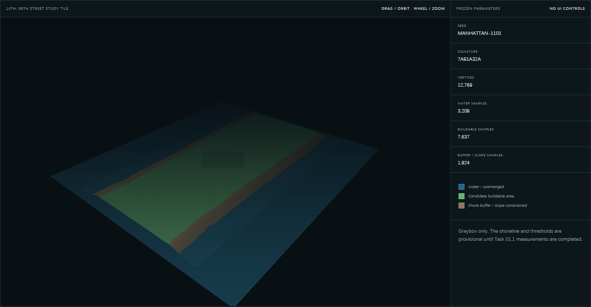 — seed `MANHATTAN-1101`, default parameters, 1440 × 1000 viewport.
- **Confirmed:** terrain, water, and buildability mask render; same seed → identical heights; different seeds → different heights.
- **Open issues:** seed variation is small (class counts differ by < 2%); a dark square artifact sits mid-tile (likely the default shadow-camera bounds); config exposes 11 non-seed values, some not spatial (resolution), which conflicts with the ≤10 spatial-parameter rule once UI is added; shoreline and thresholds remain provisional until 01.1 measurements exist.
- **Review status:** Pending review.
- **Next single task:** Human accepts or rejects this greybox as the Stage 2 terrain base; if accepted, reduce the public parameter set to ≤10 spatially meaningful values.

### 02.2 — T1 Seed terrain with live parameters and terrain fields

- **Date / Stage / Single question:** 2026-10-18 / T1 (Terrain-first) / Can a city-neutral seeded terrain expose reproducible height, water, slope, and buildability fields with a live preview?
- **Reused files or functions:** `IcelandTerrain` (height generation, unchanged) from `experiments/iceland-region/`; `checksum` from `experiments/cellular-noise/noise.js`; slope method from `experiments/manhattan-terrain-greybox/ManhattanTerrain.js`; lil-gui panel pattern from `iceland-region/ControlPanel.js`; page CSS from the Manhattan greybox; `scripts/verify-manhattan-terrain.mjs` as the verifier template. `terrain-seam` was not reused: its terrain is tied to Venice/Japan presets and assets.
- **Changed files + working-tree state:** new `experiments/seed-terrain/` (`index.html`, `main.js`, `config.js`, `TerrainFields.js`), new `scripts/verify-seed-terrain.mjs`; compass §1 and §5 updated to the Terrain-first pipeline. No other experiment, dependency, or branch changed. Uncommitted on `experiment/terrain-seam`.
- **Seed / City DNA / key parameters:** seeds `TERRAIN-01/02/03`; no City DNA. Map 64 × 64, 129 × 129 samples (fixed). Public parameters (8): heightScale 6, largeNoiseScale 18, detailNoiseScale 4, ridgeStrength 0.5, coastFalloff 0.25, waterLevel 0.8, shoreFreeboard 0.3, maxBuildableSlope 12°.
- **Entry point + verification method:** `/experiments/seed-terrain/?seed=<seed>` (any parameter can be added as a URL query); `node scripts/verify-seed-terrain.mjs` loads each seed twice and compares height and buildability checksums. Field data: `window.__seedTerrainLab.fields()` or the *Export fields JSON* button.
- **Result + checked data:** all 3 seeds reproducible; 3 unique signatures; 0 browser errors. Counts (16,641 samples) water / buildable / steep / low shore: 01 → 3371 / 5540 / 7362 / 368 (`1C504EDD`); 02 → 3320 / 5324 / 7646 / 351 (`DDE36D41`); 03 → 3331 / 5764 / 7189 / 357 (`145B5383`). Mean land slope 17.7–18.8°.
- **Screenshots:** 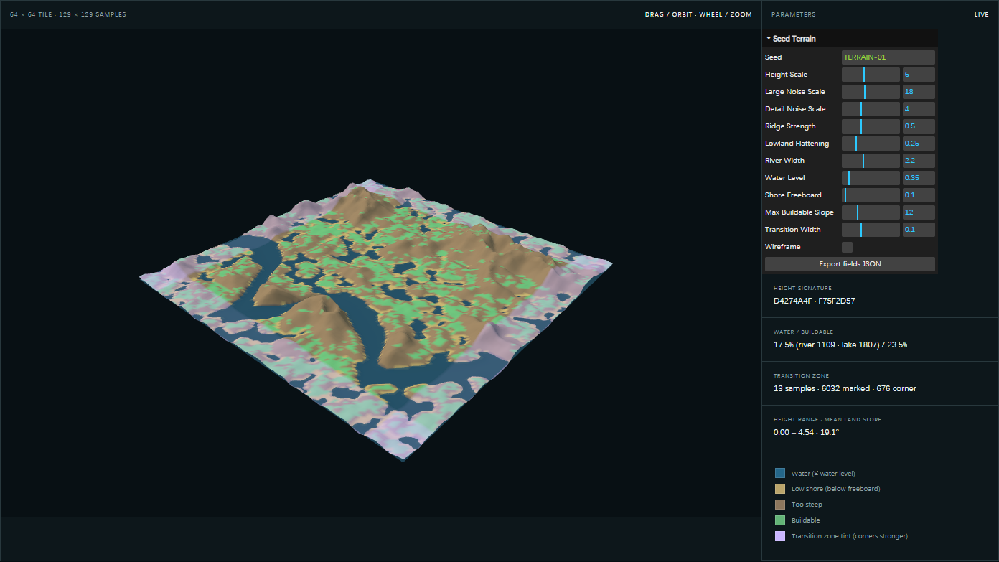 — seed `TERRAIN-01`, default parameters, 1440 × 1000 viewport.
- **Confirmed:** same seed → identical fields; different seeds → different fields; live sliders regenerate the fields; no city, road, parcel, or building output.
- **Open issues:** water appears only as the outer sea ring (no inland rivers or lakes), so T2 will find few water features; the coast reads as a square plateau edge; aggregate class ratios barely change between seeds (variation is mainly spatial); field export was not exercised by the verifier; `experiments/seed-terrain/` is not yet in the `vite.config.js` build inputs (dev server only).
- **Review status:** Pending review.
- **Next single task:** Decide whether T1 needs inland water (river/lake) before T2 feature detection starts.

### 02.2b — T1 revision: full square tile, inland water, transition zone

- **Date / Stage / Single question:** 2026-10-18 / T1 / Can the seed terrain cover the whole square tile (no island/sea), hold inland rivers, lakes, and plains, and mark an edge transition zone with boundary samples?
- **Reused files or functions:** `IcelandTerrain` unchanged (run with `coastFalloff: 0`); `sampleHeight`, `checksum` (cellular-noise); `hashParts` (flavor-clash); 02.2 page, fields, and verifier. No river code existed in earlier experiments.
- **Changed files + working-tree state:** new `experiments/seed-terrain/TileShape.js` (fixed noise floor 0.5, lowland flattening, seeded edge-to-edge river, water plane clipped to the tile); updated `config.js`, `TerrainFields.js` (transition mask, boundary lines, river/lake counts), `main.js`, `index.html`, `scripts/verify-seed-terrain.mjs`. Uncommitted; no other experiment changed.
- **Seed / City DNA / key parameters:** seeds `TERRAIN-01/02/03`; no City DNA. 10 public parameters: heightScale 6, largeNoiseScale 18, detailNoiseScale 4, ridgeStrength 0.5, lowlandFlattening 0.25, riverWidth 2.2, waterLevel 0.35, shoreFreeboard 0.1, maxBuildableSlope 12°, transitionWidth 0.10 (= 13 of 128 segments). Water defaults were picked from a height-percentile probe (water ≈ lowest 10% of ground).
- **Entry point + verification method:** `/experiments/seed-terrain/?seed=<seed>`; `node scripts/verify-seed-terrain.mjs` loads each seed twice and also asserts complete boundary lines (outer + inner, 129 samples per edge) and 4 corners shared by two edges.
- **Result + checked data:** all seeds reproducible, unique signatures, 0 browser errors. Water river / lake · buildable · steep · shore: 01 → 1109 / 1807 · 3906 · 8279 · 1540 (`D4274A4F`); 02 → 1121 / 1674 · 3638 · 8903 · 1305 (`87566160`); 03 → 1123 / 1877 · 3735 · 8308 · 1598 (`68F6BC81`). Transition 6032 samples, corners 676 (= 4 × 13²), identical for all seeds. Each river crosses two opposite edges (axis x for 01/03, z for 02); water runs per outer edge 3–8.
- **Screenshots:**  — seed `TERRAIN-01`, defaults above, 1440 × 1000 viewport (replaces the 02.2 island capture at the same path).
- **Confirmed:** no surrounding sea; inland river and lakes present for every seed; transition zone only marked (heights not flattened, no stitching); corners carry both edge bits; boundary heights and water flags exported via `window.__seedTerrainLab.boundary()` and the JSON export.
- **Open issues:** about half of the land is steeper than 12° (mean land slope 18–20°), so buildable plains are limited (22–23%); the river is a carved channel at a flat water level, not a downhill flow; per-edge water runs are high because lakes touch edges; per-tile boundary matching with neighbours is untested by design.
- **Review status:** Pending review.
- **Next single task:** Accept or tune T1 defaults (slope vs. plains balance), then start T2 feature detection on the exported fields.

### 02.3 — T1 frozen chunk with four landform rule sets

- **Date / Stage / Single question:** 2026-10-18 / T1 / Can one frozen chunk format produce plain, river valley, coast, and mountain terrain, where water appears only by landform rule, through one shared data interface?
- **Reused files or functions:** `IcelandTerrain` unchanged; `sampleHeight`, `checksum`, `hashParts`; 02.2b `TileShape`, `TerrainFields` (slope, transition mask, boundary lines), page, and verifier.
- **Changed files + working-tree state:** `experiments/seed-terrain/config.js` (chunk constants + 4 landform presets), `TileShape.js` (rule per landform: ponds / valley + river / one-sided sea / none), `TerrainFields.js` (river / sea / pond counts), `main.js`, `index.html`, `scripts/verify-seed-terrain.mjs`. Uncommitted; no other experiment changed.
- **Seed / City DNA / key parameters:** frozen chunk 1024 × 1024 m, 257 × 257 samples (4 m), 128 m edge zone (32 samples), freeboard 1 m, buildable slope ≤ 10°. UI: landform, seed slider 1–9999 (rebuild on release) + random button, variation intensity 0–1 (default 0.5; scales relief and river/coast irregularity). Seeds 1101 / 2202 / 3303. Preset relief at default variation: plain 24 m, river valley 90 m, coast 60 m, mountain 150 m. No City DNA.
- **Entry point + verification method:** `/experiments/seed-terrain/?landform=<plain|riverValley|coast|mountain>&seed=<1–9999>&variation=<0–1>`; `node scripts/verify-seed-terrain.mjs` runs 12 landform × seed pairs twice each and asserts 257² samples, a 32-sample zone with 4 × 32² corner samples, 257-sample boundary lines, and each water rule (plain: ponds only; valley: river only, wet on exactly 2 opposite edges; coast: sea only, sea edge wet and opposite edge dry; mountain: no water; no landform except plain may be wet on all 4 edges).
- **Result + checked data:** all 12 pairs reproducible, 12 unique signatures, 0 browser errors. Water / buildable / mean land slope ranges over 3 seeds: plain 2.6–4.3% / 75–80% / 2.8–2.9°; river valley 6.0–6.1% / 51–56% / 8.9–10.4°; coast 29–34% / 57–63% / 6.1–6.6° (sea edges maxZ, minX, maxX); mountain 0% / 3.7–4.3% / 37–40°.
- **Screenshots:** 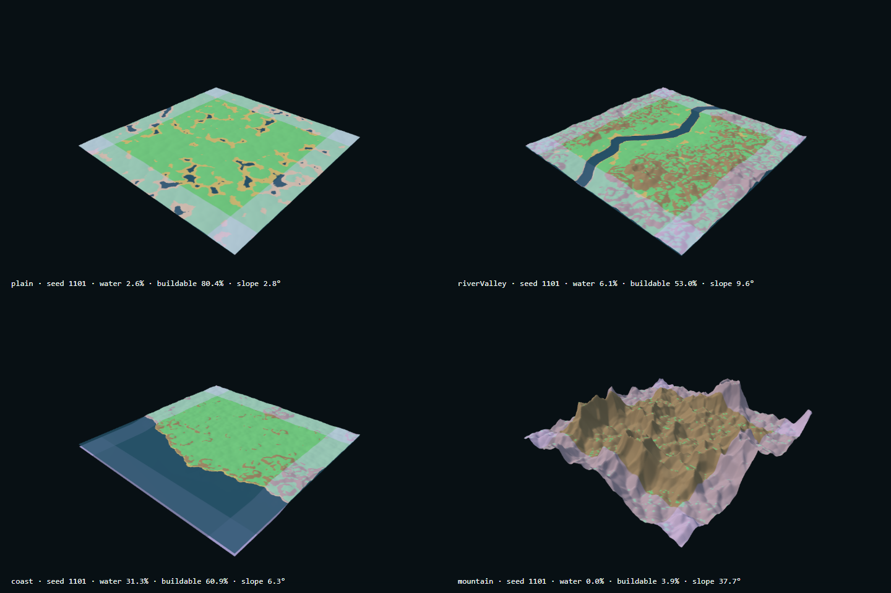 — 2 × 2 grid of four real canvas captures, seed 1101, default variation.
- **Confirmed:** one chunk format and one data interface (`stats`, `boundary`, `fields`) for all landforms; water no longer surrounds the chunk; edge zone marked only, not flattened.
- **Open issues:** plain ponds touch 3 edges for some seeds (allowed by the rule, but they will need edge matching later); plain shore band is wide (17–21%) because 1 m freeboard is large on 3° ground; heights are true metres, so plain relief looks almost flat in 3D; the river is a carved channel at one level, not a downhill flow; landform presets are tuned by probe for these 3 seeds only.
- **Review status:** Pending review.
- **Next single task:** Accept the T1 chunk format and landform presets, then start T2 feature detection on the shared field interface.

### 02.4 — Landform algorithms and adjustable transition zone

- **Date / Stage / Single question:** 2026-10-18 / T1 / Can each landform come from an explicit algorithm (fBm, valley cut, warped shoreline, ridged multifractal) inside the frozen chunk, with an adjustable, continuous edge transition weight that leaves terrain untouched?
- **Reused files or functions:** three's bundled `SimplexNoise` (seeded with `SeededRandom` from flavor-clash; no new dependency); `checksum` (cellular-noise); 02.3 page, lil-gui controls, slope method, boundary-sample layout, and Playwright verifier. `IcelandTerrain` and `TileShape.js` were dropped from this experiment: the cellular-F1 base cannot express fBm or ridged noise, and it computed heights inside the mesh class. `IcelandTerrain` itself is unchanged.
- **Changed files + working-tree state:** new `experiments/seed-terrain/TerrainGenerator.js` (pure height generator in world metres), `ChunkView.js` (render-only terrain + water meshes, transition debug view); rewritten `TerrainFields.js` (pure fields), `config.js`, `main.js`; edited `index.html`; deleted `TileShape.js`; `scripts/verify-seed-terrain.mjs` rewritten for 02.4. Uncommitted; no other experiment changed.
- **Seed / City DNA / key parameters:** chunk 1024 × 1024 m, 257 × 257 samples, 4 m spacing (fixed, shown not editable). Controls: landform, seed 1–9999 (+ random), variation 0–1 (default 0.5), transition width 32–256 m in 16 m steps (default 128), debug view. Rules: plain base 20 m + 7 m fBm + 0.2–0.5° tilt, no water; river valley 32 m channel, 3 m deep, 18 m banks, 230 m valley half-width, water surface falling 2 m/km; coast sea level 0, warped shoreline ±90 m, open sea or enclosed bay chosen by seed; mountain ridged multifractal (4 octaves, base 1/900 m⁻¹) on a 1/1600 m⁻¹ massif mask, relief 300 m. Seeds 1101 / 2202 / 3303. No City DNA.
- **Entry point + verification method:** `/experiments/seed-terrain/?landform=…&seed=…&variation=…&transitionWidth=…&view=transition`; `node scripts/verify-seed-terrain.mjs`. Data API: `window.__seedTerrainLab.fields()` → `height`, `slope`, `waterMask`, `buildableMask`, `transitionWeight`, `boundarySamples` (+ `grid`, `stats`); `neighbors(edges)` is the reserved neighbour-constraint interface.
- **Result + checked data:** all 12 landform × seed pairs reproducible; height and water identical at 32 / 128 / 256 m widths (only the weight field changes); 12 unique height fields; 0 browser errors. River: 0 off-channel water, 0 bank samples below the water surface, max depth 3.0 m, river crosses the chunk for every seed. Coast: 0 land/sea mismatches against the shoreline potential; seed 2202 gives an enclosed bay, 1101 / 3303 cross two edges; water 9–17%. Plain: no water, mean slope 0.8–1.0°, p95 < 2°. Mountain: mean slope 27–30°, p95 54–60°, about 175–200 local peaks/km². Transition: max adjacent weight step 0.1836 / 0.0468 / 0.0235 at 32 / 128 / 256 m vs smoothstep bound 1.5·4/W (+1e-4 export rounding); corners = 1, outer edges = 1, interior = 0, symmetric under both diagonal flips; boundary lines 257 samples, inner line at exactly W. Neighbour interface: identity without neighbours, explicit refusal with neighbour data.
- **Screenshots:**  — overall view, seed 1101, variation 0.5, width 128 m.  — weight ramp with 0.25 iso-lines; corners round off continuously.
- **Confirmed:** four rule-based landforms in one chunk format; water only where a rule puts it; transition zone stays inside the chunk and is a weight field only; data generation is separate from rendering.
- **Open issues:** neighbour blending itself is not implemented (interface only, by scope); the mountain still has a steep tail (p99 62–71°) and dense small peaks from ridge creases at 4 m sampling; the plain reads as flat in 3D at true metre scale; the continuity bound needed one correction during testing (a diagonal near a corner may move both edge weights, so the bound is 2× rather than √2×); presets are tuned on 3 seeds only; the 02.3 rule "plain has ponds" was replaced by "plain has no water" to match the 02.4 spec.
- **Review status:** Pending review.
- **Next single task:** Review landform presets and the transition weight; then define the neighbour boundary-blend contract before any multi-chunk test.

### 02.5 — T2 terrain analysis: constraints for city generation

- **Date / Stage / Single question:** 2026-10-18 / T2 / Can explainable geographic features and buildability be extracted automatically from the existing 02.4 fields, as one renderer-independent `terrainAnalysis` object?
- **Reused files or functions:** 02.4 `fields` only (`height`, `slope`, `waterMask`, `buildableMask`, `waterSurface`, `boundarySamples`, `grid`) — no regeneration; `EDGES` from `TerrainFields.js`; `checksum` (cellular-noise); `ChunkView` debug-view mechanism; 02.4 verifier helpers (server, browser, composite capture).
- **Changed files + working-tree state:** new `experiments/seed-terrain/TerrainAnalysis.js`; `ChunkView.js` (+ slope and suitability views), `main.js` (+ analysis call, `analysis()` API, two view options), `index.html` (+ one stats row, one legend row); new `scripts/verify-terrain-analysis.mjs`. Generator, chunk spec, and transition logic unchanged (02.4 verifier re-run: pass). Uncommitted.
- **Seed / City DNA / key parameters:** 4 landforms × seeds 1101 / 2202 / 3303, variation 0.5, transition 128 m. Thresholds (all exported in `analysis.thresholds`): suitability high ≤ 5°, medium ≤ 10° (= absolute `buildableMask`), low ≤ 20° and dry above 1 m freeboard (needs grading, not buildable), otherwise unsuitable; fragment < 2,500 m²; direction evidence — linear water elongation ≥ 4, shoreline elongation ≥ 3, relief anisotropy ≥ 0.3, slope coherence ≥ 0.5 and ≥ 0.1°.
- **Entry point + verification method:** `/experiments/seed-terrain/?landform=…&seed=…&view=suitability` (or `view=slope`); `window.__seedTerrainLab.analysis()`; `node scripts/verify-terrain-analysis.mjs` checks reproducibility, exact area totals, component counts against an independent BFS, label/area/edge-contact consistency, suitability ⇔ buildableMask, boundary samples ⇔ waterMask and edge water lengths, direction claims only with passing evidence, and river/coast water–land relations.
- **Data interface (`terrainAnalysis`):** `elevationStats` (min, max, range, area-weighted mean, p5/p50/p95), `slopeStats` (mean, land mean, land p50–p99, 8-bin area histogram), `waterCoverage`, `waterRegions` / `buildableRegions` (count, significant/fragment counts, largest share, up to 12 regions with area, centroid, world/grid bounds, touched edges, plus a full label grid), `dominantDirection` (primary type or `unknown`, every candidate with metric, value, threshold, pass), `boundaryConnections` (per edge: water and buildable runs in world metres with region ids), `suitabilityMask` (0–3 per sample), plus `units`, `grid` (layout and world-coordinate formulas), `areaCheck`, and `signature`. Areas use vertex Voronoi weights (edge ½, corner ¼), so the total is exactly 1,048,576 m².
- **Result + checked data:** 12/12 pass, 0 browser errors. Water / buildable / significant buildable regions / direction: plain 0% / 100% / 1 / unknown (tilt coherence 0.29–0.50 < 0.5); river valley 3.3–3.5% / 49–50% / 19–22 / waterAxis 179°, 83.7°, 4.3° (matches each crossing within 30°); coast 8.6–16.8% / 53–60% / 3–9 / shoreline 19.9° with seaward 297° and 136.9° with seaward 46° (toward the wet edges), enclosed bay 2202 → unknown; mountain 0% / 11–16% / 7–10 / unknown, unknown, reliefGrain 84.6° (anisotropy 0.52).
- **Screenshots:**  — dark green high, light green medium, orange low (grading), maroon unsuitable, blue water; seed 1101, variation 0.5.
- **Confirmed:** statistics, regions, edge connections, and suitability come from existing fields with traceable thresholds; directions are reported only with passing evidence; analysis is independent of rendering.
- **Open issues:** `signature` hashes masks and labels only, so uniform plains (2202, 3303) share one signature although their statistics differ; plain tilt is real in the generator but below the coherence threshold, so it stays `unknown` (threshold not tuned to pass); buildable areas on river/mountain terrain are fragmented (250–440 components, most below 2,500 m²); 4-neighbour connectivity is a stated choice; direction thresholds are judged on 12 samples only. No upstream data errors found.
- **Review status:** Pending review.
- **Next single task:** Review the `terrainAnalysis` contract and thresholds; then define how T3 City DNA matching reads it.

### 02.6 — T3 terrain-to-city matching (terrain fit, not identity)

- **Date / Stage / Single question:** 2026-10-18 / T3 / Can the existing `terrainAnalysis` rank the three prototype City DNAs by terrain fit, transparently and deterministically, without claiming city identity or inventing research thresholds?
- **Reused files or functions:** `terrainAnalysis` (02.5) only — no re-analysis; prototype decision and rules M1–M3 / V1–V3 / F1–F3 (`research/prototype-city-selection.md`), families F1 / F2 / F4 (`research/city-longlist-60.md`), Manhattan evidence and TBD list (`research/manhattan-spatial-study.md`), evidence classes from `research/city-research-template.md`; page, GUI, panel rows, and verifier helpers.
- **Changed files + working-tree state:** new `experiments/seed-terrain/cityMatchRules.js` (all weights, thresholds, evidence tags, hints), `CityMatcher.js` (pure matcher); `main.js` (+ match after analysis, City DNA override, `cityMatch()` / `selectDNA()` API), `index.html` (+ match row with top-3 reasons); new `scripts/verify-city-match.mjs`. Terrain, transition, and analysis code unchanged (02.4 and 02.5 verifiers re-run: pass). Uncommitted.
- **Seed / City DNA / key parameters:** 4 landforms × seeds 1101 / 2202 / 3303, variation 0.5, width 128 m. DNAs: `manhattanGrid` (F2), `veniceWaterNetwork` (F1), `fezOrganicCore` (F4). Scoring: fitScore = weighted mean of scored conditions (linear ramps / lookups, conflicts cap it); evidenceCoverage = scored weight / total weight (TBD counts in total); rankScore = fit × coverage; weak fit < 0.4; confidence "medium" needs coverage ≥ 0.8 and ≥ 50% V-tagged weight, otherwise "low". The research CSV rows are empty, so every numeric threshold is tagged A (design assumption, uncalibrated); TBD conditions are never scored.
- **Entry point + verification method:** `/experiments/seed-terrain/?landform=…&seed=…&dna=<auto|manhattanGrid|veniceWaterNetwork|fezOrganicCore>`; `window.__seedTerrainLab.cityMatch()`; `node scripts/verify-city-match.mjs` checks determinism, required keys, no geometry in hints, sorted ranks, score = fit × coverage, weak-fit flags, TBD never scored, auto = top, plausibility rules (no water ⇒ Venice 0 via conflict; plain ⇒ grid top and not weak; mountain ⇒ all weak; orientation hint only from a passing direction), manual override for all 3 DNAs without changing terrain, analysis, or ranking, and empty / partial analysis handled without errors.
- **Result + checked data:** 12/12 pass, 0 browser errors. Rankings (rankScore, w = weak): plain → Manhattan 0.80 > Fez 0.29w > Venice 0w (all seeds); river valley → Fez 0.23–0.25w > Venice 0.19w > Manhattan 0.04–0.05w; coast 1101 / 2202 → Manhattan 0.56 / 0.48 > Fez 0.43 > Venice 0.22–0.23w; coast 3303 → Fez 0.40w > Manhattan 0.22w > Venice 0.20w; mountain → all weak (≤ 0.09). Empty analysis → all scores 0, all conditions missing/TBD.
- **Screenshots:**  — same terrain signature `4A69CE05 · 602F2BF4` in both; panel shows score, fit × coverage, confidence, and the three decisive reasons.
- **Confirmed:** ranking is config-driven, deterministic, and traceable to tagged conditions; terrain fit and identity are separate fields (`selectedDNA.identityRules`, `identityNote`); hints are constraints only; unknowns are listed in `unresolvedEvidence`.
- **Open issues:** first ranking draft let Fez win coast with fit 1.00 from two lenient A-tagged conditions (5 TBD) — fixed by ranking on fit × coverage, which penalises missing research rather than terrain; Venice never fits because no landform makes lagoons or islands (island metric derived from water labels exists, but no terrain produces islands); Fez has no discriminating terrain condition in the research yet; all thresholds are uncalibrated assumptions; plain gives identical scores for every seed (uniform buildable land); an empty analysis still names Manhattan via tie-break (flagged weak fit, score 0); confidence can never reach "high" until research values exist.
- **Review status:** Pending review.
- **Next single task:** Review the rule table in `cityMatchRules.js` (weights, A-tagged ramps, rank formula); then decide whether research calibration (01.1 measurements) or T4 network generation comes first.

### 03.1 — T4 procedural road / canal network (NetworkGraph)

- **Date / Stage / Single question:** 2026-10-18 / T4 / Can one NetworkGraph structure, driven by three strategy configs (Grid, Organic, Canal-Street), produce deterministic, terrain-legal networks with chunk edge ports from fields + terrainAnalysis + cityMatch?
- **Reused files or functions:** `SurfaceQuery.sampleHeight` (iceland-region; bilinear height via a surfaceData adapter); `RoadMeshBuilder` + `DEFAULT_ROAD_MESH_OPTIONS` (road-mesh; debug ribbons, recoloured per class); `SeededRandom` (flavor-clash); `checksum` (cellular-noise); `terrainAnalysis` (regions, labels, boundary runs) and `cityMatch` (selected DNA, orientation hint); page, GUI, DNA override, verifier helpers. Reviewed but not reused: `RoadProjector` (bound to Iceland's single water level), `WFCRoadGenerator` (tile solver, no graph), flavor-clash Venice canal lanes (hand-placed polylines, not generated water).
- **Changed files + working-tree state:** new `experiments/seed-terrain/networkStrategies.js` (all spacings, widths, limits), `NetworkGraph.js` (GraphBuilder, chain collapse, ports, stats), `NetworkGenerator.js` (sampler, Dijkstra, three strategies), `NetworkView.js` (debug layer); `main.js` (+ network after match, layer toggle, `network()` API), `index.html` (+ network row, legend); new `scripts/verify-road-network.mjs`. Terrain, transition, analysis, and matching code unchanged (02.4–02.6 verifiers re-run: pass). Uncommitted on `experiment/terrain-seam`.
- **Seed / City DNA / key parameters:** seeds 1101 / 2202 / 3303 × 4 landforms × 3 DNAs. DNA → strategy: manhattanGrid → grid, fezOrganicCore → organic, veniceWaterNetwork → canalStreet. Grid: avenues 200 m / cross streets 80 m, widths 20 / 12 m, slope ≤ 10°, orientation from `cityMatch.networkHints.orientation` (else 0°, recorded), seed sets lattice phase, primary-only bridge candidates ≤ 80 m. Organic: slope ≤ 20°, gates = longest buildable boundary run per side, centres = buildable-region centroids (proxies; real gates/markets TBD), 26 lanes 40–320 m, widths 8 / 4 m. Canal-Street: canals = least-cost paths inside generated water (kept central), quays 2 cells (8 m) inland, bridge candidates every 260 m ≤ 70 m span, 14 lanes. All values are design assumptions (A); research spacing/width values are TBD. Transition width 128 m (existing control).
- **Entry point + verification method:** `/experiments/seed-terrain/?landform=…&seed=…&dna=…&network=on|off`; `window.__seedTerrainLab.network()`; `node scripts/verify-road-network.mjs` recomputes in the page: determinism (signature + full JSON), finite in-chunk coordinates, edge endpoints = nodes, every 2 m road sample off water and within the strategy slope, canal samples in water, bridge ends on legal land and span limit, duplicate edges, proper crossings (canal ↔ bridge excepted), nodes on other edges' interiors, port side / elevation / legality / outward direction / incidence, components and dead-end ratio vs stats, terrain + analysis unchanged across DNAs, and structural differences.
- **Result + checked data:** 36/36 combinations pass with 0 issues of every type; 0 browser errors. Plain: grid 148–175 edges, 18.4–19.5 km, 1 component, 0% dead ends, mean degree 2.93–3.02, orientation entropy 0.85–0.90, straightness 1.00, 36–38 ports; organic 40–44 edges, ≈ 5.3 km, 44% dead ends, degree ≈ 1.95, entropy 1.19–1.23, straightness 0.94–0.96, 4 ports. River valley canal-street: 1 canal, 4–5 bridge candidates, 1 road component, 23–27% dead ends, 9–10 ports. Grid on river valley / coast: 4–7 / 14–15 components, 62–66% dead ends (strict 10° limit and no secondary bridges). Mountain: every strategy ≤ 3 km of road.
- **Screenshots:**  — terrain classes view; white primary, orange secondary, sand lanes, cyan canal, pink bridge candidates, white dots nodes, red dots edge ports. 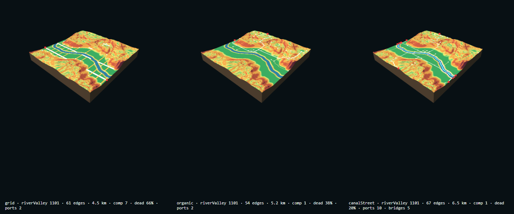 — same terrain, different DNA overrides.
- **Confirmed:** one graph structure and builder for all strategies; networks only read upstream data; roads never on water or beyond the strategy slope, water crossings only as bridge candidates; every edge port lies on its side, is incident to a network edge, and carries a redirect anchor at the transition inner line (`neighborPortId` reserved, unused).
- **Open issues:** grid fragments on coast and river valley (14–15 components, many dead-end stubs) because truncation is strict and cross streets never bridge — needs a design decision; organic and canal-street are trees (mean degree < 2, few loops), and their gates/centres are terrain proxies, not researched nodes; organic does not cross rivers (gates on the far bank stay unconnected); the enclosed bay (coast 2202) gets no canal, only quays; canal-street on waterless terrain falls back to land streets with a warning; road grade along edges is checked only via terrain slope at samples; the terrain-unchanged check compares the analysis signature and a 4,000-value height prefix, not the full height array; spacings and widths are uncalibrated.
- **Review status:** Pending review.
- **Next single task:** Decide grid truncation / bridge policy and whether organic needs loops; then start T5 block closure from the NetworkGraph.

### 03.2 — Mountain roads and tunnel connectivity

- **Date / Stage / Single question:** 2026-10-18 / T4 / When steep terrain cuts the network, can the generator link it with a grade-limited surface road first and, only when justified, a small number of checked tunnels — inside the existing NetworkGraph?
- **Reused files or functions:** 03.1 `GraphBuilder` (extended), `MinHeap`, `findCrossings`, `createSampler` (`SurfaceQuery` heights), Dijkstra pattern, `terrainAnalysis` / fields; `NetworkView` and `RoadMeshBuilder` ribbons; 03.1 verifier helpers.
- **Changed files + working-tree state:** new `experiments/seed-terrain/TunnelPlanner.js`, new `scripts/verify-tunnels.mjs`; `networkStrategies.js` (+ `CONNECTIVITY`), `NetworkGraph.js` (tunnel kind, `portal` nodes, `splitEdgeAt`, graded split elevations, tunnel stats), `NetworkGenerator.js` (planner call after pruning; exports), `NetworkView.js` (x-ray tunnel line, portal markers; tunnels excluded from ribbons), `main.js` / `index.html` (counts, legend), `scripts/verify-road-network.mjs` (mountain-road and tunnel rules). Terrain, analysis, matching, and DNA rules unchanged. Uncommitted.
- **Seed / City DNA / key parameters:** mountain seeds 1101 / 2202 / 3303 × 3 DNAs; transition 128 m. Demands: road components ≥ 200 m cut off from the main network, and chunk sides without a road port that have ≥ 40 m of legal boundary land; water-separated demands are skipped (bridge policy). Mountain road (A): 16-direction moves, terrain slope ≤ 30°, step grade ≤ 15%. Tunnel (A, test assumptions): 80–700 m, grade ≤ 6%, clearance 7 m, cover ≥ 10 m outside 30 m portal zones, ground ≥ road level in portal zones, no water, entirely outside the transition zone, portals reached by grade-limited approach roads, cost 8 × length + approaches. A tunnel is built only if no surface route exists, or detour > 3 and tunnel cost < 0.6 × surface cost; ≤ 2 per chunk, a second only for a component ≥ 500 m.
- **Entry point + verification method:** `/experiments/seed-terrain/?landform=mountain&seed=…&dna=…&view=slope`; `network().connectivity.decisions`; `node scripts/verify-tunnels.mjs` recomputes each tunnel profile from raw heights (length, grade, cover, daylight, water, transition), portal level vs ground (< 0.5 m), portals joined to surface roads, necessity (removing the tunnel disconnects the graph), justification against the recorded surface alternative, duplicates, reproducibility, unchanged analysis, and scenario coverage. `verify-road-network.mjs` re-run on all 36 combinations with mountain-road grade rules: pass.
- **Result + checked data:** 9/9 mountain runs pass, 0 browser errors. Tunnels: 2202 → 0 for every DNA (side demands have no reachable portal outside the transition zone); 1101 → 0 for grid (15 feasible alignments, all rejected because their approach roads would cross the network) and 1 for organic / canal-street (630 m, −0.38%, min cover 11.2 m); 3303 → 1 for every DNA (146–150 m, 2.5–4.5%, min cover 19.5–21.6 m) chosen from 47 feasible of 18,178 evaluated alignments. Every built tunnel had no surface alternative, is necessary, and its portals sit on ground joined to surface roads. Mountain roads: 1–6 per run. Other landforms: 0 tunnels; surface connectors only where slopes split the grid (coast / river valley).
- **Screenshots:** 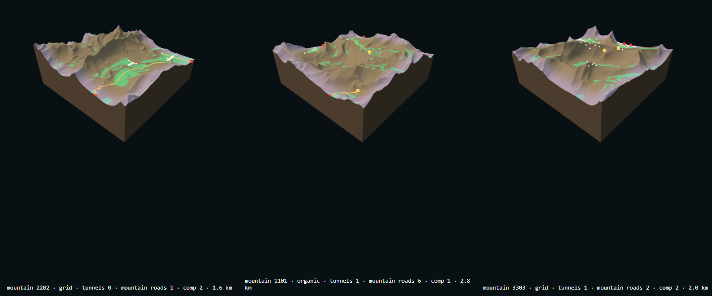 — classes view; sand mountain roads, violet dashed tunnels, yellow portals. 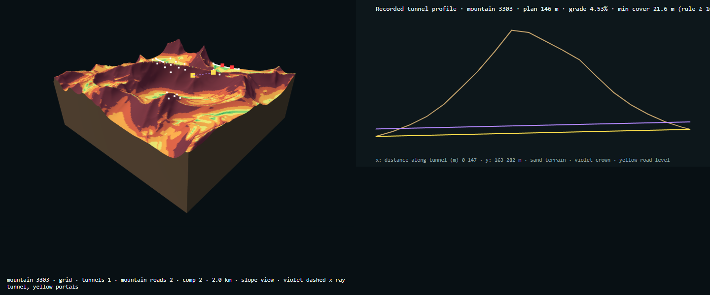 — slope view with x-ray line; profile plotted from the stored `tunnel.profile` data.
- **Confirmed:** tunnels are ordinary NetworkGraph edges (`kind: 'tunnel'`) with portals, plan / 3D length, grade, cover profile, approach lengths, demand, surface alternative, candidate counts, and cost; surface roads are always tried first; no tunnel is forced to reach the limit; upstream terrain is never modified.
- **Open issues:** terrain mesh is not opened at portals — geometry is centreline + markers only (TODO: portal cut or frame mesh); the x-ray line is faint at full-chunk camera distance; most side demands on mountains stay unresolved (no grade-limited route and no valid tunnel); during testing two defects were found and fixed — a connector joined the wrong edge in a shared cell (now attaches to the sample closest to the cell centre) and a split point on a mountain road took terrain height instead of the graded profile (now interpolated); mountain-road grade is checked per vertex segment (≥ 3 m), not continuously between vertices; all engineering thresholds are uncalibrated assumptions; no seed produced two tunnels, so the second-tunnel rule is untested.
- **Review status:** Pending review.
- **Next single task:** Decide on portal geometry (terrain cut vs frame mesh) and whether unresolved side demands need another strategy; then resume T5 block closure.

### 04.1 — T5 procedural urban blocks

- **Date / Stage / Single question:** 2026-10-18 / T5 / Can valid closed block polygons (with holes) be extracted from the existing surface roads (real widths), water, and chunk edge, with buildability from the existing fields, for all three network strategies?
- **Reused files or functions:** NetworkGraph (surface edges, widths, node/edge ids), fields (`height`, `waterSurface`, `slope`, `buildableMask`), `terrainAnalysis.suitabilityMask`, `cityMatch` (selected DNA, parcel hint), grid spacing from `networkStrategies.js`, `checksum`, ChunkView debug-view mechanism, verifier helpers. No geometry library is installed; none was added.
- **Method:** availability field on a 1 m grid = min(exact distance to each surface road / bridge centreline − ½ width, bilinear height − water surface); tunnels and canals never enter it. Blocks = 4-connected positive regions; boundaries = marching-squares zero contours with saddles resolved to match the labelling, so rings are closed, simple, and disjoint; holes come out naturally. Each boundary vertex records its cause (road edge id, water, chunk edge). Douglas–Peucker 0.3 m is kept only if the block stays valid. Buildable status from the share of the block in `buildableMask` (≥ 0.8 buildable, ≥ 0.3 partial). Pieces < 100 m² are remnants.
- **Changed files + working-tree state:** new `experiments/seed-terrain/blockRules.js`, `BlockGenerator.js`, `BlockView.js`, `scripts/verify-blocks.mjs`; `ChunkView.js` (+ "Blocks" debug view), `main.js` (+ block generation after the network, `blocks()` API, `waterSurface` added to `fields()` export, view option), `index.html` (+ blocks row, legend). Terrain, analysis, matching, network, and tunnel code unchanged (03.1 and 02.6 verifiers re-run: pass). Uncommitted.
- **Seed / City DNA / key parameters:** seeds 1101 / 2202 / 3303; grid (manhattanGrid) on plain, organic (fezOrganicCore) on coast, canal-street (veniceWaterNetwork) on river valley, plus grid and organic on mountain for tunnel checks. Resolution 1 m, field cap 3 m, min block 100 m², status thresholds 0.8 / 0.3 (all A).
- **Data interface:** `blocks()` → `{ blocks[], terrainBlockIndex (257² lookup: block index, −2 road, −3 water, −4 remnant), stats, signature, units, rules }`; each block has `id, polygon, holes, area, sampleArea, centroid, boundaryEdges {roads[{edgeId,length}], waterLength, chunkBoundaryLength}, adjacentRoads [{edgeId, roadClass, kind, frontage, nodes}], terrainStats, buildableStatus, enclosure (roads | roadsAndWater | waterOnly | clipped), clippedByBoundary, metrics, dnaContext, valid`. Example: grid plain 1101 `B15`, 12,218.5 m², enclosed by edges 1, 15 (primary) and 71, 77 (secondary), buildable share 1.0 (grid design block 12,512 m²; corners are rounded by the road distance field).
- **Entry point + verification method:** `/experiments/seed-terrain/?landform=…&seed=…&dna=…&view=blocks`; `node scripts/verify-blocks.mjs` checks in the page: ring length, self-intersection, orientation, holes inside, area ≥ 100 m², chunk bounds, overlap / water / road-corridor occupancy on a 2 m lattice (tolerances 0.3 m water, 0.6 m road edge), NetworkGraph references, no tunnel frontage, tunnel invariance (blocks recomputed without tunnel edges must match), area accounting, reproducibility.
- **Result + checked data:** 15/15 runs pass with 0 issues of every type; 0 invalid blocks; 0 browser errors; area residual < 1 m²; lattice area within 1% of polygon area. Grid / plain: 83–84 blocks, 48–60 road-enclosed, 23–36 clipped, all buildable; blocks 78–80 ha, road corridors 24.7–26.4 ha. Organic / coast: 4–5 blocks, 0 road-enclosed (1 road + water), 4 clipped regions; blocks 84–92 ha, roads 3.7–4.3 ha, water 9.1–17.6 ha, buildable inside blocks 52–59 ha. Canal-street / river valley: 7–10 blocks, 2–3 enclosed by quays + water, 4–7 clipped, 71–135 remnants; blocks ≈ 98 ha, roads 3.5 ha, water 3.7 ha, buildable inside 50–51 ha. Mountain: 1–2 clipped regions, mostly unbuildable (11–16 ha buildable in ≈ 103 ha); with tunnels present, blocks are identical with or without tunnel edges.
- **Screenshots:** 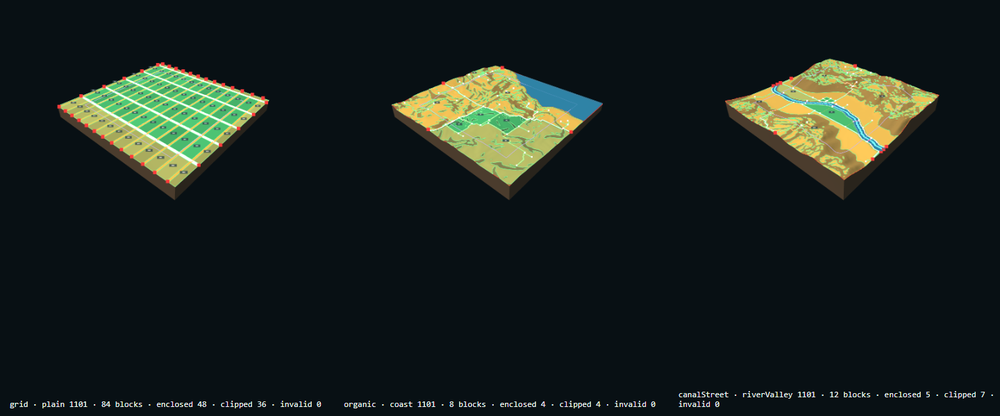 — status colours, clipped tint, outlines. 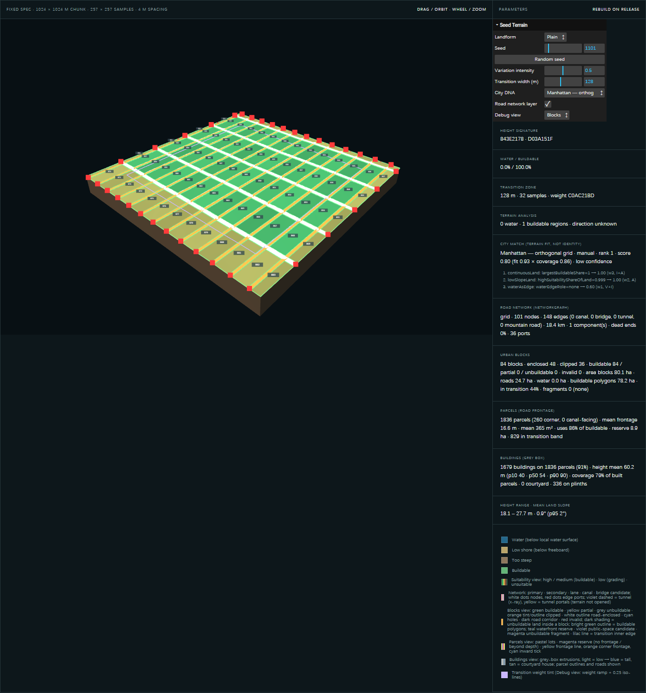.
- **Confirmed:** blocks are valid, disjoint, inside the chunk, off water and road corridors, linked to NetworkGraph edges and nodes; tunnels never cut blocks; buildability is measured, not assumed; data is separate from rendering.
- **Open issues:** organic and canal-street networks are tree-like, so they form almost no road-enclosed blocks — their "blocks" are large clipped open regions; a closed-block result for them needs loop-forming networks (not faked here); canal-street leaves 71–135 thin remnants between quays and water; grid blocks have rounded corners (distance-field geometry) instead of sharp road-boundary corners; unbuildable land is reported per block, not cut out of the polygon; transition-zone share per block is not yet recorded; port 4190 would not serve during testing (verifier moved to 4195; cause not investigated).
- **Review status:** Pending review.
- **Next single task:** Decide whether organic / canal-street need loop closure before parcels, and whether steep land should be cut out of blocks; then start parcel subdivision on grid blocks.

### 03.3 — Organic / canal-street loop closure

- **Date / Stage / Single question:** 2026-10-18 / T4 → T5 / Can a local loop-closure step make the tree-like organic and canal-street networks form real enclosed blocks, without faking closures, flattening their character, or touching grid and tunnels?
- **Reused files or functions:** 03.1 `CellNetwork` (shared cells become nodes), `searchPath` (extended), `landCost`, `cellDistance`, seeded `random`; 04.1 Block Generator unchanged (re-run for Before/After); verifier helpers.
- **Algorithm (after lanes, before emitting edges; organic and canal-street only):** (1) dead ends in seeded order, at most `closeShare` of them: try a straight extension along the dead end's heading (greedy 4-neighbour march), else a least-cost link; (2) branch links from mid-lane cells sampled every 40 m. Other road cells are barriers in the search (reached, never crossed), so every meeting point is a shared cell → topological node. A candidate is accepted only if: every interior cell is land, within the strategy slope, outside the transition zone, and not a road; length ≤ `maxLinkLength`; loop perimeter (network distance + new path) within [min, max]; network distance ≥ 2.5 × new path (a real shortcut, not a parallel road); ≥ 2 cells (8 m) from other roads except near its ends; ≥ 50% of cells buildable. Bridges are not in the cell network, so no loop closes across water. Each accepted link is recorded in `network().loops.links`.
- **Changed files + working-tree state:** `experiments/seed-terrain/NetworkGenerator.js` (`closeLoops`, `networkDistances`, `searchPath` gains step count + barrier, `generateNetwork(..., options)`), `networkStrategies.js` (`loops` blocks for organic and canal-street), `main.js` (`?loops=off` reproduces the Before network); new `scripts/verify-loops.mjs`. Grid, tunnels, terrain, analysis, matching, and blocks code unchanged. Uncommitted.
- **Seed / City DNA / key parameters:** seeds 1101 / 2202 / 3303; organic (fezOrganicCore) on coast and plain; canal-street (veniceWaterNetwork) on river valley and coast. Organic loops: link ≤ 200 m, extension ≤ 120 m, perimeter 180–1,000 m, close ≤ 50% of dead ends, ≤ 6 branch links. Canal-street loops: link ≤ 140 m, extension ≤ 100 m, perimeter 140–700 m, close ≤ 60%, ≤ 6 branch links. All A: cityMatch gives no numeric block scale for Fez or Venice (research TBD). During tuning the organic link limit was raised from 160 m to 200 m and the max perimeter from 900 m to 1,000 m because organic lanes are ≈ 180 m apart; the search cost budget was raised from 6× to 10× link length.
- **Entry point + verification method:** `/experiments/seed-terrain/?landform=…&seed=…&dna=…&view=blocks[&loops=off]`; `node scripts/verify-loops.mjs` compares Before/After per run and checks every recorded link (transition, water, slope, length, perimeter, goal on the network), invalid blocks, exactly one new cycle per link, all EdgePorts kept, dead-end ratio > 15%, straightness < 0.99, reproducibility. `verify-road-network`, `verify-tunnels`, `verify-blocks` re-run: pass (tunnel results identical to 03.2).
- **Result + checked data (Before → After):** organic coast 1101 / 2202 / 3303: cycles 0→4 / 0→5 / 0→13, dead ends 45→38 / 44→36 / 44→25%, enclosed blocks 0→4 / 1→6 / 0→13 (0→6.4 / 0.1→8.8 / 0→7.1 ha). Organic plain: cycles 0→8–10, dead ends 44→28–29%, enclosed blocks 0→8–10 (10.4–15.4 ha). Canal-street river valley: cycles 3–4→7–8, dead ends 23–27→19–20%, enclosed blocks 2–3→5–9 (≤ 3.8→2.8–4.2 ha). Canal-street coast: cycles 0→1–4, enclosed 6–14→7–18 (0.1–0.3→1.0–4.6 ha). Road length +0.2–1.2 km. Invalid blocks 0→0 everywhere; remnants unchanged or lower.
- **Screenshots:** 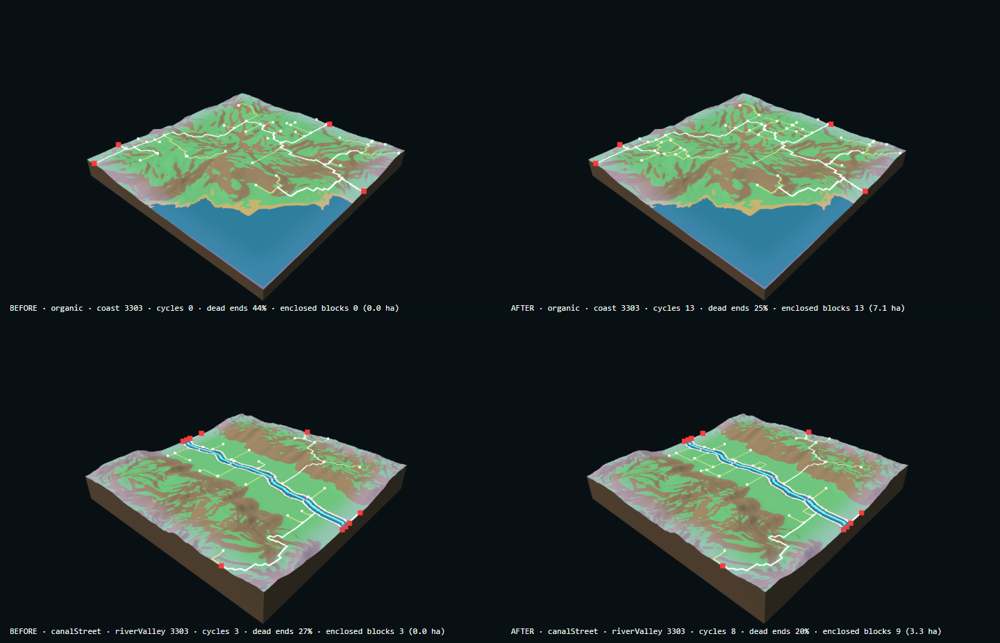 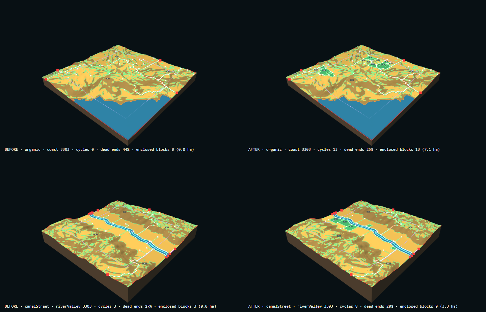
- **Confirmed:** new links always create topology (shared cells), never cross water or the transition zone, never remove EdgePorts; organic keeps 25–38% dead ends and curved paths (straightness < 0.99); grid and tunnels unaffected.
- **Open issues:** gains are uneven — coast 1101 / 2202 organic and coast 2202 canal-street add only 1–5 loops; most `noPath` rejections come from sparse networks where no acceptable goal lies within the link limit; enclosed areas stay small relative to the chunk (most land is still in large clipped regions); canal-street enclosed blocks are mostly small quay + water strips; loop size limits are assumptions, not Fez / Venice measurements; two link types (endpoint joins and branch links) were validated, but extension links were rarely accepted (1 per run at most).
- **Review status:** Pending review.
- **Next single task:** Accept or tune the loop limits; then begin parcel subdivision on enclosed blocks.

### 04.1b — Block refinement: buildable polygons, waterfront fragments, transition shares

- **Date / Stage / Single question:** 2026-10-18 / T5 / Can each existing block carry an accurate buildable MultiPolygon, classified fragments (nothing deleted), and transition-band shares, without changing block outlines, roads, or terrain?
- **Reused files or functions:** 04.1 availability field, labelling, marching squares, `dedupeRing` / `simplifyRing` / `ringsIntersect` (now exported); fields (`slope`, `height`, `waterSurface`), `CHUNK.maxBuildableSlope` (10°) and `CHUNK.shoreFreeboard` (1 m) as the existing buildable rule; ChunkView "Blocks" view and BlockView outlines; verifier helpers.
- **Method:** (1) Buildable field on the same 1 m grid = min(block availability, distance to the block's final simplified edges − 0.6 m, (10° − bilinear slope)·0.2, height − water surface − 1 m); contoured with the 04.1 marching squares → MultiPolygons with holes, each inside its block (pieces < 25 m² counted as unbuildable; a simplified piece is kept only if valid and contained, else the raw contour). (2) Former remnants (< 100 m²) are kept as `fragments`; they and thin water-touching blocks (< 2,500 m², width 2A/P < 10 m) are classified in order: buildableFragment → publicSpaceCandidate → waterfrontReserve → unbuildable, with reasons. Merge candidates (regions within 2 samples) are recorded with their separator; a merge is legal only with no road, water, or chunk edge between. (3) Transition areas by exact Sutherland–Hodgman clipping against the inner square (corners counted once), for blocks and buildable pieces.
- **Changed files + working-tree state:** new `experiments/seed-terrain/BlockRefinement.js`, `scripts/verify-block-refinement.mjs`; `BlockGenerator.js` (remnants kept as fragments, helpers exported, refinement call, fragment codes ≤ −10 in `terrainBlockIndex`), `blockRules.js` (`buildable`, `fragments`), `ChunkView.js` / `BlockView.js` (unbuildable shading, buildable outlines, fragment colours, transition inner line), `main.js` / `index.html` (panel, legend). Block outlines, roads, tunnels, terrain unchanged (04.1 and 03.3 verifiers re-run: pass). Uncommitted.
- **Data interface (added per block; polygon, id, road refs, DNA context unchanged):** `buildablePolygons [{polygon, holes, area}]`, `buildableArea`, `unbuildableArea`, `buildableRasterArea`, `buildableAreaError`, `transitionArea`, `transitionAreaRatio`, `buildableTransitionArea`, `buildableTransitionRatio`, `fragmentClassification` (null or `{source, class, reasons, width, area, roadFrontage, waterFrontage, buildableShare, meanSlope}`). New `result.fragments[]` (same buildable/transition fields) and `result.refinement` (before/after fragment counts, classes, merge candidates, area totals, transition totals).
- **Seed / City DNA / key parameters:** seeds 1101 / 2202 / 3303; grid / plain, organic / coast, canal-street / river valley and coast; transition 128 m (+ 32 / 256 m width test). Edge margin 0.6 m, min piece 25 m², fragment thresholds as in `blockRules.js` (all A, test parameters, not building codes).
- **Entry point + verification method:** `/experiments/seed-terrain/?…&view=blocks`; `blocks()`; `node scripts/verify-block-refinement.mjs` checks with stratified-jitter sampling (one random point per 2 m cell): ring validity / orientation / holes, buildable inside its own block and chunk, not on water (freeboard), not steep, not on road corridors, area relations, polygon vs sample area (total < 1%, mean boundary offset < 1 m), transition area vs samples, band upper bound, fragments all classified and none deleted, no legal merge forced, reproducibility, width series.
- **Result + checked data:** 12/12 runs + width series pass, 0 invalid / uncontained pieces, 0 browser errors. Grid / plain: blocks 78–80 ha → buildable 76–78 ha; the 1.9–2.0 ha difference is the 0.6 m edge margin (all of it is otherwise buildable). Organic / coast: 84–92 ha → buildable 51–59 ha, unbuildable 25–35 ha (steep land). Canal-street / river valley: ≈ 98 ha → buildable 49–50 ha. Area error vs samples: total ≤ 0.04%, mean boundary offset ≤ 0.24 m. Fragments: canal-street river valley 72–134 classified (almost all waterfrontReserve, 0.09–0.2 ha in total), coast 36–93 (waterfrontReserve, plus 2 publicSpaceCandidate on 3303); organic coast 2202: 3 waterfrontReserve + 1 publicSpaceCandidate; grid plain 3303: 15 unbuildable; deleted 0 everywhere. Merge candidates 0–145 per run, legal 0 (separated by water or road). Transition band (128 m): 39–48% of block area, buildable share in band 40–51%; width 32 / 128 / 256 m → grid plain block area in band 10.0 / 34.9 / 59.8 ha with unchanged block polygons; river valley network geometry changes with width (03.3 loops avoid the band), so its blocks differ by width.
- **Screenshots:** 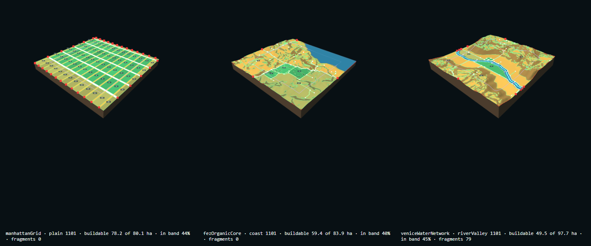 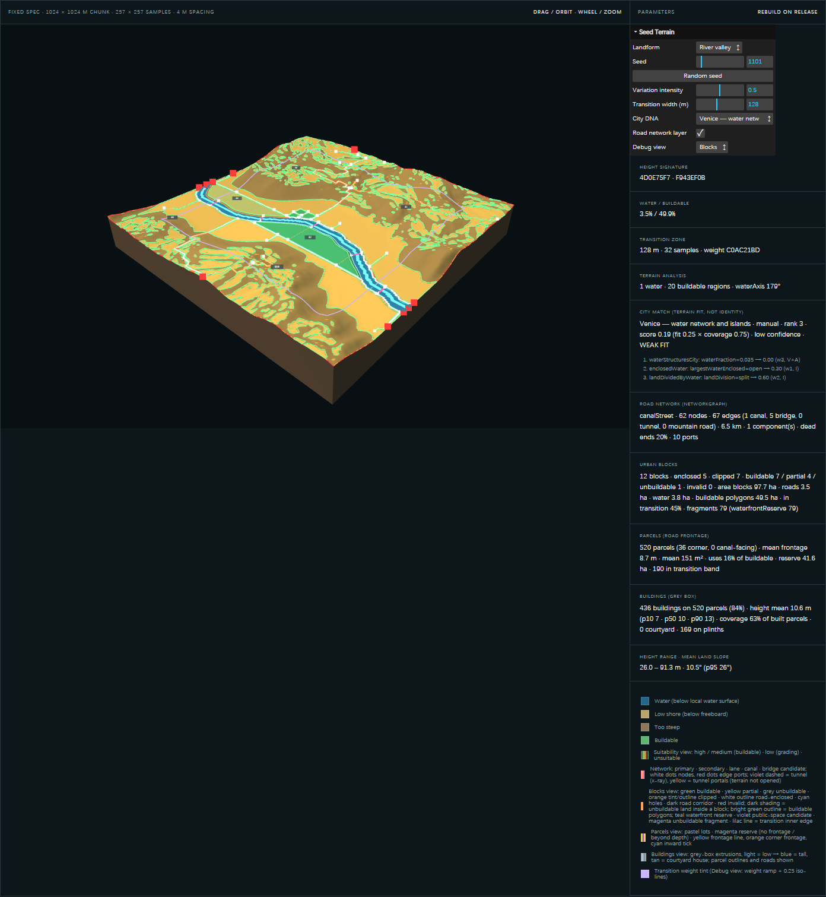
- **Problems found during testing (fixed / explained):** buildable outlines could cross block outlines where both were simplified independently → margin now measured to the final block edges, and applied to samples outside the block too (one sample had sat exactly on a raw edge); the verifier's regular 2 m lattice aliased against the grid (≈ 2% bias) → stratified jitter; per-block relative error was meaningless for thin blocks → mean boundary offset; "network changes with width" was metadata only on the grid → geometry-only comparison.
- **Open issues:** no legal fragment merge exists under the current geometry (every pair is separated by water or road), so merging is effectively a no-op; waterfront fragments are mostly 1–50 m² slivers — classified, not consolidated; the 0.6 m margin removes ≈ 2% of buildable area on grid blocks; transition shares for canal-street depend on the network, which depends on the width; buildable rule uses only slope and freeboard (no flood, legal, or setback rules, by scope).
- **Review status:** Pending review.
- **Next single task:** Start parcel subdivision on `buildablePolygons` of enclosed grid blocks first; decide later whether waterfront reserves become a public-edge layer.

### 04.2 — Road-oriented parcel subdivision

- **Date / Stage / Single question:** 2026-10-18 / T5 → T6 / Can parcels be generated from real surface-road frontage inside `buildablePolygons`, at the selected DNA's lot scale, with valid geometry, real topological frontage, and explicit reserve for land that cannot be parcelled?
- **Reused files or functions:** 04.1 / 04.1b block field, labels, buildable field (exposed as hidden `_internal`), `contours`, `label`, `dedupeRing`, `simplifyRing`, `ringsIntersect`, `transitionArea`; NetworkGraph edges (surface roads, widths, nodes); `cityMatch.selectedDNA`; `SeededRandom`; Blocks debug view and BlockView; verifier helpers.
- **Method:** (1) Frontage runs: every `road` edge (bridges and tunnels excluded) is walked in 2 m steps; on each side a probe 2 m inside the road edge finds the fronting block; consecutive hits form a run on the road-edge line (road id, class, nodes). (2) Runs are cut at the DNA target frontage (grid equal, organic / canal seeded jitter); remainders below `minFrontage` are merged. End pieces of two different roads within 12 m in one block form a corner lot. (3) Lot cells: each buildable 1 m sample takes its nearest lot; the cell value is min over other lots X of (dX − dP) / |eP − eX| (first-order distance to the shared bisector), capped by the depth limit, combined with the buildable field and a 0.25 m inset; the pairwise term is antisymmetric, so neighbours share one boundary and cannot overlap. (4) Polygons by local marching squares per lot; disconnected parts and lots that fail area, contact, or validity rules become residuals with reasons. (5) Frontage contact is measured, not assumed: each piece is walked in 1 m steps and probed inward up to 2.35 m for samples of the kept polygon; only roads with measured contact count. (6) Buildable land in blocks not covered by a valid parcel is reserve (reason: no road frontage, or beyond lot depth / unresolved).
- **Changed files + working-tree state:** new `experiments/seed-terrain/parcelRules.js`, `ParcelGenerator.js`, `ParcelView.js`, `scripts/verify-parcels.mjs`; `BlockGenerator.js` (hidden `_internal`), `BlockRefinement.js` (exports `transitionArea`, keeps the buildable field), `ChunkView.js` ("parcels" view), `main.js` (parcel step, `parcels()` API, view option, `?focus=x,z,distance` camera start), `index.html` (row, legend). Terrain, network, tunnels, and block outlines unchanged (04.1 and 04.1b verifiers re-run: pass). Uncommitted.
- **Seed / City DNA / key parameters:** seeds 1101 / 2202 / 3303; grid (manhattanGrid) / plain, organic (fezOrganicCore) / coast, canal-street (veniceWaterNetwork) / river valley. Targets (A, lot sizes TBD in research): grid frontage 15 m, depth ≤ 32 m, min frontage 6 m, min area 90 m²; organic 10 m ± 35%, depth ≤ 22 m, min 5 m / 50 m²; canal-street 9 m ± 25%, depth ≤ 20 m, min 5 m / 50 m². Inset 0.25 m, simplify 0.2 m, corner join 12 m.
- **Data interface:** `parcels()` → `{ parcels[], residuals[], reserve[], terrainParcelIndex, stats, signature, rules }`; each parcel: `id, blockId, polygon, holes, area, frontageRoadId, frontages[{edgeId, roadClass, length, roadNodes}], frontageType (road | corner), frontageLength (measured contact), canalFrontage, orientation{inwardDeg, frontageAxisDeg}, depth, terrainStats, buildableStatus, transitionRatio, mayBeAdjusted, clippedBlock, roadNodes, frontageLines, buildingInputs {setback, coverage, height: null — TBD}`. Example: grid plain 1101 `B15-P0` corner lot, 217.8 m², frontage 16 m on primary edge 1 + 14 m on secondary edge 71; `B15-P5` 387.8 m², 14 m on primary edge 15, depth 31.7 m.
- **Entry point + verification method:** `/experiments/seed-terrain/?landform=…&seed=…&dna=…&view=parcels[&focus=x,z,distance]`; `node scripts/verify-parcels.mjs` checks ring validity and orientation, min area, chunk bounds, frontage topology (fronting edge is a `road` of the parcel's own block and the parcel reaches its road edge within 2.35 m), overlap / buildable containment (0.6 m edge tolerance) / water / slope / road corridor on stratified 2 m samples, polygon vs sampled area (< 1%), reproducibility, abnormal blocks (> 1,000 m² buildable with no parcel).
- **Result + checked data:** 9/9 runs pass with 0 issues; valid frontage 100%; 0 browser errors; area error ≤ 0.29%; abnormal blocks: none. Grid / plain: 1,810–1,862 parcels (260 corner), mean frontage 16.0–16.6 m, mean 359–366 m², depth 28.4–28.5 m, uses 86.3–86.4% of buildable land, reserve 8.7–9.3 ha; 3303 has 50 lots below 90 m² left unresolved. Organic / coast: 660–717 parcels (40–75 corner), mean frontage 9.4–10.2 m, mean 169–182 m², uses 20.9–21.9%, reserve 39.8–45.9 ha. Canal-street / river valley: 465–520 parcels (30–36 corner), mean frontage 8.3–8.7 m, mean 151–153 m², uses 14.4–15.8%, reserve ≈ 42 ha. Unresolved lots per organic / canal run: 300–600 (below min area, disconnected by steep land, no real contact, nothing buildable within depth). Parcels in the transition band (flagged `mayBeAdjusted`): 137–874 per run.
- **Screenshots:**  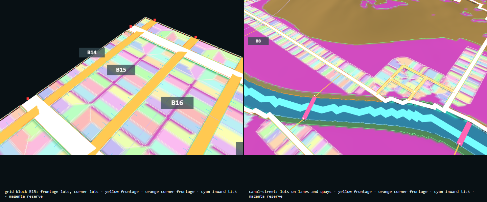
- **Problems found during testing (fixed):** the first lot-cell term ((d2 − d1)/2) is not a metric distance; with the inset it shrank lots to ≈ 7 m width → replaced by the first-order bisector distance (grid utilisation 49% → 86%); corner lots recorded a frontage road they did not reach → frontage is now measured contact on the kept polygon part only; per-lot neighbour evaluation was slow (4.5 s) → foreign samples use only their nearest lot (same shared boundary), now ≈ 2.3 s for grid chunks.
- **Open issues:** organic and canal-street use only 14–22% of buildable land: most of it lies farther than one lot depth from any road (sparse networks), so it stays reserve — not forced into parcels; canal-street lots almost never face water (0–4 canal-facing parcels) because quays sit 8 m inland and the quay–water strip is a waterfront fragment; parcel fills in the 3D view are blurry (4 m vertex colours) while outlines are exact; lot sizes, depths, and courtyard rules are assumptions (research TBD); building envelope inputs are placeholders; grid chunks take ≈ 2.3 s to parcel.
- **Review status:** Pending review.
- **Next single task:** Decide whether interior reserve in organic / canal-street needs secondary access lanes (upstream network) or stays reserve; then define the building envelope rules (setback, coverage, height) for grid parcels.

### 05.1 — Building footprints and grey-box extrusion

- **Date / Stage / Single question:** 2026-10-18 / T6 / Can each valid parcel receive 0 or 1 grey-box building whose footprint follows its road frontage and setbacks, whose height follows the selected DNA, and whose base sits on the terrain without floating or cutting it?
- **Pre-check:** all 04.2 parcels carry a valid polygon, measured frontage lines, a road reference, buildable status, and terrain stats (verified in 04.2); no random point placement was needed.
- **Reused files or functions:** 04.2 parcels (`frontageLines`, `frontages`, `orientation`, `mayBeAdjusted`), `contours`, `label`, `dedupeRing`, `simplifyRing`, `ringsIntersect`, `edgePointLocal` (now exported); `SeededRandom`; three's `ExtrudeGeometry` and `BufferGeometryUtils.mergeGeometries`; ParcelView, network ribbons, debug-view mechanism; verifier helpers.
- **Method:** footprint = contour of a per-parcel local field min(signed distance inside parcel − side setback, distance from frontage line − front setback, max depth − distance from frontage line) at 1 m; footprints not contained (≥ setback − 0.1 m inside, no edge crossing) are recomputed at 0.5 m, then 0.25 m, else the parcel stays vacant. Organic (Fez) parcels ≥ 140 m² use a 4.5 m ring band; the courtyard is kept only if the void is ≥ 12 m², otherwise a solid footprint is used. Occupancy and height jitter use a per-parcel random stream keyed by the parcel id (independent of terrain / network seeds). Height = DNA floor range × clamp(centre gradient around a seeded centre + road class + parcel area, × bounded jitter). Ground: terrain sampled under the footprint (edges every 0.5 m + 1 m lattice); ground floor at the highest point, mesh bottom 0.5 m below the lowest point (plinth); drops > 4 m leave the parcel vacant. One merged mesh for all buildings.
- **Changed files + working-tree state:** new `experiments/seed-terrain/buildingRules.js`, `BuildingGenerator.js`, `BuildingView.js`, `scripts/verify-buildings.mjs`; `ParcelGenerator.js` (exports `edgePointLocal`), `main.js` (building step, "Buildings" view, `buildings()` API), `index.html` (row, legend). Terrain, network, tunnels, blocks, parcels unchanged (04.2 verifier re-run: pass). Uncommitted on `experiment/terrain-seam` (`experiments/seed-terrain/` and `scripts/` untracked).
- **Seed / City DNA / key parameters (all A, research TBD):** seeds 1101 / 2202 / 3303. Grid (manhattanGrid) / plain: occupancy 0.92, floors 3–32 × 3.6 m, max depth 26 m, centre radius 380 m. Organic (fezOrganicCore) / coast: occupancy 0.85, floors 1–4 × 3.2 m, depth 16 m, courtyard ring 4.5 m. Canal-street (veniceWaterNetwork) / river valley: occupancy 0.85, floors 2–6 × 3.3 m, depth 14 m. Side setback 0.4 m, front setback 0 m.
- **Data interface:** `buildings()` → `{ buildings[], vacant[{parcelId, blockId, reason}], stats, signature, rules }`; each building: `id, parcelId, blockId, footprint{polygon, holes}, footprintArea, baseElevation, groundMin, plinthHeight, bottomElevation, height, floorsEstimate, coverageRatio, frontageRoadId, frontageType, orientationDeg, buildingType (streetFrontage | cornerFrontage | courtyard), validationFlags{inTransition, plinth, courtyard, canalFacing, multiPartDropped, refinedResolution}`. Example: grid `B15-P5-H` 330 m², 12 floors / 43.2 m, coverage 0.85, plinth 0.42 m; organic `B0-P0-H` courtyard house, 204 m² with one void, 2 floors, plinth 1.69 m.
- **Entry point + verification method:** `/experiments/seed-terrain/?…&view=buildings[&focus=x,z,distance]`; `node scripts/verify-buildings.mjs` checks footprint validity / orientation / holes, containment in the parcel with setback, chunk bounds, height = floors × floor height within the DNA range, ground contact re-sampled independently (mesh bottom below the lowest ground, floor not below the highest ground, plinth ≤ 4 m), collisions / water / slope / road corridor on stratified 2 m samples, footprint area vs samples (< 2%), occupancy within the density rule, ≥ 3 distinct floor counts, grid p90 / p10 ≥ 1.8, street-wall share, orientation deviation, reproducibility, upstream signatures unchanged.
- **Result + checked data:** 9/9 runs pass with 0 issues; 0 browser errors. Grid: 1,664–1,702 buildings (91–92% of parcels), mean height 60.1–60.5 m (p10 36–40, p50 54, p90 90–94, max 115; 25–26 floor counts), coverage 79% of built parcels (72–73% of all parcels), 236–249 corner buildings. Organic: 517–589 buildings (78–82%), mean 5.1–5.6 m (1–3 floors), coverage 69–71%, 98–132 courtyard houses. Canal-street: 374–436 buildings (79–84%), mean 10.0–10.8 m (2–5 floors), coverage 63–64%. Street-wall share 100% everywhere (footprint within 3.0 m of the road edge); mean axis deviation from frontage 9–14°. Vacant: density rule plus 8–36 narrow footprints per organic / canal run and 1 terrain drop > 4 m.
- **Screenshots:**  
- **Problems found during testing (fixed / explained):** 54 grid footprints crossed sharp parcel corners at 1 m resolution → containment check with finer-grid retry; one organic floor sat below a local ground high point missed by 2 m sampling → 1 m lattice + 0.5 m edge sampling; street-wall share first used an arbitrary 2.0 m threshold (70% on seed 1101, all buildings actually within 2.5 m) → derived 3.0 m threshold from the intended offsets; in-page regeneration used 3-decimal exported heights, so it now only checks that upstream state is untouched (reproducibility comes from reload comparison).
- **Open issues:** grid heights are tall overall (mean ≈ 60 m) — a prototype assumption with no Manhattan measurement yet; organic heights use only 3 floor counts; canal-street buildings almost never face water (0–3 per run) because lots front lanes / quays; courtyard ring is a simplified void; full page rebuild for grid chunks now takes ≈ 5–6 s (blocks + parcels + buildings); no façades, roofs, or materials by scope.
- **Review status:** Pending review.
- **Next single task:** Review DNA height / coverage assumptions against research (Manhattan PLUTO heights first); decide whether pipeline performance needs work before multi-chunk tests.

### 05.1b-1 — Volumetric terrain foundation (closed solid chunk)

- **Date / Stage / Single question:** 2026-10-18 / T6 (tunnel prerequisite) / Can the open terrain surface become a closed, manifold solid (surface + walls + base) without a second terrain, voxels, or any change to heights and downstream interfaces?
- **Reused files or functions:** the rendered surface `PlaneGeometry` (257 × 257, indexed) in `ChunkView` and its vertex positions; fields `height` (sole elevation authority); `checksum`-style hashing; 02.4 evidence for height comparison; verifier helpers.
- **Mesh structure:** surface unchanged (66,049 vertices, 131,072 triangles). Walls: one quad per surface boundary half-edge (edges used by exactly one surface triangle), wound opposite to it, down to a flat base → 1,024 quads; consistent outward orientation by construction. Base: fan from one centre vertex to the 1,024-vertex base ring (a corner fan would create degenerate triangles, since ring points along each side are collinear). Welded result: 67,074 vertices, 201,216 edges, 134,144 faces, Euler characteristic 2. Walls + base are a separate flat-shaded mesh whose top ring copies the surface boundary coordinates bit for bit. Base elevation = min(−60 m, min terrain − 20 m) (A; one common base simplifies later joins and leaves room below roads for tunnels).
- **Changed files + working-tree state:** new `experiments/seed-terrain/TerrainShell.js` (shell builder, closed-mesh check, prism volume), `scripts/verify-solid-terrain.mjs`; `ChunkView.js` (shell mesh, `solidReport`), `main.js` (`?camera=side`, `solid()` API). Terrain generator, heights, water, roads, tunnels, blocks, parcels, buildings unchanged (02.4 and 05.1 verifiers re-run: pass). Uncommitted.
- **Seed / parameters:** plain 1101, river valley 2202, coast 3303, mountain 1101 at variation 0.5; low-elevation coast 1101 and high-relief mountain 3303 at variation 1.0; transition 128 m; base −60 m, min thickness 20 m.
- **Entry point + verification method:** `/experiments/seed-terrain/?landform=…&seed=…[&camera=side]`; `window.__seedTerrainLab.solid()`; `node scripts/verify-solid-terrain.mjs` welds the rendered surface and shell by exact position and checks open / non-manifold / inconsistently oriented edges, degenerate and duplicate faces, Euler characteristic, signed (divergence) volume vs the exact prism volume of the height field, base below terrain by ≥ 20 m, rendered surface y = height field, heights identical to the 02.4 evidence, reproducibility, plus a synthetic terrain dipping to −75 m (base must move to −95 m).
- **Result + checked data:** 6/6 cases + synthetic pass; 0 browser errors. Every case: 0 open, 0 non-manifold, 0 inconsistent edges, 0 degenerate / duplicate faces, χ = 2, volume relative error ≤ 1.4e-14 (positive → outward normals). Terrain vs base: plain 18–28 m (78 m thick), river valley 26–92 m (86 m), coast −10–45 m (50 m), mountain 157–337 m (217 m), low coast −10–60 m (50 m), high mountain 150–471 m (210 m). Heights for the four default cases are identical to 02.4. Synthetic low case: base −95 m, watertight, χ = 2.
- **Screenshots:** 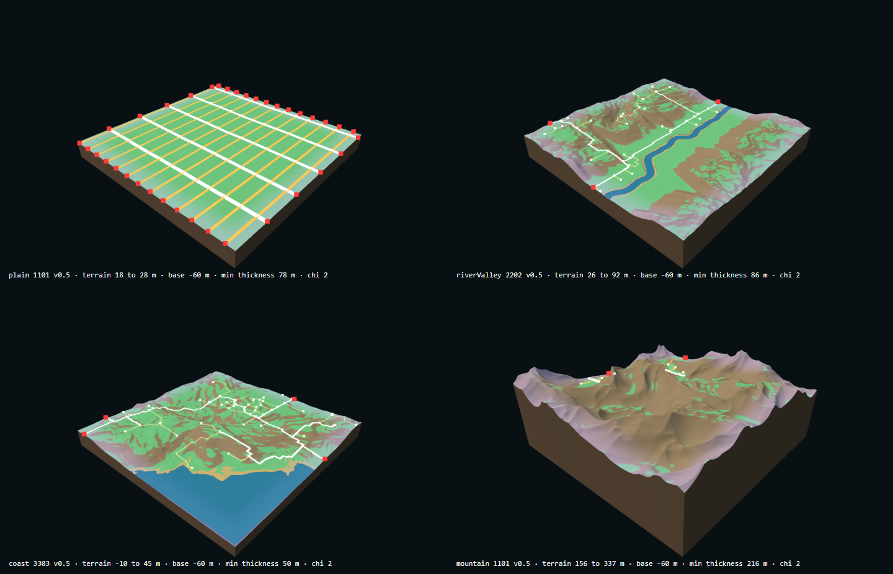 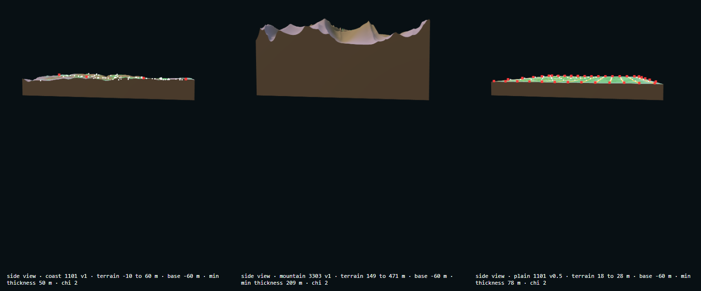
- **Confirmed:** a closed, consistently oriented, manifold solid from the existing surface plus 1,024 wall quads and a base fan; no second terrain, no voxels; all world coordinates and sampling interfaces unchanged.
- **Open issues:** water stays a separate open sheet (the sea is not part of the solid); the debug view is a side camera, not a capped cross-section (a capped cut needs stencil or boolean work — deferred with the tunnel step); the solid exists only as render geometry plus its check, no exported mesh file yet; a common base of −60 m is an assumption that later chunk joins should confirm.
- **Review status:** Pending review.
- **Next single task:** 05.1b-2 — cut real tunnel openings into this solid at the planned portals (local surface re-triangulation + tube), keeping the closed-mesh check passing.

### 05.1b-2 — Tunnel excavation and geometry

- **Date / Stage / Single question:** 2026-10-18 / T6 / Can each valid NetworkGraph tunnel edge become a real excavated passage — open cuts, portal faces, and an arch tube — inside the closed solid, while the solid stays a valid closed manifold and the height field stays untouched?
- **Pre-checks:** 05.1b-1 solid closed (χ = 2, 0 open edges); tunnel edges carry portals, straight plan line, linear road level (grade ≤ 6%), cover profile. Existing tools: no mesh boolean / CSG / SDF-mesh library in the repo (`three-mesh-bvh` is ray acceleration and `webgl-sdf-generator` is text SDF, both pulled in by drei); only `ShapeUtils` (earcut) and the 04.x marching-squares helpers. A global boolean or voxel pass was therefore replaced by local reconstruction.
- **Geometry strategy (local reconstruction):** portal stations sA / sB = first points from each end where ground covers the arch by ≥ 1 m; open cuts [u0, sA] and [sB, u1] = rotated rectangles 12 m wide (9 m tube + 2 × 1.5 m) whose start u0 / end u1 is as far out as ground stays ≥ 0.2 m above the road. Surface triangles crossed by a cut are replaced by T − R from an exact boundary walk (only canonical edge-intersection points and rectangle corners, shared by both neighbours) triangulated with earcut; fully covered triangles are dropped. Each cut is rebuilt as road floor at design level (centroid fan), two vertical side walls and a lip wall (strips from the hole boundary down to road level), and a vertical portal face with an arch notch (earcut on the simple polygon; a zipper triangulation folded under the arch dome and was replaced). The tube is an arch section (9 m wide, 7 m clearance, 2.5 m walls + semicircle) lofted every ≈ 4 m between the portal rings, which are the portal notches themselves. Expected topology: χ = 2 − 2·tunnels; expected volume = prism − cut volume − tube volume (both exact).
- **Rejection rules (tunnel kept in the graph, solid left untouched):** no portal location, tube < 20 m, tube vertex with < 1 m ground above (daylight), cut needing fill or not monotone, cut / tube over water, road < 5 m above the base, cut within 8 m of the chunk edge, portal road > 0.5 m off the ground, open approach > 1.5 m off the ground, overlap with an accepted tunnel's cuts or tube, cut crossing another surface road or a building, per-chunk limit (2).
- **Changed files + working-tree state:** new `experiments/seed-terrain/TunnelGeometry.js`, `scripts/verify-tunnel-excavation.mjs`; `ChunkView.js` (full index kept, cut-aware surface index, rim and tunnel meshes, rim recolouring, `setXray`, tunnel-aware `solidReport`), `TerrainShell.js` (Euler count uses referenced vertices only), `main.js` (tunnel step after buildings with current heights, `tunnels()` API, `?xray=1`, debug handle `__seedTerrainScene`). Network, terrain, parcels, buildings, chunk size, DNA unchanged (05.1b-1, 03.2, 05.1 verifiers re-run: pass). Uncommitted on `experiment/terrain-seam` (37 untracked paths incl. `experiments/seed-terrain/`, `scripts/`).
- **Seed / DNA / parameters (all A):** A — plain 1101 grid, mountain 2202 grid (no tunnels); B — mountain 3303 grid, mountain 1101 organic, mountain 3303 organic (one tunnel each); C — synthetic candidates on mountain 3303 (4 m shifted copy, 60° crossing copy, limit 0); D — tunnel raised 20 m, tunnel across the plain, tunnel from the sea on coast 1101. Width 9 m, clearance 7 m, cut margin 1.5 m, portal cover 1 m, min rock 1 m, min cut depth 0.2 m, ring step 4 m.
- **Entry point + verification method:** `/experiments/seed-terrain/?landform=mountain&seed=3303&dna=manhattanGrid[&xray=1][&focus=x,z,d]`; `window.__seedTerrainLab.tunnels()` and `solid()`; `node scripts/verify-tunnel-excavation.mjs` checks the rendered solid (open / non-manifold / inconsistent edges, degenerate / duplicate faces, χ vs 2 − 2·tunnels, volume vs prism − excavation), through-passage rays at the centre (half clearance) and near both walls from cut start to cut end against every solid triangle, floor at design level, clearance and half-width, cover over tube vertices, patch-edge / surface-triangle crossings, grade change against approach roads, reproducibility, identity with 05.1b-1 when there is no tunnel, and the C / D refusals leaving the solid untouched.
- **Result + checked data:** all checks pass, 0 browser errors. A: 67,074 V / 134,144 F, χ = 2, identical to 05.1b-1. B: 3 tunnels built — mountain 3303 grid: tube 120.5 m, cuts 12.5 / 10.5 m, lips 0.48 / 1.15 m, grade 4.53%, min tube cover 4.5 m; mountain 1101 organic: tube 601.2 m, cuts 14.5 / 11.0 m, lips 0.85 / 0.55 m, grade −0.38%, cover 3.4 m; mountain 3303 organic: tube 123.4 m, cuts 11.5 / 13.5 m, grade 2.52%, cover 4.4 m. Each: χ = 0, 0 open / inconsistent / degenerate, volume error ≤ 5.9e-12, rays blocked 0 / 3, crossings 0, clearance 7 m, floor at design level. C: real accepted, 4 m copy rejected (intersects tunnel real), 60° copy rejected (cut would need fill), limit 0 rejects. D: raised (portal road 20 m off the ground), plain (no portal location), sea (portal road 0.6 m off the ground) — all rejected with nothing cut. Geometry time ≈ 25–30 ms per tunnel.
- **Screenshots:**  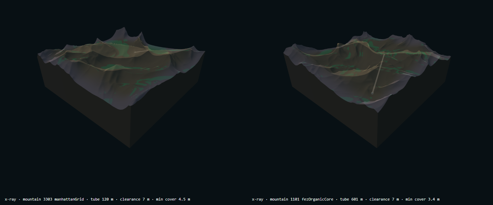
- **Problems found during testing (fixed):** zipper portal triangulation folded under the arch (8–10 inconsistent edges) → earcut on the portal polygon; a tunnel raised 20 m above the ground was accepted because portals were only searched inside the hill → portal ground-contact and open-approach rules; tunnel rebuild first ran before the new seed's heights were written → ordering fixed; Euler count included cut-away grid vertices → counts referenced vertices only.
- **Open issues:** grade change at portals reaches 12.8–19.0% (15% mountain approach roads meet 0.4–4.5% tunnels) — reported, not enforced; the water rule was not exercised by scenario D (the sea candidate failed ground contact first); lips of 0.25–1.15 m remain where the open cut starts (a step, not a ramp); minimum tube cover inside the portal zones is 3.4–4.5 m (the 10 m rule applies only beyond 30 m); portal close-ups at 70 m height show the cut and arch only partly (no near-ground camera); no portal frame / lining / lighting by scope; the 60° crossing candidate was rejected by its own cut rule, so a geometric crossing between two otherwise valid tunnels was not directly exercised.
- **Review status:** Pending review.
- **Next single task:** Decide whether portal grade transitions need vertical curves on the approach roads (03.2 rule change) before any visual polish of portals.

### 06.1 — City DNA 3 → 6 (Chicago, Amsterdam, Lisbon by configuration)

- **Date / Stage / Single question:** 2026-10-18 / T3–T6 / Can three more cities (Chicago, Amsterdam, Lisbon) be added purely as City DNA configuration on the existing Grid / Organic / Canal-Street strategies, selectable manually and in auto-match, while the original three DNAs and all upstream terrain stay bit-identical?
- **Pre-checks:** schema = `CITY_DNA` (conditions, conflicts, hints) + `DNA_STRATEGY` + `PARCEL_RULES.byDNA` + `BUILDING_RULES.byDNA`; the network read `STRATEGIES[strategy]` only, so a per-DNA parameter variant was impossible without one hook. Research available: longlist rows 02 Amsterdam (F1), 10 Chicago (F2), 35 Lisbon (F6) — candidate features only, all "to be verified", no study, no source anchor, no research-template row. Baseline of the original DNAs recorded first (`city-dna-baseline.json`, 36 runs).
- **Changes:** `networkStrategies.js` — 3 `DNA_STRATEGY` entries, `DNA_NETWORK_OVERRIDES`, `strategyParams(dna)` (strategy defaults + one-level merge); `NetworkGenerator.js` — params from `strategyParams`, optional `fixedAxisDeg` in the grid strategy (2 lines); `BlockGenerator.js` — expected grid block for any grid-strategy DNA (informational stat); `cityMatchRules.js` — 3 DNA entries with conditions / conflicts / hints and a new `unsupported` list, order extended to 6; `CityMatcher.js` — two report strings; `parcelRules.js`, `buildingRules.js` — 3 `byDNA` entries; `scripts/verify-city-match.mjs` — 6 DNAs, Amsterdam no-water check; new `scripts/verify-city-dna.mjs`. No new generator, no terrain / tunnel / chunk / transition change. The selector lists DNAs from `CITY_DNA`, so no UI code changed.
- **New DNA configs (all numbers A; "src TBD" = commonly cited figure without a registered source):**
  - `chicagoGrid` (Grid): 200 × 100 m spacing, widths 30 / 20 m, fixed cardinal axis 0°, bridges on every street (span ≤ 120 m); lots 7.6 × 38 m (25 × 125 ft, src TBD); 2–45 floors, centre weight 0.9, radius 220 m (tight tower core). Match: continuous land (w3), flat land (w2), water crossing the grid (w2: splitsLand 1 / boundaryOnly 0.6 / none 0.3), 2 TBD.
  - `amsterdamCanalRing` (Canal-Street): canal width 20 m, bridges every 120 m (Venice 260), 24 lanes, max slope 10°, loop close share 0.85; lots 7 m × 30 m deep; 3–5 floors, occupancy 0.95, building depth 18 m. Match: water fraction ramp 0.03–0.2 (w3), flat land (w2), land split by water (w1), 2 TBD (ring canals, widths); no-water conflict cap 0.
  - `lisbonHillCore` (Organic): 5 hill centres, slope penalty 1.5 + climb penalty 2 (contour-following lanes), 32 lanes, valley primary 10 m; lots 8 m, depth 18 m; 3–6 floors, street-driven height. Match: mixed-slope share ramp 0.4–0.8 (w2), buildable core (w1), water as edge (w1), 2 TBD (hill count, valley axis).
- **Unsupported (recorded in `CITY_DNA.*.unsupported`, not faked):** Chicago — mid-block alleys, height peaks at transit nodes, lake vs river edge, diagonal arterials. Amsterdam — concentric ring canals (would need canals written into the height field = upstream change), canal-facing perpendicular lots, back gardens. Lisbon — stairs / funiculars, orthogonal Baixa grid in the valley, hill-top centres / viewpoints, terraced platforms.
- **Seed / parameters / method:** 4 landforms × seeds 1101 / 2202 / 3303 × 6 DNAs = 72 runs via manual `selectDNA` on one loaded terrain; variation 0.5, transition 128 m. Shared terrain for the visual comparison: coast 1101. Suitable terrain per DNA = test terrain with the highest rankScore (data, not hand-picked). `node scripts/verify-city-dna.mjs [baseline]` checks config validity, selection / GUI label / strategy / network params / parcel + building rule = config, terrain signatures unchanged by a city switch, ranking unchanged by a manual switch, fresh `?dna=` load = switch result, switch-back stability, and baseline regression.
- **Result:** 72 / 72 runs ok and non-empty; 0 invalid blocks; 0 browser errors; mean rebuild 2.0 s (max 4.7 s, Chicago on plain). Original DNAs 36 / 36 bit-identical to the baseline (network, blocks, parcels, buildings signatures). Reproducibility 6 / 6; switch-back stable. All 13 seed-terrain verifiers re-run: pass. Auto-match change: 1 of 12 (coast 3303 Fez 0.40 → Lisbon 0.46); plain still Manhattan; mountain weak for all 6. Chicago and Amsterdam never win auto-match on the 12 test terrains (best: plain 1101 0.62 and coast 1101 0.31) — the landform set has no flat land with a river or canal belt.
- **Shared terrain (coast 1101):** Manhattan 7.34 km road, 8 blocks, 585 parcels, 529 buildings, mean 57 m, FAR 4.5; Chicago 6.64 km, axis 0° (vs 19.9°), 10 blocks, 536 parcels (6.9 m frontage, 33.5 m deep), 468 buildings, p50 22.8 m / p90 98.8 m / max 163 m, FAR 1.45; Venice 5.21 km, 438 buildings, mean 10.3 m; Amsterdam 5.68 km, 564 parcels (6.3 m frontage), 513 buildings, 2 distinct heights (10.2 / 13.6 m), FAR 0.32; Fez 6.12 km, 589 buildings, 132 courtyards, mean 5.6 m; Lisbon 7.06 km, 37 junctions, 1001 parcels, 866 buildings, mean 11.9 m, FAR 0.49. Bridges on river valleys: Chicago 1–3 (Manhattan 0), Amsterdam 5–9 (Venice 4–5).
- **Similarity to the sibling DNA (median relative difference of 13 metrics):** Chicago 0.07–0.32, Amsterdam 0.01–0.28, Lisbon 0.14–0.28. Low-difference cases (< 0.1), with causes measured: Amsterdam vs Venice on mountain 1101 (0.01) — no water, so canals, quays, and bridges never run; the remaining lane routine produces identical roads (primary 630 m, mountain road 1912 m); only lots and heights differ. Chicago vs Manhattan on mountain 1101 (0.10) and coast 2202 (0.07) — the land mask truncates 103 / 115 (coast 2202) and 115 / 115 (mountain 1101) grid lines, so road length follows the buildable area (coast 2202: 5.44 vs 5.52 km), not the spacing; parcels and heights still differ by 30–75%. No decoration was added to separate them.
- **Screenshots:**  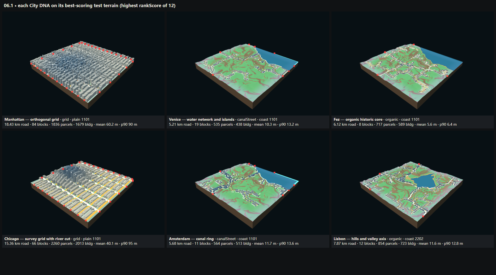 Evidence: `experiments/seed-terrain/evidence/city-dna-comparison.json`, `city-dna-baseline.json`.
- **Problems found during testing (fixed):** verifier read `network.meta` (meta is spread onto the graph) and `parcels.rules.byDNA` (stored as `rules.target`); one 404 from the composed screenshot page's favicon.
- **Open issues:** every new threshold is A and the three cities have no research row or source anchor; Amsterdam's identity rule A1 (ring canals) is absent from the output; Chicago's tower core is a seeded point, not a transit node; Lisbon's lanes are climb-averse least-cost paths, not checked against real contour alignment; canal-facing lots remain rare for both canal DNAs (0–2 per chunk).
- **Review status:** Pending review.
- **Next single task:** Decide whether a terrain-side rule (river through a plain; canal belt) is needed so Chicago and Amsterdam can be auto-selected, or keep them manual-only.

### 06.2 — World Grid and city placement (3 × 3 chunks)

- **Date / Stage / Single question:** 2026-10-18 / T7 preparation / Can nine fixed chunks share one world frame, each running the unchanged single-chunk chain with its own derived terrain seed and a user-chosen City ID, so that editing one slot rebuilds only that slot's invalidated layers, while seams are measured but not hidden?
- **Concepts kept apart:** chunk = fixed 1024 m computation unit at a fixed grid coordinate; cityId = user identity choice per slot (`null` empty / `'auto'` / a `CITY_DNA` key); city influence = future cross-chunk field, not implemented (no expansion, no network blending).
- **Pre-checks:** downstream generators always offset by `fields.grid.originX/Z`; `ChunkView` built its plane at (0, 0) and tunnel cutting combines those surface vertices with world-coordinate portals, so it assumed origin 0. The landform rules sample absolute coordinates (river centred near x = 0, coast potential linear in x / z), so sampling a chunk at x ∈ [512, 1536] would lose its river or coast.
- **Placement decision:** each chunk is generated in the chunk-local frame (origin 0, exactly as the single-chunk page) and placed by translating its grid origin before `deriveFields`, so every downstream layer is in world coordinates. Consequence (accepted, measured): same-seed noise is not continued across chunks. Terrain algorithm untouched.
- **World Grid data structure:** `createWorldConfig` → `{ version, worldSeed, transitionWidth, variation, chunkSize, slots[9] }`; slot = `{ chunkId: 'chunk_<gx>_<gy>', gridX, gridY ∈ {−1, 0, 1}, worldOrigin: { x: gx·1024, z: gy·1024 }, landform, terrainSeed, cityId, cityMode }`; `terrainSeed = 1 + hash('world-grid-terrain', worldSeed, gridX, gridY, landform) mod 9999` (slot order never enters the hash). Runtime `WorldGrid`: per chunk `terrain` layer (key = landform, seed, variation, transition, origin) and `city` layer (key = terrain key + cityId), status, build counters; `dirty()` lists invalidated layers; `build(chunkId)` reruns only those. Saved form = `serialiseWorld` (worldSeed, transition, variation, per slot landform / cityId / terrainSeed); `restoreWorld` re-derives seeds and rejects a saved seed that does not match.
- **Changed files + working-tree state:** new `experiments/world-grid/` (`worldConfig.js`, `WorldGrid.js`, `SeamCheck.js`, `SeamView.js`, `main.js`, `index.html`, `evidence/world-grid.json`), new `scripts/verify-world-grid.mjs`; `experiments/seed-terrain/ChunkView.js` — terrain plane translated to the grid origin when it is non-zero (origin 0 path unchanged). No change to terrain, analysis, matching, network, blocks, parcels, buildings, tunnels (`TunnelPlanner.js`, `TunnelGeometry.js`, `TerrainShell.js`), chunk size, or transition. Single-chunk verifiers re-run after the change: seed-terrain, solid-terrain, tunnels, tunnel-excavation pass. Uncommitted on `experiment/terrain-seam` (HEAD a38c73d; `experiments/seed-terrain/`, `experiments/world-grid/`, `scripts/` untracked).
- **World configuration tested (world seed 6201, variation 0.5, transition 128 m):** row gy = −1: mountain 5704 empty · mountain 2264 auto → Fez · river valley 9187 Fez; gy = 0: plain 5718 Chicago · plain 2085 Manhattan · river valley 2361 auto → Fez; gy = 1: coast 1385 Amsterdam · coast 3051 auto → Lisbon · coast 6678 Lisbon. Tunnel cases: chunk_0_-1 (mountain, origin x 0 / z −1024) set to Chicago in world seeds 6203 (terrain seed 5326) and 6202 (terrain seed 7922); the default world produces no accepted tunnel (one candidate in world seed 6204 is rejected by the 05.1b-2 approach rule at origin 0 as well).
- **Interaction:** oblique view of the whole 3 × 3 world (`?camera=top` for plan, `?focus=x,z,d` close-up); click a chunk (or the Selected chunk list) to select it (yellow outline); City ID list = Empty slot / Auto / every `CITY_DNA` label (from the database, not hard-coded); panel shows chunk id, grid, origin, landform, terrain seed, cityId → resolved DNA, status, layer counts, stage times, and the measured state of each of its edges; Save / Restore city config (localStorage + `__worldGridLab.save / restore`); Seam debug layer (`?seams=1`). Each chunk carries a label `chunkId · landform` / `DNA · seed`.
- **Verification:** `node scripts/verify-world-grid.mjs` — placement (data origin = gridX · 1024, mesh bounds error < 1 mm, overlap 0, covered area = 3072²), seed formula and slot independence (editing chunk_1_1's landform changes only chunk_1_1's seed; a new world seed changes all 9), three slot states and ≥ 4 DNAs, cityId = resolved DNA for manual / = auto top for auto / no city layers for empty, 12 shared edges + 4 interior corners coincide (position error 0, 257 samples in the same increasing order, equal transition widths), one City ID change (chunk_1_0 → Amsterdam) rebuilds only that chunk's city layer with its terrain signatures unchanged and the other 8 summaries identical, GUI / panel label = DNA label, empty → Manhattan reproduces the original signatures, save → edit two slots → restore = saved config and saved signatures, tampered seed rejected, all 9 solids closed, tunnel at a non-zero origin = same chunk at origin 0, reload identical, centre chunk = single-chunk page bit-identical, every placed chunk = its origin-0 generation (heights, counts).
- **Result:** all checks pass, 0 browser errors. Centre chunk signatures (height, water, network, blocks, parcels, buildings) identical to `seed-terrain/?landform=plain&seed=2085&dna=manhattanGrid`; 7 / 7 placed city chunks have identical heights and identical block / parcel / building / port counts to their origin-0 generation. Tunnel at a non-zero origin (6203): 1 tunnel accepted, solid watertight, χ = 0, excavated 15,307 m³ = origin-0 result (relative difference 1e-14). All 9 default chunks closed (χ = 2, no tunnels).
- **Performance (3 runs):** first full world build 18.3–21.8 s data + render for 9 chunks (one at a time, the page stays responsive between chunks); per chunk: terrain 75–120 ms, city 1.1–5.2 s (grid plains slowest: parcels 2.3–2.7 s), render 90–210 ms; empty slot 0.2 s; one City ID change 2.3–3.2 s (one chunk, city layer only); restore of two changed slots 5.5–7.1 s; reload ≈ 18 s; JS heap 338–382 MB. No simplified distant view was needed.
- **Seams (detection only, nothing flattened):** all 12 shared edges have height discontinuities (|Δh| max 5.2 m plain | plain … 296 m mountain | plain; mean 2.3–227 m); one-sided water on 6 / 12 edges (e.g. river valley | coast 257 / 257 samples, coast | coast 146 + 111 shared); edge ports: 7 paired by position on 2 edges (plain | plain Chicago–Manhattan: 6 pairs, all offset 9.5 m, 3 with elevation difference > 2 m, up to 5.1 m), 9 edges flagged (unpaired or elevation mismatch; e.g. plain | mountain 12 unpaired), 2 edges n/a (empty slot), 1 edge without ports; interior corner height spread 25–251 m. Expected: chunks have independent seeds and landforms and no neighbour constraint is applied yet (`applyNeighborConstraints` stays the reserved interface).
- **Screenshots:** 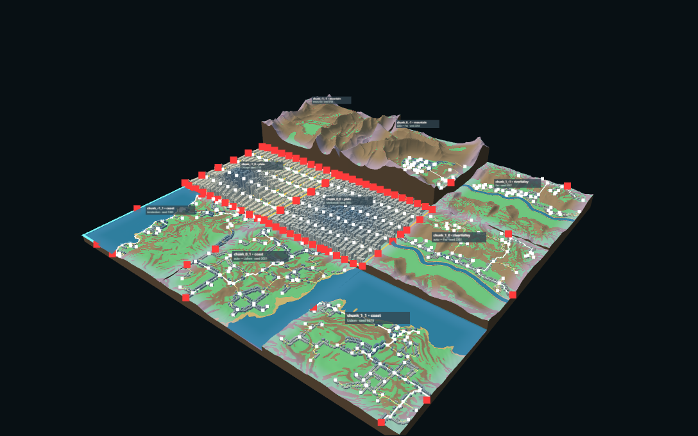  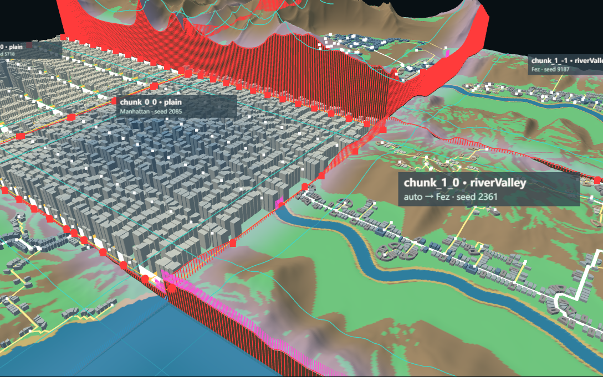 Evidence: `experiments/world-grid/evidence/world-grid.json`.
- **Problems found during testing (fixed):** canvas rendered at the default 300 × 150 (shared CSS sizes `#terrainCanvas` only) → own canvas rule; plan-view seam capture could not show height steps → `?focus` oblique close-up.
- **Defect found in a frozen system (not fixed, reported):** on mountain terrain seed 7922 with Chicago grid, the 05.1b-2 tunnel geometry accepts tunnel 8 but the cut solid is not closed — 6 non-manifold / 6 inconsistent edges, 8 degenerate and 3 duplicate faces, χ = 6 (expected 0), trench volume NaN. Reproduced identically on the single-chunk page at origin 0 (`seed-terrain/?landform=mountain&seed=7922&dna=chicagoGrid`), so it is a pre-existing 05.1b-2 issue exposed by a new terrain / DNA combination, not a world-placement effect. Tunnel system left unchanged per the 06.2 scope.
- **Open issues:** seams everywhere (expected; blending / neighbour constraints not started); landforms sample a chunk-local frame, so the world is a mosaic, not one continuous terrain; NetworkView's edge-port and node markers are sized for one chunk and clutter the world view; first build 18 s with nine full chunks (sequential, main thread; no worker); the default world produces no tunnel (covered by the 6204 case); outer world edges are not checked; the City ID list shows long DNA labels truncated in the 330 px panel.
- **Review status:** Pending review.
- **Next single task:** Define the neighbour constraint for one shared edge (height + water + port pairing through `applyNeighborConstraints` / port `redirect`) and measure it on the plain | plain edge before any city influence.

### 06.3a — Multi-chunk terrain and water seam (3 × 3 world)

- **Date / Stage / Single question:** 2026-10-19 / T7 / Can adjacent chunks of the 3 × 3 world get one continuous, reproducible terrain surface and consistent water at shared edges — inside the existing transition bands, without hiding seams — and where that is impossible, is the reason measured and reported?
- **Pre-checks / reuse:** `experiments/terrain-seam` + `flavor-clash-prototype/generation/TerrainGenerator.js` blend two continuous height functions across a band (`connectedTransitionHeight`, smoothstep) — the principle is reused (shared target, smoothstep weight inside the band), but chunks here are discrete 257² fields whose neighbour has no data inside the other chunk, so the blend is applied as a per-chunk correction field. Reused unchanged: `edgeWeight` (TerrainFields), `deriveFields`, `analyseTerrain`, the whole city chain, `ChunkView` shell / tunnel rebuild, `boundarySamples`, `NetworkGraph.edgePorts`. 06.2 seams (world seed 6201): 12 / 12 edges with height steps (5.2–296 m), 6 one-sided water edges, interior corner spread 25–251 m.
- **Algorithm (`experiments/world-grid/TerrainHarmonizer.js`):**
  - Raw height fields are never modified; harmonisation produces a separate height and water-level field per chunk (layer `harmony` between `raw` and `terrain`).
  - Per shared edge (A | B, identical 257 samples): joint target T(i) = (hA + hB) / 2, blended at both ends to the corner target of its corner group; slope target S(i) = −(sA + sB) / 2 (raw inward first differences) plus a term that cancels the discrete first difference of the corner ramp.
  - Each side gets D(i)·w(d) + S(i)·b(d) inside its own transition band (w = 1 − smoothstep(0, W, d), the existing edge weight; b(d) = d (1 − d/W)², normalised so the first difference at the edge equals S). Corners use a Coons boolean sum of the four edge terms (value Dc, slopes S1c, S2c, zero twist), so an active edge keeps its exact target inside the corner square. Edge samples are finally set to T(i): both chunks hold the identical Float32 value.
  - Corner groups: chunks meeting at a point are grouped through active edges; each group gets the mean of its members' raw corner heights (an unresolvable neighbour never pulls a joinable edge toward its height).
  - Resolution: a cell is "made steep" if its harmonised slope > 35° (A, ≈ angle of repose) and > raw slope + 2°. Each edge is first tested alone: slope-matched (C¹) join → if made steep, height-only (C⁰) join → if still made steep, unresolved. Then all surviving edges together; a blamed edge drops C¹, then is deactivated; repeated until no made-steep cell remains. An unresolved edge keeps its raw step (no wall is generated, the band is not widened).
  - Water: connected flooding only — from each chunk's raw water cells (sea level or local river surface) through band cells below level + freeboard; sea crosses an edge only where the neighbour's edge sample lies below sea level (+ freeboard) and only into that edge's band; rivers never continue into a neighbour without a channel; band cells lowered below a raw river surface but not connected stay dry (no fake lakes). Outside the bands the water level equals the raw one. Then `deriveFields` recomputes slope, waterMask, buildableMask, boundarySamples; `analyseTerrain` recomputes the analysis.
  - Deterministic and order-independent: canonical chunk order, simultaneous edge exchange rounds; independent of City ID.
- **Changed files + working-tree state:** new `experiments/world-grid/TerrainHarmonizer.js`, `scripts/verify-world-seam.mjs`, `experiments/world-grid/evidence/world-seam.json`; changed `experiments/world-grid/WorldGrid.js` (raw → harmony → terrain → city layers with keys; raw-vs-harmonised difference), `worldConfig.js` (`terrainMode` 'harmonized' | 'raw'), `SeamCheck.js` (slope kink, band slope, water-interface classification), `SeamView.js` (edge status, band limits, water state), `main.js` (Terrain mode + Transition width controls, harmonisation step, tunnel isolation, lab checks), `index.html` (legend), `scripts/verify-world-grid.mjs` (06.2 checks run with `terrain=raw`). No change to `experiments/seed-terrain/` (terrain generator, City DNA, network, parcels, buildings, tunnels), grid positions, or chunk size. Uncommitted on `experiment/terrain-seam` (HEAD a38c73d; `experiments/world-grid/`, `experiments/seed-terrain/`, `scripts/` untracked).
- **Parameters:** world seeds 6201 / 6202 / 6203; transition width 128 m (also 64 and 256 m on 6201); variation 0.5; maxTransitionSlopeDeg 35, createdSlopeMargin 2°, water level tolerance 1 m, freeboard 1 m, 2 sea-exchange rounds.
- **Entry point + method:** `/experiments/world-grid/` (harmonised, default) and `?terrain=raw` (06.2); `?seams=1` debug; GUI Terrain + Transition width. `node scripts/verify-world-seam.mjs` checks every shared edge (positions, Δh, bilinear sampler at off-grid points, rendered vertex normals, slope kink, band slope), corners, made-steep cells, cells changed outside the band, rendered mesh = fields, all 9 solids closed, water interfaces vs the raw world, City ID switch without terrain rebuild, input-order independence (reversed / rotated input), reload identity, transition widths 64 / 256 / 128 with stale-layer check, three world seeds, and the known tunnel failure; `node scripts/verify-world-grid.mjs` re-checks 06.2 in raw mode.
- **Result (6201, W 128):** all checks pass, 0 browser errors. 4 / 12 edges joined (all C¹): plain | plain (raw step 5.2 m), plain | coast ×2 (34.1, 26.0 m), coast | coast (17.5 m) — Δh 0 at all 257 samples (identical Float32 values), bilinear sampler difference 0 at off-grid points, rendered mesh = fields (height and plan error 0). Slope kink across joined edges: median 0.000°, max 8.6° (within ≈ 45 m of the closed corner, where the Coons corner terms cannot meet both slope targets); rendered vertex normals across joined edges: median 0.06–1.0°, max 8.9°. No cell made steeper than 35° by the join (band max 34.3°, raw relief included). 8 / 12 edges unresolved, each already when tested alone: 4 mountain edges (raw steps 164–296 m; the join would create 73–74° slopes), river valley | mountain (25.3 m, 37.5° in 7 cells), plain | river valley (53.9 m, 44° in 29 cells), river valley | coast (100.9 m, 51.3°), coast | coast (47.1 m, 40.6° in 39 cells) — they keep their raw step and are drawn red. Corners: 1 / 4 closed (x −512 / z 512, spread 25.3 → 0 m); the 3 others stay open (spread 248, 211, 74.5 m; 3–4 corner groups). Changed cells: 23.4% of each joined chunk, only inside the band (0 outside); max height change 17.7 m, mean 1.6–2.5 m. All 9 solids closed (χ 2, volume error < 1e-6).
- **Water (6201):** raw one-sided edges 6 → 4. Resolved (2): plain | coast chunk_-1_0 | chunk_-1_1 (60 one-sided samples) and plain | coast chunk_0_0 | chunk_0_1 (9) — the joined edge lies above sea level, the shore moved inside the coast band (wet cells 20 850 → 19 585 and 11 040 → 10 660), both sides now dry at the edge. Retained (4), all on unresolved terrain edges, with the water bodies named: river 31 m | mountain without water (8), river 29 m | plain without water (9), sea 0 m | river valley with river level 29–31 m (257 — incompatible levels: the river would have to drop ≈ 30 m), sea 0 m | sea 0 m on coast | coast (169; levels compatible, terrain step 47 m blocks the join; 146 one-sided in the raw world, 23 more after the neighbouring joins changed chunk_0_1's corner band). No river channel was generated across an edge. Other seeds also show river 29 m | river 31 m (6203, level step) and river 31 m | sea 0 m (6202).
- **Widths and seeds:** 6201: W 64 → 5 / 12 joined (river valley | mountain joins C⁰; band slope 36.6°), W 128 → 4 / 12, W 256 → 5 / 12 (coast | coast joins C⁰, coast | coast 17.5 m drops to C⁰; band slope 44.5°); water discontinuous 4 / 4 / 3. Wider is not always better: a wider band also spreads the slope-matching term over more existing relief. Seeds at W 128 (raw → harmonised): 6201 joined 4 (4 C¹), water edges 6 → 4; 6202 joined 6 (4 C¹, 2 C⁰), water 3 → 2; 6203 joined 4 (3 C¹, 1 C⁰), water 6 → 3. Max seam step on joined edges 0 m in every run; max seam step overall unchanged (296 / 315 / 293 m, all on unresolved mountain edges). Edges joined C⁰ keep a slope kink (6202 max 41.8°, 6203 24.3°); interior corners closed 1 / 4 in every seed.
- **Architecture checks:** City ID change (chunk_0_1 → Amsterdam): harmonisation not re-run, 0 raw rebuilds, 1 chunk city layer only, all terrain signatures unchanged. Reversed and rotated input → identical output checksums. Reload → identical signatures and edge report. Transition-width change rebuilds terrain and every city layer (no stale roads / parcels / buildings); raw layers are reused. Raw fields unchanged (raw checksums identical to the raw world). Downstream effect: chunk_0_1 (cityId 'auto') changes its auto-matched DNA from Lisbon to Manhattan because the harmonised terrain changes its terrainAnalysis; manual City IDs are unaffected.
- **Tunnels:** the existing 05.1b-2 flow re-cuts tunnels from the current network on the harmonised fields. Known failure (world seed 6202, chunk_0_-1, Chicago, tunnel 8: 6 non-manifold / 6 inconsistent edges, χ 6) is detected after the cut and isolated — cut removed, tunnel edge kept in the network data, solid closed (χ 2), reported in the panel and `tunnelIsolation()`; the valid case (6203) keeps its tunnel (χ 0). Tunnel algorithm not changed.
- **Performance:** harmonisation of the whole world 0.54–0.64 s (one pass + edge screening, main thread); full world build raw 22.3–24.1 s vs harmonised 21.6–24.5 s (difference within run-to-run noise, < 1 s); transition-width change rebuilds the whole world in 21–24 s (all terrain + city layers, raw layers cached); City ID change 4.0 s (one chunk, no harmonisation).
- **Screenshots:**  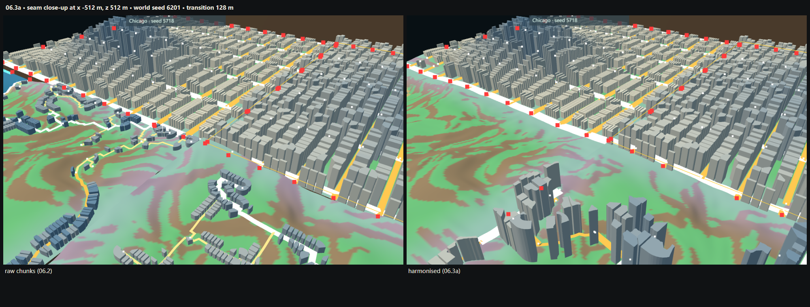  Evidence: `experiments/world-grid/evidence/world-seam.json`.
- **Problems found during testing (fixed):** the 4-chunk corner target averaged mountain heights into a 5 m plain | plain edge, which then failed the slope rule → corner groups through active edges + each edge screened alone first; slope matching transplanted steep raw banks across the edge and blocked otherwise joinable edges → C¹ first, C⁰ fallback per edge; first-difference kink from the corner ramp → compensated in S.
- **Unresolved seam issues:** (1) 8 / 12 edges in world 6201 cannot be joined within 32–256 m without slopes > 35°: every mountain edge (raw steps 116–315 m across seeds) and the river-valley edges with steep banks; (2) only 1 of 4 interior corners closes per seed; open corners keep 74–255 m spreads; (3) slope continuity is not achieved on C⁰ edges (kink up to 41.8°) or within ≈ 45 m of closed corners (up to 8.6°); rendered normals differ by up to 8.9° at joined edges because each chunk computes its own vertex normals; (4) water stays discontinuous on unresolved edges and where levels are incompatible (river ≈ 30 m vs sea 0 m; river 29 vs 31 m); rivers end at chunk edges where the neighbour has no channel; (5) edge ports are not paired or redirected (out of scope); (6) the outer world edge is not harmonised; (7) the known tunnel failure (6202 / chunk_0_-1 / Chicago) is isolated, not fixed.
- **Review status:** Pending review.
- **Next single task:** Decide how unresolvable edges are handled (wider band by explicit user choice, a landform-compatibility rule at slot assignment, or a dedicated escarpment / shore rule) before any city-network join across edges.

### M01 — Procedural Mini World midterm release (Firebase Hosting)

- **Date / Stage / Single question:** 2026-10-19 / release (no stage change) / Can the locally verified Procedural Mini World be published to the existing Firebase Hosting site and be confirmed working at the public URL?
- **Target (confirmed, nothing created):** Firebase project `gameeeee-zc626` (`.firebaserc` default); the only Hosting site `gameeeee-zc626`; public dir `dist` (`firebase.json`); build `npm run build` (Vite). CI deploys `live` on push to `main` (`.github/workflows/firebase-hosting-merge.yml`); this release was deployed locally with `firebase deploy --only hosting` (firebase-tools 15.31.0), so `main` was not pushed and Firestore rules / Authentication / Storage were not touched.
- **Pre-release finding:** the live site (released 2026-09-28 23:14:19, entry `/assets/main-D55VH64K.js`) did not contain Procedural Mini World — `seed-terrain` and `world-grid` were not Vite inputs, and `/experiments/world-grid/` fell through the SPA rewrite to the hub page.
- **Changed files (release only, no generator change):** `vite.config.js` (+ `seedTerrain`, `worldGrid` inputs); `site.js` (+ `miniWorld` → `experiments/world-grid/`, `seedTerrain` → `experiments/seed-terrain/` sections); `index.html` (+ "Mini World" nav link). During the task an external process replaced the working-tree `index.html` with the old R3F scene from commit 221f957; with the user's approval it was rebuilt from the hub version read earlier in the session plus the nav link.
- **Release snapshot:** tag `release/m01-2026-10-19` → commit `7b21c3e` (parent HEAD `a38c73d`), built from a temporary index: the full working tree of `experiment/terrain-seam` at deploy time except `*.glb`, `*.fbx` (≈ 390 MB of untracked terrain-seam models, not in the build) and `.firebase/`. Not on any branch, not pushed; working tree, index, and branch unchanged.
- **Build / tests:** `npm run build` ok (6.8 s, 255 files, 5.8 MB; chunk-size warnings only: three.module 705 kB, firebase 533 kB). `verify-world-grid` pass (147 s), `verify-world-seam` pass (321 s), `verify-city-dna` pass (218 s), `verify-seed-terrain` pass (143 s), `verify-flavor-clash` pass. `verify-markdown-links` fails on 20 pre-existing targets, all in `docs/projects/flavor-clash/terrain-seam-building-scatter.md` (missing `flavor-clash/terrain-seam-buildings/2026-10-13-*` screenshot folders) — unrelated to this release, not changed.
- **Deploy:** 2026-10-19 21:42:54–21:43:22 −0400, message "M01 Procedural Mini World midterm (tag release/m01-2026-10-19, 7b21c3e)"; `live` release time 2026-10-19 21:43:20. Public URL: <https://gameeeee-zc626.web.app/#miniWorld> (direct pages `/experiments/world-grid/`, `/experiments/seed-terrain/`).
- **Online verification (Playwright + system Chrome against the public URL, same script run first on `vite preview` of `dist`; 11 / 11 checks pass in both):** `/`, `/experiments/world-grid/`, `/experiments/seed-terrain/` return 200 with their own entry scripts (live hub entry now `/assets/main-CIzbo2qH.js`), JS assets served as JavaScript; 22 / 22 browser requests 200, 0 console / page errors; hub `#miniWorld` opens the world-grid iframe; 3 × 3 World Grid (world seed 6201, W 128 m, harmonised) reaches READY in 17.2 s — 9 / 9 chunks ready, 4 / 12 edges joined, 1 / 4 corners closed, 6 resolved DNAs incl. Chicago, Manhattan, Fez, Lisbon, Amsterdam; City ID switch chunk_1_0 Fez → Amsterdam rebuilds one chunk in 2.3 s with height signature unchanged (725 buildings); `?worldSeed=6202` yields different terrain seeds; single chunk `?landform=plain&seed=2085&dna=manhattanGrid` generates (1619 buildings).
- **Screenshots:** 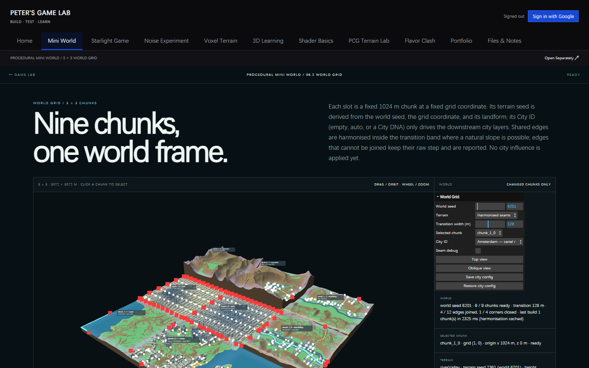 world seed 6201, transition 128 m, harmonised terrain, chunk_1_0 City ID amsterdamCanalRing, 1600 × 1000.
- **Rollback:** previous live version cloned to preview channel `m01-rollback` (<https://gameeeee-zc626--m01-rollback-tyjrl79u.web.app>, expires 2026-10-26 21:32:32); it also stays in Firebase Console → Hosting → Release history (roll back from there, or redeploy the 2026-09-28 tree).
- **Known limitations:** first world build ≈ 17 s on the main thread (no worker); open seams and corners as recorded in 06.3a; known 05.1b-2 tunnel defect (world seed 6202 / chunk_0_-1 / Chicago) isolated, not fixed; Amsterdam on chunk_-1_1 (coast 1385) produces 0 buildings in the default world; Google sign-in on the hub not re-tested in this task; the deployed source is not on `main`, so the next push to `main` will redeploy whatever `main` contains (currently the older hub without Mini World).
- **Review status:** Pending review.
- **Next single task:** Decide whether the release source goes to `main` (so CI deployments keep Procedural Mini World) — requires an explicit commit / merge instruction.

### M02 — GitHub midterm knowledge base

- **Date / Stage / Single question:** 2026-10-19 / documentation (no stage change) / Can a first-time reader of the GitHub repository understand the project, how to run it, its past experiments, and its current results within about three minutes, without duplicating long documents?
- **Changed files:** `README.md` (rewritten for Procedural Mini World: concept, research question, status, live link, run steps, knowledge-base entry, screenshot, limitations; earlier Game Lab work condensed to links); new [EXPERIMENT-INDEX.md](./EXPERIMENT-INDEX.md) (8 categories + archived experiments; per task: purpose, files, logged result, screenshot, test status, lifecycle, next step — all taken from this log, nothing new claimed); `docs/README.md` and `docs/_meta/project-map.md` (point to the index); `docs/projects/flavor-clash/terrain-seam-building-scatter.md` (20 image embeds for four capture runs whose folders no longer exist turned into "Image not preserved" notes; text kept); `.gitignore` (secrets / `.env*`, Firebase deploy cache, Obsidian per-device state, logs, `*.glb` / `*.fbx`, OS files); `.firebase/hosting.ZGlzdA.cache` and `.obsidian/workspace.json` untracked (local files kept). No generator, page, or site code changed.
- **Counts:** 24 logged tasks indexed (20 active, 4 superseded: 02.1, 02.2, 02.2b, 02.3); 2 research files without a log entry (00.3, 01.1) marked Pending verification; 11 earlier experiments marked archived, 4 of them still imported by active code (dependency).
- **Commits:** before M02, all Procedural Mini World work was uncommitted. The branch `experiment/terrain-seam` was fast-forwarded to the M01 release snapshot `7b21c3e` (`git reset --soft`, working tree untouched; it holds the pre-M02 working tree, including the previous README), and M02 is committed on top.
- **Verification:** all 22 `scripts/verify-*.mjs` browser verifiers pass on 2026-10-19 (5 during M01, 17 during M02). These runs rewrite evidence JSON and screenshots, so the 35 files they changed during M02 were restored to the committed versions to keep the evidence consistent with the logged numbers. The M01 runs had already rewritten the evidence of world-grid, world-seam, city-dna, and seed-terrain before the snapshot, so those files hold the 2026-10-19 re-run output. `node scripts/verify-markdown-links.mjs`: no broken local link or image targets (was 20 broken before M02). `npm run build` ok.
- **Screenshots:** none (text-only).
- **Open issues:** compass §5 still lists T2–T6 as "Not started" while §1 records them as implemented — needs a human decision (not changed here). The large Terrain Seam models are not in Git, so that archived page runs without models after a fresh clone. The release smoke test (M01) is not in `scripts/`. `main` does not contain this work yet; merging triggers a Firebase deploy.
- **Review status:** Pending review.
- **Next single task:** Human review of the README and index; then decide whether `experiment/terrain-seam` is merged into `main`.

### M02b — Follow-up: main branch, compass §5, Terrain Seam models, live verifier

- **Date / Stage / Single question:** 2026-10-19 / documentation + release (no stage change) / Can the four M02 open issues the user decided on be closed without changing generators or site features?
- **Decisions (user, 2026-10-19):** fast-forward `main`; align §5 with §1; document the Terrain Seam models only; add the M01 smoke test to `scripts/`.
- **Changed files:** this log §5 (Status column of T2–T7 only: "Implemented, pending review" + task IDs; T7 "Partial, pending review"; §1 unchanged); `docs/projects/flavor-clash/terrain-seam-building-scatter.md` (new "Local Model Files" section); new `scripts/verify-live-release.mjs` + `package.json` script `verify:live`; `README.md` (source branch, run step, limitations); `EXPERIMENT-INDEX.md` (M01, M02b, Terrain Seam rows).
- **Pre-checks for `main`:** `npm ci --dry-run` accepts the lockfile; a build from a clean `git archive` of the commit gives the same 256 output files as the local build, with byte-identical world-grid, seed-terrain, and three.js chunks (other chunks differ only by CRLF inside preserved comments and bundled Markdown).
- **Terrain Seam finding:** checked with Playwright. With the local models, the page loads 11 model requests and exposes `__terrainSeamLab`. With the models blocked (fresh clone), `tiny_tokyo.glb` returns 404 and the uncaught top-level `await` stops `main.js`. On the public site since M01 the same URL falls through the SPA rewrite to `index.html` ("Unexpected token '<'"), so the deployed Terrain Seam page does not initialise. The previous release (2026-09-28) had no Terrain Seam page. Not fixed (document-only decision); the M01 smoke test did not cover this page.
- **Verification:** `node scripts/verify-live-release.mjs` against the public site: 10/10 checks, 51 / 51 requests 200, 0 browser errors (before the `main` push). `verify-markdown-links`: clean.
- **`main` push and CI deploy:** `main` fast-forwarded `a38c73d..b59b26c` (no force); the merge workflow published a new `live` release at 2026-10-19 22:51:43 −0400 (hub entry `/assets/main-CF2seIHF.js`). `verify-live-release.mjs` after the CI deploy: 10/10, 51 / 51 requests 200, 0 browser errors. (Recorded after the push, so this line is not in `b59b26c`.)
- **Screenshots:** none (text-only).
- **Open issues:** the live Terrain Seam page (see above); §1 "Current stage: T1" / "Current single task" / "Forbidden now" still describe T1 and were not changed.
- **Review status:** Pending review.
- **Next single task:** Decide how the Terrain Seam page should behave without its models (catch the reference-model load, drop it from the build, or ship the models).

### M03 — Obsidian Midterm Review entry

- **Date / Stage / Single question:** 2026-10-19 / midterm review (documentation only) / Can an architecture-design teacher read the research statement, generation logic, actual results, and limitations in a fixed order inside the existing vault, without a copy of this log?
- **Changed files:** new folder `docs/procedural-mini-world/midterm-review/` with [00-midterm-review.md](./midterm-review/00-midterm-review.md) (home, reading order, status words, missing-evidence list) and chapters 01 Project Statement, 02 System Workflow, 03 Key Parameters, 04 Experiments, 05 Midterm Results, 06 Limitations, 07 Next Steps (each with previous / home / next links); this log §1 (current stage, state, single task, forbidden scope; old values kept as "superseded 2026-10-19"); `README.md` and `EXPERIMENT-INDEX.md` (link to the review). No generator, page, or deployment change.
- **Sources reused:** this log (§1–§7), `research/` (prototype selection, Manhattan study, 60-city longlist), `experiments/seed-terrain/config.js` and `experiments/world-grid/worldConfig.js` for parameter ranges, `experiments/seed-terrain/evidence/city-dna-comparison.json` (best-fit terrain per DNA), existing screenshots. Every number in the review is taken from a logged verifier run or the M01 / M02b live check.
- **Screenshots:** none new. The review embeds 19 existing captures (18 from task verifiers, 1 from the live check), each captioned with seed / world seed, landform, City DNA, and transition width as recorded in its task entry.
- **Checks:** `verify-markdown-links` (all relative links and image paths); Obsidian wikilinks: none used in the vault; duplicate files: `docs/assets/screenshots/firebase-hosting-home.png` and `game-lab-home.png` are byte-identical (the Assignment 1 checklist presents them as separate local and hosted captures; not changed), `.obsidian/app.json` = `appearance.json` (both `{}`); many folders contain `README.md` (unambiguous with relative links).
- **Missing evidence (TBD), listed in the review home:** T7 video; Manhattan DEM / street-centreline / PLUTO measurements; log entries for 00.3 and 01.1; research rows for Chicago, Amsterdam, Lisbon; screenshot of the failing tunnel case (mountain 7922, Chicago); cross-tile streets, city influence, and DNA mixing (not implemented); human review of every task; original 02.2 capture (overwritten by 02.2b).
- **Review status:** Pending review.
- **Next single task:** Instructor / author review of T1–T7 using the Midterm Review; record accept or reject per task in this log.

### DOC-01 — Obsidian knowledge base reorganisation

- **Date / Stage / Single question:** 2026-10-19 / 20 / documentation only (no stage change) / Can the existing vault present research logic, implementation, results, and next stage in six categories, without moving files, duplicating records, or claiming unverified results?
- **Inventory:** active vault = repository root; the other registered vault (`URBAN DATA`) holds one empty note; the Venice worktree's untracked experiments are a file-identical subset of the main tree. Before the change: 54 notes + 65 asset files (manifest kept in session scratch); `HEAD` `b59b26c`.
- **Changes:** no file moved, renamed, or deleted. 21 new notes: [HOME](./HOME.md) (six categories + attachments, by index); `01-foundation/project-foundation.md` (original proposal kept verbatim, design evolution early → current → future, three independent concepts, roadmap mirroring §5); `research/city-dna-library.md` (values read from the config modules, all tagged A); `03-generative-system/` (architecture + 7 subsystem notes + City Influence marked planned); `04-experiments/` (Terrain, Network, Urban Form, World, Archived: one card per task with date, question, method, reuse, seed / parameters, test numbers, screenshots, conclusion, open issues, commit); `06-release/` (release and resources, deployment history); `99-attachments/screenshot-index.md`; `docs/_meta/doc-01-migration-report.md`. `midterm-review/00-midterm-review.md` rewritten in place as the Midterm Overview (8 sections); chapter 5 targets aligned with §3; superseded banner on `docs/_meta/current-project-state.md`; one HOME link each in `README.md`, `docs/README.md`, `docs/_meta/project-map.md`, `EXPERIMENT-INDEX.md`.
- **Checks:** links and images resolve (`verify-markdown-links`); 0 wikilinks; 0 orphan notes; 34 / 34 PMW screenshots indexed and referenced; 119 / 119 pre-change files present; external project URLs 200 (GitHub 404 anonymously: private); research-source URLs on four sites 403 to automated requests (Unverified).
- **Not changed:** Three.js code, generators, Git branches, Firebase deployment. Nothing committed.
- **Open items:** see the [migration report](../_meta/doc-01-migration-report.md) §6 (duplicate Assignment 1 screenshot, orphan note naming, 3D model licences TBD, 00.3 / 01.1 log entries, Terrain Seam page, 403 sources).
- **Review status:** Pending review.
- **Next single task:** Human review of the knowledge base (HOME and Midterm Overview); then decide the open items.

### DOC-02 — Standalone experiment archive (one page)

- **Date / Stage / Single question:** 2026-10-20 / documentation only / Can the later phase (02.1 → 06.3a + release) be read top to bottom in one note, with every stage's real screenshots in place?
- **Changes:** new folder `docs/procedural-mini-world/04-experiments/EXP-Procedural-Mini-World/` with one note, [Procedural-Mini-World.md](./04-experiments/EXP-Procedural-Mini-World/Procedural-Mini-World.md) (13 sections in build order, incl. superseded algorithms and fixed failures), and `Screenshots/` holding 35 images. Of these, 34 are byte-identical copies of the committed captures under stage names (`NN-stage-x-subject-kind.png`) and 1 is the 2026-10-19 22:52 live-site capture from `verify-live-release.mjs`, previously only in `%TEMP%`. Originals not modified. One entry link each in the Midterm Overview and HOME; the storage notes in HOME and the screenshot index updated to mention the copies.
- **Checks:** 35 / 35 `![[…]]` embeds resolve to exactly one vault file; each image embedded once, in its stage; 1 H1, 13 H2 in order, no level skip; 14 / 14 heading links resolve; `verify-markdown-links` clean.
- **Coverage:** stages 02–09, 11–13 have screenshots; 01 is text only; **10 Tunnel-Building Constraints has no capture** (Partial; rules exist in 04.1 / 05.1b-2, no dedicated test).
- **Missing screenshots:** 02.2 original; 03.2 defects (before images); tunnel near buildings; failing tunnel 7922 + Chicago; cross-tile streets (not implemented); T7 video.
- **Not changed:** code, models, branches, deployment. Nothing committed.
- **Review status:** Pending review.
- **Next single task:** Human review of the archive page.

### M04 — Public midterm experiment archive + complete Flavor Clash assets

- **Date / Stage / Single question:** 2026-10-20 / midterm review release (no stage change) / Can every prior experiment be reached from the public site, with all five Flavor Clash labs actually runnable online?
- **Reused files or functions:** existing Firebase project `gameeeee-zc626`, Vite multi-page inputs, M01 `verify-live-release.mjs`, Flavor Clash runtime-ready hooks, and the local active Terrain Seam model set.
- **Changed files + working-tree state:** `site.js` and `site.css` add grouped experiment switchers; new `scripts/verify-hosted-experiments.mjs`; this entry; screenshot below. Existing dirty and untracked documentation work was preserved. No generator, City DNA, asset transform, branch, commit, push, Firestore, Authentication, or Storage change.
- **Seed / City DNA / key parameters:** no generator parameter change. Flavor Clash screenshot uses its default `FLAVOR-CLASH-01` world seed. Terrain Seam ships only the 11 model files referenced by the current page (`tiny_tokyo`, Japan `04`–`11`, Venice `v_01`–`v_02`), 129,376,672 bytes in the release; inactive local models remain excluded.
- **Entry point + verification method:** <https://gameeeee-zc626.web.app/#flavor>; `node scripts/verify-hosted-experiments.mjs https://gameeeee-zc626.web.app`; `node scripts/verify-live-release.mjs https://gameeeee-zc626.web.app`.
- **Result + checked data:** Vite production build passed (297 published files after active models were added to `dist`; size warnings only). The fully verified release was Hosting version `5b309451df21cb8d`, release `1792472195310000`, at 2026-10-20 00:56:35 −0400; a final log-sync release published the same experiment payload plus this M04 entry as version `ff8f42787443ff0f`, release `1792472347592000`, at 00:59:07 −0400. All 12 experiment routes returned their own HTML entry and JavaScript asset with HTTP 200. The five Flavor Clash pages (map prototype, Iceland, road projection, road mesh, Terrain Seam) and Manhattan greybox reached their runtime-ready hooks with 0 console, page, or HTTP errors. The hub exposes five Flavor Clash tabs and three Mini World tabs. The existing Mini World live verifier passed 10 / 10 checks and 51 / 51 browser requests (3 × 3 world ready, City ID switch, alternate world seed, single chunk), with 0 errors.
- **Screenshots:**  — public Firebase site, `FLAVOR-CLASH-01`, 1440 × 900.
- **Confirmed:** the previous live Terrain Seam failure was missing deployment assets, not a generator defect; shipping the active GLBs makes the public page initialise normally. All public experiment entries remain available; the switcher changes only discovery/navigation.
- **Open issues:** active GLBs remain ignored local files, so a future clean-clone or GitHub Actions deployment will omit them and can break Terrain Seam again unless an explicit durable asset-hosting decision is made. The current live release is verified, but this release state is not committed or pushed.
- **Review status:** Pending review.
- **Next single task:** Instructor review of the public experiment archive; separately decide durable versioned hosting for the 11 active Terrain Seam models before the next CI deployment.

### DOC-03 — English-only Markdown

- **Date / Stage / Single question:** 2026-10-20 / documentation only / Can every Markdown file in the vault be fully English, with no Chinese characters, without changing any recorded fact?
- **Rule (user, 2026-10-20):** all Markdown files are written in English only; no Chinese may appear in any note.
- **Changes:** full faithful translations of the four research notes (`city-research-template.md`, `city-longlist-60.md`, `prototype-city-selection.md`, `manhattan-spatial-study.md`), each with a translation note pointing to the original wording in Git (`7b21c3e`); this log's compass §1–§6 and entries EXP-00 / EXP-00.2 translated line by line (96 lines, structure unchanged); Chinese fragments replaced in `docs/logs/2026-10-18.md`, `2026-10-19.md`, `project-foundation.md` (proposal quote now in English), `EXPERIMENT-INDEX.md`, `city-dna-library.md`, `archived-experiments.md`, `doc-01-migration-report.md`. The repository folder name, which ends in a full-width exclamation mark, is written with an ASCII "!" and the difference stated in words.
- **Not changed:** `research/city-research-template.csv` (not Markdown); its header row keeps the original field names, mapped one-to-one by position to the English field list.
- **Checks:** CJK / full-width scan over all 76 Markdown files: 0 lines; `verify-markdown-links`: clean.
- **Review status:** Pending review.

### DOC-04 — Visual knowledge-base entry for the midterm review

- **Date / Stage / Single question:** 2026-10-20 / documentation only / Can a first-time reader see the question, the pipeline, the T1–T7 status, the evidence, and the decisions the next step waits for, on one page?
- **Audit findings:** no `docs/procedural-mini-world/README.md`; `HOME.md` was a file map without diagrams; 0 Mermaid diagrams in the PMW notes; no `.canvas` files; status words Completed / Partial / Planned did not separate Verified from Accepted. The site's Files & Notes page lists no `docs/procedural-mini-world/` notes (no matching category in `site.js`, no fallback group), and its image lookup only covers the top level of `docs/assets/screenshots/`. Both need a `site.js` change and were **not changed** (out of scope).
- **Changes:** new [README.md](./README.md) with the 10 requested sections; 3 Mermaid diagrams (Terrain-first pipeline, stage dashboard with status classes, study loop); review-status table; 7-step reading route; stage dashboard with code / screenshot / data / verifier per stage; 8-image evidence gallery with standard Markdown embeds; decisions table. `HOME.md` kept as a one-line pointer; 12 entry links repointed to README. Status vocabulary in 17 existing notes changed to Implemented / Verified / Pending review / Implemented (partial) / Proposed / Historical, with status words only, no content change. No task is recorded as Accepted or Rejected.
- **Checks:** all 5 Mermaid diagrams in the PMW notes and dated logs parse and render with Mermaid 11 in headless Chrome; `verify-markdown-links` clean; English-only scan clean.
- **Not changed:** code, page features, Firebase, generated results, `.obsidian/`, screenshots, the in-progress changes of other work in the tree (`site.js`, `site.css`, `experiments/terrain-seam/main.js`, `.gitignore`, new `.glb` files and `m04-…` screenshot). Nothing committed.
- **Review status:** Pending review.
- **Next single task:** Human review of the README and of the decisions table (accept / reject per task).

### DOC-05 — Knowledge base on the website's Files & Notes page

- **Date / Stage / Single question:** 2026-10-20 / documentation delivery (no stage change) / Can the website's Files & Notes page list the Procedural Mini World notes and show their nested screenshots and Mermaid diagrams, without disturbing other work in `site.js`?
- **Pre-check:** `site.js` already held another task's uncommitted change (sections / experiment switcher / `navigate()`, 38 added lines). No other agent session was running; my edits touch different regions. The file was backed up first, and afterwards all 38 lines of the other change were confirmed present.
- **Changes (`site.js` only, 3 hunks):**
  - (1) document-image lookup widened from `./docs/assets/screenshots/*` to `./docs/**/*.{png,jpg,jpeg,webp,gif,svg}`, excluding the Experiment Archive's `Screenshots/` copies (byte-identical, Obsidian-only `![[…]]` references, 11.8 MB);
  - (2) new category "PROCEDURAL MINI WORLD / MIDTERM KNOWLEDGE BASE" for `docs/procedural-mini-world/`, with its README pinned first;
  - (3) fallback group "OTHER NOTES" for any note no rule matches.
  - The Markdown renderer (`markdown-viewer.js`, which already normalises relative image paths and loads Mermaid 11 once from the CDN) is unchanged; no library added.
- **Build:** `npm run build` ok; the README and every knowledge-base note are bundled; all 8 README gallery images are emitted; 0 archive copies emitted. Images in `dist`: 16.9 MB (previously 1.8 MB). `dist` is 145 MB in total, of which ≈ 124 MB are 11 Terrain Seam `.glb` models added by the other task's uncommitted `experiments/terrain-seam/main.js` change, not by DOC-05.
- **Verification (headless Chrome on `vite preview` of `dist`):**
  - Files & Notes lists 77 / 77 notes (previously 40; 36 PMW notes and `AGENTS.md` were not listed). The new group has 36 notes with the README first; "OTHER NOTES" holds `AGENTS.md`.
  - README: 8 / 8 images decoded, 3 / 3 Mermaid diagrams rendered as SVG. A note link from the README opens the Midterm Overview (2 / 2 images). `02-system-workflow.md` 8 / 8 images; `world-grid-and-seam.md` 1 / 1.
  - Regression: the 10 old categories have identical counts under the old and new rules. Images load in `docs/README.md` (1 / 1, top level), `terrain-seam-building-scatter.md` (12 / 12, nested folder, previously not resolvable), `first-shader-experiments.md` (16 / 16), and `experiments/voxel-terrain/README.md` (5 / 5). Home shows 10 cards; World Grid reaches READY. 0 page errors, 0 HTTP errors.
- **Screenshots:**  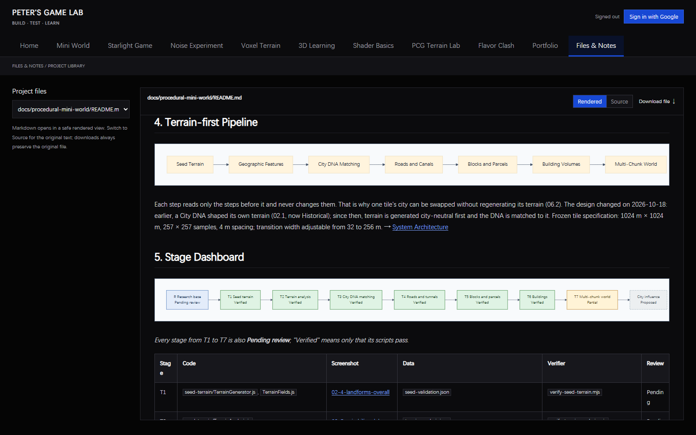 Local preview of `dist` (not the public site), 1600 × 1000.
- **Open issues:** the Experiment Archive note shows its 35 `![[…]]` embeds as plain text on the site (Obsidian-only syntax; the renderer was not extended). In the README stage table the narrow first and last columns wrap. Not deployed and not pushed: the public site still runs the M02b build.
- **Review status:** Pending review.

### M05 — Durable Terrain Seam model bundling

- **Date / Stage / Single question:** 2026-10-20 / release repair (no stage change) / Can a clean GitHub Actions build include every active Terrain Seam model and initialise the production page without changing terrain or scene geometry?
- **Changed files:** `.gitignore` explicitly unignores the 11 active runtime GLBs; `experiments/terrain-seam/main.js` imports those files with Vite `?url` handling and passes the emitted URLs to the existing loaders. No terrain algorithm, geometry, City DNA, placement transform, or Venice / Tokyo scene logic changed.
- **Active assets:** `tiny_tokyo.glb`, Japan `04.glb`–`11.glb`, Venice `v_01.glb`–`v_02.glb`; 11 files, 129,376,672 bytes total. All exist and are no longer ignored, but remain untracked until explicitly staged and committed.
- **Clean-build verification:** bundled Node `npm ci` passed, followed by `npm run build` (Vite 7.3.6). The working-tree build transformed 1056 modules; an isolated `git archive` of `HEAD` overlaid with only this runtime fix and the 11 models transformed 956 modules and also passed. `dist/assets/` contains exactly 11 hashed GLBs whose combined byte count matches the sources. Production preview served every model with HTTP 200 and `model/gltf-binary`; 0 console or page errors.
- **Runtime verification:** `window.__terrainSeamLab.ready = true`; Seam Check max and mean height error = 0, compared vertices = 121, left / right spacing = 0.45 / 0.45, shared boundary x = 0; Venice / Japan buildings = 1021 / 51; Japan GLB meshes = 151. Canvas rendered at 1008 × 650 in the headless production-preview check.
- **Screenshots:** none; request/response and runtime metrics provide the verification evidence.
- **Deployment status:** locally verified only. Nothing committed, pushed, or deployed. The currently working public Firebase release is the earlier manual M04 release; the durable CI fix remains Pending deployment.
- **Review status:** Pending review.
- **Next single task:** After approval, stage only the two source-control changes, these 11 GLBs, and this log hunk; commit on the experiment branch, integrate into `main`, and let the existing Firebase Hosting merge workflow build and publish it.

### 06.3b — Road network seam across chunks (3 × 3 world)

- **Date / Stage / Single question:** 2026-10-20 / T7 / On the shared edges that 06.3a joined, can road EdgePorts of neighbouring chunks become one connected network topology (one joint node, routable across chunks), changing roads only inside both transition bands, with every port that is not joined carrying a measured reason?
- **Step 1 — 06.3a re-check (gate):** `node scripts/verify-world-seam.mjs` re-run before any change: passes, numbers identical to the 06.3a entry (6201 W 128: 4 / 12 edges joined C¹, Δh 0 on joined edges, 8 / 12 unresolved with reasons, corners 1 / 4 closed, one-sided water edges 6 → 4; seeds 6202 / 6203: 6 / 4 joined; W 64 / 256: 5 / 5). Committed evidence restored after the run. Judgement: 06.3a passes its own definition (join where possible, report where not). Unresolved edges are an upstream limit, handled in 06.3b as "no road join, reason = terrain edge unresolved" — not repaired, not bypassed.
- **Changed files:** new `experiments/world-grid/RoadSeam.js` (stitching, world graph, Dijkstra), `scripts/verify-road-seam.mjs`, `experiments/world-grid/evidence/world-road-seam.json`; changed `WorldGrid.js` (city layer split: network → world road seam → blocks / parcels / buildings on the stitched network), `worldConfig.js` (`roadMode` 'joined' | 'independent'), `main.js` (two-pass rebuild, Roads control, panel, lab `roadSeam / roadAudit / reach / roadOrderTest`), `SeamView.js` (port join status, joints, connectors), `index.html` (legend); `scripts/verify-world-seam.mjs` runs with `roads=independent`; `scripts/verify-world-grid.mjs` compares signatures without the new `rawNetwork` field and asserts it equals `network` in raw mode. Unchanged: everything in `experiments/seed-terrain/` (single-chunk entry, terrain, City DNA, network generator, tunnels 05.1b-2), chunk size, City IDs, TerrainHarmonizer. Nothing committed.
- **Algorithm (`RoadSeam.js`):** input = each chunk's unchanged NetworkGraph + harmonised fields + the 06.3a edge report. Per shared edge in canonical order: (1) gate — empty neighbour → pending; canal ports → pending (canal joins not in this task); terrain edge unresolved / raw → rejected. (2) Pairs — road ports grouped by boundary node, candidates within 2·W·tan 25° (119 m at W 128), nearest first: class gap ≤ 1, approach ≤ 60° from the edge normal, joint J = midpoint (or the frozen side's position: bridges, tunnels, and graded mountain roads are never moved), joint heights equal within 0.5 m, each road re-routed from its redirect anchor (inner band line) or its first inner node straight to J — lean ≤ 25°, bend ≤ 40°, on land, cell slope ≤ the DNA's road limit (`maxSlopeDeg`, same land test as the network), no crossing or node contact without a junction. (3) Stubs — a remaining road port may continue straight into the neighbour's band to the nearest neighbour road (T-junction; split, or snap ≤ 2 m), same checks. Changed chunks get a rebuilt NetworkGraph via the existing `GraphBuilder.finalize` (ports, stats, signature recomputed); unchanged chunks keep the original object. World graph = all chunk graphs + one zero-length seam link per connection. 6 public rules, all spatial.
- **Data:** connection = { edge, kind pair | stub, joint {x, z, yA, yB}, port positions, offset, shifts, classes, Δy, grade, bend, lean, connector polylines + width, node id in each stitched graph }; port record = { chunk, edge, side, position, class, status connected | rejected | pending, reason, failed pair attempt }.
- **Shared-edge statistics (W 128):** 6201 — 12 edges, 4 terrain-joined, 2 with road joins; 68 ports: 14 connected, 44 rejected, 10 pending; 8 joins = 6 pairs on chunk_-1_0 | chunk_0_0 (Chicago | Manhattan, offset 9.48 m, re-route lean 4.4° per side, connectors ≤ 71 m deep) + 2 stubs on chunk_0_0 | chunk_0_1 (17 m and 67 m, bends 8° and 20°). 6202 — 6 terrain-joined, 6 with road joins, 26 joins (0 pairs, 26 stubs); ports 26 / 34 / 11. 6203 — 4 terrain-joined, 2 with road joins, 9 joins (5 pairs, 4 stubs); ports 14 / 45 / 12. Rejection reasons (6201): terrain edge unresolved 22; no neighbour road inside its band 13 (Amsterdam chunk_-1_1 has 0 km of road; the Chicago and Manhattan ports facing it have nothing to join); stub turn > 40° 6; connector over terrain steeper than the 10° Manhattan limit 3. Pending: empty slot 10.
- **Tests (`node scripts/verify-road-seam.mjs`, all pass, 0 browser errors):** every joint = one `port` node in each stitched graph, position error 0, Δy 0 (all seeds); visual-only contacts (ports of both chunks at one point without a link) 0; new crossings 0 per chunk; connectors: 0 wet samples, inside the band, cell slope within the DNA limit (along-road grade max 8.7° / 16.1° / 10.9° per seed); no join on an unresolved or raw edge; every unjoined port has a reason; every joint traversable in the world graph; chunks sharing a world component routed by Dijkstra (6201: chunk_-1_0 → chunk_0_1 1932 m over 2 seam links; 6202: chunk_-1_0 → chunk_1_1 5210 m over 3 seam links; components {-1_0, 0_0, 0_1} in 6201 / 6203, {-1_0, -1_1, 0_0, 0_1, 1_1} + {1_-1, 1_0} in 6202); terrain signatures identical to independent roads; unchanged chunks bit-identical to independent roads (network, blocks, parcels, buildings); changed chunks: city layer rebuilt on the stitched graph (`blocks.source.networkSignature` = stitched signature), 0 buildings on a connector corridor; input-order independence (reversed / rotated) identical; reload identical; each seed loaded twice identical; all 9 solids closed. City ID change chunk_0_1 → Amsterdam: 0 terrain rebuilds, 1 network rebuilt, city layers rebuilt for chunk_0_1 + chunk_0_0 (its stub set changed), others unchanged; back to auto → seam signature and all layers identical to the start. Regression: `verify-world-seam.mjs` (06.3a) and `verify-world-grid.mjs` (06.2, raw) pass; their evidence files and screenshots restored to the committed versions.
- **Downstream change (6201, independent → joined):** chunk_-1_0 Chicago buildings 2066 → 2056 (mean height 40.5 → 39.8 m); chunk_0_0 Manhattan blocks 73 → 74, parcels 1739 → 1732, buildings 1599 → 1597; chunk_0_1 blocks 12 → 13, parcels 464 → 462, buildings 416 → 405. No stale buildings kept.
- **Performance:** road seam 7–12 ms per world; full world load 21–23 s (independent 22.5 s; unchanged within noise); one City ID change next to joined edges 7.4–8.2 s (2 city layers instead of 1).
- **Screenshots (seed 6201, W 128, `?seams=1`; spheres = port status green connected / red rejected / orange pending, green cubes = joints, white = re-routed connector, pink = stub):** 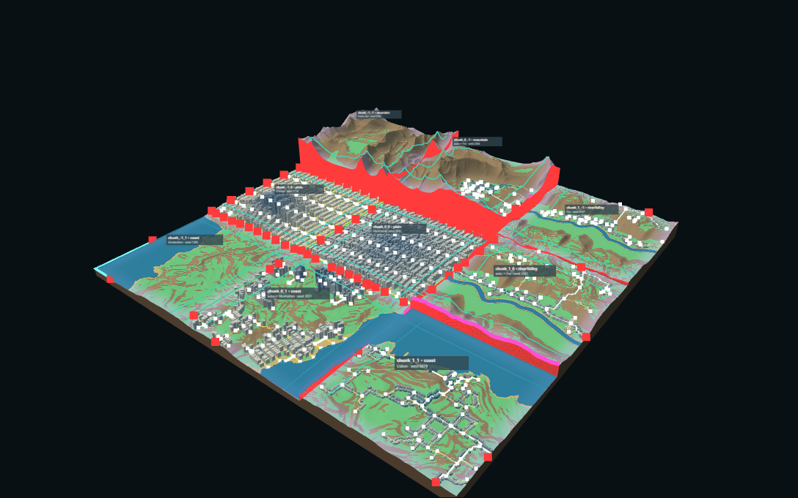 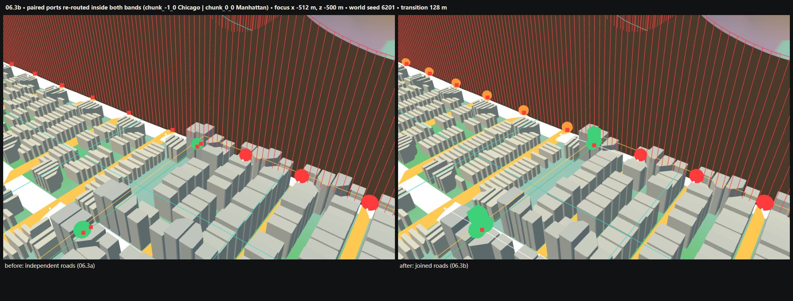 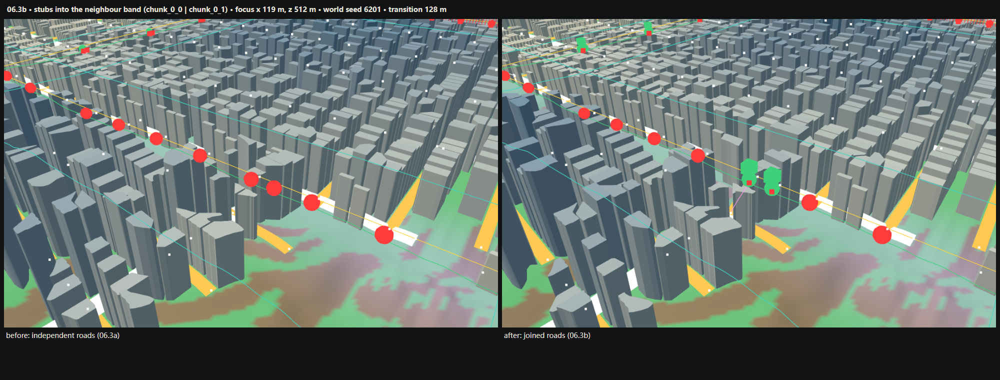 Evidence: `experiments/world-grid/evidence/world-road-seam.json`.
- **Problems found during testing (fixed):** after a re-stitch, an unchanged chunk's city layer kept the previous (identical-signature) graph object → rebound to the current stitched graph; the reachability test anchored on each chunk's largest component and missed a smaller joined component → anchors per shared component.
- **Observations:** on seed 6202 the Chicago | Manhattan ports are offset 61 m. A straight re-route would lean 28.7° (> 25°), so each street ends as a T on the neighbour's first parallel street (10 stubs, staggered junctions) instead of 5 through-streets — connected, but a different street pattern. A wider lean limit would turn them into pairs.
- **Open issues:** (1) 8 / 12 edges (6201) cannot carry roads because 06.3a left them unresolved; no ramp / bridge / escarpment rule exists (upstream decision still open). (2) Canal ports are pending (canal joins not implemented). (3) Along-road grade is not limited separately — connectors use the network's cell-slope test, so a connector can climb 16° along its line where the DNA limit is 20° (organic). (4) The stub rule can create many parallel T-junctions on one edge; there is no spacing or hierarchy preference beyond the class gap. (5) Several rejections sit at the bend (40°) and slope (10°) thresholds (e.g. 40.3°, 10.2°); thresholds are A, not calibrated. (6) NetworkView's port markers still clutter the world view. (7) The outer world edge and the known tunnel defect (6202 / chunk_0_-1 / Chicago) are unchanged.
- **Review status:** Pending review.
- **Next single task:** Decide the rule for unresolved edges (ramp / escarpment road, bridge over a level step, or landform compatibility at slot assignment) — the main limit on world-wide road connectivity.

### 06.3a-R — World-coherent terrain (global macro terrain + shared boundary surface)

- **Date / Stage / Single question:** 2026-10-21 / T7 / Can the 3 × 3 world get one continuous large-scale relief in world coordinates — same height and slope on every shared edge, one value at every corner — while each chunk keeps its landform, the transition width stays user-set, and edges that cannot be joined within a reasonable slope are reported instead of being cliffed or flattened?
- **Pre-checks / reuse:** 06.3b report: 8 / 12 edges (6201) carried no road because 06.3a left them unresolved; raw steps up to 296 m cannot be absorbed by an edge-local join inside 128 m without slopes > 35°. Reused: raw single-chunk generation + seeds (`generateRawLayer`, `terrainSeedOf`), `edgeWeight` (smoothstep band weight), `deriveFields` / `analyseTerrain`, `slopeField`, the 06.3a water rules (extracted unchanged into `floodWater`), `SeamCheck`, `SeamView`, the 06.3b `RoadSeam` and audit hooks.
- **Algorithm (`experiments/world-grid/WorldTerrain.js`, terrain mode `coordinated`, now the default):**
  - **Global macro base:** one C¹ field over the chunk lattice in world coordinates. Control values: chunk base b_c = mean raw height (coast: sea level, its datum) and relief R_c = landform relief × variation strength. Every shared edge (mid-point) and every corner (2 or 4 chunks) gets one relief-weighted value (weights 1 / R: base = weighted mean, relief = harmonic mean), so the flatter landform keeps its level and the rougher one carries the climb (foothills). Along an edge the value runs corner → mid → corner with smoothstep.
  - **Local layer:** L = T_c + E_c·(raw − b_c). T_c ramps from b_c to the edge values over the landform ramp distance D (Coons sum over shared sides; φ = 1 − smoothstep(0, D, d), so zero slope at the edge); E_c fades the local relief toward the shared relief over the same distance (never amplifies). Cells farther than D from every shared edge are raw exactly.
  - **Shared boundary surface S (inside the user band W):** relief-weighted mean of both raw edge profiles, low-passed along the edge (64 m) and pinned at the ends to the shared corner value, plus worldSeed fBm in world metres (share 0.35 of the shared relief, wavelength 400 m), faded out below sea level so a sea crossing the edge stays sea. At 4-chunk corners: corner value + the same fBm. Both chunks evaluate the same function.
  - **Final height:** h = L(1 − w) + S·w with w = `edgeWeight` (w = 1, w′ = 0 at the edge); corner squares use the bilinear combination with the corner surface. So both chunks hold the same height and the same cross-edge slope on every shared edge (C¹ by construction) and all chunks share one corner value. No edge is flattened or clamped.
  - **Check:** a cell is made steep if slope > 35° and > raw slope + 2° (06.3a rule); it is blamed on the nearest shared edge whose zone (D) contains it. Such an edge is unresolved: geometry stays continuous (no cliff), the reason gives the steep cells in band vs ramp, and a feasible adjustment is estimated (transition width needed, longer ramp, landform pair, escarpment rule). The band is never widened automatically.
  - **Water:** sea keeps level 0; a river level takes the same transform as its ground; wet cells come only from connected flooding from raw water; river water stays in its raw channel cells (`riverSpread: false`), so no lake is created by lowered ground. Then `deriveFields` recomputes slope, water, buildability, boundary samples; `analyseTerrain` recomputes the analysis.
- **Public parameters (6, spatial):** `rampDistance` plain 0 / coast 128 / river valley 384 / mountain 512 m (never < W, ≤ 512 m); `sharedReliefShare` 0.35; `sharedWavelength` 400 m; `boundarySmoothing` 64 m; `maxTransitionSlopeDeg` 35°; `createdSlopeMargin` 2° (water tolerances reused from 06.3a). Transition width stays the user slider (32–256 m).
- **Changed files:** new `experiments/world-grid/WorldTerrain.js`, `scripts/verify-world-terrain.mjs`, `experiments/world-grid/evidence/world-terrain.json`; changed `TerrainHarmonizer.js` (water section extracted into exported `floodWater`, new option `riverSpread`; 06.3a output verified bit-identical: height, water, network, building signatures and edge water interfaces of seeds 6201 / 6202 before = after), `WorldGrid.js` (mode `coordinated`; harmony key includes the world seed), `worldConfig.js` (default `coordinated`; `harmonized` / `raw` kept), `main.js` (Terrain control, lab `waterAudit / crossability / landformStats / memory`, order test per mode), `SeamView.js` (difference overlay: |coordinated − raw| colour ramp, magenta = made-steep cells), `index.html` (legend, intro); `scripts/verify-world-seam.mjs` and `scripts/verify-road-seam.mjs` pinned to `terrain=harmonized` (their tasks were measured on 06.3a terrain). Unchanged: `experiments/seed-terrain/` (single-chunk page, terrain generator, City DNA, network, parcels, buildings, tunnels), chunk size, sampling (257², 4 m), road topology rules. Nothing committed.
- **Results, world seed 6201, W 128 (raw 06.2 → harmonised 06.3a → coordinated 06.3a-R):** edges with a height step 12 → 8 → 0 (max 296.4 → 296.4 → 0 m); resolved 0 → 4 → 7 / 12; interior corners shared 0 → 1 → 4 / 4 (spread 250.7 m → 0); off-grid sampler difference across edges 295 m → 0; slope kink max over all edges 88.0° → 88.0° → 27.4° (resolved edges 8.6° → 6.2°); rendered normal difference max 93.5° → 26.4°; one-sided water samples 489 → 443 → 11, discontinuous water edges 6 → 4 → 1 (river reaches the mountain edge, neighbour has no channel — not extended); road-candidate transects (dry, ≤ 20°, no step, through both bands) 1.5% → 24.8% → 49.2% of edge positions, edges with a ≥ 40 m crossable run 1 → 4 → 12; 06.3b road joins 0 → 8 → 22. All 9 solids closed; rendered mesh = fields; raw fields unchanged; sea cells all at level 0; 0 river cells outside the raw channel.
- **Unresolved edges (6201), all continuous, each with reason + suggestion:** mountain | mountain (raw 163.5 m; 5550 cells > 35°, max 73.1°, 4098 in the band → would need W ≈ 608 m, beyond the 256 m slider), mountain | plain ×2 and mountain | river valley (raw 235–296 m; 1040–2298 cells, max 62.7–63.2°, almost all in the 512 m mountain ramp → a 200 m base drop with mountain relief does not fit in half a chunk under 35°), coast | coast chunk_0_1 | chunk_1_1 (raw 47.1 m; 27 cells, max 40.0°, all in the band → W ≈ 160 m by explicit choice).
- **Seeds (W 128, harmonised → coordinated):** 6201 resolved 4 → 7, crossable 24.8 → 49.2%, road joins 8 → 22; 6202 resolved 6 → 6 (one different set: coast | coast 0_1 | 1_1 resolved → unresolved, plain | river valley 0_0 | 1_0 unresolved → resolved), crossable 27.6 → 47.9%, road joins 26 → 37, water discontinuous 2 → 0; 6203 resolved 4 → 5 (river valley | coast 1_0 | 1_1 resolved → unresolved; coast | coast -1_1 | 0_1 and plain | river valley 0_0 | 1_0 unresolved → resolved — *corrected 2026-10-21 in 06.3a-R2: this line first said coast | coast -1_1 | 0_1 "resolved → unresolved", the reverse of the data*), crossable 18.3 → 42.9%, road joins 9 → 18. Every seed: 0 edges with a step, 4 / 4 corners shared, mountain edges always unresolved. Each coordinated seed loaded twice → identical signatures and edge report.
- **Transition widths (6201):** W 64 → 5 / 12 resolved (resolved band slope 27.2°, crossable 61.4%), W 128 → 7 / 12 (35.6°, 49.2%), W 256 → 8 / 12 (53.0°, 46.7%); geometry valid at every width (Δh 0, corners 0, mesh = fields, solids closed, no non-finite height); each width change rebuilt every changed terrain layer and its city layer (no stale roads / parcels / buildings; city layers on the current stitched network). "Resolved" means no cell made steeper than 35° *and* its raw slope + 2°; the band maximum on resolved edges (up to 53° at W 256) is existing raw relief (river banks, coastal hills), not created by the join.
- **Landform character (6201, raw → coordinated):** plains relief 5.1–5.7 → 5.2–10.3 m, mean slope 0.9 → 1.3–1.6°, buildable 100%; river valleys mean slope 11.1 → 8.9–11.6°, river wet share 3.4 → 3.1–3.6%; coasts wet share 31.6 / 16.7 / 33.2% → 29.2 / 11.3 / 21.6%; mountains mean slope 29–32 → 27–30°, relief range p5–p95 128–141 → 227–268 m (the massif now descends to its foothills at the plain / valley edges). Untouched (raw) share: plains 56–66%, coasts 66–77%, river valleys 16–39%, mountains 0.2–25% (512 m ramps on three sides).
- **Architecture checks:** City ID change (chunk_0_1 → Amsterdam): coordination not re-run, 0 raw rebuilds, raw / height / water signatures of all 9 chunks unchanged; city layers of chunk_0_1 and chunk_0_0 rebuilt (06.3b stub change), all on the current stitched graph. Reversed / rotated input → identical coordination output. Reload identical. Auto-matched DNAs follow the new terrain analysis (6201: chunk_1_0 auto → Lisbon, chunk_0_1 auto → Fez, previously Fez / Manhattan); manual City IDs unaffected.
- **Performance (heap after forced GC):** coordination 736–752 ms per world (harmonisation 06.3a 493–540 ms); full world load 21.2–24.4 s coordinated vs 20.8–23.0 s harmonised vs 20.4–23.5 s raw (within run-to-run noise); heap 327–333 MB coordinated vs 319–368 MB harmonised vs 309–351 MB raw. Transition-width change rebuilds the world in 18.4–22.1 s.
- **Regression:** single-chunk `verify-seed-terrain.mjs` and `verify-solid-terrain.mjs` pass with identical evidence except timestamps (files restored to the committed versions); `verify-world-grid.mjs` (06.2), `verify-world-seam.mjs` (06.3a) and `verify-road-seam.mjs` (06.3b) pass with their logged numbers; their evidence files and screenshots restored.
- **Screenshots (6201, W 128):** 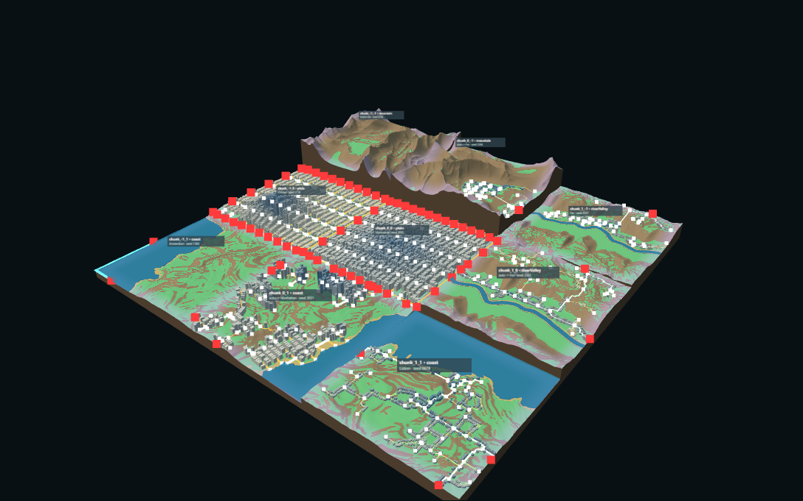 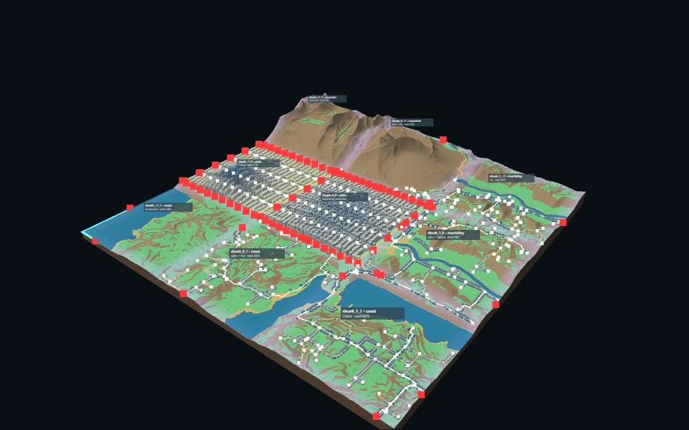 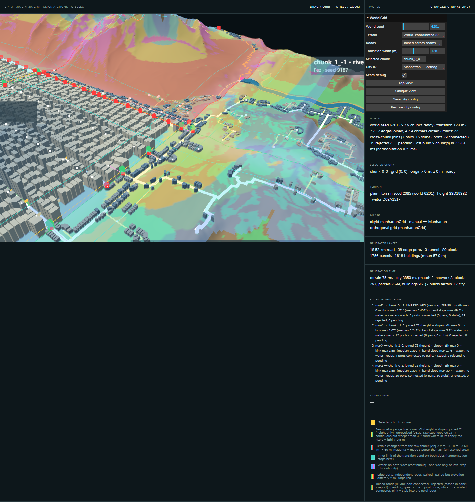 Evidence: `experiments/world-grid/evidence/world-terrain.json`.
- **Problems found during testing (fixed):** (1) a boundary surface built from chunk-mean bases lifted the sea along coast | coast edges to land (all edges reported "no water") → surface from the weighted raw edge profiles + noise faded below sea level; (2) lowered band ground let river water spread into a lake strip along a plain | river edge (87 wet edge samples; river wet cells +45%) → river water kept in its raw channel cells; (3) coast bases from the chunk mean (13–19 m, a land / sea share effect) lifted sea floors → coast base = sea level; (4) heap readings without GC varied 454–1971 MB → measured after forced GC.
- **Measured trade-off (not adopted):** coast ramp 256 m instead of 128 m gives gentler coastal transitions (band slope 17–24° vs 27–31°) and more road joins (47 vs 22) but loses much more sea (6201 chunk_1_1 wet cells 21 913 → 8 218 vs 14 240).
- **Open issues:** (1) every edge touching a mountain stays unresolved in all seeds: the base difference (~200 m) plus mountain relief does not fit under 35° within a 512 m ramp, and a mountain | mountain join would need W ≈ 600 m; options: landform-compatibility rule at slot assignment, an escarpment rule, or a lower slope criterion for mountain zones (all decisions). (2) Coasts next to a higher landform lose sea (6203 chunk_0_1 wet 18.4 → 6.1%). (3) Not monotone per edge: some edges resolved by 06.3a are unresolved here (6202 coast | coast 0_1 | 1_1, 6203 river valley | coast 1_0 | 1_1; *corrected 2026-10-21*) and vice versa. (4) Discrete slope kink up to 6.3° on resolved edges and 27° on unresolved mountain edges, although the construction is C¹ (finite differences on steep relief, per-chunk normals). (5) Rivers still end at chunk edges where the neighbour has no channel; river levels follow the ramp but monotonic flow along the channel is not checked. (6) The mountain chunk next to plains is almost entirely re-based (0.2% untouched). (7) Auto-matched City DNAs change with the coordinated terrain.
- **Review status:** Pending review.
- **Next single task:** Decide the handling of mountain-adjacent edges (landform compatibility at slot assignment vs escarpment rule vs a mountain-specific slope criterion) before any bridge, ramp or further road work.

### 06.3a-R2 — World terrain preservation & seam constraints

- **Date / Stage / Single question:** 2026-10-21 / T7 / Can the world stay geometrically continuous at every shared edge and corner while each chunk's core (farther than W from all four edges), its water and its buildable land are kept exactly, with seam corrections confined to the user transition band and edges that need a steep step reported as escarpment candidates instead of being repaired by large-scale deformation?
- **Problem in 06.3a-R (measured there):** macro ramps up to 512 m re-shaped whole chunks (mountain chunk_0_-1 0.2% untouched; 6203 chunk_0_1 sea 18.4 → 6.1%); some 06.3a joins were lost. Review of the 06.3a-R entry also found one reversed statement (6203 coast | coast), corrected in place and marked.
- **Datum audit (task 1.4):** the single-chunk landform rules each add their own base elevation: plain `baseHeight` 20 m (+ tilt, 0–7 m relief), river valley 30 m (surface datum), coast sea level 0, mountain `baseHeight` 120 m + relief term 0–300 m (mean ≈ 100). The mountain floor therefore sits ≈ 100 m above every neighbour before any noise — an architectural step that no edge blend should be asked to hide. It is now removed at the datum level, not by the seam.
- **Layers (`experiments/world-grid/TerrainCoordinator.js`, terrain mode `coordinated`, default):**
  - `rawLocalTerrain` — the unchanged single-chunk generation (seed → local landform), kept for comparison.
  - `worldMacroTerrain` — one world datum field D = 20 m + 6 m·fBm(worldSeed, world metres, wavelength 4096 m). Each land chunk gets one constant shift s = D(chunk centre) − its landform datum (coast: s = 0, sea level is the world zero). World base = raw + s; river levels + s. Shifts (6201): mountains −99.8 / −102.8 m, river valleys −13.0 / −9.6 m, plains +1.4 / 0 m, coasts 0. A constant shift keeps core shape, slope, water extent and buildability identical.
  - `coordinatedTerrain` — correction inside the band only: h = base·(1 − w) + S·w (w = existing smoothstep `edgeWeight`: w′ = 0 at the edge and at d = W, so no crease where the band meets the core); corner squares h = base(1−w1)(1−w2) + S1·w1(1−w2) + S2·w2(1−w1) + Sk·w1·w2 (joint corner, no double lift). Outside every band h = base exactly.
  - Shared surface S of an edge (one world function for both chunks): S = P(s) + G(s)·n — P = relief-weighted mean of both base edge profiles, G = relief-weighted mean of both cross-edge slopes (8 m stencil), both low-passed 64 m along the edge and pinned at the ends to the corner values; corner Sk = Pk + Gx·dx + Gz·dz. So the edge keeps a natural cross slope (C¹, no level shelf). Fallback: an edge whose pass-1 join makes cells too steep drops its cross slope (G = 0) and is checked again (06.3a C¹ → C⁰ idea).
  - Sea: where only one side is sea at an edge sample, P is held ≥ 1 m (freeboard) below sea level; the lowering is spread along the edge (max filter + low-pass over W/2) so the profile has no along-edge cliff. The land side then drops inside its band; if that is too steep the edge is a `waterConflict` (sea-cliff candidate). Water is never removed to make a join pass.
  - Check: a band cell is made steep if slope > 35° and > its base slope + 2°. Unresolved edge → `escarpmentCandidates` (runs along the edge with from / to, both base heights, max step, max slope, cause: base step vs the band's slope budget W·tan 35° / 0.75 = 119.5 m at W 128, existing relief, or waterConflict). No escarpment geometry is built; the band is never widened.
  - Water: sea level 0; connected flooding from raw water only (`floodWater`, river water kept in its raw channel cells); core water untouched by construction.
- **Parameters (7):** macroDatum 20 m, macroAmplitude 6 m, macroWavelength 4096 m, boundarySmoothing 64 m, maxTransitionSlopeDeg 35°, createdSlopeMargin 2°, smoothKinkTargetDeg 2° (test target only). Transition width = user slider 32–256 m.
- **Changed files:** new `experiments/world-grid/TerrainCoordinator.js`, `scripts/verify-terrain-coordinator.mjs`, `experiments/world-grid/evidence/terrain-coordinator.json`; changed `WorldGrid.js`, `worldConfig.js` (modes `coordinated` R2 default · `macroRamp` R1 · `harmonized` · `raw`), `WorldTerrain.js` (mode label only), `main.js` (Terrain list, lab `coreAudit`, `section`, order test per mode), `SeamCheck.js` (passes escarpment candidates), `SeamView.js` (magenta posts on escarpment-candidate runs), `index.html` (legend); `scripts/verify-world-terrain.mjs` pinned to `terrain=macroRamp`. Unchanged: `experiments/seed-terrain/` (single chunk, City DNA, roads, parcels, buildings, tunnels), chunk size, sampling, 06.3a / 06.3b algorithms. Nothing committed.
- **Results (W 128; 06.3a → 06.3a-R → 06.3a-R2):**
  - Max height discontinuity on shared edges: 296 / 315 / 293 m → 0 → 0 m (6201 / 6202 / 6203); interior corners shared 1 → 4 → 4 / 4 per seed; off-grid sampler difference 0.
  - Resolved edges: 6201 4 → 7 → 5; 6202 6 → 6 → 7; 6203 4 → 5 → 6. Degradations against 06.3a: 0 / 0 / 0. 06.3a coast | coast successes (6201 -1_1 | 0_1; 6202 -1_1 | 0_1 and 0_1 | 1_1; 6203 has none) are all resolved in R2. Against 06.3a-R, R2 resolves fewer edges on 6201 (plain | river 0_0 | 1_0 and river | coast 1_0 | 1_1 become escarpment candidates) — the price of not re-shaping cores.
  - Chunk cores changed against the world base: 0 cells in every chunk, every seed, every width. Against raw, cores differ only by the constant datum shift.
  - Measured slope kink (one-sided 4 m differences): resolved edges max 2.22° / 1.80° / 2.91° (06.3a 8.6 / 41.8 / 24.3°; R1 6.2 / 6.3 / 3.7°); resolved edges over the 2° target: 1 (6201 river | river 1_-1 | 1_0, 2.22°), 0, 2 (6203 plain | river 0_0 | 1_0 2.86°, river | coast 1_0 | 1_1 2.91°); escarpment-candidate edges max 7.7° / 8.6° / 9.6° (separate class). With 4 m spacing a first difference resolves ≈ 0.2° per 1.4 cm, so ≥ 2° is a real kink, mainly where the base step is 30–55 m within 128 m.
  - Modified area (band) per chunk: 23–44% (the band itself: one / two / three / four shared sides); max |Δh| vs base: mountains 135–215 m, river valleys 31–82 m, plains 4.9–30 m, coasts 14–47 m; mean |Δh| of changed cells: mountains 24–51 m, river valleys 5.7–17.8 m, plains 1.3–4.9 m, coasts 1.9–9.0 m. Slope change in the band (p50 / p95): plains 0.1–1.2° / 1.8–13.4°, coasts −1.2–0.5° / 3.5–15.2°, river valleys −0.8–1.4° / 5.8–26.5°, mountains 2.8–7.7° / 23–39°.
  - Coast water coverage (raw → R2): 6201 31.6 / 16.7 / 33.2% → 31.6 / 16.4 / 34.3%; 6202 18.6 / 17.2 / 18.7% → 18.6 / 16.6 / 18.7%; 6203 33.6 / 18.4 / 29.6% → 33.5 / 22.4 / 30.8% (06.3a-R had 24.4 / 6.1 / 25.0%). Core water lost: 0 everywhere. Band losses are listed per edge (e.g. 6202 coast | coast 0_1 | 1_1 399 cells, 6201 river | coast 1_0 | 1_1 307); gains are the sea entering band ground lowered below sea level next to it (6203 chunk_0_1 +2680 cells, plain chunk_0_0 +1585).
  - Escarpment candidates (6201): every mountain edge (base steps 145–195 m > 119.5 m budget, max slopes 70.8–74.5°), river | coast 1_0 | 1_1 (91 m, 50.9°, waterConflict), coast | coast 0_1 | 1_1 (47 m, 41.9°, waterConflict), plain | river 0_0 | 1_0 (44 m, 40.1°, existing relief). 6203 coast | coast -1_1 | 0_1 (61 m, sea against a 61 m coast, 38.1°) is a waterConflict — it was also unresolved in 06.3a.
  - Second width: W 256 resolves 7 / 8 / 8 edges (kink on resolved max 0.73 / 0.44 / 0.61°), but band shorelines move more (6202 chunk_0_1 17.2 → 12.7%, 6203 chunk_-1_1 33.6 → 25.5%; core water still 0 lost); W 64 (6201) resolves 3 / 12 with kink 4.57°. Every width: Δh 0, corners shared, cores unchanged, solids closed, dependent city layers rebuilt.
  - Reproducibility and architecture: each seed loaded twice → identical; reversed / rotated input identical; City ID change → no terrain rebuild and all terrain signatures unchanged; city layers always on the current stitched network.
  - Performance (heap after GC): coordination 0.35 s per world (06.3a-R 0.74 s, 06.3a 0.49–0.54 s); world load 21.5–24.1 s (06.3a 21.7–23.7 s); heap 324–336 MB (06.3a 313–342 MB).
- **Regression (2026-10-21, final code):** `verify-world-grid` (06.2, raw), `verify-world-seam` (06.3a, pinned `harmonized`), `verify-road-seam` (06.3b, pinned `harmonized`), `verify-world-terrain` (06.3a-R, pinned `macroRamp`) all pass with their logged numbers; single-chunk `verify-seed-terrain` and `verify-solid-terrain` pass with evidence identical except timestamps. All their evidence files and screenshots restored to the committed / previous versions.
- **Screenshots (6201, W 128):** 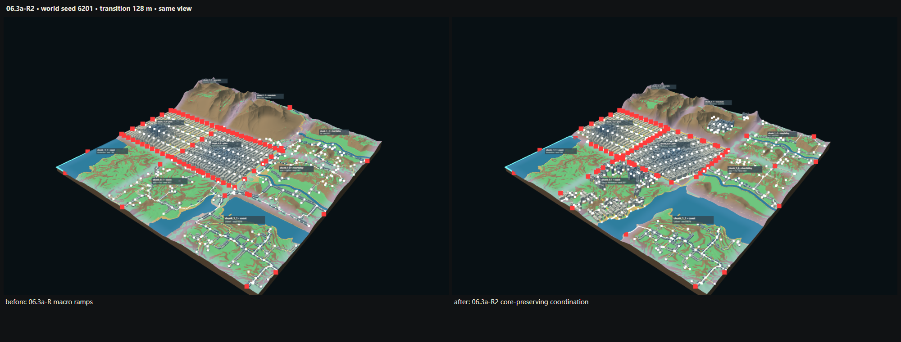 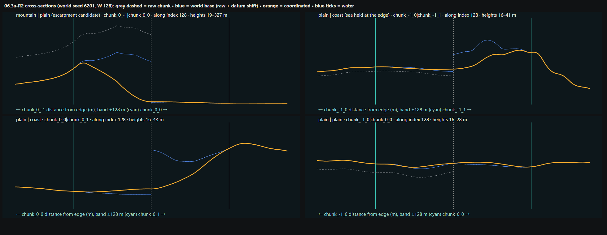 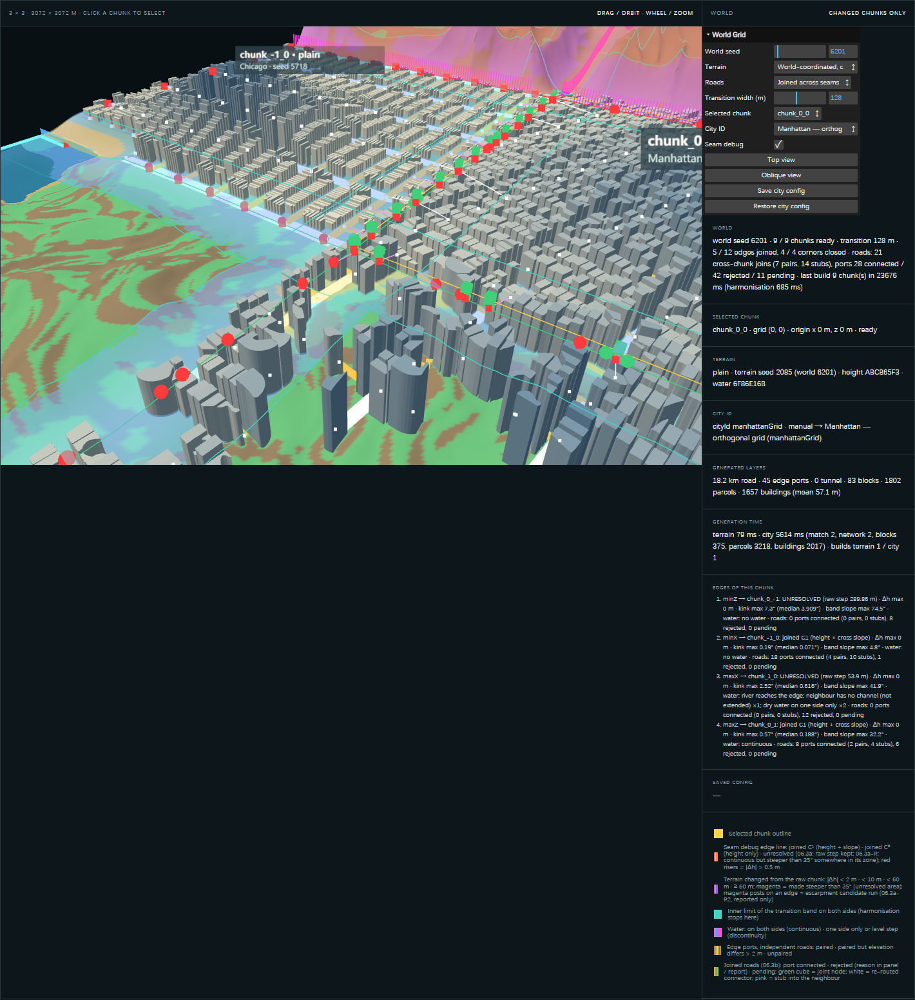 The overlay compares with the raw chunk, so plain cores show the uniform +1.4 m datum shift as a light tint; the band correction is the stronger colour along the edges. Evidence: `experiments/world-grid/evidence/terrain-coordinator.json`.
- **Problems found during testing (fixed):** (1) holding a sea joint at the sea-floor depth dropped neighbouring land below sea level and flooded land bands (6203 plain +3474 wet cells) → joint held only freeboard below sea level; (2) the per-sample sea clamp made an along-edge cliff in the shared profile (6201 plain | coast 72°) → lowering spread along the edge; (3) the C¹ cross slope made 6202 coast | coast 0_1 | 1_1 marginally steep (35.6°) → per-edge cross-slope fallback.
- **Open issues:** (1) all mountain edges stay escarpment candidates: after the datum fix their base steps (115–215 m) still exceed the 119.5 m band budget at W 128 — an escarpment rule (task out of scope) or a mountain-relief taper at the edge are the next options. (2) Coasts next to higher land: waterConflict instead of water loss, so two coast | coast edges and one river | coast edge stay unresolved; the sea can gain band cells where land is lowered next to it. (3) 3 resolved edges exceed the 2° kink target (≤ 2.91°). (4) All unresolved edges used the cross-slope fallback (level cross-section at the edge). (5) Datum shifts change absolute core heights (mountains −100 m); shapes are unchanged, but auto-matched City DNAs and any absolute-height rule downstream see the new values. (6) Rivers still end at chunk edges without a channel (no river joins, as required).
- **Review status:** Pending review.
- **Next single task:** Decide the escarpment handling for mountain edges and the waterConflict rule for coasts (accept as reported candidates, or a dedicated escarpment / sea-cliff geometry task).

### 06.3c — Seam classification and geometric continuity

- **Date / Stage / Single question:** 2026-10-21 / T7 / Can every shared edge be classified by four separate questions — is the surface continuous, what landform seam is it (smooth, valid escarpment, candidate, unresolved), how do the waters meet, can a road cross — so that steep but natural seams are no longer counted as failures, while nothing unresolved is renamed into a success?
- **Pre-checks:** 06.3a-R2 regression round finished before this task (all pass, see the R2 entry). History note honoured: 6203 has no 06.3a coast | coast success; the 06.3a coast | coast regression cases are 6201 -1_1 | 0_1 and 6202 -1_1 | 0_1, 0_1 | 1_1.
- **Seam status interface (`experiments/world-grid/SeamClassifier.js`, pure data, run after every seam check; lab `seamClasses()`):** per edge `{ geometryStatus, geometry, landformStatus, landform, hydrologyStatus, hydrology, transportStatus, transport, overall, color, legacyStatus }`.
  - `geometryStatus`: continuous (Δh 0 on all 257 samples, corner spread 0, finite heights) · discontinuous · invalid. Geometry details: max step, corner spread, band max slope, measured kink (max, p95, median).
  - `landformStatus`: smooth (no cell made steeper than 35° and its base slope + 2°) · escarpment (made-steep cells, but continuous geometry AND a landform pair that carries a scarp — at least one side mountain, river valley or coast — AND max slope ≤ 75° (steepest face a 4 m heightfield represents; one cell rises ≥ 15 m) AND no pit / ridge: coordinated heights stay within both sides' base range ± 1 m along every steep run, in corner squares within the four chunks' corner-square range) · escarpmentCandidate (a check fails: reason names it and the geometry still needed, e.g. "needs a cliff mesh") · unresolved (discontinuous, or steep with no landform reason, e.g. plain | plain).
  - `hydrologyStatus`: none · continuousWater · riverValleyContinues · shoreline (sea held at the edge, gentle land side) · coastalEscarpment (sea held, land side is a scarp) · riverEndsAtEdge (not extended, not a failure) · incompatibleLevels · coreWaterLost · discontinuous.
  - `transportStatus`: passable (continuous and a ≥ 40 m stretch whose transects through both bands are dry and ≤ 20°) · impassable. Terrain only: the 06.3b road seam still joins smooth (legacy resolved) edges only; a passable stretch on a scarp edge is reported, not used.
  - `overall`: smooth · smoothKink (smooth, measured kink > 2°) · escarpment · candidate · failed (geometry, unexplained scarp, incompatible water or lost core water). Guard: legacy resolved edges = smooth edges exactly (asserted), so no unresolved edge became a success by renaming.
- **Change to 06.3a-R2 (TerrainCoordinator):** the shared corner value used to fade into the edge profile over half the edge (512 m); with two mountains and two plains at a corner, the plain-weighted corner value pulled the mountain | mountain profile ~100 m below both mountains (pit) up to 156 m from the corner (overshoot 61 / 40 / 100 m on seeds 6201 / 6202 / 6203). New parameter `cornerPinBands` = 1: the corner value fades in over one band width (the corner square). Tested 2·W (pits 24–47 m remain) and 1·W (none). R2 verifier re-run with 1·W: resolved 5 / 7 / 6 (unchanged), regressions vs 06.3a 0, 06.3a coast | coast cases resolved, measured kink on resolved edges max 1.23° / 0.57° / 1.40° (before 2.22 / 1.80 / 2.91°; now 0 edges over the 2° target), cores unchanged, coast water 31.6 / 16.7 / 33.2% → 31.6 / 16.8 / 35.2% (6201), 6203 18.4 → 23.0%. The R2 evidence file keeps the R2 run; the 1·W numbers are recorded here.
- **Datum audit (task 8, lab `datumAudit()`):** each chunk analysed on raw terrain and on raw + its exact world datum shift (no seam correction): relative terrainAnalysis metrics differ in 0 values, water / buildable masks flip in 0 cells, auto City DNA identical for every chunk and seed; only absolute values move (elevation statistics, heights, water levels: 6 values per shifted chunk). All City Match conditions use relative metrics (buildable shares, slope classes, water fraction / role), and water metrics compare height with a water level shifted by the same amount. Auto DNA changes seen since 06.3a-R come from the band correction (e.g. 6201 chunk_0_1 Lisbon → Manhattan, chunk_0_-1 Fez → Manhattan), not from the shift. Manual City IDs unchanged in every run. *Correction:* an interim statement in this task that Float32 rounding moved chunk_1_-1 slope statistics by 0.011° was wrong — the audit had used the 2-decimal rounded shift for water levels (76 river cells flipped); with the exact shift (`macro.shiftExact`) every difference is 0.
- **Classification, W 128 (overall · hydrology · transport):**
  - 6201 (5 smooth, 7 escarpment, 0 candidate, 0 failed): mountain | mountain -1_-1 | 0_-1 escarpment 71.4° · none · impassable; mountain | plain -1_-1 | -1_0 escarpment 73.0° · impassable; mountain | river 0_-1 | 1_-1 escarpment 70.8° · passable (44 m stretch); mountain | plain 0_-1 | 0_0 escarpment 74.5° · impassable; river | river 1_-1 | 1_0 smooth (kink 0.57°) · passable; plain | plain -1_0 | 0_0 smooth (0.06°) · passable 1028 m; plain | coast -1_0 | -1_1 smooth (1.23°) · shoreline · passable; plain | river 0_0 | 1_0 escarpment 39.0° (valley wall) · continuousWater · passable; plain | coast 0_0 | 0_1 smooth (0.55°) · shoreline · passable; river | coast 1_0 | 1_1 escarpment 50.9° · coastalEscarpment · impassable; coast | coast -1_1 | 0_1 smooth (0.30°) · passable; coast | coast 0_1 | 1_1 escarpment 41.9° · coastalEscarpment · impassable.
  - 6202 (7 smooth, 5 escarpment): four mountain escarpments (60.5–72.3°), plain | river 0_0 | 1_0 escarpment 39.0°; all other edges smooth (kink ≤ 0.57°), river | coast 1_0 | 1_1 riverEndsAtEdge; passable 9 / 12.
  - 6203 (6 smooth, 6 escarpment): four mountain escarpments (58.7–67.0°), coast | coast -1_1 | 0_1 and 0_1 | 1_1 coastalEscarpment (38.1°, 42.3°); smooth edges kink ≤ 1.40°; passable 6 / 12 (plain | coast 0_0 | 0_1 smooth but impassable: no 40 m dry stretch).
- **Other widths:** W 64 — 6201: 2 smooth, 1 smoothKink (2.95°), 6 escarpment, 3 candidate (mountain scarps 75.4–79.5° > 75°: need a cliff mesh); 6202: 4 / 1 / 5 / 2 / 0; 6203: 0 smooth, 2 smoothKink (up to 4.9°), 7 escarpment, 2 candidate (one pit 3.2 m on mountain | mountain, one 75.4° scarp), 1 failed (plain | plain -1_0 | 0_0: 28 cells at 36.8°, no landform reason for a scarp). W 256 — 6201: 7 smooth, 4 escarpment, 1 candidate (coast | coast 0_1 | 1_1, pit 2.98 m); 6202: 8 / 0 / 4 / 0 / 0; 6203: 8 / 0 / 4 / 0 / 0; smooth kink ≤ 0.74°. Narrow bands produce scarps the heightfield cannot represent; wide bands move more shoreline (6202 chunk_0_1 17.2 → 12.7%).
- **Negative controls:** raw terrain (6201) → 12 / 12 failed (discontinuous); macro-ramp terrain (06.3a-R, no run data) → 4 smooth, 3 smoothKink, 5 candidate, 0 escarpment — the classifier never validates a scarp without evidence.
- **Checks per run (all seeds × W 128 / 64 / 256, `node scripts/verify-seam-classes.mjs`, all pass, 0 browser errors):** every edge has four statuses and one overall class consistent with them; geometry continuous on all 12 edges; cores unchanged against the world base and 0 core water lost; legacy resolved = smooth; datum audit exact; classes reproducible on reload.
- **Debug layer (reused):** the seam debug edge line takes the class colour (green smooth · yellow-green kink > 2° · blue valid escarpment · orange candidate · red failed), drawn twice for visibility; magenta posts mark escarpment runs; the |Δh| overlay and band limits are unchanged; the panel lists the four statuses per edge. No new UI controls.
- **Changed files:** new `experiments/world-grid/SeamClassifier.js`, `scripts/verify-seam-classes.mjs`, `experiments/world-grid/evidence/seam-classes.json`; changed `TerrainCoordinator.js` (`cornerPinBands`, exact shift in the report), `main.js` (classification after the seam check, panel line, lab `seamClasses / datumAudit`, crossability through `transectFeasibility`), `SeamView.js` (class colours), `index.html` (legend). Unchanged: roads, tunnels, parcels, buildings, City DNA, `experiments/seed-terrain/`. Nothing committed.
- **Regression (final code):** `verify-terrain-coordinator` (06.3a-R2, numbers above), `verify-world-terrain` (06.3a-R), `verify-world-seam` (06.3a), `verify-world-grid` (06.2), `verify-road-seam` (06.3b) pass with their logged numbers; single-chunk `verify-seed-terrain` and `verify-solid-terrain` pass with evidence identical except timestamps. Their evidence files and screenshots restored.
- **Performance:** world load 21.4–28.6 s, terrain coordination 0.52–0.89 s (W 64–256), classification inside the seam check; heap after GC 327–352 MB.
- **Screenshots (6201, W 128):** 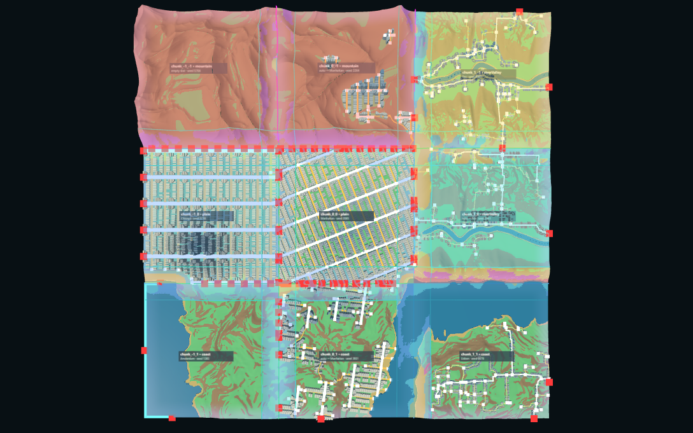 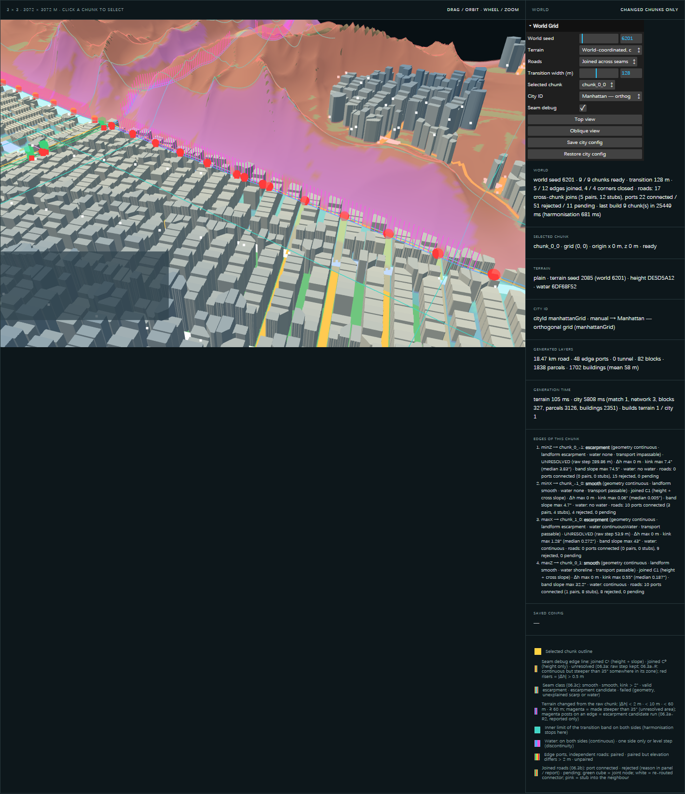 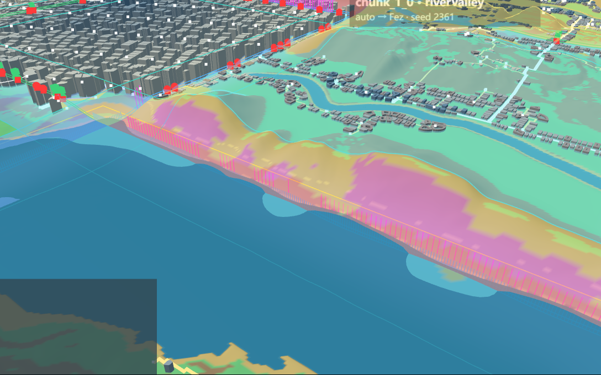 In the top view the class lines are thin at full-world scale; the close-ups show them clearly. Evidence: `experiments/world-grid/evidence/seam-classes.json`.
- **Acceptance (self-check against the task):** statuses split (yes); smooth seams still measured by height and finite-difference slope with the 2° target, no threshold relaxed (yes); mountain steps become continuous scarps inside the band without touching cores (yes); scarps validated only with geometry + landform + representability + no pit / ridge (yes); waterConflict split into coastal escarpment / river ends / incompatible (yes; no incompatible case occurred); no extra river network or cliff mesh (yes, candidates name the missing geometry); datum audit (yes, exact); seeds × widths (yes); Seam Debug reused (yes).
- **Open issues:** (1) at W 64, mountain scarps exceed 75° and stay candidates — they need cliff geometry (a near-vertical face or overhang the heightfield cannot hold). (2) Sea water enters plain bands lowered toward a sea-held corner (6203 plain | plain reports continuousWater; R2 measured +1585 wet cells in plain chunk_0_0). (3) The road seam joins smooth edges only; passable stretches on scarp edges (e.g. 6201 mountain | river 44 m) are not used. (4) The 75° limit, 1 m pit tolerance and 40 m / 20° transport test are A, not calibrated. (5) No `incompatibleLevels` case appeared in these seeds, so that branch is untested on real data.
- **Review status:** Pending review.
- **Next single task:** Decide whether valid escarpments and coastal escarpments need dedicated geometry (cliff mesh for > 75°) or whether the road seam should use passable stretches on scarp edges — one at a time.

### M06 — Checkpoint commit, World State checkpoint, Firebase release

- **Date / Stage / Single question:** 2026-10-21 / release (no stage change; requested as "M04", renumbered because M04 is the 2026-10-20 archive release) / Can the verified state be committed and pushed, the working world saved as a reproducible checkpoint, the site deployed through the existing pipeline and checked at the public URL, and the next session given one clear entry?
- **Pre-checks:** branch `experiment/terrain-seam`, `origin/main` = branch = `b59b26c`; Firebase project `gameeeee-zc626` (`.firebaserc`), Hosting `dist`, CI "Deploy to Firebase Hosting on merge" on push to `main` (last runs success); 77 uncommitted paths (06.3b–06.3c work, DOC-01–05, M04 / M05 work incl. the 11 active Terrain Seam GLBs, 0.2–26 MB each, needed by the CI build after M05); no secrets among them. Two root screenshots (`terrain-seam-overview.png`, `terrain-seam-topology.png`) are deleted in the working tree with no copy anywhere and no record of why — the deletion was left out of the commit (files stay in Git).
- **World State checkpoint:** `experiments/world-grid/worldCheckpoint.js` wraps the existing `serialiseWorld` / `restoreWorld` in a versioned JSON (`procedural-mini-world/world-checkpoint`, v1): world seed, transition width, variation, terrain / road mode, the 3 × 3 layout (grid, origin, landform, terrain seed, City ID, Auto / Manual / Empty), rule parameters and version labels of every stage, expected per-chunk signatures and seam classes. Saved: `experiments/world-grid/checkpoints/world-6201-checkpoint-v1.json` (10.7 KB, the default working world: seed 6201, W 128, coordinated, joined). Restore: `?checkpoint=default` (bundled via Vite `?url`), GUI **Load world checkpoint** (file), **Export world checkpoint** (download); the existing localStorage Save / Restore now also restores transition width, terrain and road mode in the GUI. No meshes stored.
- **Tests before the commit:** `vite build` (11 GLBs + checkpoint in `dist`); against `vite preview`: `verify-world-checkpoint` 7 / 7 (URL checkpoint reproduced, content, export equal, file load reproduced, tampered checkpoint reported as mismatch, localStorage across reload, default world = checkpoint), `verify-live-release` 10 / 10, `verify-hosted-experiments` pass; `verify-world-grid` pass (evidence restored). The 06.3a–06.3c, 06.3a-R2, single-chunk verifiers had passed on the same generator code (06.3c entry). A clean `git archive` export of the commit built on its own (11 GLBs, checkpoint asset).
- **Git:** commit `1f63e6f` "M06 checkpoint: World Grid seams, terrain coordination, World State checkpoint" (134 files) on `experiment/terrain-seam`; pushed; `main` fast-forwarded to `1f63e6f` (`git push origin HEAD:main`, no force, no reset, no branch switch). This entry, `NEXT_SESSION.md` and the two live screenshots are a follow-up documentation commit on `experiment/terrain-seam` only, so `main` and the live site stay at `1f63e6f` (no second deployment).
- **Deployment:** GitHub Actions run 39550615439 (push of `1f63e6f` to `main`) success, 2026-10-21 05:37:35–05:38:43 UTC; no manual `firebase deploy`. Live World Grid entry `assets/worldGrid-Dm_EG34_.js`.
- **Public verification (2026-10-21 05:39 UTC, <https://gameeeee-zc626.web.app>):** `verify-world-checkpoint` 7 / 7 — `/experiments/world-grid/?checkpoint=default` reaches READY in 19.1 s with "reproduced: all signatures match", 9 / 9 chunks ready, 17 road joins, buildings in every city chunk except Amsterdam on coast chunk_-1_1 (0 km road, 0 buildings — known since 06.3b); `verify-live-release` 10 / 10 (hub → Mini World iframe, City ID switch rebuilds one chunk, world seed, single-chunk page); `verify-hosted-experiments` all routes; 0 console / page errors, 0 HTTP ≥ 400.
- **Screenshots (public site):**  
- **Restart test:** all Vite servers stopped; fresh `npm run dev` (bundled Node 24.19, Vite 7.3.6, ready in 271 ms) → `verify-world-checkpoint http://localhost:5173` 7 / 7, `/experiments/seed-terrain/` 200. `dev.cmd` launched from the agent shell failed ("not recognized" in a new `cmd`, likely the full-width character in the folder name) — not verified, documented in NEXT_SESSION §8.
- **Hand-off:** [NEXT_SESSION.md](./NEXT_SESSION.md) (linked from the knowledge base Start Here and compass §1).
- **Open issues:** `dev.cmd` start unverified (use `npm run dev`); root-screenshot deletion undecided; Amsterdam chunk without roads on seed 6201; the CI build warns about large chunks (three.js 705 kB, firebase 533 kB) as before; all 06.3x tasks still pending review.
- **Review status:** Pending review.
- **Next single task:** see NEXT_SESSION.md §7.
