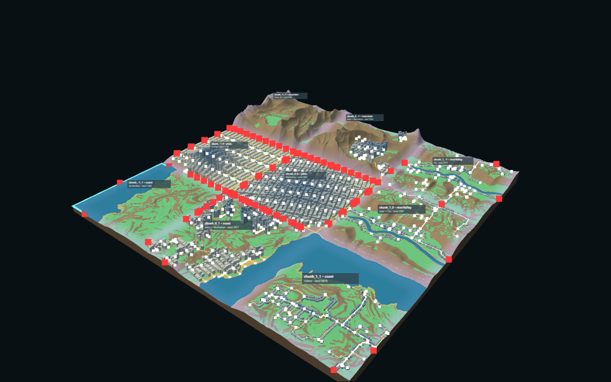
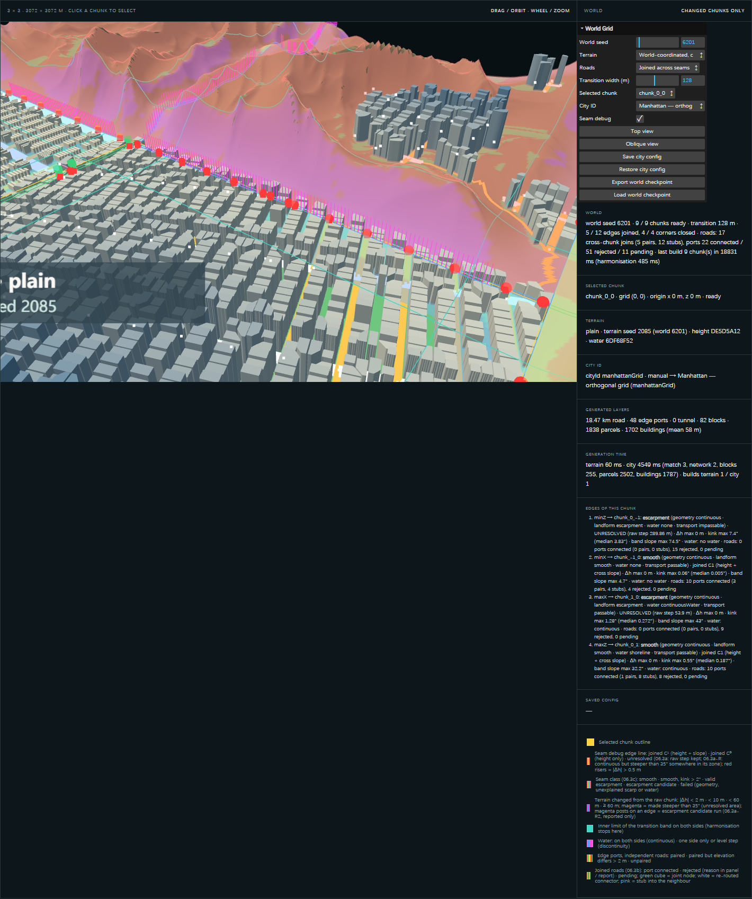

# Next Session — Procedural Mini World Hand-off

> Written 2026-10-21 (release M06). Open this first when you return to VS Code / Codex / Claude Code. Stage authority stays the [project compass](./FINAL-EXPERIMENT-LOG.md) §1 and §5; this page is the practical entry point.

## 1. Where the project stands

- **Stage:** T7 (≥ 3 tiles joined, delivery) — World Grid seams. Tasks 06.3b (road seam), 06.3a-R (macro-ramp terrain), 06.3a-R2 (core-preserving terrain, now the default), 06.3c (seam classification) are **implemented and verified, all Pending review**. Nothing in T1–T7 is accepted yet; the midterm review decisions are still open.
- **What works now (world seed 6201, W 128):** 12 / 12 shared edges one continuous surface (Δh 0, 4 / 4 corners); chunk cores unchanged; 5 smooth seams + 7 valid escarpments, 0 candidates, 0 failures; 17 cross-chunk road joins on smooth edges; every chunk's city layers rebuilt on the stitched network.
- **Full record:** [FINAL-EXPERIMENT-LOG.md](./FINAL-EXPERIMENT-LOG.md) entries 06.3b, 06.3a-R, 06.3a-R2, 06.3c, M06.

## 2. Git

| Item | Value |
| --- | --- |
| Working branch | `experiment/terrain-seam` (pushed to `origin`) |
| Release commit | `1f63e6f` — "M06 checkpoint: World Grid seams, terrain coordination, World State checkpoint" (also `main`, fast-forward) |
| Hand-off commit | the commit that adds this page, on `experiment/terrain-seam` only (documentation; `main` stays at `1f63e6f` so no second deployment) |
| Left uncommitted on purpose | deletion of `terrain-seam-overview.png` and `terrain-seam-topology.png` at the repository root — origin unknown, the files are still in Git. Decide: `git restore` them, or commit the deletion. |

## 3. Public site

- **URL:** <https://gameeeee-zc626.web.app> · World Grid: <https://gameeeee-zc626.web.app/experiments/world-grid/> · with the saved world: <https://gameeeee-zc626.web.app/experiments/world-grid/?checkpoint=default>
- **Deployed by:** GitHub Actions "Deploy to Firebase Hosting on merge", run 39550615439 (push of `1f63e6f` to `main`), success 2026-10-21 05:38:43 UTC. Firebase project `gameeeee-zc626` (unchanged, no manual deploy).
- **Verified on the public URL (2026-10-21 05:39 UTC):** `verify-world-checkpoint` 7 / 7, `verify-live-release` 10 / 10, `verify-hosted-experiments` all routes, 0 browser errors.

## 4. Saved World State

- **File:** [experiments/world-grid/checkpoints/world-6201-checkpoint-v1.json](../../experiments/world-grid/checkpoints/world-6201-checkpoint-v1.json) — `procedural-mini-world/world-checkpoint`, version 1: world seed 6201, transition width 128 m, variation 0.5, terrain `coordinated` (06.3a-R2 + 06.3c), roads `joined`; the 3 × 3 layout with grid coordinates, origins, landforms, terrain seeds, City IDs and Auto / Manual / Empty mode; the parameters and version labels of every rule set; the expected signatures of all 9 chunks and the 12 seam classes. No meshes: the world is regenerated from seeds and configuration.
- **Restore:** open `/experiments/world-grid/?checkpoint=default` (bundled file), or GUI **Load world checkpoint** and pick the JSON. The panel's *Saved config* line reports "reproduced: all signatures match" or the mismatches. **Export world checkpoint** downloads the current world in the same format. The older **Save / Restore city config** (browser localStorage) still works across a page reload.
- **Code:** [worldCheckpoint.js](../../experiments/world-grid/worldCheckpoint.js) (wraps `serialiseWorld` / `restoreWorld` from [worldConfig.js](../../experiments/world-grid/worldConfig.js)).

## 5. Recent results





More: [06.3c seam classes](../assets/screenshots/procedural-mini-world/06-3c-seam-classes-overall.png), [06.3a-R2 cross-sections](../assets/screenshots/procedural-mini-world/06-3a-r2-sections.png), [06.3b road pairs](../assets/screenshots/procedural-mini-world/06-3b-road-pair-closeup-compare.png).

## 6. Open problems

- **Seam:** at W 64 mountain scarps exceed 75° (candidates: need cliff geometry); the 75° / 1 m / 2° thresholds are assumptions; no `incompatibleLevels` case has occurred yet.
- **Water:** sea enters plain bands lowered toward a sea-held corner; rivers end at chunk edges (no river joins); band shorelines move more at W 256.
- **Road:** the road seam joins smooth edges only; passable stretches on scarp edges are not used; Amsterdam on coast chunk_-1_1 (seed 6201) generates 0 km of road and 0 buildings.
- **Tunnel:** known 05.1b-2 defect (world seed 6202, chunk_0_-1, Chicago: open cut, isolated, not fixed); tunnel algorithm frozen.
- **Data:** auto-matched City DNAs follow the coordinated terrain (band correction), not the datum shift (audit exact).

## 7. Next single task

**Decide one of the two 06.3c follow-ups** (your decision, then one task): (a) dedicated geometry for scarps steeper than 75° (cliff mesh) — files `experiments/world-grid/TerrainCoordinator.js`, `SeamClassifier.js`; or (b) let the road seam use passable stretches on escarpment edges — file `experiments/world-grid/RoadSeam.js`. Before either: record the review decisions for 06.3b–06.3c in the compass.

## 8. Start the project locally

```text
cd <repository root>                     (the folder with AGENTS.md, under D:\Documents\GitHub\)
git switch experiment/terrain-seam      (already the checked-out branch)
npm run dev                              (VS Code terminal; bundled Node: .tools\node-v24.19.0-win-x64)
```

- Verified on 2026-10-21 after stopping every server: a fresh `npm run dev` (bundled Node 24.19, Vite 7.3.6) is ready in 0.3 s and `node scripts/verify-world-checkpoint.mjs http://localhost:5173` passes 7 / 7 (the saved world is reproduced exactly).
- `dev.cmd` could not be verified from the agent shell: a newly started `cmd` reported "dev.cmd is not recognized" when launched there, probably because of the full-width character at the end of the repository folder name. If double-clicking `dev.cmd` fails for you as well, use `npm run dev` (or rename the folder to ASCII in a separate, deliberate step).

- Local pages: <http://localhost:5173/> (hub), <http://localhost:5173/experiments/world-grid/> (World Grid), `?checkpoint=default` for the saved world, `?seams=1` for the seam debug layer, `?terrain=harmonized|macroRamp|raw` and `?roads=independent` for earlier variants, <http://localhost:5173/experiments/seed-terrain/> (single chunk).
- Verifiers (each starts its own Vite server): `node scripts/verify-seam-classes.mjs`, `verify-terrain-coordinator.mjs`, `verify-road-seam.mjs`, `verify-world-grid.mjs`; release checks against any URL: `node scripts/verify-world-checkpoint.mjs <url>`, `verify-live-release.mjs <url>`, `verify-hosted-experiments.mjs <url>`. Most verifiers overwrite their evidence files and screenshots — back them up or restore with Git afterwards.
- Deployment: push to `main` deploys automatically (GitHub Actions); do not also run `firebase deploy`.
