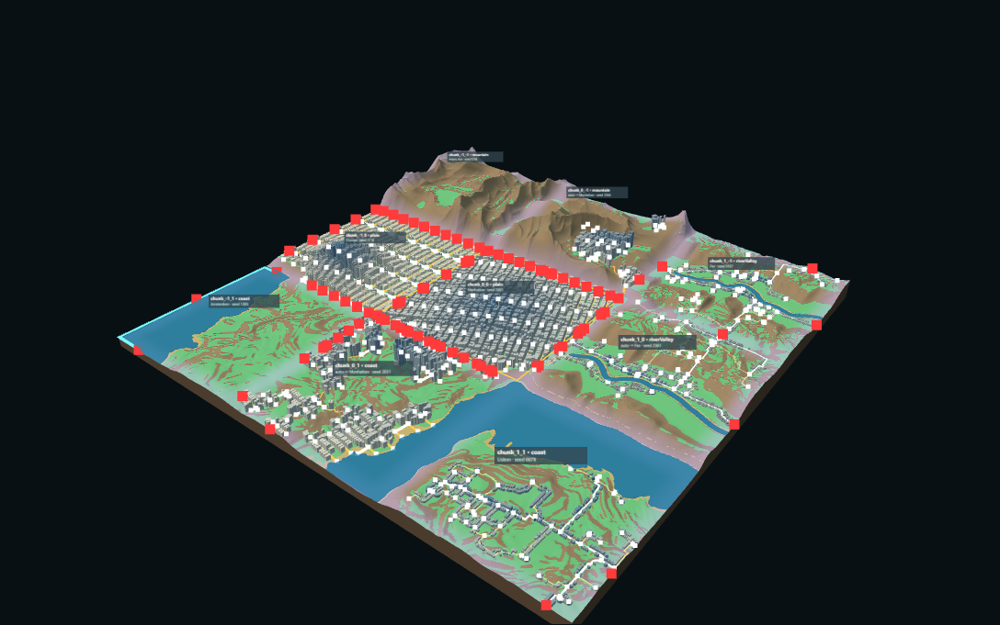
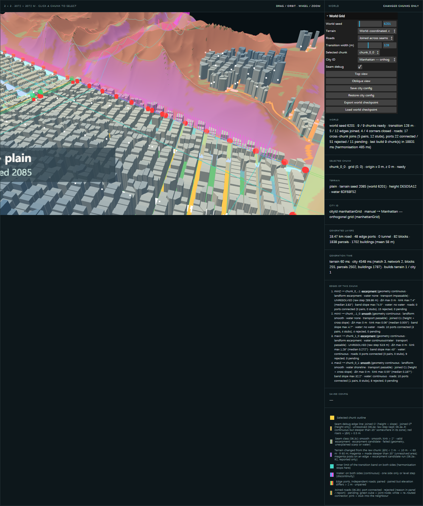

# Next Session — Procedural Mini World Hand-off

## Update 2026-11-01: G02c-01 road-driven growth (read first)

- **Done:** real road fronts as scheduler candidates, opt-in by `growthMode: 'road'`. Note: [G02c-Road-Driven-Growth](./A-City-of-Cities/G02c-Road-Driven-Growth.md). Check with `node --max-old-space-size=8192 scripts/verify-road-driven-growth.mjs`. View at `/experiments/city-of-cities/?growthMode=road`.
- **State:** pending review, uncommitted, on `experiment/procedural-growing-world`. Not on `main`, not on the site.
- **Next decision:** what to do with the road ends that meet in the image but are not joined (41 on seed 6202), before G03c.
- **Careful:**
  - `verify-morph-growth.mjs` and `verify-urban-encounter.mjs` with `--node-only` overwrite their evidence and clear its browser record. Restore the file after a regression run.
  - `verify-inspector-docs.mjs` reports 3 needs-review items until the summaries are re-read against the changed files.

## Update 2026-11-02: WEB-01 frozen, back to growth research

- **Next work:** G02c / G03c: road-first growth and encounters in the multi-city scheduler, with morphological continuity. Start from the [G02b note](./A-City-of-Cities/G02b-Morphological-Growth.md) and the [G03b note](./A-City-of-Cities/G03b-Urban-Encounter.md), then the [Research Compass](./A-City-of-Cities-Research-Compass.md) and compass §1. Code: `experiments/city-of-cities/`. Choose the single task first; it is not chosen yet.
- **Website:** https://gameeeee-zc626.web.app, commit `ad6acd6`, tag `release/city-of-cities-web-v1`. Maintenance only: see [WEB-01 summary](./A-City-of-Cities/WEB-01-Interactive-Research-Website.md).
- **Careful:** a push to `main` deploys. Develop on `experiment/procedural-growing-world`.
- **If generators change:** the bake stops when output differs from the saved state. That is expected for new behaviour: keep the released replay until a new verified run exists.
- **Still with a person:** sign [Algorithm-Review.md](./A-City-of-Cities/Algorithm-Review.md) (0 of 26), and try Firefox, Safari, a real phone, an ordinary laptop.
- **Rollback until about 2026-12-02:** `firebase hosting:clone gameeeee-zc626:pre-web01-backup gameeeee-zc626:live`.

## Update 2026-11-02: WEB-01e

- **Preview:** https://gameeeee-zc626--web01e-rc1-jt90taw2.web.app (commit `84488ab`, channel `web01e-rc1`, expires after 14 days). Production and `main` are unchanged.
- **Branch:** `experiment/procedural-growing-world`, pushed.
- **To do by a person:** watch the film; sign [Algorithm-Review.md](./A-City-of-Cities/Algorithm-Review.md) (0 of 25 signed); test a real phone and an ordinary laptop, plus Firefox and Safari.
- **Do not:** merge to `main` (it deploys automatically) or open a pull request (it creates another preview) before that review.
- **If generators change:** run `node scripts/bake-film-world.mjs`, `node scripts/record-film-part2.mjs`, `node scripts/verify-inspector-docs.mjs`. Check a deployed copy with `node scripts/verify-preview.mjs <url>`.
- **Open from before:** two root PNGs are deleted in the working tree, origin unknown, not committed.

## Update 2026-11-01: WEB-01

The site now opens on the Interactive Procedural Film. Run `npm run dev` and open `http://localhost:5173/`. Check it with `node scripts/verify-procedural-film.mjs`. Not deployed, not committed. Next: review the film in a browser, then WEB-01c. Full record and known issues: log entries WEB-01 and WEB-01b-R1 (speed, Watch / Inspect, Algorithm Inspector; press I in the film), and WEB-01c (Part II: recorded world and case study). Log entry WEB-01d adds the Guided Tour and the Inspector audit: run `node scripts/verify-inspector-docs.mjs` after changing a generator. If the generators change, re-run `node scripts/bake-film-world.mjs`; it stops if the output no longer equals the saved verified state.

## Hand-off 2026-10-28

Open this page first next session. It is a summary, not a second compass:

- **Stage status:** [project compass](./FINAL-EXPERIMENT-LOG.md) §1 and §5.
- **Research framing:** [A City of Cities — Research Compass](./A-City-of-Cities-Research-Compass.md).

### A. Where the project stands

**Research mainline:** *A City of Cities — The Emergence of a Plural Urban World through Procedural Growth.* Six cities (Venice, Manhattan, Fez, Amsterdam, Lisbon, Chicago) start from their own core chunks and grow chunk by chunk. The world map is the outcome, not a preset 3 × 3 layout.

| Stage | Status | Note / log entry |
| --- | --- | --- |
| G00 Preserve & Recover | Done (checkpoint `79687a0`) | log G00 |
| G00-R Research Compass | Written, pending review | [Research Compass](./A-City-of-Cities-Research-Compass.md), log G00-R |
| G01 Multi-Origin Initialization | Implemented, verified on seeds 6201 / 6202 / 6203, pending review | [G01 note](./A-City-of-Cities/G01-Multi-Origin-Initialization.md) (§11 = placement v2 fix), log G01-MO, G01-FIX |
| G02 Procedural Urban Growth | Implemented, verified (Node + browser, 30 steps, three seeds), pending review | [G02 note](./A-City-of-Cities/G02-Procedural-Urban-Growth.md), log G02, G02-V |
| G02b Morphological Growth (road-first, one city) | Implemented, verified (seed 6201: Manhattan, Fez; Chicago failure path), pending review | [G02b note](./A-City-of-Cities/G02b-Morphological-Growth.md), log G02b |
| G03a Urban Territory & Spatial Relationships | Implemented, verified (6201 / 6202 / 6203, 0 / 10 / 30 steps), pending review | [G03a note](./A-City-of-Cities/G03a-Urban-Territory.md), log G03a |
| PRESENTATION-01 class film | Done: 75 s MP4, real output of seed 6201 | [presentation/city-of-cities/README.md](../../presentation/city-of-cities/README.md), log PRESENTATION-01 |
| G03b Urban Encounter & Morphological Negotiation (Chicago × Fez, test fixture) | Implemented, verified (seed 6201, Node + browser), pending review | [G03b note](./A-City-of-Cities/G03b-Urban-Encounter.md), log G03b |
| G03c–G05 | Not started (encounters in the scheduler proposed in the G03b note §10) | — |

**Earlier, exploratory:** the growth prototype `/experiments/growing-world/` (log G01, 2026-10-27) stays runnable and is superseded by `/experiments/city-of-cities/`. The static 3 × 3 World Grid, Terrain Seam and City Influence experiments are unchanged and are history.

**Nothing has been accepted yet.** Passing verifiers are data checks, not a spatial review.

### B. Git

- **Branch:** `experiment/procedural-growing-world`, local only, **not pushed**; `main` and the public site are unchanged.
- **Commits today:**
  - `79687a0`: G00 checkpoint (07.1 / 07.1a)
  - `c3e2e5f`: growth prototype + Research Compass
  - `69b3a1f`: G01 Multi-Origin Initialization
  - `91efb1e`: G02 + G01 placement v2
- **Uncommitted:** the whole `presentation/` folder (film tooling, poster, storyboard, `capture-config.json`, this hand-off and the log entry). The MP4 (73.9 MB) and the decoded check frames are git-ignored by `presentation/city-of-cities/.gitignore`.
- **Still open from M06:** the root files `terrain-seam-overview.png` and `terrain-seam-topology.png` are deleted in the working tree but not staged (origin unknown). Decide: `git restore` them or commit the deletion.

### C. Start again tomorrow

```bash
npm run dev            # Vite; open the URLs below (use 127.0.0.1 if localhost does not resolve)
```

| What | URL / command |
| --- | --- |
| G01 + G02 world (origins, Grow one / multiple steps, frontier, territory, history, save / load) | <http://127.0.0.1:5173/experiments/city-of-cities/> (add `?worldSeed=6202`, or `&steps=10` to grow on load) |
| Growth prototype (2026-10-27, history) | <http://127.0.0.1:5173/experiments/growing-world/> |
| Static 3 × 3 World Grid (history) | <http://127.0.0.1:5173/experiments/world-grid/> |
| Film render page (preview) | <http://127.0.0.1:5173/presentation/city-of-cities/>, then `await __film.prepare()` and `__film.renderFrame(seconds)` in the console |
| The film | `presentation/city-of-cities/A-City-of-Cities.mp4`; re-export with `node presentation/city-of-cities/capture.mjs` (≈ 3 min) |
| G01 verifier | `node scripts/verify-city-of-cities.mjs` (≈ 6 min; `--browser-only` reuses the Node record) |
| G02 verifier | `node scripts/verify-city-growth.mjs` (≈ 25 min; `--node-only`, `--browser-only`, `--seeds=6201`) |
| G03a verifier | `node scripts/verify-city-territory.mjs` (≈ 25 min; same flags) |
| G02b verifier | `node --max-old-space-size=8192 scripts/verify-morph-growth.mjs` (≈ 8 min; `--node-only`, `--browser-only`) |
| G03b verifier | `node --max-old-space-size=8192 scripts/verify-urban-encounter.mjs` (≈ 5 min; `--node-only`, `--browser-only`); page `?fixture=compatible` / `incompatible` / `barrier` |
| Single-chunk regression | `node scripts/verify-city-dna.mjs`, then restore its re-rendered 06.1 files with `git checkout -- docs/assets/screenshots/procedural-mini-world/06-1-*.png experiments/seed-terrain/evidence/city-dna-comparison.json` |
| Docs link check | `node scripts/verify-markdown-links.mjs` |

**The dev server does not survive a closed session;** start it again each time.

### D. Known open problems (all recorded, none fixed)

1. **G02 near-fixed quotas.** The scheduler bid term 1 / (1 + chunks grown) dominates: Manhattan and Chicago reach 8 chunks on every seed. Suitability decides *where* a city grows more than *how much*.
2. **Empty chunks.** Some Amsterdam chunks (including the 6203 core) generate 0 buildings. Neither placement nor growth checks generator output.
3. **Trapped city.** On 6203 Venice ends with 0 eligible candidates.
4. **G01 placement v2 trade-off.** Water-required cities often get river-valley sites with lower suitability (0.43–0.50).
5. **Seams.** 0 continuous shared edges, 94–127 unpaired road ports; the cliffs between chunks are visible in the film.
6. **Performance.** Generation is synchronous (2–8 s UI pause per step); about 15 MB per rendered chunk; no unloading.
7. **Film.** It depends on the mp4-muxer CDN for re-export (FFmpeg is not installed). The parcels stage uses a presentation-only grey for interior land. One tag briefly overlaps geometry near 66 s.

### E. Next single task (to choose after the class)

- **First:** review G01-FIX, G02, G03a and the film; decide whether to commit `presentation/` and the uncommitted G03a work.
- **Then one of:**
  - (a) the G02 scheduler quota decision;
  - (b) a generator viability check (`nonViable` chunks);
  - (c) start G03 Territory & Encounter (Research Compass §8).
- **Rules (AGENTS.md):** one task at a time; no G03 before the review.

---

*Previous hand-off (M06, 2026-10-21), kept as history:*

> Written 2026-10-21 (release M06). Open this first when you return to VS Code / Codex / Claude Code. Stage authority stays the [project compass](./FINAL-EXPERIMENT-LOG.md) §1 and §5; this page is the practical entry point.

## 1. Where the project stands

- **Stage:** T7 (≥ 3 tiles joined, delivery) — World Grid seams. Tasks 06.3b (road seam), 06.3a-R (macro-ramp terrain), 06.3a-R2 (core-preserving terrain, now the default), 06.3c (seam classification) are **implemented and verified, all Pending review**. Nothing in T1–T7 is accepted yet; the midterm review decisions are still open.
- **What works now (world seed 6201, W 128):** 12 / 12 shared edges one continuous surface (Δh 0, 4 / 4 corners); chunk cores unchanged; 5 smooth seams + 7 valid escarpments, 0 candidates, 0 failures; 17 cross-chunk road joins on smooth edges; every chunk's city layers rebuilt on the stitched network.
- **Full record:** [FINAL-EXPERIMENT-LOG.md](./FINAL-EXPERIMENT-LOG.md) entries 06.3b, 06.3a-R, 06.3a-R2, 06.3c, M06.

## 2. Git

| Item | Value |
| --- | --- |
| Working branch | `experiment/terrain-seam` (pushed to `origin`) |
| Release commit | `1f63e6f` — "M06 checkpoint: World Grid seams, terrain coordination, World State checkpoint" (also `main`, fast-forward) |
| Hand-off commit | the commit that adds this page, on `experiment/terrain-seam` only (documentation; `main` stays at `1f63e6f` so no second deployment) |
| Left uncommitted on purpose | deletion of `terrain-seam-overview.png` and `terrain-seam-topology.png` at the repository root — origin unknown, the files are still in Git. Decide: `git restore` them, or commit the deletion. |

## 3. Public site

- **URL:** <https://gameeeee-zc626.web.app> · World Grid: <https://gameeeee-zc626.web.app/experiments/world-grid/> · with the saved world: <https://gameeeee-zc626.web.app/experiments/world-grid/?checkpoint=default>
- **Deployed by:** GitHub Actions "Deploy to Firebase Hosting on merge", run 39550615439 (push of `1f63e6f` to `main`), success 2026-10-21 05:38:43 UTC. Firebase project `gameeeee-zc626` (unchanged, no manual deploy).
- **Verified on the public URL (2026-10-21 05:39 UTC):** `verify-world-checkpoint` 7 / 7, `verify-live-release` 10 / 10, `verify-hosted-experiments` all routes, 0 browser errors.

## 4. Saved World State

- **File:** [experiments/world-grid/checkpoints/world-6201-checkpoint-v1.json](../../experiments/world-grid/checkpoints/world-6201-checkpoint-v1.json) — `procedural-mini-world/world-checkpoint`, version 1: world seed 6201, transition width 128 m, variation 0.5, terrain `coordinated` (06.3a-R2 + 06.3c), roads `joined`; the 3 × 3 layout with grid coordinates, origins, landforms, terrain seeds, City IDs and Auto / Manual / Empty mode; the parameters and version labels of every rule set; the expected signatures of all 9 chunks and the 12 seam classes. No meshes: the world is regenerated from seeds and configuration.
- **Restore:** open `/experiments/world-grid/?checkpoint=default` (bundled file), or GUI **Load world checkpoint** and pick the JSON. The panel's *Saved config* line reports "reproduced: all signatures match" or the mismatches. **Export world checkpoint** downloads the current world in the same format. The older **Save / Restore city config** (browser localStorage) still works across a page reload.
- **Code:** [worldCheckpoint.js](../../experiments/world-grid/worldCheckpoint.js) (wraps `serialiseWorld` / `restoreWorld` from [worldConfig.js](../../experiments/world-grid/worldConfig.js)).

## 5. Recent results





More: [06.3c seam classes](../assets/screenshots/procedural-mini-world/06-3c-seam-classes-overall.png), [06.3a-R2 cross-sections](../assets/screenshots/procedural-mini-world/06-3a-r2-sections.png), [06.3b road pairs](../assets/screenshots/procedural-mini-world/06-3b-road-pair-closeup-compare.png).

## 6. Open problems

- **Seam:** at W 64 mountain scarps exceed 75° (candidates: need cliff geometry); the 75° / 1 m / 2° thresholds are assumptions; no `incompatibleLevels` case has occurred yet.
- **Water:** sea enters plain bands lowered toward a sea-held corner; rivers end at chunk edges (no river joins); band shorelines move more at W 256.
- **Road:** the road seam joins smooth edges only; passable stretches on scarp edges are not used; Amsterdam on coast chunk_-1_1 (seed 6201) generates 0 km of road and 0 buildings.
- **Tunnel:** known 05.1b-2 defect (world seed 6202, chunk_0_-1, Chicago: open cut, isolated, not fixed); tunnel algorithm frozen.
- **Data:** auto-matched City DNAs follow the coordinated terrain (band correction), not the datum shift (audit exact).

## 7. Next single task

**Decide one of the two 06.3c follow-ups** (your decision, then one task): (a) dedicated geometry for scarps steeper than 75° (cliff mesh) — files `experiments/world-grid/TerrainCoordinator.js`, `SeamClassifier.js`; or (b) let the road seam use passable stretches on escarpment edges — file `experiments/world-grid/RoadSeam.js`. Before either: record the review decisions for 06.3b–06.3c in the compass.

## 8. Start the project locally

```text
cd <repository root>                     (the folder with AGENTS.md, under D:\Documents\GitHub\)
git switch experiment/terrain-seam      (already the checked-out branch)
npm run dev                              (VS Code terminal; bundled Node: .tools\node-v24.19.0-win-x64)
```

- Verified on 2026-10-21 after stopping every server: a fresh `npm run dev` (bundled Node 24.19, Vite 7.3.6) is ready in 0.3 s and `node scripts/verify-world-checkpoint.mjs http://localhost:5173` passes 7 / 7 (the saved world is reproduced exactly).
- `dev.cmd` could not be verified from the agent shell: a newly started `cmd` reported "dev.cmd is not recognized" when launched there, probably because of the full-width character at the end of the repository folder name. If double-clicking `dev.cmd` fails for you as well, use `npm run dev` (or rename the folder to ASCII in a separate, deliberate step).

- Local pages: <http://localhost:5173/> (hub), <http://localhost:5173/experiments/world-grid/> (World Grid), `?checkpoint=default` for the saved world, `?seams=1` for the seam debug layer, `?terrain=harmonized|macroRamp|raw` and `?roads=independent` for earlier variants, <http://localhost:5173/experiments/seed-terrain/> (single chunk).
- Verifiers (each starts its own Vite server): `node scripts/verify-seam-classes.mjs`, `verify-terrain-coordinator.mjs`, `verify-road-seam.mjs`, `verify-world-grid.mjs`; release checks against any URL: `node scripts/verify-world-checkpoint.mjs <url>`, `verify-live-release.mjs <url>`, `verify-hosted-experiments.mjs <url>`. Most verifiers overwrite their evidence files and screenshots — back them up or restore with Git afterwards.
- Deployment: push to `main` deploys automatically (GitHub Actions); do not also run `firebase deploy`.
