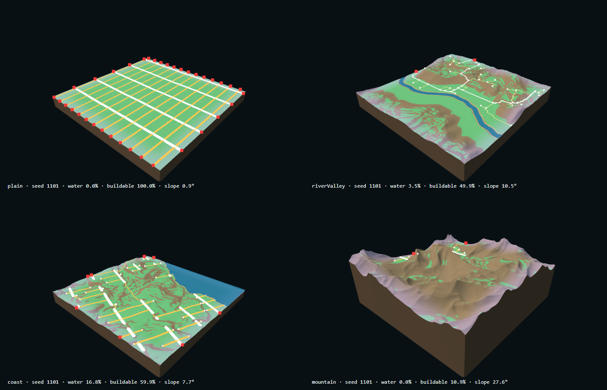
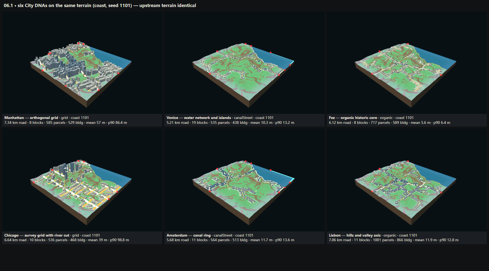
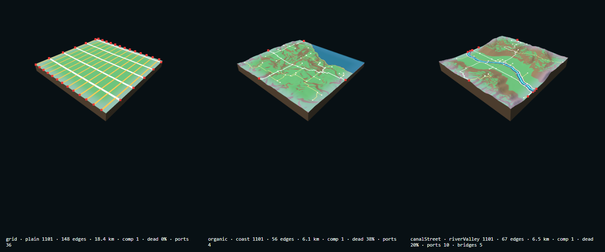
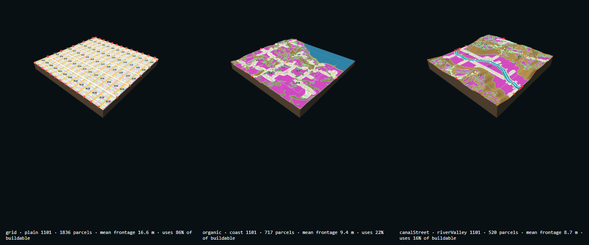
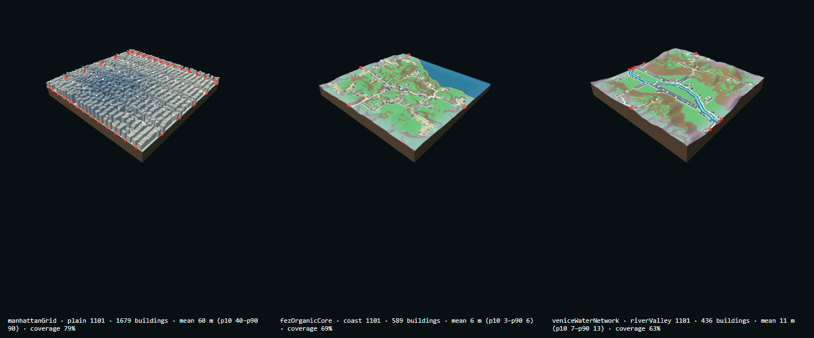
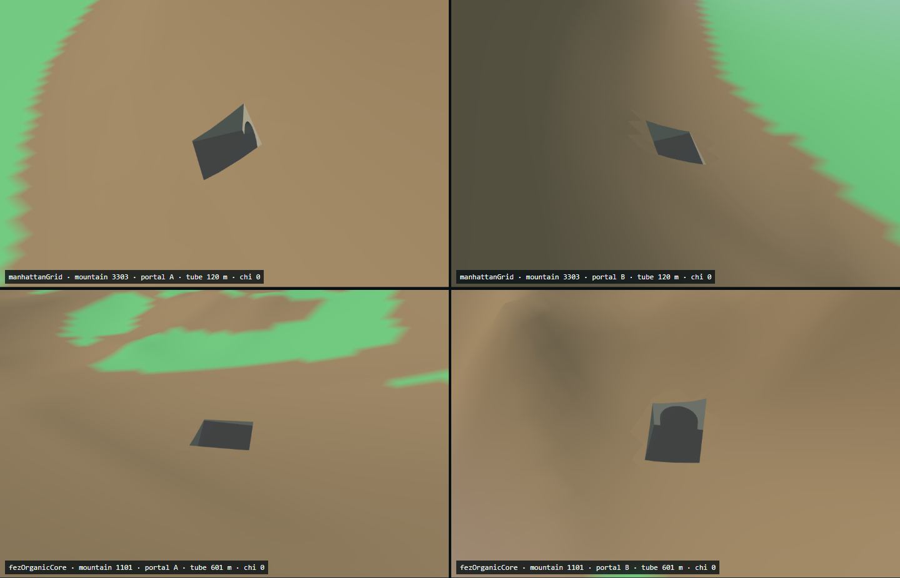
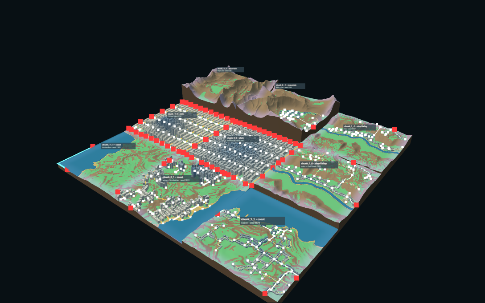
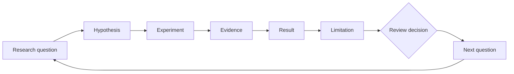

# Procedural Mini World — Research, Experiments, and Midterm Review

The study notebook of the Procedural Mini World project. Each piece of work is recorded as **research question → hypothesis → experiment → evidence → result → limitation → review decision → next question**. The only authority for stage status is the project compass, [FINAL-EXPERIMENT-LOG.md §1–§5](./FINAL-EXPERIMENT-LOG.md); this page mirrors it and links to the evidence.

## 1. Project Question

> How can a city's characteristics be encoded as controllable procedural rules? When those rules change continuously, mix with each other, or are stitched together, how is the city's identity kept, weakened, or re-formed?

A city's identity is studied as **spatial relations** between terrain, water, streets, plots, and buildings, not as landmarks or a visual copy. The result is a controllable, reproducible, joinable set of rules, not a game. The seed gives reproducible variation inside the rules; the City DNA carries identity. → [Project Foundation](./01-foundation/project-foundation.md)

## 2. Current Review Status

**Status words used on this page:**
- **Implemented:** code exists and runs.
- **Verified:** its automated verifier passes. This checks data validity (reproducibility, geometry, legality), not spatial quality.
- **Pending review:** awaiting a human decision.
- **Accepted / Rejected:** a recorded human decision.
- **Proposed:** planned, not implemented.
- **Historical:** superseded or archived, kept for the record.

A passing build or verifier is never an *accepted* spatial result. **As of 2026-10-20, no task has been Accepted or Rejected.**

| Item | Current status | Evidence | Review action |
| --- | --- | --- | --- |
| R — research base (60 cities, prototypes, Manhattan study) | Implemented as documents · Pending review; measurements Proposed | [longlist](./research/city-longlist-60.md), [prototype selection](./research/prototype-city-selection.md), [Manhattan study](./research/manhattan-spatial-study.md) | accept the 3 prototypes; decide whether 00.3 / 01.1 get log entries |
| T1 seed terrain (02.4) | Implemented · Verified · Pending review | `verify-seed-terrain.mjs`, `seed-validation.json` | accept or tune the landform presets |
| T2 terrain analysis (02.5) | Implemented · Verified · Pending review | `verify-terrain-analysis.mjs`, `terrain-analysis.json` | review the thresholds |
| T3 City DNA matching (02.6, 06.1) | Implemented · Verified · Pending review; thresholds unverified assumptions | `verify-city-match.mjs`, `verify-city-dna.mjs`, `city-dna-comparison.json` | review the rule table; decide on terrain rules for Chicago / Amsterdam |
| T4 roads, canals, tunnels (03.1–03.3, 05.1b-2) | Implemented · Verified · Pending review; one known tunnel defect | `verify-road-network`, `verify-loops`, `verify-tunnels`, `verify-tunnel-excavation` | decide grid truncation / bridge policy, loop limits, portal grades |
| T5 blocks and parcels (04.1, 04.1b, 04.2) | Implemented · Verified · Pending review | `verify-blocks`, `verify-block-refinement`, `verify-parcels` | decide on interior reserve access |
| T6 buildings and solid terrain (05.1, 05.1b-1) | Implemented · Verified · Pending review; heights are assumptions | `verify-buildings`, `verify-solid-terrain` | check heights against research |
| T7 multi-chunk world (06.2, 06.3a) | Implemented (partial: 4 / 12 edges joined) · Verified · Pending review | `verify-world-grid`, `verify-world-seam`, `world-seam.json` | decide the policy for unjoinable edges |
| Earlier versions (02.1, 02.2, 02.2b, 02.3) | Historical | [Terrain Experiments](./04-experiments/terrain-experiments.md) | none |
| City influence, expansion, DNA mixing | Proposed | [City Influence](./03-generative-system/city-influence.md) | waits for the T7 edge decision |
| Release (M01, M02b) | Implemented · Verified online | `verify-live-release.mjs` 10 / 10; [Deployment History](./06-release/deployment-history.md) | none |

## 3. Start Here

0. **[Next session hand-off](./NEXT_SESSION.md).** Current stage, Git commit, public URL, saved World State, open problems, the next single task, and the local start commands.
1. **[Project compass](./FINAL-EXPERIMENT-LOG.md), §1 and §5.** Read this first: it defines the question, the stages, and what is in or out of scope right now.
2. **[Terrain & Water](./03-generative-system/terrain-and-water.md) and [Terrain Analysis](./03-generative-system/terrain-analysis.md).** Everything starts from a city-neutral site, so understand the tile, the four landforms, and how the site is read.
3. **[City DNA Matching](./03-generative-system/city-dna-matching.md).** Next, see how a city is *chosen to fit* that site rather than imposed on it, and what is still an assumption.
4. **[Road & Tunnel](./03-generative-system/road-and-tunnel.md), then [Block & Parcel](./03-generative-system/block-and-parcel.md).** The DNA's first visible effect is its street skeleton; blocks and plots follow from it.
5. **[Building Extrusion](./03-generative-system/building-extrusion.md).** The last layer of a single tile: volumes on plots, with the heights still unverified.
6. **[World Grid & Seam](./03-generative-system/world-grid-and-seam.md).** Nine tiles meet. This is where the research question about stitching begins, and where the main open problems are.
7. **[Midterm Overview](./midterm-review/00-midterm-review.md).** The 5–8 minute summary for review, with results and limitations.

For the whole build history with every screenshot on one page, see the [Experiment Archive](./04-experiments/EXP-Procedural-Mini-World/Procedural-Mini-World.md).

### All notes by category

| Category | Notes |
| --- | --- |
| 01 Project Foundation | [Compass and log](./FINAL-EXPERIMENT-LOG.md) · [Proposal, principles, design evolution, roadmap](./01-foundation/project-foundation.md) · [AGENTS.md](../../AGENTS.md) |
| 02 City Research | [Research template](./research/city-research-template.md) + [CSV](./research/city-research-template.csv) · [60-city database and families](./research/city-longlist-60.md) · [Prototype selection](./research/prototype-city-selection.md) · [Manhattan study](./research/manhattan-spatial-study.md) · [City DNA Library](./research/city-dna-library.md) |
| 03 Generative System | [System Architecture](./03-generative-system/system-architecture.md) · [Terrain & Water](./03-generative-system/terrain-and-water.md) · [Terrain Analysis](./03-generative-system/terrain-analysis.md) · [City DNA Matching](./03-generative-system/city-dna-matching.md) · [Road & Tunnel](./03-generative-system/road-and-tunnel.md) · [Block & Parcel](./03-generative-system/block-and-parcel.md) · [Building Extrusion](./03-generative-system/building-extrusion.md) · [World Grid & Seam](./03-generative-system/world-grid-and-seam.md) · [City Influence (proposed)](./03-generative-system/city-influence.md) |
| 04 Experiments | [Experiment Index](./EXPERIMENT-INDEX.md) · [Terrain](./04-experiments/terrain-experiments.md) · [Network](./04-experiments/network-experiments.md) · [Urban Form](./04-experiments/urban-form-experiments.md) · [World](./04-experiments/world-experiments.md) · [Archived](./04-experiments/archived-experiments.md) · [Experiment Archive (single page)](./04-experiments/EXP-Procedural-Mini-World/Procedural-Mini-World.md) |
| 05 Midterm Review | [Overview](./midterm-review/00-midterm-review.md) and chapters [1](./midterm-review/01-project-statement.md) · [2](./midterm-review/02-system-workflow.md) · [3](./midterm-review/03-key-parameters.md) · [4](./midterm-review/04-experiments.md) · [5](./midterm-review/05-midterm-results.md) · [6](./midterm-review/06-limitations.md) · [7](./midterm-review/07-next-steps.md) |
| 06 Release & Resources | [GitHub, Firebase, references, attribution](./06-release/release-and-resources.md) · [Deployment History](./06-release/deployment-history.md) |
| 99 Attachments | [Screenshot Index](./99-attachments/screenshot-index.md) |
| Dated session logs | [2026-10-18](../logs/2026-10-18.md) · [2026-10-19](../logs/2026-10-19.md) |

## 4. Terrain-first Pipeline

Each step reads only the steps before it and never changes them. That is why one tile's city can be swapped without regenerating its terrain (06.2). The design changed on 2026-10-18: earlier, a City DNA shaped its own terrain (02.1, now Historical); since then, terrain is generated city-neutral first and the DNA is matched to it. Frozen tile specification: 1024 m × 1024 m, 257 × 257 samples, 4 m spacing; transition width adjustable from 32 to 256 m. → [System Architecture](./03-generative-system/system-architecture.md)

## 5. Stage Dashboard

*Every stage from T1 to T7 is also **Pending review**; "Verified" means only that its scripts pass.*

| Stage | Code | Screenshot | Data | Verifier | Review |
| --- | --- | --- | --- | --- | --- |
| T1 | `seed-terrain/TerrainGenerator.js`, `TerrainFields.js` | [02-4-landforms-overall](../assets/screenshots/procedural-mini-world/02-4-landforms-overall.png) | `seed-validation.json` | `verify-seed-terrain.mjs` | Pending |
| T2 | `seed-terrain/TerrainAnalysis.js` | [02-5-suitability-debug](../assets/screenshots/procedural-mini-world/02-5-suitability-debug.png) | `terrain-analysis.json` | `verify-terrain-analysis.mjs` | Pending |
| T3 | `seed-terrain/cityMatchRules.js`, `CityMatcher.js` | [06-1-six-cities-shared-terrain](../assets/screenshots/procedural-mini-world/06-1-six-cities-shared-terrain.png) | `city-match.json`, `city-dna-comparison.json` | `verify-city-match.mjs`, `verify-city-dna.mjs` | Pending |
| T4 | `seed-terrain/NetworkGenerator.js`, `TunnelPlanner.js`, `TunnelGeometry.js` | [03-1-network-overall](../assets/screenshots/procedural-mini-world/03-1-network-overall.png) | `road-network.json`, `loops.json`, `tunnels.json`, `tunnel-excavation.json` | 4 verifiers | Pending |
| T5 | `seed-terrain/BlockGenerator.js`, `BlockRefinement.js`, `ParcelGenerator.js` | [04-2-parcels-strategies](../assets/screenshots/procedural-mini-world/04-2-parcels-strategies.png) | `blocks.json`, `block-refinement.json`, `parcels.json` | 3 verifiers | Pending |
| T6 | `seed-terrain/BuildingGenerator.js`, `TerrainShell.js` | [05-1-buildings-overall](../assets/screenshots/procedural-mini-world/05-1-buildings-overall.png) | `buildings.json`, `solid-terrain.json` | `verify-buildings.mjs`, `verify-solid-terrain.mjs` | Pending |
| T7 | `world-grid/WorldGrid.js`, `TerrainHarmonizer.js`, `SeamCheck.js` | [06-3a-seam-debug](../assets/screenshots/procedural-mini-world/06-3a-seam-debug.png) | `world-grid.json`, `world-seam.json` | `verify-world-grid.mjs`, `verify-world-seam.mjs` | Pending |

Code paths are under `experiments/`; data files are in each experiment's `evidence/` folder. All 22 verifiers passed on 2026-10-19. Code is in Git since `7b21c3e` (no per-task commits).

## 6. Evidence Gallery

Real runtime captures from the task verifiers, parameters as logged. The full list is in the [Screenshot Index](./99-attachments/screenshot-index.md).

*T1 (02.4): plain, river valley, coast, mountain; seed 1101, variation 0.5, transition 128 m.*

*T2 (02.5): suitability classes on the same four landforms, seed 1101.*

*T3 (06.1): six City DNAs on the same coast terrain, seed 1101; only the rules differ.*

*T4 (03.1): grid on plain, organic on coast, canal-street on river valley; seed 1101.*

*T5 (04.2): road-fronted parcels for the three strategies; seed 1101.*

*T6 (05.1): grey-box volumes for the three strategies; seed 1101.*

*T4 / T6 (05.1b-2): tunnel portals cut into the closed solid; mountain 3303 grid and mountain 1101 organic.*

*T7 (06.3a): 3 × 3 world, world seed 6201, transition 128 m; 4 of 12 edges joined.*

## 7. City DNA Research

The loop above is how every task is recorded. For the city research it currently stands as follows:

| Step | Where it stands | Note |
| --- | --- | --- |
| Question | Which spatial relations make Manhattan, Venice, and Fez recognisable? | [prototype selection](./research/prototype-city-selection.md) |
| Hypothesis | Candidate rules M1–M3, V1–V3, F1–F3 (each with input, condition, output) | [prototype selection §5](./research/prototype-city-selection.md), [Manhattan study §3](./research/manhattan-spatial-study.md) |
| Experiment | The rules are configured as six City DNAs and run on test terrain | [City DNA Library](./research/city-dna-library.md), tasks 02.6, 06.1 |
| Evidence | Source anchors exist (UNESCO, NYC data); **no measurement has been made yet** | [60-city longlist §5](./research/city-longlist-60.md), [Manhattan study §4](./research/manhattan-spatial-study.md) |
| Result | The ranking works and is transparent; all numeric thresholds are assumptions | [City DNA Matching](./03-generative-system/city-dna-matching.md) |
| Limitation | Venice never fits (no lagoon landform); Chicago, Amsterdam, and Lisbon have no research row | [Limitations](./midterm-review/06-limitations.md) |
| Review decision | **Pending:** accept the three prototypes and the rule table | compass §1 |
| Next question | Do Manhattan's measured DEM, street-centreline, and PLUTO values confirm or change rules M1–M3? | [Manhattan study §6](./research/manhattan-spatial-study.md) |

## 8. Experiment Archive

The same tasks are kept in three views. Choose by what you need:

| View | Use it to | Link |
| --- | --- | --- |
| Experiment Index | see every task in one table with its status | [EXPERIMENT-INDEX.md](./EXPERIMENT-INDEX.md) |
| Category cards | check one task's date, seed, test numbers, and open issues | [Terrain](./04-experiments/terrain-experiments.md) · [Network](./04-experiments/network-experiments.md) · [Urban Form](./04-experiments/urban-form-experiments.md) · [World](./04-experiments/world-experiments.md) · [Archived](./04-experiments/archived-experiments.md) |
| Experiment Archive | read the whole build history top to bottom, with every screenshot in place (Obsidian embeds) | [Procedural-Mini-World.md](./04-experiments/EXP-Procedural-Mini-World/Procedural-Mini-World.md) |
| Full record | the original entry for a task ID | [FINAL-EXPERIMENT-LOG.md §7](./FINAL-EXPERIMENT-LOG.md) |

## 9. Midterm Review

[Midterm Overview](./midterm-review/00-midterm-review.md): project statement, research question, generative method, main experiments, verified results, the interactive world prototype, known limitations, and next stage, in 5–8 minutes. Live prototype: [gameeeee-zc626.web.app/#miniWorld](https://gameeeee-zc626.web.app/#miniWorld). The [GitHub repository](https://github.com/Peterrr294/Peter_Chen_Gamingggg) is private and needs an invitation.

## 10. Current Limits and Next Decision

**Current limits (measured, not resolved):**
- **Seams:** height steps at 8 of 12 tile edges in world 6201; 1 of 4 corners closed.
- **Water:** discontinuous on 4 edges.
- **Streets:** ports are not paired across tiles.
- **Tunnels:** one tunnel-geometry defect (mountain 7922 + Chicago).
- **Research calibration:** every DNA value is an assumption.

**Decisions the next step must wait for:**

| Decision | Blocks |
| --- | --- |
| Accept or reject T1–T7, task by task (record in the log) | every further change to a stage |
| Policy for unjoinable edges: wider band, landform-compatibility rule, or escarpment / shore rule (06.3a) | street-port pairing and any city influence work |
| Grid truncation / bridge policy and loop limits (03.1, 03.3) | network changes |
| Terrain rule for a river plain or canal belt, or keep Chicago / Amsterdam manual-only (06.1) | auto-matching of those DNAs |
| Accept the three prototypes and the rule table (00.3, 02.6) | research calibration |

Forbidden until these decisions are made (compass §1): generator or algorithm changes, new cities, cross-chunk network joins, city influence, new assets, gameplay, visual polish.
