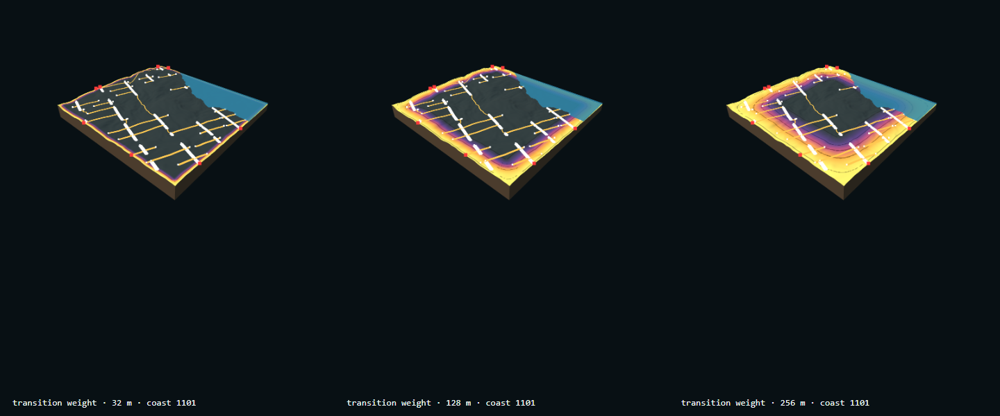
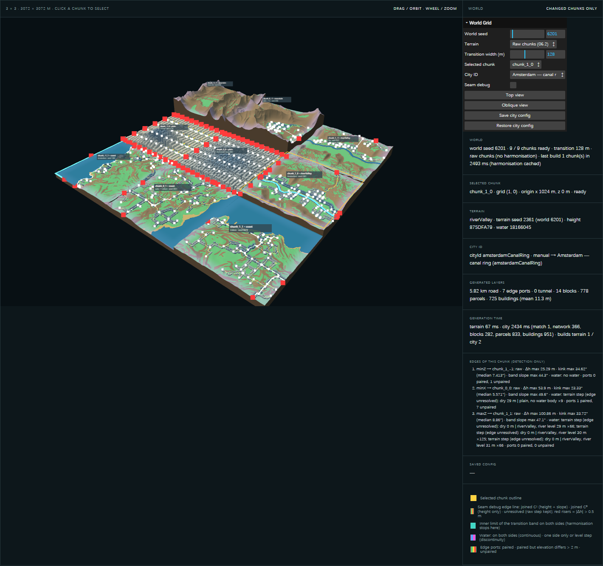

# 3 · Key Parameters

[← System Workflow](./02-system-workflow.md) · [Home](./00-midterm-review.md) · [Next: Experiments →](./04-experiments.md)

The project rule is that every public parameter must have a spatial meaning, with at most 10 per generator. The table lists each one and the page where it is set: **Tile** = single-tile page (`/experiments/seed-terrain/`), **World** = World Grid page (`/experiments/world-grid/`), **Layout** = fixed in the default world layout. Values come from `experiments/seed-terrain/config.js` and `experiments/world-grid/worldConfig.js`.

| Parameter | Value / range | Where it is set | Spatial meaning |
| --- | --- | --- | --- |
| **Chunk (tile) size** | 1024 m × 1024 m, fixed; 257 × 257 height samples (4 m apart) | fixed in code | The unit of computation and placement, roughly a district. Fixed so that tiles always meet on the same grid lines. |
| **Landform** | plain · river valley · coast · mountain | Tile; World: Layout | The site type. It decides where water may exist (ponds; one river; sea on one side; none) and the relief (plain ≈ 7 m, mountain ≈ 300 m). |
| **Seed** | 1–9999 per tile; in the world, derived from world seed + tile position + landform | Tile; World: derived | Reproducible variation of the site inside its landform rule: where the river bends, where the coast cuts in. Same seed → identical tile. |
| **World seed** | integer; default 6201 | World | One number that fixes all nine tile seeds. Changing it gives a new world with the same layout of landforms and cities. |
| **Variation** | 0–1, default 0.5 | Tile (World uses 0.5) | How strongly noise departs from the landform's base shape. |
| **Transition width** | 32–256 m in 16 m steps, default 128 m | Tile, World | The band along each tile edge where it may be adjusted to meet its neighbour. Wider bands allow gentler joins but alter more of the tile's own ground. |
| **City ID** | empty · `auto` · one of 6 DNAs | Tile ("City DNA": `auto` or a DNA), World (per tile, incl. empty) | Who builds here. *Empty* = landscape only. *Auto* = the DNA that best fits the terrain. A named DNA = forced by the designer. Changing it rebuilds only that tile's city, never its terrain. |
| **Terrain mode** | harmonised (default) · raw | World | Raw shows each tile as generated alone. Harmonised applies the edge joins inside the transition band. |

## Parameters in action

*Transition weight on coast, seed 1101, widths 32 / 128 / 256 m. The band stays inside the tile and rounds off at corners. In this single-tile view it is only a weight; heights are unchanged.*

*World seed 6201 · tile `chunk_1_0` after its City ID was set to Amsterdam. The panel shows the tile's terrain seed, resolved DNA, layer counts, and edge states.*

Inside each City DNA there are further rule values: street spacing and widths, lot size, floors, and slope limits. They are configuration, not visitor controls. Most of them are working assumptions until the city research measures them (see [Limitations](./06-limitations.md)).

[← System Workflow](./02-system-workflow.md) · [Home](./00-midterm-review.md) · [Next: Experiments →](./04-experiments.md)
