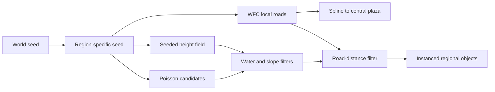

# Four Regions, One Plaza — Flavor Clash Map Prototype 0.1

> Status: **Implemented and automated-browser verified locally / personal screenshots pending**

Flavor Clash Map Prototype 0.1 is a finite procedural map study, not an infinite world and not yet a complete game. It compares four independently configurable regions—Iceland, Tokyo, Venice, and Hawaii—around one central plaza. Each region combines a seeded height field, locally constrained Wave Function Collapse roads, a spline route to the plaza, and Poisson-disk object scattering.

The focused follow-up labs are grouped under the same Flavor Clash website entry: [Iceland Terrain](../../../experiments/iceland-region/), [Road Projection](../../../experiments/road-projection/), and [Road Mesh](../../../experiments/road-mesh/). Their concise session summary is [From Regional Terrain to a Road Mesh](../../logs/2026-10-07-flavor-clash.md).

The Venice/Japan terrain-seam building work is recorded separately in [Terrain-Bound Building Scatter — Venice and Japan](./terrain-seam-building-scatter.md), including one browser capture for every adjustment step.

[Open the experiment](../../../experiments/flavor-clash-prototype/) · [Open-source sources and licenses](../../OPEN_SOURCE_SOURCES.md) · [Return to the document cover](../../README.md)

## Research Question

How can one bounded map preserve four visibly different regional identities while keeping generation deterministic, editable, and independently regenerable?

The prototype tests a separation of responsibilities: terrain creates surface character; WFC creates local road adjacency; a spline guarantees the high-level connection to the plaza; and scattering populates the remaining space. This avoids asking one algorithm to solve the entire world.

## System Flow

### How to read this map

The shared world seed branches into independent regional streams. Terrain, roads, routes, and objects are generated in a fixed order, while the filters keep scattered objects away from unsuitable surfaces and routes.

### Key insight

Determinism is most useful when it is scoped. Combining the world seed with a region ID and seed offset means Iceland can be regenerated or edited without consuming Tokyo's random sequence.

## Four Regional Studies

| Region | Terrain character | Road and object study | Current evidence status |
| --- | --- | --- | --- |
| Iceland | Pale ridged height field with visible water level | Sparse WFC road component and rock-like instances | Implemented; screenshot and personal observation pending |
| Tokyo | Low-relief urban ground | Denser modular streets and box/tower placeholders | Implemented; screenshot and personal observation pending |
| Venice | Low terrain around a visible water plane | Compact routes and block-like architectural markers | Implemented; screenshot and personal observation pending |
| Hawaii | Radial volcanic rise with noise variation | Curved plaza route and cone-shaped vegetation markers | Implemented; screenshot and personal observation pending |

The cultural labels describe a visual and systems study using abstract placeholder geometry. They do not claim architectural or cultural completeness.

## Local Roads with WFC

The road generator uses `wavefunctioncollapse`'s `SimpleTiledModel` with six local module families: empty, straight, corner, T-junction, cross, and dead end. Socket compatibility generates neighbor rules. Boundary constraints reject outward-facing roads except at one controlled edge cell facing the plaza.

Only the road component connected to that exit is rendered. A bounded retry limit prevents one contradiction from freezing the page; if every attempt fails, the region displays an explicit fallback exit and reports `Fallback` in the generation panel.

> Observation to complete after testing: Compare the visible road density, connectivity, retries, and fallback status for all four default regions. Record any seed that contradicts repeatedly.

## Main Route and Central Plaza

WFC is responsible for local modular adjacency. A Catmull–Rom spline separately connects the exit component to the central plaza. This makes the high-level connection predictable without forcing the WFC tile set to solve a cross-region navigation problem.

The prototype does not yet prove that the route supports gameplay navigation. It only establishes a visible, deterministic map connection.

## Regional Scattering

`poisson-disk-sampling` generates spaced 2D candidates within each region. A candidate is rejected if it is below the configured water level, above the maximum sampled slope, or too close to a local road or the main route. Accepted transforms are rendered through one `THREE.InstancedMesh` per region.

The objects are deliberately abstract placeholders: rock-like polyhedra, towers, blocks, and cone vegetation. Asset art, collision, interaction, and cultural validation are outside Prototype 0.1.

## Controls and Regeneration

Global controls expose the world seed, finite map size, plaza radius, shared terrain resolution, quality preset, debug layers, and optional automatic regeneration. Each region exposes visibility, seed offset, center, footprint, terrain, water, WFC, route, scatter, slope, and material parameters.

Expensive generation happens only after an edit finishes or after a Regenerate action. Each region also has its own Regenerate and Reset commands. JSON export/import and a browser-local preset preserve configuration without changing Firebase data.

## Verification Plan

The automated check must establish:

- the direct URL and homepage entry both open;
- all four regions generate and WFC reports a solution or explicit fallback;
- the same world and region seeds reproduce road and scatter signatures;
- changing Iceland's seed changes Iceland but not Tokyo, Venice, or Hawaii;
- repeated regeneration does not increase the number of region groups;
- JSON serialization contains the world and all four region configs;
- the page has no browser errors and remains usable at a mobile viewport;
- pre-existing experiment URLs still return HTTP 200.

> Observation to complete after testing: Describe which default region reads most clearly at first glance and which parameter change makes its identity clearer or weaker.

## Automated Result

The 2026-10-07 Playwright run verified deterministic regeneration, single-region independence, stable scene-root children after repeat regeneration, responsive layout, direct routing, and zero captured browser errors. All four default WFC regions solved within their retry limits.

| Region | WFC retries | Connected road cells | Scatter accepted | Scatter rejected |
| --- | ---: | ---: | ---: | ---: |
| Iceland | 4 | 7 | 21 | 46 |
| Tokyo | 3 | 3 | 153 | 44 |
| Venice | 1 | 3 | 120 | 57 |
| Hawaii | 0 | 7 | 62 | 39 |

Generation time is intentionally not treated as a stable benchmark because it varies by machine and run. The counts above are deterministic for the tested defaults.

## Screenshot Evidence To Capture

Store real captures under `docs/assets/screenshots/flavor-clash/` and replace each item only after running the page.

1. **Full default map:** show all four regions and the central plaza; record world seed and quality.
2. **Systems mode:** show WFC grids, region bounds, and road connections; record whether every region solved.
3. **Iceland detail:** show ridges, sparse objects, local roads, and the plaza route.
4. **Tokyo detail:** show the denser road modules and tower instances.
5. **Venice detail:** show the water relationship and low terrain.
6. **Hawaii detail:** show the radial rise, curved route, and scatter.
7. **Deterministic pair:** capture the same seed twice with matching output.
8. **Independent regeneration:** capture before and after changing one region while the other three remain fixed.

> Observation to complete after testing: Add the image links, visible parameters, what each image proves, and any discrepancy between the expected and observed result.

## Current Limits

- Finite four-region display only; no streaming or infinite generation.
- Abstract placeholder geometry; no production assets.
- WFC produces local road modules, not a guaranteed gameplay navigation graph.
- The spline is a visible connector, not a pathfinding or vehicle system.
- Terrain is a height field and cannot represent caves or overhangs.
- No combat, economy, resource collection, cultural simulation, or Firebase persistence is added.

## Next Question

After the four regions have been visually tested, the next focused question should be: **How can the prototype measure and improve the transition where a region's local WFC road meets its plaza spline without adding full gameplay?**
