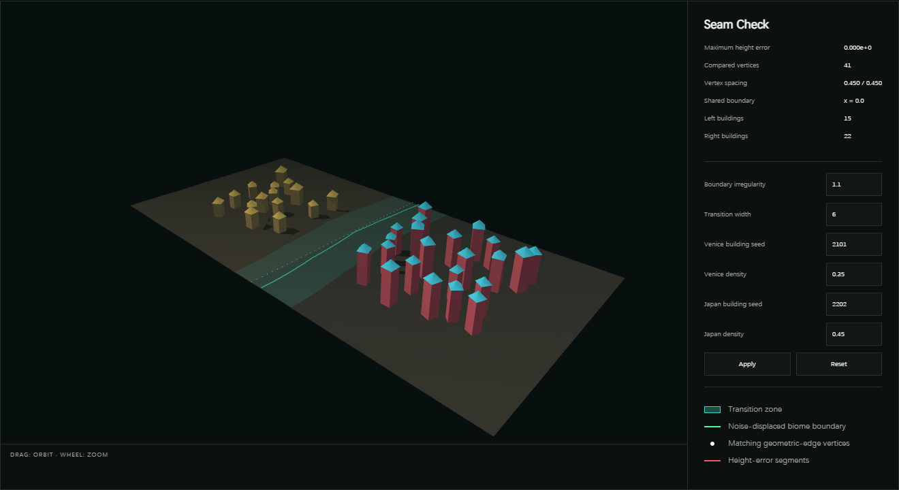
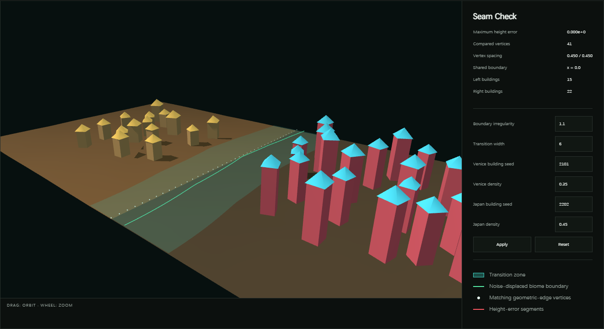
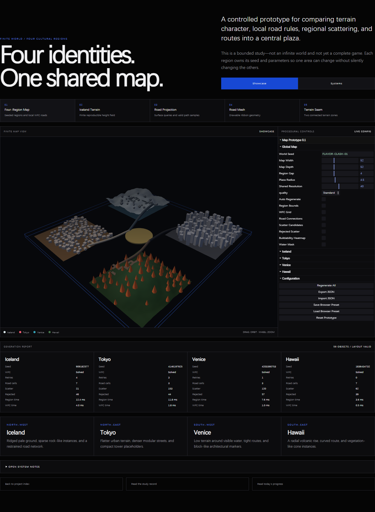
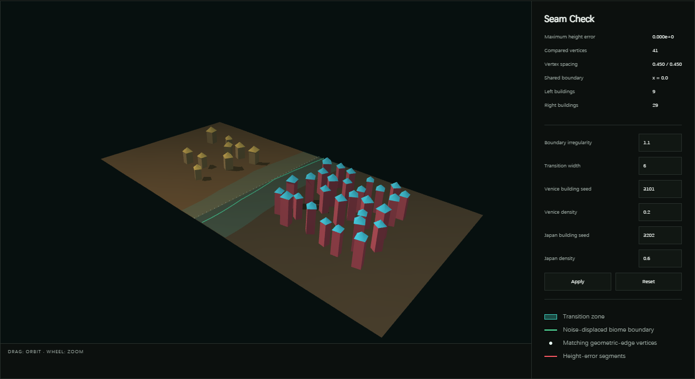
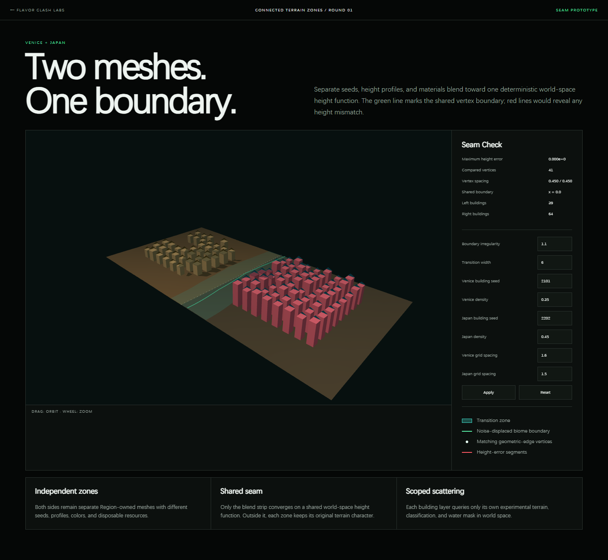
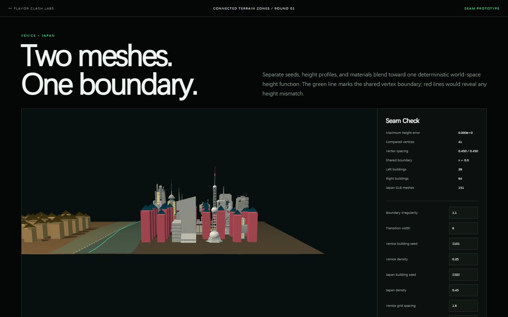
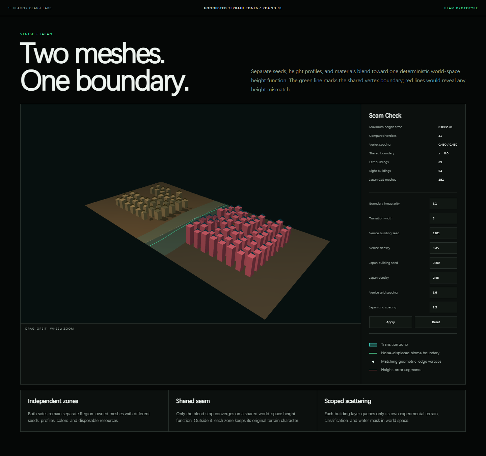
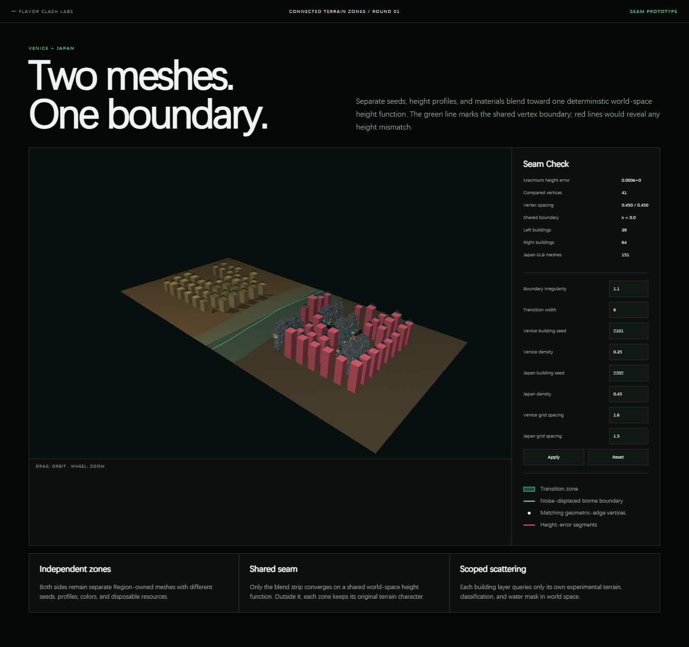

# Terrain-Bound Building Scatter — Venice and Japan

> Status: **Implemented and automated-browser verified locally / personal visual observations pending**

This focused record covers only the experimental building layers in the [Terrain Seam lab](../../../experiments/terrain-seam/). It does not redefine the original [four-region Flavor Clash world](../../../experiments/flavor-clash-prototype/) or replace its terrain, WFC roads, plaza routes, and regional object scattering.

## Research Question

How can Venice and Japan each scatter buildings against their own experimental terrain data without leaking those experimental layers into the original Flavor Clash world?

## Adjustment Sequence

| Step | Adjustment | Required proof |
| ---: | --- | --- |
| 1 | Trace terrain references, `SurfaceQuery`, scatter coordinates, and scene attachment | Each building layer references its own terrain mesh and remains parented to its own region group |
| 2 | Bind each layer to terrain classification and water mask | Every accepted point is dry and meets that terrain's buildability threshold |
| 3 | Use experimental world coordinates and height data | Every accepted instance uses the sampled world XZ and matches the queried surface height |
| 4 | Disable experimental buildings in the original world | All four original regions retain zero experimental building instances and no building controls |
| 5 | Keep both experimental layers visible and independently controlled | Venice and Japan both render, use different seeds, and respond to separate density values |

## Repeatable Capture

Run this only after a meaningful change to one of the five adjustments:

```powershell
.\.tools\node-v24.19.0-win-x64\npm.cmd run evidence:flavor-buildings
```

The command opens both relevant pages in headless Chrome or Edge, checks the same ownership and placement rules used by the focused browser tests, stores five screenshots in a timestamped directory under `docs/assets/screenshots/flavor-clash/terrain-seam-buildings/`, and appends a capture run below. It does not write personal visual conclusions.

## Captured Evidence

<!-- evidence-capture:flavor-buildings:start -->

### Capture Run — Oct 13, 2026, 1:39:31 a.m.

> Created by `npm run evidence:flavor-buildings`. Archive ID: `2026-10-13-013931-444`. Browser errors: none.

#### Step 1 — Terrain references and scene attachment


**What this shows:** The focused scene contains separate Venice and Japan terrain meshes with their building layers visible.

**Programmatic check:** Each layer's `terrainMesh` and `SurfaceQuery.terrain` reference its own region terrain; each building group is parented to its own region group.

**Recorded result:** Venice 15 instances; Japan 22 instances.

#### Step 2 — Classification and water-mask binding



**What this shows:** Both experimental meshes display their own water-mask data while accepted buildings remain visible.

**Programmatic check:** Every accepted point has `waterMask < 0.5` and meets its layer's buildability threshold.

#### Step 3 — World coordinates and sampled height



**What this shows:** An oblique close view makes the terrain-relative vertical placement and shared world-space seam visible.

**Programmatic check:** Every accepted instance Y equals its own `SurfaceQuery` height at the same world XZ coordinate.

#### Step 4 — Original Flavor Clash world isolation



**What this shows:** The original Iceland, Tokyo, Venice, and Hawaii world remains a separate four-region view.

**Programmatic check:** Original-world experimental building counts are Iceland 0, Tokyo 0, Venice 0, and Hawaii 0; no Buildings control folder is present.

#### Step 5 — Independent seeds and density controls



**What this shows:** Both layers remain visible while the form exposes separate Venice and Japan seed and density values.

**Parameters:** Venice seed 3101, density 0.2, 9 instances; Japan seed 3202, density 0.6, 29 instances.

> Observation to complete after testing:
>
> Record what changed visually between the default and custom density capture, and note any placement that still appears incorrect.

### Capture Run — Oct 13, 2026, 1:41:50 a.m.

> Created by `npm run evidence:flavor-buildings`. Archive ID: `2026-10-13-014150-517`. Browser errors: none.

#### Step 1 — Terrain references and scene attachment

*Image not preserved in the repository: `2026-10-13-014150-517/01-terrain-ownership.png` — Venice and Japan experimental terrain meshes with both building layers visible.*

**What this shows:** The focused scene contains separate Venice and Japan terrain meshes with their building layers visible.

**Programmatic check:** Each layer's `terrainMesh` and `SurfaceQuery.terrain` reference its own region terrain; each building group is parented to its own region group.

**Recorded result:** Venice 15 instances; Japan 22 instances.

#### Step 2 — Classification and water-mask binding

*Image not preserved in the repository: `2026-10-13-014150-517/02-classification-water-mask.png` — Water-mask overlay on both experimental terrain meshes with accepted buildings retained.*

**What this shows:** Both experimental meshes display their own water-mask data while accepted buildings remain visible.

**Programmatic check:** Every accepted point has `waterMask < 0.5`, slope below the zone threshold, and meets its layer's buildability threshold.

#### Step 3 — World coordinates and sampled height

*Image not preserved in the repository: `2026-10-13-014150-517/03-world-height-placement.png` — Oblique close view of Venice and Japan buildings placed on the connected terrain surfaces.*

**What this shows:** An oblique close view makes the terrain-relative vertical placement and shared world-space seam visible.

**Programmatic check:** Every accepted instance Y equals its own `SurfaceQuery` height at the same world XZ coordinate; both body and roof matrices are Y-up and uniformly scaled.

#### Step 4 — Original Flavor Clash world isolation

*Image not preserved in the repository: `2026-10-13-014150-517/04-original-world-isolation.png` — Original four-region Flavor Clash world without experimental building controls or building layers.*

**What this shows:** The original Iceland, Tokyo, Venice, and Hawaii world remains a separate four-region view.

**Programmatic check:** Original-world experimental building counts are Iceland 0, Tokyo 0, Venice 0, and Hawaii 0; no Buildings control folder is present.

#### Step 5 — Independent seeds and density controls

*Image not preserved in the repository: `2026-10-13-014150-517/05-independent-controls.png` — Venice and Japan seam controls showing independent building seeds and density values.*

**What this shows:** Both layers remain visible while the form exposes separate Venice and Japan seed and density values.

**Parameters:** Venice seed 3101, density 0.2, 9 instances; Japan seed 3202, density 0.6, 29 instances.

> Observation to complete after testing:
>
> Record what changed visually between the default and custom density capture, and note any placement that still appears incorrect.

### Capture Run — Oct 13, 2026, 1:55:13 a.m.

> Created by `npm run evidence:flavor-buildings`. Archive ID: `2026-10-13-015513-978`. Browser errors: none.

#### Step 1 — Terrain references and scene attachment

*Image not preserved in the repository: `2026-10-13-015513-978/01-terrain-ownership.png` — Venice and Japan experimental terrain meshes with both building layers visible.*

**What this shows:** The focused scene contains separate Venice and Japan terrain meshes with their building layers visible.

**Programmatic check:** Each layer's `terrainMesh` and `SurfaceQuery.terrain` reference its own region terrain; each building group is parented to its own region group.

**Recorded result:** Venice 15 instances; Japan 22 instances.

#### Step 2 — Classification and water-mask binding

*Image not preserved in the repository: `2026-10-13-015513-978/02-classification-water-mask.png` — Water-mask overlay on both experimental terrain meshes with accepted buildings retained.*

**What this shows:** Both experimental meshes display their own water-mask data while accepted buildings remain visible.

**Programmatic check:** Every accepted point has `waterMask < 0.5`, slope below the zone threshold, and meets its layer's buildability threshold.

#### Step 3 — World coordinates and sampled height

*Image not preserved in the repository: `2026-10-13-015513-978/03-world-height-placement.png` — Oblique close view of Venice and Japan buildings placed on the connected terrain surfaces.*

**What this shows:** An oblique close view makes the terrain-relative vertical placement and shared world-space seam visible.

**Programmatic check:** Every accepted instance Y equals its own `SurfaceQuery` height at the same world XZ coordinate; both body and roof matrices are Y-up and uniformly scaled.

#### Step 4 — Original Flavor Clash world isolation

*Image not preserved in the repository: `2026-10-13-015513-978/04-original-world-isolation.png` — Original four-region Flavor Clash world without experimental building controls or building layers.*

**What this shows:** The original Iceland, Tokyo, Venice, and Hawaii world remains a separate four-region view.

**Programmatic check:** Original-world experimental building counts are Iceland 0, Tokyo 0, Venice 0, and Hawaii 0; no Buildings control folder is present.

#### Step 5 — Independent seeds and density controls

*Image not preserved in the repository: `2026-10-13-015513-978/05-independent-controls.png` — Venice and Japan seam controls showing independent building seeds and density values.*

**What this shows:** Both layers remain visible while the form exposes separate Venice and Japan seed and density values.

**Parameters:** Venice seed 3101, density 0.2, 9 instances; Japan seed 3202, density 0.6, 29 instances.

> Observation to complete after testing:
>
> Record what changed visually between the default and custom density capture, and note any placement that still appears incorrect.

### Capture Run — Oct 13, 2026, 1:57:34 a.m.

> Created by `npm run evidence:flavor-buildings`. Archive ID: `2026-10-13-015734-845`. Browser errors: none.

#### Step 1 — Terrain references and scene attachment

*Image not preserved in the repository: `2026-10-13-015734-845/01-terrain-ownership.png` — Venice and Japan experimental terrain meshes with both building layers visible.*

**What this shows:** The focused scene contains separate Venice and Japan terrain meshes with their building layers visible.

**Programmatic check:** Each layer's `terrainMesh` and `SurfaceQuery.terrain` reference its own region terrain; each building group is parented to its own region group.

**Recorded result:** Venice 15 instances; Japan 22 instances.

#### Step 2 — Classification and water-mask binding

*Image not preserved in the repository: `2026-10-13-015734-845/02-classification-water-mask.png` — Water-mask overlay on both experimental terrain meshes with accepted buildings retained.*

**What this shows:** Both experimental meshes display their own water-mask data while accepted buildings remain visible.

**Programmatic check:** Every accepted point has `waterMask < 0.5`, slope below the zone threshold, and meets its layer's buildability threshold.

#### Step 3 — World coordinates and sampled height

*Image not preserved in the repository: `2026-10-13-015734-845/03-world-height-placement.png` — Oblique close view of Venice and Japan buildings placed on the connected terrain surfaces.*

**What this shows:** An oblique close view makes the terrain-relative vertical placement and shared world-space seam visible.

**Programmatic check:** Every accepted instance Y equals its own `SurfaceQuery` height at the same world XZ coordinate; both body and roof matrices are Y-up and uniformly scaled.

#### Step 4 — Original Flavor Clash world isolation

*Image not preserved in the repository: `2026-10-13-015734-845/04-original-world-isolation.png` — Original four-region Flavor Clash world without experimental building controls or building layers.*

**What this shows:** The original Iceland, Tokyo, Venice, and Hawaii world remains a separate four-region view.

**Programmatic check:** Original-world experimental building counts are Iceland 0, Tokyo 0, Venice 0, and Hawaii 0; no Buildings control folder is present.

#### Step 5 — Independent seeds and density controls

*Image not preserved in the repository: `2026-10-13-015734-845/05-independent-controls.png` — Venice and Japan seam controls showing independent building seeds and density values.*

**What this shows:** Both layers remain visible while the form exposes separate Venice and Japan seed and density values.

**Parameters:** Venice seed 3101, density 0.2, 9 instances; Japan seed 3202, density 0.6, 29 instances.

> Observation to complete after testing:
>
> Record what changed visually between the default and custom density capture, and note any placement that still appears incorrect.

### Capture Run — Oct 13, 2026, 1:48:32 p.m.

> Created by `npm run evidence:flavor-buildings`. Archive ID: `2026-10-13-134832-299`. Browser errors: none.

#### Step 1 — Terrain references and scene attachment

*Image not preserved in the repository: `2026-10-13-134832-299/01-terrain-ownership.png` — Venice and Japan experimental terrain meshes with both building layers visible.*

**What this shows:** The focused scene contains separate Venice and Japan terrain meshes with their building layers visible.

**Programmatic check:** Each layer's `terrainMesh` and `SurfaceQuery.terrain` reference its own region terrain; each building group is parented to its own region group.

**Recorded result:** Venice 15 instances; Japan 22 instances.

#### Step 2 — Classification and water-mask binding

*Image not preserved in the repository: `2026-10-13-134832-299/02-classification-water-mask.png` — Water-mask overlay on both experimental terrain meshes with accepted buildings retained.*

**What this shows:** Both experimental meshes display their own water-mask data while accepted buildings remain visible.

**Programmatic check:** Every accepted point has `waterMask < 0.5`, slope below the zone threshold, and meets its layer's buildability threshold.

#### Step 3 — World coordinates and sampled height

*Image not preserved in the repository: `2026-10-13-134832-299/03-world-height-placement.png` — Oblique close view of Venice and Japan buildings placed on the connected terrain surfaces.*

**What this shows:** An oblique close view makes the terrain-relative vertical placement and shared world-space seam visible.

**Programmatic check:** Every accepted instance Y equals its own `SurfaceQuery` height at the same world XZ coordinate; both body and roof matrices are Y-up and uniformly scaled.

#### Step 4 — Original Flavor Clash world isolation

*Image not preserved in the repository: `2026-10-13-134832-299/04-original-world-isolation.png` — Original four-region Flavor Clash world without experimental building controls or building layers.*

**What this shows:** The original Iceland, Tokyo, Venice, and Hawaii world remains a separate four-region view.

**Programmatic check:** Original-world experimental building counts are Iceland 0, Tokyo 0, Venice 0, and Hawaii 0; no Buildings control folder is present.

#### Step 5 — Independent seeds and density controls

*Image not preserved in the repository: `2026-10-13-134832-299/05-independent-controls.png` — Venice and Japan seam controls showing independent building seeds and density values.*

**What this shows:** Both layers remain visible while the form exposes separate Venice and Japan seed and density values.

**Parameters:** Venice seed 3101, density 0.2, 9 instances; Japan seed 3202, density 0.6, 29 instances.

> Observation to complete after testing:
>
> Record what changed visually between the default and custom density capture, and note any placement that still appears incorrect.
<!-- evidence-capture:flavor-buildings:end -->

## Grid Coverage Update — Oct 13, 2026



The grid now spans the complete zone bounds, including edge cells. Terrain sampling still rejects water, steep slopes, non-buildable cells, and overlaps. Default verification recorded **Venice: 39/39 valid cells (100%)** and **Japan: 64/64 valid cells (100%)**. This single overview screenshot is the only screenshot for the grid/roof update.

The current overview also verifies roofs generated from each footprint with an 8% uniform overhang and a wall-top base, preserving the existing placement and orientation.

## Japan GLB Test Asset — Oct 13, 2026



`tiny_tokyo.glb` is loaded through Three.js `GLTFLoader` as a separate Japan-scene test group; its hierarchy contains 151 mesh nodes. It is uniformly normalized to 0.3727755, kept Y-up with zero rotation, and its base is aligned to a valid Japan terrain anchor. The existing grid remains unchanged.

## Modular GLB Preparation — Oct 13, 2026



Added a shared URL-keyed GLTF source cache and instance normalizer for future building GLBs. Instances expose normalized base origin, yaw, uniform scale, and computed footprint. `tiny_tokyo.glb` remains one intact city-cluster instance; no auto-splitting or grid replacement was performed.

## Standalone Japan Replacement — Oct 13, 2026


`procedurally_made_cyberpunk_building.glb` loaded successfully and replaced Japan grid index 0 only. Its uniform scale is matched to that placeholder footprint, yaw remains the zone yaw (0), and its normalized base uses the placeholder's sampled terrain height. Tiny Tokyo, the other 63 Japan instances, Venice, and all terrain remain unchanged.

## Multi-cell Japan Replacement — Oct 13, 2026


The standalone model measures 17.396 × 38.417 source units and uses a **1×2** grid span (depth-oriented), occupying placeholders 0 and 1. Final footprint is **1.179 × 2.604** world units at uniform scale **0.0677826**; edges stay inside the 1.5-unit grid cells and the sampled footprint passes terrain validity/slope checks.

## Multi-asset Japan Test — Oct 13, 2026



The capped test placed **4** standalone GLB instances, reserving **32** grid cells. Asset selection uses the Japan building seed and configurable asset weights; only the available cyberpunk GLB was selected. Tiny Tokyo, Venice, terrain, and non-conflicting placeholders remain unchanged.

## GLB Inventory Audit — Oct 13, 2026


Audit result: 306 total nodes, 151 meshes, 151 one-mesh parent groups, 83 materials, world bounds X `[7.449, 11.449]`, Y `[0.337, 2.125]`, Z `[-1.119, 2.649]`. Names such as `houses`, `roofs`, `TinyHouse`, `RamenHouse`, poles, rails, plants, signs, and props are mixed across flat component groups. Meshes are not reliable building units; no group-ID debug view was added. Manual segmentation is required.

## Verification Boundary

Automated evidence can prove references, masks, sampled heights, parents, configured values, instance counts, and browser-console cleanliness. It cannot decide whether the building distribution looks culturally appropriate, compositionally balanced, or visually finished.

> Observation to complete after testing: Compare all five screenshots in order. Record any floating, submerged, overlapping, missing, or visually misleading building instance.

## Relevant Files

- `experiments/terrain-seam/main.js` — focused scene construction, controls, and evidence API.
- `experiments/terrain-seam/config.js` — Venice/Japan terrain and independent building settings.
- `experiments/flavor-clash-prototype/generation/BuildingScatterGenerator.js` — opt-in surface query and instanced building placement.
- `scripts/verify-terrain-seam.mjs` — focused ownership, mask, height, and control assertions.
- `scripts/verify-flavor-clash.mjs` — original-world isolation assertion.
- `scripts/capture-flavor-building-evidence.mjs` — five-step screenshot and Markdown evidence capture.
