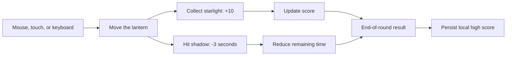

# Starlight Run — First Playable Collection Game

> Game 001 / First Prototype
## Playable Loop

### How to read this map

Follow either collision branch after movement: starlight changes score, while shadows change the remaining time. Both affect the end-of-round result.

### Key insight

The first prototype is significant because it closes a complete feedback loop and retains a best result locally, not because it contains many systems.

## Design Intent

A lightweight, 30-second collection game. The player controls a lantern, collects golden starlight before nightfall, and avoids floating shadows.

## Study Notebook Reflection

**Research question:** What is the smallest browser game that still feels like a complete, replayable loop?

**Initial hypothesis:** A short timer, one collectible, one hazard, immediate feedback, and a remembered high score would be enough to turn movement practice into a game.

**Observation:** Limiting the round to 30 seconds kept the rules readable and made restart behavior part of the design. Keyboard and pointer input widened access without changing the goal.

**What changed in my understanding:** A playable loop depends less on content volume than on clear state transitions: ready, playing, feedback, result, and replay.

**Next question:** Which single extension—difficulty pacing, sound, or additional star behavior—would improve the loop without hiding its beginner-readable structure?

## Experiment Result

**What this shows:** The complete pre-run interface presents the objective, control options, timer, score, high score, and play area.

**Why it matters:** It verifies that the first project is an executable game entry rather than only a design description.

**Parameters or conditions:** Current local version before starting a 30-second round; keyboard and pointer controls available.

## Current State

- **Version:** 0.1.0
- **Status:** first playable prototype
- **How to run:** start `./dev.cmd`, open `http://localhost:5173/#game`, or open `legacy-game.html` directly
- **Technology:** HTML, CSS, and native JavaScript Canvas
- **Dependencies:** none

## Core Systems

- Move the lantern with the mouse or touch
- Move with the arrow keys or `WASD`
- Golden starlight: +10 points
- Shadow collision: -3 seconds

## Development Log

### 2026-09-02

- Created the game project structure
- Completed the game view, scoring, countdown, and high-score storage
- Added mouse, touch, and keyboard input
- Added starlight, shadows, particles, and a responsive layout

## Next Direction

- Add more types of starlight and a combo system
- Add sound-effect and background-music controls
- Add a level difficulty curve
- Design a start menu and end-of-round statistics
