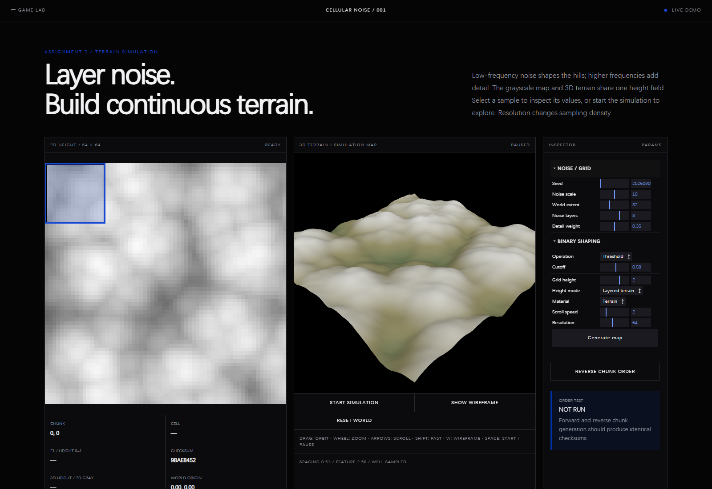

# Cellular Noise — Reproducible Patterns and Chunked Generation

> Independent exercise · Started 2026-09-09 · Current stage: continuous terrain and simulation implemented; headless-browser evidence captured, manual interactive review pending

## Study Notebook Summary

**Research question:** Can a seeded Cellular field be sampled in any order, divided into chunks, and reused by both a 2D explanation view and a 3D terrain view?

**Why I explored it:** A procedural world needs repeatable values at arbitrary coordinates. The first assignment also needed a visible connection between a noise equation, stored samples, and displaced geometry.

**Initial hypothesis:** Coordinate-hashed feature points would make F1 queries deterministic, and one shared array would keep the Canvas and Three.js results synchronized.

**Implementation and parameters:** The first five stages used binary shaping. The later terrain mode stores continuous values in a `Float32Array`, samples a fixed world extent, and layers up to four Cellular frequencies. Defaults are resolution 64, extent 32, scale 10, three layers, detail weight 0.35, and grid height 2.

**Observations:** Seeded random access and reverse chunk order reproduce the same field. Binary thresholding is useful for regions and terraces but discards gradual height variation; the continuous field produces more readable terrain while preserving determinism.

**Problems and weaker approaches:** Treating resolution as world size changed the landscape instead of only its detail. Scrolling also exposed the need to separate integer array coordinates from floating-point world coordinates. Fixed extent and separate coordinate roles replaced those weaker assumptions.

**What changed in my understanding:** Noise generation, shaping, storage, and rendering are separate stages. A deterministic raw field can support several visual interpretations without being regenerated differently for each view.

**Current result:** Six automated tests passed, the production build includes the experiment, and the screenshot below records the current default 2D/3D result. Manual interaction and responsive review remain open.

**Next question:** How can a halo-based update rule add chunkable diffusion or erosion without losing order independence?

## Experiment Result



**What this shows:** The 2D Canvas, 3D grid, world-position readout, calibration panel, and generation controls are visible together.

**Why it matters:** Distinctive light and dark regions correspond across both views, providing visual evidence that they consume the same stored field.

**Parameters or conditions:** Default layered-terrain mode; resolution 64; world extent 32; noise scale 10; three layers; detail weight 0.35; grid height 2; simulation paused at capture.

## Project Location

This experiment is stored in `experiments/cellular-noise/` and remains separate from the main React Three Fiber learning path. “Branch” refers to an independent exercise directory rather than a Git branch.

Open [the demo](./index.html) directly to view it. A future update may add a “Small Experiment / Cellular Noise” entry to the project section in `archive/portfolio/index.html`. The experiment does not modify `src/App.jsx`. The file `dist/index.html` is generated output and should not be edited directly.
## Experiment Path


### How to read this map

The path begins with reproducibility requirements, passes through the original binary representation, and then follows the documented finding that caused the continuous-height revision.

### Key insight

Cellular noise did not need replacement: binary shaping discarded its intermediate values. Keeping a `Float32Array` height map unlocked continuous terrain while preserving deterministic sampling.

## Four Requirements

- **Random access:** `sampleCell(x, y, params)` calculates one cell from its coordinates and parameters without reading an existing map.
- **Trivially parallel:** cells do not write to one another, so their calculations can be assigned directly to multiple Web Workers.
- **Deterministic and reproducible:** a 32-bit integer coordinate hash generates feature points without the internal state used by `Math.random()`.
- **Chunkable:** the map uses 16 × 16 chunks. Each chunk calculates from world coordinates, so generation order does not change the result or create seams at chunk boundaries.

Click any map cell to demonstrate random access. Select `REVERSE CHUNK ORDER` to generate all chunks in the opposite order and compare the two checksums. The blue outline shows the selected chunk, and the code panel uses a Klein Blue highlight.

## Intended Map

The map contains only black and white cells. White regions form island-like shapes. A different seed produces a different map; the same seed and parameters reproduce the same result.

| Value | 2D Display | Meaning | Future 3D Display |
| --- | --- | --- | --- |
| 0 | Black, `#000000` | Empty space or background | Black base at height 0 |
| 1 | White, `#ffffff` | Solid region or land | White cube at height 1 |

Stored map data must always be either 0 or 1. Distance calculations may use floating-point numbers, but the result must be converted to binary before it enters the map. The first version does not add water, trees, characters, or additional terrain types.

## Three Related Concepts

**Cellular noise (Worley noise):** place pseudo-random feature points and calculate the distance from each sample position to those points. `F1` is the distance to the closest point, and `F2` is the distance to the second-closest point. The distance field is not binary by itself and must be thresholded. For example, return 1 when `F1 <= radius`, otherwise return 0. See Steven Worley's original paper, [A Cellular Texture Basis Function (1996)](https://cedric.cnam.fr/~cubaud/PROCEDURAL/worley.pdf).

**Random walk:** move one point up, down, left, or right at each step and set every visited cell to 1. This creates a continuous, irregular path.

**Diffusion rule:** inspect the neighbors of black cells and give adjacent cells a probability of turning white. This is an additional discrete growth process rather than part of Worley noise itself.

The strict four-requirement foundation uses cellular noise alone. Random walks and diffusion can be evaluated later as separate structural layers.

## Demo Generation Method

1. The visible map is 64 × 64 cells, each chunk is 16 × 16 cells, and the default seed is `20260909`.
2. Divide a world coordinate by `CELL SIZE` to find its feature cell. Each feature cell independently creates one jittered feature point from `hash(seed, cellX, cellY)`.
3. A cell query searches the surrounding 5 × 5 feature cells and calculates the Euclidean distance `F1` to the closest point.
4. Return 1 when `F1 <= WHITE RADIUS`; otherwise return 0. The function reads only the seed, parameters, and world coordinates.
5. Each chunk converts its local coordinates into world coordinates and calls the same query function for every cell.
6. Canvas renders the binary grid with image smoothing disabled, preserving crisp black-and-white pixel boundaries.

Every pseudo-random value comes from a stateless 32-bit integer hash. Different chunks do not share random state and do not need to know one another's generation order.

Random walks and iterative diffusion make a cell depend on previous state, which conflicts with strict random access. A future diffusion layer can read a fixed-width halo around each chunk and use a fixed iteration count. Random walks should be cached as a separate reproducible structure layer instead of becoming part of the base noise query.

```text
seed + world coordinate → integer hash → local feature points → F1 → binary threshold
                                                                    ├─ 2D: black-and-white pixels
                                                                    └─ 3D: black base + white cubes
```

The following hand-drawn pattern illustrates the intended type of shape. It is not output from the algorithm:

```text
0000000000000000
0001110000000000
0011111000011100
0001111111111100
0000010000111000
0000111000010000
0001111100111000
0000111000010000
0000000000000000
```

## Future 2D / 3D Toggle

A clearly labeled `2D / 3D` control will default to 2D. Switching display mode must not regenerate the map or advance any random state.

- 2D: draw pure black or pure white cells from `map[row][column]` on Canvas.
- 3D: map the same array to the XZ plane. Columns correspond to X and rows correspond to Z. Place a height-1 cube with its center at Y = 0.5 for every value of 1. Values of 0 show only the base.
- 3D supports rotation and zoom. The first version uses unlit black-and-white materials with shadows, gradients, fog, antialiasing, and post-processing disabled.
- Returning to 2D must show exactly the same map data. The first version uses a direct switch without a height-transition animation.

This is a 3D presentation of a binary map, not a true volumetric 3D noise field or multilayer cave system.

## Controls

| Control | Default | Purpose |
| --- | --- | --- |
| Seed | 20260909 | Reproduce a specific map |
| Feature-cell size | 8 cells | Control feature-point density |
| Grid height | 1 | Map binary 1 to a 3D height |
| Resolution | 64 | Set the samples and vertices along each axis |
| Shaping operation | Threshold | Choose Threshold, Invert Threshold, or Band |
| Shaping slider | Mode-specific | Control cutoff, inverted cutoff, or band width |
| Generate map | Button | Recalculate from the current parameters |
| Reverse chunk order | Button | Verify that chunk order does not affect the result |
| Display | Side by side | Compare the 2D and 3D views of the same data |

Parameter changes take effect after selecting `GENERATE MAP`, making comparisons easier. A future interface may show the percentage of white cells to identify nearly all-black or all-white maps.

## Course Assignment Roadmap

**Teaching progress:** Stages 1–5 implemented and verified by the learner. The assignment roadmap is complete; conceptual review can continue before presentation or submission.

This roadmap follows a strict teaching sequence. Each stage begins with a plain-language explanation of the graphics or mathematical principle, continues with one minimal working code change with detailed Chinese line comments, and ends with a browser test and one understanding question. Work does not continue until the learner provides the required confirmation phrase from the course conversation.

### Technical Choice

Use **vanilla Three.js + Canvas 2D + lil-gui + Vite** for this assignment.

- **Three.js** renders the 3D grid, camera, material, and displaced vertices.
- **Canvas 2D** shows the exact noise samples without introducing a second rendering abstraction.
- **lil-gui** provides numerical sliders and dropdown controllers with very little interface code.
- **Vite** serves the experiment as an ES-module page and uses the Three.js package already installed in this repository.
- **OrbitControls** provides camera orbit, zoom, and pan for inspecting the terrain.

React Three Fiber remains useful for the main learning path, but this isolated assignment will use vanilla Three.js so the relationship between geometry, buffers, noise values, and rendering remains visible to a beginner.

The final page will use a side-by-side layout:

```text
┌───────────────────────┬────────────────────────┐
│ 2D NOISE VIEW         │ 3D GRID VIEW           │
│ black / white cells   │ the same cells as Y    │
│                       │ vertex heights         │
├───────────────────────┴────────────────────────┤
│ lil-gui: noise / resolution / shaping controls │
└────────────────────────────────────────────────┘
```

Both views must read one shared array. The 2D and 3D outputs must never calculate separate noise maps.

### Stage 1 — Page Layout and a Flat 3D Grid

**Principle:** A 3D plane is a collection of vertices. Each vertex has X, Y, and Z coordinates. The plane begins flat because all height values are equal. A camera projects those coordinates onto the screen.

**Minimal result:** Keep the existing experiment URL and 2D prototype, divide the workspace into 2D and 3D panels, and render one flat wireframe plane with OrbitControls. No noise is applied to the new 3D grid and no GUI controls are added yet.

**Browser test:** Open the Vite URL, confirm that both panels are visible, rotate and zoom the 3D grid, and verify that the browser console has no errors.

**Understanding question:** Why does changing the camera position alter the view without changing any grid vertex coordinates?

### Stage 2 — Sample Cellular Noise in 2D

**Principle:** Cellular noise divides space into conceptual cells, places a deterministic feature point in each cell, and measures the distance from each sample to its closest feature point. A threshold converts the continuous F1 distance into 0 or 1.

**Minimal result:** Generate a small fixed-resolution `Float32Array` of F1 values and a `Uint8Array` binary map, then draw the binary map on Canvas 2D. Use a fixed seed and no controls.

**Browser test:** Reload several times and confirm that the pattern is identical. Inspect selected samples and confirm that every stored binary value is 0 or 1.

**Understanding question:** Why can the same world coordinate be sampled again without generating all earlier coordinates first?

### Stage 3 — Apply the Shared Map to the 3D Grid

**Principle:** A height map stores one height for each grid sample. The array index `row * resolution + column` connects a 2D location to the matching 3D vertex. Changing that vertex's local Z value before rotating the plane onto the XZ ground plane produces world-space Y height.

**Minimal result:** Read the same binary array used by Canvas and set each 3D grid vertex to height 0 or 1. Recalculate normals after changing positions so lighting responds correctly.

**Browser test:** Compare distinctive white shapes in the 2D panel with raised regions in the 3D panel. Confirm that no region appears in only one view.

**Understanding question:** Why must the plane contain the same number of samples along each axis as the noise map?

### Stage 4 — Noise and Resolution Controls

**Principle:** Noise scale changes the spatial frequency of feature points. Resolution changes the number of samples and therefore the number of 3D vertices. A parameter change can update vertex heights, while a resolution change must rebuild the geometry and arrays because their lengths change.

**Minimal result:** Add lil-gui sliders for feature-cell size, white radius, height, and grid resolution. Keep the seed fixed during this stage.

**Browser test:** Move one slider at a time. Confirm that both views update together, resolution changes preserve their alignment, and repeated parameter values reproduce the same image.

**Understanding question:** Why can height update the existing geometry while resolution requires new geometry?

### Stage 5 — Shaping Dropdown, Validation, and Presentation

**Principle:** A shaping function remaps a raw noise value before display. Threshold creates islands, inverted threshold swaps solid and empty regions, and a band operation selects a narrow distance range. Each operation uses one clearly named shaping slider and still produces a binary result.

**Minimal result:** Add a dropdown with `Threshold`, `Invert Threshold`, and `Band`. Reconfigure one adjacent slider as cutoff or band width for the selected operation. Add labels, Klein Blue focus states, and a compact parameter readout.

**Browser test:** Select every shaping operation, move its slider through the full range, and confirm that 2D and 3D remain synchronized. Run the production build and check the console.

**Understanding question:** At what point in the data flow should shaping occur so the Canvas and 3D geometry always agree?

### Assignment Requirement Mapping

| Assignment Requirement | Roadmap Stage |
| --- | --- |
| Create a grid in the 3D viewport | Stage 1 |
| Create a 2D view of a noise equation | Stage 2 |
| Apply the noise map to the 3D grid | Stage 3 |
| Add sliders for noise and grid resolution | Stage 4 |
| Add shaping operations with a dropdown and slider | Stage 5 |

## Implementation and Verification

- [x] Create an independent experiment document and project entry.
- [x] Implement coordinate-hashed feature points, F1 distance, and a binary threshold.
- [x] Verify random access, order independence, reproducibility, and chunk generation.
- [ ] Design a chunkable diffusion layer with a fixed halo; treat random walks as a separate structure layer.
- [x] Add side-by-side 2D and 3D displays that share the same map data.
- [x] Add noise, height, resolution, and shaping controls with lil-gui.
- [ ] Add the experiment page to the previous website's project list.

Final implementation checks:

- Every stored cell is either 0 or 1.
- The same seed and parameters produce the same array.
- Switching between 2D and 3D does not change the array.
- Chunk generation order does not change the checksum.
- Chunk boundaries remain continuous.
- The original main-path scene still opens normally.

The original session handoff is recorded in [2026-09-09 — Five-Stage Cellular Noise Prototype](../../docs/logs/2026-09-09.md). The current Assignment 2 handoff is [2026-09-16 — Terrain Simulation and Unified Website](../../docs/logs/2026-09-16.md); the learner's new request expands the earlier single-stage scope to the requirements in the assignment screenshot.

## Stage 6 — Continuous Terrain and Simulation Map

Both views now read the same `Float32Array heightMap`. `Layered terrain` blends up to four deterministic Cellular F1 layers with decreasing feature sizes and weights. Fixed-bound normalization and smoothstep create a continuous 0–1 field. Canvas displays rounded `heightMap * 255`; Three.js displays `heightMap * gridHeight`. `Binary terraces` retains the original Threshold, Invert Threshold, and Band operations. Binary shaping controls affect that mode only. Terrain and Contour materials vary vertex colors with elevation.

Use `START SIMULATION` or Space to scroll the sampled world window over time; pause freezes its location. Arrow keys move manually; Shift moves faster. W toggles wireframe. Reset World pauses and returns to the origin. Hidden tabs automatically pause. Generation updates at up to 15 Hz; expensive parameter changes generally apply when editing finishes.

Local integer coordinates select array indices. Separate floating-point world coordinates select noise samples, fixing invalid writes during scrolling. Resolution rebuilds the geometry and arrays but preserves the fixed world extent. Defaults: resolution 64, world extent 32, noise scale 10, three layers, detail weight 0.35, grid height 2. The calibration readout compares sample spacing with the smallest feature size and suggests higher resolution when needed; it is a sampling heuristic, not a realism guarantee.

The checksum hashes height-map bytes, including fractional values. Reverse Chunk Order compares raw F1, binary, and continuous arrays. Clicking a sample shows its F1, normalized height, actual 3D elevation, grayscale value, and agreement with an independent world-coordinate query.

Run `./dev.cmd` from the project root and open `http://localhost:5173/experiments/cellular-noise/`. Vite now includes the experiment in production builds. The directory is `experiments/cellular-noise/`, not a root-level `cellular-noise/` directory.

Verification: production build and six automated noise/interaction tests passed on 2026-09-16; the development URL returned HTTP 200. DOM and renderer substitutes were used for interaction tests with actual Three.js geometry. Browser visual QA remains pending.

```powershell
.\.tools\node-v24.19.0-win-x64\node.exe --test experiments/cellular-noise/noise.test.js experiments/cellular-noise/demo.test.js
```
