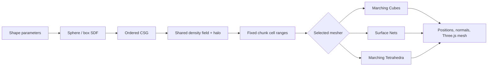
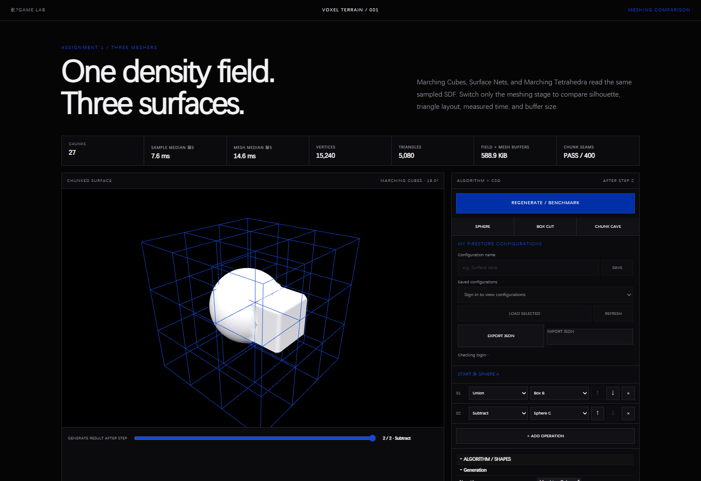
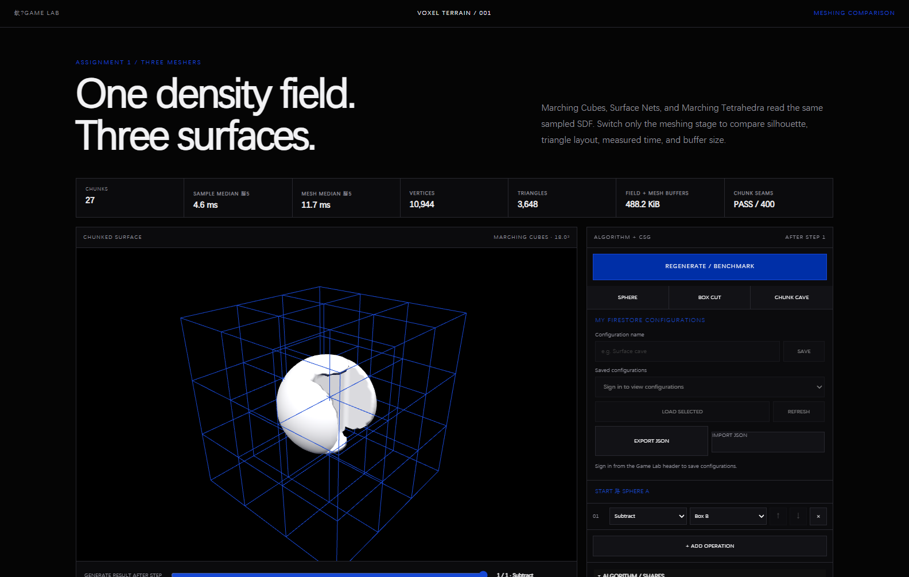
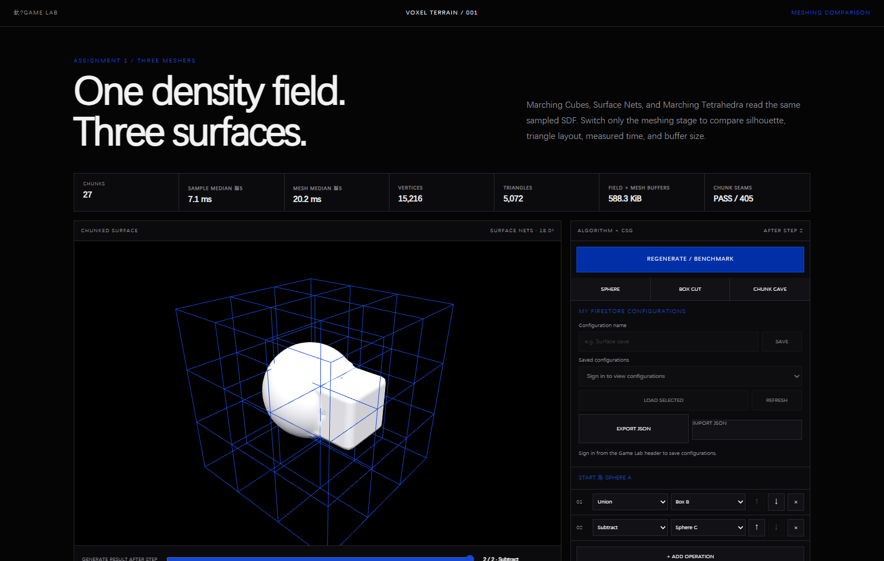

# Voxel Terrain — From Density Fields to Three Meshers

For measured results, verification, and the exact resume checklist, see the [2026-09-28 development log](../../docs/logs/2026-09-28.md).

The experiment compares Marching Cubes, basic Surface Nets, and Marching Tetrahedra using one finite density field, iso-value zero, chunk layout, SDF convention, material, lights, and camera.
## Study Notebook Summary

**Research question:** How can one finite three-dimensional scalar field support ordered shape construction, chunk ownership, and a fair comparison of three meshers?

**Why I explored it:** The earlier Cellular experiment produced a height field. It could not represent caves, overhangs, or fully volumetric Boolean operations, so the next question required density values in 3D.

**Initial hypothesis:** If every algorithm reads the same signed-distance samples, chunk descriptors, iso-value, material, lights, and camera, visible and measured differences can be attributed mainly to surface extraction.

**Implementation and parameters:** Sphere and box SDFs use the negative-inside convention. Ordered CSG builds the field; the finite world defaults to 3 chunks per axis, 12 cells per chunk, 0.5 sample spacing, and iso-value zero. A shared `Float32Array` plus one-sample halo feeds Marching Cubes, Surface Nets, or Marching Tetrahedra.

**Observations:** Ordered CSG makes sequence meaningful; finite chunk ownership makes boundary responsibility explicit; shared samples allow consistent normals and comparable mesh timings. The three algorithms produce different triangle counts and surface character from the same input.

**Problems and weaker approaches:** A single undivided world would not expose boundary ownership. Sampling separately inside each mesher duplicated work and weakened comparison. Those approaches were replaced by descriptors and a shared density field. The experiment remains synchronous and finite; editable terrain, LOD, Dual Contouring, and WFC are not implemented.

**What changed in my understanding:** Meshing is not the terrain definition. The density field defines the shape, chunking organizes responsibility, and the selected mesher only extracts a drawable boundary.

**Current result:** Code, 17 automated tests, benchmark output, seam auditing, and the screenshots below verify the implemented pipeline. A normal interactive browser review is still worth repeating before submission.

**Next question:** How should edits invalidate samples and remesh only affected chunks without changing the shared-field contract?

## Signed Distance Fields

The experiment begins with sphere and box SDFs evaluated at world-space points. Negative values are inside, positive values are outside, and zero is the surface extracted by every mesher.

## Ordered CSG

Union, intersection, subtraction, and smooth union are applied in list order. Box Cut demonstrates subtraction; Chunk Cave combines a union with a later subtraction. Intersection is implemented in the operation selector but still lacks a dedicated preserved screenshot.

## Chunk-Based Terrain

Each chunk owns a finite cell range while reading the same density buffer and halo samples. Visible bounds, deterministic descriptors, seam checks, and shared normal sampling make cross-chunk behavior inspectable.

## Three Meshing Methods

Marching Cubes, basic Surface Nets, and Marching Tetrahedra receive the same field. This isolates their extraction behavior instead of comparing results generated from different source data.

## Surface Construction Pipeline

### How to read this map

Read from shape parameters to one sampled field, then follow one of three mutually exclusive mesher branches into the same Three.js output stage.

### Key insight

The shared field is the comparison boundary: changing only the mesher makes triangle, timing, and silhouette differences attributable to extraction rather than different SDF samples.

## Experiment Evidence

### Sphere SDF result

**What this shows:** The default sphere SDF produces one closed surface while blue bounds expose the finite chunk layout.

**Why it matters:** It is the simplest visual check that world-space SDF sampling, chunk descriptors, the selected mesher, and Three.js output agree.

**Parameters or conditions:** Marching Cubes; sphere preset; iso-value 0; 3 chunks per axis; 12 cells per chunk; 0.5 spacing.

### Ordered subtraction result

**What this shows:** A rectangular cut appears in Sphere A after the ordered Subtract Box B operation.

**Why it matters:** The result makes operation order and the negative-inside CSG convention visible rather than relying only on code descriptions.

**Parameters or conditions:** Box Cut preset with Marching Cubes and the default finite chunk grid.

### Union, cave subtraction, and chunks

**What this shows:** The displayed sequence unions Box B with Sphere A and then subtracts Sphere C; the surface crosses several visible chunk boundaries.

**Why it matters:** This is the clearest combined check of ordered CSG, volumetric cavities, and chunk ownership.

**Parameters or conditions:** Chunk Cave preset; Marching Cubes; 3 × 3 × 3 chunks; 12 cells per chunk; 0.5 spacing.

### Two alternative meshers

**What this shows:** Surface Nets and Marching Tetrahedra render the same preset and chunk layout while their algorithm readouts and mesh statistics change.

**Why it matters:** Holding the field and scene constant supports a meaningful visual and measured comparison between extraction methods.

**Parameters or conditions:** Chunk Cave field; default chunks and spacing; first Surface Nets, then Marching Tetrahedra. Marching Cubes evidence appears in the preceding images.

### Missing visual evidence — CSG intersection

A dedicated intersection capture is still required. Select **Intersect Box B**, generate the result, and preserve a screenshot that includes both the operation row and the surface. Until that image exists, intersection is **Implemented** in code but its screenshot evidence is **Missing**.

## Method — Shared Sampling and Measurement

The complete finite world is sampled once into a `Float32Array` with a one-sample halo. Every chunk and algorithm reads this same buffer. The halo supports central-difference normals without private chunk sampling. Sampling and meshing each run once for warm-up and five measured times; the UI reports the median. Mesh timing includes vertex placement and normal generation. Buffer bytes include the shared density field plus position and normal buffers.

## Algorithms

- Marching Cubes reuses Three.js's exported edge and triangle tables and interpolates zero crossings.
- Surface Nets creates one averaged edge-crossing vertex for each active cell. Every sign-changing grid edge owns exactly one quad. Ownership is assigned to one cell and therefore one chunk; neighboring cell vertices are recomputed from the shared field, preventing missing or duplicated boundary faces.
- Marching Tetrahedra uses the same six-tetrahedron split in every cell. This keeps diagonals consistent across adjacent cells and chunks.

All algorithms emit non-indexed triangles. Winding is checked against the shared density gradient, and every final vertex receives a normal from the same trilinearly sampled density buffer.

## Presets

Sphere isolates the basic curved surface. Box Cut subtracts Box B from Sphere A. Chunk Cave joins Sphere A and Box B, then subtracts Sphere C centered on a default chunk boundary.

The experiment remains finite and synchronous. It does not include Dual Contouring, WFC, LOD, an infinite world, or asynchronous generation.
